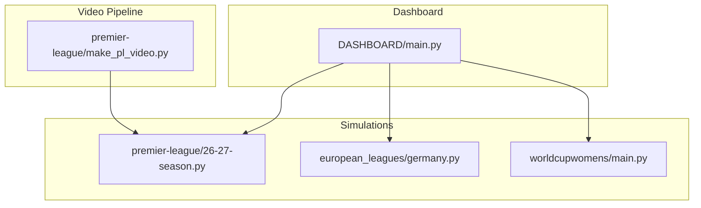
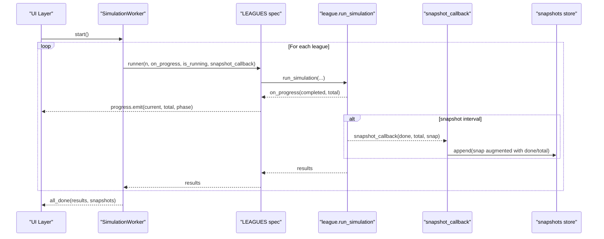
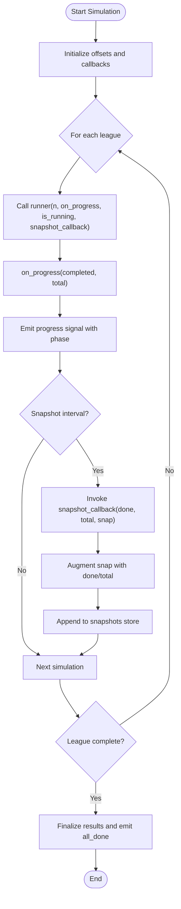
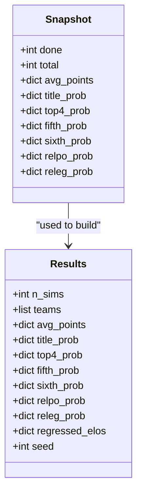
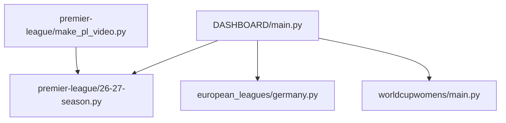

# API Reference

<cite>
**Referenced Files in This Document**   
- [DASHBOARD/main.py](file://DASHBOARD/main.py)
- [premier-league/26-27-season.py](file://premier-league/26-27-season.py)
- [european_leagues/germany.py](file://european_leagues/germany.py)
- [worldcupwomens/main.py](file://worldcupwomens/main.py)
- [premier-league/make_pl_video.py](file://premier-league/make_pl_video.py)
</cite>

## Table of Contents
1. [Introduction](#introduction)
2. [Project Structure](#project-structure)
3. [Core Components](#core-components)
4. [Architecture Overview](#architecture-overview)
5. [Detailed Component Analysis](#detailed-component-analysis)
6. [Dependency Analysis](#dependency-analysis)
7. [Performance Considerations](#performance-considerations)
8. [Troubleshooting Guide](#troubleshooting-guide)
9. [Conclusion](#conclusion)
10. [Appendices](#appendices)

## Introduction
This document provides a comprehensive API reference for the simulation runner interface, progress callback system, snapshot interface, worker thread communication, and configuration schemas used across multiple league simulations. It focuses on:

- The unified simulation runner contract expected by the dashboard.
- Progress callbacks and their event semantics.
- Snapshot data structures for capturing and replaying simulation progress.
- Worker thread integration patterns and state management.
- Configuration schemas for league specifications, simulation parameters, and visualization settings.
- Method references with parameter descriptions, return values, and exception handling.
- Programmatic usage examples and best practices for external tool integration.

The goal is to make it straightforward for developers to integrate new leagues or tools while maintaining consistent behavior across the dashboard and video export pipelines.

## Project Structure
At a high level, the project organizes simulation modules per league and a dashboard that orchestrates them:

- Dashboard orchestration and UI: DASHBOARD/main.py
- Premier League simulation module: premier-league/26-27-season.py
- European leagues (example: Germany/Bundesliga): european_leagues/germany.py
- Women’s World Cup simulation: worldcupwomens/main.py
- Video pipeline using snapshots: premier-league/make_pl_video.py

**Diagram sources**
- [DASHBOARD/main.py:56-62](file://DASHBOARD/main.py#L56-L62)
- [DASHBOARD/main.py:68-199](file://DASHBOARD/main.py#L68-L199)
- [premier-league/26-27-season.py:2696-2933](file://premier-league/26-27-season.py#L2696-L2933)
- [european_leagues/germany.py:247-327](file://european_leagues/germany.py#L247-L327)
- [worldcupwomens/main.py:412-665](file://worldcupwomens/main.py#L412-L665)
- [premier-league/make_pl_video.py:218-246](file://premier-league/make_pl_video.py#L218-L246)

**Section sources**
- [DASHBOARD/main.py:56-62](file://DASHBOARD/main.py#L56-L62)
- [DASHBOARD/main.py:68-199](file://DASHBOARD/main.py#L68-L199)

## Core Components
This section documents the core interfaces exposed by simulation modules and consumed by the dashboard and video pipeline.

### Simulation Runner Interface
All league simulation modules expose a function named run_simulation with a consistent signature pattern. The dashboard expects these parameters:

- n_sims: integer number of Monte Carlo simulations to run.
- seed: optional random seed for reproducibility.
- on_progress: optional callback invoked periodically with completed count and total sims.
- is_running: optional callable returning a boolean indicating whether the simulation should continue.
- snapshot_callback: optional callback invoked at intervals with completed, total, and a snapshot dict.

Return value:
- A dictionary containing aggregated results such as team probabilities, averages, and metadata like seed and n_sims.

Example signatures observed:
- premier-league/26-27-season.py: run_simulation(n_sims=NUM_PL_SIMS, seed=None, on_progress=None, is_running=None, snapshot_callback=None, snapshot_every=...)
- european_leagues/germany.py: run_simulation(n_sims=NUM_SIMS, seed=None, on_progress=None, is_running=None, snapshot_callback=None, snapshot_every=...)
- worldcupwomens/main.py: run_simulation(n_sims, on_progress=None, is_running=None)

Notes:
- Some modules may accept additional keyword arguments like snapshot_every to control snapshot frequency.
- The dashboard passes is_running as a lambda returning a flag; this allows graceful cancellation.

**Section sources**
- [premier-league/26-27-season.py:2696-2933](file://premier-league/26-27-season.py#L2696-L2933)
- [european_leagues/germany.py:247-327](file://european_leagues/germany.py#L247-L327)
- [worldcupwomens/main.py:412-665](file://worldcupwomens/main.py#L412-L665)

### Progress Callback System
Progress callbacks are invoked during simulation runs to update UIs and track overall completion.

Event signature:
- on_progress(completed, total)
  - completed: integer count of simulations completed so far.
  - total: integer total number of simulations requested.

Behavior:
- The dashboard wraps each league’s on_progress to emit a unified signal with current, total, and phase label.
- The worker tracks an offset across leagues to maintain a global progress bar.

State management:
- The worker maintains _running flag to support cancellation.
- The progress signal emits only when _running is true.

**Section sources**
- [DASHBOARD/main.py:284-333](file://DASHBOARD/main.py#L284-L333)
- [DASHBOARD/main.py:393-405](file://DASHBOARD/main.py#L393-L405)

### Snapshot Interface
Snapshots capture intermediate states of the simulation for visualization and video playback.

Callback signature:
- snapshot_callback(done, total, snap)
  - done: integer completed simulations.
  - total: integer total simulations.
  - snap: dictionary of metrics keyed by team or aggregate fields.

Snapshot structure (examples from Bundesliga):
- avg_points: dict mapping team to average points over simulations.
- title_prob: dict mapping team to probability of winning the league.
- top4_prob: dict mapping team to probability of finishing in top 4.
- fifth_prob: dict mapping team to probability of finishing 5th.
- sixth_prob: dict mapping team to probability of finishing 6th.
- relpo_prob: dict mapping team to probability of relegation playoff.
- releg_prob: dict mapping team to probability of automatic relegation.

Dashboard augmentation:
- The dashboard adds done and total keys to each snapshot before storing it.

Usage:
- The video pipeline consumes snapshots to render frames representing table evolution over time.

**Section sources**
- [european_leagues/germany.py:300-327](file://european_leagues/germany.py#L300-L327)
- [DASHBOARD/main.py:311-319](file://DASHBOARD/main.py#L311-L319)
- [premier-league/make_pl_video.py:218-246](file://premier-league/make_pl_video.py#L218-L246)

### Worker Thread Communication Protocols
The dashboard uses a QThread-based worker to run simulations sequentially while emitting progress signals and collecting snapshots.

Key elements:
- SimulationWorker class exposes:
  - progress signal: emits (current, total, phase).
  - all_done signal: emits (results, snapshots).
- Methods:
  - run(): iterates through LEAGUES specs, invokes each runner with callbacks, accumulates results and snapshots.
  - stop(): sets internal _running flag to False to allow cancellation.

Communication flow:
- The worker creates per-league progress and snapshot callbacks via closures.
- It updates a global offset to align progress across leagues.
- On completion, it emits final progress and aggregates results/snapshots.

**Section sources**
- [DASHBOARD/main.py:284-333](file://DASHBOARD/main.py#L284-L333)

### Configuration Schemas
League specifications define how the dashboard interacts with each simulation module.

LEAGUES schema (per league entry):
- key: string identifier for the league.
- title: display name.
- short: abbreviated name.
- subtitle: season description.
- accent: color code for UI styling.
- continent: geographic grouping.
- geo: map positioning object with lon, lat, dx, dy.
- n_sims: number of simulations to run.
- has_video: boolean indicating if video rendering is supported.
- runner: callable that accepts (n, on_progress, is_running, snapshot_callback) and returns results.
- get_teams: callable that extracts team list from results.
- top_key: metric key used to determine top contenders.
- top_fmt: format string for displaying top probabilities.
- columns: list of tuples (label, metric_key, format_string) defining table columns.

Visualization settings:
- Columns define which metrics appear in detail tables.
- Top formatting controls percentage display.
- Accent colors provide visual distinction between leagues.

**Section sources**
- [DASHBOARD/main.py:68-199](file://DASHBOARD/main.py#L68-L199)

## Architecture Overview
The architecture integrates multiple simulation modules under a single dashboard that manages progress, snapshots, and visualization.

**Diagram sources**
- [DASHBOARD/main.py:284-333](file://DASHBOARD/main.py#L284-L333)
- [DASHBOARD/main.py:68-199](file://DASHBOARD/main.py#L68-L199)
- [premier-league/26-27-season.py:2696-2933](file://premier-league/26-27-season.py#L2696-L2933)
- [european_leagues/germany.py:247-327](file://european_leagues/germany.py#L247-L327)

## Detailed Component Analysis

### Simulation Runner Implementation Patterns
Each league implements run_simulation following a common pattern:

- Accepts n_sims, seed, on_progress, is_running, snapshot_callback, and optionally snapshot_every.
- Initializes RNG and accumulators for metrics.
- Loops over simulations, updating metrics and invoking callbacks.
- Returns aggregated results including probabilities and averages.

Complexity considerations:
- Time complexity scales linearly with n_sims due to Monte Carlo iterations.
- Space complexity depends on metric storage per team and per simulation step.

Optimization opportunities:
- Batched snapshot generation to reduce overhead.
- Vectorized computations where possible (e.g., numpy operations).
- Early termination based on is_running checks.

Error handling:
- Graceful cancellation via is_running.
- Robust callback invocation with checks for None.
- Clear return structures even if no snapshots were captured.

**Section sources**
- [premier-league/26-27-season.py:2696-2933](file://premier-league/26-27-season.py#L2696-L2933)
- [european_leagues/germany.py:247-327](file://european_leagues/germany.py#L247-L327)

### Progress Callback Flow
The progress callback flow ensures smooth UI updates and accurate tracking across multiple leagues.

**Diagram sources**
- [DASHBOARD/main.py:284-333](file://DASHBOARD/main.py#L284-L333)
- [DASHBOARD/main.py:393-405](file://DASHBOARD/main.py#L393-L405)

**Section sources**
- [DASHBOARD/main.py:284-333](file://DASHBOARD/main.py#L284-L333)

### Snapshot Data Model
Snapshots represent the state of metrics at specific points during simulation execution.

Data model diagram:

**Diagram sources**
- [european_leagues/germany.py:300-327](file://european_leagues/germany.py#L300-L327)

**Section sources**
- [european_leagues/germany.py:300-327](file://european_leagues/germany.py#L300-L327)

### Video Pipeline Integration
The video pipeline consumes snapshots to generate animated table visuals.

Key aspects:
- Captures snapshots after every simulation or at intervals.
- Computes FPS and duration based on total snapshots and desired video length.
- Uses ffmpeg or OpenCV to encode frames into MP4.

Integration pattern:
- Invokes run_simulation with snapshot_callback to collect snapshots.
- Validates snapshot availability before proceeding.
- Renders frames by interpolating between snapshots for smooth transitions.

**Section sources**
- [premier-league/make_pl_video.py:218-246](file://premier-league/make_pl_video.py#L218-L246)

## Dependency Analysis
The dashboard depends on simulation modules through dynamically loaded modules and standardized runners.

Coupling and cohesion:
- Low coupling between dashboard and simulation modules via standardized run_simulation interface.
- High cohesion within each simulation module encapsulating league-specific logic.

External dependencies:
- PyQt5 for UI and threading.
- numpy for numerical operations in some simulations.
- OpenCV and ffmpeg for video encoding.

Potential circular dependencies:
- None detected; modules are loaded dynamically and do not import each other directly.

Interface contracts:
- run_simulation signature consistency ensures interoperability.
- Snapshot structure expectations maintained across modules.

**Diagram sources**
- [DASHBOARD/main.py:56-62](file://DASHBOARD/main.py#L56-L62)
- [DASHBOARD/main.py:68-199](file://DASHBOARD/main.py#L68-L199)
- [premier-league/make_pl_video.py:218-246](file://premier-league/make_pl_video.py#L218-L246)

**Section sources**
- [DASHBOARD/main.py:56-62](file://DASHBOARD/main.py#L56-L62)
- [DASHBOARD/main.py:68-199](file://DASHBOARD/main.py#L68-L199)

## Performance Considerations
- Monte Carlo simulations scale linearly with n_sims; consider adaptive sampling strategies for large runs.
- Snapshot frequency impacts memory usage; balance granularity with performance.
- Use vectorized operations (numpy) where possible to accelerate metric calculations.
- Threading model: sequential league execution avoids contention but can be parallelized per league if needed.
- Video encoding benefits from precomputed frame rates and efficient interpolation between snapshots.

[No sources needed since this section provides general guidance]

## Troubleshooting Guide
Common issues and resolutions:

- Missing snapshots:
  - Ensure snapshot_callback is provided and invoked at appropriate intervals.
  - Validate that snapshot_every is set correctly.

- Progress not updating:
  - Verify on_progress is passed to run_simulation.
  - Check is_running lambda returns True during execution.

- Video export failures:
  - Ensure required dependencies (opencv-python, numpy) are installed.
  - Validate sufficient snapshots exist for rendering.

- Cancellation not working:
  - Confirm is_running flag is checked within simulation loops.
  - Ensure stop() method is called to set _running to False.

**Section sources**
- [premier-league/make_pl_video.py:218-246](file://premier-league/make_pl_video.py#L218-L246)
- [DASHBOARD/main.py:332-333](file://DASHBOARD/main.py#L332-L333)

## Conclusion
This API reference outlines the standardized simulation runner interface, progress callback system, snapshot mechanism, and worker thread integration used across the sports analysis project. By adhering to these contracts, developers can seamlessly integrate new leagues and tools while maintaining consistent behavior across the dashboard and video pipelines. Best practices emphasize clear callback signatures, robust error handling, and efficient data structures to support scalable simulations and rich visualizations.

[No sources needed since this section summarizes without analyzing specific files]

## Appendices

### Method Reference Documentation

#### run_simulation
Parameters:
- n_sims: int, number of simulations to execute.
- seed: Optional[int], random seed for reproducibility.
- on_progress: Optional[Callable[[int, int], None]], progress callback.
- is_running: Optional[Callable[[], bool]], cancellation check.
- snapshot_callback: Optional[Callable[[int, int, dict], None]], snapshot callback.
- snapshot_every: Optional[int], frequency of snapshot generation.

Return value:
- dict containing aggregated results such as team probabilities, averages, and metadata.

Exceptions:
- May raise exceptions if callbacks are improperly implemented or if resources are insufficient.

**Section sources**
- [premier-league/26-27-season.py:2696-2933](file://premier-league/26-27-season.py#L2696-L2933)
- [european_leagues/germany.py:247-327](file://european_leagues/germany.py#L247-L327)
- [worldcupwomens/main.py:412-665](file://worldcupwomens/main.py#L412-L665)

### Code Examples and Integration Patterns

Programmatic usage example:
- Import simulation module.
- Define on_progress and snapshot_callback functions.
- Call run_simulation with desired parameters.
- Process returned results and stored snapshots.

Integration patterns:
- Dashboard-style: Use LEAGUES configuration to orchestrate multiple simulations.
- Video pipeline: Capture snapshots and render animated tables.

Best practices:
- Implement robust error handling in callbacks.
- Use consistent snapshot structures across leagues.
- Leverage is_running for responsive cancellation.

**Section sources**
- [DASHBOARD/main.py:68-199](file://DASHBOARD/main.py#L68-L199)
- [premier-league/make_pl_video.py:218-246](file://premier-league/make_pl_video.py#L218-L246)