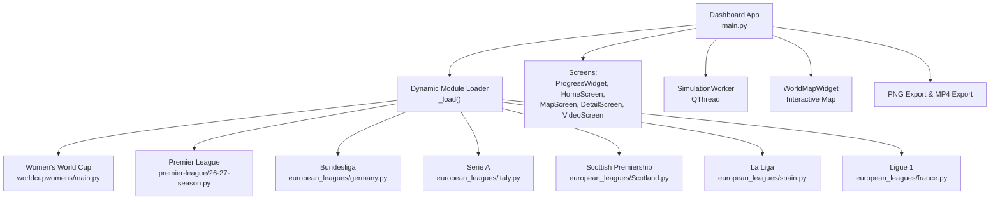
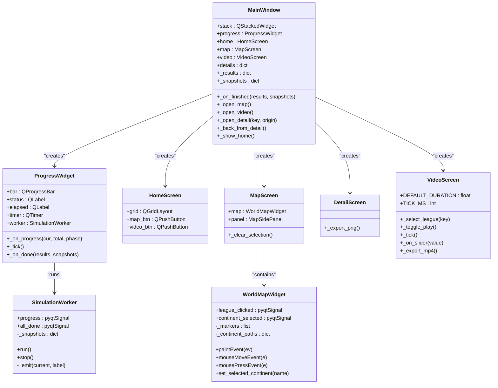
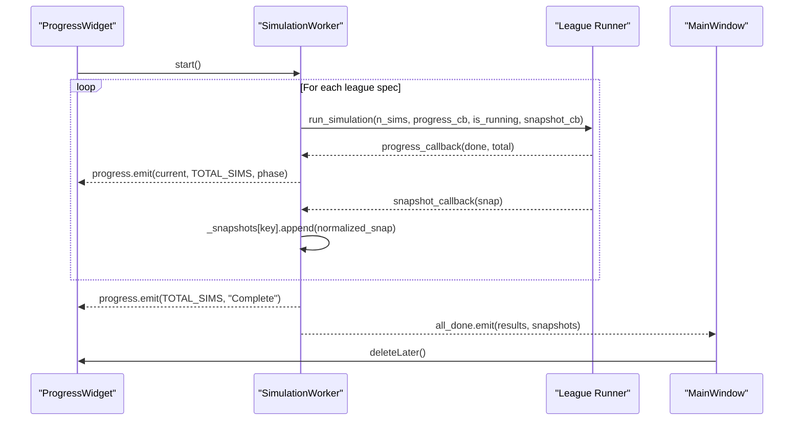
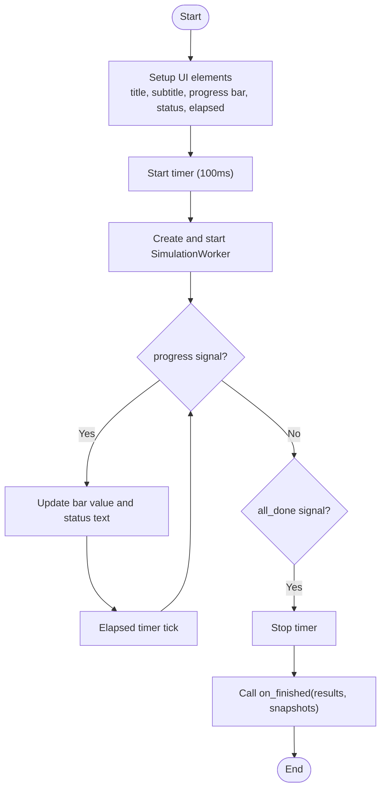
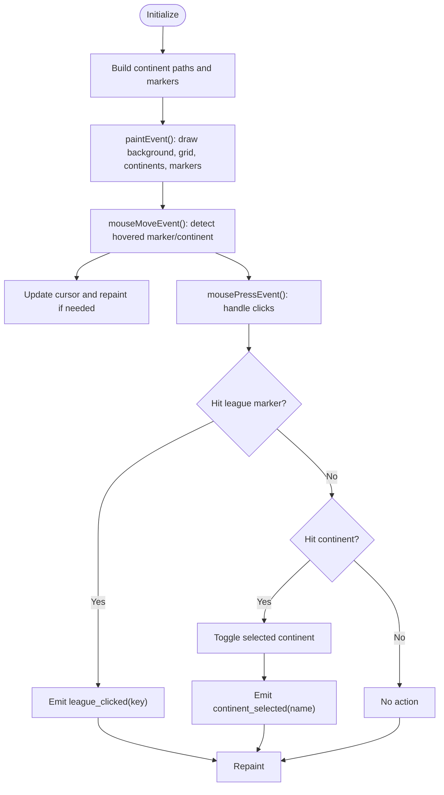
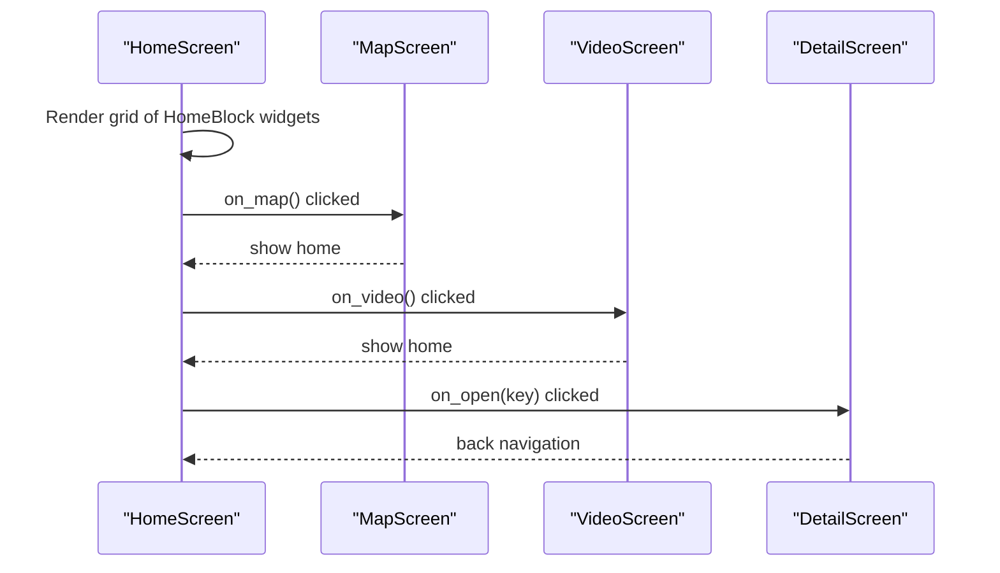
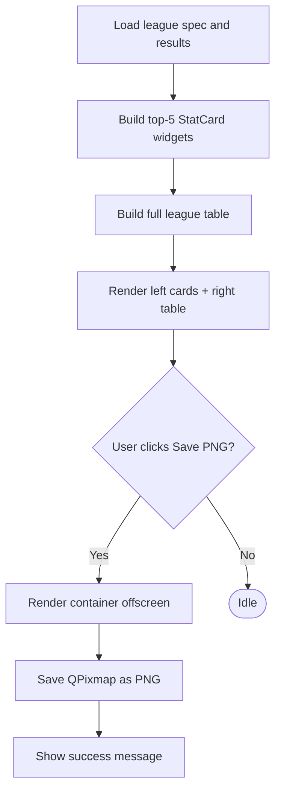
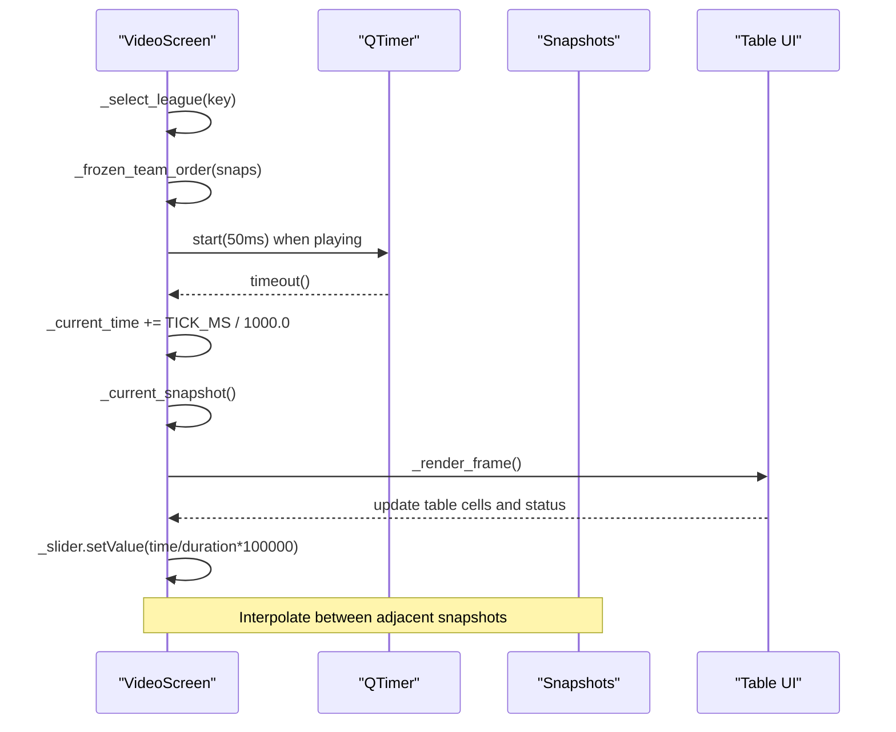
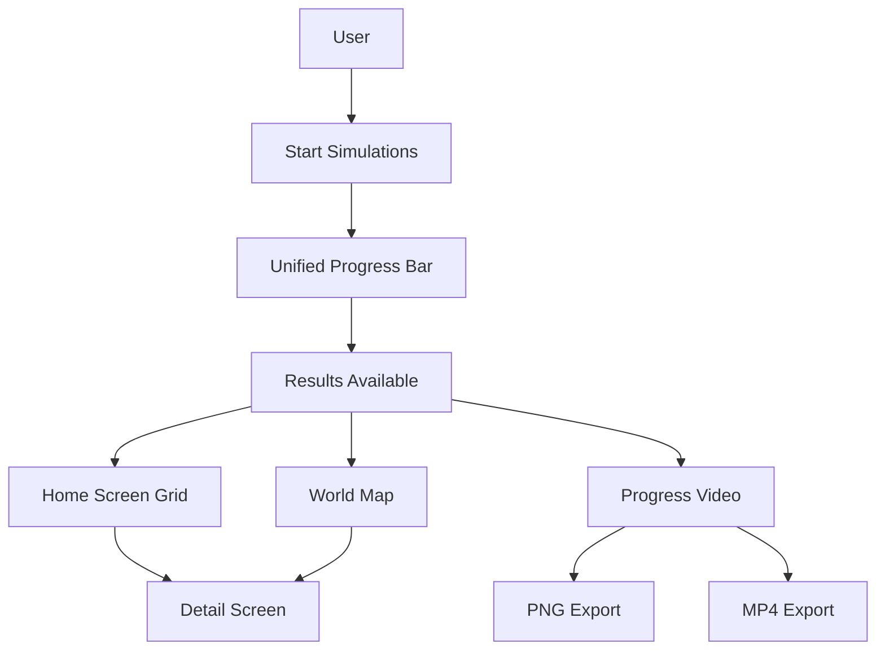
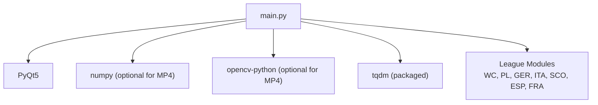

# Dashboard Application

<cite>
**Referenced Files in This Document**
- [main.py](file://DASHBOARD/main.py)
- [dashboard.spec](file://DASHBOARD/dashboard.spec)
- [build_dashboard.bat](file://DASHBOARD/build_dashboard.bat)
</cite>

## Table of Contents
1. [Introduction](#introduction)
2. [Project Structure](#project-structure)
3. [Core Components](#core-components)
4. [Architecture Overview](#architecture-overview)
5. [Detailed Component Analysis](#detailed-component-analysis)
6. [Dependency Analysis](#dependency-analysis)
7. [Performance Considerations](#performance-considerations)
8. [Troubleshooting Guide](#troubleshooting-guide)
9. [Conclusion](#conclusion)
10. [Appendices](#appendices)

## Introduction
This document describes the PyQt5-based Simulation Dashboard application that runs Monte Carlo simulations for seven sports competitions and presents their results through a multi-screen interface. The application:

- Runs all seven league simulations sequentially on a background thread while exposing a unified progress bar and live status updates.
- Captures periodic snapshots during each simulation so the video playback screen can animate how predicted tables evolve over time.
- Provides an interactive world map with clickable continents and league markers to navigate to detailed results.
- Displays statistical cards, full sortable tables, and PNG export functionality for each league’s predictions.
- Offers a 500-second animated table playback for leagues that support it, with optional MP4 export using OpenCV.

The main entry point is the dashboard application module, which dynamically loads simulation modules from sibling project directories and orchestrates UI screens via a stacked widget architecture.

## Project Structure
At runtime, the dashboard imports simulation modules from these locations relative to the repository root:

- `worldcupwomens/main.py`
- `premier-league/26-27-season.py`
- `european_leagues/germany.py`
- `european_leagues/italy.py`
- `european_leagues/Scotland.py`
- `european_leagues/spain.py`
- `european_leagues/france.py`

The build configuration packages the application as a single executable and collects required dependencies such as NumPy and tqdm. The build script creates an isolated virtual environment, installs minimal dependencies, and uses PyInstaller with specific exclusions and collection flags.

**Diagram sources**
- [main.py:37-63](file://DASHBOARD/main.py#L37-L63)
- [main.py:284-333](file://DASHBOARD/main.py#L284-L333)
- [main.py:339-410](file://DASHBOARD/main.py#L339-L410)
- [main.py:742-908](file://DASHBOARD/main.py#L742-L908)
- [main.py:1037-1266](file://DASHBOARD/main.py#L1037-L1266)
- [main.py:1517-1562](file://DASHBOARD/main.py#L1517-L1562)

**Section sources**
- [main.py:37-63](file://DASHBOARD/main.py#L37-L63)
- [dashboard.spec:1-48](file://DASHBOARD/dashboard.spec#L1-L48)
- [build_dashboard.bat:1-119](file://DASHBOARD/build_dashboard.bat#L1-L119)

## Core Components
The dashboard implements a layered architecture centered around five primary UI components and one background worker:

- **ProgressWidget**: Shows a unified progress bar, elapsed time, and phase labels while the background worker runs all simulations. It transitions to the home screen when complete.
- **HomeScreen**: Presents a 2x4 grid of clickable blocks summarizing top contenders per league, plus navigation buttons to the world map and progress video.
- **MapScreen**: Combines an interactive world map with a side panel listing leagues filtered by continent selection. Clicking a marker or row opens the detail screen.
- **DetailScreen**: Displays top-five statistical cards and a full league table with a “Save PNG” button for exporting the current view.
- **VideoScreen**: Animates league tables over captured snapshots for up to 500 seconds, supports play/pause, scrubbing, and optional MP4 export.
- **SimulationWorker**: A QThread that runs each league’s runner sequentially, emits global progress, and captures snapshots for later replay.

These components are orchestrated by a main window using a stacked widget system, enabling smooth navigation between screens without recreating heavy components unnecessarily.

**Section sources**
- [main.py:284-333](file://DASHBOARD/main.py#L284-L333)
- [main.py:339-410](file://DASHBOARD/main.py#L339-L410)
- [main.py:1462-1511](file://DASHBOARD/main.py#L1462-L1511)
- [main.py:968-1004](file://DASHBOARD/main.py#L968-L1004)
- [main.py:1517-1562](file://DASHBOARD/main.py#L1517-L1562)
- [main.py:1037-1266](file://DASHBOARD/main.py#L1037-L1266)

## Architecture Overview
The application follows a clear separation of concerns:

- **Data Loading Layer**: Dynamically imports simulation modules and defines league specifications including runners, team getters, column definitions, and geographic metadata.
- **Background Processing Layer**: SimulationWorker executes league runners sequentially, aggregates results, and records snapshots.
- **UI Layer**: ProgressWidget, HomeScreen, MapScreen, DetailScreen, and VideoScreen render state and handle user interactions.
- **Export Layer**: PNG export renders detail views offscreen; MP4 export renders frames into a video file using OpenCV.

**Diagram sources**
- [main.py:1568-1633](file://DASHBOARD/main.py#L1568-L1633)
- [main.py:339-410](file://DASHBOARD/main.py#L339-L410)
- [main.py:284-333](file://DASHBOARD/main.py#L284-L333)
- [main.py:1462-1511](file://DASHBOARD/main.py#L1462-L1511)
- [main.py:968-1004](file://DASHBOARD/main.py#L968-L1004)
- [main.py:742-908](file://DASHBOARD/main.py#L742-L908)
- [main.py:1517-1562](file://DASHBOARD/main.py#L1517-L1562)
- [main.py:1037-1266](file://DASHBOARD/main.py#L1037-L1266)

## Detailed Component Analysis

### SimulationWorker Background Thread System
The worker encapsulates sequential execution of all seven league simulations. For each league:

- It initializes a snapshot list keyed by league identifier.
- Wraps the league’s progress callback to emit a global progress signal across all leagues.
- Wraps the snapshot callback to append normalized snapshots containing done/total counts and computed statistics.
- Aggregates final results and emits them along with all snapshots upon completion.

**Diagram sources**
- [main.py:284-333](file://DASHBOARD/main.py#L284-L333)
- [main.py:339-410](file://DASHBOARD/main.py#L339-L410)
- [main.py:1582-1588](file://DASHBOARD/main.py#L1582-L1588)

**Section sources**
- [main.py:284-333](file://DASHBOARD/main.py#L284-L333)

### ProgressWidget and Unified Progress Bar
ProgressWidget manages:

- A styled progress bar ranging from zero to the total number of simulations across all leagues.
- Real-time status text showing the current phase, count, and percentage.
- An elapsed time label updated every 100 milliseconds.
- Automatic transition to the home screen once the worker completes.

**Diagram sources**
- [main.py:339-410](file://DASHBOARD/main.py#L339-L410)

**Section sources**
- [main.py:339-410](file://DASHBOARD/main.py#L339-L410)

### Interactive World Map Visualization
WorldMapWidget renders:

- A gradient background with latitude/longitude grid lines.
- Continents drawn as QPainterPath polygons, supporting hover and selection states.
- League markers with leader team names and probabilities, connected to dots via dashed lines.
- Mouse tracking for hover effects and click handling to either select a league or toggle continent filtering.

**Diagram sources**
- [main.py:742-908](file://DASHBOARD/main.py#L742-L908)

**Section sources**
- [main.py:742-908](file://DASHBOARD/main.py#L742-L908)

### HomeScreen Navigation Flow
HomeScreen provides:

- A 2x4 grid of HomeBlock widgets, each representing a league with preview lines of top contenders.
- Navigation buttons to open the world map and the progress video screen.
- Footer text summarizing the number of competitions and total simulations.

**Diagram sources**
- [main.py:1462-1511](file://DASHBOARD/main.py#L1462-L1511)
- [main.py:1568-1633](file://DASHBOARD/main.py#L1568-L1633)

**Section sources**
- [main.py:1462-1511](file://DASHBOARD/main.py#L1462-L1511)

### DetailScreen Result Visualization
DetailScreen displays:

- Top-five statistical cards based on the league’s probability metric.
- A full league table with alternating row colors and styled headers.
- A “Save PNG” button that renders the current view offscreen and saves it as a high-resolution PNG image.

**Diagram sources**
- [main.py:1517-1562](file://DASHBOARD/main.py#L1517-L1562)
- [main.py:660-687](file://DASHBOARD/main.py#L660-L687)

**Section sources**
- [main.py:1517-1562](file://DASHBOARD/main.py#L1517-L1562)
- [main.py:660-687](file://DASHBOARD/main.py#L660-L687)

### VideoScreen Animated Playback
VideoScreen animates league tables over captured snapshots:

- Supports selecting among leagues that have at least two snapshots.
- Uses linear interpolation between snapshots to produce smooth transitions.
- Freezes team row order based on the final snapshot to prevent mid-playback row swapping.
- Provides play/pause controls, a slider for scrubbing, and a time label indicating simulation progress.
- Exports an MP4 video by rendering frames offscreen and writing them via OpenCV.

**Diagram sources**
- [main.py:1037-1266](file://DASHBOARD/main.py#L1037-L1266)

**Section sources**
- [main.py:1037-1266](file://DASHBOARD/main.py#L1037-L1266)

### Conceptual Overview
The dashboard integrates simulation data, background processing, and rich visualization into a cohesive user experience. Users initiate simulations, observe real-time progress, explore results via a world map, inspect detailed statistics, and optionally export visualizations or animations.

[No sources needed since this diagram shows conceptual workflow, not actual code structure]

## Dependency Analysis
The dashboard depends on:

- **PyQt5**: GUI framework providing widgets, threading signals, painting, and event handling.
- **NumPy and OpenCV**: Optional dependencies for MP4 export; ImportError is handled gracefully with guidance to install required packages.
- **tqdm**: Included in packaging but not directly referenced in the analyzed code; likely used by underlying simulation modules.
- **Dynamic simulation modules**: Loaded at runtime from sibling directories, requiring correct folder placement next to the executable.

**Diagram sources**
- [main.py:15-31](file://DASHBOARD/main.py#L15-L31)
- [main.py:1373-1380](file://DASHBOARD/main.py#L1373-L1380)
- [dashboard.spec:1-48](file://DASHBOARD/dashboard.spec#L1-L48)

**Section sources**
- [main.py:15-31](file://DASHBOARD/main.py#L15-L31)
- [main.py:1373-1380](file://DASHBOARD/main.py#L1373-L1380)
- [dashboard.spec:1-48](file://DASHBOARD/dashboard.spec#L1-L48)

## Performance Considerations
- **Sequential Simulation Execution**: Running leagues sequentially ensures predictable memory usage and simplifies progress aggregation, but total runtime scales with the sum of all league simulations.
- **Snapshot Capture Frequency**: Snapshot frequency is determined by the underlying league runners; excessive snapshots may increase memory consumption and slow down video export.
- **UI Responsiveness**: The worker emits progress signals on the main thread via Qt signals, keeping the UI responsive. The video playback uses a 50-millisecond timer to balance smoothness and CPU usage.
- **Rendering Overhead**: PNG export renders offscreen containers and converts to images; MP4 export iterates frames and writes to disk, which can be I/O bound.

[No sources needed since this section provides general guidance]

## Troubleshooting Guide
Common issues and resolutions:

- **Missing Dependencies for MP4 Export**: If OpenCV or NumPy is not installed, the application raises a RuntimeError instructing users to install `opencv-python` and `numpy`. Install them in the same environment as the dashboard.
- **OpenCV Writer Failure**: If the output file cannot be opened, ensure ffmpeg is available or try a different path. The error message guides users to adjust the environment.
- **Executable Not Finding League Folders**: When running the packaged executable, place the league folders (`european_leagues`, `premier-league`, `worldcupwomens`) next to `dashboard.exe` or run from the source tree.
- **Build Failures**: Use the provided build script to create a clean virtual environment and install only necessary dependencies. Ensure Python 3.11 is available or the script falls back to default Python.

**Section sources**
- [main.py:1373-1380](file://DASHBOARD/main.py#L1373-L1380)
- [main.py:1402-1407](file://DASHBOARD/main.py#L1402-L1407)
- [build_dashboard.bat:105-119](file://DASHBOARD/build_dashboard.bat#L105-L119)

## Conclusion
The Simulation Dashboard provides a comprehensive, interactive platform for exploring Monte Carlo predictions across multiple sports leagues. Its architecture cleanly separates background computation, data loading, and UI presentation, while offering rich visualization features including an interactive map, statistical cards, sortable tables, and animated playback. The application is designed for extensibility, allowing new leagues to be integrated by adding simulation modules and updating the league specification list.

[No sources needed since this section summarizes without analyzing specific files]

## Appendices

### User Interaction Patterns
- **Starting Simulations**: Launch the app; the progress screen automatically starts the worker and displays real-time progress.
- **Navigating Results**: From the home screen, click any league block to open its detail view, or use the world map to filter by continent and select a league.
- **Exploring History**: Use the progress video screen to watch how predicted tables evolve over simulations, scrubbing with the slider or playing automatically.
- **Exporting Visuals**: From the detail screen, save PNG images of the current view; from the video screen, export an MP4 animation.

**Section sources**
- [main.py:339-410](file://DASHBOARD/main.py#L339-L410)
- [main.py:1462-1511](file://DASHBOARD/main.py#L1462-L1511)
- [main.py:1517-1562](file://DASHBOARD/main.py#L1517-L1562)
- [main.py:1037-1266](file://DASHBOARD/main.py#L1037-L1266)

### Customization Options
- **League Specifications**: Modify the `LEAGUES` list to add new leagues, change columns, probabilities, geographic positions, and whether they support video playback.
- **Styling**: CSS-like stylesheets define colors, fonts, and borders for tables, progress bars, and buttons. Adjust these strings to rebrand the interface.
- **Playback Duration**: Change `DEFAULT_DURATION` in VideoScreen to alter the length of the animated playback.
- **Export Settings**: Adjust scale factors in PNG export and frame rate/resolution in MP4 export to balance quality and performance.

**Section sources**
- [main.py:68-199](file://DASHBOARD/main.py#L68-L199)
- [main.py:207-243](file://DASHBOARD/main.py#L207-L243)
- [main.py:1037-1040](file://DASHBOARD/main.py#L1037-L1040)
- [main.py:660-687](file://DASHBOARD/main.py#L660-L687)
- [main.py:1373-1456](file://DASHBOARD/main.py#L1373-L1456)