# Interactive World Map Visualization

<cite>
**Referenced Files in This Document**
- [main.py](file://DASHBOARD/main.py)
</cite>

## Table of Contents
1. [Introduction](#introduction)
2. [Project Structure](#project-structure)
3. [Core Components](#core-components)
4. [Architecture Overview](#architecture-overview)
5. [Detailed Component Analysis](#detailed-component-analysis)
6. [Dependency Analysis](#dependency-analysis)
7. [Performance Considerations](#performance-considerations)
8. [Troubleshooting Guide](#troubleshooting-guide)
9. [Conclusion](#conclusion)

## Introduction
This document explains the interactive world map visualization system used to display continents and league markers with probability information. The core component is a custom widget that renders geographic shapes using precise latitude/longitude coordinates, transforms them into screen coordinates, and provides interactive features such as continent selection, hover feedback, and clickable league markers. It also includes responsive layout logic to maintain proper aspect ratios during window resizing.

## Project Structure
The visualization is implemented within a single dashboard module that integrates multiple simulation backends (e.g., Premier League, La Liga, Bundesliga, Serie A, Ligue 1, Scottish Premiership, Women’s World Cup). The world map widget lives alongside other UI screens (home, detail, video) and communicates via Qt signals.

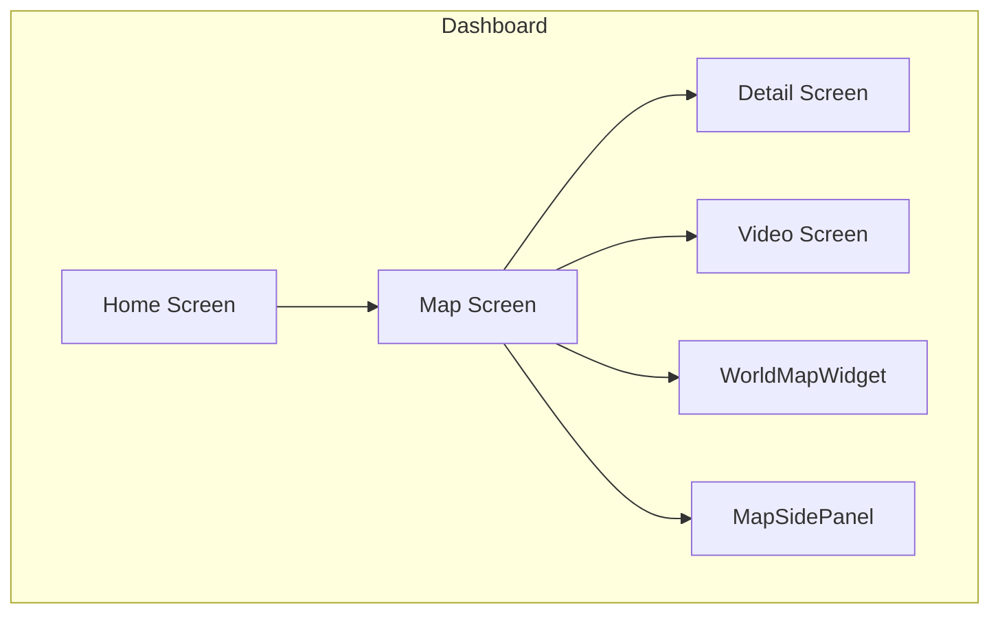

**Diagram sources**
- [main.py:1590-1602](file://DASHBOARD/main.py#L1590-L1602)
- [main.py:913-915](file://DASHBOARD/main.py#L913-L915)

**Section sources**
- [main.py:1-13](file://DASHBOARD/main.py#L1-L13)
- [main.py:1590-1602](file://DASHBOARD/main.py#L1590-L1602)

## Core Components
- WorldMapWidget: Renders continents and league markers; handles mouse interactions and selection state.
- Coordinate transformation: Converts latitude/longitude to screen coordinates within a computed map rectangle.
- Continent geometry: Predefined polygons for North America, South America, Europe, Africa, Asia, and Oceania.
- League marker system: Displays clickable markers with team leader names and probability percentages.
- Responsive design: Maintains aspect ratio and adapts to window resizing.

Key responsibilities:
- Build QPainterPath objects from geographic coordinates.
- Compute a centered map rectangle with fixed aspect ratio.
- Transform lat/lon to screen points for drawing and hit testing.
- Provide visual feedback on hover and selection.
- Emit signals when a league marker or continent is clicked.

**Section sources**
- [main.py:689-907](file://DASHBOARD/main.py#L689-L907)

## Architecture Overview
The world map visualization is part of a larger dashboard flow. The MapScreen hosts both the WorldMapWidget and a side panel for filtering by continent. Signals connect user interactions to application behavior (e.g., opening details for a selected league).

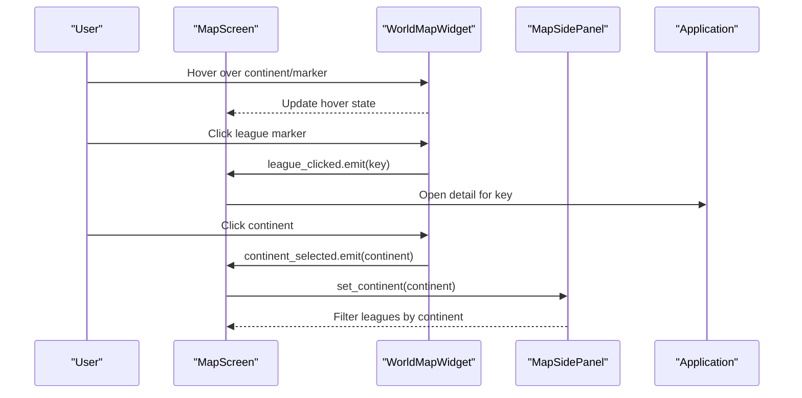

**Diagram sources**
- [main.py:883-904](file://DASHBOARD/main.py#L883-L904)
- [main.py:1001-1003](file://DASHBOARD/main.py#L1001-L1003)

## Detailed Component Analysis

### WorldMapWidget Class
WorldMapWidget is a QWidget subclass responsible for rendering the world map and handling interactions.

Responsibilities:
- Initialize state for hover and selection.
- Build continent paths and league markers.
- Paint the background, grid lines, continents, and markers.
- Handle mouse events for hover and click.
- Respond to resize events by rebuilding geometry.

Key methods:
- _map_rect(): Computes a centered rectangle with a fixed aspect ratio inside the widget bounds.
- _to_screen(lon, lat, rect): Transforms geographic coordinates to screen coordinates.
- _build_geometry(): Builds QPainterPath objects for continents and computes marker boxes.
- paintEvent(): Draws the map, grid, continents, and markers with visual feedback.
- _hit_marker(pos), _hit_continent(pos): Hit-testing utilities for interaction.
- set_selected_continent(name): Updates selection state and triggers repaint.
- mouseMoveEvent(), leaveEvent(), mousePressEvent(): Interaction handlers.
- resizeEvent(): Rebuilds geometry on size changes.

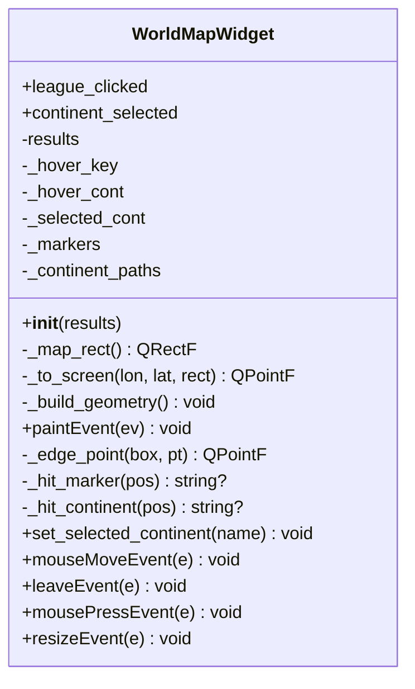

**Diagram sources**
- [main.py:742-907](file://DASHBOARD/main.py#L742-L907)

**Section sources**
- [main.py:742-907](file://DASHBOARD/main.py#L742-L907)

### Geographic Coordinates and Continents
Continents are defined as lists of polygons using latitude/longitude pairs. Each polygon represents a contiguous landmass; some continents have multiple polygons (e.g., islands).

Continents covered:
- North America
- South America
- Europe
- Africa
- Asia
- Oceania

These coordinates are transformed to screen space using the coordinate transformation method and then rendered as filled paths.

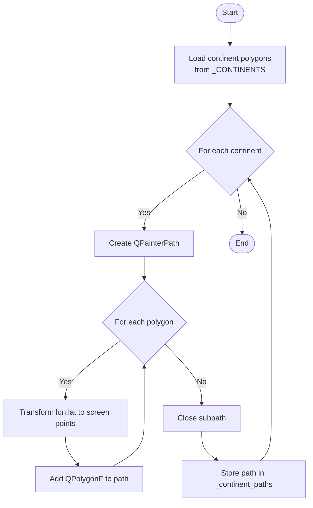

**Diagram sources**
- [main.py:692-735](file://DASHBOARD/main.py#L692-L735)
- [main.py:777-785](file://DASHBOARD/main.py#L777-L785)

**Section sources**
- [main.py:692-735](file://DASHBOARD/main.py#L692-L735)
- [main.py:777-785](file://DASHBOARD/main.py#L777-L785)

### Coordinate Transformation System (_to_screen)
The _to_screen method converts latitude/longitude to screen coordinates within the map rectangle. It maps longitude from [-180, 180] to horizontal pixel positions and latitude from [-90, 90] to vertical pixel positions.

Behavior:
- Horizontal mapping: (lon + 180) / 360 * width
- Vertical mapping: (90 - lat) / 180 * height
- Returns a QPointF relative to the top-left corner of the map rectangle

This ensures consistent placement across different widget sizes while preserving geographic proportions.

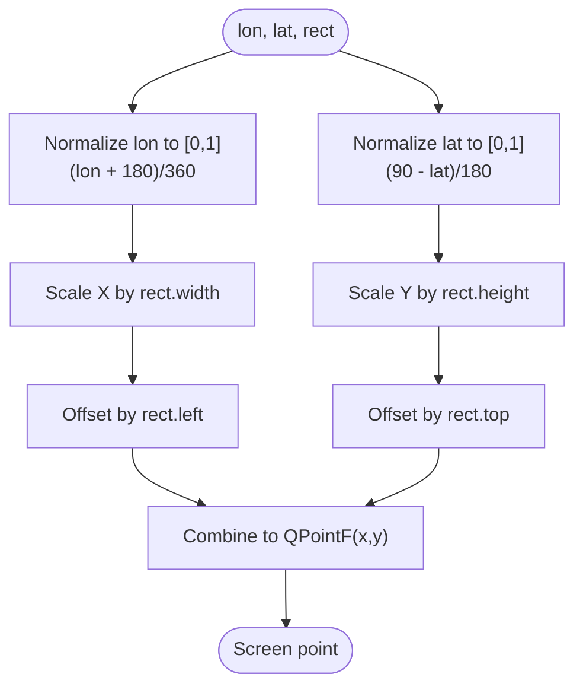

**Diagram sources**
- [main.py:773-775](file://DASHBOARD/main.py#L773-L775)

**Section sources**
- [main.py:773-775](file://DASHBOARD/main.py#L773-L775)

### League Marker System
League markers display clickable indicators for each competition with team leader information and probability percentages.

Components:
- LEAGUES: Configuration list defining each competition’s metadata, including geographic position (lon, lat) and label offsets (dx, dy).
- Marker box calculation: Uses font metrics to compute text dimensions and centers labels around the projected dot.
- Visual elements: Dashed connector line from dot to label box, colored ellipse for the marker, and rounded label box with title and value text.
- Global marker: Special handling for the Women’s World Cup (“wc”) with distinct styling.

Interaction:
- Markers are hit-tested by checking if the mouse position falls within the label box or near the dot.
- Hovering highlights the marker and changes cursor to pointing hand.
- Clicking emits a signal with the league key to open the detail view.

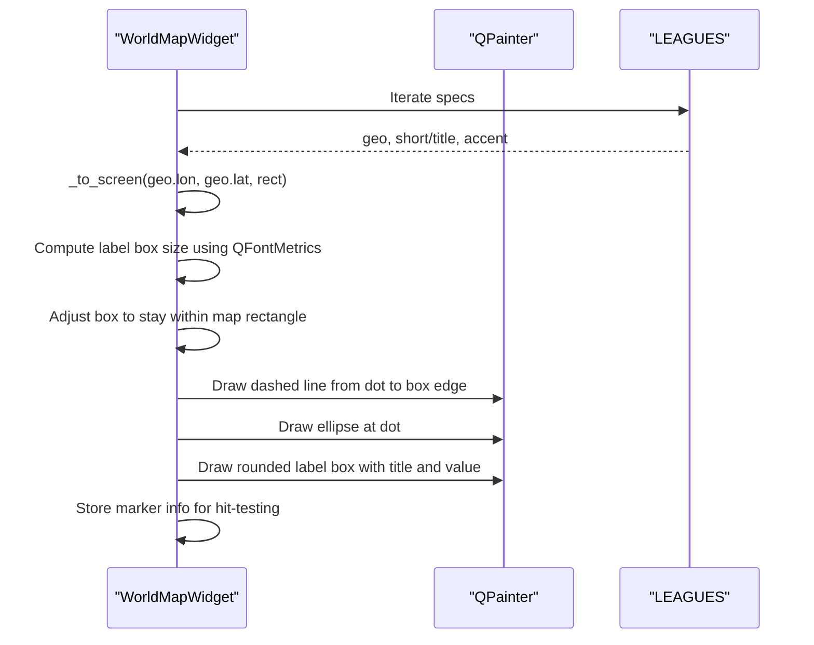

**Diagram sources**
- [main.py:68-199](file://DASHBOARD/main.py#L68-L199)
- [main.py:786-804](file://DASHBOARD/main.py#L786-L804)
- [main.py:836-858](file://DASHBOARD/main.py#L836-L858)

**Section sources**
- [main.py:68-199](file://DASHBOARD/main.py#L68-L199)
- [main.py:786-804](file://DASHBOARD/main.py#L786-L804)
- [main.py:836-858](file://DASHBOARD/main.py#L836-L858)

### Continent Selection Functionality
Continent selection allows users to filter leagues by continent and receive visual feedback.

Features:
- Hovering over a continent highlights it with a distinct fill color and shows a chip label indicating the hovered continent name.
- Clicking toggles selection: clicking a selected continent clears selection; clicking another selects it.
- Selection state is stored in _selected_cont and emitted via continent_selected signal.
- Side panel reacts to selection to filter leagues accordingly.

Visual feedback:
- Filled path color changes for hovered/selected continents.
- A small chip appears at the top-left of the map showing the hovered continent name.

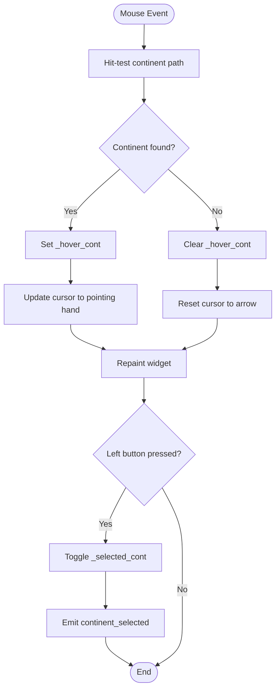

**Diagram sources**
- [main.py:823-835](file://DASHBOARD/main.py#L823-L835)
- [main.py:874-881](file://DASHBOARD/main.py#L874-L881)
- [main.py:883-904](file://DASHBOARD/main.py#L883-L904)

**Section sources**
- [main.py:823-835](file://DASHBOARD/main.py#L823-L835)
- [main.py:874-881](file://DASHBOARD/main.py#L874-L881)
- [main.py:883-904](file://DASHBOARD/main.py#L883-L904)

### Mouse Interaction Handling
Mouse interactions include hovering over continents and clicking on league markers.

Hover handling:
- Tracks current hovered marker key and continent name.
- Changes cursor to pointing hand when over interactive elements.
- Triggers repaint to update visual feedback.

Click handling:
- Left-click on a league marker emits league_clicked signal with the league key.
- Left-click on a continent toggles selection and emits continent_selected signal.

Leave handling:
- Clears hover state when the mouse leaves the widget.

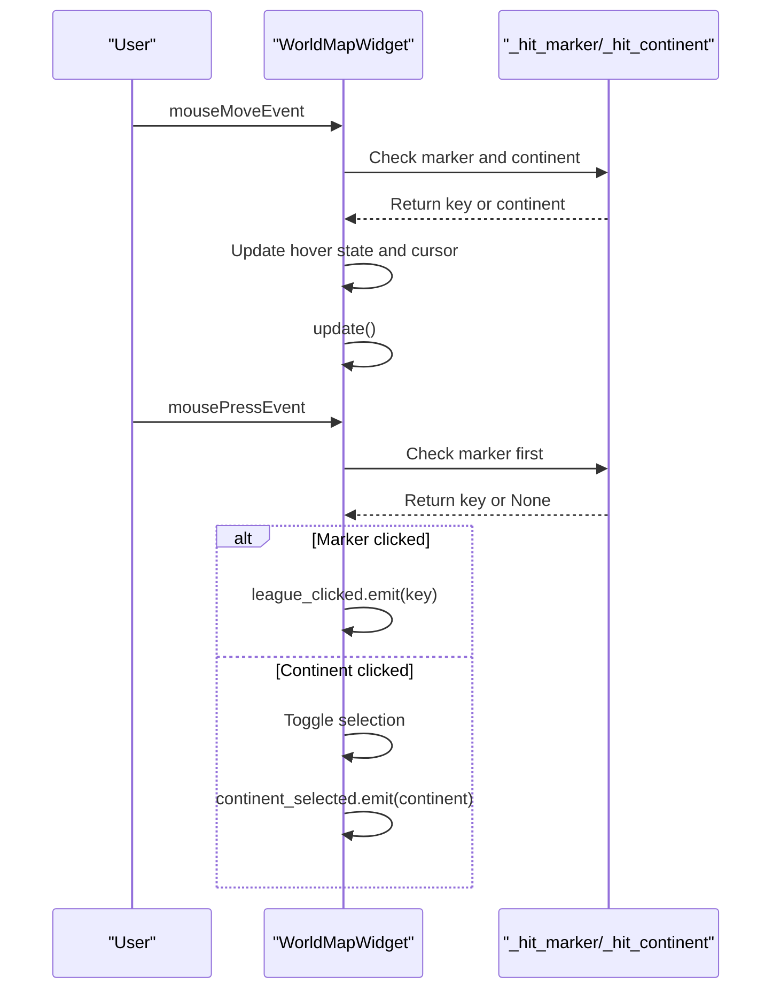

**Diagram sources**
- [main.py:867-878](file://DASHBOARD/main.py#L867-L878)
- [main.py:883-904](file://DASHBOARD/main.py#L883-L904)

**Section sources**
- [main.py:867-878](file://DASHBOARD/main.py#L867-L878)
- [main.py:883-904](file://DASHBOARD/main.py#L883-L904)

### Geometric Calculations for Labels and Overlap Avoidance
Label positioning uses font metrics to calculate text dimensions and ensure labels fit within the map rectangle.

Calculations:
- Label width: Maximum of title and value text widths plus padding.
- Label height: Sum of title and value font heights plus padding.
- Positioning: Centered around a projected dot offset by dx/dy factors relative to the map rectangle dimensions.
- Boundary clamping: Ensures labels do not exceed the map rectangle edges.

Overlap avoidance:
- Labels are constrained to remain within the map rectangle boundaries.
- Connector lines are drawn from the dot to the nearest edge of the label box.

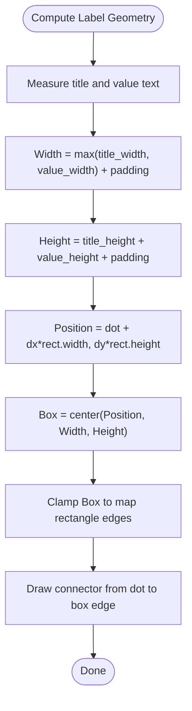

**Diagram sources**
- [main.py:786-804](file://DASHBOARD/main.py#L786-L804)
- [main.py:861-865](file://DASHBOARD/main.py#L861-L865)

**Section sources**
- [main.py:786-804](file://DASHBOARD/main.py#L786-L804)
- [main.py:861-865](file://DASHBOARD/main.py#L861-L865)

### Responsive Design and Aspect Ratio Maintenance
The widget maintains a consistent aspect ratio regardless of window size.

Mechanism:
- _map_rect computes a centered rectangle with a fixed aspect ratio (width-to-height ratio of 2:1).
- If available width exceeds twice the height, the map width is constrained to maintain the aspect ratio.
- Otherwise, the map height is constrained based on the available width.
- On resize, geometry is rebuilt to adapt to new dimensions.

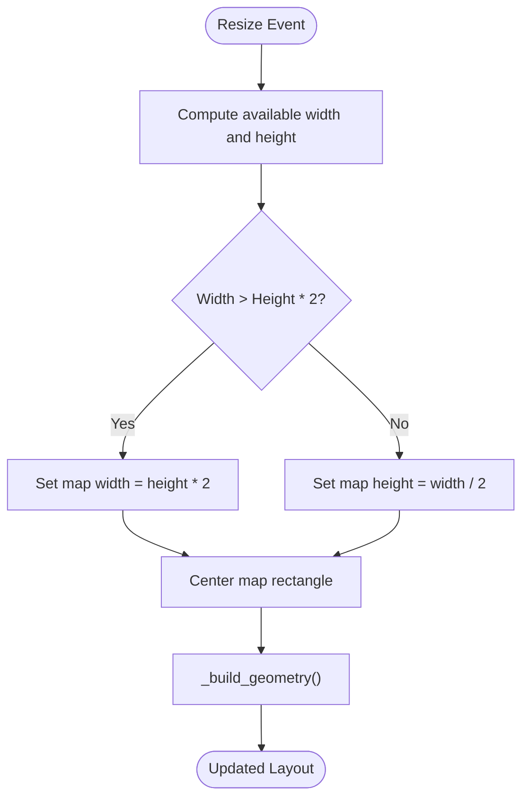

**Diagram sources**
- [main.py:759-771](file://DASHBOARD/main.py#L759-L771)
- [main.py:906-907](file://DASHBOARD/main.py#L906-L907)

**Section sources**
- [main.py:759-771](file://DASHBOARD/main.py#L759-L771)
- [main.py:906-907](file://DASHBOARD/main.py#L906-L907)

## Dependency Analysis
The world map visualization depends on several components:

- PyQt5 GUI framework: Provides widgets, painting primitives, and event handling.
- Simulation modules: Dynamically loaded to provide data for league statistics.
- LEAGUES configuration: Defines metadata for each competition, including geographic positions and display properties.
- WorldMapWidget: Central component integrating all functionality.
- MapSidePanel: Filters leagues by continent and responds to selection changes.

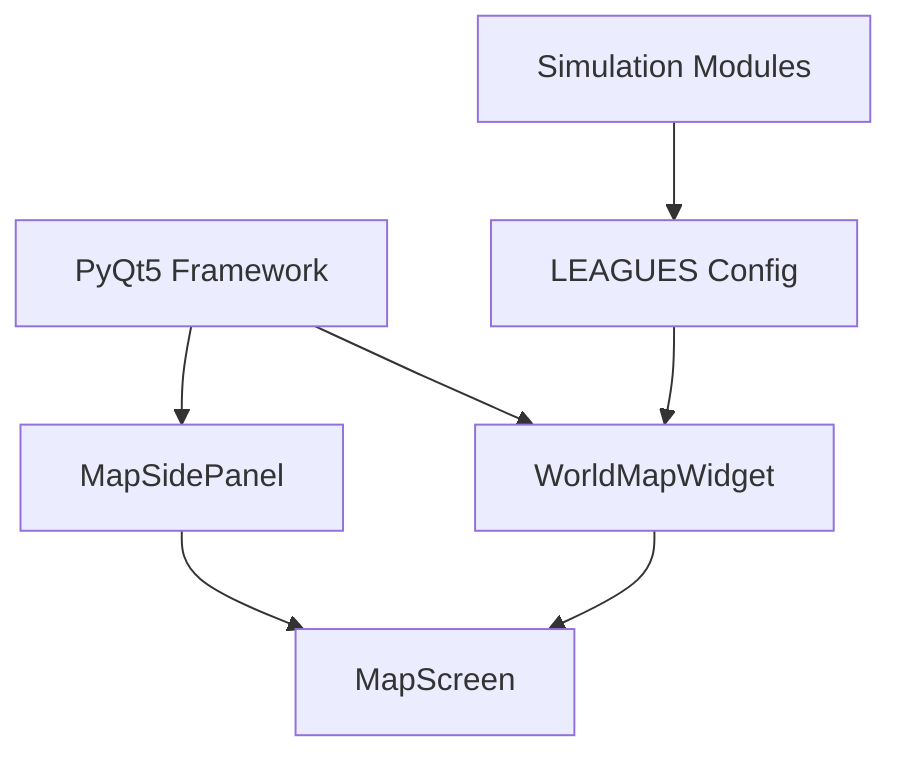

**Diagram sources**
- [main.py:15-31](file://DASHBOARD/main.py#L15-L31)
- [main.py:56-62](file://DASHBOARD/main.py#L56-L62)
- [main.py:68-199](file://DASHBOARD/main.py#L68-L199)
- [main.py:742-907](file://DASHBOARD/main.py#L742-L907)
- [main.py:913-915](file://DASHBOARD/main.py#L913-L915)

**Section sources**
- [main.py:15-31](file://DASHBOARD/main.py#L15-L31)
- [main.py:56-62](file://DASHBOARD/main.py#L56-L62)
- [main.py:68-199](file://DASHBOARD/main.py#L68-L199)
- [main.py:742-907](file://DASHBOARD/main.py#L742-L907)
- [main.py:913-915](file://DASHBOARD/main.py#L913-L915)

## Performance Considerations
- Path construction: Building QPainterPath objects for continents is done once per resize and cached in _continent_paths to avoid recomputation.
- Hit testing: Efficiently checks marker boxes and dot proximity before falling back to continent path containment tests.
- Repainting: Only updates when hover or selection state changes, minimizing unnecessary redraws.
- Font metrics: Computed once per build phase to determine label sizes efficiently.

Optimization opportunities:
- Consider precomputing label positions for common widget sizes to reduce runtime calculations.
- Use spatial indexing for continent hit testing if the number of continents increases significantly.

[No sources needed since this section provides general guidance]

## Troubleshooting Guide
Common issues and solutions:

- Markers not appearing:
  - Verify LEAGUES configuration has valid geographic coordinates and label offsets.
  - Ensure results data contains expected fields for computing team leaders and probabilities.

- Labels overlapping or clipped:
  - Check boundary clamping logic in label box computation.
  - Adjust dx/dy offsets in LEAGUES configuration to improve spacing.

- Incorrect continent highlighting:
  - Confirm continent polygons are correctly defined in _CONTINENTS.
  - Validate coordinate transformation logic in _to_screen.

- Responsiveness issues:
  - Ensure resizeEvent calls _build_geometry to recalculate layout.
  - Verify _map_rect returns valid rectangles for all widget sizes.

**Section sources**
- [main.py:777-804](file://DASHBOARD/main.py#L777-L804)
- [main.py:759-771](file://DASHBOARD/main.py#L759-L771)
- [main.py:906-907](file://DASHBOARD/main.py#L906-L907)

## Conclusion
The interactive world map visualization system provides a comprehensive interface for exploring sports competition data geographically. Through precise coordinate transformations, efficient path rendering, and intuitive interactions, it enables users to explore league statistics and continental distributions effectively. The responsive design ensures optimal presentation across various window sizes, while the modular architecture supports easy extension and maintenance.

[No sources needed since this section summarizes without analyzing specific files]