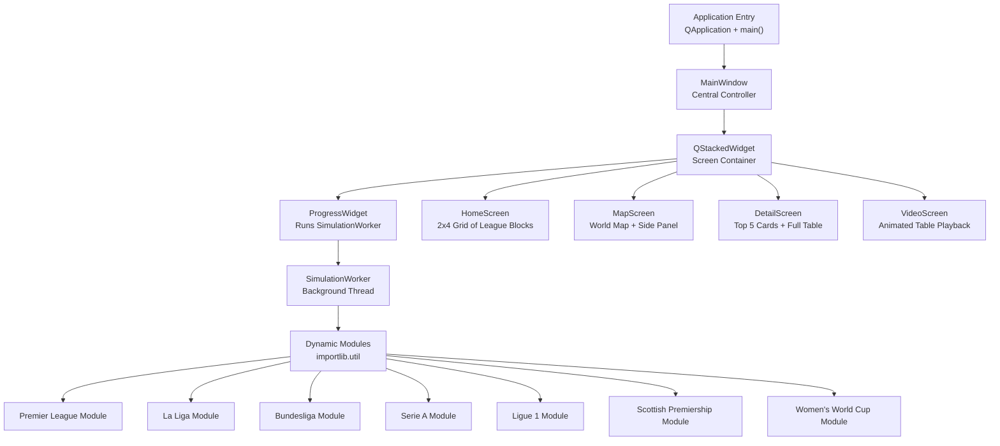
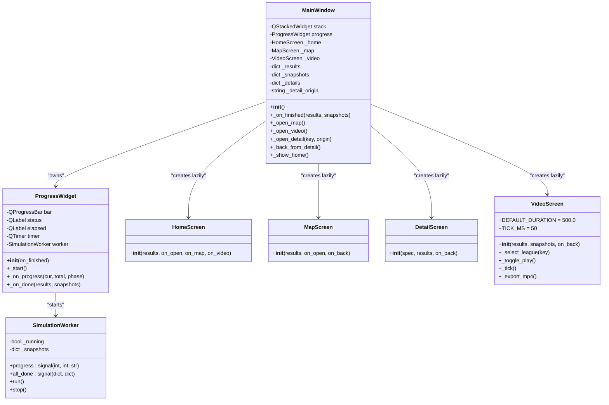
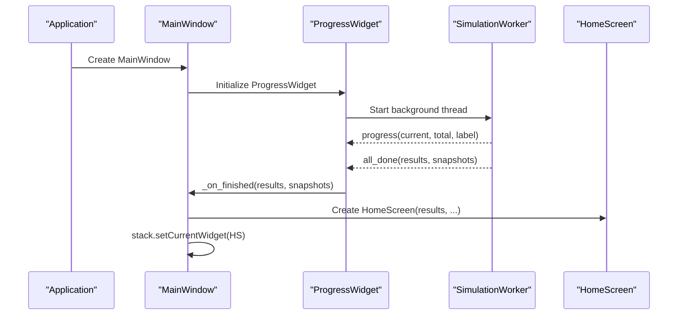
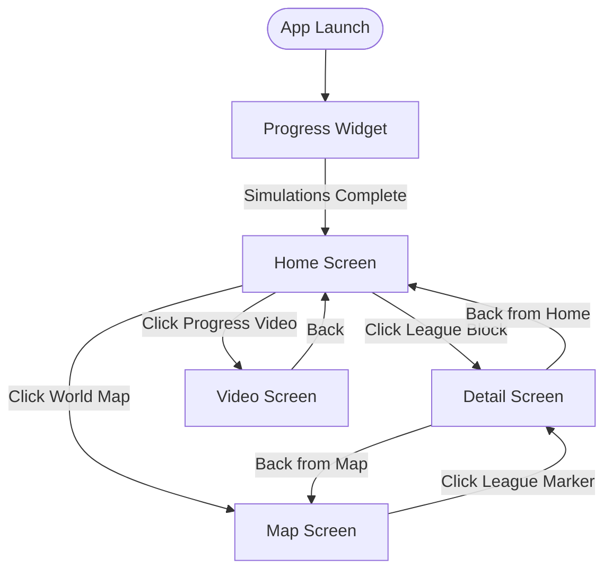
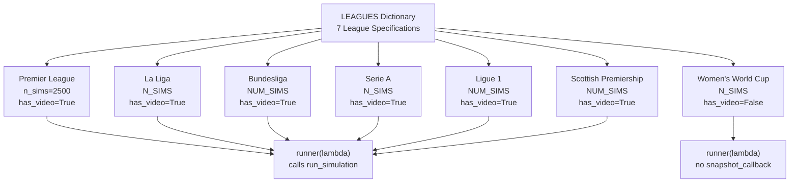
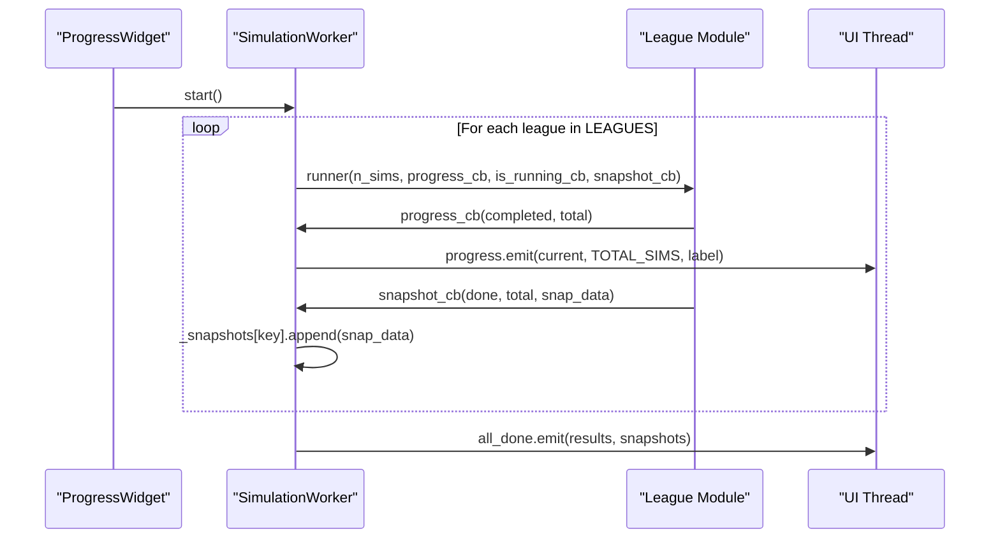
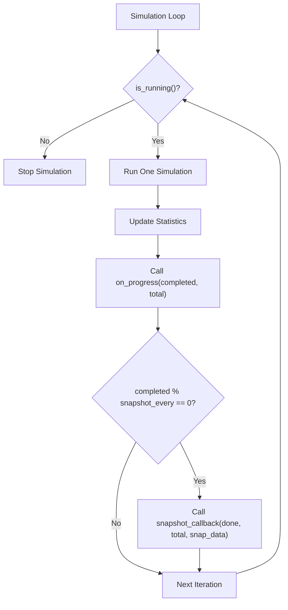
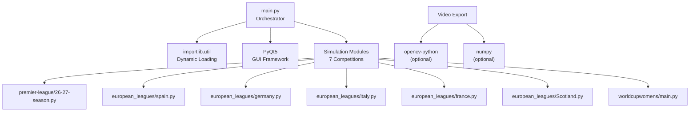

# Main Application Orchestrator

<cite>
**Referenced Files in This Document**
- [main.py](file://DASHBOARD/main.py)
- [26-27-season.py](file://premier-league/26-27-season.py)
- [germany.py](file://european_leagues/germany.py)
</cite>

## Table of Contents
1. [Introduction](#introduction)
2. [Project Structure](#project-structure)
3. [Core Components](#core-components)
4. [Architecture Overview](#architecture-overview)
5. [Detailed Component Analysis](#detailed-component-analysis)
6. [Dependency Analysis](#dependency-analysis)
7. [Performance Considerations](#performance-considerations)
8. [Troubleshooting Guide](#troubleshooting-guide)
9. [Conclusion](#conclusion)

## Introduction
This document explains the main application orchestrator that manages the entire dashboard workflow. It focuses on:
- The MainWindow class as the central controller coordinating UI screens and simulation workers
- The screen navigation system using QStackedWidget for Progress, Home, World Map, Detail, and Video screens
- The league configuration system with a LEAGUES dictionary covering seven competitions
- The dynamic module loading mechanism using importlib.util to load simulation modules at runtime
- The SimulationWorker background thread implementation that runs simulations sequentially while capturing progress snapshots
- The callback system for real-time progress updates and snapshot capture during simulations

The orchestrator is implemented in a single primary file and dynamically loads separate simulation modules for each competition.

## Project Structure
At a high level, the dashboard consists of:
- A main orchestrator file containing the UI, worker, and navigation logic
- Separate simulation modules per competition, loaded dynamically at runtime
- A world map visualization and side panel for filtering leagues by continent
- A video playback screen that animates table evolution over time

**Diagram sources**
- [main.py:1568-1633](file://DASHBOARD/main.py#L1568-L1633)
- [main.py:284-334](file://DASHBOARD/main.py#L284-L334)
- [main.py:339-410](file://DASHBOARD/main.py#L339-L410)
- [main.py:1462-1512](file://DASHBOARD/main.py#L1462-L1512)
- [main.py:968-1004](file://DASHBOARD/main.py#L968-L1004)
- [main.py:1517-1563](file://DASHBOARD/main.py#L1517-L1563)
- [main.py:1037-1266](file://DASHBOARD/main.py#L1037-L1266)

**Section sources**
- [main.py:1-13](file://DASHBOARD/main.py#L1-L13)
- [main.py:15-63](file://DASHBOARD/main.py#L15-L63)
- [main.py:1568-1633](file://DASHBOARD/main.py#L1568-L1633)

## Core Components
- MainWindow: Central controller that owns the QStackedWidget and coordinates navigation between screens
- ProgressWidget: Displays overall progress and starts the SimulationWorker
- SimulationWorker: Background thread that runs all league simulations sequentially and captures snapshots
- HomeScreen: Shows a 2x4 grid of clickable blocks representing each league
- MapScreen: Interactive world map with continent filtering and league markers
- DetailScreen: Shows top-5 cards and full predicted table for a selected league
- VideoScreen: Animates table evolution across captured snapshots over a configurable duration

Key responsibilities:
- Dynamic loading of simulation modules via importlib.util
- Maintaining a LEAGUES configuration dictionary for all seven competitions
- Running simulations in a background thread with progress and snapshot callbacks
- Managing screen transitions and state through QStackedWidget

**Section sources**
- [main.py:49-63](file://DASHBOARD/main.py#L49-L63)
- [main.py:68-201](file://DASHBOARD/main.py#L68-L201)
- [main.py:284-334](file://DASHBOARD/main.py#L284-L334)
- [main.py:339-410](file://DASHBOARD/main.py#L339-L410)
- [main.py:1462-1512](file://DASHBOARD/main.py#L1462-L1512)
- [main.py:968-1004](file://DASHBOARD/main.py#L968-L1004)
- [main.py:1517-1563](file://DASHBOARD/main.py#L1517-L1563)
- [main.py:1037-1266](file://DASHBOARD/main.py#L1037-L1266)

## Architecture Overview
The orchestrator follows a layered architecture:
- Presentation layer: Qt widgets (QMainWindow, QStackedWidget, QWidget subclasses)
- Coordination layer: MainWindow methods managing screen lifecycle and data flow
- Execution layer: SimulationWorker running background threads
- Integration layer: Dynamically loaded simulation modules providing run_simulation functions

**Diagram sources**
- [main.py:1568-1633](file://DASHBOARD/main.py#L1568-L1633)
- [main.py:339-410](file://DASHBOARD/main.py#L339-L410)
- [main.py:284-334](file://DASHBOARD/main.py#L284-L334)
- [main.py:1462-1512](file://DASHBOARD/main.py#L1462-L1512)
- [main.py:968-1004](file://DASHBOARD/main.py#L968-L1004)
- [main.py:1517-1563](file://DASHBOARD/main.py#L1517-L1563)
- [main.py:1037-1266](file://DASHBOARD/main.py#L1037-L1266)

## Detailed Component Analysis

### MainWindow: Central Controller
MainWindow initializes the application window, sets up QStackedWidget, and creates ProgressWidget as the first screen. After simulations complete, it constructs HomeScreen and navigates to it. It also lazily creates MapScreen, VideoScreen, and DetailScreen instances when needed, storing them to avoid recreation. Navigation methods manage back behavior based on whether detail was opened from home or map.

Key behaviors:
- Owns QStackedWidget as the central widget
- Starts ProgressWidget immediately
- On completion, stores results and snapshots, builds HomeScreen, and switches to it
- Lazily instantiates MapScreen, VideoScreen, and DetailScreen
- Tracks detail origin to determine correct back navigation

**Diagram sources**
- [main.py:1568-1633](file://DASHBOARD/main.py#L1568-L1633)
- [main.py:339-410](file://DASHBOARD/main.py#L339-L410)
- [main.py:284-334](file://DASHBOARD/main.py#L284-L334)

**Section sources**
- [main.py:1568-1633](file://DASHBOARD/main.py#L1568-L1633)

### Screen Navigation System with QStackedWidget
The dashboard uses QStackedWidget to manage multiple screens:
- Progress: Initial screen showing simulation progress
- Home: Results overview with 2x4 grid of league blocks
- World Map: Interactive map with continent filtering and league markers
- Detail: Top-5 cards and full table for a specific league
- Video: Animated playback of table evolution over simulations

Navigation flow:
- Progress -> Home (after simulation completion)
- Home -> Detail (clicking a league block)
- Home -> Map (via button)
- Home -> Video (via button)
- Map -> Detail (clicking a league marker or row)
- Detail -> Home or Map (depending on origin)

**Diagram sources**
- [main.py:1568-1633](file://DASHBOARD/main.py#L1568-L1633)
- [main.py:1462-1512](file://DASHBOARD/main.py#L1462-L1512)
- [main.py:968-1004](file://DASHBOARD/main.py#L968-L1004)
- [main.py:1517-1563](file://DASHBOARD/main.py#L1517-L1563)
- [main.py:1037-1266](file://DASHBOARD/main.py#L1037-L1266)

**Section sources**
- [main.py:1568-1633](file://DASHBOARD/main.py#L1568-L1633)

### League Configuration System (LEAGUES Dictionary)
The LEAGUES dictionary defines specifications for all seven competitions:
- Premier League
- La Liga
- Bundesliga
- Serie A
- Ligue 1
- Scottish Premiership
- Women's World Cup

Each league specification includes:
- key: Unique identifier used throughout the application
- title and short: Display names
- subtitle: Season information
- accent: Color theme
- continent: Geographic grouping for map filtering
- geo: Positioning data for map markers (longitude, latitude, offset)
- n_sims: Number of simulations to run
- has_video: Whether the league supports video playback
- runner: Lambda function calling the league's run_simulation with callbacks
- get_teams: Function to extract team list from results
- top_key: Metric used to determine top teams (e.g., title_prob)
- top_fmt: Formatting string for probability display
- columns: Table column definitions with labels, data keys, and formatting

Special handling:
- Women's World Cup uses different result structure and is excluded from video playback
- Each league's runner passes on_progress, is_running, and snapshot_callback to the underlying simulation

**Diagram sources**
- [main.py:68-201](file://DASHBOARD/main.py#L68-L201)

**Section sources**
- [main.py:68-201](file://DASHBOARD/main.py#L68-L201)

### Dynamic Module Loading Mechanism
The application uses importlib.util to dynamically load simulation modules at runtime:
- _app_root(): Determines the application root directory, handling both frozen executables and development environments
- _load(): Loads a module by name and relative path using spec_from_file_location, module_from_spec, and exec_module
- Seven modules are loaded:
  - wc_sim: worldcupwomens/main.py
  - pl_sim: premier-league/26-27-season.py
  - ger_sim: european_leagues/germany.py
  - ita_sim: european_leagues/italy.py
  - sco_sim: european_leagues/Scotland.py
  - esp_sim: european_leagues/spain.py
  - fra_sim: european_leagues/france.py

Benefits:
- Decouples UI from simulation implementations
- Allows adding new leagues without modifying core orchestrator
- Supports modular architecture where each league maintains its own simulation logic

**Section sources**
- [main.py:37-63](file://DASHBOARD/main.py#L37-L63)

### SimulationWorker Background Thread
SimulationWorker extends QThread and runs all league simulations sequentially:
- Emits progress signals with current count, total count, and phase label
- Captures snapshots for each league during simulation execution
- Stores snapshots in a dictionary keyed by league identifier
- Handles graceful stopping via _running flag
- Emits all_done signal with final results and snapshots upon completion

Key implementation details:
- Uses make_prog_cb to wrap progress callbacks with offset calculation
- Uses make_snap_cb to create snapshot callbacks that append to league-specific lists
- Calls each league's runner function with appropriate callbacks
- Accumulates total simulation count across leagues
- Provides stop() method to halt execution

**Diagram sources**
- [main.py:284-334](file://DASHBOARD/main.py#L284-L334)
- [main.py:339-410](file://DASHBOARD/main.py#L339-L410)

**Section sources**
- [main.py:284-334](file://DASHBOARD/main.py#L284-L334)

### Callback System for Real-Time Updates
The callback system enables real-time progress updates and snapshot capture:
- on_progress: Called by simulation modules to report completion status
- is_running: Boolean callback to check if simulation should continue
- snapshot_callback: Called periodically to capture intermediate simulation states

Implementation pattern:
- Simulation modules accept these callbacks in their run_simulation functions
- ProgressWidget connects to SimulationWorker.progress signal to update UI
- Snapshot data includes metrics like avg_points, title_prob, top4_prob, etc.
- VideoScreen uses snapshots to interpolate and animate table evolution

Example from Bundesliga module:
- run_simulation accepts on_progress, is_running, and snapshot_callback parameters
- Calls on_progress after each completed simulation
- Calls snapshot_callback at intervals to capture statistical snapshots
- Returns aggregated results with probabilities and averages

**Diagram sources**
- [germany.py:247-327](file://european_leagues/germany.py#L247-L327)
- [main.py:284-334](file://DASHBOARD/main.py#L284-L334)

**Section sources**
- [germany.py:247-327](file://european_leagues/germany.py#L247-L327)
- [main.py:284-334](file://DASHBOARD/main.py#L284-L334)

### Video Screen and Animation System
VideoScreen provides animated playback of table evolution:
- DEFAULT_DURATION: 500 seconds as specified
- TICK_MS: 50ms for 20fps UI updates
- Filters leagues that support video playback and have sufficient snapshots
- Implements frame interpolation between snapshots for smooth animation
- Freezes team order based on final snapshot to prevent row swapping during playback
- Supports play/pause controls, timeline slider, and MP4 export

Key features:
- Interpolates between snapshots using linear interpolation
- Maintains consistent team ordering throughout playback
- Provides export functionality using OpenCV and numpy
- Handles missing dependencies gracefully with error messages

**Section sources**
- [main.py:1037-1266](file://DASHBOARD/main.py#L1037-L1266)

## Dependency Analysis
The application exhibits clear separation of concerns with minimal coupling:

**Diagram sources**
- [main.py:15-63](file://DASHBOARD/main.py#L15-L63)
- [main.py:1373-1457](file://DASHBOARD/main.py#L1373-L1457)

Coupling characteristics:
- Low coupling between orchestrator and simulation modules via standardized interfaces
- High cohesion within each component (each class has focused responsibility)
- Clear dependency direction: UI depends on simulation modules, not vice versa
- Optional dependencies (OpenCV, numpy) handled gracefully

**Section sources**
- [main.py:15-63](file://DASHBOARD/main.py#L15-L63)
- [main.py:1373-1457](file://DASHBOARD/main.py#L1373-L1457)

## Performance Considerations
- Sequential simulation execution ensures predictable memory usage and avoids resource contention
- Background threading prevents UI freezing during long-running simulations
- Snapshot frequency is controlled to balance performance with video quality
- Lazy instantiation of screens reduces initial startup time
- Fixed team ordering in video playback prevents expensive re-sorting operations
- Progress updates are throttled through Qt's signal-slot mechanism

Optimization opportunities:
- Consider parallelizing independent league simulations if CPU resources allow
- Implement snapshot compression for large simulation datasets
- Add progress estimation algorithms for better user experience
- Consider virtual scrolling for very large tables

## Troubleshooting Guide
Common issues and solutions:

Missing optional dependencies:
- Symptom: Error message about opencv-python and numpy requirements
- Solution: Install required packages with pip install opencv-python numpy

Module loading failures:
- Symptom: ImportError when loading simulation modules
- Solution: Verify file paths and ensure modules exist in expected locations

Simulation not progressing:
- Symptom: Progress bar stuck or no updates
- Solution: Check is_running callback implementation in simulation modules

Video export failures:
- Symptom: RuntimeError about OpenCV not opening output file
- Solution: Ensure ffmpeg is installed or try different file path

Snapshot data inconsistencies:
- Symptom: Video shows incorrect or incomplete data
- Solution: Verify snapshot_callback is called with proper data structure

**Section sources**
- [main.py:1373-1457](file://DASHBOARD/main.py#L1373-L1457)

## Conclusion
The main application orchestrator provides a robust, modular architecture for managing sports simulation dashboards. Key strengths include:

- Clean separation of concerns with MainWindow as central coordinator
- Flexible screen navigation system using QStackedWidget
- Extensible league configuration system supporting seven competitions
- Dynamic module loading enabling easy addition of new simulations
- Robust background processing with real-time progress updates
- Comprehensive snapshot capture system enabling video playback

The design successfully balances performance, maintainability, and extensibility while providing an intuitive user interface for exploring sports simulation results across multiple competitions.