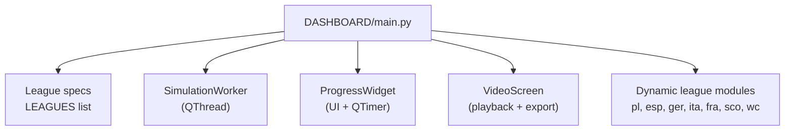
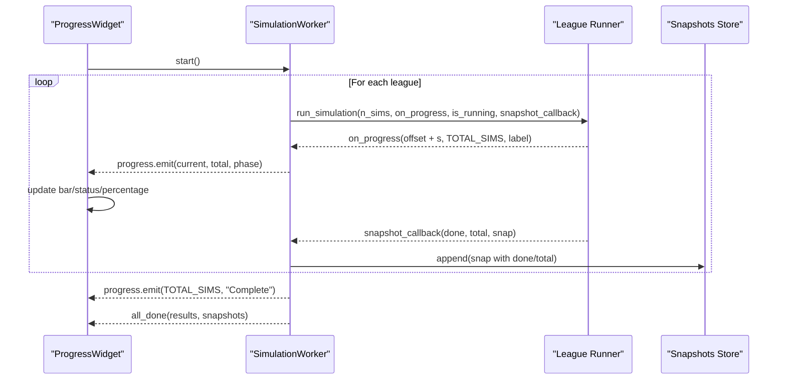
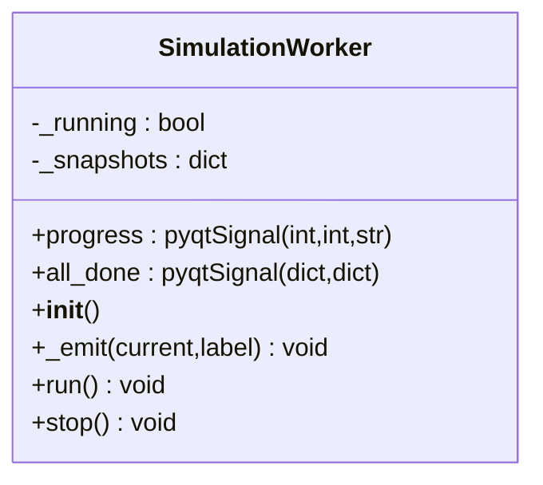
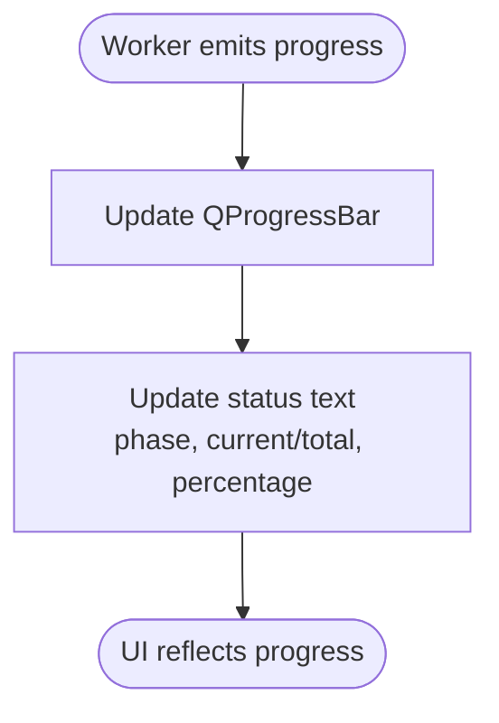
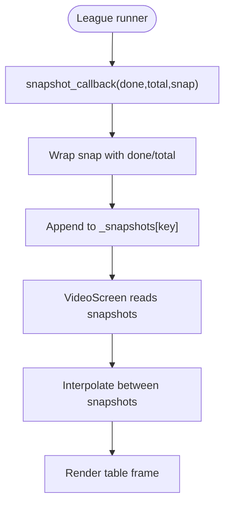
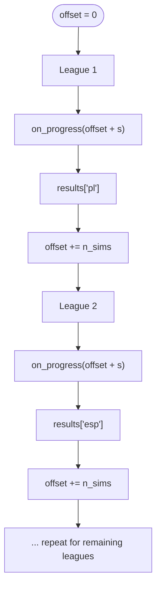
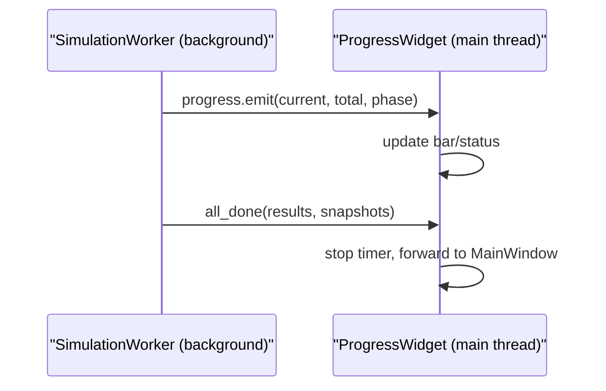
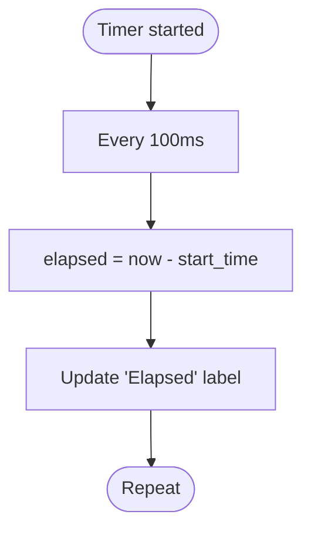
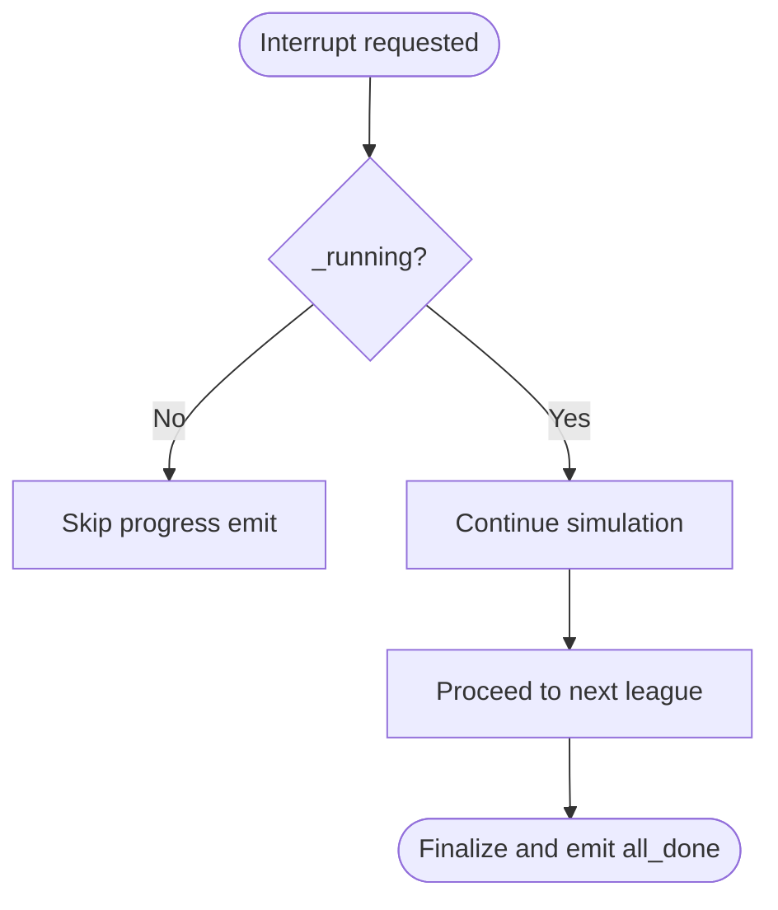
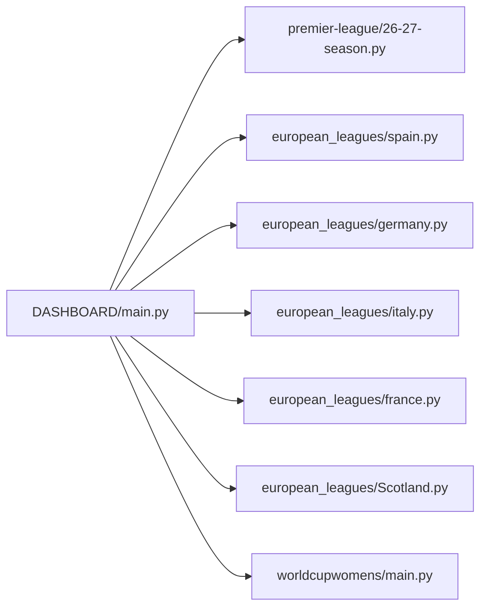

# Progress Tracking and Snapshot System

<cite>
**Referenced Files in This Document**
- [DASHBOARD/main.py](file://DASHBOARD/main.py)
</cite>

## Table of Contents
1. [Introduction](#introduction)
2. [Project Structure](#project-structure)
3. [Core Components](#core-components)
4. [Architecture Overview](#architecture-overview)
5. [Detailed Component Analysis](#detailed-component-analysis)
6. [Dependency Analysis](#dependency-analysis)
7. [Performance Considerations](#performance-considerations)
8. [Troubleshooting Guide](#troubleshooting-guide)
9. [Conclusion](#conclusion)

## Introduction
This document explains the progress tracking and snapshot capture system used by the simulation dashboard. The system runs seven league simulations sequentially on a background thread, emits real-time progress signals for UI updates, captures periodic snapshots of simulation state for video playback, tracks cumulative offsets across leagues, and uses a safe signal-slot architecture to connect background work to the GUI. It also documents timer-based elapsed time tracking, percentage calculations, error handling for interrupted simulations, cleanup procedures, and threading considerations.

## Project Structure
The relevant implementation lives in the dashboard application module that:
- Dynamically loads seven league simulation modules
- Defines a shared configuration of league specifications
- Runs all simulations sequentially via a background worker
- Captures snapshots per league
- Provides UI screens for progress, results, world map, detail views, and animated progress video

**Diagram sources**
- [DASHBOARD/main.py:56-62](file://DASHBOARD/main.py#L56-L62)
- [DASHBOARD/main.py:68-199](file://DASHBOARD/main.py#L68-L199)
- [DASHBOARD/main.py:284-333](file://DASHBOARD/main.py#L284-L333)
- [DASHBOARD/main.py:339-409](file://DASHBOARD/main.py#L339-L409)
- [DASHBOARD/main.py:1037-1265](file://DASHBOARD/main.py#L1037-L1265)

**Section sources**
- [DASHBOARD/main.py:1-13](file://DASHBOARD/main.py#L1-L13)
- [DASHBOARD/main.py:56-62](file://DASHBOARD/main.py#L56-L62)
- [DASHBOARD/main.py:68-199](file://DASHBOARD/main.py#L68-L199)

## Core Components
- SimulationWorker: Background QThread that orchestrates sequential league simulations, computes global offset, emits progress signals, and collects snapshots.
- ProgressWidget: UI component that displays a unified progress bar, status text with phase labels, elapsed time, and connects to SimulationWorker signals.
- VideoScreen: Playback and export screen that renders interpolated snapshots into an animated table and can export MP4 using OpenCV.
- League spec registry (LEAGUES): Declarative configuration of each league’s runner, number of simulations, columns, and metadata.

Key responsibilities:
- Sequential execution of seven leagues
- Global progress accounting with offset accumulation
- Signal emission for current progress, total simulations, and phase label
- Snapshot capture per league for video replay
- Timer-driven elapsed time display and percentage calculation

**Section sources**
- [DASHBOARD/main.py:68-199](file://DASHBOARD/main.py#L68-L199)
- [DASHBOARD/main.py:284-333](file://DASHBOARD/main.py#L284-L333)
- [DASHBOARD/main.py:339-409](file://DASHBOARD/main.py#L339-L409)
- [DASHBOARD/main.py:1037-1265](file://DASHBOARD/main.py#L1037-L1265)

## Architecture Overview
The system follows a producer-consumer pattern:
- Producer: SimulationWorker runs on a background thread and calls each league’s runner with callbacks for progress and snapshots.
- Consumer: ProgressWidget receives progress signals and updates the UI; VideoScreen consumes snapshots for playback and export.

**Diagram sources**
- [DASHBOARD/main.py:284-333](file://DASHBOARD/main.py#L284-L333)
- [DASHBOARD/main.py:339-409](file://DASHBOARD/main.py#L339-L409)
- [DASHBOARD/main.py:68-199](file://DASHBOARD/main.py#L68-L199)

## Detailed Component Analysis

### SimulationWorker: Sequential Execution, Offset Calculation, Signals, and Snapshots
- Inherits from QThread and defines two signals:
  - progress(int, int, str): current, total, phase label
  - all_done(dict, dict): final results and snapshots
- Maintains internal state:
  - _running flag for cancellation checks
  - _snapshots dictionary keyed by league key
- run() method:
  - Iterates LEAGUES in order
  - Initializes per-league snapshot list
  - Creates progress callback that adds the current league’s offset to local progress
  - Creates snapshot callback that appends a copy of the snapshot with done/total fields
  - Calls each league’s runner with n_sims, progress callback, is_running checker, and snapshot callback
  - Accumulates offset by the number of simulations completed by the league
  - Emits final progress and all_done upon completion

**Diagram sources**
- [DASHBOARD/main.py:284-333](file://DASHBOARD/main.py#L284-L333)

**Section sources**
- [DASHBOARD/main.py:284-333](file://DASHBOARD/main.py#L284-L333)

### Progress Callback System and UI Updates
- ProgressWidget connects to SimulationWorker.progress and all_done signals.
- On progress:
  - Updates QProgressBar value
  - Sets status text with phase label, current/total counts, and percentage
- Elapsed time is updated by a QTimer every 100 ms.

**Diagram sources**
- [DASHBOARD/main.py:339-409](file://DASHBOARD/main.py#L339-L409)

**Section sources**
- [DASHBOARD/main.py:339-409](file://DASHBOARD/main.py#L339-L409)

### Snapshot Capture Mechanism for Video Playback
- Per league, SimulationWorker initializes a snapshot list under self._snapshots[key].
- Each league runner invokes snapshot_callback(done, total, snap).
- The worker wraps the snapshot with done/total and appends it to the league’s list.
- VideoScreen uses these snapshots to render interpolated frames over a fixed duration.

**Diagram sources**
- [DASHBOARD/main.py:284-333](file://DASHBOARD/main.py#L284-L333)
- [DASHBOARD/main.py:1037-1265](file://DASHBOARD/main.py#L1037-L1265)

**Section sources**
- [DASHBOARD/main.py:284-333](file://DASHBOARD/main.py#L284-L333)
- [DASHBOARD/main.py:1037-1265](file://DASHBOARD/main.py#L1037-L1265)

### Offset Calculation Across Multiple Leagues
- The worker maintains a running offset initialized to zero.
- Before calling a league’s runner, it creates a progress callback that adds the current offset to the league’s local progress.
- After the league completes, the worker adds the returned number of simulations to the offset.
- This ensures the global progress bar reflects cumulative progress across all leagues.

**Diagram sources**
- [DASHBOARD/main.py:284-333](file://DASHBOARD/main.py#L284-L333)

**Section sources**
- [DASHBOARD/main.py:284-333](file://DASHBOARD/main.py#L284-L333)

### Signal-Slot Architecture Connecting Background Thread to UI
- SimulationWorker emits progress and all_done signals.
- ProgressWidget connects its slots to these signals and updates UI elements safely on the main thread.
- This avoids direct cross-thread UI manipulation and leverages Qt’s event loop.

**Diagram sources**
- [DASHBOARD/main.py:284-333](file://DASHBOARD/main.py#L284-L333)
- [DASHBOARD/main.py:339-409](file://DASHBOARD/main.py#L339-L409)

**Section sources**
- [DASHBOARD/main.py:284-333](file://DASHBOARD/main.py#L284-L333)
- [DASHBOARD/main.py:339-409](file://DASHBOARD/main.py#L339-L409)

### Timer-Based Elapsed Time Tracking and Percentage Calculations
- ProgressWidget starts a QTimer at startup and ticks every 100 ms.
- Each tick updates the elapsed time label using the difference between current time and start_time.
- Percentage is computed as (current / total) * 100% when updating the status label.

**Diagram sources**
- [DASHBOARD/main.py:339-409](file://DASHBOARD/main.py#L339-L409)

**Section sources**
- [DASHBOARD/main.py:339-409](file://DASHBOARD/main.py#L339-L409)

### Error Handling for Interrupted Simulations and Cleanup Procedures
- Cancellation:
  - SimulationWorker checks _running before emitting progress and before proceeding to the next league.
  - ProgressWidget provides a stop mechanism via _running flag.
- Completion:
  - Upon all_done, ProgressWidget stops the timer and forwards results/snapshots to the main window.
- Video export:
  - Validates dependencies (OpenCV, numpy) and raises informative errors if missing.
  - Uses a modal progress dialog during rendering and allows user cancellation.
  - Ensures writer release and container cleanup in finally blocks.

**Diagram sources**
- [DASHBOARD/main.py:284-333](file://DASHBOARD/main.py#L284-L333)
- [DASHBOARD/main.py:1373-1456](file://DASHBOARD/main.py#L1373-L1456)

**Section sources**
- [DASHBOARD/main.py:284-333](file://DASHBOARD/main.py#L284-L333)
- [DASHBOARD/main.py:1373-1456](file://DASHBOARD/main.py#L1373-L1456)

### Threading Considerations and Thread Safety Practices
- Background execution:
  - SimulationWorker extends QThread and runs league runners in run().
- Safe UI updates:
  - All UI updates occur in ProgressWidget slots connected via Qt signals, ensuring they execute on the main thread.
- Shared state protection:
  - _running is checked frequently to allow graceful interruption.
  - Snapshots are appended within the worker thread; read access occurs later in the main thread after all_done.
- Resource management:
  - Timers are stopped on completion.
  - Video export cleans up writers and widgets even on exceptions or cancellation.

**Section sources**
- [DASHBOARD/main.py:284-333](file://DASHBOARD/main.py#L284-L333)
- [DASHBOARD/main.py:339-409](file://DASHBOARD/main.py#L339-L409)
- [DASHBOARD/main.py:1373-1456](file://DASHBOARD/main.py#L1373-L1456)

## Dependency Analysis
The dashboard depends on dynamically loaded league modules for actual simulation logic. The LEAGUES list binds each league’s runner function and metadata.

**Diagram sources**
- [DASHBOARD/main.py:56-62](file://DASHBOARD/main.py#L56-L62)
- [DASHBOARD/main.py:68-199](file://DASHBOARD/main.py#L68-L199)

**Section sources**
- [DASHBOARD/main.py:56-62](file://DASHBOARD/main.py#L56-L62)
- [DASHBOARD/main.py:68-199](file://DASHBOARD/main.py#L68-L199)

## Performance Considerations
- Sequential execution reduces contention and simplifies progress accounting but increases total runtime.
- Snapshot frequency should be tuned to balance memory usage and video smoothness.
- Video export renders frames off-screen and converts images to NumPy arrays; ensure sufficient memory for large resolutions.
- Using a frozen team order prevents row reordering during playback, improving visual stability.

[No sources needed since this section provides general guidance]

## Troubleshooting Guide
- Missing video export dependencies:
  - If OpenCV or numpy are not installed, the export will raise a clear error instructing installation.
- Not enough snapshots:
  - Export requires at least two snapshots; otherwise, a runtime error is raised.
- Interruption during export:
  - The progress dialog supports cancellation; ensure resources are released afterward.
- UI not updating:
  - Verify that ProgressWidget is connected to SimulationWorker signals and that the timer is started.

**Section sources**
- [DASHBOARD/main.py:1373-1456](file://DASHBOARD/main.py#L1373-L1456)
- [DASHBOARD/main.py:339-409](file://DASHBOARD/main.py#L339-L409)

## Conclusion
The progress tracking and snapshot system provides a robust foundation for running multiple league simulations sequentially while offering real-time feedback and rich replay capabilities. Through careful use of Qt signals and slots, timer-based UI updates, and disciplined snapshot collection, the system delivers a responsive interface and high-quality video exports. Proper cancellation checks and resource cleanup ensure reliability even under interruptions.

[No sources needed since this section summarizes without analyzing specific files]