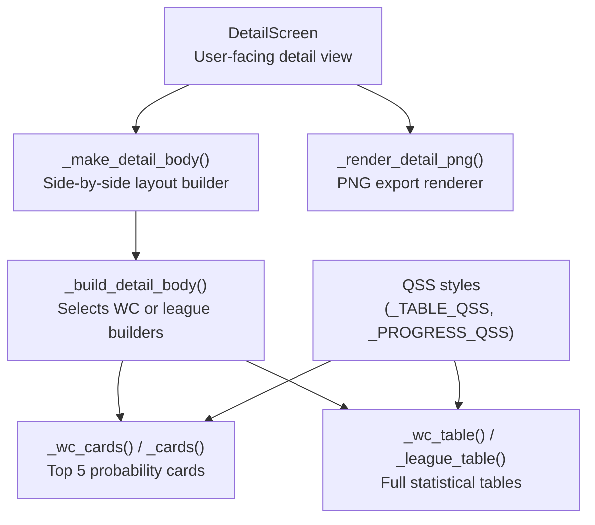
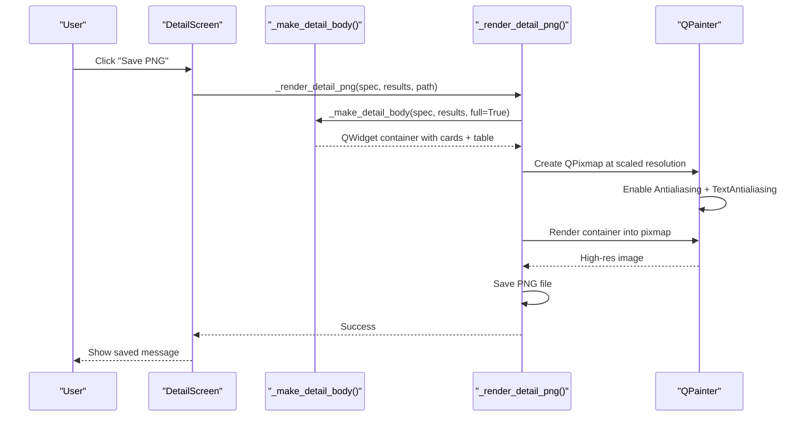
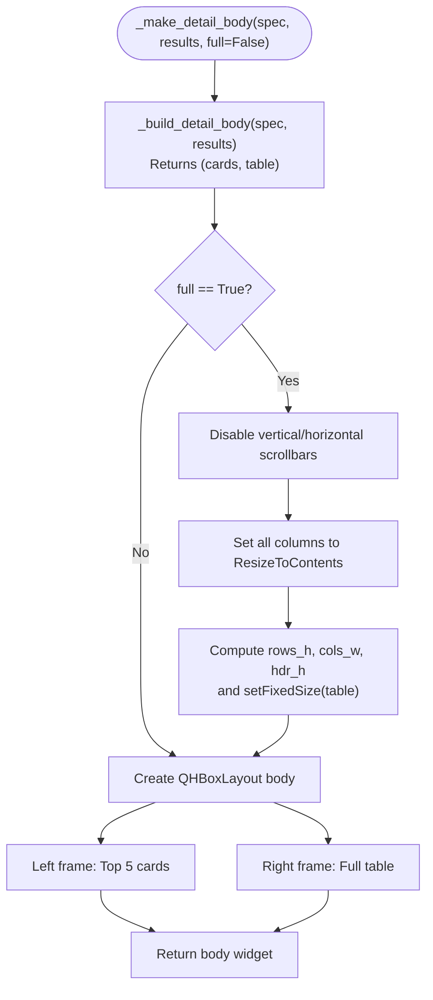
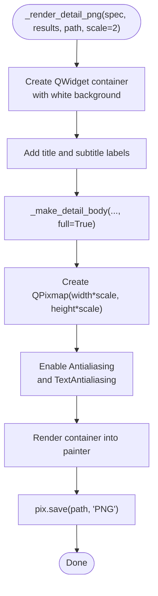
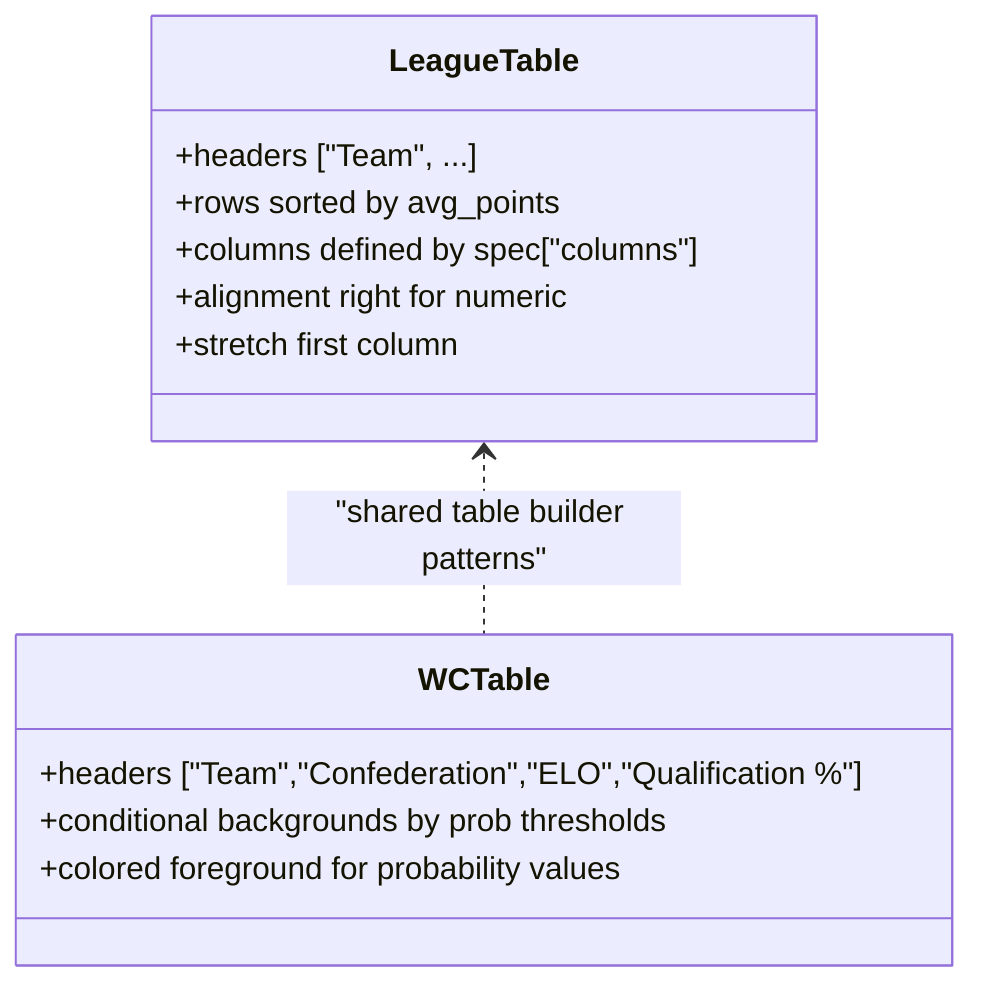
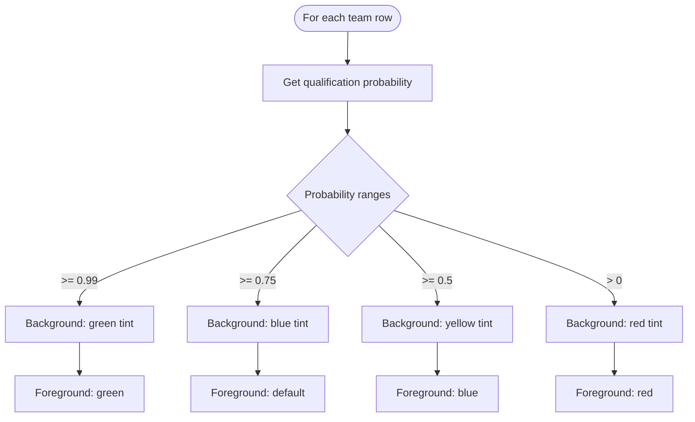
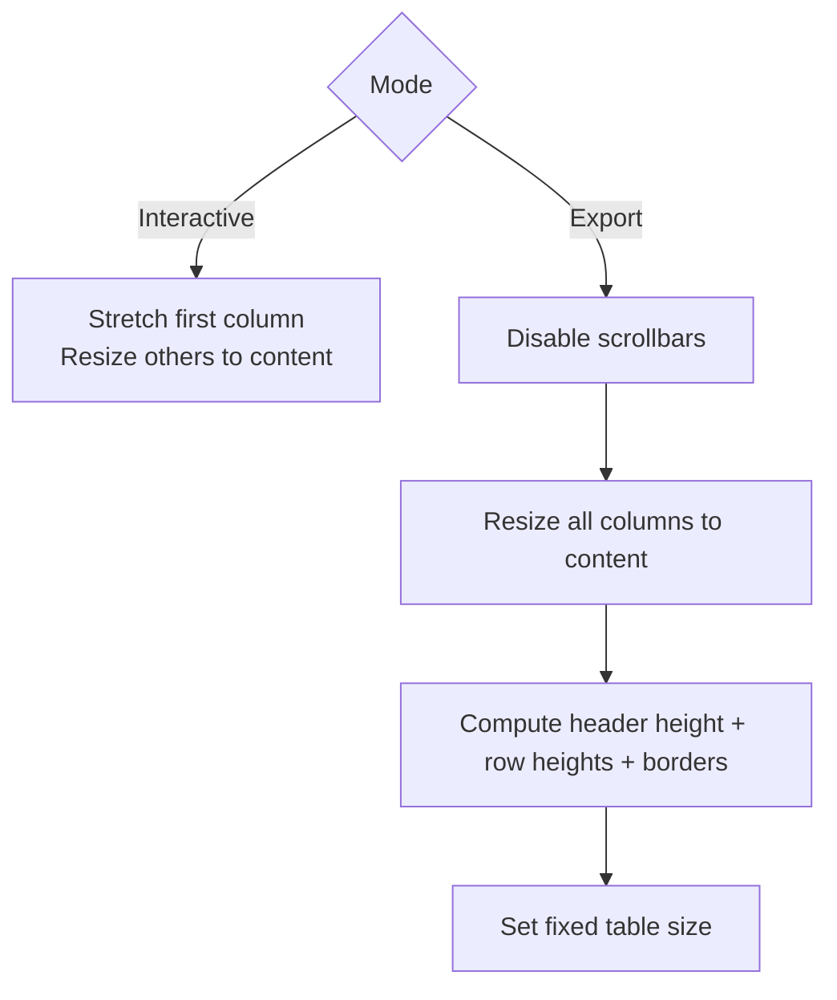
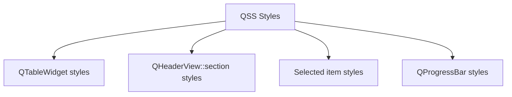
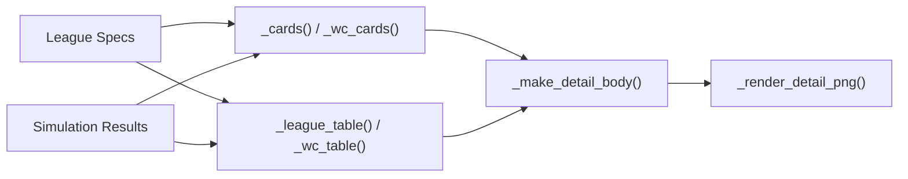

# Result Visualization and Export

<cite>
**Referenced Files in This Document**
- [DASHBOARD/main.py](file://DASHBOARD/main.py)
</cite>

## Table of Contents
1. [Introduction](#introduction)
2. [Project Structure](#project-structure)
3. [Core Components](#core-components)
4. [Architecture Overview](#architecture-overview)
5. [Detailed Component Analysis](#detailed-component-analysis)
6. [Dependency Analysis](#dependency-analysis)
7. [Performance Considerations](#performance-considerations)
8. [Troubleshooting Guide](#troubleshooting-guide)
9. [Conclusion](#conclusion)

## Introduction
This document explains the result visualization and export functionality for the simulation dashboard. It focuses on:
- How detail views are constructed with side-by-side layouts, top 5 probability cards, and full statistical tables
- The PNG export system that renders high-resolution images with scaling and anti-aliasing
- Table formatting options including headers, alignment, and color coding
- Conditional formatting for Women’s World Cup qualification probabilities
- Responsive table sizing to fit content dimensions
- Styling via Qt Style Sheets (QSS) for consistent visuals across components
- Customization points for colors, fonts, and layout spacing

## Project Structure
The visualization and export logic is implemented in a single dashboard module that composes multiple screens and reusable widgets. The relevant parts include:
- Detail view construction helpers
- Table builders for leagues and the Women’s World Cup
- PNG export renderer
- QSS style definitions
- UI screens that wire everything together

**Diagram sources**
- [DASHBOARD/main.py:612-654](file://DASHBOARD/main.py#L612-L654)
- [DASHBOARD/main.py:534-609](file://DASHBOARD/main.py#L534-L609)
- [DASHBOARD/main.py:660-686](file://DASHBOARD/main.py#L660-L686)
- [DASHBOARD/main.py:207-243](file://DASHBOARD/main.py#L207-L243)

**Section sources**
- [DASHBOARD/main.py:612-686](file://DASHBOARD/main.py#L612-L686)
- [DASHBOARD/main.py:207-243](file://DASHBOARD/main.py#L207-L243)

## Core Components
- Detail body builder: constructs the left panel (top 5 cards) and right panel (full table), with responsive sizing when exporting as PNG.
- Card builders: generate ranked probability cards for leagues and the Women’s World Cup.
- Table builders: create formatted tables with headers, aligned numeric columns, and conditional coloring for WC qualification probabilities.
- PNG exporter: renders the detail view into a high-resolution image with antialiasing and proper scaling.
- QSS styling: defines consistent visual appearance for tables, progress bars, and other UI elements.

**Section sources**
- [DASHBOARD/main.py:534-609](file://DASHBOARD/main.py#L534-L609)
- [DASHBOARD/main.py:612-686](file://DASHBOARD/main.py#L612-L686)
- [DASHBOARD/main.py:207-243](file://DASHBOARD/main.py#L207-L243)

## Architecture Overview
The detail screen composes the visualization and export pipeline:

**Diagram sources**
- [DASHBOARD/main.py:1517-1562](file://DASHBOARD/main.py#L1517-L1562)
- [DASHBOARD/main.py:618-654](file://DASHBOARD/main.py#L618-L654)
- [DASHBOARD/main.py:660-686](file://DASHBOARD/main.py#L660-L686)

## Detailed Component Analysis

### Detail View Construction: _build_detail_body and _make_detail_body
- _build_detail_body selects the appropriate card and table builders based on whether the spec represents the Women’s World Cup or a league.
- _make_detail_body builds a horizontal layout with:
  - Left panel: “Top 5 — by probability” header and five StatCard widgets
  - Right panel: “Full table” header and the complete statistical table
- When full=True (used during PNG export), it disables scrollbars, sets column resize modes to fit content, computes exact table size from header and row heights, and fixes the table dimensions for rendering.

**Diagram sources**
- [DASHBOARD/main.py:612-654](file://DASHBOARD/main.py#L612-L654)

**Section sources**
- [DASHBOARD/main.py:612-654](file://DASHBOARD/main.py#L612-L654)

### PNG Export System: _render_detail_png
- Creates an off-screen container widget with white background and margins.
- Adds title and subtitle labels using the spec’s accent color.
- Builds the detail body with full=True so the table is sized precisely.
- Renders the container into a QPixmap at a user-defined scale factor (default 2x).
- Enables antialiasing and text antialiasing for crisp output.
- Saves the resulting image to the specified PNG path.

**Diagram sources**
- [DASHBOARD/main.py:660-686](file://DASHBOARD/main.py#L660-L686)

**Section sources**
- [DASHBOARD/main.py:660-686](file://DASHBOARD/main.py#L660-L686)

### Table Formatting Options
- Headers:
  - League tables use dynamic headers built from the spec’s columns list, prefixed with “Team”.
  - WC tables use fixed headers: Team, Confederation, ELO, Qualification %.
- Data alignment:
  - Numeric columns are right-aligned and vertically centered.
  - Team names and confederation labels are appropriately aligned.
- Column sizing:
  - First column (Team) stretches; subsequent columns resize to content.
  - In full mode (PNG export), all columns are resized to content and the table is fixed-sized.
- Alternating rows and editability:
  - Alternating row colors enabled.
  - Edit triggers disabled for read-only display.

**Diagram sources**
- [DASHBOARD/main.py:551-579](file://DASHBOARD/main.py#L551-L579)
- [DASHBOARD/main.py:582-609](file://DASHBOARD/main.py#L582-L609)

**Section sources**
- [DASHBOARD/main.py:551-609](file://DASHBOARD/main.py#L551-L609)

### Conditional Formatting for Women’s World Cup Qualification Probabilities
- Background colors indicate likelihood levels:
  - Very high probability: green tint
  - High probability: blue tint
  - Medium probability: yellow tint
  - Low probability: red tint
- Foreground color for probability values:
  - Green for very high probability
  - Blue for medium or higher
  - Red for low probability
- These rules apply to each row’s team name cell (background) and probability value cell (foreground).

**Diagram sources**
- [DASHBOARD/main.py:590-608](file://DASHBOARD/main.py#L590-L608)

**Section sources**
- [DASHBOARD/main.py:590-608](file://DASHBOARD/main.py#L590-L608)

### Responsive Table Sizing
- In interactive mode (full=False):
  - First column stretches to fill available width.
  - Other columns resize to content.
- In export mode (full=True):
  - Scrollbars are disabled.
  - All columns are set to ResizeToContents.
  - Table size is computed from header height plus sum of row heights and frame borders, ensuring the exported image captures the entire table without clipping.

**Diagram sources**
- [DASHBOARD/main.py:621-632](file://DASHBOARD/main.py#L621-L632)

**Section sources**
- [DASHBOARD/main.py:621-632](file://DASHBOARD/main.py#L621-L632)

### Styling System Using Qt Style Sheets (QSS)
- Table styling:
  - White background with alternating row colors
  - Border and rounded corners
  - Gridline color
  - Header section styled with dark background and white bold text
  - Selected item styling with blue background and white text
- Progress bar styling:
  - Gradient chunk color
  - Rounded borders
  - Centered text with bold font
- These styles ensure consistent visual appearance across all components.

**Diagram sources**
- [DASHBOARD/main.py:207-243](file://DASHBOARD/main.py#L207-L243)

**Section sources**
- [DASHBOARD/main.py:207-243](file://DASHBOARD/main.py#L207-L243)

### Customization Options
- Colors:
  - Accent colors per league/spec control card borders, headers, and button highlights.
  - Table and progress bar colors are defined centrally in QSS.
- Fonts:
  - Segoe UI is used consistently for headings, labels, and data cells.
  - Font sizes vary by component (e.g., larger for titles, smaller for table data).
- Layout spacing:
  - Margins and spacing are configured in layout managers for frames and containers.
  - Export containers add extra padding for better visual framing.

**Section sources**
- [DASHBOARD/main.py:618-654](file://DASHBOARD/main.py#L618-L654)
- [DASHBOARD/main.py:660-686](file://DASHBOARD/main.py#L660-L686)
- [DASHBOARD/main.py:207-243](file://DASHBOARD/main.py#L207-L243)

## Dependency Analysis
The visualization and export components depend on:
- Spec definitions for league metadata (titles, subtitles, accent colors, column definitions)
- Results dictionaries containing probabilities and statistics
- Qt framework classes for UI composition and rendering

**Diagram sources**
- [DASHBOARD/main.py:534-609](file://DASHBOARD/main.py#L534-L609)
- [DASHBOARD/main.py:618-686](file://DASHBOARD/main.py#L618-L686)

**Section sources**
- [DASHBOARD/main.py:534-686](file://DASHBOARD/main.py#L534-L686)

## Performance Considerations
- Rendering performance:
  - Off-screen rendering avoids unnecessary UI updates during export.
  - Scaling factor controls output resolution; higher scales increase memory and processing time.
- Table sizing:
  - Computing exact table dimensions prevents clipping and reduces reflows during export.
- Antialiasing:
  - Enabling antialiasing improves visual quality but may slightly impact render time.

[No sources needed since this section provides general guidance]

## Troubleshooting Guide
- PNG export fails:
  - Ensure the target path is writable and ends with .png.
  - Check for exceptions raised during pix.save and handle them gracefully.
- Missing dependencies for video export:
  - MP4 export requires opencv-python and numpy; install if not present.
- Visual issues:
  - Verify QSS styles are applied correctly.
  - Confirm fonts are available on the system.

**Section sources**
- [DASHBOARD/main.py:660-686](file://DASHBOARD/main.py#L660-L686)
- [DASHBOARD/main.py:1373-1456](file://DASHBOARD/main.py#L1373-L1456)

## Conclusion
The result visualization and export system provides a robust, customizable interface for displaying simulation outcomes. It combines structured detail views, conditional formatting, responsive table sizing, and high-quality PNG exports. The styling system ensures consistency across components, while customization points allow adaptation to different themes and requirements.

[No sources needed since this section summarizes without analyzing specific files]