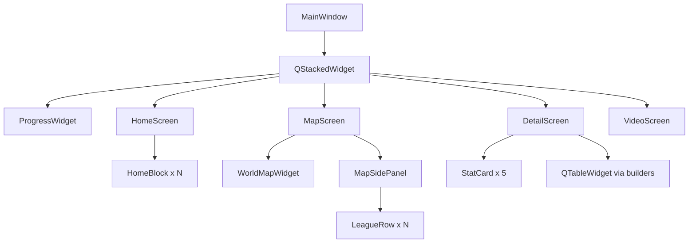
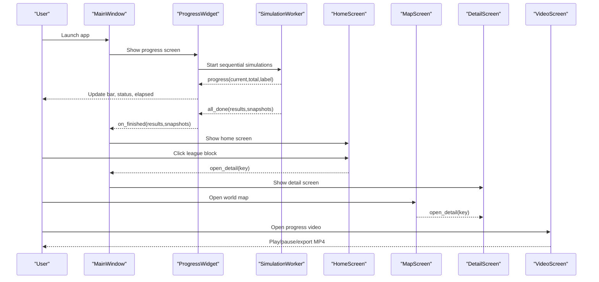
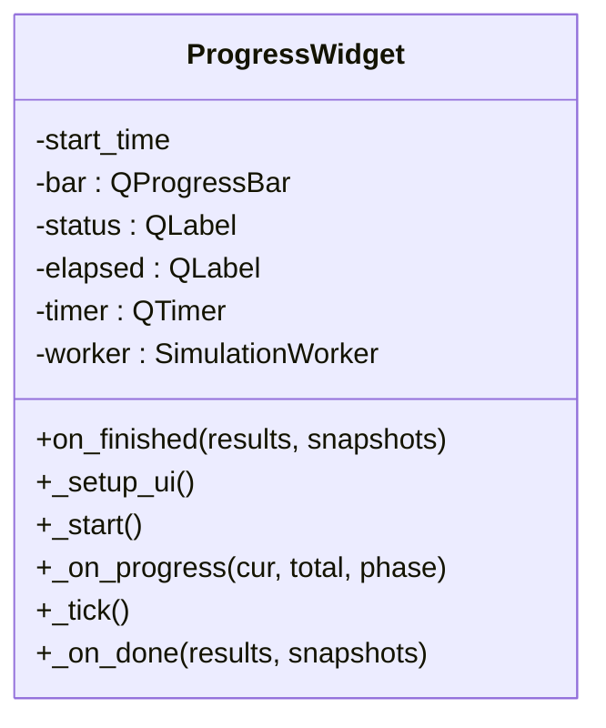
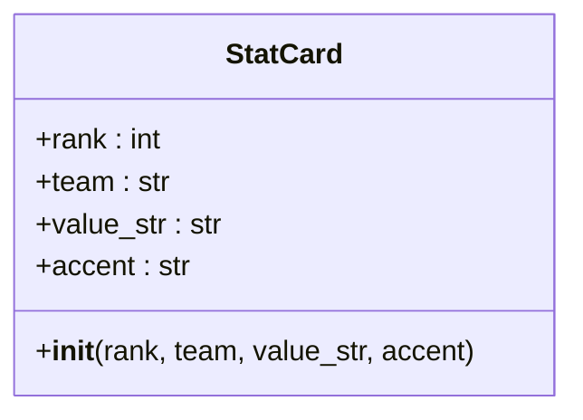
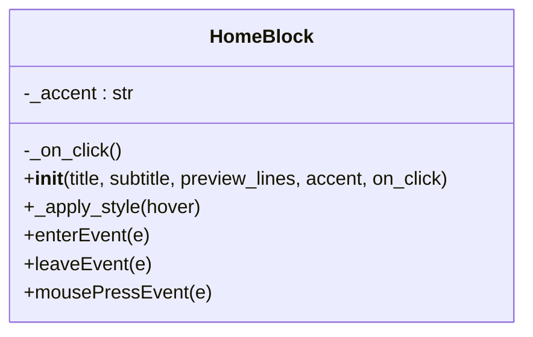
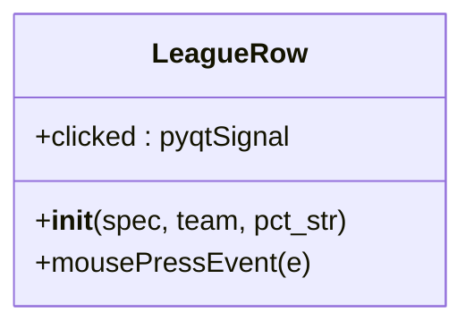
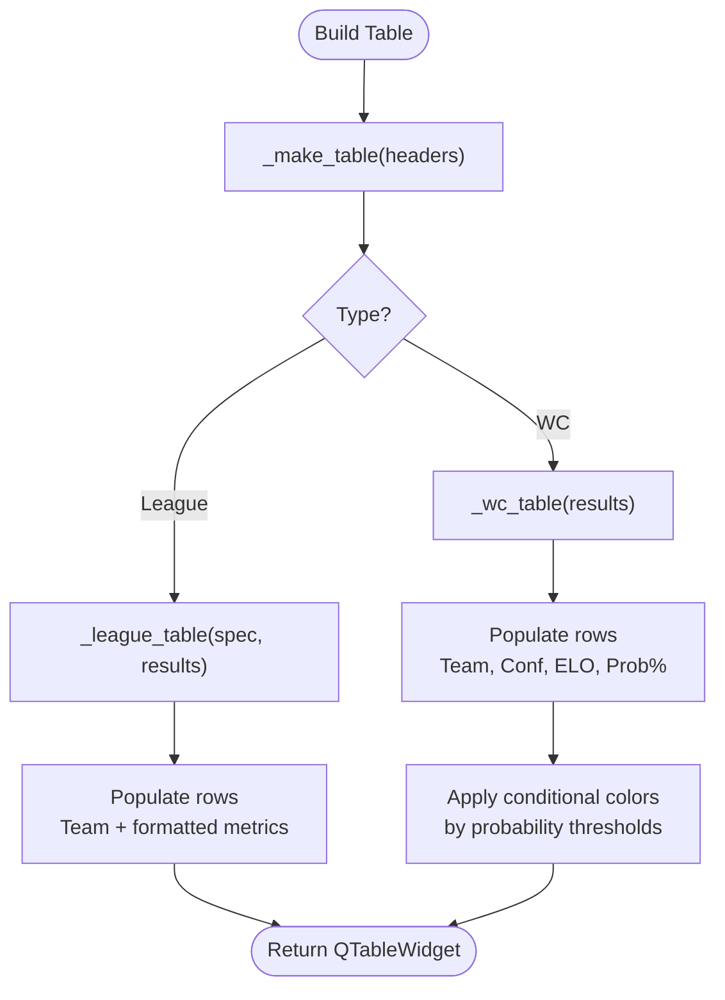
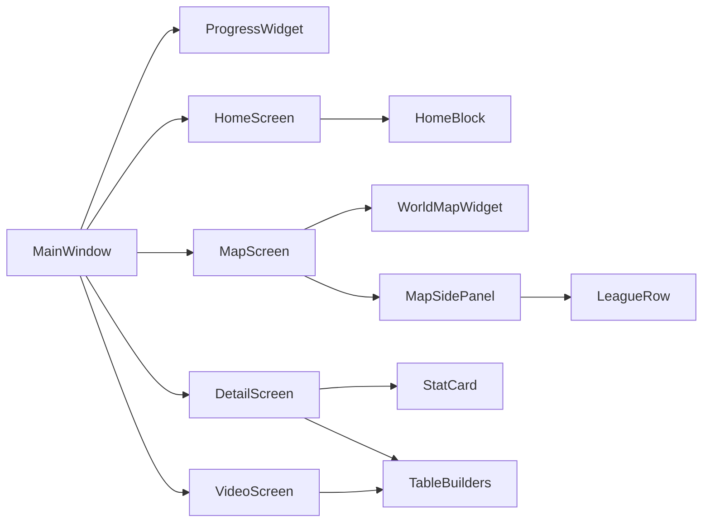

# UI Components and Widgets

<cite>
**Referenced Files in This Document**
- [main.py](file://DASHBOARD/main.py)
</cite>

## Table of Contents
1. [Introduction](#introduction)
2. [Project Structure](#project-structure)
3. [Core Components](#core-components)
4. [Architecture Overview](#architecture-overview)
5. [Detailed Component Analysis](#detailed-component-analysis)
6. [Dependency Analysis](#dependency-analysis)
7. [Performance Considerations](#performance-considerations)
8. [Troubleshooting Guide](#troubleshooting-guide)
9. [Conclusion](#conclusion)

## Introduction
This document explains the custom PyQt5 UI components used throughout the Simulation Dashboard. It focuses on:
- StatCard for displaying top team statistics with rank, team name, and probability values
- HomeBlock widget used in a grid layout for league selection with hover effects and click handling
- LeagueRow component for displaying league information with accent colors and probability indicators
- ProgressWidget implementation showing simulation progress with a unified progress bar, status updates, and elapsed time tracking
- Reusable table builder functions (_make_table, _league_table, _wc_table) that create consistent data visualization across different leagues

It also covers styling patterns, event handling mechanisms, and responsive design considerations for each component.

## Project Structure
The dashboard is implemented as a single-file application under DASHBOARD/main.py. It defines:
- Custom widgets (ProgressWidget, StatCard, HomeBlock, LeagueRow, WorldMapWidget, MapSidePanel, MapScreen, VideoScreen, HomeScreen, DetailScreen, MainWindow)
- Shared helpers for tables, previews, cards, PNG export, and video playback
- A stacked navigation flow from Progress -> Home -> World Map -> Detail -> Video

**Diagram sources**
- [main.py:1568-1629](file://DASHBOARD/main.py#L1568-L1629)
- [main.py:339-409](file://DASHBOARD/main.py#L339-L409)
- [main.py:415-479](file://DASHBOARD/main.py#L415-L479)
- [main.py:482-507](file://DASHBOARD/main.py#L482-L507)
- [main.py:742-907](file://DASHBOARD/main.py#L742-L907)
- [main.py:913-1003](file://DASHBOARD/main.py#L913-L1003)
- [main.py:1037-1265](file://DASHBOARD/main.py#L1037-L1265)
- [main.py:1462-1511](file://DASHBOARD/main.py#L1462-L1511)
- [main.py:1517-1562](file://DASHBOARD/main.py#L1517-L1562)

**Section sources**
- [main.py:1-13](file://DASHBOARD/main.py#L1-L13)
- [main.py:1568-1629](file://DASHBOARD/main.py#L1568-L1629)

## Core Components
This section documents the key reusable UI components and their responsibilities.

- ProgressWidget: Displays a unified progress bar, current phase/status text, and an elapsed-time label while simulations run in a background thread.
- StatCard: A compact card showing rank, team name, and formatted probability value with an accent-colored left border.
- HomeBlock: A clickable block used in a 2x4 grid to select a league; includes hover styling and click handling.
- LeagueRow: A row item in the map side panel showing league title, top team, and probability percentage; emits a clicked signal.
- Table builders (_make_table, _league_table, _wc_table): Create styled QTableWidget instances and populate them consistently per league or World Cup.

Styling patterns:
- Consistent color palette using dark blue headers (#1a3c5e), light backgrounds (#f7f9fc), and accent colors per league.
- Rounded corners, subtle borders, and alternating row colors for readability.
- Hover states for interactive elements (HomeBlock, buttons).

Event handling:
- Click events routed through pyqtSignal for decoupled navigation (e.g., LeagueRow.clicked).
- Mouse enter/leave events for hover effects (HomeBlock).
- Timer-driven updates for elapsed time and video playback.

Responsive design:
- Stretching layouts and flexible sizing for main panels.
- Fixed heights for cards and rows to maintain visual rhythm.
- Table column resizing strategies (Stretch first column, ResizeToContents for numeric columns).

**Section sources**
- [main.py:339-409](file://DASHBOARD/main.py#L339-L409)
- [main.py:415-479](file://DASHBOARD/main.py#L415-L479)
- [main.py:482-507](file://DASHBOARD/main.py#L482-L507)
- [main.py:551-609](file://DASHBOARD/main.py#L551-L609)
- [main.py:207-243](file://DASHBOARD/main.py#L207-L243)

## Architecture Overview
The dashboard uses a stacked navigation model driven by MainWindow. Screens are added lazily and switched via QStackedWidget. Data flows from a background worker into UI screens through signals and shared results/snapshots dictionaries.

**Diagram sources**
- [main.py:1568-1629](file://DASHBOARD/main.py#L1568-L1629)
- [main.py:284-333](file://DASHBOARD/main.py#L284-L333)
- [main.py:339-409](file://DASHBOARD/main.py#L339-L409)
- [main.py:1462-1511](file://DASHBOARD/main.py#L1462-L1511)
- [main.py:968-1003](file://DASHBOARD/main.py#L968-L1003)
- [main.py:1037-1265](file://DASHBOARD/main.py#L1037-L1265)

## Detailed Component Analysis

### ProgressWidget
Purpose:
- Shows a unified progress bar over all simulations, current phase label, and elapsed time.
- Starts a background SimulationWorker and updates UI via signals.

Key behaviors:
- Initializes a QTimer to update elapsed time every 100ms.
- Connects to worker.progress to set bar value and status text.
- On completion, stops timer and calls on_finished callback.

Styling:
- Uses a shared QSS string for a gradient-filled progress bar with rounded corners.

**Diagram sources**
- [main.py:339-409](file://DASHBOARD/main.py#L339-L409)

**Section sources**
- [main.py:339-409](file://DASHBOARD/main.py#L339-L409)
- [main.py:229-243](file://DASHBOARD/main.py#L229-L243)

### StatCard
Purpose:
- Displays a ranked top team entry with an accent-colored left border, team name, and formatted probability.

Responsibilities:
- Fixed height and horizontal layout with rank label, team label, and value label.
- Accent color applied to rank and value labels and left border.

Styling:
- White background, subtle border, rounded corners, and accent-colored left border.

**Diagram sources**
- [main.py:415-440](file://DASHBOARD/main.py#L415-L440)

**Section sources**
- [main.py:415-440](file://DASHBOARD/main.py#L415-L440)

### HomeBlock
Purpose:
- Provides a clickable tile in the home grid for selecting a league.

Responsibilities:
- Displays title, subtitle, preview lines, and a hint label.
- Handles mouse enter/leave to change background and border color based on accent.
- Emits click via direct call to on_click callback.

Hover and interaction:
- Changes background and border on hover.
- Cursor changes to pointing hand.

**Diagram sources**
- [main.py:442-479](file://DASHBOARD/main.py#L442-L479)

**Section sources**
- [main.py:442-479](file://DASHBOARD/main.py#L442-L479)

### LeagueRow
Purpose:
- Represents a league entry in the map side panel with accent color and probability indicator.

Responsibilities:
- Displays league title, top team, and formatted probability.
- Emits a clicked signal when pressed.

Styling:
- Left accent border, white background, subtle border, and rounded corners.

**Diagram sources**
- [main.py:482-507](file://DASHBOARD/main.py#L482-L507)

**Section sources**
- [main.py:482-507](file://DASHBOARD/main.py#L482-L507)

### Table Builders: _make_table, _league_table, _wc_table
Purpose:
- Provide consistent table creation and population for league-specific and World Cup views.

Responsibilities:
- _make_table: Creates a styled QTableWidget with header configuration and alternating row colors.
- _league_table: Populates a table with teams sorted by average points and formats numeric columns per spec.
- _wc_table: Builds a World Cup table with Team, Confederation, ELO, and Qualification %, applying conditional background and foreground colors based on qualification probability thresholds.

Styling:
- Uses shared QSS for table appearance and header styling.

**Diagram sources**
- [main.py:551-609](file://DASHBOARD/main.py#L551-L609)

**Section sources**
- [main.py:551-609](file://DASHBOARD/main.py#L551-L609)
- [main.py:207-227](file://DASHBOARD/main.py#L207-L227)

## Dependency Analysis
Component relationships:
- MainWindow orchestrates screens and navigation.
- ProgressWidget depends on SimulationWorker for background execution and emits finished state to MainWindow.
- HomeScreen composes multiple HomeBlock widgets and routes clicks to open DetailScreen.
- MapScreen composes WorldMapWidget and MapSidePanel; MapSidePanel composes LeagueRow items.
- DetailScreen composes StatCard items and tables built by helper functions.
- VideoScreen uses shared table builders and snapshot interpolation utilities.

External dependencies:
- Optional opencv-python and numpy for MP4 export.

**Diagram sources**
- [main.py:1568-1629](file://DASHBOARD/main.py#L1568-L1629)
- [main.py:339-409](file://DASHBOARD/main.py#L339-L409)
- [main.py:1462-1511](file://DASHBOARD/main.py#L1462-L1511)
- [main.py:968-1003](file://DASHBOARD/main.py#L968-L1003)
- [main.py:913-965](file://DASHBOARD/main.py#L913-L965)
- [main.py:1517-1562](file://DASHBOARD/main.py#L1517-L1562)
- [main.py:1037-1265](file://DASHBOARD/main.py#L1037-L1265)
- [main.py:551-609](file://DASHBOARD/main.py#L551-L609)

**Section sources**
- [main.py:1568-1629](file://DASHBOARD/main.py#L1568-L1629)
- [main.py:1373-1456](file://DASHBOARD/main.py#L1373-L1456)

## Performance Considerations
- Background threading: Simulations run in a dedicated QThread to keep the UI responsive.
- Efficient updates: ProgressWidget updates only necessary labels and bar value; elapsed time refreshes at 10 Hz.
- Table rendering: Column widths are precomputed for export scenarios to avoid repeated layout passes.
- Video playback: Frame interpolation avoids heavy recomputation; frozen team order prevents row swapping during playback.
- Optional heavy dependencies: MP4 export requires opencv-python and numpy; missing libraries raise clear errors.

[No sources needed since this section provides general guidance]

## Troubleshooting Guide
Common issues and resolutions:
- Missing MP4 export dependencies: When exporting videos, if opencv-python or numpy are not installed, a descriptive error is raised instructing installation.
- No snapshots available: Exporting without sufficient snapshots triggers a warning dialog indicating insufficient data.
- Table export failures: PNG export raises a RuntimeError if writing fails; ensure valid file path and permissions.

Operational tips:
- Ensure the application style is Fusion and font is Segoe UI for consistent visuals.
- For large datasets, prefer fixed table sizing in export paths to reduce layout churn.

**Section sources**
- [main.py:1373-1456](file://DASHBOARD/main.py#L1373-L1456)
- [main.py:1252-1265](file://DASHBOARD/main.py#L1252-L1265)
- [main.py:660-686](file://DASHBOARD/main.py#L660-L686)
- [main.py:1624-1629](file://DASHBOARD/main.py#L1624-L1629)

## Conclusion
The dashboard’s UI is built around a small set of well-scoped, reusable components:
- StatCard, HomeBlock, and LeagueRow provide consistent, themed presentation for stats and navigation.
- ProgressWidget offers a clean, unified view of long-running simulations with real-time feedback.
- Table builders enforce consistent data visualization across leagues and special cases like the World Cup.
Together, these components enable a responsive, accessible, and visually cohesive experience across multiple screens and workflows.

[No sources needed since this section summarizes without analyzing specific files]