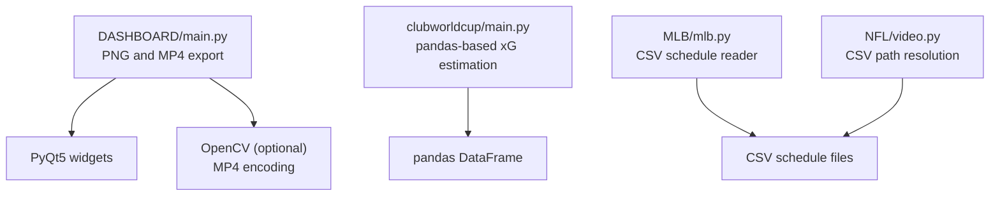
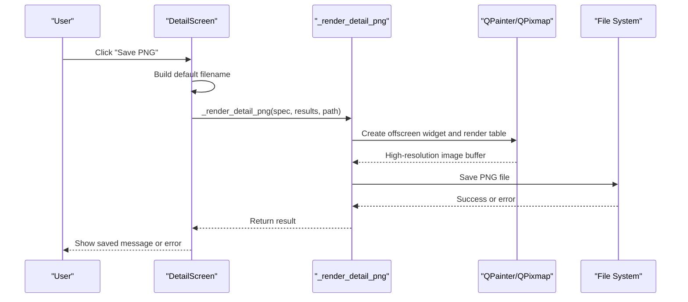
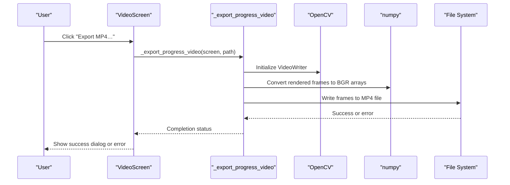
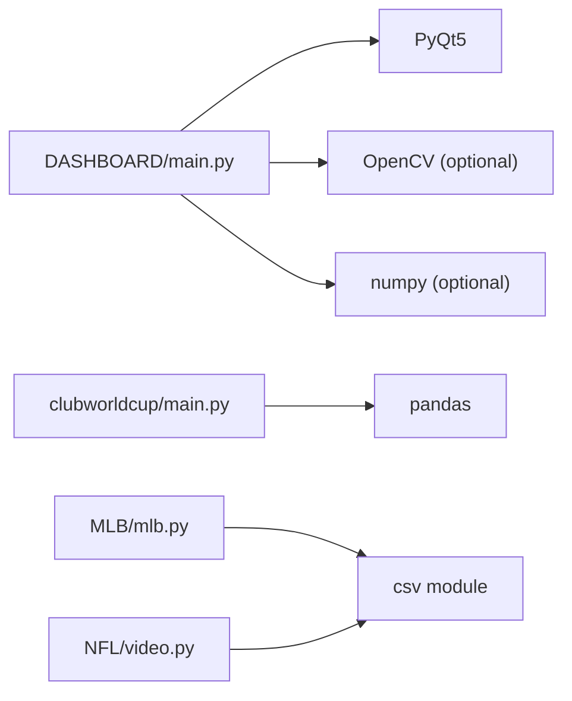

# Data Export Formats

<cite>
**Referenced Files in This Document**   
- [DASHBOARD/main.py](file://DASHBOARD/main.py)
- [MLB/mlb.py](file://MLB/mlb.py)
- [clubworldcup/main.py](file://clubworldcup/main.py)
- [womens euros/player.csv](file://womens euros/player.csv)
- [womens euros/squad.csv](file://womens euros/squad.csv)
- [NFL/video.py](file://NFL/video.py)
</cite>

## Table of Contents
1. [Introduction](#introduction)
2. [Project Structure](#project-structure)
3. [Core Components](#core-components)
4. [Architecture Overview](#architecture-overview)
5. [Detailed Component Analysis](#detailed-component-analysis)
6. [Dependency Analysis](#dependency-analysis)
7. [Performance Considerations](#performance-considerations)
8. [Troubleshooting Guide](#troubleshooting-guide)
9. [Conclusion](#conclusion)

## Introduction
This document explains the data export functionality and supported formats across the sports analysis repository. It focuses on:
- CSV generation and consumption patterns
- Image export capabilities for reports and dashboards
- Report formatting options, including table layouts and visual styling
- Export data structures, field mappings, and customization options
- Integration with external tools such as OpenCV and pandas
- File naming conventions and batch-oriented workflows
- Examples of exported data formats, template usage, and automated reporting flows
- Data transformation processes and compatibility with common analysis tools

The primary export surface is the simulation dashboard, which renders Monte Carlo results into tables and exports them as PNG images or MP4 progress videos. Other modules demonstrate CSV input/output patterns used by analysis scripts.

## Project Structure
The export-related code is concentrated in a few areas:
- The simulation dashboard handles UI-driven image and video export.
- Several analysis scripts read or write CSV files for data exchange.
- External tool integrations include OpenCV for video encoding and pandas for tabular processing.

**Diagram sources**
- [DASHBOARD/main.py:657-686](file://DASHBOARD/main.py#L657-L686)
- [DASHBOARD/main.py:1089-1097](file://DASHBOARD/main.py#L1089-L1097)
- [DASHBOARD/main.py:1251-1265](file://DASHBOARD/main.py#L1251-L1265)
- [DASHBOARD/main.py:1373-1456](file://DASHBOARD/main.py#L1373-L1456)
- [clubworldcup/main.py:1-31](file://clubworldcup/main.py#L1-L31)
- [MLB/mlb.py:134-157](file://MLB/mlb.py#L134-L157)
- [NFL/video.py:107-137](file://NFL/video.py#L107-L137)

**Section sources**
- [DASHBOARD/main.py:1-13](file://DASHBOARD/main.py#L1-L13)
- [DASHBOARD/main.py:657-686](file://DASHBOARD/main.py#L657-L686)
- [DASHBOARD/main.py:1089-1097](file://DASHBOARD/main.py#L1089-L1097)
- [DASHBOARD/main.py:1251-1265](file://DASHBOARD/main.py#L1251-L1265)
- [DASHBOARD/main.py:1373-1456](file://DASHBOARD/main.py#L1373-L1456)
- [clubworldcup/main.py:1-31](file://clubworldcup/main.py#L1-L31)
- [MLB/mlb.py:134-157](file://MLB/mlb.py#L134-L157)
- [NFL/video.py:107-137](file://NFL/video.py#L107-L137)

## Core Components
- Simulation dashboard export:
  - PNG export of predicted league tables and top-5 cards.
  - MP4 export of animated progression across simulations.
- CSV handling:
  - Reading schedules and datasets from CSV.
  - Applying transformations using pandas where applicable.
- External tool integration:
  - OpenCV for MP4 encoding.
  - pandas for DataFrame operations.

Key responsibilities:
- Rendering report-like visuals for export.
- Managing file naming and user-selected paths.
- Handling optional dependencies gracefully.

**Section sources**
- [DASHBOARD/main.py:657-686](file://DASHBOARD/main.py#L657-L686)
- [DASHBOARD/main.py:1089-1097](file://DASHBOARD/main.py#L1089-L1097)
- [DASHBOARD/main.py:1251-1265](file://DASHBOARD/main.py#L1251-L1265)
- [DASHBOARD/main.py:1373-1456](file://DASHBOARD/main.py#L1373-L1456)
- [clubworldcup/main.py:1-31](file://clubworldcup/main.py#L1-L31)
- [MLB/mlb.py:134-157](file://MLB/mlb.py#L134-L157)

## Architecture Overview
The export architecture centers around the dashboard’s UI components that render final outputs and delegate to external libraries when needed.

**Diagram sources**
- [DASHBOARD/main.py:1539-1562](file://DASHBOARD/main.py#L1539-L1562)
- [DASHBOARD/main.py:657-686](file://DASHBOARD/main.py#L657-L686)

**Diagram sources**
- [DASHBOARD/main.py:1089-1097](file://DASHBOARD/main.py#L1089-L1097)
- [DASHBOARD/main.py:1251-1265](file://DASHBOARD/main.py#L1251-L1265)
- [DASHBOARD/main.py:1373-1456](file://DASHBOARD/main.py#L1373-L1456)

## Detailed Component Analysis

### PNG Export for League Tables
The dashboard provides a “Save PNG” button on the detail screen. It constructs a default filename based on the league title and subtitle, opens a save dialog, and renders an offscreen widget containing the full table and top-5 cards. The rendering pipeline uses PyQt’s painter primitives to produce a high-resolution PNG.

- Default filename construction:
  - Uses a safe filename helper to sanitize league names.
  - Appends `.png` extension if missing.
- Rendering process:
  - Builds a hidden container widget with styled background and margins.
  - Adds title, subtitle, and the full detail body.
  - Scales the output for higher resolution.
  - Saves via QPixmap.save.

Customization options:
- Title and subtitle are derived from the league spec.
- Accent colors and fonts are applied consistently.
- Full table layout is optimized for export without scrollbars.

Field mapping and structure:
- Columns are defined per league in the LEAGUES configuration.
- Each column maps a display label to a result key and format string.
- Rows represent teams sorted by average points.

Example fields (league-specific):
- Position, Points, Title probability, Top-4/Top-5 probabilities, European qualification probabilities, Relegation probability.

**Section sources**
- [DASHBOARD/main.py:276-279](file://DASHBOARD/main.py#L276-L279)
- [DASHBOARD/main.py:657-686](file://DASHBOARD/main.py#L657-L686)
- [DASHBOARD/main.py:1539-1562](file://DASHBOARD/main.py#L1539-L1562)
- [DASHBOARD/main.py:80-199](file://DASHBOARD/main.py#L80-L199)

### MP4 Export for Progress Videos
The video screen allows exporting an animated progression of the league table over simulated time. It requires OpenCV and numpy; otherwise, it raises a clear error instructing installation.

Workflow:
- Validates snapshots availability.
- Prompts for MP4 path and ensures extension.
- Initializes OpenCV writer with chosen codec.
- Renders frames by interpolating between captured snapshots.
- Converts rendered frames to BGR arrays and writes to file.
- Shows progress dialog and completion message.

Customization options:
- Duration defaults to 500 seconds.
- Frame rate is fixed at 5 fps.
- Minimum output size is enforced to ensure readability.

Data transformation:
- Snapshots contain numeric metrics per team; interpolation smooths transitions.
- Team order is frozen based on final snapshot to avoid row swapping during playback.

External tool integration:
- OpenCV VideoWriter encodes frames to MP4.
- numpy converts QImage buffers to arrays.

**Section sources**
- [DASHBOARD/main.py:1037-1063](file://DASHBOARD/main.py#L1037-L1063)
- [DASHBOARD/main.py:1089-1097](file://DASHBOARD/main.py#L1089-L1097)
- [DASHBOARD/main.py:1251-1265](file://DASHBOARD/main.py#L1251-L1265)
- [DASHBOARD/main.py:1373-1456](file://DASHBOARD/main.py#L1373-L1456)
- [DASHBOARD/main.py:1009-1034](file://DASHBOARD/main.py#L1009-L1034)

### CSV Generation and Consumption Patterns
Several modules demonstrate CSV usage:

- MLB schedule reader:
  - Reads a CSV with columns for date, id, away_team, home_team, venue, status.
  - Normalizes team names and filters malformed rows.
  - Produces a list of game dictionaries for simulation.

- clubworldcup xG estimation:
  - Loads team-level stats from CSV using pandas.
  - Applies a formula to estimate expected goals per row.
  - Outputs selected columns including the new xG estimate.

- womens euros example:
  - Demonstrates conversion of fractional odds to normalized probabilities.
  - While not writing CSV directly, illustrates transformation logic commonly paired with CSV I/O.

- NFL video utility:
  - Resolves CSV input paths from command-line arguments or defaults.
  - Supports directory scanning for multiple CSV files.

These patterns show how CSV acts as a bridge between raw data and analysis/export pipelines.

**Section sources**
- [MLB/mlb.py:134-157](file://MLB/mlb.py#L134-L157)
- [clubworldcup/main.py:1-31](file://clubworldcup/main.py#L1-L31)
- [NFL/video.py:107-137](file://NFL/video.py#L107-L137)

### Report Formatting Options
Report formatting is primarily handled through PyQt widgets and styles:
- Table styling:
  - Alternating row colors, header backgrounds, selection highlights.
  - Fixed column widths for export stability.
- Card styling:
  - Top-5 cards use accent borders and bold typography.
- Layout:
  - Detail screens combine cards and tables in a two-column layout.
  - Export containers disable scrollbars and fix dimensions for consistent output.

Template usage:
- League specs define titles, subtitles, accents, and column definitions.
- These specs act as templates for both UI rendering and export content.

**Section sources**
- [DASHBOARD/main.py:207-227](file://DASHBOARD/main.py#L207-L227)
- [DASHBOARD/main.py:551-579](file://DASHBOARD/main.py#L551-L579)
- [DASHBOARD/main.py:618-654](file://DASHBOARD/main.py#L618-L654)
- [DASHBOARD/main.py:80-199](file://DASHBOARD/main.py#L80-L199)

### Batch Export Operations
While there is no explicit “batch export all leagues” button, the dashboard supports:
- Sequential simulation runs across multiple leagues.
- Per-league PNG export from each detail screen.
- Per-league MP4 export from the video screen.

To automate batch exports:
- Iterate over LEAGUES programmatically.
- For each league, call the PNG renderer with the appropriate spec and results.
- Optionally collect snapshots and generate MP4s per league.

This approach aligns with the existing per-league export functions and naming helpers.

**Section sources**
- [DASHBOARD/main.py:68-199](file://DASHBOARD/main.py#L68-L199)
- [DASHBOARD/main.py:657-686](file://DASHBOARD/main.py#L657-L686)
- [DASHBOARD/main.py:1251-1265](file://DASHBOARD/main.py#L1251-L1265)

### Data Transformation Processes
- Expected Goals Estimation:
  - Formula combines penalty kicks and non-penalty shots.
  - Applied row-wise to create a new xG_est column.
- Probability Normalization:
  - Fractional odds converted to implied probabilities.
  - Probabilities normalized to sum to one.

These transformations illustrate how raw CSV inputs can be enriched before export or further analysis.

**Section sources**
- [clubworldcup/main.py:10-18](file://clubworldcup/main.py#L10-L18)
- [womens euros/main.py:12-24](file://womens euros/main.py#L12-L24)

### Compatibility with Common Analysis Tools
- pandas:
  - Used for reading CSVs and applying vectorized or row-wise transformations.
- OpenCV and numpy:
  - Required for MP4 export; convert UI-rendered frames to video frames.
- Standard CSV:
  - Widely compatible with Excel, R, Python, and other analysis environments.

**Section sources**
- [clubworldcup/main.py:1-31](file://clubworldcup/main.py#L1-L31)
- [DASHBOARD/main.py:1373-1456](file://DASHBOARD/main.py#L1373-L1456)

## Dependency Analysis
The export system depends on:
- PyQt5 for UI rendering and image capture.
- Optional OpenCV and numpy for MP4 encoding.
- pandas for CSV-based data manipulation in some modules.
- Standard library csv module for low-level CSV parsing.

**Diagram sources**
- [DASHBOARD/main.py:15-31](file://DASHBOARD/main.py#L15-L31)
- [DASHBOARD/main.py:1373-1380](file://DASHBOARD/main.py#L1373-L1380)
- [clubworldcup/main.py:1-31](file://clubworldcup/main.py#L1-L31)
- [MLB/mlb.py:1-6](file://MLB/mlb.py#L1-L6)
- [NFL/video.py:107-137](file://NFL/video.py#L107-L137)

**Section sources**
- [DASHBOARD/main.py:15-31](file://DASHBOARD/main.py#L15-L31)
- [DASHBOARD/main.py:1373-1380](file://DASHBOARD/main.py#L1373-L1380)
- [clubworldcup/main.py:1-31](file://clubworldcup/main.py#L1-L31)
- [MLB/mlb.py:1-6](file://MLB/mlb.py#L1-L6)
- [NFL/video.py:107-137](file://NFL/video.py#L107-L137)

## Performance Considerations
- PNG export:
  - Offscreen rendering avoids UI overhead.
  - Scaling increases resolution but also memory usage.
- MP4 export:
  - Frame count equals fps × duration; large durations increase processing time.
  - Converting UI widgets to images per frame is CPU-intensive.
- CSV processing:
  - Row-wise transformations (e.g., apply) can be slow on large datasets; prefer vectorized operations where possible.

Recommendations:
- Limit video duration or reduce fps for faster exports.
- Use pandas vectorization instead of row-wise apply for large tables.
- Precompute team orders and headers to minimize repeated calculations.

[No sources needed since this section provides general guidance]

## Troubleshooting Guide
Common issues and resolutions:
- PNG write failure:
  - Ensure the target path is writable and has sufficient disk space.
  - Check that the filename is valid and does not conflict with existing files.
- MP4 export dependency errors:
  - Install opencv-python and numpy if missing.
  - Verify ffmpeg availability if OpenCV cannot open the output file.
- CSV path resolution:
  - Confirm file extensions and paths.
  - Use absolute paths when running scripts from different working directories.

Error messages in the code provide actionable guidance:
- PNG export raises a runtime error if saving fails.
- MP4 export raises a runtime error if OpenCV cannot initialize the writer.
- CSV readers print warnings when files are missing.

**Section sources**
- [DASHBOARD/main.py:685-686](file://DASHBOARD/main.py#L685-L686)
- [DASHBOARD/main.py:1373-1380](file://DASHBOARD/main.py#L1373-L1380)
- [MLB/mlb.py:134-138](file://MLB/mlb.py#L134-L138)

## Conclusion
The repository provides robust export capabilities centered on the simulation dashboard:
- PNG export delivers publication-ready league tables and summary cards.
- MP4 export visualizes simulation progression with smooth interpolation.
- CSV patterns support flexible data ingestion and transformation.
- External tool integrations enable advanced analytics and media production.

Users can customize report formatting via league specs, leverage pandas for data enrichment, and integrate with OpenCV for video workflows. The documented field mappings, naming conventions, and transformation examples facilitate automation and compatibility with common analysis tools.

[No sources needed since this section summarizes without analyzing specific files]