# Data Management

<cite>
**Referenced Files in This Document**
- [texttocsv.py](file://ELO/texttocsv.py)
- [findelo.py](file://worldcup26/findelo.py)
- [fullsim.py](file://worldcup26/fullsim.py)
- [former_names.csv](file://worldcup26/former_names.csv)
- [mlb.py](file://MLB/mlb.py)
- [mlb_remaining_schedule_2026.csv](file://MLB/mlb_remaining_schedule_2026.csv)
- [main.py](file://DASHBOARD/main.py)
- [video.py](file://NFL/video.py)
</cite>

## Table of Contents
1. [Introduction](#introduction)
2. [Project Structure](#project-structure)
3. [Core Components](#core-components)
4. [Architecture Overview](#architecture-overview)
5. [Detailed Component Analysis](#detailed-component-analysis)
6. [Dependency Analysis](#dependency-analysis)
7. [Performance Considerations](#performance-considerations)
8. [Troubleshooting Guide](#troubleshooting-guide)
9. [Conclusion](#conclusion)

## Introduction
This document explains the data handling and management systems across the sports analysis repository. It focuses on:
- Team rating databases and ELO storage
- Historical performance data organization
- Fixture schedule processing and match result ingestion
- Data validation procedures
- Snapshot system for animation and replay
- Data export formats, CSV generation, and external data integration
- Data migration processes, version management, and backup strategies
- Data quality checks, error handling, and recovery procedures

The goal is to make these systems understandable for both technical and non-technical users while providing precise references to source files.

## Project Structure
The repository contains multiple sport-specific modules. The data management aspects relevant to this document are primarily located in:
- ELO engine and calibration pipeline
- World Cup simulation and rating updates
- MLB schedule-driven Monte Carlo simulations
- Dashboard snapshot playback and video export
- NFL video rendering from game snapshots

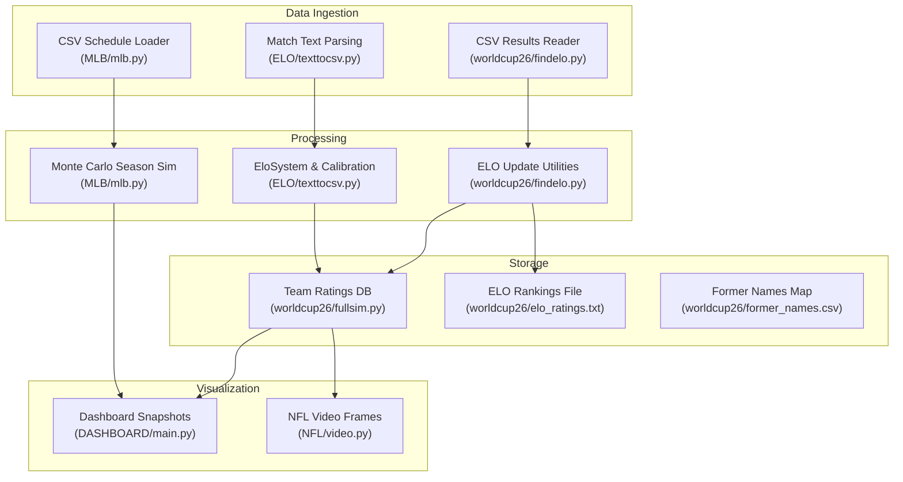

**Diagram sources**
- [texttocsv.py:183-246](file://ELO/texttocsv.py#L183-L246)
- [mlb.py:134-157](file://MLB/mlb.py#L134-L157)
- [findelo.py:146-221](file://worldcup26/findelo.py#L146-L221)
- [texttocsv.py:252-318](file://ELO/texttocsv.py#L252-L318)
- [fullsim.py:13-17](file://worldcup26/fullsim.py#L13-L17)
- [main.py:1037-1265](file://DASHBOARD/main.py#L1037-L1265)
- [video.py:372-490](file://NFL/video.py#L372-L490)

**Section sources**
- [texttocsv.py:183-246](file://ELO/texttocsv.py#L183-L246)
- [mlb.py:134-157](file://MLB/mlb.py#L134-L157)
- [findelo.py:146-221](file://worldcup26/findelo.py#L146-L221)
- [fullsim.py:13-17](file://worldcup26/fullsim.py#L13-L17)
- [main.py:1037-1265](file://DASHBOARD/main.py#L1037-L1265)
- [video.py:372-490](file://NFL/video.py#L372-L490)

## Core Components
- Team name normalization and historical match parsing
- ELO rating system with dynamic calibration
- Fixture schedule loading and Monte Carlo season simulation
- Simulation snapshot capture and interpolation for animation
- Export utilities (CSV, text rankings, MP4 video)
- Data migration via former names mapping

Key responsibilities:
- Normalize team names across heterogeneous sources
- Parse raw match logs into structured records
- Compute expected scores and update ratings
- Generate calibrated seeds per league tier
- Validate integrity and detect duplicates
- Load schedules and simulate outcomes
- Capture periodic snapshots for replay
- Export results to CSV, text, or video

**Section sources**
- [texttocsv.py:175-177](file://ELO/texttocsv.py#L175-L177)
- [texttocsv.py:183-246](file://ELO/texttocsv.py#L183-L246)
- [texttocsv.py:252-318](file://ELO/texttocsv.py#L252-L318)
- [texttocsv.py:324-356](file://ELO/texttocsv.py#L324-L356)
- [texttocsv.py:362-377](file://ELO/texttocsv.py#L362-L377)
- [mlb.py:134-157](file://MLB/mlb.py#L134-L157)
- [mlb.py:159-248](file://MLB/mlb.py#L159-L248)
- [main.py:1018-1034](file://DASHBOARD/main.py#L1018-L1034)
- [main.py:1193-1249](file://DASHBOARD/main.py#L1193-L1249)
- [video.py:372-490](file://NFL/video.py#L372-L490)

## Architecture Overview
The data pipeline integrates ingestion, processing, storage, visualization, and export.

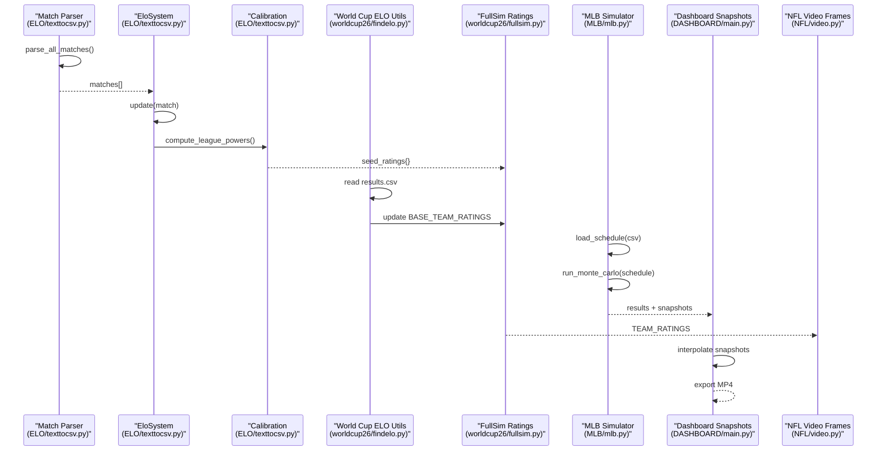

**Diagram sources**
- [texttocsv.py:183-246](file://ELO/texttocsv.py#L183-L246)
- [texttocsv.py:252-318](file://ELO/texttocsv.py#L252-L318)
- [texttocsv.py:324-356](file://ELO/texttocsv.py#L324-L356)
- [findelo.py:146-221](file://worldcup26/findelo.py#L146-L221)
- [fullsim.py:13-17](file://worldcup26/fullsim.py#L13-L17)
- [mlb.py:134-157](file://MLB/mlb.py#L134-L157)
- [mlb.py:159-248](file://MLB/mlb.py#L159-L248)
- [main.py:1018-1034](file://DASHBOARD/main.py#L1018-L1034)
- [main.py:1193-1249](file://DASHBOARD/main.py#L1193-L1249)
- [video.py:372-490](file://NFL/video.py#L372-L490)

## Detailed Component Analysis

### Team Name Normalization and Match Parsing
- Purpose: Standardize team names and extract structured match records from raw text files.
- Key behaviors:
  - Alias mapping consolidates variations of team names.
  - Regex-based parser extracts dates, home/away teams, and scores.
  - Chronological sorting ensures consistent ordering for downstream processing.

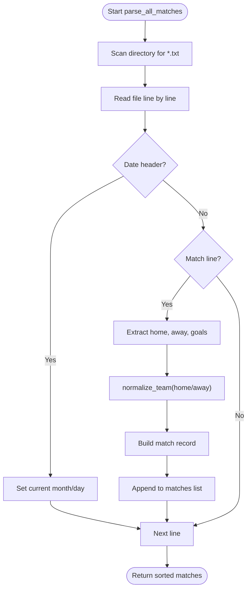

**Diagram sources**
- [texttocsv.py:183-246](file://ELO/texttocsv.py#L183-L246)

**Section sources**
- [texttocsv.py:175-177](file://ELO/texttocsv.py#L175-L177)
- [texttocsv.py:183-246](file://ELO/texttocsv.py#L183-L246)

### ELO Rating System and Dynamic Calibration
- Purpose: Maintain team ratings and calibrate league tiers using a two-pass approach.
- Key behaviors:
  - Expected score calculation based on rating differences and home advantage.
  - Goal-difference multiplier adjusts K-factor for decisive games.
  - Two-pass calibration derives league power and seeds initial ratings per league.

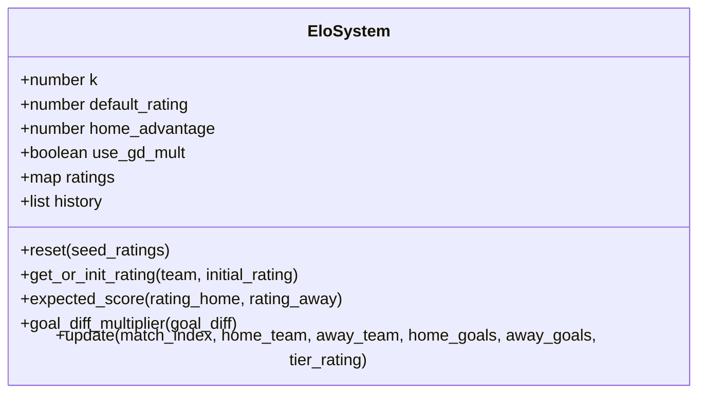

**Diagram sources**
- [texttocsv.py:252-318](file://ELO/texttocsv.py#L252-L318)

**Section sources**
- [texttocsv.py:252-318](file://ELO/texttocsv.py#L252-L318)
- [texttocsv.py:324-356](file://ELO/texttocsv.py#L324-L356)

### Fixture Schedule Processing and Match Result Ingestion
- Purpose: Load scheduled fixtures and ingest match results to drive simulations.
- Key behaviors:
  - CSV loader reads date, IDs, away/home teams, venue, status; normalizes team names.
  - Monte Carlo simulation iterates through schedule, updates win probabilities and ELOs, and projects playoffs.

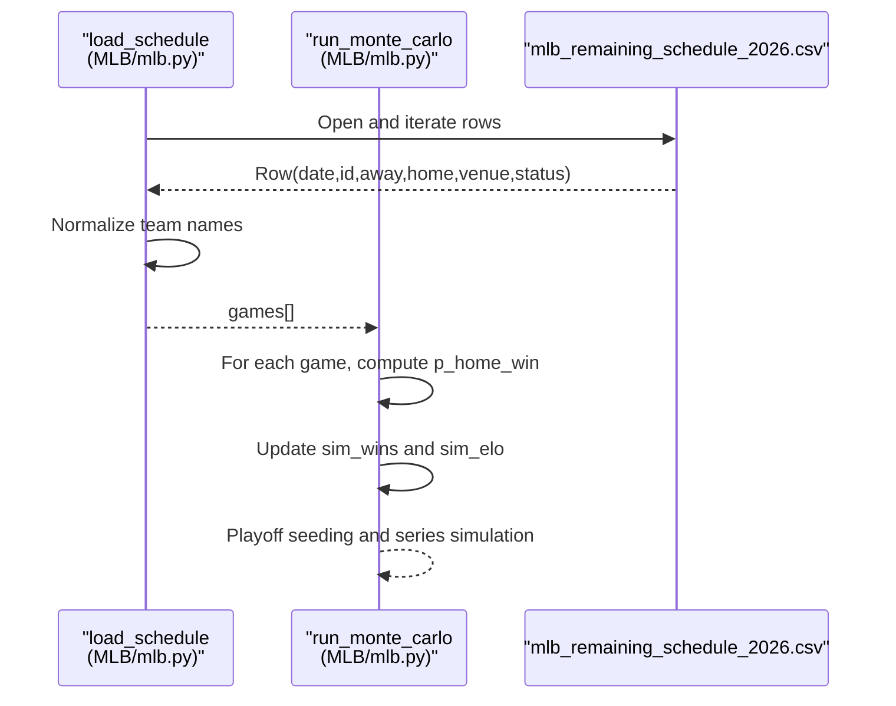

**Diagram sources**
- [mlb.py:134-157](file://MLB/mlb.py#L134-L157)
- [mlb.py:159-248](file://MLB/mlb.py#L159-L248)

**Section sources**
- [mlb.py:134-157](file://MLB/mlb.py#L134-L157)
- [mlb.py:159-248](file://MLB/mlb.py#L159-L248)
- [mlb_remaining_schedule_2026.csv:1-200](file://MLB/mlb_remaining_schedule_2026.csv#L1-L200)

### Data Validation Procedures
- Purpose: Ensure data integrity and detect anomalies such as duplicate or unmerged teams.
- Key behaviors:
  - Validates team name similarity and rating divergence to flag potential duplicates.
  - Provides warnings when suspicious pairs are detected.

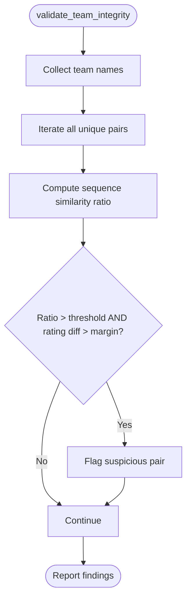

**Diagram sources**
- [texttocsv.py:362-377](file://ELO/texttocsv.py#L362-L377)

**Section sources**
- [texttocsv.py:362-377](file://ELO/texttocsv.py#L362-L377)

### Snapshot System for Animation and Replay
- Purpose: Capture periodic states during simulations to enable smooth animations and replays.
- Key behaviors:
  - Interpolates between snapshots to produce frames at desired frame rates.
  - Freezes team row order to prevent visual jitter during playback.
  - Exports progress videos using OpenCV when available.

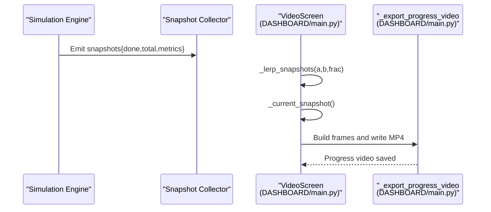

**Diagram sources**
- [main.py:1018-1034](file://DASHBOARD/main.py#L1018-L1034)
- [main.py:1193-1249](file://DASHBOARD/main.py#L1193-L1249)
- [main.py:1373-1400](file://DASHBOARD/main.py#L1373-L1400)

**Section sources**
- [main.py:1018-1034](file://DASHBOARD/main.py#L1018-L1034)
- [main.py:1193-1249](file://DASHBOARD/main.py#L1193-L1249)
- [main.py:1373-1400](file://DASHBOARD/main.py#L1373-L1400)

### NFL Video Rendering from Game Snapshots
- Purpose: Generate frames from per-game snapshots for animated table visuals.
- Key behaviors:
  - Builds snapshots per match by applying results to team stats.
  - Renders ranked tables with formatted statistics.
  - Precomputes frame distribution across snapshots for consistent playback speed.

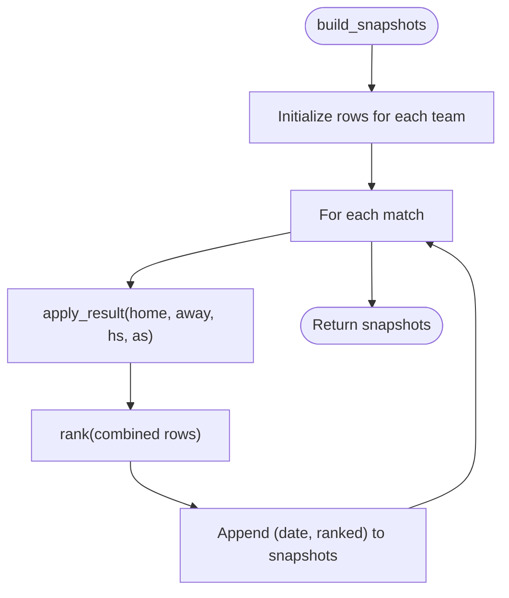

**Diagram sources**
- [video.py:372-383](file://NFL/video.py#L372-L383)

**Section sources**
- [video.py:372-490](file://NFL/video.py#L372-L490)
- [video.py:502-511](file://NFL/video.py#L502-L511)

### Data Export Formats and CSV Generation
- Purpose: Provide standardized outputs for consumption by other tools or dashboards.
- Key behaviors:
  - Writes ELO rankings to a human-readable text file.
  - Reads CSV results to update internal ratings and optionally modify code constants.
  - Exports simulation progress as MP4 video.

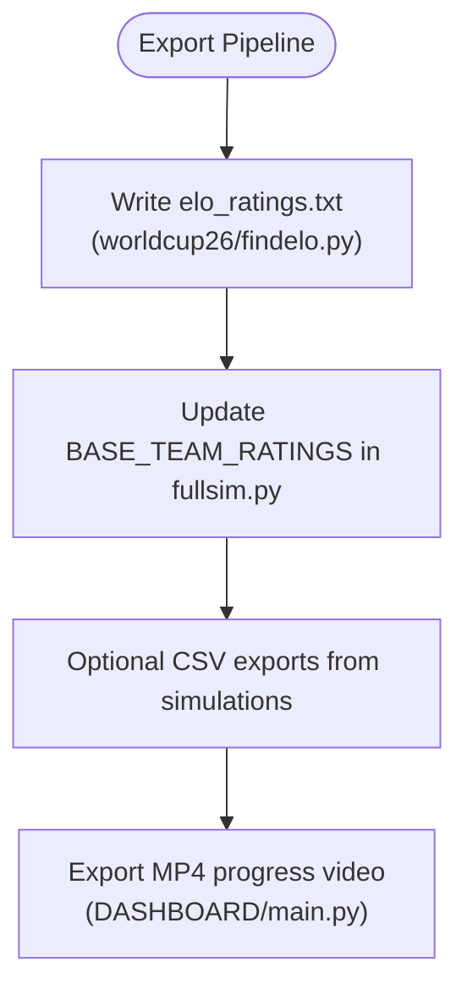

**Diagram sources**
- [findelo.py:198-216](file://worldcup26/findelo.py#L198-L216)
- [findelo.py:91-144](file://worldcup26/findelo.py#L91-L144)
- [main.py:1373-1400](file://DASHBOARD/main.py#L1373-L1400)

**Section sources**
- [findelo.py:198-216](file://worldcup26/findelo.py#L198-L216)
- [findelo.py:91-144](file://worldcup26/findelo.py#L91-L144)
- [main.py:1373-1400](file://DASHBOARD/main.py#L1373-L1400)

### Data Migration Processes and Version Management
- Purpose: Handle historical team name changes and maintain consistency across datasets.
- Key behaviors:
  - Maintains a mapping of current names to former names with effective date ranges.
  - Supports renaming and merging of entities over time.

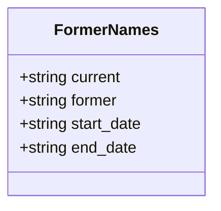

**Diagram sources**
- [former_names.csv:1-36](file://worldcup26/former_names.csv#L1-L36)

**Section sources**
- [former_names.csv:1-36](file://worldcup26/former_names.csv#L1-L36)

### Backup Strategies and Recovery Procedures
- Purpose: Ensure resilience against corrupted or incomplete datasets.
- Key behaviors:
  - Graceful handling of missing files and invalid inputs.
  - Logging and raising exceptions for critical failures.
  - Defensive parsing that skips malformed lines and validates required fields.

Recovery recommendations:
- Validate input paths before processing.
- Use try/except blocks around file operations.
- Log errors and continue where possible.
- Maintain backups of original CSVs and generated artifacts.

**Section sources**
- [findelo.py:218-221](file://worldcup26/findelo.py#L218-L221)
- [mlb.py:134-157](file://MLB/mlb.py#L134-L157)

## Dependency Analysis
The components exhibit clear separation of concerns:
- Ingestion modules depend only on standard libraries and CSV/text parsing.
- ELO logic depends on match records and produces ratings and history.
- Simulation modules depend on ratings and schedule data.
- Visualization depends on snapshots and results produced by simulations.

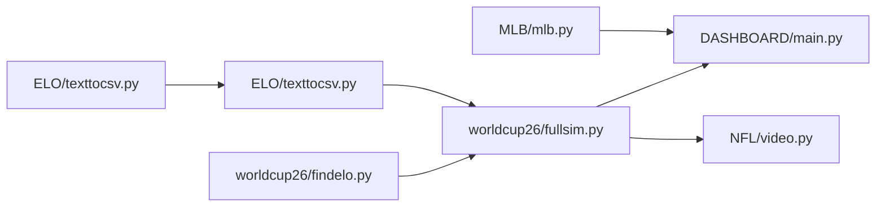

**Diagram sources**
- [texttocsv.py:183-246](file://ELO/texttocsv.py#L183-L246)
- [texttocsv.py:252-318](file://ELO/texttocsv.py#L252-L318)
- [findelo.py:146-221](file://worldcup26/findelo.py#L146-L221)
- [fullsim.py:13-17](file://worldcup26/fullsim.py#L13-L17)
- [mlb.py:159-248](file://MLB/mlb.py#L159-L248)
- [main.py:1037-1265](file://DASHBOARD/main.py#L1037-L1265)
- [video.py:372-490](file://NFL/video.py#L372-L490)

**Section sources**
- [texttocsv.py:183-246](file://ELO/texttocsv.py#L183-L246)
- [texttocsv.py:252-318](file://ELO/texttocsv.py#L252-L318)
- [findelo.py:146-221](file://worldcup26/findelo.py#L146-L221)
- [fullsim.py:13-17](file://worldcup26/fullsim.py#L13-L17)
- [mlb.py:159-248](file://MLB/mlb.py#L159-L248)
- [main.py:1037-1265](file://DASHBOARD/main.py#L1037-L1265)
- [video.py:372-490](file://NFL/video.py#L372-L490)

## Performance Considerations
- Parsing large directories of match logs benefits from regex optimization and early filtering.
- ELO updates should be vectorized where possible; current implementations are straightforward but may scale linearly with matches.
- Monte Carlo simulations can be parallelized across independent runs to reduce runtime.
- Snapshot interpolation and video export require careful memory management to avoid excessive RAM usage.
- NFL frame rendering uses multiprocessing helpers to distribute workload.

[No sources needed since this section provides general guidance]

## Troubleshooting Guide
Common issues and resolutions:
- Missing CSV files: Ensure correct paths and permissions; handle FileNotFoundError gracefully.
- Malformed match lines: Skip invalid entries and log warnings.
- Duplicate team names: Run validation to detect and merge aliases.
- Video export failures: Install required dependencies (OpenCV, NumPy) and ensure sufficient snapshots exist.

**Section sources**
- [findelo.py:218-221](file://worldcup26/findelo.py#L218-L221)
- [mlb.py:134-157](file://MLB/mlb.py#L134-L157)
- [main.py:1373-1400](file://DASHBOARD/main.py#L1373-L1400)

## Conclusion
The repository implements a robust data management system spanning ingestion, processing, storage, visualization, and export. It supports team rating databases, ELO calculations, fixture scheduling, match result ingestion, validation, snapshots for animation, and multi-format exports. With clear separation of concerns and defensive error handling, it provides a solid foundation for extending and maintaining sports analytics workflows.

[No sources needed since this section summarizes without analyzing specific files]