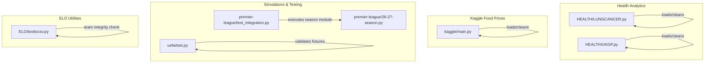
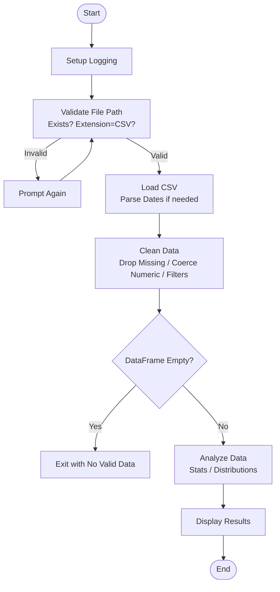
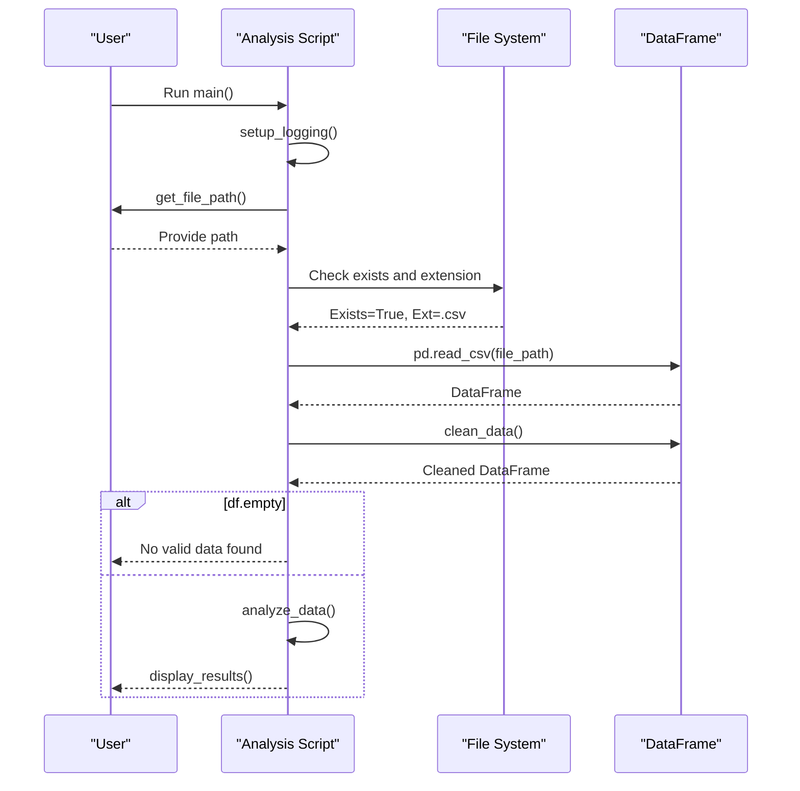
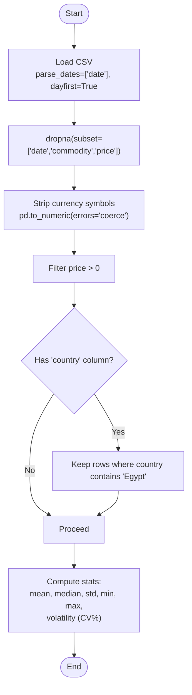
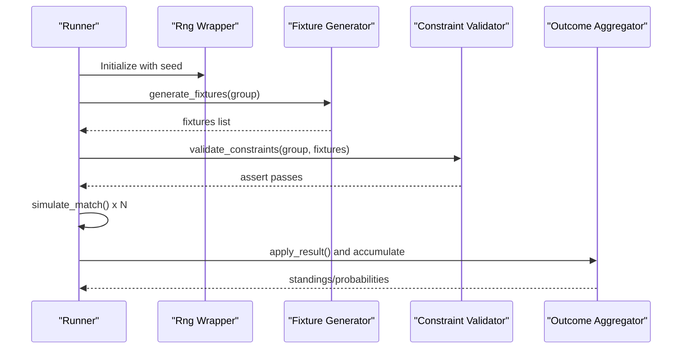
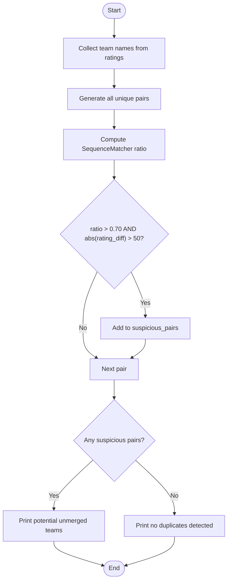
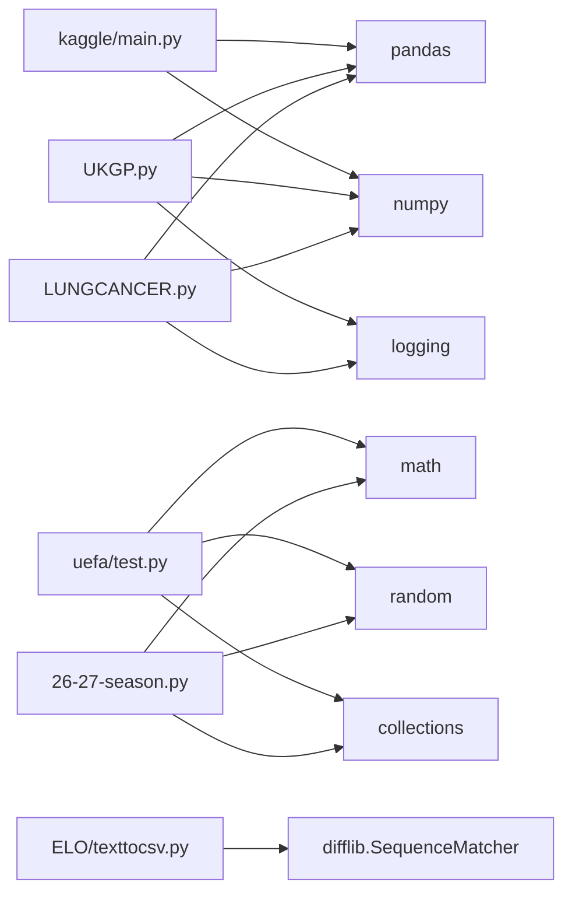

# Data Validation and Quality

<cite>
**Referenced Files in This Document**
- [LUNGCANCER.py](file://HEALTH/LUNGCANCER.py)
- [UKGP.py](file://HEALTH/UKGP.py)
- [main.py](file://kaggle/main.py)
- [test_integration.py](file://premier-league/test_integration.py)
- [26-27-season.py](file://premier-league/26-27-season.py)
- [texttocsv.py](file://ELO/texttocsv.py)
- [test.py](file://uefa/test.py)
</cite>

## Table of Contents
1. [Introduction](#introduction)
2. [Project Structure](#project-structure)
3. [Core Components](#core-components)
4. [Architecture Overview](#architecture-overview)
5. [Detailed Component Analysis](#detailed-component-analysis)
6. [Dependency Analysis](#dependency-analysis)
7. [Performance Considerations](#performance-considerations)
8. [Troubleshooting Guide](#troubleshooting-guide)
9. [Conclusion](#conclusion)

## Introduction
This document explains the data validation procedures, quality assurance processes, and error detection mechanisms across the repository’s analysis scripts. It focuses on:
- Input validation rules for CSV files
- Data cleaning and integrity checks
- Error handling and recovery strategies
- Quality metrics used to assess dataset reliability
- Automated testing and simulation validation patterns

The goal is to make these practices understandable for both technical and non-technical readers while providing concrete references to the codebase.

## Project Structure
The repository contains multiple domain-specific analysis scripts that share common patterns for loading, validating, and cleaning data. The most relevant components for data validation and quality are:
- Health analytics scripts with robust input validation and cleaning routines
- A Kaggle food prices script with targeted numeric cleaning and filtering
- Simulation modules with constraint validation and deterministic seeding
- An ELO text-to-CSV utility with team name integrity checks

**Diagram sources**
- [LUNGCANCER.py:26-83](file://HEALTH/LUNGCANCER.py#L26-L83)
- [UKGP.py:26-83](file://HEALTH/UKGP.py#L26-L83)
- [main.py:26-87](file://kaggle/main.py#L26-L87)
- [test_integration.py:1-21](file://premier-league/test_integration.py#L1-L21)
- [26-27-season.py:98-141](file://premier-league/26-27-season.py#L98-L141)
- [test.py:117-134](file://uefa/test.py#L117-L134)
- [texttocsv.py:362-377](file://ELO/texttocsv.py#L362-L377)

**Section sources**
- [LUNGCANCER.py:26-83](file://HEALTH/LUNGCANCER.py#L26-L83)
- [UKGP.py:26-83](file://HEALTH/UKGP.py#L26-L83)
- [main.py:26-87](file://kaggle/main.py#L26-L87)
- [test_integration.py:1-21](file://premier-league/test_integration.py#L1-L21)
- [26-27-season.py:98-141](file://premier-league/26-27-season.py#L98-L141)
- [test.py:117-134](file://uefa/test.py#L117-L134)
- [texttocsv.py:362-377](file://ELO/texttocsv.py#L362-L377)

## Core Components
This section summarizes the primary validation and quality components:
- Input validation: file path prompts, existence checks, extension validation
- Data loading: CSV parsing with date parsing where applicable
- Data cleaning: missing value removal, numeric coercion, business rule filters (e.g., positive price)
- Integrity checks: fixture constraints, team name similarity warnings
- Quality metrics: record counts, feature counts, missing values, descriptive statistics, volatility measures
- Automated testing: deterministic seeds, integration entry points, Monte Carlo simulations with assertions

Key implementation highlights:
- Health scripts use a consistent pattern: interactive file path validation, try/except around CSV load, broad dropna, numeric coercion
- Kaggle script performs targeted cleaning: subset-based missing value removal, currency symbol stripping, positivity filter, optional country filter
- Simulations validate structural constraints via assertions and use seeded RNGs for reproducibility
- ELO utility detects potential duplicate or unmerged team names using string similarity thresholds

**Section sources**
- [LUNGCANCER.py:26-83](file://HEALTH/LUNGCANCER.py#L26-L83)
- [UKGP.py:26-83](file://HEALTH/UKGP.py#L26-L83)
- [main.py:26-87](file://kaggle/main.py#L26-L87)
- [test.py:117-134](file://uefa/test.py#L117-L134)
- [texttocsv.py:362-377](file://ELO/texttocsv.py#L362-L377)

## Architecture Overview
The validation and quality pipeline follows a consistent flow across scripts:
1. Setup logging
2. Validate input file path interactively
3. Load CSV with appropriate parsing options
4. Clean data (missing values, type conversion, business rules)
5. Analyze data (statistics, distributions)
6. Display results or proceed to simulation/validation

**Diagram sources**
- [LUNGCANCER.py:21-83](file://HEALTH/LUNGCANCER.py#L21-L83)
- [UKGP.py:21-83](file://HEALTH/UKGP.py#L21-L83)
- [main.py:21-87](file://kaggle/main.py#L21-L87)

**Section sources**
- [LUNGCANCER.py:21-83](file://HEALTH/LUNGCANCER.py#L21-L83)
- [UKGP.py:21-83](file://HEALTH/UKGP.py#L21-L83)
- [main.py:21-87](file://kaggle/main.py#L21-L87)

## Detailed Component Analysis

### Health Analytics: Lung Cancer and UK GP Practice Scripts
These scripts implement a standardized validation and cleaning workflow:
- Interactive file path validation ensures non-empty paths, file existence, and .csv extension
- CSV loading wrapped in try/except to handle FileNotFoundError and general exceptions
- Cleaning removes all missing values broadly and coerces numeric columns safely
- Analysis computes basic stats, missing value totals, numeric summaries, and categorical distributions
- Main function handles empty datasets after cleaning and logs errors

**Diagram sources**
- [LUNGCANCER.py:21-83](file://HEALTH/LUNGCANCER.py#L21-L83)
- [UKGP.py:21-83](file://HEALTH/UKGP.py#L21-L83)

Validation rules and quality checks:
- Input validation: non-empty path, file existence, .csv extension
- Loading: try/except around CSV read; log and re-raise specific errors
- Cleaning: dropna(), numeric coercion with errors='coerce'
- Quality metrics: total records, total features, missing values, numeric describe, categorical value_counts

Error handling patterns:
- FileNotFoundError logged and re-raised
- Generic Exception caught and logged
- Empty DataFrame after cleaning handled gracefully

Recovery strategies:
- Prompt user again for valid path
- Exit early if no valid data remains post-cleaning

**Section sources**
- [LUNGCANCER.py:26-83](file://HEALTH/LUNGCANCER.py#L26-L83)
- [LUNGCANCER.py:86-107](file://HEALTH/LUNGCANCER.py#L86-L107)
- [LUNGCANCER.py:132-156](file://HEALTH/LUNGCANCER.py#L132-L156)
- [UKGP.py:26-83](file://HEALTH/UKGP.py#L26-L83)
- [UKGP.py:86-114](file://HEALTH/UKGP.py#L86-L114)
- [UKGP.py:146-170](file://HEALTH/UKGP.py#L146-L170)

### Kaggle Food Prices: Targeted Cleaning and Volatility Metrics
This script demonstrates domain-specific cleaning and quality metrics:
- Date parsing with dayfirst=True
- Missing value removal on critical columns (date, commodity, price)
- Currency symbol stripping and numeric coercion for price
- Business rule: remove rows with invalid (non-positive) prices
- Optional country filter (Egypt)
- Quality metrics include average, median, min/max, standard deviation, and volatility (coefficient of variation)

**Diagram sources**
- [main.py:59-87](file://kaggle/main.py#L59-L87)
- [main.py:90-107](file://kaggle/main.py#L90-L107)

Quality metrics:
- Record count, unique commodities, date range
- Price statistics: mean, median, std, min, max
- Volatility: coefficient of variation expressed as percentage

Error handling:
- Try/except around CSV load; log and re-raise FileNotFoundError and generic exceptions

**Section sources**
- [main.py:21-87](file://kaggle/main.py#L21-L87)
- [main.py:90-107](file://kaggle/main.py#L90-L107)

### Simulations: Constraint Validation and Deterministic Seeding
Simulation modules emphasize structural integrity and reproducibility:
- Deterministic random number generation via seeded RNG wrappers
- Fixture generation followed by constraint validation (assertions)
- Monte Carlo runs aggregate outcomes and compute probabilities

**Diagram sources**
- [26-27-season.py:98-141](file://premier-league/26-27-season.py#L98-L141)
- [test.py:117-134](file://uefa/test.py#L117-L134)

Validation rules:
- Each team plays exactly 6 matches
- Exactly 3 home and 3 away games per team
- Matches against each pot occur exactly twice

Automated testing:
- Integration test imports and executes the season module with fixed simulation counts
- Monte Carlo loop uses tqdm progress and aggregates auto qualification and playoff qualification frequencies

**Section sources**
- [test_integration.py:1-21](file://premier-league/test_integration.py#L1-L21)
- [26-27-season.py:98-141](file://premier-league/26-27-season.py#L98-L141)
- [test.py:117-134](file://uefa/test.py#L117-L134)
- [test.py:246-257](file://uefa/test.py#L246-L257)

### ELO Text-to-CSV: Team Name Integrity Checks
The ELO utility includes an automated validation step to detect potentially unmerged team names:
- Compares pairs of team names using sequence similarity ratio
- Flags suspicious pairs when similarity exceeds a threshold and rating difference is large
- Provides actionable output for manual review

**Diagram sources**
- [texttocsv.py:362-377](file://ELO/texttocsv.py#L362-L377)

Quality assurance:
- Detects naming inconsistencies that could corrupt downstream analyses
- Encourages data repair by highlighting likely duplicates requiring merging

**Section sources**
- [texttocsv.py:362-377](file://ELO/texttocsv.py#L362-L377)

## Dependency Analysis
The validation and quality components have clear dependencies:
- Health scripts depend on pandas/numpy for data manipulation and logging for error reporting
- Kaggle script depends on pandas for date parsing and numeric cleaning
- Simulation modules depend on math/random for probabilistic modeling and collections for aggregation
- ELO utility depends on difflib.SequenceMatcher for string similarity

**Diagram sources**
- [LUNGCANCER.py:12-18](file://HEALTH/LUNGCANCER.py#L12-L18)
- [UKGP.py:12-18](file://HEALTH/UKGP.py#L12-L18)
- [main.py:12-18](file://kaggle/main.py#L12-L18)
- [26-27-season.py:1-7](file://premier-league/26-27-season.py#L1-L7)
- [test.py:1-5](file://uefa/test.py#L1-L5)
- [texttocsv.py:362-377](file://ELO/texttocsv.py#L362-L377)

**Section sources**
- [LUNGCANCER.py:12-18](file://HEALTH/LUNGCANCER.py#L12-L18)
- [UKGP.py:12-18](file://HEALTH/UKGP.py#L12-L18)
- [main.py:12-18](file://kaggle/main.py#L12-L18)
- [26-27-season.py:1-7](file://premier-league/26-27-season.py#L1-L7)
- [test.py:1-5](file://uefa/test.py#L1-L5)
- [texttocsv.py:362-377](file://ELO/texttocsv.py#L362-L377)

## Performance Considerations
- Broad dropna() can be expensive on large datasets; consider specifying subsets of critical columns to reduce memory usage
- Numeric coercion with errors='coerce' is efficient but may mask malformed data; add explicit validation steps to capture and report problematic entries
- Monte Carlo simulations scale linearly with the number of runs; consider batching or parallelization for very large NUM_SIMULATIONS
- String similarity checks are O(n^2); limit candidate pairs using heuristics (e.g., prefix matching) before computing full ratios

[No sources needed since this section provides general guidance]

## Troubleshooting Guide
Common issues and resolutions:
- File not found or wrong extension: ensure the provided path exists and ends with .csv; the scripts prompt users to correct inputs
- CSV parsing errors: wrap reads in try/except; inspect logs for detailed messages; verify delimiter and encoding
- Invalid numeric values: after coercion, check for NaNs introduced by errors='coerce'; consider imputation or exclusion policies
- Empty datasets after cleaning: review cleaning rules (e.g., positive price filter) and adjust thresholds based on domain knowledge
- Simulation assertion failures: verify fixture generation logic meets constraints (matches played, home/away balance, pot matchups)
- Team name discrepancies: run the ELO integrity check and merge duplicate names before proceeding

**Section sources**
- [LUNGCANCER.py:60-70](file://HEALTH/LUNGCANCER.py#L60-L70)
- [UKGP.py:60-70](file://HEALTH/UKGP.py#L60-L70)
- [main.py:59-69](file://kaggle/main.py#L59-L69)
- [test.py:117-134](file://uefa/test.py#L117-L134)
- [texttocsv.py:362-377](file://ELO/texttocsv.py#L362-L377)

## Conclusion
The repository implements consistent and practical data validation and quality assurance patterns:
- Robust input validation and error handling at the boundaries
- Clear data cleaning pipelines tailored to domain requirements
- Structural integrity checks in simulations using assertions
- Actionable quality metrics and automated tests for reproducibility
- Utility-level integrity checks to prevent data corruption from naming inconsistencies

Adopting these patterns across new scripts will improve reliability, maintainability, and trustworthiness of analytical outputs.

[No sources needed since this section summarizes without analyzing specific files]