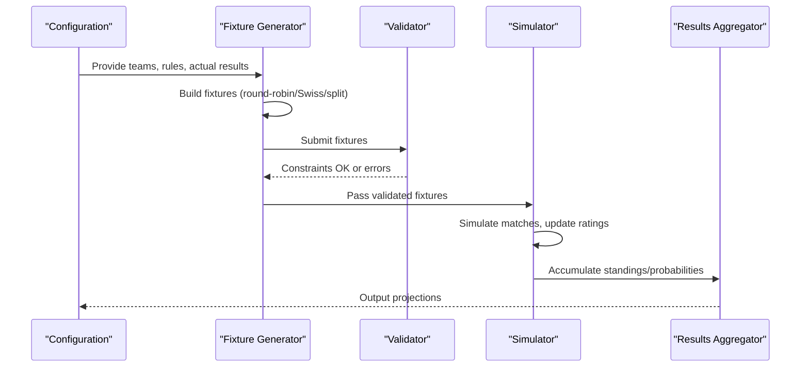
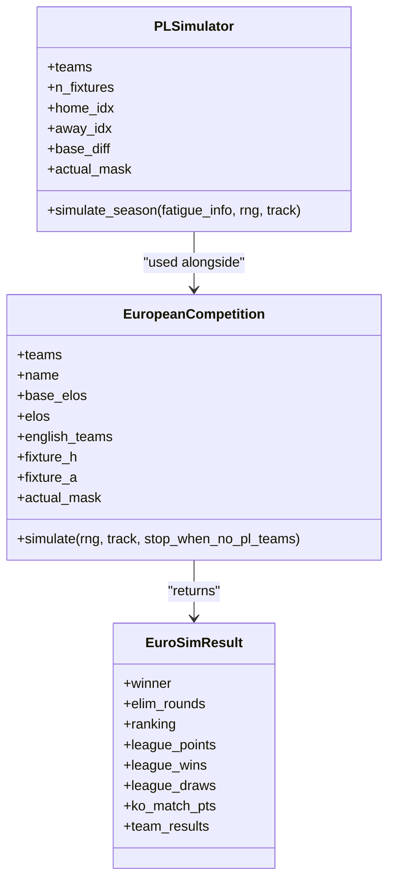
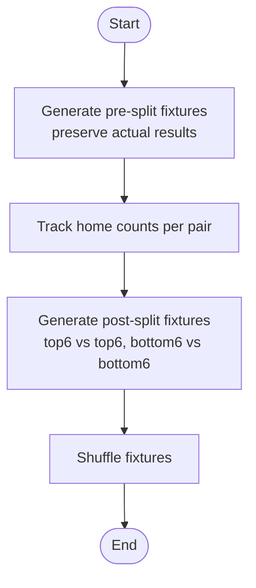
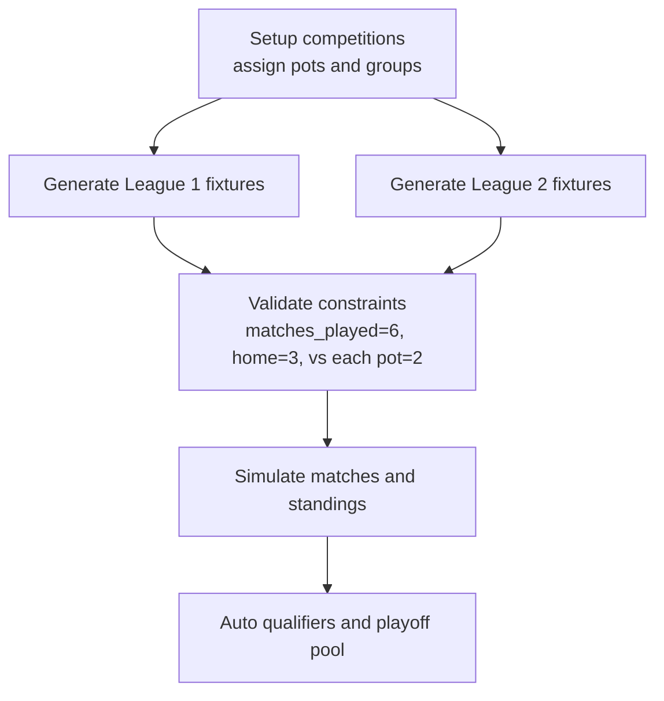
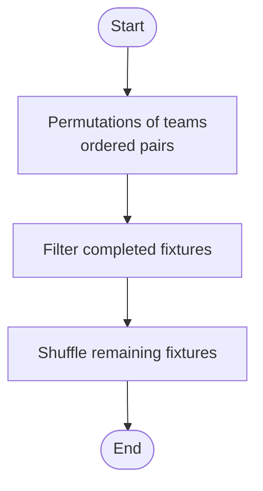
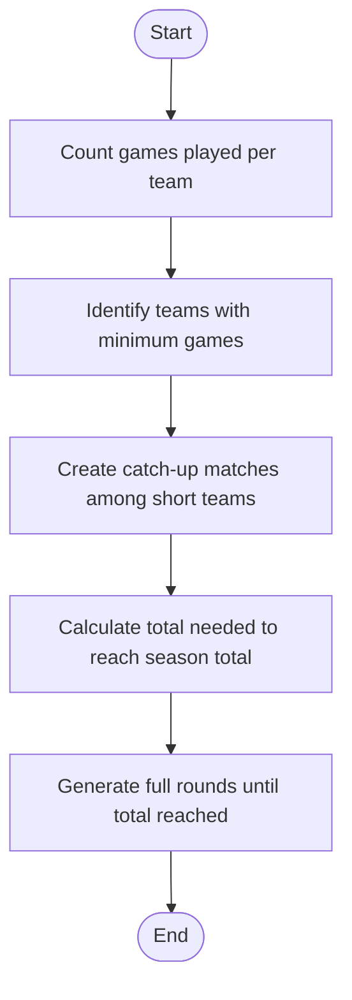
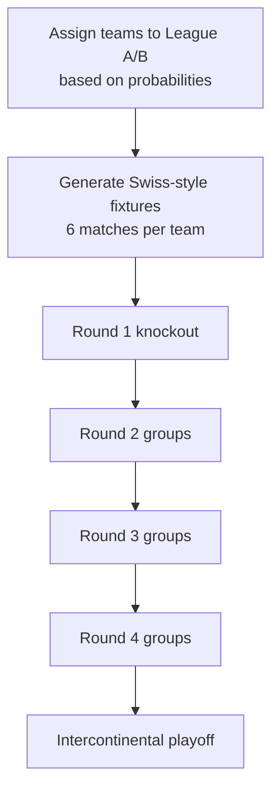
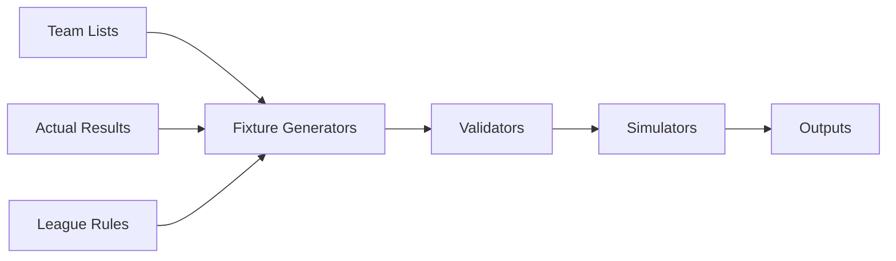

# Fixture Schedule Processing

<cite>
**Referenced Files in This Document**
- [26-27-season.py](file://premier-league/26-27-season.py)
- [Scotland.py](file://european_leagues/Scotland.py)
- [test.py](file://uefa/test.py)
- [nationleague.py](file://darlington/nationleague.py)
- [italy.py](file://european_leagues/italy.py)
- [main.py](file://worldcup30/main.py)
</cite>

## Table of Contents
1. [Introduction](#introduction)
2. [Project Structure](#project-structure)
3. [Core Components](#core-components)
4. [Architecture Overview](#architecture-overview)
5. [Detailed Component Analysis](#detailed-component-analysis)
6. [Dependency Analysis](#dependency-analysis)
7. [Performance Considerations](#performance-considerations)
8. [Troubleshooting Guide](#troubleshooting-guide)
9. [Conclusion](#conclusion)

## Introduction
This document explains how fixture schedules are generated, validated, and processed across multiple football simulation modules in the repository. It focuses on:
- Round-robin and Swiss-style fixture generation
- Fixture validation and scheduling constraints
- Integration with actual results data
- Normalization of team names across competitions
- Handling European competition fixtures alongside domestic leagues
- Data structures, match ordering logic, and simulation processing
- Examples for different league formats and tournament structures

The goal is to make these systems understandable even if you are not deeply familiar with the codebase.

## Project Structure
The relevant fixture and schedule logic is spread across several modules:
- Premier League and European integration: `premier-league/26-27-season.py`
- Scottish Premiership split-format league: `european_leagues/Scotland.py`
- UEFA-style two-league format with group fixtures: `uefa/test.py`
- National League North double round-robin: `darlington/nationleague.py`
- Serie A remaining fixture generation: `european_leagues/italy.py`
- World Cup 2030 multi-stage qualification including Swiss-style groups: `worldcup30/main.py`

```mermaid
graph TB
PL["Premier League + Europe<br/>26-27-season.py"] --> ELO["ELO / XG helpers"]
PL --> ACTUAL["Actual results mapping"]
PL --> KNOCKOUT["Knockout phase simulation"]
SCO["Scottish Premiership<br/>Scotland.py"] --> PRE_SPLIT["Pre-split fixtures"]
SCO --> POST_SPLIT["Post-split fixtures"]
SCO --> SIM_SEASON["Season simulation"]
UEFA["UEFA test format<br/>test.py"] --> GROUPS["Group setup"]
UEFA --> FIX_L1["League 1 fixtures"]
UEFA --> FIX_L2["League 2 fixtures"]
UEFA --> VALIDATE["Constraint validation"]
NL["National League North<br/>nationleague.py"] --> DOUBLE_RR["Double round-robin"]
NL --> REMAINING["Remaining fixtures"]
NL --> MC["Monte Carlo simulations"]
ITA["Serie A remaining fixtures<br/>italy.py"] --> CATCHUP["Games-in-hand catch-up"]
ITA --> FULL_ROUNDS["Full rounds generation"]
WC["World Cup 2030<br/>main.py"] --> SWISS["Swiss-style fixtures"]
WC --> MULTI_STAGE["Multi-stage qualification"]
```

**Diagram sources**
- [26-27-season.py:648-663](file://premier-league/26-27-season.py#L648-L663)
- [26-27-season.py:884-1066](file://premier-league/26-27-season.py#L884-L1066)
- [Scotland.py:130-179](file://european_leagues/Scotland.py#L130-L179)
- [Scotland.py:184-263](file://european_leagues/Scotland.py#L184-L263)
- [test.py:48-77](file://uefa/test.py#L48-L77)
- [test.py:79-115](file://uefa/test.py#L79-L115)
- [test.py:117-134](file://uefa/test.py#L117-L134)
- [nationleague.py:245-253](file://darlington/nationleague.py#L245-L253)
- [italy.py:227-256](file://european_leagues/italy.py#L227-L256)
- [main.py:821-881](file://worldcup30/main.py#L821-L881)

**Section sources**
- [26-27-season.py:1-23](file://premier-league/26-27-season.py#L1-L23)
- [Scotland.py:1-11](file://european_leagues/Scotland.py#L1-L11)
- [test.py:1-25](file://uefa/test.py#L1-L25)
- [nationleague.py:1-13](file://darlington/nationleague.py#L1-L13)
- [italy.py:200-222](file://european_leagues/italy.py#L200-L222)
- [main.py:750-818](file://worldcup30/main.py#L750-L818)

## Core Components
The core components involved in fixture schedule processing include:
- Fixture generators for different formats (round-robin, split-league, Swiss-style)
- Actual results integration and normalization
- Validation functions ensuring scheduling constraints
- Simulation engines that process fixtures and update ratings or standings
- Knockout-phase simulators for European competitions

Key responsibilities:
- Generate complete or partial fixture lists based on league rules
- Preserve already-played matches while generating remaining games
- Normalize team names across datasets
- Validate home/away balance, opponent diversity, and pot constraints
- Simulate matches using expected goals and ELO models
- Track results, rankings, and progression through stages

**Section sources**
- [26-27-season.py:648-663](file://premier-league/26-27-season.py#L648-L663)
- [26-27-season.py:884-1066](file://premier-league/26-27-season.py#L884-L1066)
- [Scotland.py:130-179](file://european_leagues/Scotland.py#L130-L179)
- [test.py:79-115](file://uefa/test.py#L79-L115)
- [test.py:117-134](file://uefa/test.py#L117-L134)
- [nationleague.py:245-253](file://darlington/nationleague.py#L245-L253)
- [italy.py:227-256](file://european_leagues/italy.py#L227-L256)
- [main.py:821-881](file://worldcup30/main.py#L821-L881)

## Architecture Overview
The architecture combines modular fixture generators with a unified simulation pipeline:
- Domestic leagues generate full or partial schedules depending on whether actual results exist
- European competitions integrate with domestic fixtures and use structured knockout phases
- Validation ensures fairness and rule compliance before simulation
- Monte Carlo simulations aggregate probabilities over many runs

**Diagram sources**
- [26-27-season.py:884-1066](file://premier-league/26-27-season.py#L884-L1066)
- [Scotland.py:184-263](file://european_leagues/Scotland.py#L184-L263)
- [test.py:179-244](file://uefa/test.py#L179-L244)
- [nationleague.py:344-393](file://darlington/nationleague.py#L344-L393)
- [italy.py:264-335](file://european_leagues/italy.py#L264-L335)
- [main.py:884-900](file://worldcup30/main.py#L884-L900)

## Detailed Component Analysis

### Premier League and European Competition Integration
The Premier League module integrates domestic fixtures with European competitions. It includes:
- Full round-robin generation from actual results
- Flattening nested fixtures into a flat list
- European competition class handling fixtures, actual results, and knockout phases
- Fatigue adjustments and manager sack-risk modeling

**Diagram sources**
- [26-27-season.py:868-882](file://premier-league/26-27-season.py#L868-L882)
- [26-27-season.py:884-1066](file://premier-league/26-27-season.py#L884-L1066)
- [26-27-season.py:1313-1400](file://premier-league/26-27-season.py#L1313-L1400)

Key behaviors:
- `build_full_round_robin` constructs all possible home-away pairs from observed teams
- `flatten_fixtures` converts nested round-based fixtures into a single sequence
- `EuropeanCompetition` normalizes team names, maps actual results, and simulates league phase plus knockout
- `PLSimulator` processes fixtures with fatigue effects and tracks team results

**Section sources**
- [26-27-season.py:648-663](file://premier-league/26-27-season.py#L648-L663)
- [26-27-season.py:884-1066](file://premier-league/26-27-season.py#L884-L1066)
- [26-27-season.py:1313-1400](file://premier-league/26-27-season.py#L1313-L1400)

### Scottish Premiership Split-Format Fixtures
The Scottish model uses a pre-split and post-split structure:
- Pre-split: each pair plays three times, preserving actual results
- Post-split: top six and bottom six play each other once within their halves
- Home/away balance is tracked and enforced during generation

**Diagram sources**
- [Scotland.py:130-165](file://european_leagues/Scotland.py#L130-L165)
- [Scotland.py:168-179](file://european_leagues/Scotland.py#L168-L179)

Simulation flow:
- Vectorized scoring for pre-split matches
- Ranking by points, goal difference, goals for, with tiebreakers
- Post-split matches update stats and final ranking

**Section sources**
- [Scotland.py:130-179](file://european_leagues/Scotland.py#L130-L179)
- [Scotland.py:184-263](file://european_leagues/Scotland.py#L184-L263)

### UEFA Two-League Format with Group Fixtures
The UEFA test module implements a two-league system with pots and group fixtures:
- League 1: 36 teams in 3 groups of 12; fixtures ensure balanced opposition across pots
- League 2: 18 teams in 3 groups of 6; fixtures ensure balanced opposition across pots
- Constraint validation checks matches played, home/away balance, and pot matchups

**Diagram sources**
- [test.py:48-77](file://uefa/test.py#L48-L77)
- [test.py:79-115](file://uefa/test.py#L79-L115)
- [test.py:117-134](file://uefa/test.py#L117-L134)

Validation details:
- Each team must play exactly six matches
- Exactly three home and three away games
- Opponents from each pot must be exactly two per team

**Section sources**
- [test.py:48-77](file://uefa/test.py#L48-L77)
- [test.py:79-115](file://uefa/test.py#L79-L115)
- [test.py:117-134](file://uefa/test.py#L117-L134)

### National League North Double Round-Robin
The National League North module generates remaining fixtures for a double round-robin:
- Uses permutations to create all ordered team pairs
- Filters out already completed matches
- Shuffles remaining fixtures for randomness

**Diagram sources**
- [nationleague.py:245-253](file://darlington/nationleague.py#L245-L253)

Simulation behavior:
- Initializes ELO ratings from completed fixtures
- Predicts scores using adjusted ELO and form factors
- Runs Monte Carlo simulations to estimate promotion/top-seven/relegation probabilities

**Section sources**
- [nationleague.py:245-253](file://darlington/nationleague.py#L245-L253)
- [nationleague.py:316-393](file://darlington/nationleague.py#L316-L393)

### Serie A Remaining Fixtures
The Serie A module generates remaining fixtures after some matches have been played:
- Identifies teams with fewer games played (games in hand)
- Creates catch-up matches among those teams
- Fills remaining slots with full rounds until reaching the season total

**Diagram sources**
- [italy.py:227-256](file://european_leagues/italy.py#L227-L256)

**Section sources**
- [italy.py:227-256](file://european_leagues/italy.py#L227-L256)

### World Cup 2030 Multi-Stage Qualification with Swiss-Style Groups
The World Cup 2030 module includes complex qualification formats:
- Swiss-style fixtures for League 1 groups: each team plays six matches against unique opponents with balanced home/away distribution
- Multi-stage qualification involving knockout rounds, group stages, and playoffs
- Team assignment to leagues based on Nations League probabilities

**Diagram sources**
- [main.py:754-818](file://worldcup30/main.py#L754-L818)
- [main.py:821-881](file://worldcup30/main.py#L821-L881)

Swiss-style fixture generation:
- Sorts teams by ELO and divides into four pots
- Ensures each team plays six unique opponents
- Balances home/away counts up to three per team
- Randomizes candidate opponents within pots

**Section sources**
- [main.py:754-818](file://worldcup30/main.py#L754-L818)
- [main.py:821-881](file://worldcup30/main.py#L821-L881)

## Dependency Analysis
The modules depend on shared concepts but remain largely independent:
- Fixture generators rely on team lists, actual results, and league rules
- Validators enforce constraints specific to each format
- Simulators consume fixtures and produce statistical outputs
- European integration depends on both domestic and continental fixtures

**Diagram sources**
- [26-27-season.py:648-663](file://premier-league/26-27-season.py#L648-L663)
- [Scotland.py:130-179](file://european_leagues/Scotland.py#L130-L179)
- [test.py:79-115](file://uefa/test.py#L79-L115)
- [nationleague.py:245-253](file://darlington/nationleague.py#L245-L253)
- [italy.py:227-256](file://european_leagues/italy.py#L227-L256)
- [main.py:821-881](file://worldcup30/main.py#L821-L881)

**Section sources**
- [26-27-season.py:648-663](file://premier-league/26-27-season.py#L648-L663)
- [Scotland.py:130-179](file://european_leagues/Scotland.py#L130-L179)
- [test.py:79-115](file://uefa/test.py#L79-L115)
- [nationleague.py:245-253](file://darlington/nationleague.py#L245-L253)
- [italy.py:227-256](file://european_leagues/italy.py#L227-L256)
- [main.py:821-881](file://worldcup30/main.py#L821-L881)

## Performance Considerations
- Vectorized operations in the Scottish model improve pre-split simulation speed
- Poisson sampling with capped maximum goals prevents extreme scorelines
- ELO regression balances prior knowledge with observed performance
- Fatigue adjustments in the Premier League model reduce expected goals for teams playing European fixtures
- Monte Carlo simulations aggregate probabilities efficiently using counters and dictionaries

Recommendations:
- Use vectorized libraries where possible for large fixture sets
- Cap random samples to avoid unrealistic outcomes
- Reuse computed expected goals and masks to reduce recomputation
- Seed random number generators for reproducibility

[No sources needed since this section provides general guidance]

## Troubleshooting Guide
Common issues and resolutions:
- Invalid fixture counts: Ensure each team plays the required number of matches
- Home/away imbalance: Track and enforce home/away limits during generation
- Pot constraint violations: Verify opponent distribution across pots
- Missing actual results: Map actual results correctly and mask simulated values
- Name mismatches: Normalize team names using provided mappings

Specific checks:
- UEFA constraints assert exact match counts and pot distributions
- Scottish pre-split preserves actual results and balances home counts
- Serie A catch-up matches only involve teams with fewer games played
- World Cup Swiss fixtures ensure unique opponents and balanced home/away

**Section sources**
- [test.py:117-134](file://uefa/test.py#L117-L134)
- [Scotland.py:130-165](file://european_leagues/Scotland.py#L130-L165)
- [italy.py:227-256](file://european_leagues/italy.py#L227-L256)
- [main.py:821-881](file://worldcup30/main.py#L821-L881)

## Conclusion
The fixture schedule processing in this repository supports diverse football formats through modular generators, validators, and simulators. Key strengths include:
- Flexible fixture generation for round-robin, split-league, and Swiss-style formats
- Robust validation ensuring fairness and rule compliance
- Integration of actual results and normalization across competitions
- Comprehensive European competition handling alongside domestic leagues
- Efficient simulation pipelines with ELO-based expected goals and Monte Carlo aggregation

These components collectively enable realistic and scalable football simulations across multiple leagues and tournaments.

[No sources needed since this section summarizes without analyzing specific files]