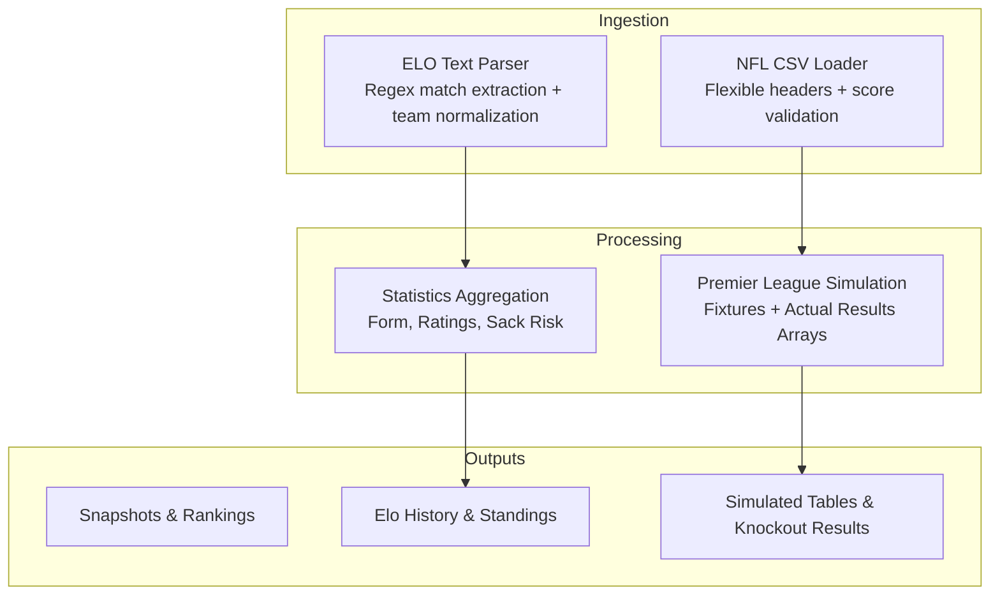
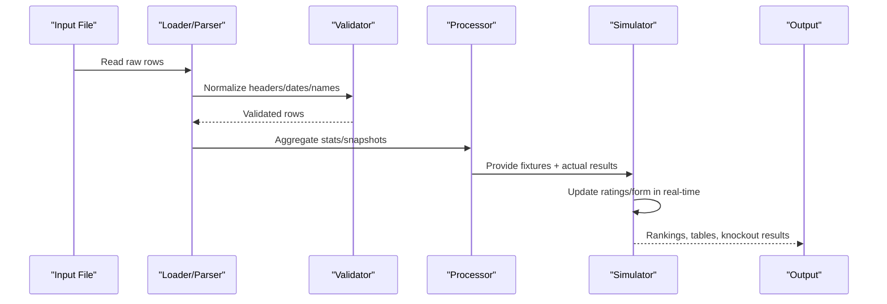
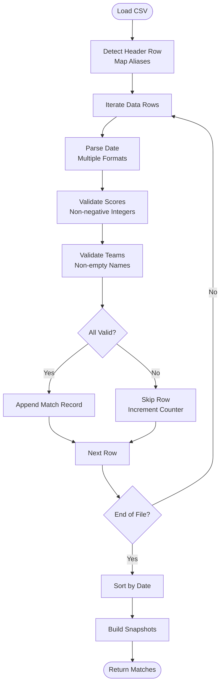
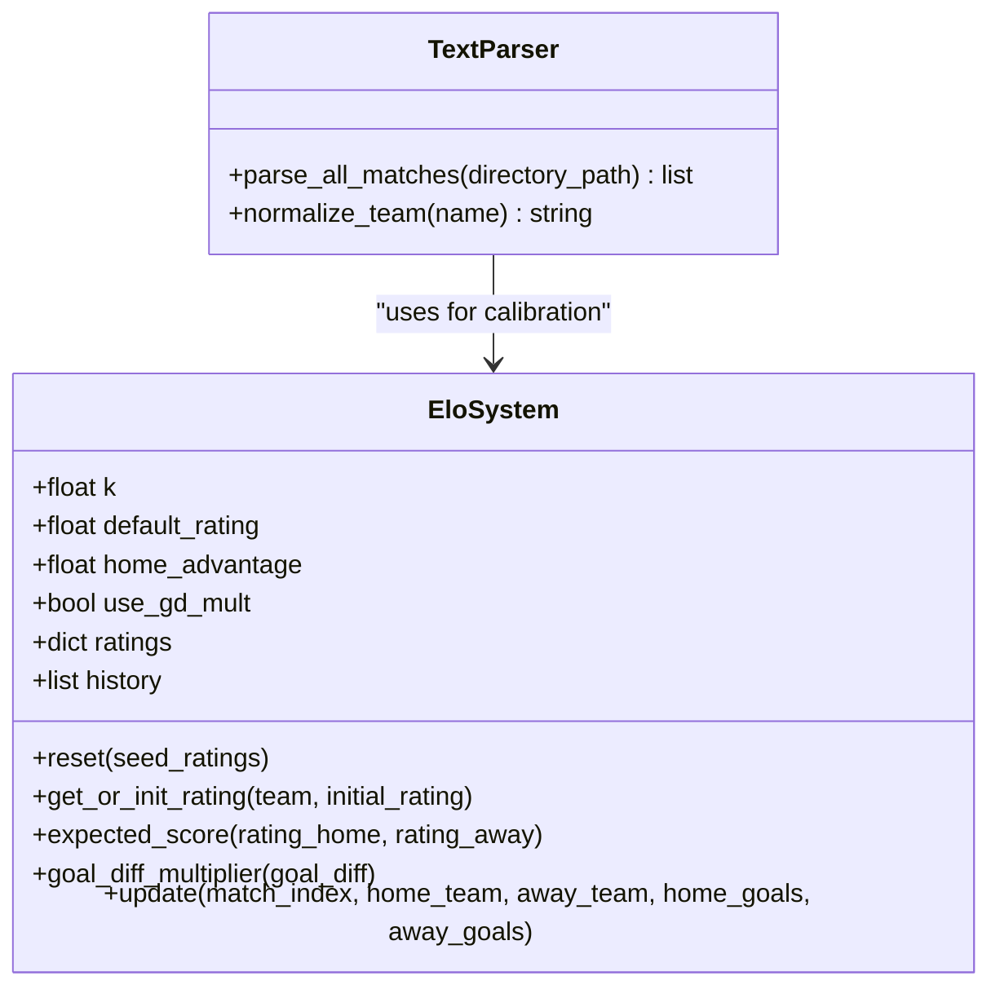
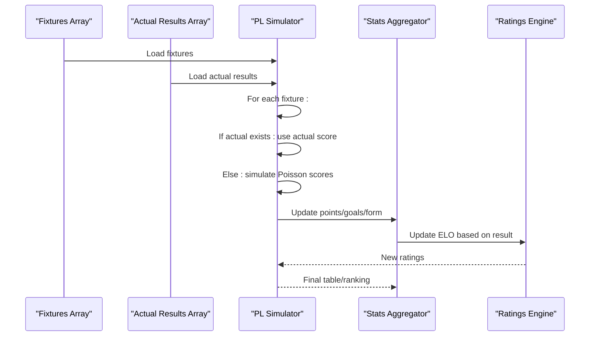
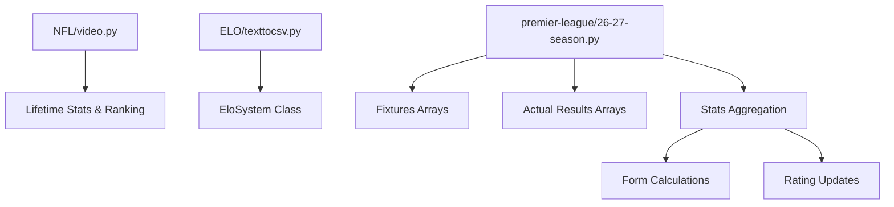

# Match Result Ingestion

<cite>
**Referenced Files in This Document**
- [video.py](file://NFL/video.py)
- [texttocsv.py](file://ELO/texttocsv.py)
- [26-27-season.py](file://premier-league/26-27-season.py)
</cite>

## Table of Contents
1. [Introduction](#introduction)
2. [Project Structure](#project-structure)
3. [Core Components](#core-components)
4. [Architecture Overview](#architecture-overview)
5. [Detailed Component Analysis](#detailed-component-analysis)
6. [Dependency Analysis](#dependency-analysis)
7. [Performance Considerations](#performance-considerations)
8. [Troubleshooting Guide](#troubleshooting-guide)
9. [Conclusion](#conclusion)

## Introduction
This document explains how match results are ingested, validated, standardized, and processed across the sports analysis codebase. It focuses on:
- Data validation for incoming match results
- Score format standardization
- Error handling for malformed data
- Integration with actual results arrays
- Result aggregation algorithms
- Real-time result processing during simulations
- Result data structures and derived statistics
- How results impact team ratings and form calculations
- Examples of result processing workflows and data quality checks

The systems analyzed include:
- NFL CSV ingestion pipeline that normalizes heterogeneous CSV headers and validates scores
- ELO text parsing pipeline that extracts matches from free-form text files and normalizes team names
- Premier League simulation engine that integrates real-world results into simulated fixtures and updates ratings and form metrics

## Project Structure
At a high level, match result ingestion spans three major areas:
- NFL video pipeline: robust CSV loader with flexible header mapping and strict score validation
- ELO text-to-CSV pipeline: regex-based parser for league match logs with team name normalization
- Premier League simulation: structured fixtures and actual results arrays driving live simulations and statistical aggregation

**Diagram sources**
- [video.py:163-303](file://NFL/video.py#L163-L303)
- [texttocsv.py:180-246](file://ELO/texttocsv.py#L180-L246)
- [26-27-season.py:648-664](file://premier-league/26-27-season.py#L648-L664)

**Section sources**
- [video.py:163-303](file://NFL/video.py#L163-L303)
- [texttocsv.py:180-246](file://ELO/texttocsv.py#L180-L246)
- [26-27-season.py:648-664](file://premier-league/26-27-season.py#L648-L664)

## Core Components
- NFL CSV ingestion:
  - Flexible header aliasing to support multiple CSV layouts
  - Date parsing with multiple formats
  - Strict score validation (non-negative integers)
  - Row-level error handling and skip counting
  - Chronological sorting and snapshot building per game
- ELO text parsing:
  - Regex-based match line extraction
  - Team name normalization via alias map
  - Two-pass ELO calibration with dynamic seeding
  - Automated integrity validation for suspicious team duplicates
- Premier League simulation:
  - Structured fixtures and actual results arrays
  - Real-time integration of actual results into simulations
  - Statistical aggregation (points, goals, form)
  - Form-derived sack risk adjustments
  - ELO regression and rating updates

**Section sources**
- [video.py:163-303](file://NFL/video.py#L163-L303)
- [texttocsv.py:180-246](file://ELO/texttocsv.py#L180-L246)
- [26-27-season.py:648-664](file://premier-league/26-27-season.py#L648-L664)

## Architecture Overview
The ingestion and processing architecture follows a layered design:
- Input layer: CSV or text files containing match data
- Normalization layer: Header mapping, date parsing, team name normalization
- Validation layer: Score format checks, row-level error handling
- Processing layer: Aggregation of results into tables, snapshots, and statistics
- Simulation layer: Real-time integration of actual results into simulated fixtures
- Output layer: Rankings, Elo histories, simulated standings, knockout results

**Diagram sources**
- [video.py:201-303](file://NFL/video.py#L201-L303)
- [texttocsv.py:180-246](file://ELO/texttocsv.py#L180-L246)
- [26-27-season.py:939-1066](file://premier-league/26-27-season.py#L939-L1066)

## Detailed Component Analysis

### NFL CSV Ingestion Pipeline
The NFL pipeline loads CSVs with flexible headers, validates dates and scores, and builds chronological snapshots for ranking visualization.

Key behaviors:
- Header aliasing supports multiple column naming conventions
- Date parsing tries multiple formats; raises an error if unparseable
- Score fields must be non-negative integers; invalid rows are skipped
- Team names must be non-empty; otherwise rows are skipped
- Skipped rows are counted and reported
- Matches are sorted by date and used to build per-game snapshots

**Diagram sources**
- [video.py:163-303](file://NFL/video.py#L163-L303)

**Section sources**
- [video.py:163-303](file://NFL/video.py#L163-L303)

### ELO Text Parsing and Team Normalization
The ELO pipeline parses free-form match logs using regex patterns, normalizes team names, and performs two-pass ELO calibration.

Key behaviors:
- Regex extracts home team, away team, and scores from each line
- Team names are normalized via a comprehensive alias map
- Dates are inferred from month/day lines and season boundaries
- Two-pass ELO system calibrates league strengths and seeds team ratings
- Automated validation detects suspicious duplicate team names

**Diagram sources**
- [texttocsv.py:175-177](file://ELO/texttocsv.py#L175-L177)
- [texttocsv.py:180-246](file://ELO/texttocsv.py#L180-L246)
- [texttocsv.py:252-318](file://ELO/texttocsv.py#L252-L318)

**Section sources**
- [texttocsv.py:175-177](file://ELO/texttocsv.py#L175-L177)
- [texttocsv.py:180-246](file://ELO/texttocsv.py#L180-L246)
- [texttocsv.py:252-318](file://ELO/texttocsv.py#L252-L318)

### Premier League Simulation and Actual Results Integration
The Premier League simulation integrates actual results arrays into simulated fixtures, updating team statistics and ratings in real time.

Key behaviors:
- Fixtures and actual results are defined as structured arrays
- Actual results override simulated scores when available
- Statistics aggregation includes points, goals, goal difference, and form
- Form is used to compute sack risk adjustments
- ELO regression blends preset ratings with observed performance

**Diagram sources**
- [26-27-season.py:648-664](file://premier-league/26-27-season.py#L648-L664)
- [26-27-season.py:939-1066](file://premier-league/26-27-season.py#L939-L1066)
- [26-27-season.py:1355-1440](file://premier-league/26-27-season.py#L1355-L1440)

**Section sources**
- [26-27-season.py:648-664](file://premier-league/26-27-season.py#L648-L664)
- [26-27-season.py:939-1066](file://premier-league/26-27-season.py#L939-L1066)
- [26-27-season.py:1355-1440](file://premier-league/26-27-season.py#L1355-L1440)

## Dependency Analysis
The components have clear separation of concerns:
- NFL pipeline depends on CSV parsing utilities and datetime formatting
- ELO pipeline depends on regex parsing and team normalization maps
- Premier League simulation depends on fixtures, actual results arrays, and statistical aggregation functions

**Diagram sources**
- [video.py:309-383](file://NFL/video.py#L309-L383)
- [texttocsv.py:252-318](file://ELO/texttocsv.py#L252-L318)
- [26-27-season.py:648-664](file://premier-league/26-27-season.py#L648-L664)

**Section sources**
- [video.py:309-383](file://NFL/video.py#L309-L383)
- [texttocsv.py:252-318](file://ELO/texttocsv.py#L252-L318)
- [26-27-season.py:648-664](file://premier-league/26-27-season.py#L648-L664)

## Performance Considerations
- NFL pipeline uses multiprocessing for frame rendering but single-threaded CSV loading
- ELO pipeline processes files sequentially with progress bars
- Premier League simulation uses efficient array operations and precomputed expected goals
- All pipelines avoid unnecessary object creation by using lists and dictionaries efficiently

[No sources needed since this section provides general guidance]

## Troubleshooting Guide
Common issues and resolutions:
- CSV header detection failures: Ensure required columns (date, home_team, away_team, home_score, away_score) are present
- Unparseable dates: Verify date format matches one of the supported formats
- Invalid scores: Ensure scores are non-negative integers; fractional or negative values will be skipped
- Missing team names: Both home and away teams must be non-empty strings
- Team name mismatches: Use the team alias maps to normalize names consistently
- Actual results not applied: Check that the fixture tuple matches the key in actual results

**Section sources**
- [video.py:201-303](file://NFL/video.py#L201-L303)
- [texttocsv.py:175-177](file://ELO/texttocsv.py#L175-L177)
- [26-27-season.py:920-934](file://premier-league/26-27-season.py#L920-L934)

## Conclusion
The match result ingestion and processing systems provide robust, flexible, and validated pipelines for handling diverse input formats. The NFL pipeline excels at CSV flexibility and validation, the ELO pipeline offers powerful text parsing and team normalization, and the Premier League simulation integrates real-world results seamlessly into simulations. Together, they enable accurate statistical aggregation, real-time rating updates, and reliable form calculations that drive meaningful insights and predictions.

[No sources needed since this section summarizes without analyzing specific files]