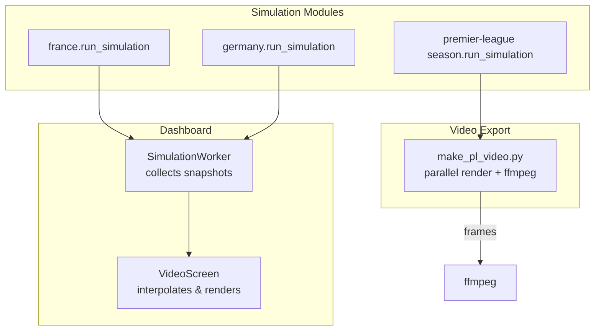
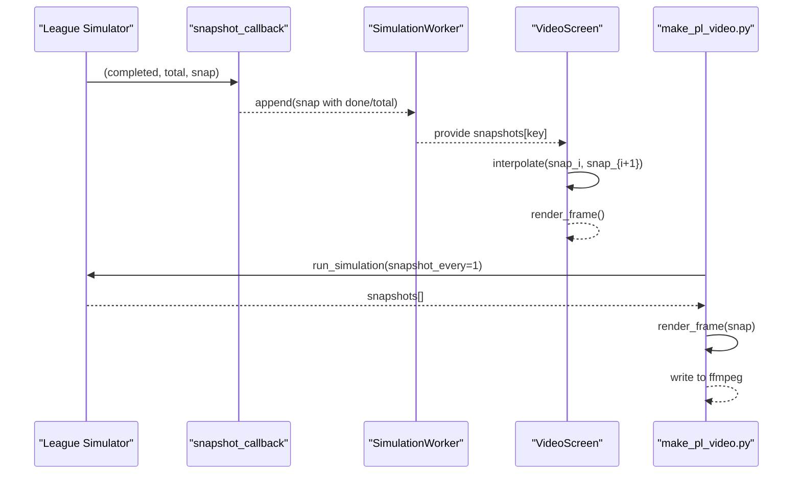
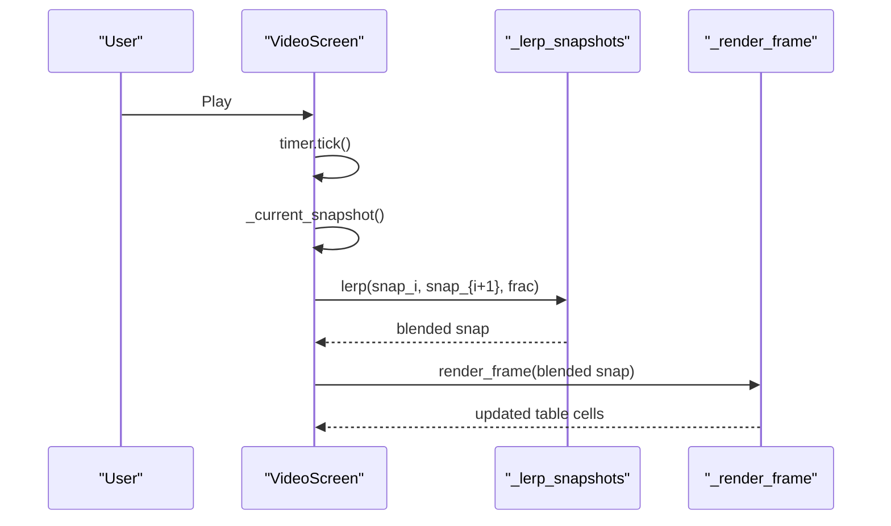
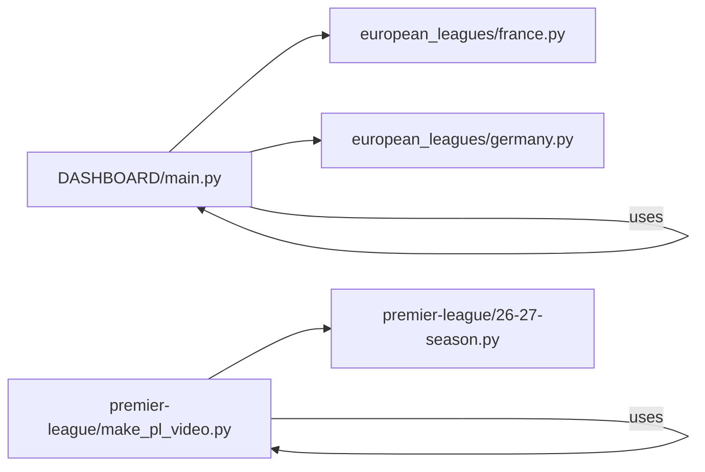

# Snapshot System

<cite>
**Referenced Files in This Document**
- [DASHBOARD/main.py](file://DASHBOARD/main.py)
- [european_leagues/france.py](file://european_leagues/france.py)
- [european_leagues/germany.py](file://european_leagues/germany.py)
- [premier-league/make_pl_video.py](file://premier-league/make_pl_video.py)
</cite>

## Table of Contents
1. [Introduction](#introduction)
2. [Project Structure](#project-structure)
3. [Core Components](#core-components)
4. [Architecture Overview](#architecture-overview)
5. [Detailed Component Analysis](#detailed-component-analysis)
6. [Dependency Analysis](#dependency-analysis)
7. [Performance Considerations](#performance-considerations)
8. [Troubleshooting Guide](#troubleshooting-guide)
9. [Conclusion](#conclusion)

## Introduction
This document explains the simulation snapshot system that captures periodic states during Monte Carlo simulations to enable animation and replay of evolving league tables. It covers how snapshots are produced, structured, stored, retrieved, and rendered for visualization and video export. It also documents lifecycle management, memory considerations, integration with progress tracking, and example workflows for creation, retrieval, and playback.

## Project Structure
The snapshot system spans three layers:
- Simulation modules emit snapshots via a callback at configurable intervals.
- The dashboard worker collects snapshots per league and exposes them to UI components.
- Video/rendering tools consume snapshots to produce animated outputs (interactive playback or MP4).

**Diagram sources**
- [DASHBOARD/main.py:284-330](file://DASHBOARD/main.py#L284-L330)
- [DASHBOARD/main.py:1037-1250](file://DASHBOARD/main.py#L1037-L1250)
- [european_leagues/france.py:242-314](file://european_leagues/france.py#L242-L314)
- [european_leagues/germany.py:247-327](file://european_leagues/germany.py#L247-L327)
- [premier-league/make_pl_video.py:214-246](file://premier-league/make_pl_video.py#L214-L246)

**Section sources**
- [DASHBOARD/main.py:1-13](file://DASHBOARD/main.py#L1-L13)
- [DASHBOARD/main.py:284-330](file://DASHBOARD/main.py#L284-L330)
- [european_leagues/france.py:242-314](file://european_leagues/france.py#L242-L314)
- [european_leagues/germany.py:247-327](file://european_leagues/germany.py#L247-L327)
- [premier-league/make_pl_video.py:1-12](file://premier-league/make_pl_video.py#L1-L12)

## Core Components
- Snapshot producer: Each league’s run_simulation function emits snapshots through a callback at regular intervals. Snapshots contain aggregated statistics such as average points and probabilities for outcomes like title contention, top-four qualification, and relegation.
- Snapshot collector: The dashboard’s SimulationWorker wraps each league runner, attaches global progress counters (done, total), and stores snapshots per league key.
- Snapshot consumer (UI): VideoScreen reads snapshots from the collected store, interpolates between adjacent snapshots for smooth playback, and renders frames into a table view.
- Snapshot consumer (video export): make_pl_video.py runs a separate simulation pipeline that captures one snapshot per simulation and renders frames in parallel to ffmpeg.

Key responsibilities:
- Capture: Periodic emission of state dictionaries.
- Store: In-memory list per league keyed by simulation identifier.
- Retrieve: Access by league key; interpolation for smooth playback.
- Render: Table updates for UI; frame rendering for MP4.

**Section sources**
- [european_leagues/france.py:242-314](file://european_leagues/france.py#L242-L314)
- [european_leagues/germany.py:247-327](file://european_leagues/germany.py#L247-L327)
- [DASHBOARD/main.py:284-330](file://DASHBOARD/main.py#L284-L330)
- [DASHBOARD/main.py:1037-1250](file://DASHBOARD/main.py#L1037-L1250)
- [premier-league/make_pl_video.py:214-246](file://premier-league/make_pl_video.py#L214-L246)

## Architecture Overview
The snapshot system follows a producer-consumer pattern:
- Producers: League simulation modules call snapshot_callback periodically.
- Consumer (dashboard): SimulationWorker aggregates snapshots and forwards results to UI.
- Consumers (renderers): VideoScreen and make_pl_video.py consume snapshots to animate and export.

**Diagram sources**
- [european_leagues/france.py:291-300](file://european_leagues/france.py#L291-L300)
- [european_leagues/germany.py:303-312](file://european_leagues/germany.py#L303-L312)
- [DASHBOARD/main.py:311-323](file://DASHBOARD/main.py#L311-L323)
- [DASHBOARD/main.py:1192-1222](file://DASHBOARD/main.py#L1192-L1222)
- [premier-league/make_pl_video.py:218-228](file://premier-league/make_pl_video.py#L218-L228)

## Detailed Component Analysis

### Snapshot Producer: European League Simulators
Both France and Germany simulators implement an identical pattern:
- Initialize RNG seeds.
- Build current table and remaining fixtures.
- Maintain running counters for metrics (title, top4, fifth, sixth, relpo, releg, points distribution).
- Compute snapshot_every = max(1, n_sims // 250) if not provided.
- On each iteration:
  - Run simulate_season.
  - Update counters and distributions.
  - Emit on_progress.
  - If completed % snapshot_every == 0 or completed == n_sims, emit snapshot_callback with a dictionary containing:
    - avg_points: team -> mean points so far
    - title_prob, top4_prob, fifth_prob, sixth_prob, relpo_prob, releg_prob: team -> percentage so far

Complexity:
- Per-simulation work is O(T) where T is number of teams.
- Snapshot aggregation uses running sums/lists; final averages computed at snapshot time.

Memory:
- Points distribution accumulates per team across simulations until next snapshot; this can grow large for many simulations.

Error handling:
- Graceful exit when is_running returns False.

**Section sources**
- [european_leagues/france.py:242-314](file://european_leagues/france.py#L242-L314)
- [european_leagues/germany.py:247-327](file://european_leagues/germany.py#L247-L327)

#### Snapshot Data Structure
A snapshot is a dictionary with:
- Numeric fields:
  - done: completed simulations count (added by dashboard)
  - total: total simulations target (added by dashboard)
- Aggregated metrics (per team):
  - avg_points: float values
  - title_prob, top4_prob, fifth_prob, sixth_prob, relpo_prob, releg_prob: float percentages
- Optional extra keys may be added by consumers (e.g., _sim in video export).

Interpolation:
- Dashboard provides _lerp_snapshots to linearly interpolate numeric values and nested dicts between two snapshots for smooth playback.

**Section sources**
- [DASHBOARD/main.py:1018-1034](file://DASHBOARD/main.py#L1018-L1034)
- [european_leagues/france.py:292-300](file://european_leagues/france.py#L292-L300)
- [european_leagues/germany.py:304-312](file://european_leagues/germany.py#L304-L312)

### Snapshot Collector: SimulationWorker
Responsibilities:
- For each league spec:
  - Initialize an empty list for snapshots keyed by league key.
  - Wrap the league runner with:
    - Progress callback that emits unified progress signals.
    - Snapshot callback that copies the incoming snapshot dict and appends done/total before storing.
- After all leagues complete, emit all_done(results, snapshots).

Lifecycle:
- Starts in a background thread.
- Supports stop() to set internal flag and halt further processing.

Memory:
- Stores all snapshots in memory per league; size depends on n_sims and snapshot frequency.

**Section sources**
- [DASHBOARD/main.py:284-330](file://DASHBOARD/main.py#L284-L330)

### Snapshot Renderer (UI): VideoScreen
Responsibilities:
- Load snapshots for selected league.
- Freeze team order based on final snapshot’s average points to prevent row-swapping during playback.
- Interpolate between adjacent snapshots to compute current frame data.
- Render table rows and update status labels with done/total counts.
- Provide play/pause controls and slider scrubbing.
- Export MP4 using OpenCV and numpy.

Playback math:
- Map current_time to index i and fraction frac between snapshots[i] and snapshots[i+1].
- Use _lerp_snapshots to blend values.

Export:
- Validates at least two snapshots exist.
- Uses cv2.VideoWriter to encode frames at fixed fps over duration.

**Section sources**
- [DASHBOARD/main.py:1037-1250](file://DASHBOARD/main.py#L1037-L1250)
- [DASHBOARD/main.py:1355-1426](file://DASHBOARD/main.py#L1355-L1426)

#### Playback Sequence

**Diagram sources**
- [DASHBOARD/main.py:1192-1222](file://DASHBOARD/main.py#L1192-L1222)
- [DASHBOARD/main.py:1018-1034](file://DASHBOARD/main.py#L1018-L1034)

### Snapshot Renderer (Video Export): make_pl_video.py
Responsibilities:
- Import season module and run simulation with snapshot_every=1 to capture every simulation result.
- Append each snapshot to a list with an additional _sim field indicating completion index.
- Calculate FPS from total snapshots and desired duration.
- Spawn ffmpeg process to accept raw RGB frames via stdin.
- Parallelize frame rendering across processes and pipe bytes to ffmpeg writer thread.

Data flow:
- season.run_simulation(callback) -> snapshots[]
- ProcessPoolExecutor.map(render_frame) -> byte buffers
- Writer thread writes to ffmpeg.stdin

Error handling:
- Raises errors if no snapshots captured or ffmpeg cannot open output file.

**Section sources**
- [premier-league/make_pl_video.py:214-246](file://premier-league/make_pl_video.py#L214-L246)
- [premier-league/make_pl_video.py:248-308](file://premier-league/make_pl_video.py#L248-L308)

## Dependency Analysis
Coupling and cohesion:
- Simulation modules depend only on their own domain logic and expose a uniform run_simulation interface with optional callbacks.
- Dashboard depends on simulation modules via dynamic import and orchestrates execution and snapshot collection.
- VideoScreen depends on collected snapshots and helper interpolation functions.
- make_pl_video.py depends on the season module directly and external tools (ffmpeg, PIL, numpy).

External dependencies:
- PyQt5 for UI and threading.
- OpenCV and numpy for MP4 export in dashboard.
- ffmpeg for video encoding in make_pl_video.py.

Potential circular dependencies:
- None observed; imports are unidirectional from dashboard/export to simulation modules.

**Diagram sources**
- [DASHBOARD/main.py:56-62](file://DASHBOARD/main.py#L56-L62)
- [premier-league/make_pl_video.py:146-152](file://premier-league/make_pl_video.py#L146-L152)

**Section sources**
- [DASHBOARD/main.py:56-62](file://DASHBOARD/main.py#L56-L62)
- [premier-league/make_pl_video.py:146-152](file://premier-league/make_pl_video.py#L146-L152)

## Performance Considerations
- Snapshot frequency:
  - Default snapshot_every = max(1, n_sims // 250) balances fidelity and overhead.
  - For interactive playback, fewer snapshots reduce memory but may reduce smoothness; interpolation mitigates this.
- Memory usage:
  - Storing full snapshots per league grows linearly with number of snapshots and team count.
  - Points distribution lists accumulate per team until next snapshot; consider periodic compaction or rolling windows if needed.
- Rendering performance:
  - UI playback uses lightweight interpolation and table updates; ensure TICK_MS is tuned for responsiveness.
  - MP4 export parallelizes frame rendering; adjust N_WORKERS based on CPU cores.
- I/O and encoding:
  - ffmpeg throughput depends on preset/crf settings; medium preset with CRF 20 offers balanced quality/performance.

[No sources needed since this section provides general guidance]

## Troubleshooting Guide
Common issues and resolutions:
- No snapshots captured:
  - Ensure snapshot_every is set appropriately and simulation loop reaches completion.
  - Validate that snapshot_callback is passed and invoked inside the simulation loop.
- Not enough snapshots for video export:
  - VideoScreen requires at least two snapshots; increase n_sims or decrease snapshot_every.
- MP4 export fails:
  - Install opencv-python and numpy for dashboard export.
  - Ensure ffmpeg is installed and accessible; verify output path permissions.
- Row swapping during playback:
  - Use frozen team order derived from final snapshot’s avg_points to keep consistent row positions.

**Section sources**
- [DASHBOARD/main.py:1252-1265](file://DASHBOARD/main.py#L1252-L1265)
- [DASHBOARD/main.py:1373-1426](file://DASHBOARD/main.py#L1373-L1426)
- [premier-league/make_pl_video.py:231-232](file://premier-league/make_pl_video.py#L231-L232)

## Conclusion
The snapshot system provides a robust mechanism to capture intermediate simulation states for animation and replay. By emitting periodic snapshots through a standardized callback, aggregating them in the dashboard, and consuming them in both UI and video export pipelines, it enables smooth playback and high-quality MP4 generation. Proper configuration of snapshot frequency, careful memory management, and leveraging interpolation ensure responsive visualization while maintaining fidelity.

[No sources needed since this section summarizes without analyzing specific files]