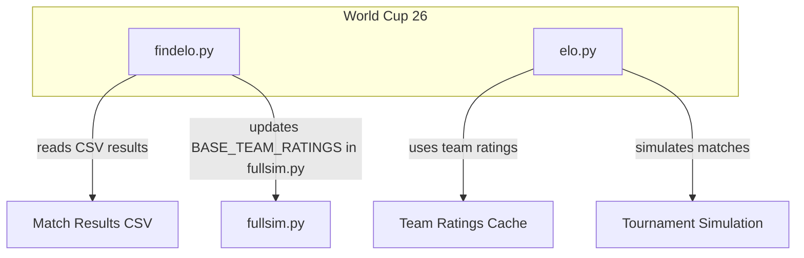
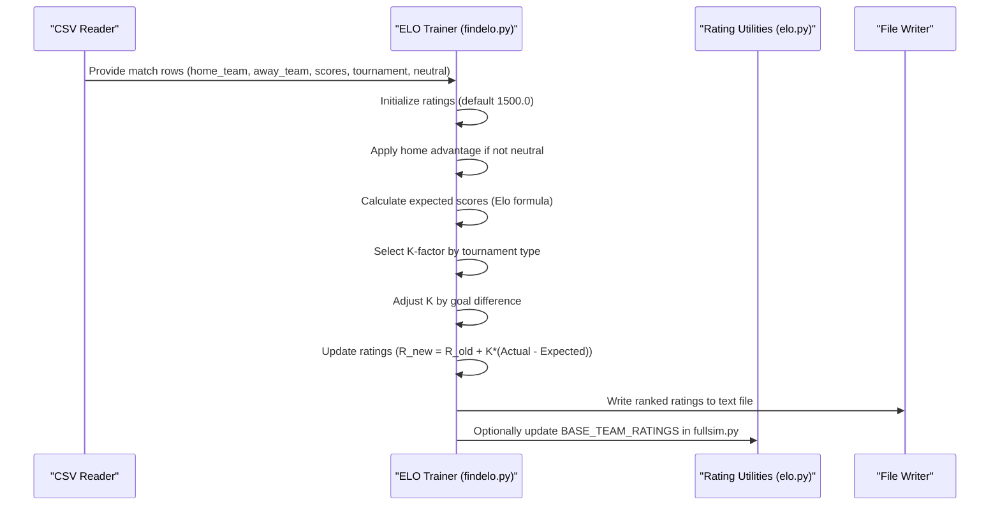
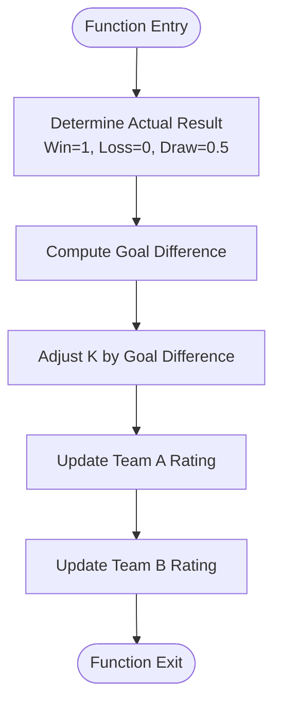
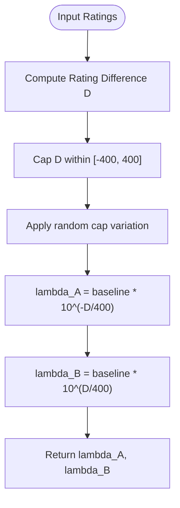
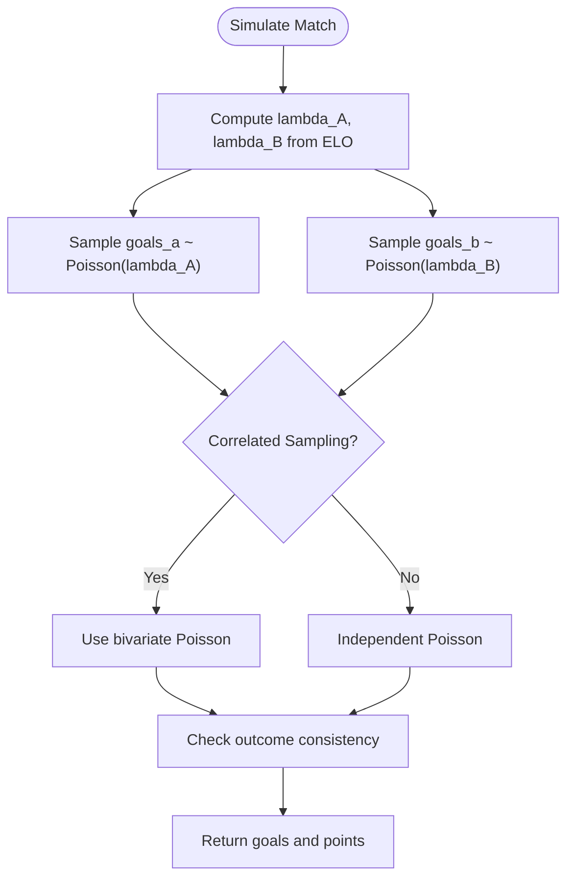
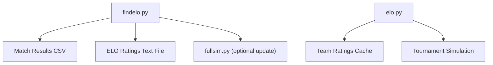

# ELO Rating System Implementation

<cite>
**Referenced Files in This Document**
- [findelo.py](file://worldcup26/findelo.py)
- [elo.py](file://worldcup26/1998/elo.py)
</cite>

## Table of Contents
1. [Introduction](#introduction)
2. [Project Structure](#project-structure)
3. [Core Components](#core-components)
4. [Architecture Overview](#architecture-overview)
5. [Detailed Component Analysis](#detailed-component-analysis)
6. [Dependency Analysis](#dependency-analysis)
7. [Performance Considerations](#performance-considerations)
8. [Troubleshooting Guide](#troubleshooting-guide)
9. [Conclusion](#conclusion)

## Introduction
This document explains the ELO rating system implementation used across the repository’s football analysis modules. It focuses on:
- The mathematical foundation of the Elo formula, including expected score calculations and rating updates.
- Key constants such as HOME_ADVANTAGE_ELO (or equivalent home advantage), ELO_SCALE (400.0), and LEAGUE_AVERAGE_ELO (1500.0).
- The update_elo function mechanics and how ratings change based on match outcomes.
- Examples of rating calculations for wins, losses, and draws.
- The relationship between ELO differences and goal probability through expected_goals logic.
- Integration of Poisson distributions for realistic goal scoring simulation.

The primary implementations are found in:
- worldcup26/findelo.py: a standalone ELO trainer that reads match results, computes expected scores, adjusts K by goal difference, and updates team ratings.
- worldcup26/1998/elo.py: a broader simulation engine that includes ELO-based probabilities, goal modeling via Poisson/Skellam-like approaches, and tournament simulation utilities.

## Project Structure
At a high level, the ELO-related code is organized into two main files:
- findelo.py implements an ELO trainer with explicit functions for expected score calculation, K-factor selection, K adjustment by goal difference, and rating updates.
- elo.py provides a richer simulation environment with ELO-derived win/draw probabilities, goal expectation models, and Monte Carlo simulations.

**Diagram sources**
- [findelo.py:146-216](file://worldcup26/findelo.py#L146-L216)
- [elo.py:443-485](file://worldcup26/1998/elo.py#L443-L485)

**Section sources**
- [findelo.py:1-225](file://worldcup26/findelo.py#L1-L225)
- [elo.py:1-800](file://worldcup26/1998/elo.py#L1-L800)

## Core Components
This section summarizes the core components relevant to ELO:

- Expected Score Calculation
  - Standard logistic form using base 10 exponentials with scale 400.
  - Implemented in findelo.py and mirrored in elo.py’s helper functions.

- K-Factor Selection and Adjustment
  - Tournament-dependent base K values.
  - Additional scaling by goal difference to reflect dominance.

- Rating Update Mechanics
  - R_new = R_old + K × (Actual - Expected).
  - Actual is 1 for win, 0.5 for draw, 0 for loss.

- Home Advantage
  - In findelo.py, a fixed additive home advantage is applied before computing expected scores.
  - In elo.py, home advantage is modeled via adjustments to expected goals or effective ratings depending on simulation mode.

- Goal Probability and Scoring Models
  - Elo differences map to expected goals via exponential relationships.
  - Poisson distribution is used to simulate goal counts; Skellam-like approach is also present.

**Section sources**
- [findelo.py:6-12](file://worldcup26/findelo.py#L6-L12)
- [findelo.py:14-46](file://worldcup26/findelo.py#L14-L46)
- [findelo.py:48-64](file://worldcup26/findelo.py#L48-L64)
- [findelo.py:66-89](file://worldcup26/findelo.py#L66-L89)
- [findelo.py:154-194](file://worldcup26/findelo.py#L154-L194)
- [elo.py:487-508](file://worldcup26/1998/elo.py#L487-L508)
- [elo.py:520-533](file://worldcup26/1998/elo.py#L520-L533)
- [elo.py:535-618](file://worldcup26/1998/elo.py#L535-L618)

## Architecture Overview
The ELO system integrates match result processing, expected score computation, K-factor tuning, and rating updates. In the simulation context, ELO drives both outcome probabilities and goal expectations, which are then sampled from Poisson distributions.

**Diagram sources**
- [findelo.py:146-216](file://worldcup26/findelo.py#L146-L216)
- [findelo.py:6-12](file://worldcup26/findelo.py#L6-L12)
- [findelo.py:14-46](file://worldcup26/findelo.py#L14-L46)
- [findelo.py:48-64](file://worldcup26/findelo.py#L48-L64)
- [findelo.py:66-89](file://worldcup26/findelo.py#L66-L89)

## Detailed Component Analysis

### Mathematical Foundation of Elo Formula
- Expected score for team A against team B:
  - E_A = 1 / (1 + 10^((R_B - R_A)/400))
  - E_B = 1 - E_A
- Scale factor 400 controls sensitivity to rating differences.
- Default starting rating is 1500.0 for new teams.

These formulas appear in:
- findelo.py’s calculate_expected_score function.
- elo.py’s get_win_probability and related helpers.

**Section sources**
- [findelo.py:6-12](file://worldcup26/findelo.py#L6-L12)
- [elo.py:487-489](file://worldcup26/1998/elo.py#L487-L489)

### Constants and Parameters
- ELO_SCALE (400.0): Used as the denominator in the exponent of the Elo formula. Present implicitly in findelo.py’s expected score calculation and explicitly in elo.py’s win probability helpers.
- LEAGUE_AVERAGE_ELO (1500.0): Default initial rating for unknown teams. Implemented in findelo.py when initializing ratings and in elo.py’s get_rating fallback.
- HOME_ADVANTAGE_ELO (or equivalent):
  - In findelo.py, a fixed additive home advantage (HOME_ADVANTAGE = 100) is added to the home team’s rating before computing expected scores.
  - In elo.py, home advantage is modeled differently: it adjusts expected goals or effective ratings depending on simulation mode.

Note: While the prompt references HOME_ADVANTAGE_ELO = 40.0, the actual repository uses different constants:
- findelo.py uses HOME_ADVANTAGE = 100 (additive to rating).
- elo.py applies home advantage to expected goals via apply_home_advantage and other mechanisms.

**Section sources**
- [findelo.py:154-183](file://worldcup26/findelo.py#L154-L183)
- [elo.py:190-211](file://worldcup26/1998/elo.py#L190-L211)
- [elo.py:452-461](file://worldcup26/1998/elo.py#L452-L461)

### update_elo Function Mechanics
The update_elo function in findelo.py performs the following steps:
1. Determine actual results:
   - Win: 1.0 for winner, 0.0 for loser.
   - Draw: 0.5 for both.
2. Compute goal difference and adjust K accordingly.
3. Update ratings:
   - R_new = R_old + K_adjusted × (Actual - Expected).

**Diagram sources**
- [findelo.py:66-89](file://worldcup26/findelo.py#L66-L89)
- [findelo.py:48-64](file://worldcup26/findelo.py#L48-L64)

**Section sources**
- [findelo.py:66-89](file://worldcup26/findelo.py#L66-L89)

### Examples of Rating Calculations
Assume two teams with ratings R_A and R_B, and a chosen K-factor.

- Win scenario:
  - If A wins, Actual_A = 1, Actual_B = 0.
  - New_R_A = R_A + K × (1 - E_A)
  - New_R_B = R_B + K × (0 - E_B)

- Loss scenario:
  - If A loses, Actual_A = 0, Actual_B = 1.
  - New_R_A = R_A + K × (0 - E_A)
  - New_R_B = R_B + K × (1 - E_B)

- Draw scenario:
  - Actual_A = Actual_B = 0.5.
  - New_R_A = R_A + K × (0.5 - E_A)
  - New_R_B = R_B + K × (0.5 - E_B)

These examples follow directly from the update_elo logic and expected score definitions.

**Section sources**
- [findelo.py:6-12](file://worldcup26/findelo.py#L6-L12)
- [findelo.py:66-89](file://worldcup26/findelo.py#L66-L89)

### Relationship Between ELO Differences and Goal Probability
In elo.py, ELO differences influence expected goals:
- expected_goals_skellam_random_cap maps rating differences to lambda_A and lambda_B using exponential relationships with base 10 and scale 400.
- The baseline total goals are split proportionally based on each team’s expected strength derived from ELO.

**Diagram sources**
- [elo.py:520-533](file://worldcup26/1998/elo.py#L520-L533)

**Section sources**
- [elo.py:520-533](file://worldcup26/1998/elo.py#L520-L533)

### Poisson Distribution Integration for Realistic Goal Scoring
Both files integrate Poisson distributions to simulate goal counts:
- elo.py samples goals from Poisson(lambda_A) and Poisson(lambda_B), optionally with correlation via bivariate Poisson sampling.
- findelo.py does not directly simulate goals but uses ELO to drive match outcomes and ratings.

**Diagram sources**
- [elo.py:510-518](file://worldcup26/1998/elo.py#L510-L518)
- [elo.py:575-611](file://worldcup26/1998/elo.py#L575-L611)

**Section sources**
- [elo.py:510-518](file://worldcup26/1998/elo.py#L510-L518)
- [elo.py:575-611](file://worldcup26/1998/elo.py#L575-L611)

## Dependency Analysis
The ELO system has clear dependencies:
- findelo.py depends on CSV input and writes outputs to a text file and optionally updates fullsim.py.
- elo.py depends on team ratings cache and provides simulation utilities.

**Diagram sources**
- [findelo.py:146-216](file://worldcup26/findelo.py#L146-L216)
- [elo.py:443-485](file://worldcup26/1998/elo.py#L443-L485)

**Section sources**
- [findelo.py:146-216](file://worldcup26/findelo.py#L146-L216)
- [elo.py:443-485](file://worldcup26/1998/elo.py#L443-L485)

## Performance Considerations
- K-factor selection impacts convergence speed: higher K leads to faster rating changes but may increase volatility.
- Goal difference adjustment prevents overreaction to lopsided matches.
- Poisson sampling is computationally efficient and suitable for large-scale simulations.
- Caching team ratings avoids repeated lookups and improves performance.

[No sources needed since this section provides general guidance]

## Troubleshooting Guide
Common issues and resolutions:
- Missing CSV file: Ensure the path to the match results CSV is correct.
- Unexpected rating behavior: Verify tournament type affects K-factor appropriately.
- Home advantage anomalies: Check whether neutral venue flag is set correctly.
- Simulation inconsistencies: Confirm Poisson parameters and correlation settings align with desired realism.

**Section sources**
- [findelo.py:218-221](file://worldcup26/findelo.py#L218-L221)

## Conclusion
The ELO rating system in this repository combines classical Elo mathematics with practical adaptations for football:
- Expected scores use the standard logistic function with scale 400.
- Ratings start at 1500 and adjust via K-factors tuned by tournament type and goal difference.
- Home advantage is implemented additively in the trainer and via expected goals in the simulator.
- Poisson distributions model goal scoring realistically, enabling robust tournament simulations.

[No sources needed since this section summarizes without analyzing specific files]