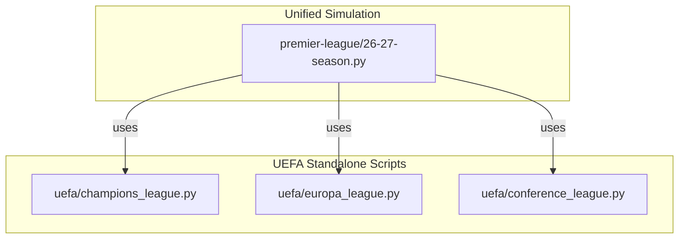
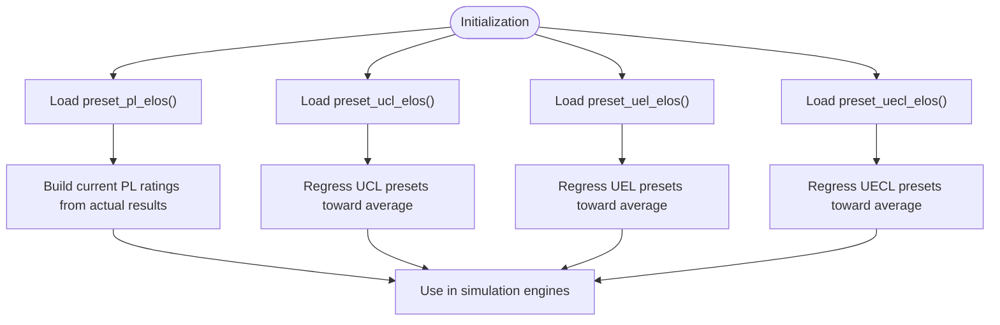
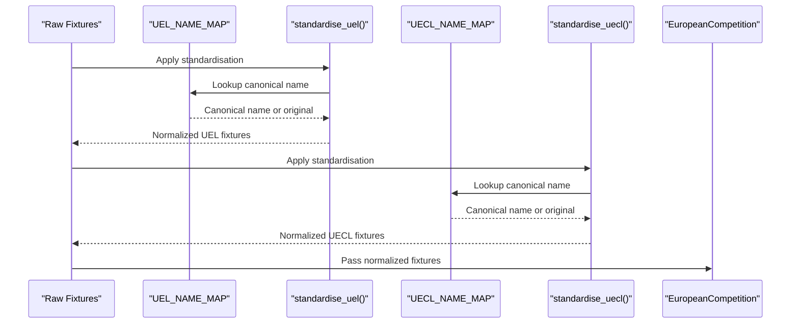
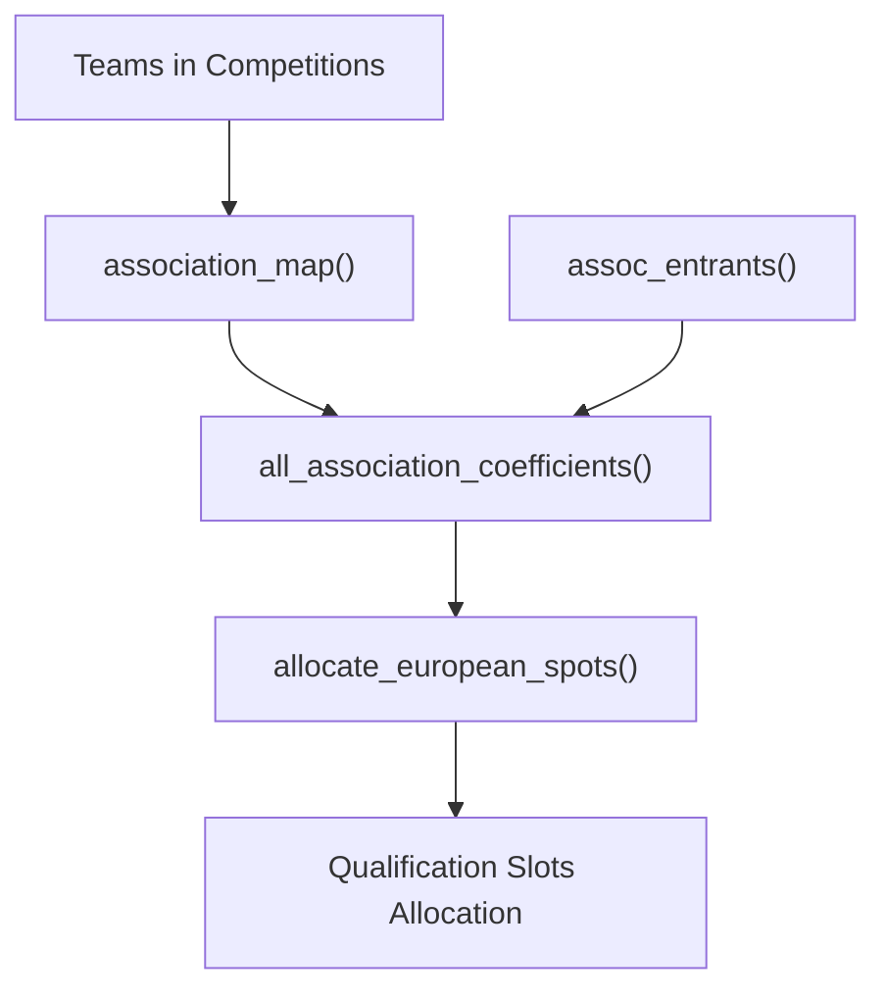
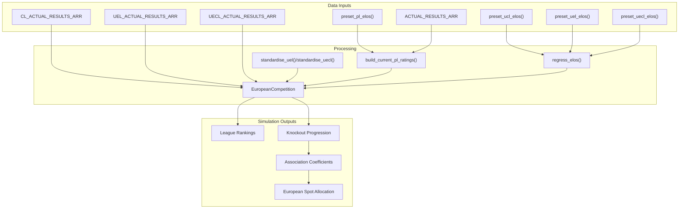
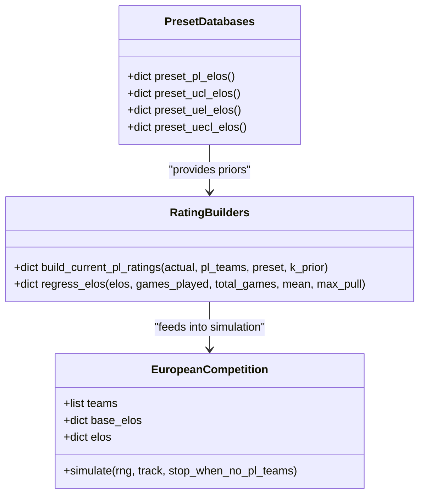
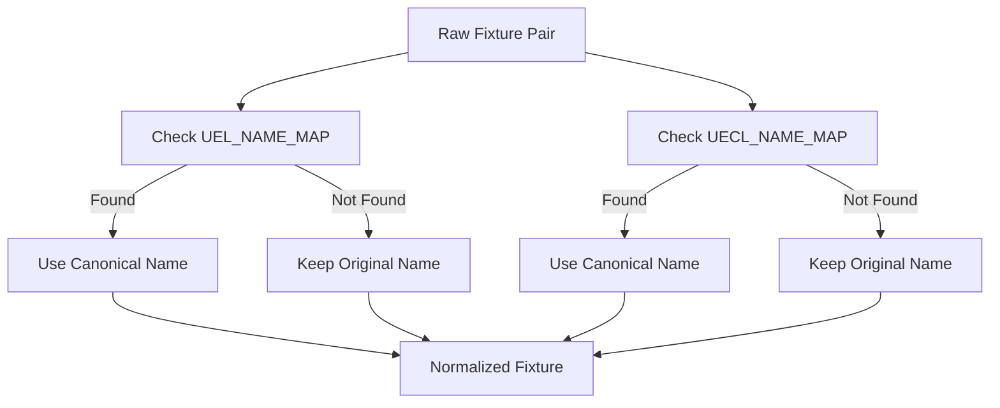
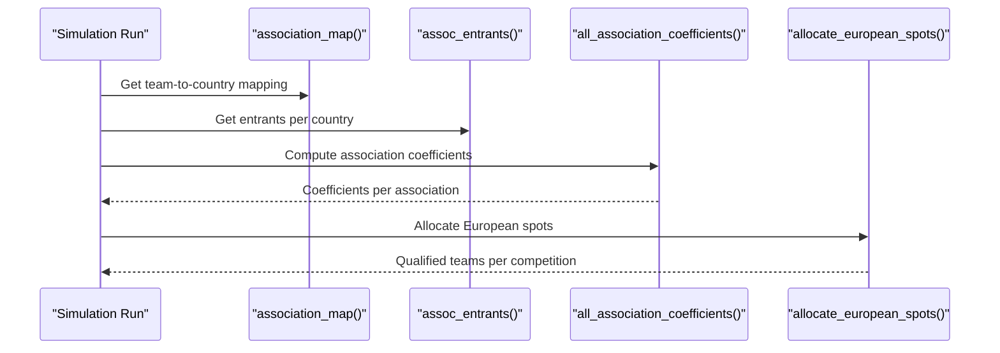
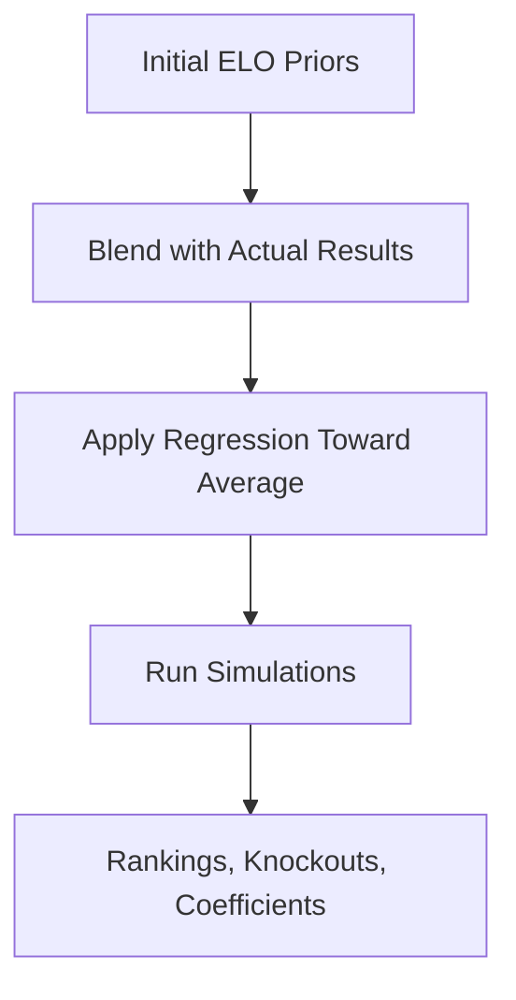
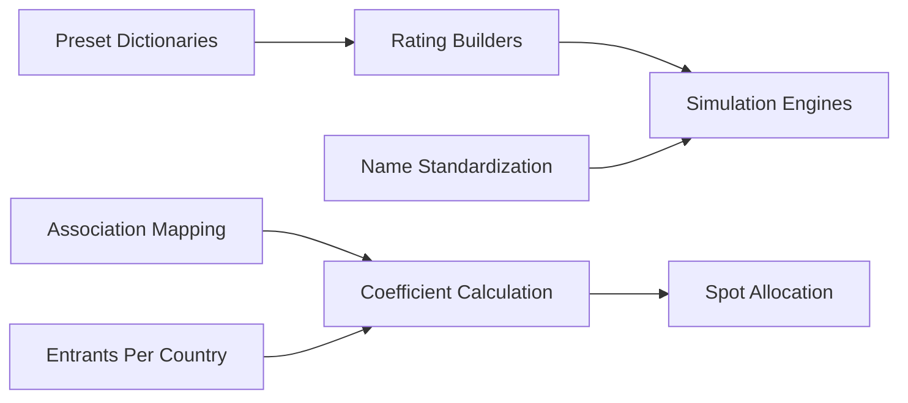

# Preset Ratings Databases

<cite>
**Referenced Files in This Document**
- [26-27-season.py](file://premier-league/26-27-season.py)
- [champions_league.py](file://uefa/champions_league.py)
- [europa_league.py](file://uefa/europa_league.py)
- [conference_league.py](file://uefa/conference_league.py)
</cite>

## Table of Contents
1. [Introduction](#introduction)
2. [Project Structure](#project-structure)
3. [Core Components](#core-components)
4. [Architecture Overview](#architecture-overview)
5. [Detailed Component Analysis](#detailed-component-analysis)
6. [Dependency Analysis](#dependency-analysis)
7. [Performance Considerations](#performance-considerations)
8. [Troubleshooting Guide](#troubleshooting-guide)
9. [Conclusion](#conclusion)

## Introduction
This document explains the preset rating databases used for major European football competitions and the Premier League within this codebase. It focuses on:
- The four preset ELO dictionaries: Premier League (preset_pl_elos), Champions League (preset_ucl_elos), Europa League (preset_uel_elos), and Conference League (preset_uecl_elos).
- How team names are standardized across competitions using mapping tables and helper functions.
- The rationale behind initial rating assignments and how they reflect competitive balance.
- The structure of the rating dictionaries and their role in simulation.
- The association_map function that links teams to national associations, and the assoc_entrants function that defines qualification slots per country.

The goal is to make these systems understandable for both technical and non-technical readers, with clear diagrams and concrete references to source files.

## Project Structure
The preset rating databases and related logic live primarily in the unified simulation script for the 2026–27 season. Supporting scripts exist for standalone simulations but do not define the same preset structures.

**Diagram sources**
- [26-27-season.py:155-219](file://premier-league/26-27-season.py#L155-L219)
- [champions_league.py:5-19](file://uefa/champions_league.py#L5-L19)
- [europa_league.py:5-12](file://uefa/europa_league.py#L5-L12)
- [conference_league.py:1-12](file://uefa/conference_league.py#L1-L12)

**Section sources**
- [26-27-season.py:155-219](file://premier-league/26-27-season.py#L155-L219)
- [champions_league.py:5-19](file://uefa/champions_league.py#L5-L19)
- [europa_league.py:5-12](file://uefa/europa_league.py#L5-L12)
- [conference_league.py:1-12](file://uefa/conference_league.py#L1-L12)

## Core Components
This section documents the preset rating databases and supporting data structures.

### Preset Rating Dictionaries
- **Premier League**: preset_pl_elos returns a dictionary mapping team names to initial ELO ratings.
- **Champions League**: preset_ucl_elos returns a dictionary mapping participating teams to initial ELO ratings.
- **Europa League**: preset_uel_elos returns a dictionary mapping participating teams to initial ELO ratings.
- **Conference League**: preset_uecl_elos returns a dictionary mapping participating teams to initial ELO ratings.

These dictionaries serve as prior beliefs about team strength before simulating matches. They are later regressed toward league averages based on the number of games played across all competitions.

**Diagram sources**
- [26-27-season.py:155-219](file://premier-league/26-27-season.py#L155-L219)
- [26-27-season.py:2702-2734](file://premier-league/26-27-season.py#L2702-L2734)

**Section sources**
- [26-27-season.py:155-219](file://premier-league/26-27-season.py#L155-L219)
- [26-27-season.py:2702-2734](file://premier-league/26-27-season.py#L2702-L2734)

### Team Name Standardization
To ensure consistent team naming across fixtures and datasets, the code uses mapping tables and helper functions:
- UEL_NAME_MAP maps short or alternate names to canonical names for Europa League fixtures.
- standardise_uel applies the mapping to each fixture pair.
- UECL_NAME_MAP does the same for Conference League fixtures.
- standardise_uecl applies the mapping to each fixture pair.

This normalization ensures that team names align with those used in the preset dictionaries and other parts of the simulation.

**Diagram sources**
- [26-27-season.py:543-554](file://premier-league/26-27-season.py#L543-L554)
- [26-27-season.py:617-629](file://premier-league/26-27-season.py#L617-L629)
- [26-27-season.py:2736-2743](file://premier-league/26-27-season.py#L2736-L2743)

**Section sources**
- [26-27-season.py:543-554](file://premier-league/26-27-season.py#L543-L554)
- [26-27-season.py:617-629](file://premier-league/26-27-season.py#L617-L629)
- [26-27-season.py:2736-2743](file://premier-league/26-27-season.py#L2736-L2743)

### Association Mapping and Qualification Slots
- **association_map**: Maps each team to its national association (country). This is used to compute coefficients per association and allocate European spots based on performance.
- **assoc_entrants**: Defines the number of entrants per country, which normalizes association coefficients by dividing total points by the number of entrants.

**Diagram sources**
- [26-27-season.py:222-278](file://premier-league/26-27-season.py#L222-L278)
- [26-27-season.py:1280-1307](file://premier-league/26-27-season.py#L1280-L1307)
- [26-27-season.py:1446-1488](file://premier-league/26-27-season.py#L1446-L1488)

**Section sources**
- [26-27-season.py:222-278](file://premier-league/26-27-season.py#L222-L278)
- [26-27-season.py:1280-1307](file://premier-league/26-27-season.py#L1280-L1307)
- [26-27-season.py:1446-1488](file://premier-league/26-27-season.py#L1446-L1488)

## Architecture Overview
The unified simulation integrates preset rating databases with match fixtures and actual results to produce realistic outcomes.

**Diagram sources**
- [26-27-season.py:155-219](file://premier-league/26-27-season.py#L155-L219)
- [26-27-season.py:543-554](file://premier-league/26-27-season.py#L543-L554)
- [26-27-season.py:617-629](file://premier-league/26-27-season.py#L617-L629)
- [26-27-season.py:669-694](file://premier-league/26-27-season.py#L669-L694)
- [26-27-season.py:884-1066](file://premier-league/26-27-season.py#L884-L1066)
- [26-27-season.py:1280-1307](file://premier-league/26-27-season.py#L1280-L1307)
- [26-27-season.py:1446-1488](file://premier-league/26-27-season.py#L1446-L1488)
- [26-27-season.py:2702-2743](file://premier-league/26-27-season.py#L2702-L2743)

## Detailed Component Analysis

### Preset Rating Databases
- **Structure**: Each preset function returns a Python dictionary where keys are team names and values are numeric ELO ratings.
- **Usage**: 
  - For the Premier League, build_current_pl_ratings blends actual results with the preset to produce current ratings.
  - For European competitions, regress_elos pulls preset ratings toward the league average based on the proportion of games played.
- **Rationale**: 
  - Initial ratings encode expected team strengths before the season’s matches are simulated.
  - Regression prevents overfitting to small sample sizes and stabilizes predictions.

**Diagram sources**
- [26-27-season.py:155-219](file://premier-league/26-27-season.py#L155-L219)
- [26-27-season.py:669-694](file://premier-league/26-27-season.py#L669-L694)
- [26-27-season.py:884-1066](file://premier-league/26-27-season.py#L884-L1066)

**Section sources**
- [26-27-season.py:155-219](file://premier-league/26-27-season.py#L155-L219)
- [26-27-season.py:669-694](file://premier-league/26-27-season.py#L669-L694)
- [26-27-season.py:884-1066](file://premier-league/26-27-season.py#L884-L1066)

### Team Name Standardization
- **Mapping Tables**: 
  - UEL_NAME_MAP contains entries like mapping short names to full names.
  - UECL_NAME_MAP similarly maps alternate names to canonical forms.
- **Helper Functions**: 
  - standardise_uel(name) returns the canonical name if mapped; otherwise returns the original.
  - standardise_uecl(name) does the same for Conference League.
- **Application**: 
  - Before constructing EuropeanCompetition instances, fixtures are normalized to ensure consistency with preset dictionaries and other components.

**Diagram sources**
- [26-27-season.py:543-554](file://premier-league/26-27-season.py#L543-L554)
- [26-27-season.py:617-629](file://premier-league/26-27-season.py#L617-L629)

**Section sources**
- [26-27-season.py:543-554](file://premier-league/26-27-season.py#L543-L554)
- [26-27-season.py:617-629](file://premier-league/26-27-season.py#L617-L629)

### Association Mapping and Qualification Slots
- **association_map**: Provides a lookup from team name to national association. Used to aggregate performance by country.
- **assoc_entrants**: Defines the number of clubs per country that participate in European competitions. This denominator normalizes association coefficients.
- **all_association_coefficients**: Computes per-association coefficients by summing club coefficient points and dividing by the number of entrants.
- **allocate_european_spots**: Determines which English teams qualify for UCL, UEL, and UECL based on league position, cup winners, and UEFA rules.

**Diagram sources**
- [26-27-season.py:222-278](file://premier-league/26-27-season.py#L222-L278)
- [26-27-season.py:1280-1307](file://premier-league/26-27-season.py#L1280-L1307)
- [26-27-season.py:1446-1488](file://premier-league/26-27-season.py#L1446-L1488)

**Section sources**
- [26-27-season.py:222-278](file://premier-league/26-27-season.py#L222-L278)
- [26-27-season.py:1280-1307](file://premier-league/26-27-season.py#L1280-L1307)
- [26-27-season.py:1446-1488](file://premier-league/26-27-season.py#L1446-L1488)

### Conceptual Overview
The preset rating databases provide a structured foundation for simulating football competitions. By combining initial ELO estimates with actual results and regression techniques, the system balances realism with stability. Team name standardization ensures consistency across datasets, while association mapping and slot allocation reflect real-world qualification rules.

[No sources needed since this diagram shows conceptual workflow, not actual code structure]

## Dependency Analysis
The preset rating databases depend on several supporting components:
- Fixture normalization functions ensure consistent team naming.
- Rating builders transform raw presets into usable inputs for simulations.
- Association mapping and entrant counts influence coefficient calculations and spot allocations.

**Diagram sources**
- [26-27-season.py:155-219](file://premier-league/26-27-season.py#L155-L219)
- [26-27-season.py:543-554](file://premier-league/26-27-season.py#L543-L554)
- [26-27-season.py:617-629](file://premier-league/26-27-season.py#L617-L629)
- [26-27-season.py:669-694](file://premier-league/26-27-season.py#L669-L694)
- [26-27-season.py:1280-1307](file://premier-league/26-27-season.py#L1280-L1307)
- [26-27-season.py:1446-1488](file://premier-league/26-27-season.py#L1446-L1488)

**Section sources**
- [26-27-season.py:155-219](file://premier-league/26-27-season.py#L155-L219)
- [26-27-season.py:543-554](file://premier-league/26-27-season.py#L543-L554)
- [26-27-season.py:617-629](file://premier-league/26-27-season.py#L617-L629)
- [26-27-season.py:669-694](file://premier-league/26-27-season.py#L669-L694)
- [26-27-season.py:1280-1307](file://premier-league/26-27-season.py#L1280-L1307)
- [26-27-season.py:1446-1488](file://premier-league/26-27-season.py#L1446-L1488)

## Performance Considerations
- **Efficiency**: Using dictionaries for preset ratings allows O(1) lookups during simulation.
- **Regression**: Pulling ratings toward the league average reduces variance and improves generalization.
- **Normalization**: Precomputing canonical team names avoids repeated string comparisons during simulations.
- **Scalability**: The modular design allows adding new competitions or adjusting presets without major refactoring.

[No sources needed since this section provides general guidance]

## Troubleshooting Guide
Common issues and resolutions:
- **Team Name Mismatches**: Ensure all team names are standardized using standardise_uel and standardise_uecl before passing fixtures to EuropeanCompetition.
- **Missing Associations**: Verify that association_map includes all teams present in fixtures; missing entries will be skipped in coefficient calculations.
- **Incorrect Entrant Counts**: Double-check assoc_entrants for accuracy, as incorrect denominators will skew association coefficients.

**Section sources**
- [26-27-season.py:543-554](file://premier-league/26-27-season.py#L543-L554)
- [26-27-season.py:617-629](file://premier-league/26-27-season.py#L617-L629)
- [26-27-season.py:222-278](file://premier-league/26-27-season.py#L222-L278)

## Conclusion
The preset rating databases form the backbone of the simulation system, providing initial strength estimates that are refined through actual results and regression. Team name standardization ensures consistency across datasets, while association mapping and qualification slot allocation reflect real-world rules. Together, these components enable realistic and robust simulations of the Premier League and European competitions.

[No sources needed since this section summarizes without analyzing specific files]