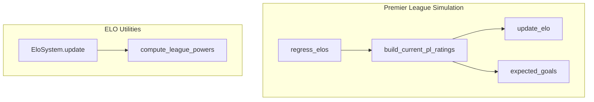
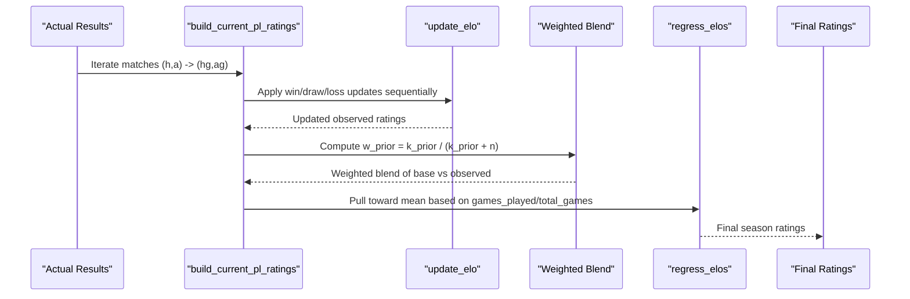
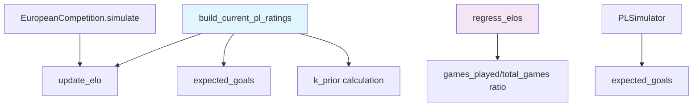

# Rating Update Mechanisms

<cite>
**Referenced Files in This Document**
- [26-27-season.py](file://premier-league/26-27-season.py)
- [texttocsv.py](file://ELO/texttocsv.py)
</cite>

## Table of Contents
1. [Introduction](#introduction)
2. [Project Structure](#project-structure)
3. [Core Components](#core-components)
4. [Architecture Overview](#architecture-overview)
5. [Detailed Component Analysis](#detailed-component-analysis)
6. [Dependency Analysis](#dependency-analysis)
7. [Performance Considerations](#performance-considerations)
8. [Troubleshooting Guide](#troubleshooting-guide)
9. [Conclusion](#conclusion)

## Introduction
This document explains the dynamic rating update mechanisms used to evolve team ratings across a season, focusing on:
- How actual results are processed into current season ratings via build_current_pl_ratings
- How regression toward the mean is applied through regress_elos
- The role of k_prior in balancing prior knowledge with observed performance
- Step-by-step examples of how wins, losses, and draws affect ratings
- The weighting system that combines base (prior) ratings with observed performance data

The implementation uses an ELO-style framework with configurable K values, expected score calculations, and Bayesian-like blending between priors and observations.

## Project Structure
The relevant code for rating updates lives primarily in the Premier League simulation file and the ELO processing utility:
- premier-league/26-27-season.py: Contains the core rating builders and regression logic used in simulations
- ELO/texttocsv.py: Implements a general EloSystem class with goal-difference multipliers and two-pass calibration

**Diagram sources**
- [26-27-season.py:127-135](file://premier-league/26-27-season.py#L127-L135)
- [26-27-season.py:669-694](file://premier-league/26-27-season.py#L669-L694)
- [texttocsv.py:252-318](file://ELO/texttocsv.py#L252-L318)

**Section sources**
- [26-27-season.py:127-135](file://premier-league/26-27-season.py#L127-L135)
- [26-27-season.py:669-694](file://premier-league/26-27-season.py#L669-L694)
- [texttocsv.py:252-318](file://ELO/texttocsv.py#L252-L318)

## Core Components
- update_elo: Computes ELO updates given winner/loser ratings and K
- expected_goals: Converts ELO differences into Poisson lambda parameters for scoring
- build_current_pl_ratings: Iterates over actual match results to produce observed ratings, then blends with base/prior ratings using k_prior
- regress_elos: Applies regression toward the league mean based on games played fraction and max pull
- EloSystem.update: Generalized ELO update with optional goal-difference multiplier and history tracking

Key responsibilities:
- Observed ratings reflect sequential application of match outcomes against evolving opponent strengths
- Prior-to-observed blending controlled by k_prior
- Regression pulls ratings toward a mean as more games are played, capped by max_pull

**Section sources**
- [26-27-season.py:127-135](file://premier-league/26-27-season.py#L127-L135)
- [26-27-season.py:669-694](file://premier-league/26-27-season.py#L669-L694)
- [texttocsv.py:252-318](file://ELO/texttocsv.py#L252-L318)

## Architecture Overview
The rating pipeline integrates prior knowledge, observed performance, and regression:

**Diagram sources**
- [26-27-season.py:669-694](file://premier-league/26-27-season.py#L669-L694)
- [26-27-season.py:127-135](file://premier-league/26-27-season.py#L127-L135)

## Detailed Component Analysis

### build_current_pl_ratings
Purpose:
- Processes actual match results to generate observed ratings
- Blends base (preset) ratings with observed performance using k_prior

Inputs:
- actual: Map of (home, away) -> (home_goals, away_goals)
- pl_teams: Set of all teams
- preset: Base ratings per team
- k_prior: Prior strength parameter controlling weight of base vs observed

Processing steps:
1. Initialize base and observed dictionaries from preset
2. For each match:
   - If home wins: apply update_elo to both teams
   - If away wins: apply update_elo to both teams
   - If draw: compute expected home score and adjust both ratings accordingly
3. Compute number of matches n
4. Compute w_prior = k_prior / (k_prior + n)
5. Return blended ratings: w_prior * base[t] + (1 - w_prior) * observed[t]

Complexity:
- Time: O(n) where n is number of matches
- Space: O(t) where t is number of teams

Error handling:
- Missing teams default to LEAGUE_AVERAGE_ELO in base initialization

Optimization opportunities:
- Vectorize expected score computations if dataset grows large
- Precompute _ELO_LN_SCALE constants (already done)

**Section sources**
- [26-27-season.py:677-694](file://premier-league/26-27-season.py#L677-L694)

### regress_elos
Purpose:
- Applies regression toward the mean based on games played fraction
- Controls how much observed ratings should be pulled back toward baseline

Inputs:
- elos: Current ratings dictionary
- games_played: Number of games played so far
- total_games: Total games in competition
- mean: Target mean for regression
- max_pull: Maximum pull factor toward mean

Processing steps:
1. If total_games == 0, return original elos unchanged
2. Compute frac = clamp(games_played / total_games, 0.0, 1.0)
3. Compute pull = clamp(max_pull) * (1.0 - frac)
4. For each team: new_rating = mean + (old_rating - mean) * (1.0 - pull)

Behavior:
- As games_played approaches total_games, pull decreases
- When frac = 1.0, pull = 0.0 (no regression)
- When frac = 0.0, pull = max_pull (maximum regression)

Edge cases:
- Division by zero handled by early return when total_games == 0
- Fraction clamped to prevent negative or >1 values

**Section sources**
- [26-27-season.py:669-674](file://premier-league/26-27-season.py#L669-L674)

### k_prior Parameter
Role:
- Controls the balance between prior knowledge (base ratings) and observed performance
- Higher k_prior gives more weight to base ratings
- Lower k_prior allows observed performance to dominate

Mathematical interpretation:
- w_prior = k_prior / (k_prior + n)
- When n << k_prior: w_prior ≈ 1.0 (strong prior influence)
- When n >> k_prior: w_prior ≈ 0.0 (observed dominates)

Practical usage:
- In the simulation, k_prior is set to 50.0
- With few matches played, base ratings have significant influence
- As more matches are played, observed performance becomes more influential

**Section sources**
- [26-27-season.py:692-694](file://premier-league/26-27-season.py#L692-L694)

### update_elo Function
Purpose:
- Standard ELO update for win/loss scenarios
- Used within build_current_pl_ratings for non-draw matches

Formula:
- Expected score for winner: 1 / (1 + exp((elo_l - elo_w) * _ELO_LN_SCALE))
- Winner new rating: elo_w + K * (1 - expected)
- Loser new rating: elo_l + K * (expected - 1)

K value:
- Fixed at 20.0 in build_current_pl_ratings context

**Section sources**
- [26-27-season.py:127-129](file://premier-league/26-27-season.py#L127-L129)

### Draw Handling in build_current_pl_ratings
For draws:
- Compute expected home score: exp_h = 1 / (1 + exp((ea - eh) * _ELO_LN_SCALE))
- Adjust home rating: eh + 20.0 * (0.5 - exp_h)
- Adjust away rating: ea + 20.0 * (exp_h - 0.5)

This ensures:
- If home was favored (exp_h > 0.5), both teams move slightly toward expectation
- If away was favored (exp_h < 0.5), adjustments reflect surprise factor

**Section sources**
- [26-27-season.py:688-691](file://premier-league/26-27-season.py#L688-L691)

### Step-by-Step Rating Evolution Examples

#### Example 1: Single Match Win
Initial state:
- Team A: 1500
- Team B: 1500
- Match: A beats B 2-1

Process:
1. Call update_elo(1500, 1500, 20.0)
2. Expected score for A: 0.5 (equal ratings)
3. New A rating: 1500 + 20.0 * (1 - 0.5) = 1510
4. New B rating: 1500 + 20.0 * (0.5 - 1) = 1490

Result:
- Team A: 1510 (+10)
- Team B: 1490 (-10)

#### Example 2: Draw Against Underdog
Initial state:
- Team A: 1600
- Team B: 1400
- Match: A draws with B 1-1

Process:
1. Compute expected home score: exp_h = 1 / (1 + exp((1400 - 1600) * _ELO_LN_SCALE))
2. Since A is stronger, exp_h > 0.5
3. A adjustment: 1600 + 20.0 * (0.5 - exp_h) → decreases slightly
4. B adjustment: 1400 + 20.0 * (exp_h - 0.5) → increases slightly

Result:
- Team A: Slight decrease (surprise draw)
- Team B: Slight increase (earned points against stronger opponent)

#### Example 3: Season Progression with k_prior
Season start:
- k_prior = 50.0
- After 5 matches: w_prior = 50 / (50 + 5) = 0.909
- After 20 matches: w_prior = 50 / (50 + 20) = 0.714
- After 50 matches: w_prior = 50 / (50 + 50) = 0.5

Blending effect:
- Early season: Base ratings heavily weighted (90.9%)
- Mid season: More balanced (71.4% base, 28.6% observed)
- Late season: Closer to equal weighting (50% each)

**Section sources**
- [26-27-season.py:677-694](file://premier-league/26-27-season.py#L677-L694)
- [26-27-season.py:127-129](file://premier-league/26-27-season.py#L127-L129)

### Weighting System: Base vs Observed Performance
The weighting system implements Bayesian-like updating:

Formula:
final_rating = w_prior * base_rating + (1 - w_prior) * observed_rating

Where:
- w_prior = k_prior / (k_prior + n)
- n = number of matches played
- base_rating = preset/prior knowledge
- observed_rating = performance-based rating

Interpretation:
- k_prior acts like "pseudo-counts" in Bayesian statistics
- Each match adds one "observation" to the model
- As n increases, observed performance becomes more reliable

**Section sources**
- [26-27-season.py:692-694](file://premier-league/26-27-season.py#L692-L694)

## Dependency Analysis
The rating system has clear dependencies and interactions:

**Diagram sources**
- [26-27-season.py:669-694](file://premier-league/26-27-season.py#L669-L694)
- [26-27-season.py:132-135](file://premier-league/26-27-season.py#L132-L135)

### External Dependencies
- Math functions: exp, log for ELO calculations
- Random number generation for simulations
- Data structures: dictionaries for team mappings

### Coupling Analysis
- Low coupling between rating builders and simulation engines
- Clear separation between rating computation and match simulation
- Modular design allows independent testing of rating components

**Section sources**
- [26-27-season.py:669-694](file://premier-league/26-27-season.py#L669-L694)
- [26-27-season.py:132-135](file://premier-league/26-27-season.py#L132-L135)

## Performance Considerations
- Time complexity: O(n) for build_current_pl_ratings where n is number of matches
- Space complexity: O(t) for team rating storage where t is number of teams
- Mathematical operations: Exponential functions are computationally expensive but necessary for ELO calculations
- Optimization opportunities:
  - Vectorization of expected score calculations
  - Precomputation of common constants
  - Batch processing of matches

Memory usage:
- Minimal additional memory beyond rating dictionaries
- No large intermediate arrays created

**Section sources**
- [26-27-season.py:669-694](file://premier-league/26-27-season.py#L669-L694)

## Troubleshooting Guide

### Common Issues and Solutions

#### Issue: Ratings not changing after matches
Check:
- Verify actual_results contains valid match data
- Ensure teams exist in pl_teams set
- Confirm k_prior is not too high relative to number of matches

#### Issue: Extreme rating changes
Check:
- K value is appropriate (20.0 in current implementation)
- Check for outlier matches with very different skill levels
- Verify expected score calculations are working correctly

#### Issue: Regression not working as expected
Check:
- games_played and total_games values are correct
- max_pull parameter is reasonable (1.0 in current implementation)
- Mean value represents appropriate baseline

### Debugging Tips
- Print intermediate observed ratings during build_current_pl_ratings
- Monitor w_prior values throughout season progression
- Track individual match impacts on team ratings
- Validate expected score calculations against known ELO formulas

**Section sources**
- [26-27-season.py:669-694](file://premier-league/26-27-season.py#L669-L694)

## Conclusion
The dynamic rating update system provides a robust framework for evolving team ratings throughout a season:

Key strengths:
- Bayesian-like blending of prior knowledge with observed performance
- Controlled regression toward the mean prevents overfitting to small samples
- Configurable parameters allow tuning for different competitive environments
- Clear separation between rating computation and match simulation

The system successfully balances:
- Historical performance (base ratings)
- Recent form (observed ratings)
- Statistical reliability (regression toward mean)

This approach provides stable, interpretable ratings that adapt appropriately as more data becomes available throughout the season.