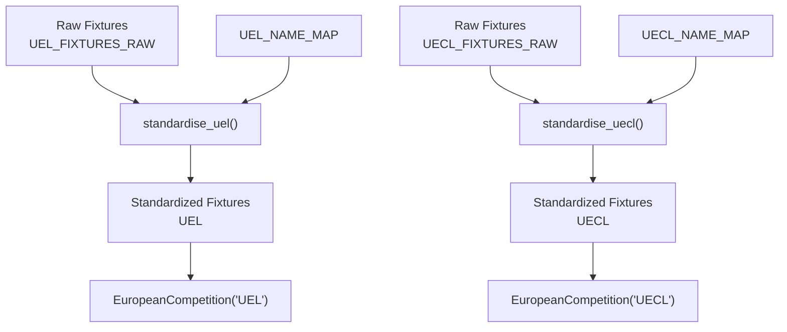
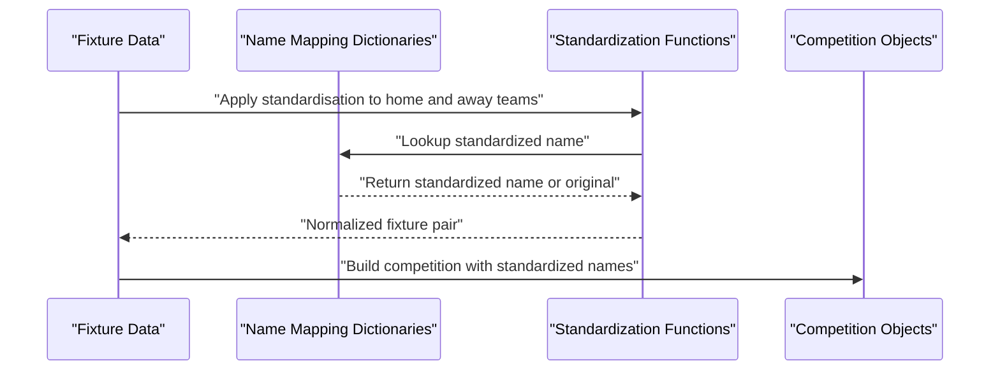
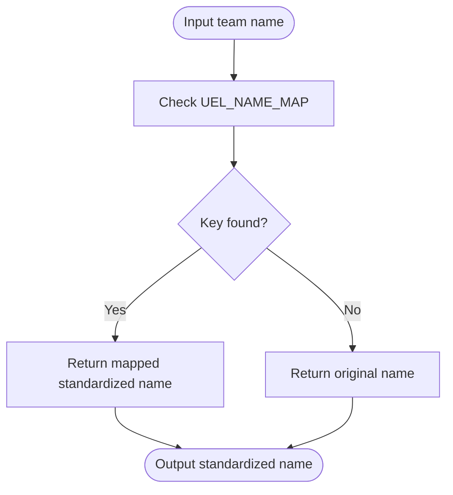
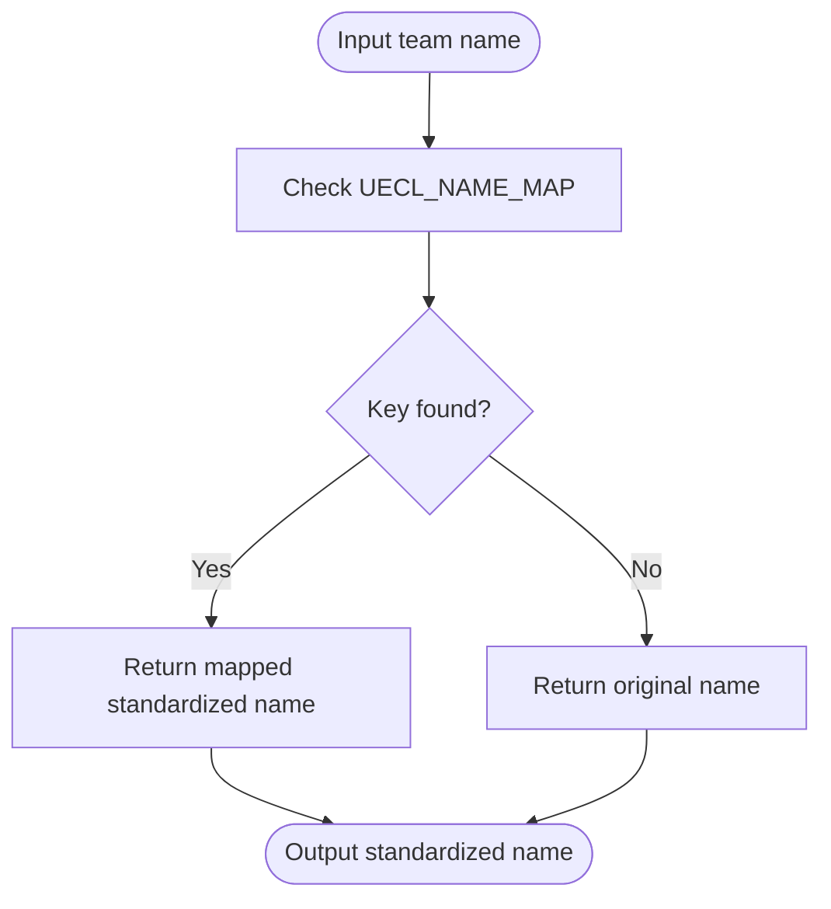
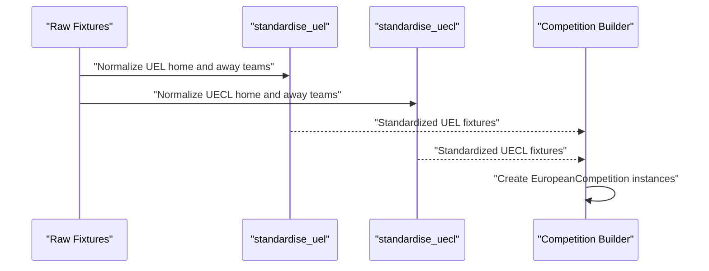
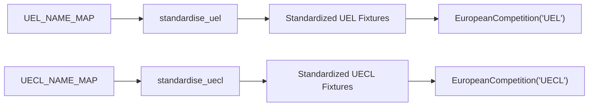

# Team Name Standardization

<cite>
**Referenced Files in This Document**
- [26-27-season.py](file://premier-league/26-27-season.py)
</cite>

## Table of Contents
1. [Introduction](#introduction)
2. [Project Structure](#project-structure)
3. [Core Components](#core-components)
4. [Architecture Overview](#architecture-overview)
5. [Detailed Component Analysis](#detailed-component-analysis)
6. [Dependency Analysis](#dependency-analysis)
7. [Performance Considerations](#performance-considerations)
8. [Troubleshooting Guide](#troubleshooting-guide)
9. [Conclusion](#conclusion)

## Introduction
This document explains the team name standardization system used for UEFA competitions in the project. It focuses on:
- The `UEL_NAME_MAP` and `UECL_NAME_MAP` dictionaries that normalize variations in team names for the UEFA Europa League (UEL) and UEFA Conference League (UECL).
- The `standardise_uel` and `standardise_uecl` functions that apply these mappings to raw fixture data.
- Examples of common name variations and their standardized forms.
- How this system ensures consistent data when merging information across multiple sources and competitions.

The goal is to make sure that team names are uniform before they are used in simulations, statistics, and cross-competition comparisons.

## Project Structure
The standardization logic lives in a single simulation script that handles Premier League and European competition analysis together. The relevant parts are:
- Two mapping dictionaries: one for UEL and one for UECL.
- Two simple normalization functions that use those mappings.
- Fixture processing code that applies the normalization before building competition objects.

**Diagram sources**
- [26-27-season.py:543-554](file://premier-league/26-27-season.py#L543-L554)
- [26-27-season.py:617-629](file://premier-league/26-27-season.py#L617-L629)
- [26-27-season.py:2131-2138](file://premier-league/26-27-season.py#L2131-L2138)
- [26-27-season.py:2736-2743](file://premier-league/26-27-season.py#L2736-L2743)

**Section sources**
- [26-27-season.py:543-554](file://premier-league/26-27-season.py#L543-L554)
- [26-27-season.py:617-629](file://premier-league/26-27-season.py#L617-L629)
- [26-27-season.py:2131-2138](file://premier-league/26-27-season.py#L2131-L2138)
- [26-27-season.py:2736-2743](file://premier-league/26-27-season.py#L2736-L2743)

## Core Components
The core components are:
- `UEL_NAME_MAP`: Maps UEL-specific team name variations to standardized names.
- `UECL_NAME_MAP`: Maps UECL-specific team name variations to standardized names.
- `standardise_uel(name)`: Returns the standardized UEL name for a given input.
- `standardise_uecl(name)`: Returns the standardized UECL name for a given input.

These components work together to ensure that all team names entering the competition simulation are consistent.

**Section sources**
- [26-27-season.py:543-554](file://premier-league/26-27-season.py#L543-L554)
- [26-27-season.py:617-629](file://premier-league/26-27-season.py#L617-L629)

## Architecture Overview
At a high level, the standardization pipeline is:
1. Raw fixtures are read from source arrays.
2. Each team name in each fixture is passed through the appropriate standardization function.
3. The resulting standardized fixtures are used to build competition objects.
4. Simulations and statistics then operate on normalized team names.

**Diagram sources**
- [26-27-season.py:543-554](file://premier-league/26-27-season.py#L543-L554)
- [26-27-season.py:617-629](file://premier-league/26-27-season.py#L617-L629)
- [26-27-season.py:2131-2138](file://premier-league/26-27-season.py#L2131-L2138)
- [26-27-season.py:2736-2743](file://premier-league/26-27-season.py#L2736-L2743)

## Detailed Component Analysis

### UEL_NAME_MAP
`UEL_NAME_MAP` contains mappings for common UEL naming variations. Examples include:
- Shortened club names mapped to full official names.
- Alternative spellings or abbreviations mapped to canonical forms.
- Localized or alternate city-based names mapped to the preferred representation.

Typical patterns you will see:
- Abbreviation to full name.
- City prefix removal or addition.
- Diacritic normalization.
- Common short form to official long form.

This dictionary is used only for UEL fixtures.

**Section sources**
- [26-27-season.py:543-550](file://premier-league/26-27-season.py#L543-L550)

### UECL_NAME_MAP
`UECL_NAME_MAP` contains mappings for common UECL naming variations. Examples include:
- Shortened club names mapped to full official names.
- Alternate local names mapped to standardized English-friendly forms.
- Club suffixes normalized (for example, adding or removing “FC”, “FK”, etc.).

This dictionary is used only for UECL fixtures.

**Section sources**
- [26-27-season.py:617-625](file://premier-league/26-27-season.py#L617-L625)

### standardise_uel(name)
`standardise_uel` is a simple lookup function:
- If the input name exists in `UEL_NAME_MAP`, it returns the standardized value.
- Otherwise, it returns the original name unchanged.

This design allows unknown or already-standardized names to pass through without error.

**Diagram sources**
- [26-27-season.py:543-554](file://premier-league/26-27-season.py#L543-L554)

**Section sources**
- [26-27-season.py:543-554](file://premier-league/26-27-season.py#L543-L554)

### standardise_uecl(name)
`standardise_uecl` follows the same pattern as `standardise_uel`, but uses `UECL_NAME_MAP`:
- If the input name exists in `UECL_NAME_MAP`, it returns the standardized value.
- Otherwise, it returns the original name unchanged.

**Diagram sources**
- [26-27-season.py:617-629](file://premier-league/26-27-season.py#L617-L629)

**Section sources**
- [26-27-season.py:617-629](file://premier-league/26-27-season.py#L617-L629)

### Fixture Processing and Integration
The standardized fixtures are created by applying the standardization functions to every home and away team in the raw fixture lists. These standardized fixtures are then passed into the competition simulation objects.

**Diagram sources**
- [26-27-season.py:2131-2138](file://premier-league/26-27-season.py#L2131-L2138)
- [26-27-season.py:2736-2743](file://premier-league/26-27-season.py#L2736-L2743)

**Section sources**
- [26-27-season.py:2131-2138](file://premier-league/26-27-season.py#L2131-L2138)
- [26-27-season.py:2736-2743](file://premier-league/26-27-season.py#L2736-L2743)

### Examples of Common Name Variations and Standardized Forms
Below are representative examples based on the mapping dictionaries. These illustrate how different input forms are normalized to consistent output forms.

For UEL:
- Shortened or alternate names are mapped to full official names.
- City prefixes or suffixes may be adjusted to match the canonical representation.
- Abbreviations are expanded where needed.

For UECL:
- Localized or alternate names are mapped to standardized forms.
- Club suffixes such as “FC” or “FK” may be added or removed to match the expected format.
- Diacritics and special characters are normalized to consistent representations.

Note: The exact mappings are defined in the two dictionaries. When adding new fixtures, ensure that any non-standard name is included in the correct mapping so that it resolves consistently.

**Section sources**
- [26-27-season.py:543-550](file://premier-league/26-27-season.py#L543-L550)
- [26-27-season.py:617-625](file://premier-league/26-27-season.py#L617-L625)

## Dependency Analysis
The standardization system has minimal external dependencies:
- The mapping dictionaries are static configuration.
- The standardization functions depend only on their respective dictionaries.
- Fixture processing depends on the standardization functions.
- Competition objects depend on the standardized fixtures.

**Diagram sources**
- [26-27-season.py:543-554](file://premier-league/26-27-season.py#L543-L554)
- [26-27-season.py:617-629](file://premier-league/26-27-season.py#L617-L629)
- [26-27-season.py:2131-2138](file://premier-league/26-27-season.py#L2131-L2138)
- [26-27-season.py:2736-2743](file://premier-league/26-27-season.py#L2736-L2743)

**Section sources**
- [26-27-season.py:543-554](file://premier-league/26-27-season.py#L543-L554)
- [26-27-season.py:617-629](file://premier-league/26-27-season.py#L617-L629)
- [26-27-season.py:2131-2138](file://premier-league/26-27-season.py#L2131-L2138)
- [26-27-season.py:2736-2743](file://premier-league/26-27-season.py#L2736-L2743)

## Performance Considerations
- Dictionary lookups are O(1) on average, so standardization is fast even for large fixture sets.
- The functions do not perform complex string transformations; they simply return either a mapped value or the original input.
- Applying standardization to all fixtures adds negligible overhead compared to simulation logic.
- Keeping mappings centralized makes maintenance easier and reduces duplication.

[No sources needed since this section provides general guidance]

## Troubleshooting Guide
Common issues and how to address them:

- **Team name not standardized**:
  - Check whether the input name exists in the relevant mapping dictionary.
  - If not present, the function returns the original name. Add the missing mapping if the variation should be standardized.

- **Incorrect standardized name**:
  - Verify the target name in the mapping dictionary matches the canonical form used elsewhere in the codebase.
  - Ensure consistency across UEL and UECL mappings if the same club appears in both competitions.

- **Duplicate or conflicting names**:
  - Avoid having multiple keys map to different values for the same canonical name unless intentional.
  - Review fixture data to ensure the same club is represented consistently after standardization.

- **Debugging fixture pairs**:
  - Inspect the standardized fixture arrays produced before passing them into competition objects.
  - Confirm that both home and away teams are normalized using the correct function.

**Section sources**
- [26-27-season.py:543-554](file://premier-league/26-27-season.py#L543-L554)
- [26-27-season.py:617-629](file://premier-league/26-27-season.py#L617-L629)
- [26-27-season.py:2131-2138](file://premier-league/26-27-season.py#L2131-L2138)
- [26-27-season.py:2736-2743](file://premier-league/26-27-season.py#L2736-L2743)

## Conclusion
The team name standardization system for UEFA competitions relies on two small, focused components:
- Two mapping dictionaries (`UEL_NAME_MAP` and `UECL_NAME_MAP`) that capture known variations.
- Two simple standardization functions (`standardise_uel` and `standardise_uecl`) that apply those mappings.

This approach keeps the logic simple, fast, and easy to maintain while ensuring that team names are consistent across fixtures, simulations, and aggregated statistics. By centralizing naming rules in mappings, the system avoids ad-hoc string handling and reduces the risk of inconsistencies when merging data from multiple sources and competitions.

[No sources needed since this section summarizes without analyzing specific files]