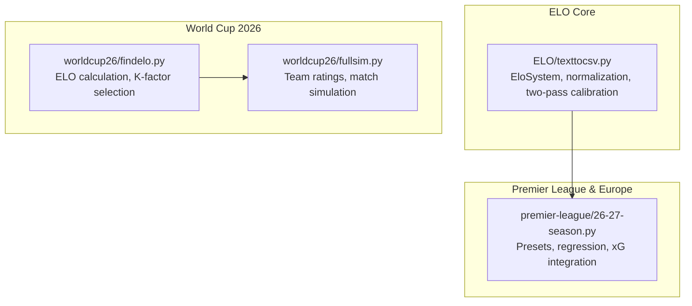
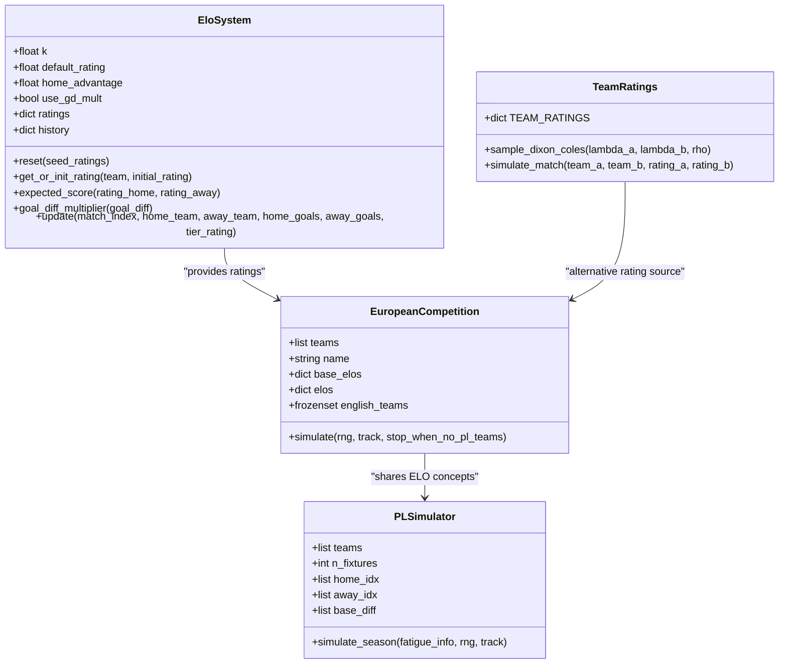
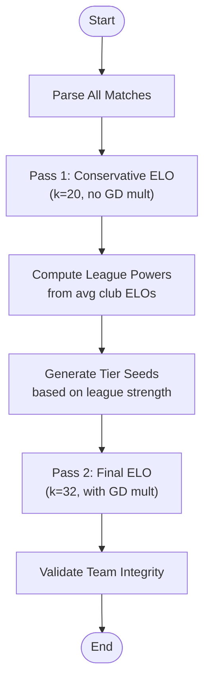
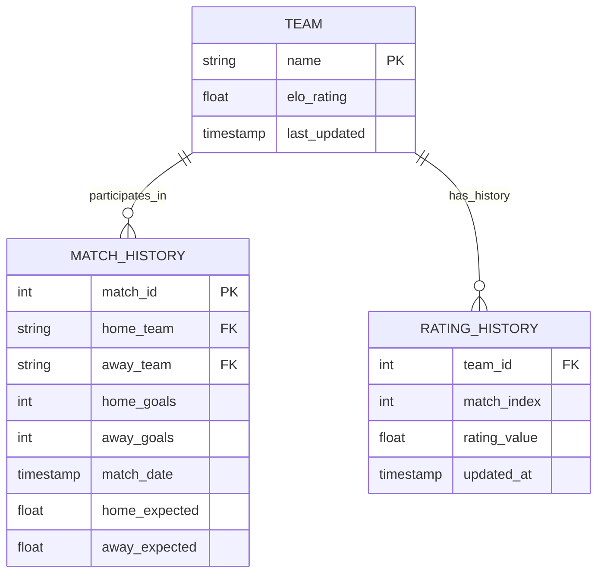
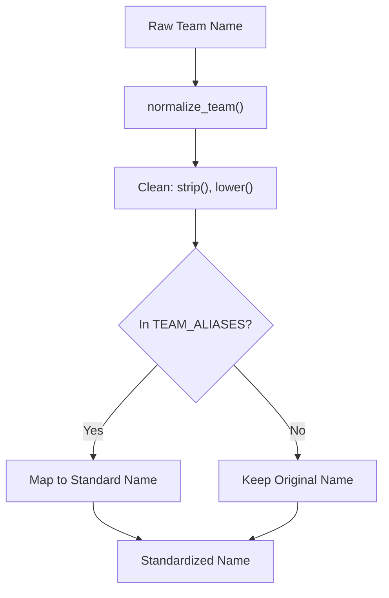
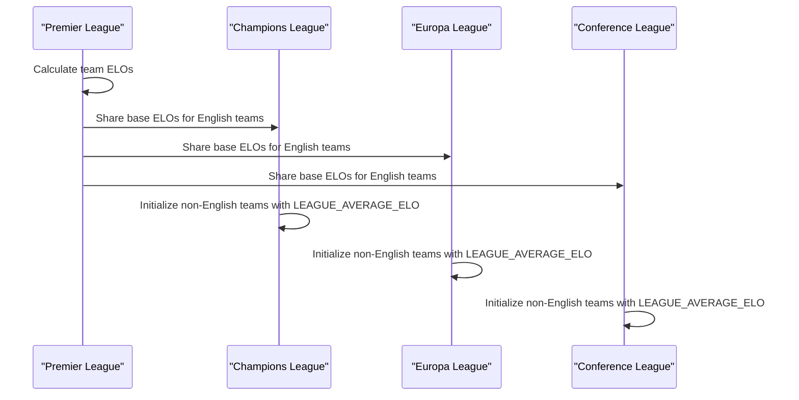
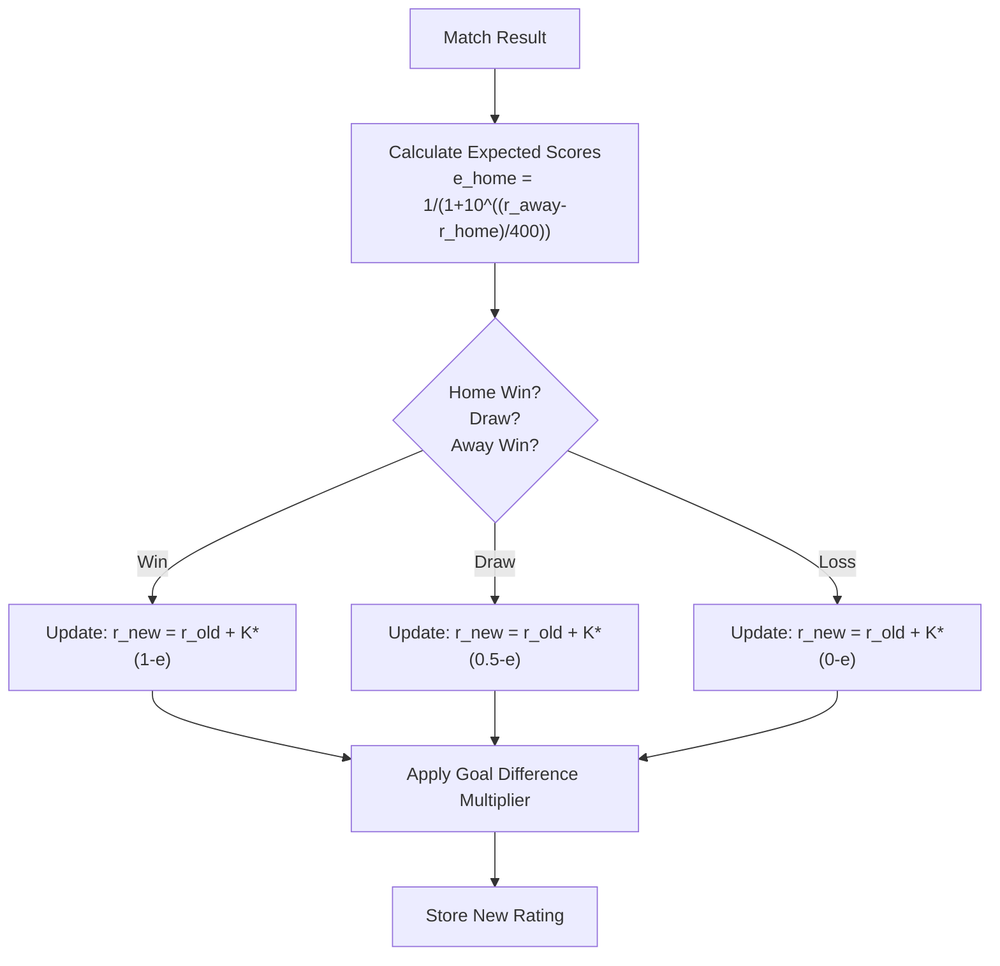
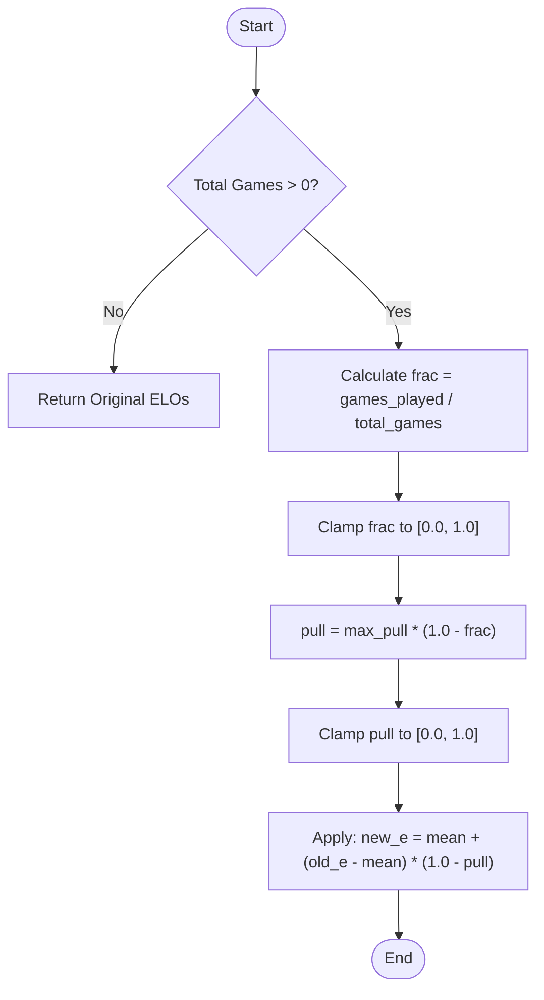
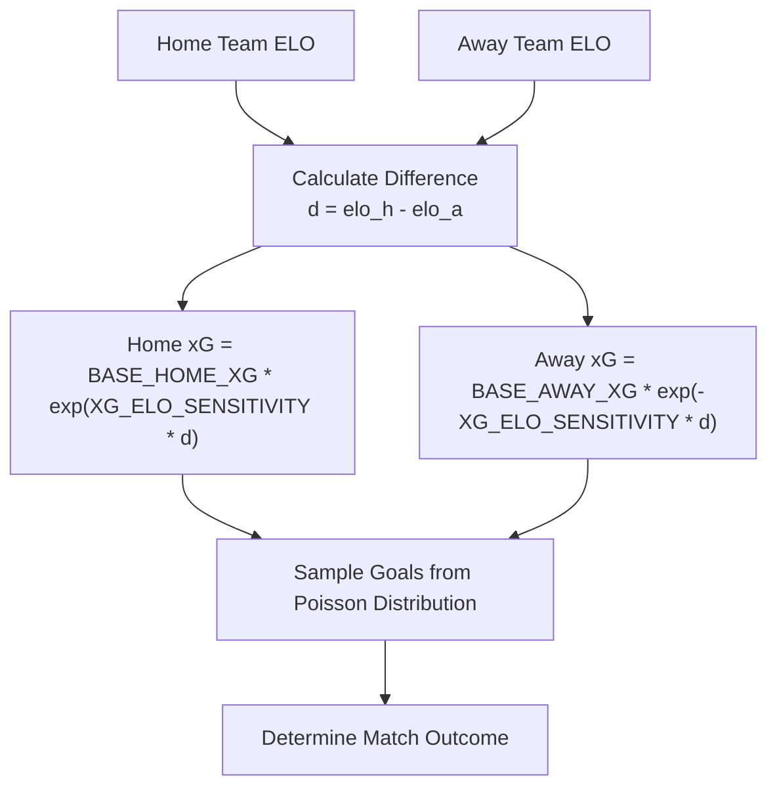
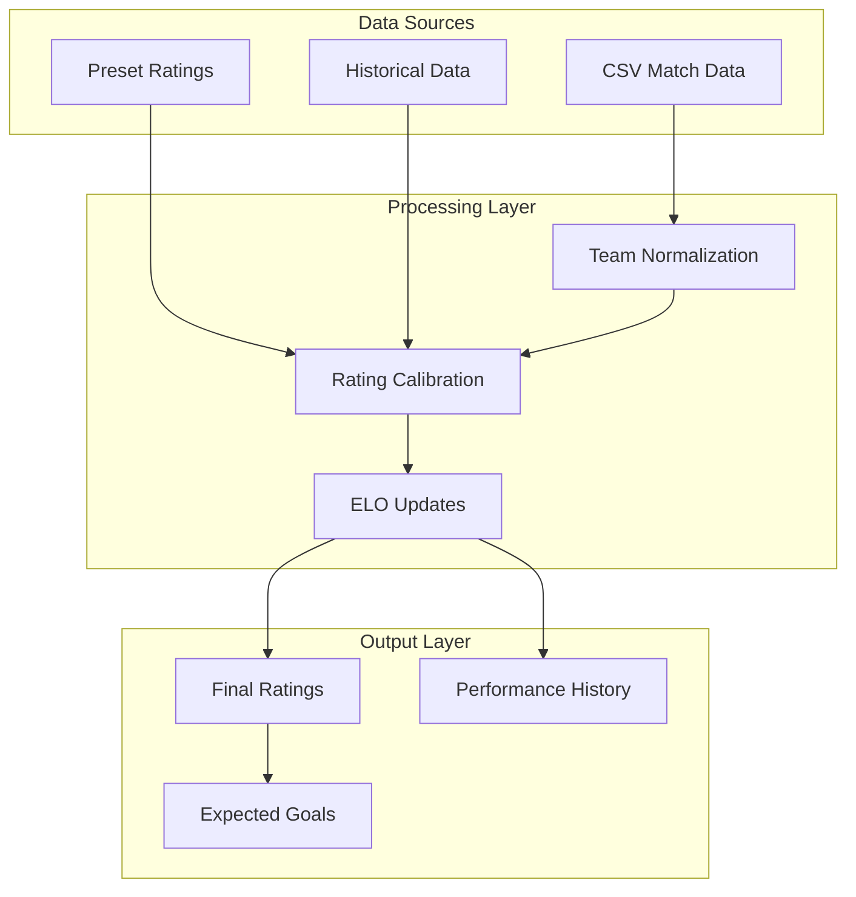

# Team Rating Databases

<cite>
**Referenced Files in This Document**
- [texttocsv.py](file://ELO/texttocsv.py)
- [findelo.py](file://worldcup26/findelo.py)
- [fullsim.py](file://worldcup26/fullsim.py)
- [26-27-season.py](file://premier-league/26-27-season.py)
</cite>

## Table of Contents
1. [Introduction](#introduction)
2. [Project Structure](#project-structure)
3. [Core Components](#core-components)
4. [Architecture Overview](#architecture-overview)
5. [Detailed Component Analysis](#detailed-component-analysis)
6. [Dependency Analysis](#dependency-analysis)
7. [Performance Considerations](#performance-considerations)
8. [Troubleshooting Guide](#troubleshooting-guide)
9. [Conclusion](#conclusion)

## Introduction
This document explains the team rating database management across multiple football competitions, focusing on ELO-based systems and their integration with expected goals (xG). It covers:
- ELO rating system implementation details
- Preset ratings for Premier League, Champions League, Europa League, and Conference League
- Rating initialization and calibration processes
- Historical performance data storage
- Team name standardization and association mappings
- Cross-competition rating consistency
- Examples of rating updates, regression algorithms, and evolution based on match outcomes
- The relationship between team ratings and expected goals calculations

## Project Structure
The repository contains several modules implementing ELO systems and competition simulations:
- ELO module: General ELO engine with two-pass calibration and team normalization
- World Cup 2026 module: Standalone ELO calculation and simulation utilities
- Premier League module: Unified PL + European competitions with preset ratings and advanced features
- UEFA modules: Competition-specific simulators using ELO and Poisson models

**Diagram sources**
- [texttocsv.py:252-318](file://ELO/texttocsv.py#L252-L318)
- [findelo.py:6-89](file://worldcup26/findelo.py#L6-L89)
- [fullsim.py:13-17](file://worldcup26/fullsim.py#L13-L17)
- [26-27-season.py:155-219](file://premier-league/26-27-season.py#L155-L219)

**Section sources**
- [texttocsv.py:1-442](file://ELO/texttocsv.py#L1-L442)
- [findelo.py:1-225](file://worldcup26/findelo.py#L1-L225)
- [fullsim.py:1-129](file://worldcup26/fullsim.py#L1-L129)
- [26-27-season.py:1-2933](file://premier-league/26-27-season.py#L1-L2933)

## Core Components

### ELO System Engine (ELO Module)
The core ELO implementation provides:
- Team name normalization through alias mapping
- Two-pass calibration for cross-league strength assessment
- Goal difference multiplier for K-factor adjustment
- Historical rating tracking per team

Key features:
- `EloSystem` class with configurable parameters (K-factor, default rating, home advantage)
- Dynamic calibration using league average comparisons
- Validation tools for team name integrity

**Section sources**
- [texttocsv.py:13-177](file://ELO/texttocsv.py#L13-L177)
- [texttocsv.py:252-318](file://ELO/texttocsv.py#L252-L318)
- [texttocsv.py:324-356](file://ELO/texttocsv.py#L324-L356)

### World Cup ELO Calculator
A standalone ELO calculator that:
- Processes CSV match data
- Applies tournament-specific K-factors
- Updates team ratings chronologically
- Generates output files and integrates with simulation code

**Section sources**
- [findelo.py:6-89](file://worldcup26/findelo.py#L6-L89)
- [findelo.py:91-144](file://worldcup26/findelo.py#L91-L144)

### Premier League & European Competitions
Comprehensive system featuring:
- Preset ratings for all major competitions
- Advanced regression algorithms
- Expected goals integration
- Fatigue and manager pressure modeling

**Section sources**
- [26-27-season.py:155-219](file://premier-league/26-27-season.py#L155-L219)
- [26-27-season.py:669-694](file://premier-league/26-27-season.py#L669-L694)
- [26-27-season.py:132-135](file://premier-league/26-27-season.py#L132-L135)

## Architecture Overview

**Diagram sources**
- [texttocsv.py:252-318](file://ELO/texttocsv.py#L252-L318)
- [26-27-season.py:884-1066](file://premier-league/26-27-season.py#L884-L1066)
- [26-27-season.py:1313-1440](file://premier-league/26-27-season.py#L1313-L1440)
- [fullsim.py:13-82](file://worldcup26/fullsim.py#L13-L82)

## Detailed Component Analysis

### ELO Rating Initialization Process

The system supports multiple initialization strategies:

#### Two-Pass Calibration (ELO Module)

**Diagram sources**
- [texttocsv.py:383-423](file://ELO/texttocsv.py#L383-L423)
- [texttocsv.py:324-356](file://ELO/texttocsv.py#L324-L356)

#### Preset-Based Initialization (Premier League)
Each competition has dedicated preset functions:
- `preset_pl_elos()` - Premier League teams
- `preset_ucl_elos()` - Champions League teams  
- `preset_uel_elos()` - Europa League teams
- `preset_uecl_elos()` - Conference League teams

**Section sources**
- [26-27-season.py:155-219](file://premier-league/26-27-season.py#L155-L219)

### Historical Performance Data Storage

The ELO system maintains comprehensive historical data:

**Diagram sources**
- [texttocsv.py:317-318](file://ELO/texttocsv.py#L317-L318)
- [texttocsv.py:258-259](file://ELO/texttocsv.py#L258-L259)

**Section sources**
- [texttocsv.py:317-318](file://ELO/texttocsv.py#L317-L318)

### Team Name Standardization

The system implements robust team name normalization:

**Diagram sources**
- [texttocsv.py:175-177](file://ELO/texttocsv.py#L175-L177)
- [texttocsv.py:13-172](file://ELO/texttocsv.py#L13-L172)

**Section sources**
- [texttocsv.py:13-177](file://ELO/texttocsv.py#L13-L177)

### Cross-Competition Rating Consistency

The system ensures consistency across competitions through:

1. **Shared Base Ratings**: European competitions inherit from Premier League ratings when available
2. **League Power Calibration**: Cross-league strength comparison using average ELOs
3. **Standardized Constants**: Common ELO scale and home advantage values

**Diagram sources**
- [26-27-season.py:894-904](file://premier-league/26-27-season.py#L894-L904)
- [26-27-season.py:12-14](file://premier-league/26-27-season.py#L12-L14)

**Section sources**
- [26-27-season.py:894-904](file://premier-league/26-27-season.py#L894-L904)

### Rating Update Algorithms

#### Standard ELO Update

**Diagram sources**
- [texttocsv.py:274-318](file://ELO/texttocsv.py#L274-L318)
- [26-27-season.py:127-129](file://premier-league/26-27-season.py#L127-L129)

#### Regression Algorithm
The system includes sophisticated regression for rating stability:

**Diagram sources**
- [26-27-season.py:669-674](file://premier-league/26-27-season.py#L669-L674)

**Section sources**
- [26-27-season.py:669-674](file://premier-league/26-27-season.py#L669-L674)

### Relationship Between Team Ratings and Expected Goals

The ELO system directly influences expected goals calculations:

**Diagram sources**
- [26-27-season.py:132-135](file://premier-league/26-27-season.py#L132-L135)
- [26-27-season.py:19-21](file://premier-league/26-27-season.py#L19-L21)

**Section sources**
- [26-27-season.py:132-135](file://premier-league/26-27-season.py#L132-L135)

## Dependency Analysis

**Diagram sources**
- [texttocsv.py:183-246](file://ELO/texttocsv.py#L183-L246)
- [texttocsv.py:383-423](file://ELO/texttocsv.py#L383-L423)
- [26-27-season.py:155-219](file://premier-league/26-27-season.py#L155-L219)

**Section sources**
- [texttocsv.py:183-246](file://ELO/texttocsv.py#L183-L246)
- [26-27-season.py:155-219](file://premier-league/26-27-season.py#L155-L219)

## Performance Considerations

### Computational Efficiency
- **Two-pass approach**: Reduces computational complexity by separating calibration from final rating computation
- **Caching mechanisms**: LRU caching for frequently accessed data like Carabao Cup ELOs
- **Vectorized operations**: Use of numpy arrays for Dixon-Coles probability calculations

### Memory Management
- **Incremental updates**: Ratings are updated in-place rather than creating new dictionaries
- **Efficient data structures**: Use of frozensets for team collections and defaultdict for history tracking

### Scalability
- **Modular design**: Separate components for different competitions allow independent scaling
- **Configurable parameters**: K-factors and sensitivity settings can be tuned for different competition sizes

## Troubleshooting Guide

### Common Issues and Solutions

#### Team Name Mismatch
**Problem**: Teams not being recognized due to naming inconsistencies
**Solution**: 
- Check TEAM_ALIASES dictionary for missing entries
- Use normalize_team() function before processing
- Run validate_team_integrity() to detect suspicious duplicates

#### Rating Instability
**Problem**: Ratings fluctuating too much or too little
**Solution**:
- Adjust K-factor values for specific competitions
- Tune goal difference multiplier thresholds
- Review regression algorithm parameters

#### Cross-Competition Inconsistencies
**Problem**: Same team having different ratings across competitions
**Solution**:
- Ensure proper inheritance from Premier League ratings
- Verify preset rating consistency
- Check league power calibration process

**Section sources**
- [texttocsv.py:362-377](file://ELO/texttocsv.py#L362-L377)
- [texttocsv.py:278-287](file://ELO/texttocsv.py#L278-L287)

## Conclusion

The team rating database management system provides a comprehensive, multi-layered approach to ELO rating calculation and management across various football competitions. Key strengths include:

1. **Robust Initialization**: Multiple strategies including two-pass calibration and preset-based initialization
2. **Cross-Competition Consistency**: Shared rating foundations with competition-specific adjustments
3. **Advanced Analytics**: Integration with expected goals, fatigue modeling, and performance regression
4. **Scalable Architecture**: Modular design supporting easy expansion to new competitions
5. **Data Integrity**: Comprehensive validation and normalization processes

The system successfully balances theoretical rigor with practical implementation, providing reliable team strength assessments that evolve dynamically with match outcomes while maintaining consistency across different competition contexts.