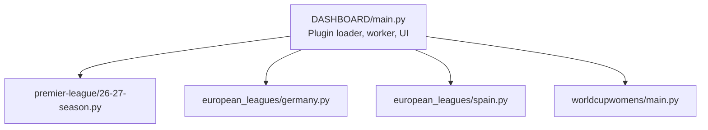
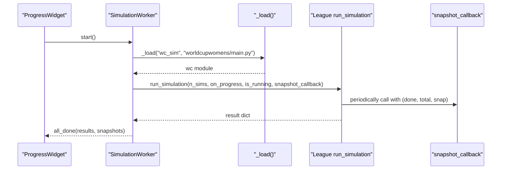
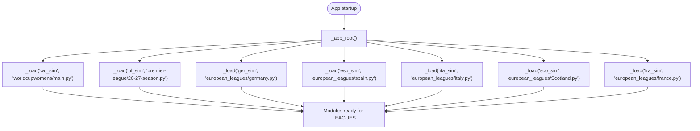
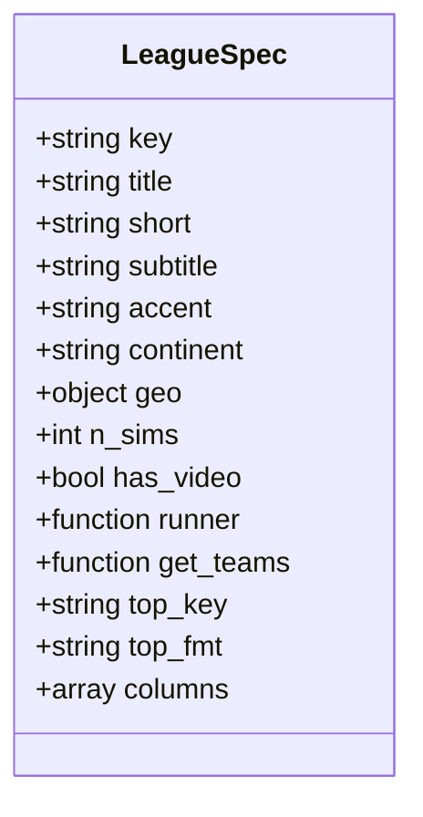
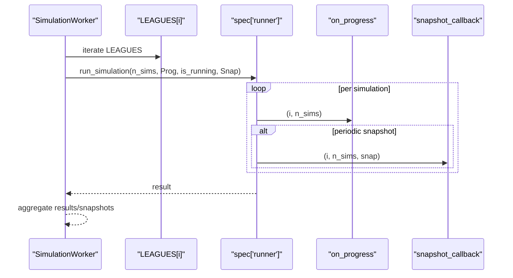
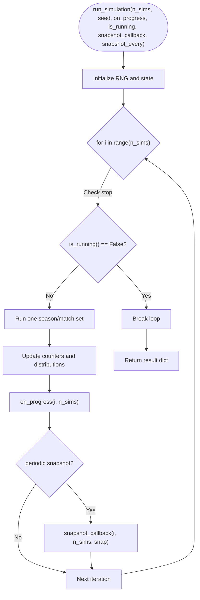
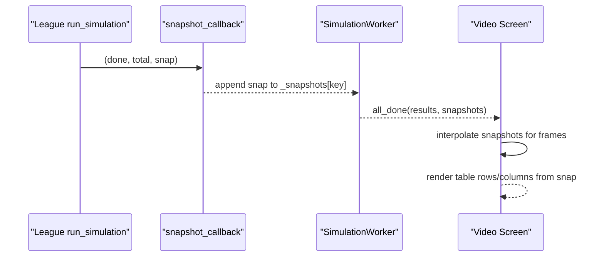
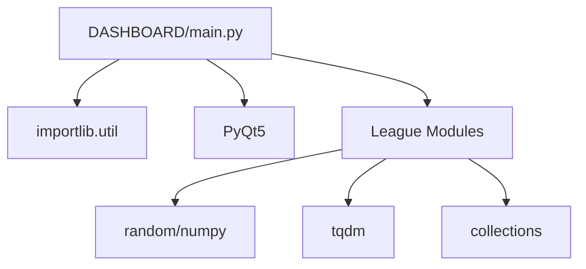

# Architecture and Extension Points

<cite>
**Referenced Files in This Document**
- [DASHBOARD/main.py](file://DASHBOARD/main.py)
- [european_leagues/germany.py](file://european_leagues/germany.py)
- [european_leagues/spain.py](file://european_leagues/spain.py)
- [premier-league/26-27-season.py](file://premier-league/26-27-season.py)
- [worldcupwomens/main.py](file://worldcupwomens/main.py)
</cite>

## Table of Contents
1. [Introduction](#introduction)
2. [Project Structure](#project-structure)
3. [Core Components](#core-components)
4. [Architecture Overview](#architecture-overview)
5. [Detailed Component Analysis](#detailed-component-analysis)
6. [Dependency Analysis](#dependency-analysis)
7. [Performance Considerations](#performance-considerations)
8. [Troubleshooting Guide](#troubleshooting-guide)
9. [Conclusion](#conclusion)
10. [Appendices](#appendices)

## Introduction
This document explains the sports analysis platform’s plugin-based architecture and extension points. The dashboard dynamically loads simulation modules using Python’s importlib, runs them through a standardized interface, and provides real-time progress reporting plus snapshot capture for animation playback. It also documents the LEAGUES configuration schema that registers new leagues into the dashboard UI and video pipeline.

The key goals are:
- Explain how simulation modules are discovered and loaded at runtime.
- Define the contract that every league simulator must implement.
- Detail the callback system for progress updates and snapshots.
- Show how to register a new league via the LEAGUES configuration.
- Provide step-by-step guidance for implementing a new league simulator.

## Project Structure
At a high level, the project is organized by sport or competition, with each domain containing its own simulation logic. The DASHBOARD package orchestrates execution, while individual league folders contain their own simulation implementations.

**Diagram sources**
- [DASHBOARD/main.py:49-62](file://DASHBOARD/main.py#L49-L62)
- [DASHBOARD/main.py:68-199](file://DASHBOARD/main.py#L68-L199)

**Section sources**
- [DASHBOARD/main.py:49-62](file://DASHBOARD/main.py#L49-L62)
- [DASHBOARD/main.py:68-199](file://DASHBOARD/main.py#L68-L199)

## Core Components
The core components are:
- Dynamic module loader using importlib.util.
- LEAGUES registry defining metadata, runner functions, and display columns.
- SimulationWorker thread that executes simulations sequentially and captures snapshots.
- Progress callbacks and snapshot callbacks for real-time feedback and animation.
- League-specific simulators exposing run_simulation with a consistent signature.

Key responsibilities:
- DASHBOARD/main.py: Loads modules, defines LEAGUES, runs simulations, collects results and snapshots, and renders UI/video.
- League modules (e.g., germany.py, spain.py, 26-27-season.py, worldcupwomens/main.py): Implement run_simulation and return structured results.

**Section sources**
- [DASHBOARD/main.py:49-62](file://DASHBOARD/main.py#L49-L62)
- [DASHBOARD/main.py:68-199](file://DASHBOARD/main.py#L68-L199)
- [DASHBOARD/main.py:284-333](file://DASHBOARD/main.py#L284-L333)
- [european_leagues/germany.py:247-327](file://european_leagues/germany.py#L247-L327)
- [european_leagues/spain.py:411-479](file://european_leagues/spain.py#L411-L479)
- [premier-league/26-27-season.py:1-200](file://premier-league/26-27-season.py#L1-L200)
- [worldcupwomens/main.py:1-200](file://worldcupwomens/main.py#L1-L200)

## Architecture Overview
The dashboard uses a plugin pattern:
- Modules are loaded dynamically from relative paths.
- Each module exposes a run_simulation function.
- The dashboard passes progress and snapshot callbacks to each runner.
- Results and snapshots are aggregated and displayed in the UI and used for video playback.

**Diagram sources**
- [DASHBOARD/main.py:49-62](file://DASHBOARD/main.py#L49-L62)
- [DASHBOARD/main.py:284-333](file://DASHBOARD/main.py#L284-L333)
- [european_leagues/germany.py:247-327](file://european_leagues/germany.py#L247-L327)

## Detailed Component Analysis

### Dynamic Module Loading
The dashboard resolves the application root path and loads simulation modules by file path using importlib.util.spec_from_file_location and module_from_spec. This allows adding new leagues without changing core orchestration code.

Important behaviors:
- _app_root determines the base directory depending on whether the app is frozen or running from source.
- _load creates a spec, constructs a module object, and executes it.
- Loaded modules are assigned to variables (wc, pl, ger, ita, sco, esp, fra).

**Diagram sources**
- [DASHBOARD/main.py:37-62](file://DASHBOARD/main.py#L37-L62)

**Section sources**
- [DASHBOARD/main.py:37-62](file://DASHBOARD/main.py#L37-L62)

### LEAGUES Configuration Schema
LEAGUES is a list of dictionaries describing each league. Each entry includes:
- key: Unique identifier used to index results and snapshots.
- title/short/subtitle/accent: Display metadata for UI.
- continent/geo: Map placement and grouping.
- n_sims: Number of Monte Carlo simulations.
- has_video: Whether the league supports animated table playback.
- runner: Callable invoked by the worker to execute the simulation with callbacks.
- get_teams: Function returning team names from results.
- top_key/top_fmt: Metric used to determine top contenders and formatting.
- columns: List of tuples (label, data_key, format_string) for table rendering.

Example entries:
- Premier League: Uses pl.NUM_PL_SIMS and exposes European qualification metrics.
- La Liga/Bundesliga/Serie A/Ligue 1/Scottish Premiership: Standardized probability metrics.
- Women's World Cup: Special handling via is_wc flag and different result structure.

**Diagram sources**
- [DASHBOARD/main.py:68-199](file://DASHBOARD/main.py#L68-L199)

**Section sources**
- [DASHBOARD/main.py:68-199](file://DASHBOARD/main.py#L68-L199)

### SimulationWorker and Callback System
SimulationWorker runs simulations sequentially across all leagues, passing:
- n_sims: Total number of simulations for this league.
- on_progress: Callback invoked with (completed_count, total_count).
- is_running: Boolean predicate to allow graceful stop.
- snapshot_callback: Callback invoked with (completed_count, total_count, snapshot_dict).

The worker aggregates:
- results: Dict keyed by league key mapping to returned result objects.
- snapshots: Dict keyed by league key mapping to lists of snapshot dicts.

Snapshot dicts include:
- done/total: Counts injected by the worker.
- Per-team metrics defined by the league (e.g., avg_points, title_prob, top4_prob).

**Diagram sources**
- [DASHBOARD/main.py:284-333](file://DASHBOARD/main.py#L284-L333)
- [european_leagues/germany.py:247-327](file://european_leagues/germany.py#L247-L327)
- [european_leagues/spain.py:411-479](file://european_leagues/spain.py#L411-L479)

**Section sources**
- [DASHBOARD/main.py:284-333](file://DASHBOARD/main.py#L284-L333)

### Standardized Interface: run_simulation
Every league simulator must expose a run_simulation function with the following signature:
- Parameters:
  - n_sims: int, number of simulations to run.
  - seed: optional int for reproducibility.
  - on_progress: callable(int completed, int total), invoked after each simulation.
  - is_running: callable() -> bool, used to check if the user requested a stop.
  - snapshot_callback: callable(int completed, int total, dict snapshot), invoked periodically.
  - snapshot_every: optional int controlling snapshot frequency; default behavior often derived from n_sims.

- Return value:
  - A dictionary containing:
    - n_sims: actual number of simulations executed.
    - teams: list of team names.
    - Metrics: per-team probabilities and averages (e.g., avg_points, title_prob, top4_prob, releg_prob).

Examples:
- Bundesliga (germany.py): Implements full Monte Carlo with ELO regression and returns standard metrics.
- La Liga (spain.py): Similar structure with ELO-based match simulation and probability aggregation.
- Premier League (26-27-season.py): Complex multi-comp simulation; ensure run_simulation matches the expected signature when integrated with the dashboard.
- Women's World Cup (worldcupwomens/main.py): Different result shape; handled specially in the dashboard via is_wc flag.

**Diagram sources**
- [european_leagues/germany.py:247-327](file://european_leagues/germany.py#L247-L327)
- [european_leagues/spain.py:411-479](file://european_leagues/spain.py#L411-L479)

**Section sources**
- [european_leagues/germany.py:247-327](file://european_leagues/germany.py#L247-L327)
- [european_leagues/spain.py:411-479](file://european_leagues/spain.py#L411-L479)

### Snapshot Mechanism for Animation Playback
Snapshots are captured periodically during simulation runs. The dashboard stores these snapshots per league and uses them to render an animated table over time. Key aspects:
- snapshot_callback receives a dict with per-team metrics.
- The worker injects done/total fields into each snapshot.
- Video playback interpolates between snapshots to create smooth transitions.
- Columns defined in LEAGUES specify which keys to render and how to format them.

**Diagram sources**
- [DASHBOARD/main.py:284-333](file://DASHBOARD/main.py#L284-L333)
- [DASHBOARD/main.py:1355-1456](file://DASHBOARD/main.py#L1355-L1456)

**Section sources**
- [DASHBOARD/main.py:284-333](file://DASHBOARD/main.py#L284-L333)
- [DASHBOARD/main.py:1355-1456](file://DASHBOARD/main.py#L1355-L1456)

### Example: Implementing a New League Simulator
To add a new league:
1. Create a new module under a dedicated folder (e.g., my_league/my_league_sim.py).
2. Implement run_simulation with the standardized signature.
3. Ensure the function:
   - Accepts n_sims, seed, on_progress, is_running, snapshot_callback, snapshot_every.
   - Calls on_progress after each simulation.
   - Periodically calls snapshot_callback with a dict containing per-team metrics.
   - Returns a dict with n_sims, teams, and metric maps.
4. Register the league in LEAGUES in DASHBOARD/main.py:
   - Add a new entry with key, title, n_sims, runner lambda invoking your run_simulation.
   - Define get_teams, top_key, top_fmt, and columns for UI rendering.
   - Optionally set has_video=True to enable animation playback.

Required functions and structures:
- run_simulation(n_sims, seed=None, on_progress=None, is_running=None, snapshot_callback=None, snapshot_every=None) -> dict
- Result dict keys commonly include:
  - n_sims: int
  - teams: list[str]
  - avg_points: dict[str, float]
  - title_prob: dict[str, float]
  - top4_prob/fifth_prob/sixth_prob/releg_prob: dict[str, float]
- Columns definition:
  - [("Label", "data_key", "{:.2f}"), ...]

Integration steps:
- Import the module via _load in DASHBOARD/main.py.
- Add a LEAGUES entry referencing the module’s constants and run_simulation.
- Test by running the dashboard and verifying progress and snapshots.

**Section sources**
- [DASHBOARD/main.py:49-62](file://DASHBOARD/main.py#L49-L62)
- [DASHBOARD/main.py:68-199](file://DASHBOARD/main.py#L68-L199)
- [european_leagues/germany.py:247-327](file://european_leagues/germany.py#L247-L327)
- [european_leagues/spain.py:411-479](file://european_leagues/spain.py#L411-L479)

## Dependency Analysis
The dashboard depends on:
- importlib.util for dynamic loading.
- PyQt5 for UI and threading signals.
- League modules for simulation logic and result structures.

League modules depend on:
- random/numpy for stochastic simulation.
- tqdm for progress bars (disabled in GUI context).
- collections for counters and aggregations.

**Diagram sources**
- [DASHBOARD/main.py:15-18](file://DASHBOARD/main.py#L15-L18)
- [DASHBOARD/main.py:20-31](file://DASHBOARD/main.py#L20-L31)
- [european_leagues/germany.py:12-17](file://european_leagues/germany.py#L12-L17)
- [european_leagues/spain.py:1-6](file://european_leagues/spain.py#L1-L6)

**Section sources**
- [DASHBOARD/main.py:15-31](file://DASHBOARD/main.py#L15-L31)
- [european_leagues/germany.py:12-17](file://european_leagues/germany.py#L12-L17)
- [european_leagues/spain.py:1-6](file://european_leagues/spain.py#L1-L6)

## Performance Considerations
- SimulationWorker runs leagues sequentially to simplify progress tracking and snapshot collection.
- Snapshot frequency defaults to approximately n_sims // 250 to balance detail and memory usage.
- In GUI mode, tqdm is disabled to avoid redundant progress output.
- Video export requires opencv-python and numpy; insufficient snapshots will raise an error.

Recommendations:
- Tune snapshot_every based on n_sims and desired animation smoothness.
- Avoid heavy computations inside snapshot_callback; keep snapshots lightweight.
- Use deterministic seeds for reproducible runs when debugging.

[No sources needed since this section provides general guidance]

## Troubleshooting Guide
Common issues and resolutions:
- Missing dependencies for video export:
  - Install opencv-python and numpy.
  - Ensure sufficient snapshots are captured; otherwise, video export raises an error.
- Incorrect run_simulation signature:
  - Ensure parameters match the standardized interface; otherwise, the dashboard may fail to invoke callbacks correctly.
- LEAGUES registration errors:
  - Verify that runner lambdas correctly pass n_sims, on_progress, is_running, and snapshot_callback.
  - Confirm that get_teams returns a list of team names present in result metrics.

**Section sources**
- [DASHBOARD/main.py:1373-1456](file://DASHBOARD/main.py#L1373-L1456)
- [DASHBOARD/main.py:284-333](file://DASHBOARD/main.py#L284-L333)

## Conclusion
The sports analysis platform employs a clean plugin architecture centered around dynamic module loading and a standardized run_simulation interface. The LEAGUES configuration serves as the integration point for new competitions, enabling seamless expansion of the dashboard’s capabilities. By adhering to the established patterns for callbacks and snapshots, developers can extend the platform with minimal friction while maintaining consistent UI behavior and animation support.

[No sources needed since this section summarizes without analyzing specific files]

## Appendices

### Appendix A: LEAGUES Entry Template
Use this template when registering a new league:
- key: unique string
- title/short/subtitle/accent: display strings
- continent/geo: map metadata
- n_sims: integer count
- has_video: boolean
- runner: lambda(n, p, r, sc=None): module.run_simulation(n, on_progress=p, is_running=r, snapshot_callback=sc)
- get_teams: lambda(r): r["teams"] or equivalent
- top_key/top_fmt: metric and format
- columns: list of (label, key, format) tuples

**Section sources**
- [DASHBOARD/main.py:68-199](file://DASHBOARD/main.py#L68-L199)

### Appendix B: run_simulation Contract Summary
- Signature: run_simulation(n_sims, seed=None, on_progress=None, is_running=None, snapshot_callback=None, snapshot_every=None)
- Responsibilities:
  - Invoke on_progress(completed, total) after each simulation.
  - Periodically invoke snapshot_callback(completed, total, snapshot_dict).
  - Return a dict with n_sims, teams, and per-team metric maps.

**Section sources**
- [european_leagues/germany.py:247-327](file://european_leagues/germany.py#L247-L327)
- [european_leagues/spain.py:411-479](file://european_leagues/spain.py#L411-L479)