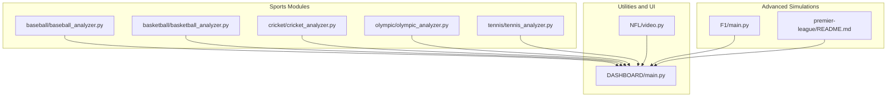
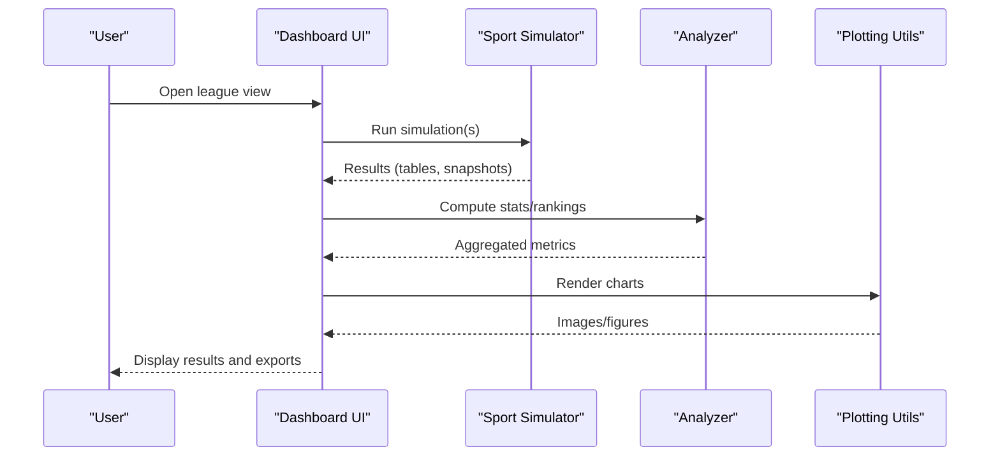
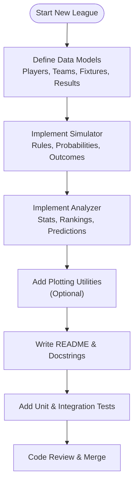
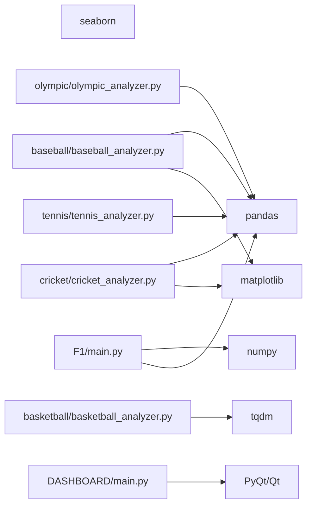

# Contribution Guidelines

<cite>
**Referenced Files in This Document**
- [premier-league/README.md](file://premier-league/README.md)
- [baseball/baseball_analyzer.py](file://baseball/baseball_analyzer.py)
- [basketball/basketball_analyzer.py](file://basketball/basketball_analyzer.py)
- [cricket/cricket_analyzer.py](file://cricket/cricket_analyzer.py)
- [olympic/olympic_analyzer.py](file://olympic/olympic_analyzer.py)
- [tennis/tennis_analyzer.py](file://tennis/tennis_analyzer.py)
- [F1/main.py](file://F1/main.py)
- [NFL/video.py](file://NFL/video.py)
- [DASHBOARD/main.py](file://DASHBOARD/main.py)
</cite>

## Table of Contents
1. Introduction
2. Project Structure
3. Core Components
4. Architecture Overview
5. Detailed Component Analysis
6. Dependency Analysis
7. Performance Considerations
8. Troubleshooting Guide
9. Conclusion
10. Appendices

## Introduction
This document provides comprehensive contribution guidelines for extending the sports analysis platform. It covers coding standards, naming conventions, project structure requirements, code review process, commit message conventions, branching strategies, adding new league simulators (including interface compliance and testing), documentation and comment standards, example code requirements, submission workflows for bug reports, feature requests, and pull requests, as well as intellectual property and licensing considerations.

The repository is a collection of independent simulation and analysis modules across multiple sports, plus a dashboard application that can visualize results. Each sport typically follows a consistent pattern: data models, simulator logic, analyzer utilities, and optional plotting helpers.

## Project Structure
At a high level, the repository organizes work by sport or domain:
- Sport-specific folders contain scripts and modules for simulation and analysis (for example, baseball, basketball, cricket, olympic, tennis).
- The premier-league folder includes a detailed README describing its simulation approach and parameters.
- The F1 module contains a substantial simulation engine with Elo blending and Monte Carlo methods.
- The NFL module includes utilities for argument parsing and CSV path resolution.
- The DASHBOARD module implements a Qt-based UI to explore and export results.



**Diagram sources**
- [baseball/baseball_analyzer.py:1-678](file://baseball/baseball_analyzer.py#L1-L678)
- [basketball/basketball_analyzer.py:1-118](file://basketball/basketball_analyzer.py#L1-L118)
- [cricket/cricket_analyzer.py:1-593](file://cricket/cricket_analyzer.py#L1-L593)
- [olympic/olympic_analyzer.py:1-570](file://olympic/olympic_analyzer.py#L1-L570)
- [tennis/tennis_analyzer.py:1-103](file://tennis/tennis_analyzer.py#L1-L103)
- [F1/main.py:617-1114](file://F1/main.py#L617-L1114)
- [premier-league/README.md:1-103](file://premier-league/README.md#L1-L103)
- [NFL/video.py:111-138](file://NFL/video.py#L111-L138)
- [DASHBOARD/main.py:1236-1426](file://DASHBOARD/main.py#L1236-L1426)

**Section sources**
- [premier-league/README.md:1-103](file://premier-league/README.md#L1-L103)
- [baseball/baseball_analyzer.py:1-678](file://baseball/baseball_analyzer.py#L1-L678)
- [basketball/basketball_analyzer.py:1-118](file://basketball/basketball_analyzer.py#L1-L118)
- [cricket/cricket_analyzer.py:1-593](file://cricket/cricket_analyzer.py#L1-L593)
- [olympic/olympic_analyzer.py:1-570](file://olympic/olympic_analyzer.py#L1-L570)
- [tennis/tennis_analyzer.py:1-103](file://tennis/tennis_analyzer.py#L1-L103)
- [F1/main.py:617-1114](file://F1/main.py#L617-L1114)
- [NFL/video.py:111-138](file://NFL/video.py#L111-L138)
- [DASHBOARD/main.py:1236-1426](file://DASHBOARD/main.py#L1236-L1426)

## Core Components
Across the sports modules, you will find recurring patterns:
- Data classes representing entities such as players, teams, matches, and events.
- Simulator classes implementing game or event mechanics.
- Analyzer classes providing statistics, rankings, and insights.
- Optional plotting utilities for visualizing top performers.

Examples:
- Baseball uses dataclasses for players and teams, a simulator for at-bats and innings, and an analyzer for team and player insights.
- Basketball defines Elo-based win probabilities and series simulations.
- Cricket models batting and bowling performance per match type and supports series simulations.
- Olympic models athletes, events, and countries, with individual and team event simulations.
- Tennis computes best-of-five probabilities from Elo and runs Monte Carlo tournament simulations.

These components demonstrate how to structure new league simulators consistently.

**Section sources**
- [baseball/baseball_analyzer.py:18-177](file://baseball/baseball_analyzer.py#L18-L177)
- [baseball/baseball_analyzer.py:180-382](file://baseball/baseball_analyzer.py#L180-L382)
- [baseball/baseball_analyzer.py:385-597](file://baseball/baseball_analyzer.py#L385-L597)
- [basketball/basketball_analyzer.py:38-96](file://basketball/basketball_analyzer.py#L38-L96)
- [cricket/cricket_analyzer.py:18-148](file://cricket/cricket_analyzer.py#L18-L148)
- [cricket/cricket_analyzer.py:151-306](file://cricket/cricket_analyzer.py#L151-L306)
- [cricket/cricket_analyzer.py:309-515](file://cricket/cricket_analyzer.py#L309-L515)
- [olympic/olympic_analyzer.py:18-105](file://olympic/olympic_analyzer.py#L18-L105)
- [olympic/olympic_analyzer.py:107-230](file://olympic/olympic_analyzer.py#L107-L230)
- [olympic/olympic_analyzer.py:233-495](file://olympic/olympic_analyzer.py#L233-L495)
- [tennis/tennis_analyzer.py:33-103](file://tennis/tennis_analyzer.py#L33-L103)

## Architecture Overview
The platform’s architecture separates concerns into:
- Simulation engines (per sport) that model rules, probabilities, and outcomes.
- Analyzers that compute metrics, rankings, and predictions.
- Utilities for data loading, plotting, and CLI handling.
- A dashboard UI that consumes results and renders interactive views and exports.



[No sources needed since this diagram shows conceptual workflow, not actual code structure]

## Detailed Component Analysis

### Adding a New League Simulator
Follow these steps to add a new league simulator while maintaining consistency with existing modules:

1. Create a new folder named after the league (for example, leagues/my_league).
2. Implement data models using dataclasses for entities like players, teams, fixtures, and results.
3. Implement a simulator class with deterministic or seeded randomness for reproducibility.
4. Provide an analyzer class for computing statistics, rankings, and predictions.
5. Add optional plotting utilities if you need charts for top performers or distributions.
6. Include a README describing inputs, assumptions, parameters, and usage.
7. Add tests covering core simulation paths and edge cases.

Interface compliance checklist:
- Use snake_case for functions and variables; PascalCase for classes and dataclasses.
- Keep public APIs stable and documented via docstrings.
- Avoid global mutable state; pass configuration explicitly.
- Prefer pure functions where possible to simplify testing.
- Ensure Monte Carlo loops are configurable (iterations, seeds).
- Return structured results (dicts or dataclass instances) rather than printing.

Testing requirements:
- Unit tests for simulator methods (for example, at-bat, inning, match simulation).
- Integration tests for full series or tournament flows.
- Deterministic checks using fixed random seeds.
- Edge case coverage (ties, early finishes, missing data fallbacks).

Documentation requirements:
- Module-level docstring explaining purpose and dependencies.
- Class and method docstrings describing inputs, outputs, and side effects.
- README with data sources, assumptions, parameters, and examples.

Example code references:
- Data modeling and simulation patterns: [baseball/baseball_analyzer.py:18-177](file://baseball/baseball_analyzer.py#L18-L177), [baseball/baseball_analyzer.py:180-382](file://baseball/baseball_analyzer.py#L180-L382)
- Series and tournament simulation: [basketball/basketball_analyzer.py:60-96](file://basketball/basketball_analyzer.py#L60-L96), [tennis/tennis_analyzer.py:68-103](file://tennis/tennis_analyzer.py#L68-L103)
- Match simulation and result structures: [cricket/cricket_analyzer.py:267-306](file://cricket/cricket_analyzer.py#L267-L306)
- Event simulation and medal tracking: [olympic/olympic_analyzer.py:136-230](file://olympic/olympic_analyzer.py#L136-L230)



[No sources needed since this diagram shows conceptual workflow, not actual code structure]

**Section sources**
- [baseball/baseball_analyzer.py:18-177](file://baseball/baseball_analyzer.py#L18-L177)
- [baseball/baseball_analyzer.py:180-382](file://baseball/baseball_analyzer.py#L180-L382)
- [basketball/basketball_analyzer.py:60-96](file://basketball/basketball_analyzer.py#L60-L96)
- [cricket/cricket_analyzer.py:267-306](file://cricket/cricket_analyzer.py#L267-L306)
- [olympic/olympic_analyzer.py:136-230](file://olympic/olympic_analyzer.py#L136-L230)
- [tennis/tennis_analyzer.py:68-103](file://tennis/tennis_analyzer.py#L68-L103)

### Code Review Process
- All changes must be reviewed before merging.
- Reviews should verify correctness, readability, test coverage, and adherence to standards.
- Request reviewers familiar with the affected sport module.
- Address all feedback before requesting re-review.

Commit message conventions:
- Use imperative mood (for example, “Add playoff bracket logic”).
- Keep subject lines under 72 characters.
- Include context in the body when necessary.
- Reference related issues or PRs.

Branching strategy:
- main: stable branch for releases.
- develop: integration branch for features.
- feature/<short-name>: isolated feature branches.
- hotfix/<issue-id>: urgent fixes targeting main.

Pull request guidelines:
- Describe the change, motivation, and impact.
- Link related issues.
- Include screenshots or logs if UI or output changed.
- Ensure tests pass and coverage is adequate.

**Section sources**
- [premier-league/README.md:1-103](file://premier-league/README.md#L1-L103)

### Documentation Standards and Comment Conventions
- Module-level docstrings: explain purpose, inputs, outputs, and dependencies.
- Function/method docstrings: describe parameters, return values, exceptions, and examples.
- Inline comments: clarify non-obvious logic; avoid restating obvious code.
- README files: include overview, data sources, assumptions, parameters, usage, and limitations.

Example references:
- Premier League README outlines simulation components, assumptions, and usage.
- Health script demonstrates logging setup and file path guidance.

**Section sources**
- [premier-league/README.md:1-103](file://premier-league/README.md#L1-L103)
- [HEALTH/UKGP.py:21-38](file://HEALTH/UKGP.py#L21-L38)

### Example Code Requirements
- Provide minimal runnable examples demonstrating key functionality.
- Use realistic but small datasets for quick validation.
- Include instructions for installing dependencies and running examples.
- Show expected outputs or artifacts (charts, tables, videos).

References:
- Baseball and Cricket modules include main entry points and plotting calls.
- Tennis module demonstrates Monte Carlo tournament simulation.

**Section sources**
- [baseball/baseball_analyzer.py:600-678](file://baseball/baseball_analyzer.py#L600-L678)
- [cricket/cricket_analyzer.py:518-593](file://cricket/cricket_analyzer.py#L518-L593)
- [tennis/tennis_analyzer.py:83-103](file://tennis/tennis_analyzer.py#L83-L103)

### Intellectual Property and Licensing
- Contributors must ensure they have rights to submit code and data.
- Do not include copyrighted material without permission.
- Clearly attribute third-party data sources and licenses.
- If contributing proprietary algorithms, obtain explicit approval.

[No sources needed since this section provides general guidance]

## Dependency Analysis
Common dependencies across modules:
- pandas for data manipulation.
- numpy for numerical operations.
- matplotlib/seaborn for plotting.
- tqdm for progress bars.
- Qt for the dashboard UI.

External integrations:
- F1 module blends Elo ratings and performs Monte Carlo simulations.
- NFL module resolves CSV paths and parses arguments.
- Dashboard UI orchestrates simulation results and exports media.



**Diagram sources**
- [baseball/baseball_analyzer.py:1-16](file://baseball/baseball_analyzer.py#L1-L16)
- [basketball/basketball_analyzer.py:1-4](file://basketball/basketball_analyzer.py#L1-L4)
- [cricket/cricket_analyzer.py:1-15](file://cricket/cricket_analyzer.py#L1-L15)
- [olympic/olympic_analyzer.py:1-15](file://olympic/olympic_analyzer.py#L1-L15)
- [tennis/tennis_analyzer.py:1-3](file://tennis/tennis_analyzer.py#L1-L3)
- [F1/main.py:17-23](file://F1/main.py#L17-L23)
- [DASHBOARD/main.py:1236-1426](file://DASHBOARD/main.py#L1236-L1426)

**Section sources**
- [baseball/baseball_analyzer.py:1-16](file://baseball/baseball_analyzer.py#L1-L16)
- [basketball/basketball_analyzer.py:1-4](file://basketball/basketball_analyzer.py#L1-L4)
- [cricket/cricket_analyzer.py:1-15](file://cricket/cricket_analyzer.py#L1-L15)
- [olympic/olympic_analyzer.py:1-15](file://olympic/olympic_analyzer.py#L1-L15)
- [tennis/tennis_analyzer.py:1-3](file://tennis/tennis_analyzer.py#L1-L3)
- [F1/main.py:17-23](file://F1/main.py#L17-L23)
- [DASHBOARD/main.py:1236-1426](file://DASHBOARD/main.py#L1236-L1426)

## Performance Considerations
- Use vectorized operations with pandas/numpy where possible.
- Limit Monte Carlo iterations during development; expose iteration counts as parameters.
- Cache expensive computations (for example, Elo blends, modifiers).
- Stream large datasets instead of loading entirely into memory when feasible.
- Profile bottlenecks before optimizing; focus on hot paths.

[No sources needed since this section provides general guidance]

## Troubleshooting Guide
Common issues and resolutions:
- Missing dependencies: install required packages (for example, opencv-python and numpy for MP4 export).
- Path resolution failures: validate input paths and CSV formats; use provided utilities for resolving directories and filenames.
- UI export errors: ensure sufficient snapshots and correct video writer configuration.

References:
- MP4 export requires optional dependencies and raises informative errors.
- CSV path resolution utility handles directory/file detection and default candidates.

**Section sources**
- [DASHBOARD/main.py:1373-1407](file://DASHBOARD/main.py#L1373-L1407)
- [NFL/video.py:111-138](file://NFL/video.py#L111-L138)

## Conclusion
By following these contribution guidelines—consistent coding standards, clear documentation, robust testing, and disciplined review—you can extend the sports analysis platform reliably. Adhering to the established patterns for data models, simulators, analyzers, and dashboards ensures maintainability and scalability as new leagues and features are added.

[No sources needed since this section summarizes without analyzing specific files]

## Appendices

### Coding Standards Summary
- Naming: snake_case for functions/variables; PascalCase for classes/dataclasses.
- Types: prefer type hints for function signatures and dataclasses.
- Immutability: avoid global mutable state; pass configuration explicitly.
- Error handling: raise descriptive exceptions; log actionable messages.
- Testing: unit and integration tests with deterministic seeds.

[No sources needed since this section provides general guidance]

### Commit Message Template
```
<type>: <subject>

<body>

<footer>
```

Types: feat, fix, docs, style, refactor, test, chore.

[No sources needed since this section provides general guidance]

### Pull Request Checklist
- [ ] Change described clearly
- [ ] Related issues linked
- [ ] Tests added/updated
- [ ] Documentation updated
- [ ] No sensitive data included
- [ ] Dependencies reviewed

[No sources needed since this section provides general guidance]