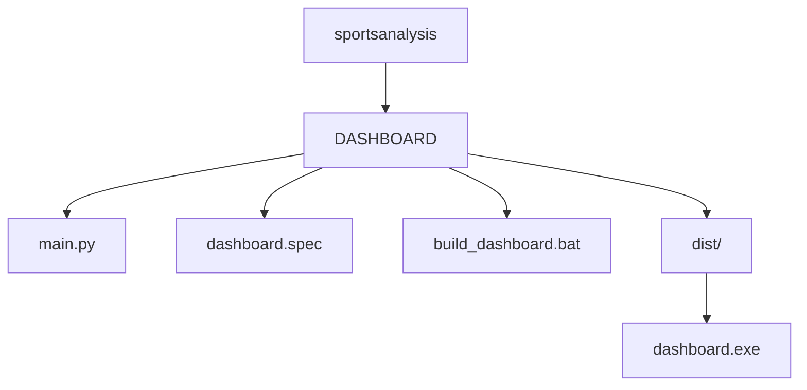
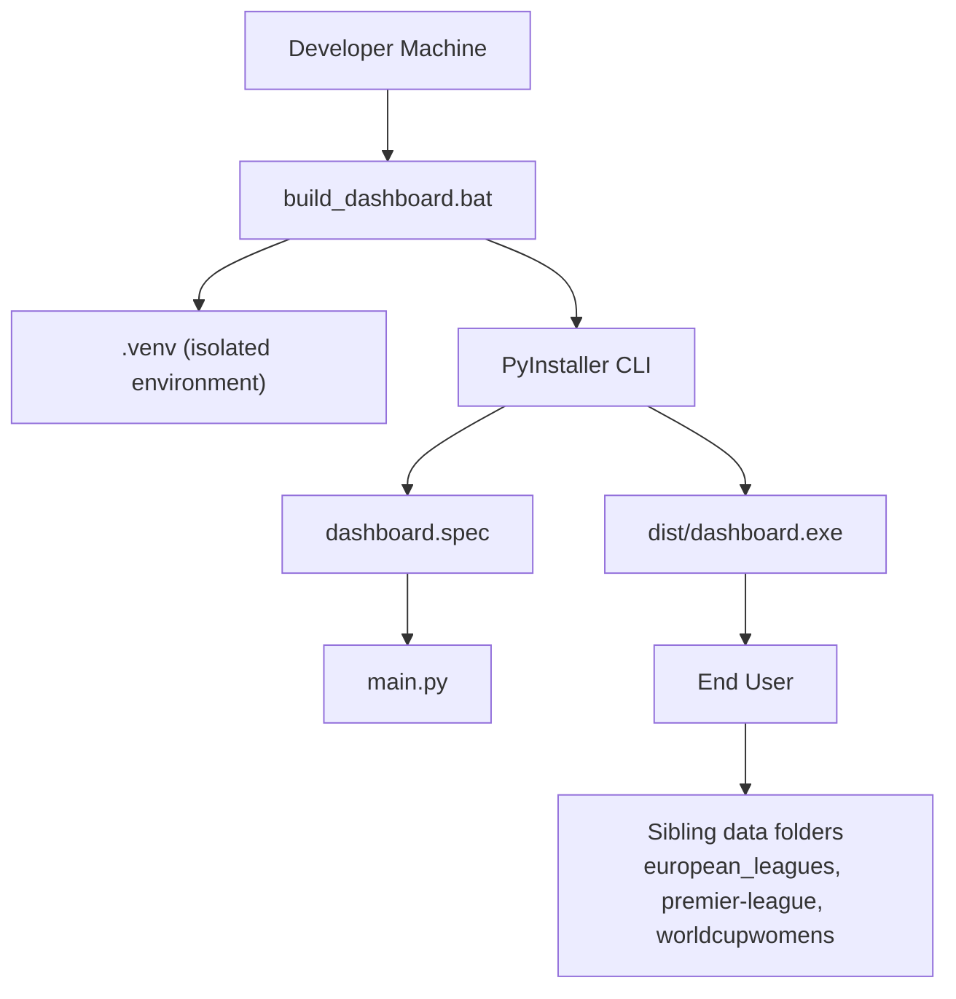
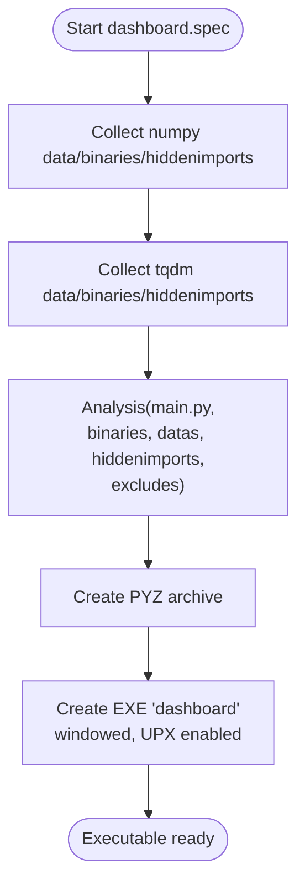
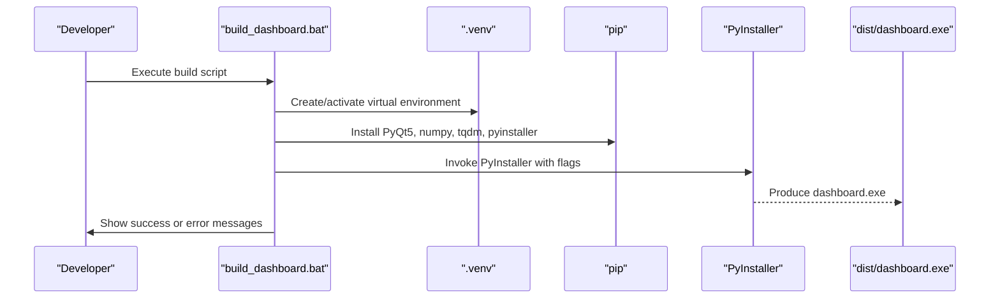
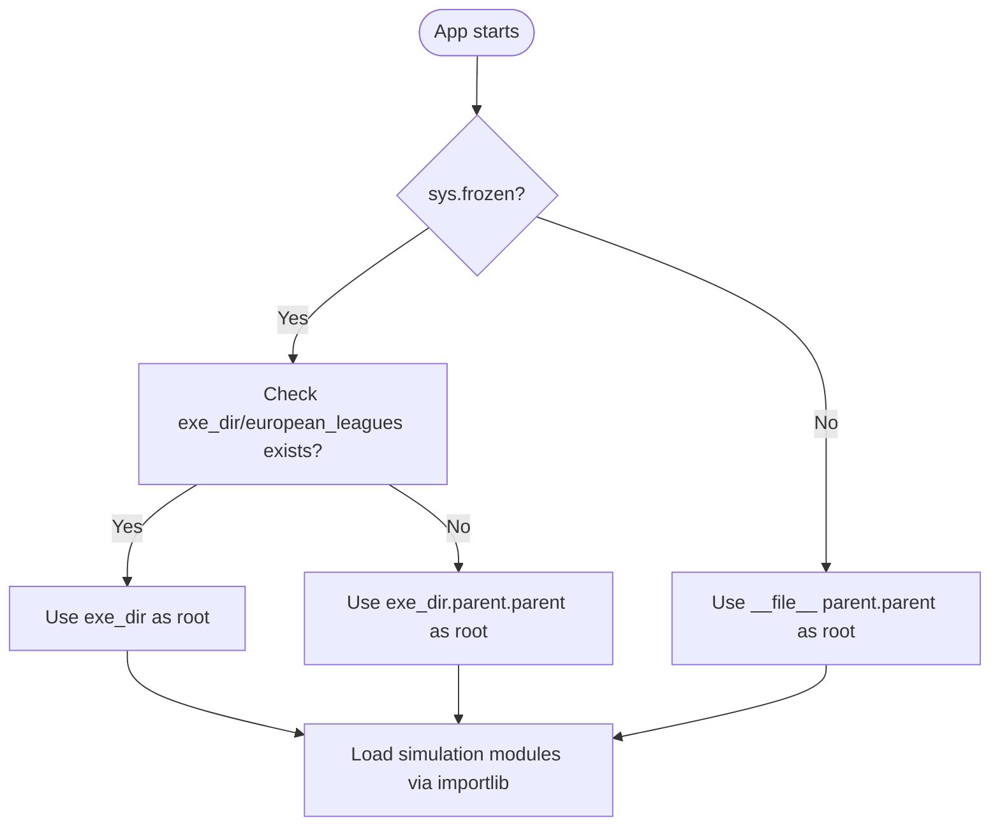
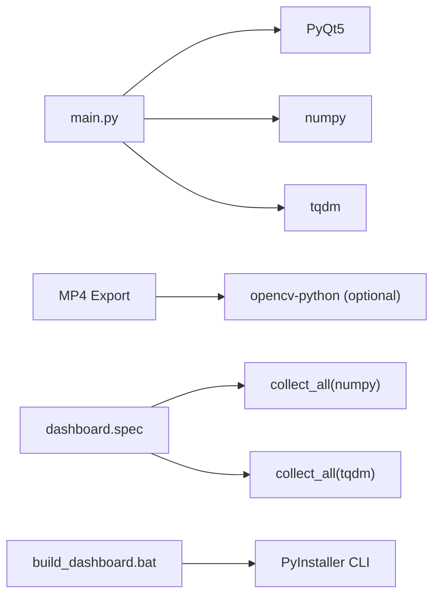

# Deployment and Packaging

<cite>
**Referenced Files in This Document**
- [dashboard.spec](file://DASHBOARD/dashboard.spec)
- [build_dashboard.bat](file://DASHBOARD/build_dashboard.bat)
- [main.py](file://DASHBOARD/main.py)
</cite>

## Table of Contents
1. [Introduction](#introduction)
2. [Project Structure](#project-structure)
3. [Core Components](#core-components)
4. [Architecture Overview](#architecture-overview)
5. [Detailed Component Analysis](#detailed-component-analysis)
6. [Dependency Analysis](#dependency-analysis)
7. [Performance Considerations](#performance-considerations)
8. [Troubleshooting Guide](#troubleshooting-guide)
9. [Versioning and Updates](#versioning-and-updates)
10. [Conclusion](#conclusion)

## Introduction
This document explains how to deploy and package the sports analysis dashboard as a standalone executable using PyInstaller. It covers the PyInstaller configuration, the automated Windows build script, dependency management, distribution strategies across platforms, runtime resource layout, and common deployment troubleshooting. It also provides guidance on versioning and update mechanisms for deployed applications.

The application is a PyQt5-based desktop dashboard that runs Monte Carlo simulations for multiple football leagues and displays results through interactive screens, including a world map view, detail tables, and an optional progress video feature.

## Project Structure
At the top level, the project contains many independent sports analysis modules. The packaging and deployment focus is under the `DASHBOARD` directory:

- `DASHBOARD/main.py`: Application entry point and UI logic.
- `DASHBOARD/dashboard.spec`: PyInstaller specification for building the executable.
- `DASHBOARD/build_dashboard.bat`: Automated Windows build script.
- `DASHBOARD/dist/`: Output folder containing the packaged executable after a successful build.
- `DASHBOARD/.venv/`: Isolated Python environment used by the build script.

**Diagram sources**
- [main.py:1624-1633](file://DASHBOARD/main.py#L1624-L1633)
- [dashboard.spec:13-47](file://DASHBOARD/dashboard.spec#L13-L47)
- [build_dashboard.bat:65-84](file://DASHBOARD/build_dashboard.bat#L65-L84)

**Section sources**
- [main.py:1-20](file://DASHBOARD/main.py#L1-L20)
- [dashboard.spec:1-48](file://DASHBOARD/dashboard.spec#L1-L48)
- [build_dashboard.bat:1-119](file://DASHBOARD/build_dashboard.bat#L1-L119)

## Core Components
The deployment pipeline consists of three main components:

1. **Application Entry Point**: `main.py` initializes the PyQt5 application, loads simulation modules dynamically, and manages UI navigation.
2. **PyInstaller Specification**: `dashboard.spec` defines how PyInstaller bundles the app, collects dependencies, excludes unnecessary modules, and configures the executable.
3. **Build Script**: `build_dashboard.bat` automates environment setup, dependency installation, cleaning previous builds, and invoking PyInstaller with explicit flags.

Key responsibilities:
- `main.py` determines the application root path at runtime so it can locate sibling data folders when packaged.
- `dashboard.spec` ensures critical runtime libraries like NumPy and tqdm are collected and hidden imports are resolved.
- `build_dashboard.bat` enforces a consistent Python version, creates a clean virtual environment, installs only required packages, and produces a single-file windowed executable.

**Section sources**
- [main.py:37-53](file://DASHBOARD/main.py#L37-L53)
- [dashboard.spec:1-48](file://DASHBOARD/dashboard.spec#L1-L48)
- [build_dashboard.bat:10-84](file://DASHBOARD/build_dashboard.bat#L10-L84)

## Architecture Overview
The packaging architecture connects the build script, PyInstaller spec, and application runtime into a repeatable deployment workflow.

**Diagram sources**
- [build_dashboard.bat:22-84](file://DASHBOARD/build_dashboard.bat#L22-L84)
- [dashboard.spec:13-47](file://DASHBOARD/dashboard.spec#L13-L47)
- [main.py:37-53](file://DASHBOARD/main.py#L37-L53)

## Detailed Component Analysis

### PyInstaller Configuration in dashboard.spec
The specification file controls how PyInstaller analyzes and bundles the application.

Important behaviors:
- Uses `collect_all` from PyInstaller hooks to gather data files, binaries, and hidden imports for `numpy` and `tqdm`.
- Defines an `Analysis` object pointing at `main.py`, passing collected data, binaries, and hidden imports.
- Excludes heavy or unused GUI frameworks and scientific packages such as `PySide6`, `PySide2`, `PyQt6`, `pandas`, `scipy`, `matplotlib`, `PIL`, `IPython`, `pytest`, `pygame`, and `tkinter`.
- Creates a `PYZ` archive and an `EXE` target named `dashboard`.
- Disables console output (`console=False`) for a windowed experience.
- Enables UPX compression (`upx=True`) to reduce executable size.

**Diagram sources**
- [dashboard.spec:7-10](file://DASHBOARD/dashboard.spec#L7-L10)
- [dashboard.spec:13-25](file://DASHBOARD/dashboard.spec#L13-L25)
- [dashboard.spec:28-47](file://DASHBOARD/dashboard.spec#L28-L47)

**Section sources**
- [dashboard.spec:1-48](file://DASHBOARD/dashboard.spec#L1-L48)

### Build Process Using build_dashboard.bat
The batch script automates the entire build process on Windows.

Workflow steps:
1. Force Python 3.11 if available via the launcher; otherwise fall back to default `python`.
2. Create or reuse `.venv` as an isolated build environment.
3. Activate the virtual environment.
4. Check whether required packages (`PyQt5`, `numpy`, `tqdm`) are installed; if not, install them along with a pinned `pyinstaller==6.12.0`.
5. Clean previous `build`, `dist`, and the spec file to ensure a fresh build.
6. Run PyInstaller with:
   - `--onefile`
   - `--windowed`
   - `--noconfirm`
   - `--clean`
   - `--name dashboard`
   - `--collect-all numpy`
   - `--collect-all tqdm`
   - Multiple `--exclude-module` flags matching those in `dashboard.spec`.
7. Verify that `dist\dashboard.exe` exists after the build.
8. Print deployment reminders about placing league data folders next to the executable.

**Diagram sources**
- [build_dashboard.bat:10-50](file://DASHBOARD/build_dashboard.bat#L10-L50)
- [build_dashboard.bat:52-84](file://DASHBOARD/build_dashboard.bat#L52-L84)
- [build_dashboard.bat:95-119](file://DASHBOARD/build_dashboard.bat#L95-L119)

**Section sources**
- [build_dashboard.bat:1-119](file://DASHBOARD/build_dashboard.bat#L1-L119)

### Runtime Resource Layout and Data Dependencies
The application dynamically loads simulation modules relative to an application root path. At runtime, `_app_root()` resolves the correct base directory depending on whether the app is frozen into an executable.

Behavior:
- If frozen, it checks whether expected sibling folders exist next to the executable.
- If they exist, it uses the executable’s parent directory as the root.
- Otherwise, it falls back to navigating up two levels from the executable path.
- If not frozen, it uses the source tree’s parent directory.

This design allows the packaged executable to access league simulation modules located in sibling directories such as `european_leagues`, `premier-league`, and `worldcupwomens`.

**Diagram sources**
- [main.py:37-53](file://DASHBOARD/main.py#L37-L53)
- [main.py:56-62](file://DASHBOARD/main.py#L56-L62)

**Section sources**
- [main.py:37-62](file://DASHBOARD/main.py#L37-L62)

### Distribution Strategies for Different Platforms
The current build script and spec are optimized for Windows:

- **Windows**:
  - Use `build_dashboard.bat` to create `dist/dashboard.exe`.
  - Ensure sibling data folders are present alongside the executable.
  - The script pins PyInstaller 6.12.0 and requires Python 3.11 if available.

- **macOS**:
  - There is no macOS-specific build script in the repository.
  - You would need to run PyInstaller manually on macOS with equivalent flags and adjust platform-specific considerations such as code signing and bundle structure.
  - Update `dashboard.spec` and the build command to match macOS requirements.

- **Linux**:
  - There is no Linux-specific build script in the repository.
  - You would need to run PyInstaller manually on Linux with equivalent flags and adjust platform-specific considerations such as executable permissions and shared library availability.
  - Update `dashboard.spec` and the build command to match Linux requirements.

Recommendation:
- Create platform-specific build scripts mirroring `build_dashboard.bat` for macOS and Linux.
- Pin exact versions of Python, PyInstaller, and dependencies per platform.
- Validate that all excluded modules remain excluded and all required modules are collected.

**Section sources**
- [build_dashboard.bat:10-84](file://DASHBOARD/build_dashboard.bat#L10-L84)
- [dashboard.spec:22-47](file://DASHBOARD/dashboard.spec#L22-L47)

## Dependency Analysis
The application depends on:

- **PyQt5**: GUI framework.
- **NumPy**: Numerical operations and video export support.
- **tqdm**: Progress tracking utilities.
- **OpenCV (optional)**: Required only for MP4 export functionality.

Packaging behavior:
- `dashboard.spec` explicitly collects NumPy and tqdm data, binaries, and hidden imports.
- `build_dashboard.bat` installs `PyQt5`, `numpy`, `tqdm`, and `pyinstaller==6.12.0`.
- The script passes `--collect-all numpy` and `--collect-all tqdm` to PyInstaller.
- Many unrelated GUI and scientific packages are excluded to keep the executable smaller.

**Diagram sources**
- [main.py:15-31](file://DASHBOARD/main.py#L15-L31)
- [main.py:1373-1380](file://DASHBOARD/main.py#L1373-L1380)
- [dashboard.spec:7-10](file://DASHBOARD/dashboard.spec#L7-L10)
- [build_dashboard.bat:37-49](file://DASHBOARD/build_dashboard.bat#L37-L49)

**Section sources**
- [main.py:15-31](file://DASHBOARD/main.py#L15-L31)
- [main.py:1373-1380](file://DASHBOARD/main.py#L1373-L1380)
- [dashboard.spec:7-10](file://DASHBOARD/dashboard.spec#L7-L10)
- [dashboard.spec:22-47](file://DASHBOARD/dashboard.spec#L22-L47)
- [build_dashboard.bat:37-84](file://DASHBOARD/build_dashboard.bat#L37-L84)

## Performance Considerations
- **One-file executable**: The build uses `--onefile`, which extracts dependencies at runtime. This simplifies distribution but may increase startup time.
- **UPX compression**: Enabled in `dashboard.spec` to reduce binary size; this can slightly affect startup performance.
- **Excluded modules**: Excluding large unused packages reduces bundle size and potential runtime overhead.
- **Video export**: MP4 export uses OpenCV and NumPy; ensure these are available if users plan to export videos.

[No sources needed since this section provides general guidance]

## Troubleshooting Guide

### Missing Dependencies
Symptoms:
- Application fails to start due to missing `PyQt5`, `numpy`, or `tqdm`.
- Build fails during dependency installation.

Resolution:
- Re-run `build_dashboard.bat` to recreate `.venv` and reinstall dependencies.
- Confirm Python 3.11 is available or adjust the script to use your preferred interpreter.
- For MP4 export errors, install `opencv-python` and `numpy` in the runtime environment.

**Section sources**
- [build_dashboard.bat:10-50](file://DASHBOARD/build_dashboard.bat#L10-L50)
- [main.py:1373-1380](file://DASHBOARD/main.py#L1373-L1380)

### Path Resolution Problems
Symptoms:
- Application cannot find simulation modules or data folders.
- Errors occur when loading dynamic modules.

Resolution:
- Ensure sibling data folders (`european_leagues`, `premier-league`, `worldcupwomens`) are placed next to `dashboard.exe`.
- Verify the application root resolution logic in `_app_root()` matches your deployment layout.
- If running from source, confirm the working directory aligns with the expected parent structure.

**Section sources**
- [main.py:37-53](file://DASHBOARD/main.py#L37-L53)
- [build_dashboard.bat:110-118](file://DASHBOARD/build_dashboard.bat#L110-L118)

### Executable Permissions
Symptoms:
- On Linux or macOS, the executable cannot be executed due to permission issues.

Resolution:
- Set executable permissions manually: `chmod +x dist/dashboard`.
- Ensure the built binary matches the target platform architecture.

[No sources needed since this section provides general guidance]

### Build Failures
Symptoms:
- PyInstaller reports missing modules or crashes during bundling.
- `dist/dashboard.exe` is not generated.

Resolution:
- Delete `.venv`, `build`, and `dist`, then re-run the build script.
- Confirm PyInstaller version is pinned to 6.12.0.
- Review exclusion list in both `dashboard.spec` and `build_dashboard.bat` to avoid conflicting configurations.

**Section sources**
- [build_dashboard.bat:52-103](file://DASHBOARD/build_dashboard.bat#L52-L103)
- [dashboard.spec:22-47](file://DASHBOARD/dashboard.spec#L22-L47)

## Versioning and Updates
Recommended practices:
- **Pin dependencies**: Keep `pyinstaller==6.12.0` and other critical packages pinned in the build script or a requirements file.
- **Semantic versioning**: Tag releases with semantic versions (for example, `1.0.0`, `1.1.0`, `2.0.0`) and include changelogs.
- **Platform artifacts**: Publish separate artifacts for Windows, macOS, and Linux, clearly labeled with OS and architecture.
- **Update mechanism**: Implement a lightweight updater that:
  - Checks a remote manifest for the latest version.
  - Downloads new executables and data folders.
  - Validates checksums before replacing old files.
  - Restarts the application after updating.
- **Data folder updates**: Treat simulation data folders as versioned assets; ensure the application validates compatibility before loading them.

[No sources needed since this section provides general guidance]

## Conclusion
The sports analysis dashboard is packaged into a standalone executable using PyInstaller, with `dashboard.spec` controlling dependency collection and exclusions, and `build_dashboard.bat` automating the Windows build process. The application relies on sibling data folders for simulation modules, and its runtime path resolution supports both development and packaged deployments. For multi-platform distribution, create platform-specific build scripts, pin versions consistently, and implement a robust update strategy. Common deployment issues such as missing dependencies, path resolution failures, and permission problems can be resolved by following the troubleshooting guidance provided here.