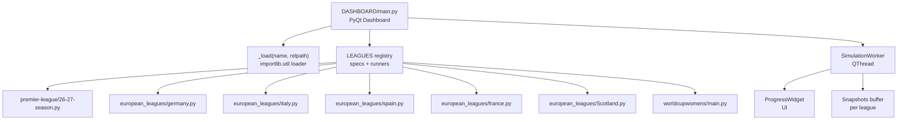
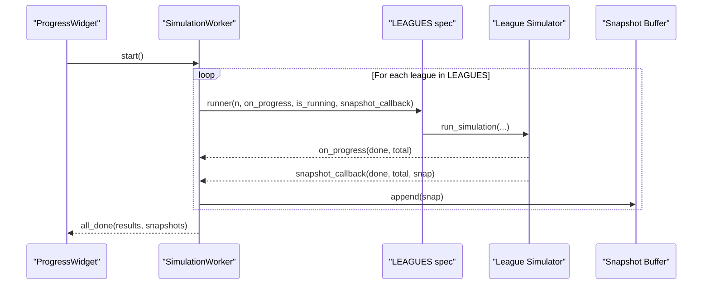
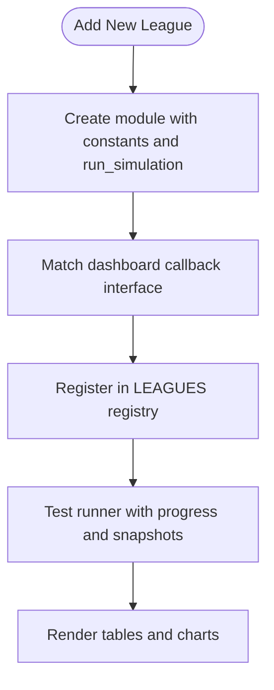
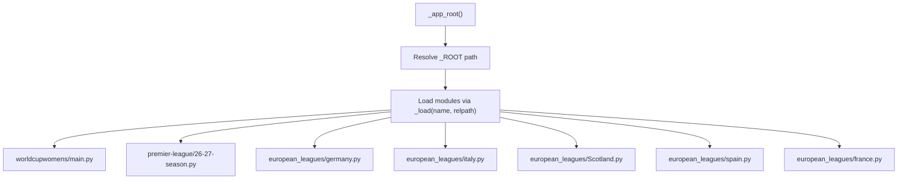
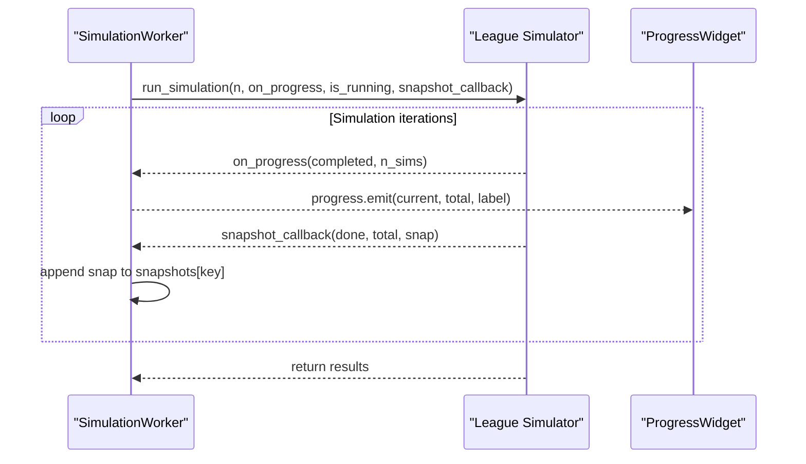
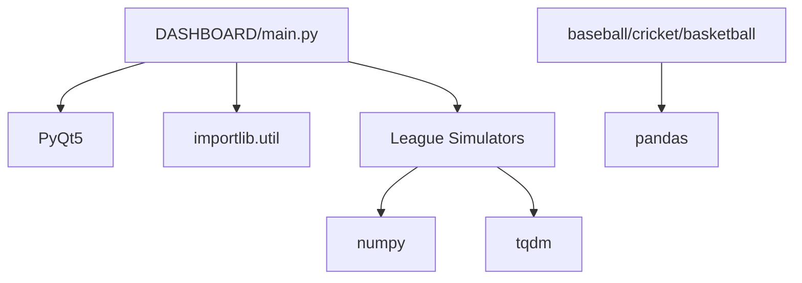

# Development and Extension Guide

<cite>
**Referenced Files in This Document**
- [DASHBOARD/main.py](file://DASHBOARD/main.py)
- [DASHBOARD/dashboard.spec](file://DASHBOARD/dashboard.spec)
- [european_leagues/germany.py](file://european_leagues/germany.py)
- [premier-league/26-27-season.py](file://premier-league/26-27-season.py)
- [worldcupwomens/main.py](file://worldcupwomens/main.py)
- [baseball/baseball_analyzer.py](file://baseball/baseball_analyzer.py)
- [basketball/basketball_analyzer.py](file://basketball/basketball_analyzer.py)
- [cricket/cricket_analyzer.py](file://cricket/cricket_analyzer.py)
</cite>

## Table of Contents
1. [Introduction](#introduction)
2. [Project Structure](#project-structure)
3. [Core Components](#core-components)
4. [Architecture Overview](#architecture-overview)
5. [Detailed Component Analysis](#detailed-component-analysis)
6. [Dependency Analysis](#dependency-analysis)
7. [Performance Considerations](#performance-considerations)
8. [Troubleshooting Guide](#troubleshooting-guide)
9. [Conclusion](#conclusion)
10. [Appendices](#appendices)

## Introduction
This guide explains how to extend and customize the sports analysis platform. It focuses on:
- The plugin architecture for adding new league simulators following established interface patterns.
- The module loading system using importlib.util for dynamic simulation discovery and registration.
- The callback interface for progress reporting and snapshot capture integration.
- Testing procedures, debugging techniques, and development environment setup.
- Code contribution guidelines, coding standards, and review processes.
- Examples of implementing custom statistical models, visualization components, and data processing pipelines.
- Deployment considerations, packaging with PyInstaller, and distribution strategies for standalone applications.

The platform is a PyQt-based dashboard that orchestrates multiple independent simulation modules (for leagues like Premier League, Bundesliga, La Liga, Serie A, Ligue 1, Scottish Premiership, and Women’s World Cup). Each simulator exposes a consistent run_simulation interface so the dashboard can execute them uniformly, collect results, and render interactive visualizations.

## Project Structure
At a high level:
- DASHBOARD contains the main application, UI orchestration, and dynamic module loading.
- european_leagues contains per-league simulators (Germany, Italy, Spain, France, Scotland).
- premier-league contains the Premier League simulation and related utilities.
- worldcupwomens contains the Women’s World Cup qualification simulation.
- baseball, basketball, cricket contain sport-specific analyzers and simulators.

**Diagram sources**
- [DASHBOARD/main.py:35-63](file://DASHBOARD/main.py#L35-L63)
- [DASHBOARD/main.py:68-199](file://DASHBOARD/main.py#L68-L199)
- [DASHBOARD/main.py:284-333](file://DASHBOARD/main.py#L284-L333)

**Section sources**
- [DASHBOARD/main.py:1-13](file://DASHBOARD/main.py#L1-L13)
- [DASHBOARD/main.py:35-63](file://DASHBOARD/main.py#L35-L63)
- [DASHBOARD/main.py:68-199](file://DASHBOARD/main.py#L68-L199)

## Core Components
Key runtime components:
- Dynamic Module Loader: Loads simulation modules at runtime via importlib.util.
- League Registry: LEAGUES defines metadata, runner functions, and display columns for each league.
- SimulationWorker: Runs simulations sequentially in a background thread, emitting progress and capturing snapshots.
- ProgressWidget: Displays overall progress and elapsed time.
- Visualization Widgets: Home blocks, world map, detail cards, tables, PNG export, and video generation.

Important implementation details:
- _load uses importlib.util.spec_from_file_location and module_from_spec to load modules by relative path from the app root.
- LEAGUES entries include n_sims, runner lambda, get_teams, top_key, top_fmt, columns, and optional flags like has_video or is_wc.
- SimulationWorker wraps each league’s runner with progress and snapshot callbacks, collecting results and snapshots keyed by league.

**Section sources**
- [DASHBOARD/main.py:35-63](file://DASHBOARD/main.py#L35-L63)
- [DASHBOARD/main.py:68-199](file://DASHBOARD/main.py#L68-L199)
- [DASHBOARD/main.py:284-333](file://DASHBOARD/main.py#L284-L333)
- [DASHBOARD/main.py:339-410](file://DASHBOARD/main.py#L339-L410)

## Architecture Overview
The dashboard orchestrates multiple simulators through a uniform interface. Each simulator must expose:
- A constant indicating number of simulations (e.g., NUM_PL_SIMS, N_SIMS, NUM_SIMS).
- A run_simulation function accepting parameters for number of simulations, progress callback, running state checker, and snapshot callback.

**Diagram sources**
- [DASHBOARD/main.py:284-333](file://DASHBOARD/main.py#L284-L333)
- [DASHBOARD/main.py:308-323](file://DASHBOARD/main.py#L308-L323)

## Detailed Component Analysis

### Plugin Architecture for New League Simulators
To add a new league simulator:
1. Create a Python module under a suitable directory (e.g., european_leagues/new_league.py).
2. Define a constant for the number of simulations (e.g., NUM_SIMS or N_SIMS).
3. Implement run_simulation with the signature compatible with the dashboard:
   - Parameters: n_sims, on_progress, is_running, snapshot_callback, snapshot_every (optional).
   - Return: dict containing keys expected by the dashboard (e.g., teams, avg_points, title_prob, etc.).
4. Register the league in the dashboard’s LEAGUES list:
   - key, title, short, subtitle, accent, continent, geo coordinates, n_sims, has_video flag.
   - runner lambda calling your module’s run_simulation with the required callbacks.
   - get_teams returning team names.
   - top_key and top_fmt for probability metrics.
   - columns defining table fields and formatting.

Example references:
- Bundesliga module exposes NUM_SIMS and run_simulation with callbacks.
- Premier League module exposes NUM_PL_SIMS and run_simulation.
- Women’s World Cup module exposes N_SIMS and run_simulation.

**Diagram sources**
- [european_leagues/germany.py:247-327](file://european_leagues/germany.py#L247-L327)
- [premier-league/26-27-season.py:1-200](file://premier-league/26-27-season.py#L1-L200)
- [worldcupwomens/main.py:161-200](file://worldcupwomens/main.py#L161-L200)
- [DASHBOARD/main.py:68-199](file://DASHBOARD/main.py#L68-L199)

**Section sources**
- [european_leagues/germany.py:247-327](file://european_leagues/germany.py#L247-L327)
- [premier-league/26-27-season.py:1-200](file://premier-league/26-27-season.py#L1-L200)
- [worldcupwomens/main.py:161-200](file://worldcupwomens/main.py#L161-L200)
- [DASHBOARD/main.py:68-199](file://DASHBOARD/main.py#L68-L199)

### Module Loading System Using importlib.util
The dashboard dynamically loads simulation modules at runtime:
- _app_root determines the application root path, handling both frozen executables and development environments.
- _load creates a module spec from file location, instantiates the module, and executes it.
- Modules are loaded for each league and assigned to variables (wc, pl, ger, ita, sco, esp, fra).

**Diagram sources**
- [DASHBOARD/main.py:37-53](file://DASHBOARD/main.py#L37-L53)
- [DASHBOARD/main.py:56-62](file://DASHBOARD/main.py#L56-L62)

**Section sources**
- [DASHBOARD/main.py:37-53](file://DASHBOARD/main.py#L37-L53)
- [DASHBOARD/main.py:56-62](file://DASHBOARD/main.py#L56-L62)

### Callback Interface for Progress Reporting and Snapshot Capture
The dashboard provides two primary callbacks:
- on_progress(current, total): Reports simulation progress.
- snapshot_callback(done, total, snap): Captures periodic snapshots of intermediate results.

Each league simulator should:
- Accept these callbacks in run_simulation.
- Call on_progress periodically during simulation loops.
- Call snapshot_callback at intervals defined by snapshot_every or at completion.

Examples:
- Bundesliga’s run_simulation calls on_progress and snapshot_callback within its Monte Carlo loop.
- Premier League’s run_simulation follows similar patterns.
- Women’s World Cup’s run_simulation integrates with the dashboard’s workflow.

**Diagram sources**
- [DASHBOARD/main.py:308-323](file://DASHBOARD/main.py#L308-L323)
- [european_leagues/germany.py:301-312](file://european_leagues/germany.py#L301-L312)

**Section sources**
- [DASHBOARD/main.py:308-323](file://DASHBOARD/main.py#L308-L323)
- [european_leagues/germany.py:301-312](file://european_leagues/germany.py#L301-L312)

### Data Structures and Algorithms
Common patterns across simulators:
- Elo-based expected goals calculation.
- Poisson-distributed goal sampling.
- Monte Carlo simulation loops aggregating statistics (title probabilities, top finishes, relegation risks).
- Regression of Elo ratings toward league mean over time.

Complexity considerations:
- Monte Carlo loops scale linearly with number of simulations.
- Snapshot frequency affects memory usage and UI responsiveness.
- ELO calculations involve exponential functions and logarithmic scaling.

**Section sources**
- [european_leagues/germany.py:39-55](file://european_leagues/germany.py#L39-L55)
- [european_leagues/germany.py:160-166](file://european_leagues/germany.py#L160-L166)
- [european_leagues/germany.py:228-242](file://european_leagues/germany.py#L228-L242)
- [premier-league/26-27-season.py:127-141](file://premier-league/26-27-season.py#L127-L141)

### Visualization Components
The dashboard includes:
- StatCard: Displays top performers with rank, team name, and value.
- HomeBlock: Interactive blocks for league selection.
- LeagueRow: Clickable rows for league navigation.
- Table builders for league standings and World Cup qualification probabilities.
- PNG export functionality for saving detailed views.

These components use PyQt widgets and styling for a polished user experience.

**Section sources**
- [DASHBOARD/main.py:415-508](file://DASHBOARD/main.py#L415-L508)
- [DASHBOARD/main.py:551-616](file://DASHBOARD/main.py#L551-L616)
- [DASHBOARD/main.py:660-686](file://DASHBOARD/main.py#L660-L686)

## Dependency Analysis
The dashboard depends on:
- PyQt5 for UI components and threading.
- importlib.util for dynamic module loading.
- Individual league simulators for statistical modeling and simulation logic.

External dependencies:
- numpy for numerical operations in some simulators.
- tqdm for progress bars in CLI contexts.
- pandas for data manipulation in analyzers.

**Diagram sources**
- [DASHBOARD/main.py:15-31](file://DASHBOARD/main.py#L15-L31)
- [european_leagues/germany.py:12-17](file://european_leagues/germany.py#L12-L17)
- [baseball/baseball_analyzer.py:1-16](file://baseball/baseball_analyzer.py#L1-L16)

**Section sources**
- [DASHBOARD/main.py:15-31](file://DASHBOARD/main.py#L15-L31)
- [european_leagues/germany.py:12-17](file://european_leagues/germany.py#L12-L17)
- [baseball/baseball_analyzer.py:1-16](file://baseball/baseball_analyzer.py#L1-L16)

## Performance Considerations
- Use efficient random number generators (e.g., numpy RandomState) for large-scale simulations.
- Limit snapshot frequency to balance memory usage and UI responsiveness.
- Optimize Elo calculations by precomputing constants where possible.
- Consider parallelizing independent simulations if needed, while maintaining thread safety for shared state.

[No sources needed since this section provides general guidance]

## Troubleshooting Guide
Common issues and solutions:
- Module loading errors: Ensure paths are correct and modules are accessible from _ROOT.
- Missing constants: Verify that each simulator exports required constants (NUM_SIMS, N_SIMS, etc.).
- Callback mismatches: Ensure run_simulation accepts the expected parameters and calls callbacks correctly.
- UI freezing: Offload heavy computations to QThread and update UI via signals.

Debugging tips:
- Print debug statements in simulators to trace execution flow.
- Use logging instead of print statements for production code.
- Test individual simulators independently before integrating with the dashboard.

**Section sources**
- [DASHBOARD/main.py:37-53](file://DASHBOARD/main.py#L37-L53)
- [european_leagues/germany.py:247-327](file://european_leagues/germany.py#L247-L327)

## Conclusion
This guide provided a comprehensive overview of extending and customizing the sports analysis platform. By following the established interfaces and patterns, developers can add new league simulators, integrate custom statistical models, and enhance visualization components. The modular architecture supports dynamic loading, robust callback mechanisms, and scalable performance considerations.

[No sources needed since this section summarizes without analyzing specific files]

## Appendices

### Development Environment Setup
- Install required dependencies: PyQt5, numpy, tqdm, pandas.
- Set up virtual environment for isolation.
- Run the dashboard from the DASHBOARD directory.

### Code Contribution Guidelines
- Follow PEP 8 style guidelines.
- Write unit tests for new simulators and components.
- Document public APIs and provide examples.
- Submit pull requests with clear descriptions and test coverage.

### Review Processes
- Code reviews focus on correctness, performance, and maintainability.
- Ensure backward compatibility when modifying interfaces.
- Validate changes with existing simulators and the dashboard.

### Deployment with PyInstaller
- Use dashboard.spec to configure packaging.
- Include necessary data files and hidden imports.
- Test the packaged application on target platforms.

**Section sources**
- [DASHBOARD/dashboard.spec:1-48](file://DASHBOARD/dashboard.spec#L1-L48)