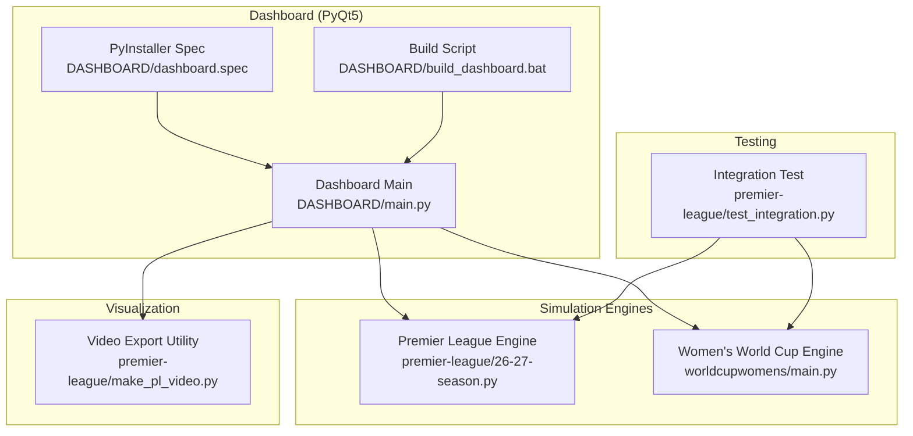
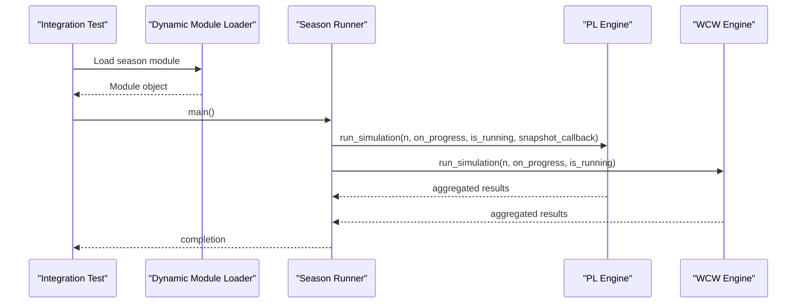
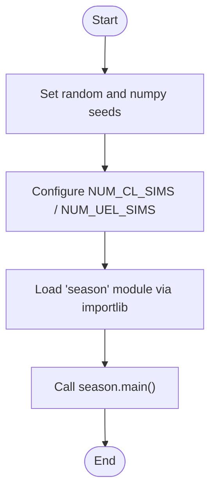
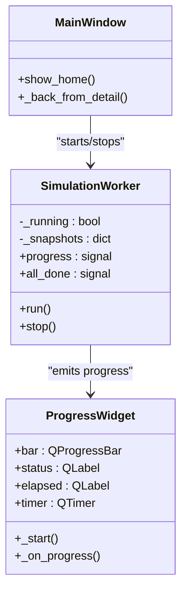
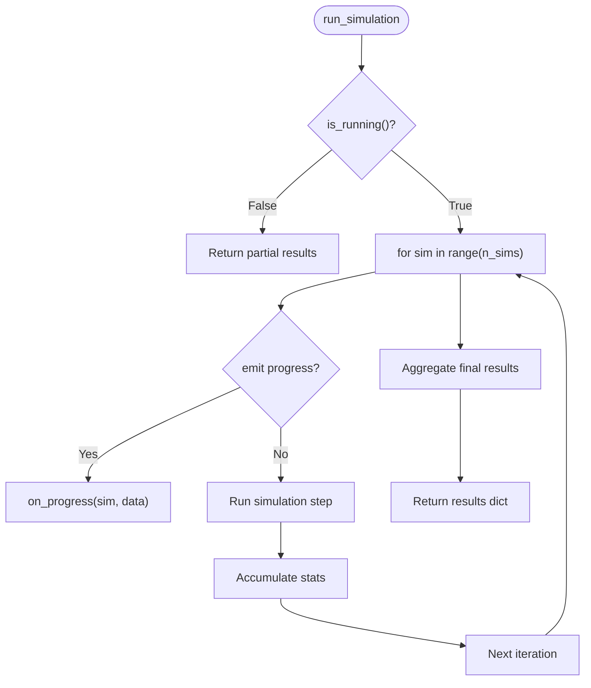
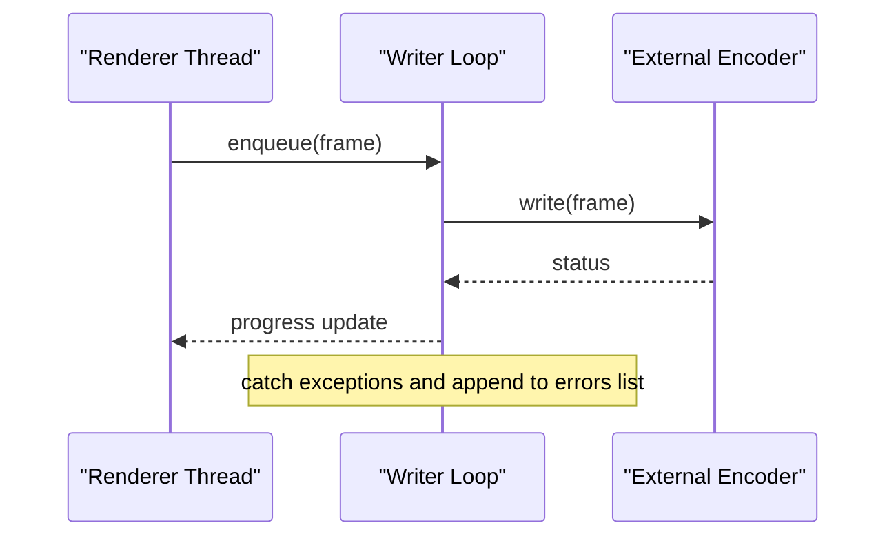
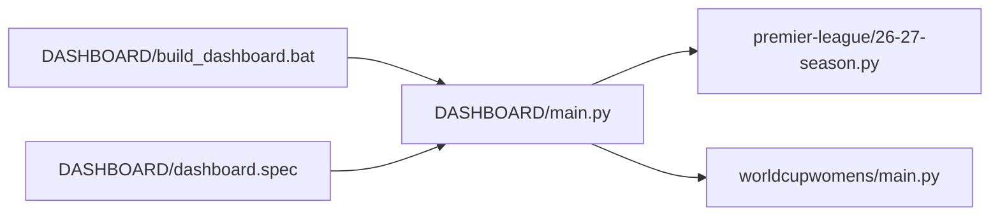

# Testing and Debugging Guide

<cite>
**Referenced Files in This Document**
- [test_integration.py](file://premier-league/test_integration.py)
- [26-27-season.py](file://premier-league/26-27-season.py)
- [main.py (Dashboard)](file://DASHBOARD/main.py)
- [build_dashboard.bat](file://DASHBOARD/build_dashboard.bat)
- [dashboard.spec](file://DASHBOARD/dashboard.spec)
- [make_pl_video.py](file://premier-league/make_pl_video.py)
- [main.py (World Cup Women)](file://worldcupwomens/main.py)
- [fpl.py](file://premier-league/fpl.py)
</cite>

## Table of Contents
1. [Introduction](#introduction)
2. [Project Structure](#project-structure)
3. [Core Components](#core-components)
4. [Architecture Overview](#architecture-overview)
5. [Detailed Component Analysis](#detailed-component-analysis)
6. [Dependency Analysis](#dependency-analysis)
7. [Performance Considerations](#performance-considerations)
8. [Troubleshooting Guide](#troubleshooting-guide)
9. [Conclusion](#conclusion)

## Introduction
This guide explains how to test and debug the sports analysis platform, focusing on:
- The integration test structure and execution flow from test_integration.py
- Debugging PyQt5 applications with console monitoring, error handling, and progress inspection
- Unit testing strategies for statistical models, simulation engines, and UI components
- Common debugging scenarios such as module loading failures, progress callback issues, and visualization problems
- Validating Monte Carlo simulations for consistency and performance
- Memory management considerations and troubleshooting tips for long-running simulations

## Project Structure
The testing and debugging surface spans several areas:
- Integration tests that drive simulation modules dynamically
- A PyQt5 dashboard orchestrating multiple league simulations
- Simulation engines exposing run_simulation functions with progress callbacks
- Video export utilities and build scripts for packaging

**Diagram sources**
- [test_integration.py:1-21](file://premier-league/test_integration.py#L1-L21)
- [26-27-season.py:1-200](file://premier-league/26-27-season.py#L1-L200)
- [main.py (Dashboard):1-200](file://DASHBOARD/main.py#L1-L200)
- [build_dashboard.bat:1-119](file://DASHBOARD/build_dashboard.bat#L1-L119)
- [dashboard.spec:1-47](file://DASHBOARD/dashboard.spec#L1-L47)
- [make_pl_video.py:154-187](file://premier-league/make_pl_video.py#L154-L187)
- [main.py (World Cup Women):410-537](file://worldcupwomens/main.py#L410-L537)

**Section sources**
- [test_integration.py:1-21](file://premier-league/test_integration.py#L1-L21)
- [main.py (Dashboard):1-200](file://DASHBOARD/main.py#L1-L200)

## Core Components
- Integration test harness: sets deterministic seeds, configures simulation counts, dynamically loads a season module, and executes its main entry point.
- Dashboard orchestration: dynamically loads simulation modules, runs them sequentially on a background thread, and exposes unified progress and snapshots for visualization.
- Simulation engines: expose run_simulation with optional progress callbacks and early-stop hooks; aggregate results across Monte Carlo iterations.
- Visualization pipeline: renders progress videos using an external encoder, with progress reporting and error capture.

Key responsibilities:
- Deterministic seeding for reproducibility
- Progress callback contracts for UI updates
- Snapshot collection for replayable animations
- Robust module loading and error propagation

**Section sources**
- [test_integration.py:1-21](file://premier-league/test_integration.py#L1-L21)
- [main.py (Dashboard):34-63](file://DASHBOARD/main.py#L34-L63)
- [main.py (Dashboard):288-333](file://DASHBOARD/main.py#L288-L333)
- [main.py (World Cup Women):410-537](file://worldcupwomens/main.py#L410-L537)
- [make_pl_video.py:154-187](file://premier-league/make_pl_video.py#L154-L187)

## Architecture Overview
The system composes modular simulation engines behind a PyQt5 dashboard and a lightweight integration test runner.

**Diagram sources**
- [test_integration.py:14-21](file://premier-league/test_integration.py#L14-L21)
- [26-27-season.py:2060-2095](file://premier-league/26-27-season.py#L2060-L2095)
- [main.py (World Cup Women):410-537](file://worldcupwomens/main.py#L410-L537)

## Detailed Component Analysis

### Integration Test Harness (test_integration.py)
Purpose:
- Establish deterministic randomness via global seeds
- Configure simulation counts for European competitions
- Dynamically load and execute a season script without importing it statically

Behavior highlights:
- Reconfigures stdout encoding for consistent output
- Seeds Python random and NumPy RNGs
- Adjusts module-level constants before import
- Uses importlib to load a specific season file and invoke its main function

**Diagram sources**
- [test_integration.py:1-21](file://premier-league/test_integration.py#L1-L21)

**Section sources**
- [test_integration.py:1-21](file://premier-league/test_integration.py#L1-L21)

### Dashboard Orchestration (DASHBOARD/main.py)
Responsibilities:
- Resolve application root path for both frozen and development environments
- Dynamically load simulation modules by relative path
- Define league specifications including runners, metrics, and UI columns
- Execute all simulations sequentially on a background worker thread
- Emit unified progress events and collect periodic snapshots for video playback

Key patterns:
- Dynamic module loading with importlib.util
- Background QThread-based worker emitting pyqtSignal progress events
- Snapshot accumulation keyed by league identifier
- Error handling around PNG export and video rendering

**Diagram sources**
- [main.py (Dashboard):1-200](file://DASHBOARD/main.py#L1-L200)
- [main.py (Dashboard):288-333](file://DASHBOARD/main.py#L288-L333)
- [main.py (Dashboard):368-405](file://DASHBOARD/main.py#L368-L405)

**Section sources**
- [main.py (Dashboard):34-63](file://DASHBOARD/main.py#L34-L63)
- [main.py (Dashboard):288-333](file://DASHBOARD/main.py#L288-L333)
- [main.py (Dashboard):368-405](file://DASHBOARD/main.py#L368-L405)

### Simulation Engines (26-27-season.py and worldcupwomens/main.py)
Common contract:
- run_simulation(n_sims, on_progress=None, is_running=None, snapshot_callback=None)
- on_progress(sim_index, live_data_dict) called periodically
- is_running() returns False to stop early
- Returns aggregated results dictionary

Premier League engine:
- Implements RNG wrapper, ELO calculations, expected goals, and score sampling
- Provides shared setup and progress rendering helpers
- Exposes run_simulation through module interface used by dashboard

Women’s World Cup engine:
- Aggregates qualification probabilities and preliminary phase statistics
- Emits progress snapshots at fixed intervals based on n_sims

**Diagram sources**
- [26-27-season.py:98-141](file://premier-league/26-27-season.py#L98-L141)
- [26-27-season.py:2060-2095](file://premier-league/26-27-season.py#L2060-L2095)
- [main.py (World Cup Women):410-537](file://worldcupwomens/main.py#L410-L537)

**Section sources**
- [26-27-season.py:98-141](file://premier-league/26-27-season.py#L98-L141)
- [26-27-season.py:2060-2095](file://premier-league/26-27-season.py#L2060-L2095)
- [main.py (World Cup Women):410-537](file://worldcupwomens/main.py#L410-L537)

### Visualization Pipeline (make_pl_video.py)
Responsibilities:
- Write frames to an external encoder via stdin
- Capture errors from writer thread
- Provide real-time progress reporting with percentage, frame count, FPS, elapsed time, and ETA

**Diagram sources**
- [make_pl_video.py:154-187](file://premier-league/make_pl_video.py#L154-L187)

**Section sources**
- [make_pl_video.py:154-187](file://premier-league/make_pl_video.py#L154-L187)

## Dependency Analysis
- Dashboard depends on dynamic loading of simulation modules and uses their run_simulation interfaces.
- Build script ensures minimal dependencies are installed and packaged with PyInstaller, collecting required packages like NumPy and tqdm.
- Spec file configures PyInstaller to include necessary binaries and exclude unused GUI frameworks.

**Diagram sources**
- [main.py (Dashboard):34-63](file://DASHBOARD/main.py#L34-L63)
- [build_dashboard.bat:37-84](file://DASHBOARD/build_dashboard.bat#L37-L84)
- [dashboard.spec:1-47](file://DASHBOARD/dashboard.spec#L1-L47)

**Section sources**
- [main.py (Dashboard):34-63](file://DASHBOARD/main.py#L34-L63)
- [build_dashboard.bat:37-84](file://DASHBOARD/build_dashboard.bat#L37-L84)
- [dashboard.spec:1-47](file://DASHBOARD/dashboard.spec#L1-L47)

## Performance Considerations
- Use small simulation counts during development and testing to reduce runtime.
- Leverage deterministic seeds to ensure reproducible runs.
- Monitor progress callbacks to detect stalls or excessive overhead in UI updates.
- For video export, track encoder FPS and ETA to identify bottlenecks in rendering or I/O.

[No sources needed since this section provides general guidance]

## Troubleshooting Guide

### Console Output Monitoring
- Ensure stdout encoding is configured for consistent output in tests.
- Use stderr for progress messages in CLI tools to avoid mixing with potential CSV/JSON outputs.
- In video export utilities, monitor sys.stdout progress lines and flush buffers to keep feedback timely.

Practical checks:
- Verify stdout reconfiguration in integration tests.
- Confirm progress callbacks are invoked at expected intervals.
- Inspect encoder progress output for stalled frames.

**Section sources**
- [test_integration.py:1-2](file://premier-league/test_integration.py#L1-L2)
- [main.py (World Cup Women):544-552](file://worldcupwomens/main.py#L544-L552)
- [make_pl_video.py:172-187](file://premier-league/make_pl_video.py#L172-L187)

### Error Handling Patterns
- Wrap dynamic module loading and simulation execution in try/except blocks to capture ImportError and runtime exceptions.
- Validate file paths and existence before attempting to load or render.
- Propagate meaningful errors to the UI via QMessageBox when exporting images or videos.

Common locations:
- Dynamic module loader and league spec definitions
- PNG export routines
- Video export routines with OpenCV validation

**Section sources**
- [main.py (Dashboard):34-63](file://DASHBOARD/main.py#L34-L63)
- [main.py (Dashboard):1550-1562](file://DASHBOARD/main.py#L1550-L1562)
- [main.py (Dashboard):1252-1265](file://DASHBOARD/main.py#L1252-L1265)

### Module Loading Failures
Symptoms:
- ImportError when loading simulation modules
- Missing files or incorrect paths in frozen builds

Mitigations:
- Use _app_root to resolve paths correctly in both dev and frozen environments
- Ensure required directories exist next to the executable per build script instructions
- Validate imports and attributes before invoking run_simulation

**Section sources**
- [main.py (Dashboard):37-53](file://DASHBOARD/main.py#L37-L53)
- [build_dashboard.bat:105-119](file://DASHBOARD/build_dashboard.bat#L105-L119)

### Progress Callback Issues
Symptoms:
- UI progress bar not updating
- Stalls during long-running simulations
- Snapshots not captured for video playback

Checks:
- Ensure on_progress is called at regular intervals proportional to n_sims
- Verify is_running hook allows early termination if needed
- Confirm snapshot_callback receives periodic snapshots with done/total metadata

**Section sources**
- [main.py (Dashboard):288-333](file://DASHBOARD/main.py#L288-L333)
- [main.py (World Cup Women):410-537](file://worldcupwomens/main.py#L410-L537)

### Visualization Problems
Symptoms:
- PNG export fails
- Video export fails due to missing snapshots or OpenCV issues

Mitigations:
- Validate enough snapshots exist before attempting video export
- Catch and display user-friendly error messages for export failures
- Ensure output file paths are writable and have correct extensions

**Section sources**
- [main.py (Dashboard):1550-1562](file://DASHBOARD/main.py#L1550-L1562)
- [main.py (Dashboard):1252-1265](file://DASHBOARD/main.py#L1252-L1265)

### Testing Monte Carlo Simulations
Strategies:
- Set deterministic seeds for Python random and NumPy RNGs
- Reduce NUM_PL_SIMS or N_SIMS for quick validation
- Assert key statistical properties (e.g., probability sums, expected ranges)
- Compare outputs across runs to ensure consistency

Validation points:
- Reproducible results under identical seeds
- Stable convergence behavior as n_sims increases
- Reasonable probability distributions for outcomes

**Section sources**
- [test_integration.py:1-12](file://premier-league/test_integration.py#L1-L12)
- [main.py (World Cup Women):410-537](file://worldcupwomens/main.py#L410-L537)

### Memory Management and Long-Running Simulations
Guidance:
- Avoid accumulating large intermediate structures inside tight loops
- Periodically release references to temporary data
- Limit snapshot frequency to balance UI responsiveness and memory usage
- Monitor process memory during extended runs and adjust n_sims accordingly

Operational tips:
- Use snapshot_callback judiciously to prevent unbounded growth of snapshot lists
- Stop simulations early via is_running when investigating memory spikes
- Profile renderer threads and encoder I/O to isolate memory hotspots

[No sources needed since this section provides general guidance]

## Conclusion
This guide outlined the testing and debugging approach for the sports analysis platform:
- Use the integration test harness to validate simulation modules deterministically
- Rely on the dashboard’s progress and snapshot mechanisms to diagnose UI and simulation issues
- Apply robust error handling around dynamic module loading and visualization exports
- Validate Monte Carlo simulations for consistency and performance
- Manage memory carefully during long-running simulations and visualize progress effectively

[No sources needed since this section summarizes without analyzing specific files]