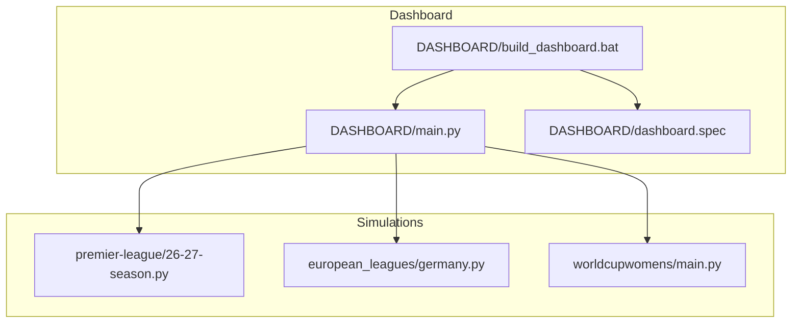
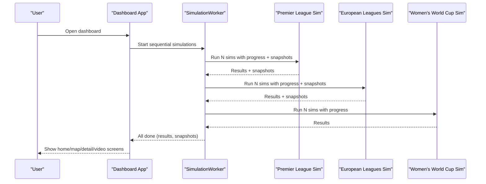
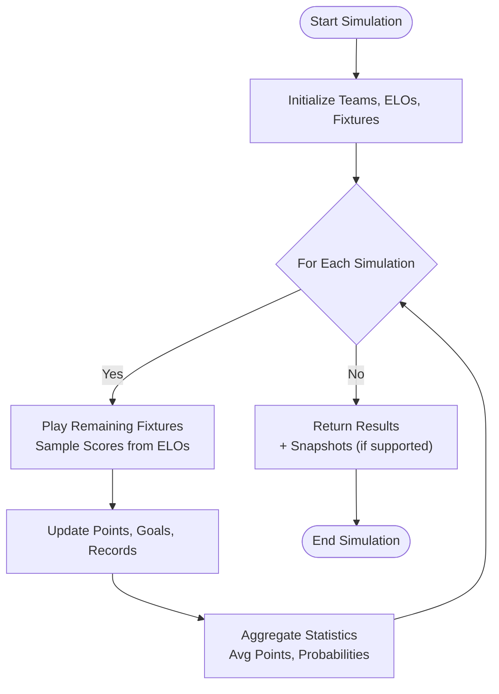
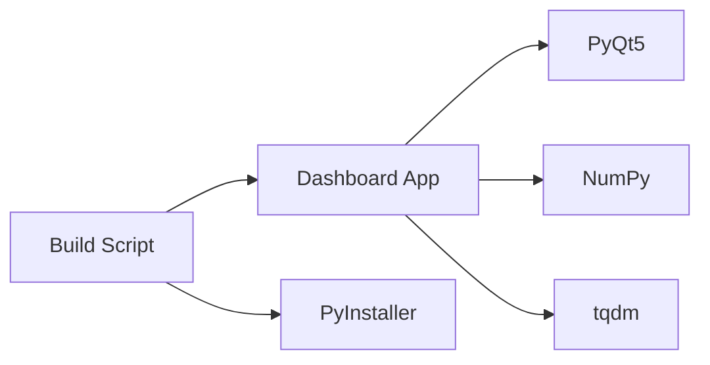

# Getting Started

<cite>
**Referenced Files in This Document**
- [main.py](file://DASHBOARD/main.py)
- [dashboard.spec](file://DASHBOARD/dashboard.spec)
- [build_dashboard.bat](file://DASHBOARD/build_dashboard.bat)
- [26-27-season.py](file://premier-league/26-27-season.py)
- [germany.py](file://european_leagues/germany.py)
- [main.py](file://worldcupwomens/main.py)
</cite>

## Table of Contents
1. [Introduction](#introduction)
2. [Project Structure](#project-structure)
3. [Core Components](#core-components)
4. [Architecture Overview](#architecture-overview)
5. [Detailed Component Analysis](#detailed-component-analysis)
6. [Dependency Analysis](#dependency-analysis)
7. [Performance Considerations](#performance-considerations)
8. [Troubleshooting Guide](#troubleshooting-guide)
9. [Conclusion](#conclusion)

## Introduction
The Sports Analysis Dashboard is a Monte Carlo simulation platform for football and soccer competitions. It runs many simulated seasons to estimate probabilities such as title chances, European qualification, relegation risk, and tournament qualification likelihoods. The dashboard currently supports seven competitions:

- Premier League (England)
- La Liga (Spain)
- Bundesliga (Germany)
- Serie A (Italy)
- Ligue 1 (France)
- Scottish Premiership (Scotland)
- Women's World Cup qualification

The application provides an interactive PyQt5 interface with:
- A progress screen while simulations run
- A home screen with clickable league cards
- A world map view with continent selection and league markers
- Detail screens showing top teams and full predicted tables
- Optional animated table replay for supported leagues
- PNG export of detail tables

This guide explains installation, setup, running from source or the built executable, basic usage, interpretation of results, and troubleshooting.

## Project Structure
The dashboard lives under `DASHBOARD`. It dynamically loads simulation modules from sibling folders:

- `DASHBOARD/main.py` — main GUI application, simulation orchestration, UI screens, and result rendering
- `DASHBOARD/dashboard.spec` — PyInstaller configuration used when building the standalone executable
- `DASHBOARD/build_dashboard.bat` — Windows build script that creates a virtual environment, installs dependencies, and builds `dist\dashboard.exe`
- `premier-league/26-27-season.py` — Premier League simulation module
- `european_leagues/*.py` — European league simulation modules (Germany, Italy, Spain, France, Scotland)
- `worldcupwomens/main.py` — Women's World Cup qualification simulation module

**Diagram sources**
- [main.py:34-62](file://DASHBOARD/main.py#L34-L62)
- [dashboard.spec:13-47](file://DASHBOARD/dashboard.spec#L13-L47)
- [build_dashboard.bat:60-84](file://DASHBOARD/build_dashboard.bat#L60-L84)

**Section sources**
- [main.py:34-62](file://DASHBOARD/main.py#L34-L62)
- [dashboard.spec:13-47](file://DASHBOARD/dashboard.spec#L13-L47)
- [build_dashboard.bat:10-49](file://DASHBOARD/build_dashboard.bat#L10-L49)

## Core Components
The dashboard composes several core components:

- Simulation worker thread: runs all leagues sequentially, captures periodic snapshots, and emits progress signals
- Progress widget: shows overall progress, elapsed time, and status messages
- Home blocks: clickable cards summarizing each league’s top contenders
- World map widget: displays continents and league markers; allows filtering by continent
- Detail widgets: show top-5 cards and full predicted tables per league
- PNG exporter: renders detail views into high-resolution images

At runtime, the dashboard imports simulation modules using dynamic loading based on relative paths from the application root. For frozen executables, it resolves paths differently so that the required league folders are found next to the executable.

Key responsibilities:
- Orchestrate sequential simulation execution across leagues
- Provide unified progress tracking
- Render results consistently across leagues
- Support optional video replay for leagues that expose snapshot callbacks

**Section sources**
- [main.py:284-333](file://DASHBOARD/main.py#L284-L333)
- [main.py:339-409](file://DASHBOARD/main.py#L339-L409)
- [main.py:442-508](file://DASHBOARD/main.py#L442-L508)
- [main.py:660-686](file://DASHBOARD/main.py#L660-L686)

## Architecture Overview
The system follows a layered architecture:

- Presentation layer: PyQt5-based GUI with multiple screens stacked via a container widget
- Orchestration layer: SimulationWorker coordinates simulation runs and snapshots
- Simulation layer: Per-league modules implement Monte Carlo logic and return aggregated statistics
- Data layer: Hardcoded ELO ratings, fixtures, and team data within each simulation module

**Diagram sources**
- [main.py:284-333](file://DASHBOARD/main.py#L284-L333)
- [main.py:393-409](file://DASHBOARD/main.py#L393-L409)

## Detailed Component Analysis

### Installation Requirements
- Python 3.x (the build script prefers Python 3.11 if available)
- Dependencies:
  - PyQt5
  - NumPy
  - tqdm
  - PyInstaller (only needed for building the executable)

System requirements:
- Windows is explicitly supported by the provided build script
- macOS/Linux users can adapt the build process manually using PyInstaller

Setup procedure from source:
1. Install Python 3.11 if you want to match the build script behavior
2. Create and activate a virtual environment
3. Install dependencies: `pip install PyQt5 numpy tqdm pyinstaller==6.12.0`
4. Run the dashboard directly from source: `python DASHBOARD/main.py`

Building the executable:
- On Windows, run `DASHBOARD\build_dashboard.bat`
- The script will:
  - Prefer Python 3.11 via the launcher, otherwise fall back to default `python`
  - Create or reuse `.venv`
  - Install minimal dependencies
  - Clean previous builds
  - Build `dist\dashboard.exe` using PyInstaller with collected assets for NumPy and tqdm
  - Verify output exists

Important deployment note:
- When distributing the executable, copy the required league folders (`european_leagues`, `premier-league`, `worldcupwomens`) next to `dashboard.exe`, or run the executable from the source tree.

**Section sources**
- [build_dashboard.bat:10-49](file://DASHBOARD/build_dashboard.bat#L10-L49)
- [build_dashboard.bat:60-84](file://DASHBOARD/build_dashboard.bat#L60-L84)
- [build_dashboard.bat:95-118](file://DASHBOARD/build_dashboard.bat#L95-L118)
- [dashboard.spec:13-47](file://DASHBOARD/dashboard.spec#L13-L47)

### Running the Dashboard

#### From Source Code
- Navigate to the repository root
- Activate your virtual environment (if created)
- Run: `python DASHBOARD/main.py`
- The app will load simulation modules and start the progress screen

#### Using the Built Executable
- After building, locate `DASHBOARD\dist\dashboard.exe`
- Ensure the required league folders are present next to the executable:
  - `european_leagues\`
  - `premier-league\`
  - `worldcupwomens\`
- Double-click `dashboard.exe` to launch the GUI

If the executable cannot find simulation modules, verify folder placement or run from the source tree.

**Section sources**
- [main.py:37-46](file://DASHBOARD/main.py#L37-L46)
- [build_dashboard.bat:95-118](file://DASHBOARD/build_dashboard.bat#L95-L118)

### Basic Usage Examples

#### Running Simulations
- Launch the dashboard
- The progress screen starts automatically and runs all seven competitions sequentially
- Watch the unified progress bar and status text indicating current league and percentage completed
- Once complete, navigate to the home screen

#### Navigating the Interface
- Home screen: Click any league card to open its detail view
- World map: Select a continent to filter markers; click a league marker to jump to details
- Detail screen: Shows top-5 cards and a full predicted table
- Video screen: Available for most leagues; replays how the table evolved during simulations

#### Interpreting Results
- Top-5 cards: Highlight teams with highest probability for the primary metric (usually title probability)
- Full table columns vary by league but commonly include:
  - Average points
  - Title probability
  - Top-4 or European qualification probability
  - Relegation probability
- Women's World Cup: Shows qualification probability per team, grouped by confederation

Example interpretations:
- A team with a high title probability is likely to win the league across many simulated seasons
- High European qualification probability indicates strong chances of reaching Champions League, Europa League, or Conference League spots
- High relegation probability suggests significant risk of dropping down divisions

**Section sources**
- [main.py:68-199](file://DASHBOARD/main.py#L68-L199)
- [main.py:513-615](file://DASHBOARD/main.py#L513-L615)

### Supported Competitions

| Competition | Region | Season / Context | Notes |
|---|---|---|---|
| Premier League | England | 2026/27 season | Includes European competition modeling; video replay supported |
| La Liga | Spain | 2026/27 season | Standard league metrics; video replay supported |
| Bundesliga | Germany | 2026/27 season | Uses mid-season Elo regression; video replay supported |
| Serie A | Italy | 2026/27 season | Standard league metrics; video replay supported |
| Ligue 1 | France | 2026/27 season | Standard league metrics; video replay supported |
| Scottish Premiership | Scotland | 2026/27 season | Standard league metrics; video replay supported |
| Women's World Cup | Global | 2027 qualification | Qualification probability per team; no video replay |

**Section sources**
- [main.py:68-199](file://DASHBOARD/main.py#L68-L199)

### Simulation Logic Highlights

#### Premier League
- Uses ELO-based expected goals and Poisson scoring
- Models European competitions alongside the league
- Runs a fixed number of simulations per league

#### Bundesliga
- Regresses ELO toward league mean at kickoff, loosening as games are played
- Uses actual early-matchday results to initialize the season state
- Provides detailed probability outputs for top positions and relegation

#### Women's World Cup
- Uses hardcoded ELO ratings and confederation slot allocations
- Computes qualification probabilities per team
- Supports seeding and inter-confederation rules

**Diagram sources**
- [germany.py:228-257](file://european_leagues/germany.py#L228-L257)
- [26-27-season.py:127-141](file://premier-league/26-27-season.py#L127-L141)
- [main.py:297-330](file://DASHBOARD/main.py#L297-L330)

**Section sources**
- [germany.py:39-55](file://european_leagues/germany.py#L39-L55)
- [germany.py:228-257](file://european_leagues/germany.py#L228-L257)
- [26-27-season.py:127-141](file://premier-league/26-27-season.py#L127-L141)
- [main.py:297-330](file://DASHBOARD/main.py#L297-L330)

## Dependency Analysis
The dashboard depends on:
- PyQt5 for GUI components and threading
- NumPy for numerical operations in some simulation modules
- tqdm for progress bars inside simulation modules
- PyInstaller for packaging the application

The build script ensures these dependencies are installed in an isolated virtual environment and collects necessary assets for NumPy and tqdm.

**Diagram sources**
- [main.py:20-31](file://DASHBOARD/main.py#L20-L31)
- [dashboard.spec:7-10](file://DASHBOARD/dashboard.spec#L7-L10)
- [build_dashboard.bat:37-49](file://DASHBOARD/build_dashboard.bat#L37-L49)

**Section sources**
- [main.py:20-31](file://DASHBOARD/main.py#L20-L31)
- [dashboard.spec:7-10](file://DASHBOARD/dashboard.spec#L7-L10)
- [build_dashboard.bat:37-49](file://DASHBOARD/build_dashboard.bat#L37-L49)

## Performance Considerations
- Sequential simulation execution: The dashboard runs leagues one after another, which keeps resource usage predictable but increases total runtime
- Snapshot capture: For leagues with video replay, periodic snapshots are stored, increasing memory usage slightly
- Large simulation counts: Adjusting simulation counts per league can impact runtime significantly
- Threading: The UI remains responsive because simulations run in a background thread

Recommendations:
- Use fewer simulations for quick exploration
- Focus on specific leagues if you only need partial results
- Monitor memory usage when enabling video replay for multiple leagues

[No sources needed since this section provides general guidance]

## Troubleshooting Guide

Common issues and resolutions:

- Missing dependencies
  - Symptom: Import errors for PyQt5, NumPy, or tqdm
  - Resolution: Install dependencies in your virtual environment: `pip install PyQt5 numpy tqdm pyinstaller==6.12.0`

- Python version mismatch
  - Symptom: Build script warnings or failures
  - Resolution: Install Python 3.11 or ensure your default `python` matches expectations

- Executable cannot find simulation modules
  - Symptom: Errors when launching `dashboard.exe`
  - Resolution: Copy `european_leagues`, `premier-league`, and `worldcupwomens` folders next to `dashboard.exe`, or run from the source tree

- PyInstaller build fails
  - Symptom: Build script reports failure
  - Resolution: Check console output for missing packages or permission issues; ensure network access for pip downloads

- Slow performance
  - Symptom: Long simulation times
  - Resolution: Reduce simulation counts or focus on fewer leagues

- Video replay not available
  - Symptom: No video option for certain leagues
  - Resolution: Some leagues do not support video replay due to missing snapshot callbacks; this is expected

**Section sources**
- [build_dashboard.bat:10-49](file://DASHBOARD/build_dashboard.bat#L10-L49)
- [build_dashboard.bat:95-118](file://DASHBOARD/build_dashboard.bat#L95-L118)
- [main.py:37-46](file://DASHBOARD/main.py#L37-L46)

## Conclusion
The Sports Analysis Dashboard provides a user-friendly interface to explore Monte Carlo simulations across major football leagues and international tournaments. By following the installation steps, running from source or the built executable, and interpreting the probabilistic outputs, users can gain insights into title races, European qualification, and relegation battles. The modular design allows future expansion to additional competitions while maintaining a consistent experience.

[No sources needed since this section summarizes without analyzing specific files]