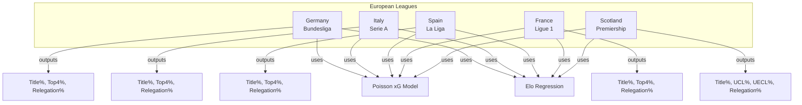
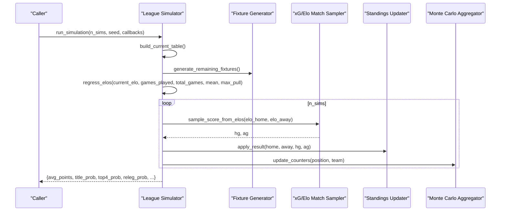
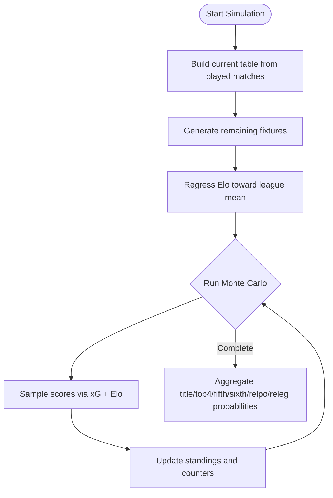
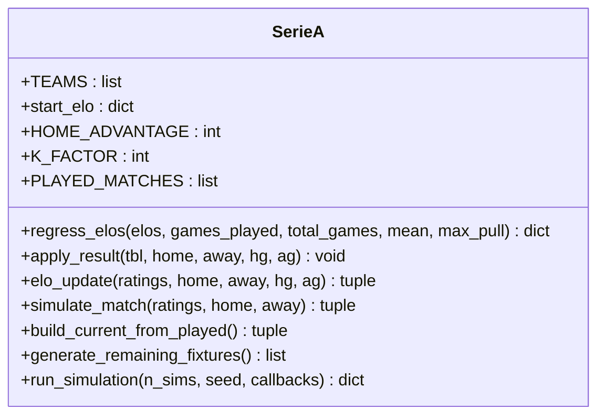
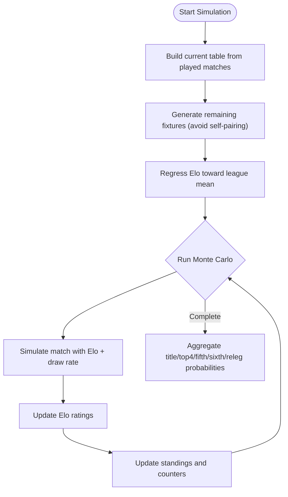
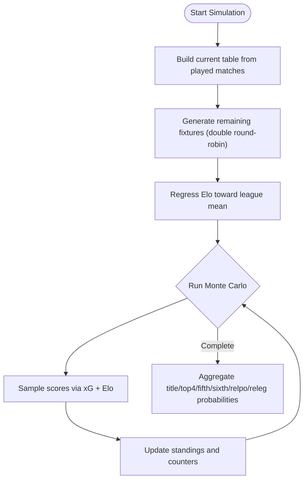
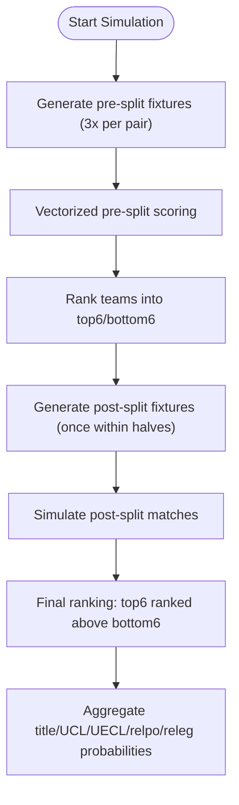
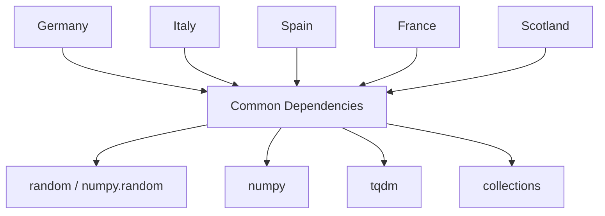

# European Leagues Simulators

<cite>
**Referenced Files in This Document**
- [germany.py](file://european_leagues/germany.py)
- [italy.py](file://european_leagues/italy.py)
- [spain.py](file://european_leagues/spain.py)
- [france.py](file://european_leagues/france.py)
- [Scotland.py](file://european_leagues/Scotland.py)
- [laliga_simulation_results.html](file://european_leagues/htmls/laliga_simulation_results.html)
</cite>

## Table of Contents
1. [Introduction](#introduction)
2. [Project Structure](#project-structure)
3. [Core Components](#core-components)
4. [Architecture Overview](#architecture-overview)
5. [Detailed Component Analysis](#detailed-component-analysis)
6. [Dependency Analysis](#dependency-analysis)
7. [Performance Considerations](#performance-considerations)
8. [Troubleshooting Guide](#troubleshooting-guide)
9. [Conclusion](#conclusion)
10. [Appendices](#appendices)

## Introduction
This document explains the individual European league simulators and their shared modeling approach. Each module implements a Monte Carlo season simulator that:
- Starts from current team strengths (Elo-based),
- Uses expected goals (xG) to simulate match scores,
- Applies league-specific fixture generation and rules,
- Aggregates probabilities for titles, European qualification, and relegation.

The common framework includes:
- Elo regression toward the league mean as the season progresses,
- Poisson-distributed goal counts parameterized by home advantage and Elo differences,
- A consistent Monte Carlo loop with progress callbacks and snapshot support,
- League-specific outputs such as title probability, top-four probability, Europa/Conference League chances, and relegation risk.

## Project Structure
The European leagues are implemented as separate modules under a single package. Each file contains:
- Team lists and initial/current Elo ratings,
- Historical results used to build the current table,
- Fixture generation logic tailored to the league format,
- Match simulation using xG and Elo,
- Monte Carlo aggregation and result reporting.

**Diagram sources**
- [germany.py:24-36](file://european_leagues/germany.py#L24-L36)
- [italy.py:27-36](file://european_leagues/italy.py#L27-L36)
- [spain.py:42-48](file://european_leagues/spain.py#L42-L48)
- [france.py:19-30](file://european_leagues/france.py#L19-L30)
- [Scotland.py:22-33](file://european_leagues/Scotland.py#L22-L33)

**Section sources**
- [germany.py:1-385](file://european_leagues/germany.py#L1-L385)
- [italy.py:1-339](file://european_leagues/italy.py#L1-L339)
- [spain.py:1-483](file://european_leagues/spain.py#L1-L483)
- [france.py:1-370](file://european_leagues/france.py#L1-L370)
- [Scotland.py:1-414](file://european_leagues/Scotland.py#L1-L414)

## Core Components
Across all leagues, the following components are consistently present:
- Team definitions and Elo ratings,
- Current table built from played matches,
- Fixture generator producing remaining matches,
- Match score sampler using xG and Elo,
- Result updater applying points and goal stats,
- Monte Carlo engine aggregating outcomes,
- Probability outputs for key milestones.

Key shared patterns:
- Elo regression function reduces reliance on early-season noise by pulling ratings toward the league average over time.
- xG model uses Poisson distributions with parameters derived from home advantage and Elo difference.
- Monte Carlo loop supports seeding, progress callbacks, and periodic snapshots for dashboards.

**Section sources**
- [germany.py:39-55](file://european_leagues/germany.py#L39-L55)
- [germany.py:160-166](file://european_leagues/germany.py#L160-L166)
- [germany.py:247-327](file://european_leagues/germany.py#L247-L327)
- [france.py:33-38](file://european_leagues/france.py#L33-L38)
- [france.py:155-161](file://european_leagues/france.py#L155-L161)
- [france.py:242-314](file://european_leagues/france.py#L242-L314)
- [Scotland.py:36-41](file://european_leagues/Scotland.py#L36-L41)
- [Scotland.py:119-125](file://european_leagues/Scotland.py#L119-L125)
- [Scotland.py:296-356](file://european_leagues/Scotland.py#L296-L356)

## Architecture Overview
Each league simulator follows this sequence:
1. Build current table from historical results.
2. Generate remaining fixtures according to league rules.
3. Regress Elo ratings toward the league mean based on games played.
4. For each Monte Carlo iteration:
   - Sample match scores via xG and Elo.
   - Update standings and track milestone counters.
5. Aggregate probabilities for title, European spots, and relegation.

**Diagram sources**
- [germany.py:194-223](file://european_leagues/germany.py#L194-L223)
- [germany.py:228-242](file://european_leagues/germany.py#L228-L242)
- [germany.py:247-327](file://european_leagues/germany.py#L247-L327)
- [france.py:189-218](file://european_leagues/france.py#L189-L218)
- [france.py:223-237](file://european_leagues/france.py#L223-L237)
- [france.py:242-314](file://european_leagues/france.py#L242-L314)
- [Scotland.py:130-179](file://european_leagues/Scotland.py#L130-L179)
- [Scotland.py:184-263](file://european_leagues/Scotland.py#L184-L263)
- [Scotland.py:296-356](file://european_leagues/Scotland.py#L296-L356)

## Detailed Component Analysis

### Bundesliga (Germany)
Unique characteristics:
- 18 teams, double round-robin, no split phase.
- Promotion/relegation system tracked:
  - Title probability (1st place).
  - Top-4 probability (UEFA Champions League places).
  - 5th place (UEFA Europa League).
  - 6th place (UEFA Conference League).
  - Relegation play-off (16th place).
  - Automatic relegation (17th–18th).

Implementation highlights:
- Heavy Elo regression at season start, loosening linearly as games accumulate.
- xG model uses Poisson sampling capped at a maximum number of goals.
- Fixed set of actual results for matchdays 1–6; remaining fixtures generated deterministically then shuffled.

**Diagram sources**
- [germany.py:194-223](file://european_leagues/germany.py#L194-L223)
- [germany.py:228-242](file://european_leagues/germany.py#L228-L242)
- [germany.py:247-327](file://european_leagues/germany.py#L247-L327)

**Section sources**
- [germany.py:24-36](file://european_leagues/germany.py#L24-L36)
- [germany.py:63-84](file://european_leagues/germany.py#L63-L84)
- [germany.py:89-155](file://european_leagues/germany.py#L89-L155)
- [germany.py:160-166](file://european_leagues/germany.py#L160-L166)
- [germany.py:194-223](file://european_leagues/germany.py#L194-L223)
- [germany.py:228-242](file://european_leagues/germany.py#L228-L242)
- [germany.py:247-327](file://european_leagues/germany.py#L247-L327)
- [germany.py:332-385](file://european_leagues/germany.py#L332-L385)

### Serie A (Italy)
Unique characteristics:
- 20 teams, 38-game season per team.
- Tactical approaches reflected through Elo updates and draw-rate calibration.
- Tracks title, top-4, 5th, 6th, and relegation probabilities.

Implementation highlights:
- Elo rating updates after each simulated match with K-factor and margin multiplier.
- Draw rate computed from historical data influences outcome probabilities.
- Fixture generation accounts for teams with games in hand and fills rounds randomly.

**Diagram sources**
- [italy.py:13-28](file://european_leagues/italy.py#L13-L28)
- [italy.py:31-36](file://european_leagues/italy.py#L31-L36)
- [italy.py:41-110](file://european_leagues/italy.py#L41-L110)
- [italy.py:129-180](file://european_leagues/italy.py#L129-L180)
- [italy.py:182-201](file://european_leagues/italy.py#L182-L201)
- [italy.py:206-222](file://european_leagues/italy.py#L206-L222)
- [italy.py:227-256](file://european_leagues/italy.py#L227-L256)
- [italy.py:264-335](file://european_leagues/italy.py#L264-L335)

**Section sources**
- [italy.py:13-28](file://european_leagues/italy.py#L13-L28)
- [italy.py:41-110](file://european_leagues/italy.py#L41-L110)
- [italy.py:112-112](file://european_leagues/italy.py#L112-L112)
- [italy.py:129-180](file://european_leagues/italy.py#L129-L180)
- [italy.py:182-201](file://european_leagues/italy.py#L182-L201)
- [italy.py:206-222](file://european_leagues/italy.py#L206-L222)
- [italy.py:227-256](file://european_leagues/italy.py#L227-L256)
- [italy.py:264-335](file://european_leagues/italy.py#L264-L335)

### La Liga (Spain)
Unique characteristics:
- 18 teams, 38-game season per team.
- Technical style modeled via Elo-driven xG and calibrated draw rates.
- Tracks title, top-4, 5th, 6th, and relegation probabilities.

Implementation highlights:
- Separate start and current Elo dictionaries; current Elo reflects recent form.
- Draw rate computed from historical matches informs outcome probabilities.
- Fixture generation ensures each team reaches 38 games while avoiding self-pairing.

**Diagram sources**
- [spain.py:21-48](file://european_leagues/spain.py#L21-L48)
- [spain.py:62-150](file://european_leagues/spain.py#L62-L150)
- [spain.py:157-167](file://european_leagues/spain.py#L157-L167)
- [spain.py:169-189](file://european_leagues/spain.py#L169-L189)
- [spain.py:191-220](file://european_leagues/spain.py#L191-L220)
- [spain.py:222-241](file://european_leagues/spain.py#L222-L241)
- [spain.py:246-255](file://european_leagues/spain.py#L246-L255)
- [spain.py:260-294](file://european_leagues/spain.py#L260-L294)
- [spain.py:411-479](file://european_leagues/spain.py#L411-L479)

**Section sources**
- [spain.py:21-48](file://european_leagues/spain.py#L21-L48)
- [spain.py:62-150](file://european_leagues/spain.py#L62-L150)
- [spain.py:152-152](file://european_leagues/spain.py#L152-L152)
- [spain.py:169-189](file://european_leagues/spain.py#L169-L189)
- [spain.py:191-220](file://european_leagues/spain.py#L191-L220)
- [spain.py:222-241](file://european_leagues/spain.py#L222-L241)
- [spain.py:246-255](file://european_leagues/spain.py#L246-L255)
- [spain.py:260-294](file://european_leagues/spain.py#L260-L294)
- [spain.py:411-479](file://european_leagues/spain.py#L411-L479)

### Ligue 1 (France)
Unique characteristics:
- 18 teams, double round-robin, no split phase.
- Development focus reflected in balanced strength distribution and conservative xG parameters.
- Tracks title, top-4, 5th, 6th, relegation play-off, and automatic relegation probabilities.

Implementation highlights:
- xG model uses Poisson sampling capped at a maximum number of goals.
- Fixture generation preserves actual results and completes the double round-robin.
- Monte Carlo loop aggregates probabilities including title chance.

**Diagram sources**
- [france.py:19-30](file://european_leagues/france.py#L19-L30)
- [france.py:46-67](file://european_leagues/france.py#L46-L67)
- [france.py:73-150](file://european_leagues/france.py#L73-L150)
- [france.py:155-161](file://european_leagues/france.py#L155-L161)
- [france.py:189-218](file://european_leagues/france.py#L189-L218)
- [france.py:223-237](file://european_leagues/france.py#L223-L237)
- [france.py:242-314](file://european_leagues/france.py#L242-L314)

**Section sources**
- [france.py:19-30](file://european_leagues/france.py#L19-L30)
- [france.py:46-67](file://european_leagues/france.py#L46-L67)
- [france.py:73-150](file://european_leagues/france.py#L73-L150)
- [france.py:155-161](file://european_leagues/france.py#L155-L161)
- [france.py:189-218](file://european_leagues/france.py#L189-L218)
- [france.py:223-237](file://european_leagues/france.py#L223-L237)
- [france.py:242-314](file://european_leagues/france.py#L242-L314)
- [france.py:319-370](file://european_leagues/france.py#L319-L370)

### Scottish Premiership
Unique characteristics:
- 12 teams, split format: pre-split (each pair plays three times) and post-split (top six vs bottom six once).
- Competitive dynamics emphasize strong top-tier teams and tight mid-table battles.
- European qualification tracks:
  - 1st place: UEFA Champions League Play-off Round.
  - 2nd place: UEFA Champions League Second Qualifying Round.
  - 3rd and 4th places: UEFA Europa Conference League Second Qualifying Round.
  - 11th place: Relegation play-off.
  - 12th place: Automatic relegation.

Implementation highlights:
- Vectorized pre-split scoring using NumPy arrays for performance.
- Post-split fixtures generated based on pre-split rankings and home balance.
- Tie-breaking uses small random perturbations to avoid deterministic ties.

**Diagram sources**
- [Scotland.py:49-54](file://european_leagues/Scotland.py#L49-L54)
- [Scotland.py:59-114](file://european_leagues/Scotland.py#L59-L114)
- [Scotland.py:130-179](file://european_leagues/Scotland.py#L130-L179)
- [Scotland.py:184-263](file://european_leagues/Scotland.py#L184-L263)
- [Scotland.py:296-356](file://european_leagues/Scotland.py#L296-L356)

**Section sources**
- [Scotland.py:22-33](file://european_leagues/Scotland.py#L22-L33)
- [Scotland.py:49-54](file://european_leagues/Scotland.py#L49-L54)
- [Scotland.py:59-114](file://european_leagues/Scotland.py#L59-L114)
- [Scotland.py:119-125](file://european_leagues/Scotland.py#L119-L125)
- [Scotland.py:130-179](file://european_leagues/Scotland.py#L130-L179)
- [Scotland.py:184-263](file://european_leagues/Scotland.py#L184-L263)
- [Scotland.py:296-356](file://european_leagues/Scotland.py#L296-L356)
- [Scotland.py:361-414](file://european_leagues/Scotland.py#L361-L414)

## Dependency Analysis
Common dependencies across modules:
- Random number generators for reproducibility and seeding.
- NumPy for efficient array operations (especially in Scotland’s vectorized pre-split).
- TQDM for progress bars during simulations.
- Collections utilities (defaultdict, Counter) for statistics aggregation.

Module coupling:
- Each league module is independent and does not import others.
- Shared conceptual components (Elo regression, xG sampling, Monte Carlo) are implemented per module rather than centralized.

External integration points:
- Dashboard HTML output exists for La Liga results, indicating potential web visualization integration.

**Diagram sources**
- [germany.py:12-17](file://european_leagues/germany.py#L12-L17)
- [italy.py:1-6](file://european_leagues/italy.py#L1-L6)
- [spain.py:1-6](file://european_leagues/spain.py#L1-L6)
- [france.py:7-12](file://european_leagues/france.py#L7-L12)
- [Scotland.py:13-18](file://european_leagues/Scotland.py#L13-L18)

**Section sources**
- [germany.py:12-17](file://european_leagues/germany.py#L12-L17)
- [italy.py:1-6](file://european_leagues/italy.py#L1-L6)
- [spain.py:1-6](file://european_leagues/spain.py#L1-L6)
- [france.py:7-12](file://european_leagues/france.py#L7-L12)
- [Scotland.py:13-18](file://european_leagues/Scotland.py#L13-L18)
- [laliga_simulation_results.html:1-259](file://european_leagues/htmls/laliga_simulation_results.html#L1-L259)

## Performance Considerations
- Vectorization: Scotland’s pre-split scoring uses NumPy arrays to process many matches efficiently.
- Goal capping: All leagues cap simulated goals to prevent extreme outliers.
- Seeding: Deterministic seeds enable reproducible runs and faster debugging.
- Snapshot intervals: Progress callbacks and snapshot callbacks reduce overhead when integrating with dashboards.

[No sources needed since this section provides general guidance]

## Troubleshooting Guide
Common issues and resolutions:
- Non-reproducible results: Ensure seeds are set for both Python random and NumPy RNG where applicable.
- Fixture pairing errors: Some leagues explicitly avoid self-pairing or enforce home/away balance; verify fixture generation logic.
- Draw rate anomalies: If draws seem too frequent or rare, check historical draw rate computation and calibration.
- Progress interruptions: Use is_running callback to gracefully stop long-running simulations.

**Section sources**
- [germany.py:247-252](file://european_leagues/germany.py#L247-L252)
- [france.py:242-247](file://european_leagues/france.py#L242-L247)
- [Scotland.py:296-300](file://european_leagues/Scotland.py#L296-L300)
- [spain.py:260-294](file://european_leagues/spain.py#L260-L294)

## Conclusion
The European leagues simulators share a robust architectural pattern centered on Elo regression, xG-based match simulation, and Monte Carlo aggregation. League-specific adaptations include:
- Bundesliga’s promotion/relegation thresholds and fixed fixture structure.
- Serie A’s tactical modeling through Elo updates and draw-rate calibration.
- La Liga’s technical style reflected in Elo-driven xG and draw rates.
- Ligue 1’s development focus with balanced strength distributions.
- Scottish Premiership’s split format and competitive dynamics.

These models provide actionable probabilities for titles, European qualification, and relegation, enabling informed analysis and decision-making.

[No sources needed since this section summarizes without analyzing specific files]

## Appendices

### Running Simulations and Interpreting Results
- Germany: Call run_simulation to obtain title, top-4, fifth, sixth, relegation play-off, and automatic relegation probabilities.
- Italy: Call run_simulation to obtain title, top-4, fifth, sixth, and relegation probabilities.
- Spain: Call run_simulation to obtain title, top-4, fifth, sixth, and relegation probabilities.
- France: Call run_simulation to obtain title, top-4, fifth, sixth, relegation play-off, and automatic relegation probabilities.
- Scotland: Call run_simulation to obtain title, UCL, UECL, relegation play-off, and automatic relegation probabilities.

Example interpretation:
- Title% indicates the percentage of simulations where a team finishes first.
- Top4%/UCL% indicates qualification chances for UEFA Champions League.
- Fifth%/Sixth%/UECL% indicates chances for Europa League or Conference League.
- Releg% indicates the likelihood of automatic relegation; RelPO% indicates relegation play-off chances.

**Section sources**
- [germany.py:315-327](file://european_leagues/germany.py#L315-L327)
- [italy.py:326-335](file://european_leagues/italy.py#L326-L335)
- [spain.py:469-479](file://european_leagues/spain.py#L469-L479)
- [france.py:302-314](file://european_leagues/france.py#L302-L314)
- [Scotland.py:345-356](file://european_leagues/Scotland.py#L345-L356)