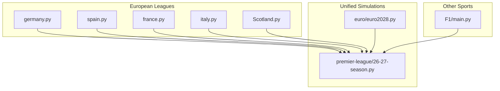
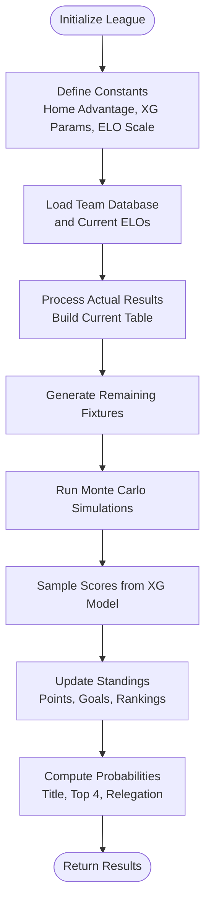
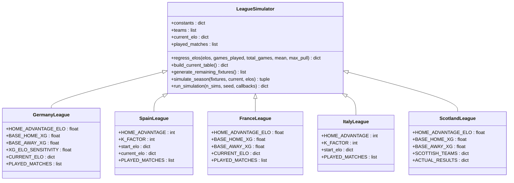
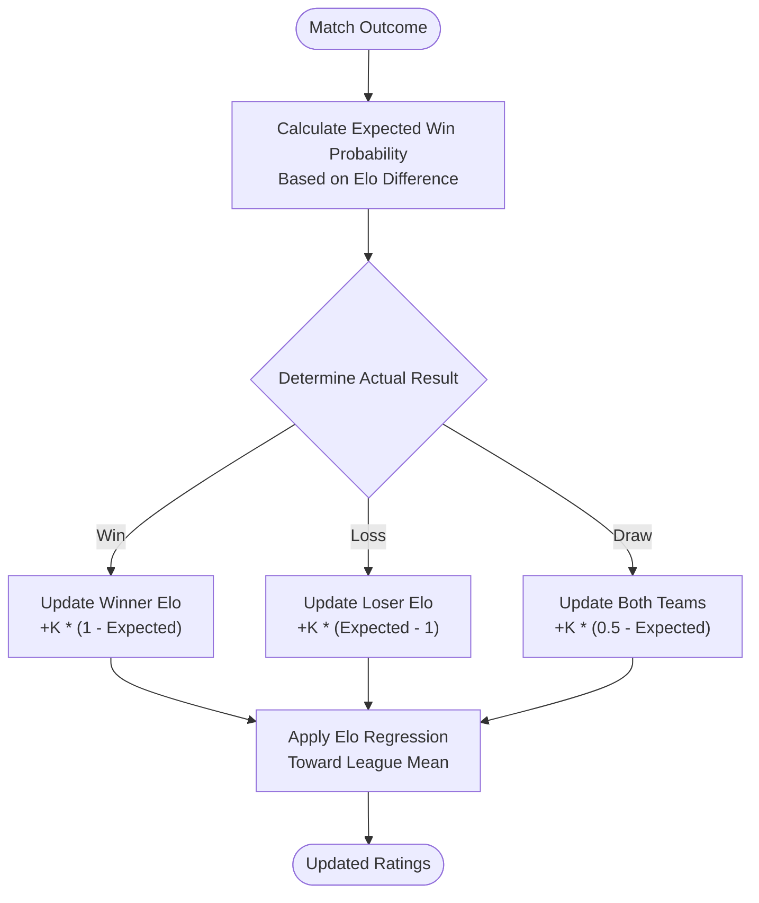
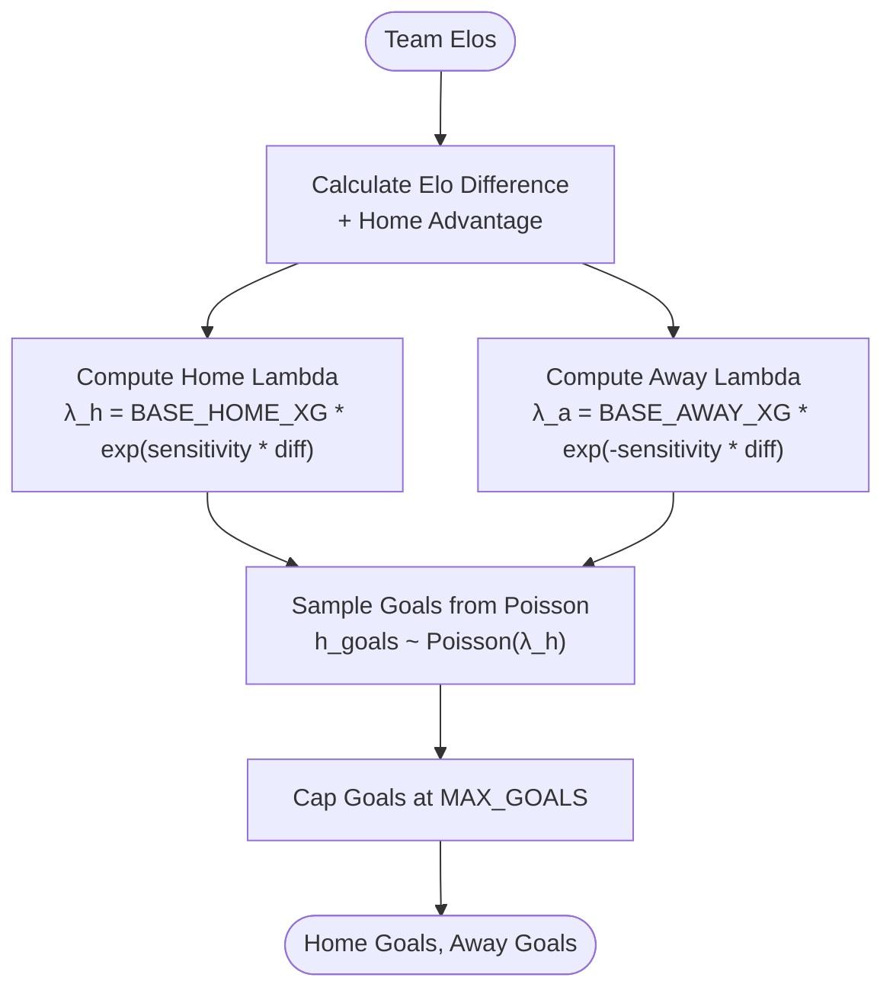
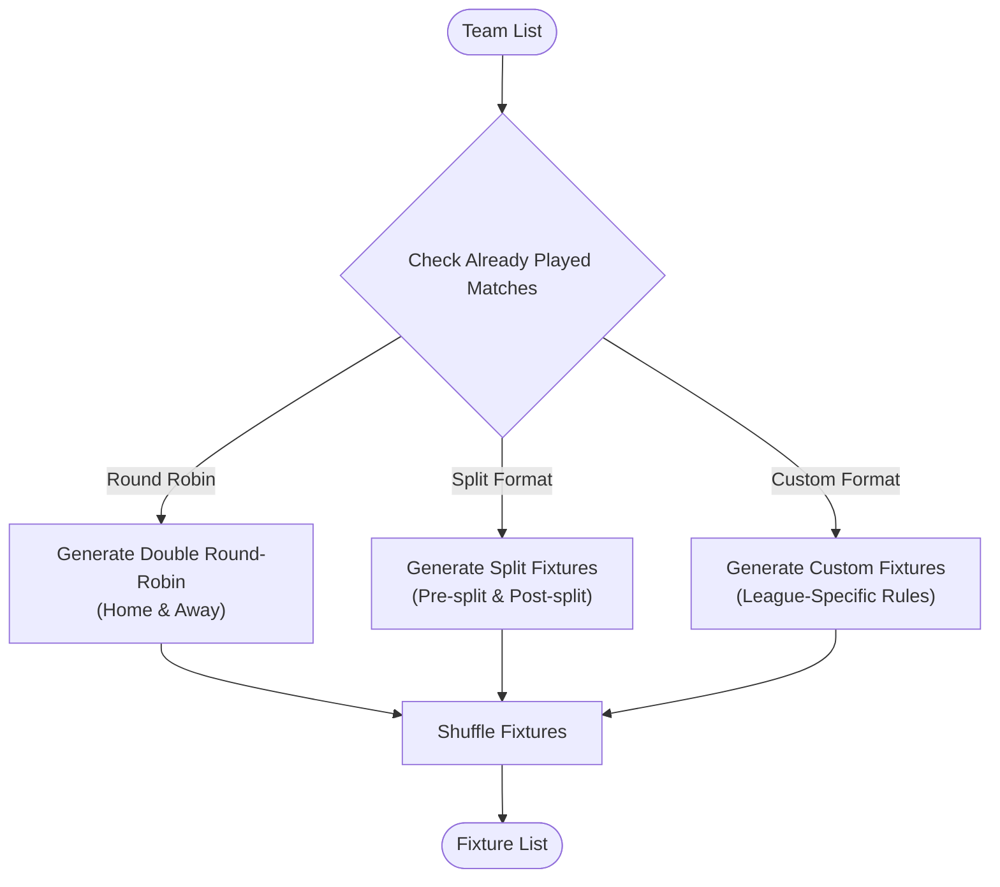
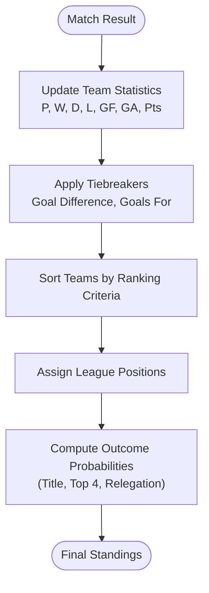
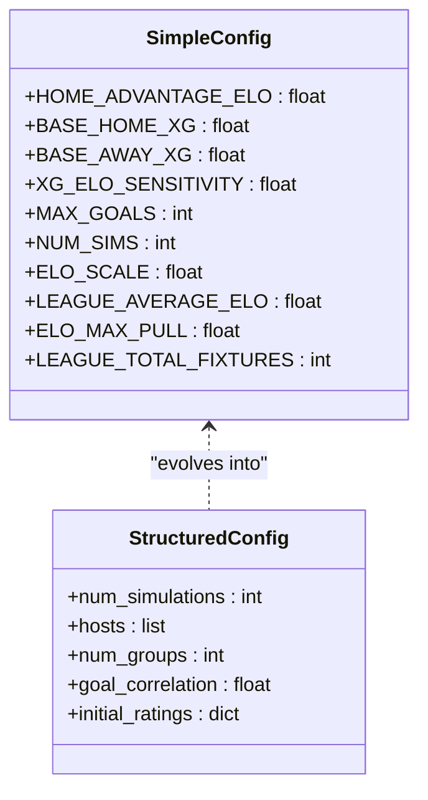
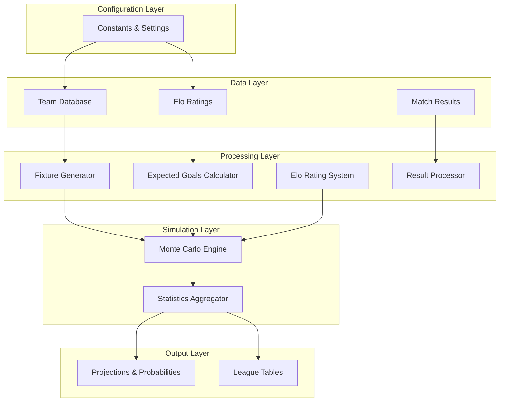

# League Architecture Patterns

<cite>
**Referenced Files in This Document**
- [germany.py](file://european_leagues/germany.py)
- [spain.py](file://european_leagues/spain.py)
- [france.py](file://european_leagues/france.py)
- [italy.py](file://european_leagues/italy.py)
- [Scotland.py](file://european_leagues/Scotland.py)
- [26-27-season.py](file://premier-league/26-27-season.py)
- [euro2028.py](file://euro/euro2028.py)
- [main.py](file://F1/main.py)
</cite>

## Table of Contents
1. [Introduction](#introduction)
2. [Project Structure](#project-structure)
3. [Core Components](#core-components)
4. [Architecture Overview](#architecture-overview)
5. [Detailed Component Analysis](#detailed-component-analysis)
6. [Dependency Analysis](#dependency-analysis)
7. [Performance Considerations](#performance-considerations)
8. [Troubleshooting Guide](#troubleshooting-guide)
9. [Conclusion](#conclusion)
10. [Appendices](#appendices)

## Introduction
This document explains the common architectural patterns shared across league simulators in this repository. It focuses on:
- The template method pattern used to standardize simulation workflows
- Standardized interfaces for league-specific implementations
- Modular design enabling easy addition of new leagues
- Core components: Elo rating systems, expected goals (xG) calculations, fixture generation algorithms, and result processing pipelines
- Configuration schema for league parameters, team databases, and competition rules
- Extension points for adding new leagues, customizing statistical models, and integrating external data sources
- Practical guidance and code example paths for implementing a new league simulator following established patterns

The goal is to make these patterns accessible to both technical and non-technical readers while providing precise references to source files.

## Project Structure
The repository organizes league simulators by sport or competition domain. For football leagues, the most relevant modules are under:
- european_leagues: Standalone league simulators (Germany, Spain, France, Italy, Scotland)
- premier-league: A unified Premier League + European competitions simulator with advanced features
- euro: Euro tournament simulation with explicit configuration system
- F1: Formula 1 simulation demonstrating broader Monte Carlo and performance modeling patterns

**Diagram sources**
- [germany.py:1-385](file://european_leagues/germany.py#L1-L385)
- [spain.py:1-483](file://european_leagues/spain.py#L1-L483)
- [france.py:1-370](file://european_leagues/france.py#L1-L370)
- [italy.py:1-339](file://european_leagues/italy.py#L1-L339)
- [Scotland.py:1-414](file://european_leagues/Scotland.py#L1-L414)
- [26-27-season.py:1-200](file://premier-league/26-27-season.py#L1-L200)
- [euro2028.py:1-120](file://euro/euro2028.py#L1-L120)
- [main.py:36-84](file://F1/main.py#L36-L84)

**Section sources**
- [germany.py:1-385](file://european_leagues/germany.py#L1-L385)
- [spain.py:1-483](file://european_leagues/spain.py#L1-L483)
- [france.py:1-370](file://european_leagues/france.py#L1-L370)
- [italy.py:1-339](file://european_leagues/italy.py#L1-L339)
- [Scotland.py:1-414](file://european_leagues/Scotland.py#L1-L414)
- [26-27-season.py:1-200](file://premier-league/26-27-season.py#L1-L200)
- [euro2028.py:1-120](file://euro/euro2028.py#L1-L120)
- [main.py:36-84](file://F1/main.py#L36-L84)

## Core Components
Across all league simulators, the following core components appear consistently:
- Elo rating systems: Team strength estimation and updates based on match outcomes
- Expected goals (xG) calculations: Poisson-based scoring models parameterized by Elo differences and home advantage
- Fixture generation algorithms: Round-robin or league-specific scheduling logic
- Result processing pipelines: Point accumulation, tiebreakers, and ranking computation
- Monte Carlo simulation loops: Repeated runs to produce probabilistic projections

These components are implemented as functions and classes within each league module, often sharing similar signatures and behaviors despite league-specific variations.

**Section sources**
- [germany.py:39-55](file://european_leagues/germany.py#L39-L55)
- [spain.py:51-56](file://european_leagues/spain.py#L51-L56)
- [france.py:33-38](file://european_leagues/france.py#L33-L38)
- [italy.py:31-36](file://european_leagues/italy.py#L31-L36)
- [Scotland.py:36-41](file://european_leagues/Scotland.py#L36-L41)
- [26-27-season.py:127-141](file://premier-league/26-27-season.py#L127-L141)
- [euro2028.py:13-42](file://euro/euro2028.py#L13-L42)

## Architecture Overview
The architecture follows a template method pattern where each league simulator implements a standardized workflow:
1. Define league constants (home advantage, xG parameters, ELO scale)
2. Initialize team database and current ELO ratings
3. Process actual results to build current table state
4. Generate remaining fixtures using league-specific algorithms
5. Run Monte Carlo simulations with score sampling from xG models
6. Update standings and compute probabilities for key outcomes

**Diagram sources**
- [germany.py:228-327](file://european_leagues/germany.py#L228-L327)
- [spain.py:411-479](file://european_leagues/spain.py#L411-L479)
- [france.py:242-314](file://european_leagues/france.py#L242-L314)
- [italy.py:264-335](file://european_leagues/italy.py#L264-L335)
- [Scotland.py:184-242](file://european_leagues/Scotland.py#L184-L242)

**Section sources**
- [germany.py:228-327](file://european_leagues/germany.py#L228-L327)
- [spain.py:411-479](file://european_leagues/spain.py#L411-L479)
- [france.py:242-314](file://european_leagues/france.py#L242-L314)
- [italy.py:264-335](file://european_leagues/italy.py#L264-L335)
- [Scotland.py:184-242](file://european_leagues/Scotland.py#L184-L242)

## Detailed Component Analysis

### Template Method Pattern Implementation
Each league simulator implements a consistent template method pattern through standardized function signatures and workflow steps:

**Diagram sources**
- [germany.py:21-84](file://european_leagues/germany.py#L21-L84)
- [spain.py:10-48](file://european_leagues/spain.py#L10-L48)
- [france.py:16-67](file://european_leagues/france.py#L16-L67)
- [italy.py:10-27](file://european_leagues/italy.py#L10-L27)
- [Scotland.py:22-54](file://european_leagues/Scotland.py#L22-L54)

**Section sources**
- [germany.py:21-84](file://european_leagues/germany.py#L21-L84)
- [spain.py:10-48](file://european_leagues/spain.py#L10-L48)
- [france.py:16-67](file://european_leagues/france.py#L16-L67)
- [italy.py:10-27](file://european_leagues/italy.py#L10-L27)
- [Scotland.py:22-54](file://european_leagues/Scotland.py#L22-L54)

### Elo Rating Systems
The Elo rating systems vary slightly between leagues but follow common principles:

**Diagram sources**
- [spain.py:191-220](file://european_leagues/spain.py#L191-L220)
- [italy.py:151-180](file://european_leagues/italy.py#L151-L180)
- [germany.py:39-55](file://european_leagues/germany.py#L39-L55)

**Section sources**
- [spain.py:191-220](file://european_leagues/spain.py#L191-L220)
- [italy.py:151-180](file://european_leagues/italy.py#L151-L180)
- [germany.py:39-55](file://european_leagues/germany.py#L39-L55)

### Expected Goals Calculations
Expected goals are calculated using Poisson distributions parameterized by Elo differences and home advantage:

**Diagram sources**
- [germany.py:160-166](file://european_leagues/germany.py#L160-L166)
- [france.py:155-161](file://european_leagues/france.py#L155-L161)
- [Scotland.py:119-125](file://european_leagues/Scotland.py#L119-L125)
- [26-27-season.py:132-141](file://premier-league/26-27-season.py#L132-L141)

**Section sources**
- [germany.py:160-166](file://european_leagues/germany.py#L160-L166)
- [france.py:155-161](file://european_leagues/france.py#L155-L161)
- [Scotland.py:119-125](file://european_leagues/Scotland.py#L119-L125)
- [26-27-season.py:132-141](file://premier-league/26-27-season.py#L132-L141)

### Fixture Generation Algorithms
Fixture generation varies by league format but follows common patterns:

**Diagram sources**
- [germany.py:206-223](file://european_leagues/germany.py#L206-L223)
- [france.py:201-218](file://european_leagues/france.py#L201-L218)
- [Scotland.py:130-179](file://european_leagues/Scotland.py#L130-L179)
- [italy.py:227-256](file://european_leagues/italy.py#L227-L256)

**Section sources**
- [germany.py:206-223](file://european_leagues/germany.py#L206-L223)
- [france.py:201-218](file://european_leagues/france.py#L201-L218)
- [Scotland.py:130-179](file://european_leagues/Scotland.py#L130-L179)
- [italy.py:227-256](file://european_leagues/italy.py#L227-L256)

### Result Processing Pipelines
Result processing involves updating team statistics and computing rankings:

**Diagram sources**
- [germany.py:169-189](file://european_leagues/germany.py#L169-L189)
- [spain.py:169-189](file://european_leagues/spain.py#L169-L189)
- [france.py:164-184](file://european_leagues/france.py#L164-L184)
- [italy.py:129-149](file://european_leagues/italy.py#L129-L149)

**Section sources**
- [germany.py:169-189](file://european_leagues/germany.py#L169-L189)
- [spain.py:169-189](file://european_leagues/spain.py#L169-L189)
- [france.py:164-184](file://european_leagues/france.py#L164-L184)
- [italy.py:129-149](file://european_leagues/italy.py#L129-L149)

### Configuration Schema
The configuration system varies between simple constant definitions and structured configuration objects:

**Diagram sources**
- [germany.py:21-36](file://european_leagues/germany.py#L21-L36)
- [france.py:16-30](file://european_leagues/france.py#L16-L30)
- [euro2028.py:13-42](file://euro/euro2028.py#L13-L42)

**Section sources**
- [germany.py:21-36](file://european_leagues/germany.py#L21-L36)
- [france.py:16-30](file://european_leagues/france.py#L16-L30)
- [euro2028.py:13-42](file://euro/euro2028.py#L13-L42)

## Dependency Analysis
The dependencies between components show clear separation of concerns:

**Diagram sources**
- [germany.py:228-327](file://european_leagues/germany.py#L228-L327)
- [26-27-season.py:98-141](file://premier-league/26-27-season.py#L98-L141)
- [euro2028.py:13-42](file://euro/euro2028.py#L13-L42)

**Section sources**
- [germany.py:228-327](file://european_leagues/germany.py#L228-L327)
- [26-27-season.py:98-141](file://premier-league/26-27-season.py#L98-L141)
- [euro2028.py:13-42](file://euro/euro2028.py#L13-L42)

## Performance Considerations
Key performance considerations across league simulators include:
- Vectorized operations using NumPy for large-scale computations
- Efficient random number generation with seeded RNG instances
- Progress tracking and callback mechanisms for long-running simulations
- Memory optimization through careful data structure management
- Parallelization opportunities for independent simulation runs

**Section sources**
- [germany.py:276-313](file://european_leagues/germany.py#L276-L313)
- [spain.py:426-467](file://european_leagues/spain.py#L426-L467)
- [france.py:265-300](file://european_leagues/france.py#L265-L300)
- [26-27-season.py:98-122](file://premier-league/26-27-season.py#L98-L122)

## Troubleshooting Guide
Common issues and their solutions:
- **Seed reproducibility**: Ensure consistent random number generation across simulations
- **Elo convergence**: Monitor Elo regression parameters to prevent overfitting
- **Fixture validity**: Validate that generated fixtures meet league constraints
- **Performance bottlenecks**: Profile simulation loops and optimize hot paths
- **Memory usage**: Monitor memory consumption during large-scale simulations

**Section sources**
- [germany.py:247-252](file://european_leagues/germany.py#L247-L252)
- [spain.py:411-418](file://european_leagues/spain.py#L411-L418)
- [france.py:242-247](file://european_leagues/france.py#L242-L247)

## Conclusion
The league simulators in this repository demonstrate a well-architected approach to sports simulation through:
- Consistent template method patterns that standardize implementation
- Modular design enabling easy extension and customization
- Robust statistical models combining Elo ratings with expected goals
- Flexible configuration systems supporting diverse league formats
- Comprehensive Monte Carlo simulation frameworks

These patterns provide a solid foundation for adding new leagues and customizing existing ones while maintaining code quality and performance.

## Appendices

### Example: Implementing a New League Simulator
To implement a new league simulator following established patterns:

1. **Define Constants**: Set up league-specific parameters including home advantage, xG parameters, and simulation settings
2. **Initialize Data Structures**: Create team database, current Elo ratings, and actual results
3. **Implement Core Functions**: 
   - `regress_elos()` for Elo regression toward league mean
   - `sample_score_from_elos()` for score generation
   - `apply_result()` for result processing
   - `build_current_table()` for initial table construction
   - `generate_remaining_fixtures()` for fixture generation
   - `simulate_season()` for single season simulation
   - `run_simulation()` for Monte Carlo engine

**Code Example Paths:**
- [germany.py:39-55](file://european_leagues/germany.py#L39-L55) - Elo regression implementation
- [germany.py:160-166](file://european_leagues/germany.py#L160-L166) - Score sampling from Elos
- [germany.py:169-189](file://european_leagues/germany.py#L169-L189) - Result application
- [germany.py:206-223](file://european_leagues/germany.py#L206-L223) - Fixture generation
- [germany.py:228-242](file://european_leagues/germany.py#L228-L242) - Season simulation
- [germany.py:247-327](file://european_leagues/germany.py#L247-L327) - Monte Carlo simulation

**Section sources**
- [germany.py:39-55](file://european_leagues/germany.py#L39-L55)
- [germany.py:160-166](file://european_leagues/germany.py#L160-L166)
- [germany.py:169-189](file://european_leagues/germany.py#L169-L189)
- [germany.py:206-223](file://european_leagues/germany.py#L206-L223)
- [germany.py:228-242](file://european_leagues/germany.py#L228-L242)
- [germany.py:247-327](file://european_leagues/germany.py#L247-L327)