# League Simulators

<cite>
**Referenced Files in This Document**
- [26-27-season.py](file://premier-league/26-27-season.py)
- [germany.py](file://european_leagues/germany.py)
- [italy.py](file://european_leagues/italy.py)
- [spain.py](file://european_leagues/spain.py)
- [france.py](file://european_leagues/france.py)
- [Scotland.py](file://european_leagues/Scotland.py)
- [champions_league.py](file://uefa/champions_league.py)
- [europa_league.py](file://uefa/europa_league.py)
- [conference_league.py](file://uefa/conference_league.py)
</cite>

## Table of Contents
1. [Introduction](#introduction)
2. [Project Structure](#project-structure)
3. [Core Components](#core-components)
4. [Architecture Overview](#architecture-overview)
5. [Detailed Component Analysis](#detailed-component-analysis)
6. [Dependency Analysis](#dependency-analysis)
7. [Performance Considerations](#performance-considerations)
8. [Troubleshooting Guide](#troubleshooting-guide)
9. [Conclusion](#conclusion)
10. [Appendices](#appendices)

## Introduction
This document explains the league simulation modules across the repository, focusing on:
- The consistent architecture pattern used by all league simulators
- League-specific rules, fixtures, and qualification pathways
- The Premier League simulator’s integration with Champions League, Europa League, and Conference League
- European league simulators for Bundesliga, Serie A, La Liga, Ligue 1, and Scottish Premiership
- Data sources, team strength modeling, fixture generation, historical result handling, configuration parameters, and extension points for adding new leagues

The goal is to make these systems understandable for both technical readers who may extend them and non-technical readers who want to understand how probabilities are produced.

## Project Structure
The relevant code is organized into three main areas:
- Premier League unified simulation with European competitions and domestic cups
- Individual top-five European league simulators
- Standalone UEFA competition scripts

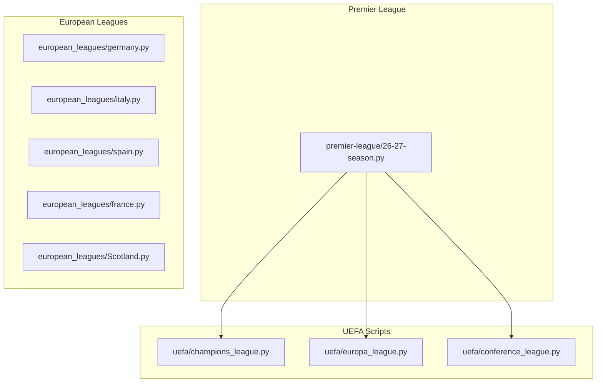

**Diagram sources**
- [26-27-season.py:1-800](file://premier-league/26-27-season.py#L1-L800)
- [germany.py:1-100](file://european_leagues/germany.py#L1-L100)
- [italy.py:1-120](file://european_leagues/italy.py#L1-L120)
- [spain.py:1-120](file://european_leagues/spain.py#L1-L120)
- [france.py:1-120](file://european_leagues/france.py#L1-L120)
- [Scotland.py:1-120](file://european_leagues/Scotland.py#L1-L120)
- [champions_league.py:1-117](file://uefa/champions_league.py#L1-L117)
- [europa_league.py:1-133](file://uefa/europa_league.py#L1-L133)
- [conference_league.py:1-140](file://uefa/conference_league.py#L1-L140)

**Section sources**
- [26-27-season.py:1-800](file://premier-league/26-27-season.py#L1-L800)
- [germany.py:1-100](file://european_leagues/germany.py#L1-L100)
- [italy.py:1-120](file://european_leagues/italy.py#L1-L120)
- [spain.py:1-120](file://european_leagues/spain.py#L1-L120)
- [france.py:1-120](file://european_leagues/france.py#L1-L120)
- [Scotland.py:1-120](file://european_leagues/Scotland.py#L1-L120)
- [champions_league.py:1-117](file://uefa/champions_league.py#L1-L117)
- [europa_league.py:1-133](file://uefa/europa_league.py#L1-L133)
- [conference_league.py:1-140](file://uefa/conference_league.py#L1-L140)

## Core Components
Across the simulators, the following components appear consistently:
- Team list and Elo-based strength model
- Historical results input
- Fixture generator for remaining matches
- Score sampler using expected goals or Poisson models
- Table builder and ranking logic
- Monte Carlo loop with progress callbacks and snapshot support
- Configuration constants for home advantage, Elo scale, maximum goals, number of simulations, and regression behavior

The Premier League module adds:
- Unified European competition simulation
- Fatigue effects from European fixtures
- Manager sack-risk modeling
- Carabao Cup and FA Cup simulation
- European spot allocation based on league position and cup winners

**Section sources**
- [germany.py:21-58](file://european_leagues/germany.py#L21-L58)
- [italy.py:10-37](file://european_leagues/italy.py#L10-L37)
- [spain.py:10-57](file://european_leagues/spain.py#L10-L57)
- [france.py:16-41](file://european_leagues/france.py#L16-L41)
- [Scotland.py:22-44](file://european_leagues/Scotland.py#L22-L44)
- [26-27-season.py:9-43](file://premier-league/26-27-season.py#L9-L43)

## Architecture Overview
All league simulators follow a common Monte Carlo pipeline:
1. Initialize teams and Elo ratings
2. Build current table from actual played matches
3. Generate remaining fixtures
4. For each simulation:
   - Sample scores per fixture
   - Update table and ratings
   - Rank teams
   - Accumulate probabilities for title, European spots, relegation
5. Return aggregated statistics

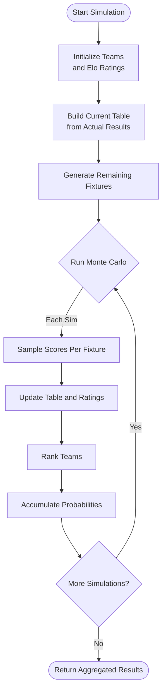

**Diagram sources**
- [germany.py:247-327](file://european_leagues/germany.py#L247-L327)
- [italy.py:264-335](file://european_leagues/italy.py#L264-L335)
- [spain.py:411-479](file://european_leagues/spain.py#L411-L479)
- [france.py:242-314](file://european_leagues/france.py#L242-L314)
- [Scotland.py:296-356](file://european_leagues/Scotland.py#L296-L356)

**Section sources**
- [germany.py:247-327](file://european_leagues/germany.py#L247-L327)
- [italy.py:264-335](file://european_leagues/italy.py#L264-L335)
- [spain.py:411-479](file://european_leagues/spain.py#L411-L479)
- [france.py:242-314](file://european_leagues/france.py#L242-L314)
- [Scotland.py:296-356](file://european_leagues/Scotland.py#L296-L356)

## Detailed Component Analysis

### Premier League Simulator
The Premier League simulator is the most complex component because it integrates:
- League simulation
- Champions League, Europa League, and Conference League
- Carabao Cup and FA Cup
- Manager sack risk
- European qualification spot allocation
- Association coefficient tracking

#### Key Classes and Functions
- `PLSimulator`: Optimized season simulation with fatigue support
- `EuropeanCompetition`: League phase and knockout simulation for UCL/UEL/UECL
- `allocate_european_spots`: Determines which teams qualify for Europe
- `compute_sack_risk`: Calculates manager dismissal risk
- `run_carabao_tournament` and `simulate_fa_cup`: Domestic cup simulations

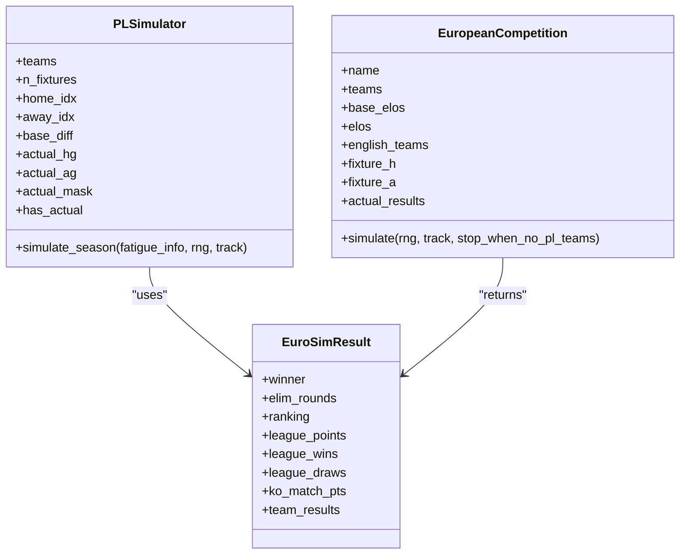

**Diagram sources**
- [26-27-season.py:1313-1440](file://premier-league/26-27-season.py#L1313-L1440)
- [26-27-season.py:884-1066](file://premier-league/26-27-season.py#L884-L1066)
- [26-27-season.py:868-882](file://premier-league/26-27-season.py#L868-L882)

#### European Qualification Pathways
The Premier League simulator determines European qualification as follows:
- Top four teams qualify for Champions League
- Winners of Champions League, Europa League, and Conference League can qualify via their competition win
- If a winner already qualifies through league position, the next eligible team moves up
- Europa League spot goes to the highest-ranked team not already in Champions League
- Conference League spot goes to the Carabao Cup winner if not already qualified; otherwise, the next eligible team
- FA Cup winner can also affect Europa League qualification

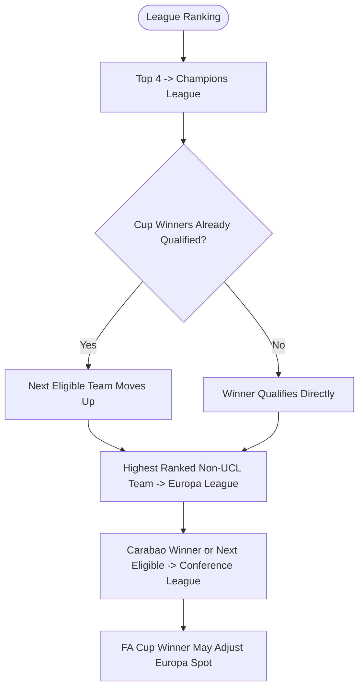

**Diagram sources**
- [26-27-season.py:1446-1488](file://premier-league/26-27-season.py#L1446-L1488)

#### Fatigue Integration
Teams participating in European competitions receive fatigue adjustments that reduce their expected goals in Premier League fixtures. The fatigue effect increases as the season progresses and depends on the stage reached in Europe.

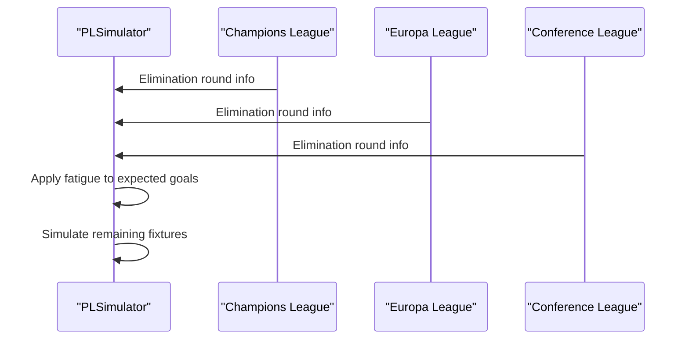

**Diagram sources**
- [26-27-season.py:2184-2194](file://premier-league/26-27-season.py#L2184-L2194)
- [26-27-season.py:1355-1440](file://premier-league/26-27-season.py#L1355-L1440)

#### Configuration Parameters
Key configurable parameters include:
- `HOME_ADVANTAGE_ELO`: Home field advantage in Elo terms
- `BASE_HOME_XG` and `BASE_AWAY_XG`: Base expected goals for home and away teams
- `XG_ELO_SENSITIVITY`: How much Elo differences affect expected goals
- `MAX_GOALS`: Maximum goals per team per match
- `NUM_PL_SIMS`: Number of Monte Carlo simulations
- `PL_TOTAL_FIXTURES`: Total fixtures in the league
- `PL_ELO_MAX_PULL`: Elo regression strength

**Section sources**
- [26-27-season.py:12-23](file://premier-league/26-27-season.py#L12-L23)
- [26-27-season.py:1313-1440](file://premier-league/26-27-season.py#L1313-L1440)
- [26-27-season.py:1446-1488](file://premier-league/26-27-season.py#L1446-L1488)
- [26-27-season.py:2184-2194](file://premier-league/26-27-season.py#L2184-L2194)

### Bundesliga Simulator
The Bundesliga simulator uses:
- 18 teams with double round-robin format
- Elo-based score sampling with heavy regression toward league mean at season start
- Actual results from matchdays 1–6
- Probability outputs for title, top four, fifth place, sixth place, relegation playoff, and automatic relegation

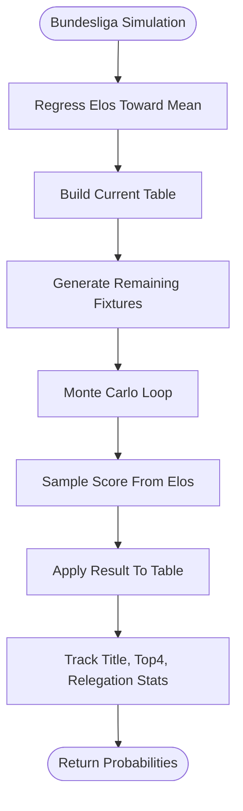

**Diagram sources**
- [germany.py:39-55](file://european_leagues/germany.py#L39-L55)
- [germany.py:194-223](file://european_leagues/germany.py#L194-L223)
- [germany.py:247-327](file://european_leagues/germany.py#L247-L327)

**Section sources**
- [germany.py:21-36](file://european_leagues/germany.py#L21-L36)
- [germany.py:63-84](file://european_leagues/germany.py#L63-L84)
- [germany.py:89-155](file://european_leagues/germany.py#L89-L155)
- [germany.py:160-189](file://european_leagues/germany.py#L160-L189)
- [germany.py:194-223](file://european_leagues/germany.py#L194-L223)
- [germany.py:247-327](file://european_leagues/germany.py#L247-L327)

### Serie A Simulator
The Serie A simulator uses:
- 20 teams with 38-game seasons
- Elo-based match simulation with draw rate estimation from actual results
- Dynamic Elo updates after each match
- Random fixture generation for remaining matches
- Probability outputs for title, top four, fifth place, sixth place, and relegation

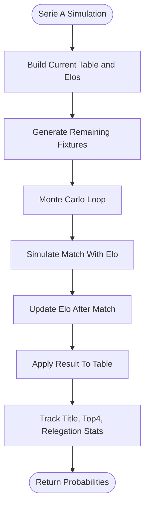

**Diagram sources**
- [italy.py:206-222](file://european_leagues/italy.py#L206-L222)
- [italy.py:227-256](file://european_leagues/italy.py#L227-L256)
- [italy.py:264-335](file://european_leagues/italy.py#L264-L335)

**Section sources**
- [italy.py:13-25](file://european_leagues/italy.py#L13-L25)
- [italy.py:41-112](file://european_leagues/italy.py#L41-L112)
- [italy.py:129-180](file://european_leagues/italy.py#L129-L180)
- [italy.py:182-201](file://european_leagues/italy.py#L182-L201)
- [italy.py:206-222](file://european_leagues/italy.py#L206-L222)
- [italy.py:227-256](file://european_leagues/italy.py#L227-L256)
- [italy.py:264-335](file://european_leagues/italy.py#L264-L335)

### La Liga Simulator
The La Liga simulator uses:
- 20 teams with 38-game seasons
- Elo-based match simulation with draw rate estimation
- Dynamic Elo updates after each match
- Random fixture generation ensuring each team plays 38 games
- Probability outputs for title, top four, fifth place, sixth place, and relegation

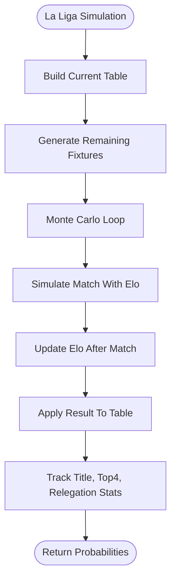

**Diagram sources**
- [spain.py:246-255](file://european_leagues/spain.py#L246-L255)
- [spain.py:260-294](file://european_leagues/spain.py#L260-L294)
- [spain.py:411-479](file://european_leagues/spain.py#L411-L479)

**Section sources**
- [spain.py:13-48](file://european_leagues/spain.py#L13-L48)
- [spain.py:62-150](file://european_leagues/spain.py#L62-L150)
- [spain.py:169-220](file://european_leagues/spain.py#L169-L220)
- [spain.py:222-241](file://european_leagues/spain.py#L222-L241)
- [spain.py:246-255](file://european_leagues/spain.py#L246-L255)
- [spain.py:260-294](file://european_leagues/spain.py#L260-L294)
- [spain.py:411-479](file://european_leagues/spain.py#L411-L479)

### Ligue 1 Simulator
The Ligue 1 simulator uses:
- 18 teams with double round-robin format
- Elo-based score sampling similar to Bundesliga
- Heavy regression toward league mean at season start
- Actual results from matchdays 1–7
- Probability outputs for title, top four, fifth place, sixth place, relegation playoff, and automatic relegation

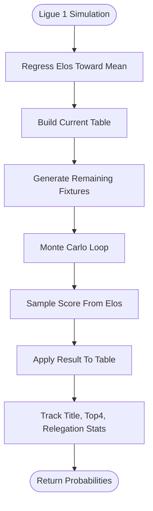

**Diagram sources**
- [france.py:33-38](file://european_leagues/france.py#L33-L38)
- [france.py:189-196](file://european_leagues/france.py#L189-L196)
- [france.py:201-218](file://european_leagues/france.py#L201-L218)
- [france.py:242-314](file://european_leagues/france.py#L242-L314)

**Section sources**
- [france.py:16-30](file://european_leagues/france.py#L16-L30)
- [france.py:46-67](file://european_leagues/france.py#L46-L67)
- [france.py:73-150](file://european_leagues/france.py#L73-L150)
- [france.py:155-184](file://european_leagues/france.py#L155-L184)
- [france.py:189-196](file://european_leagues/france.py#L189-L196)
- [france.py:201-218](file://european_leagues/france.py#L201-L218)
- [france.py:242-314](file://european_leagues/france.py#L242-L314)

### Scottish Premiership Simulator
The Scottish Premiership simulator uses:
- 12 teams with split format (pre-split and post-split)
- Three meetings between each pair in pre-split phase
- Post-split phase where top six and bottom six play separately
- European qualification for top two (Champions League) and third/fourth (Conference League)
- Relegation play-off for 11th place and automatic relegation for 12th place

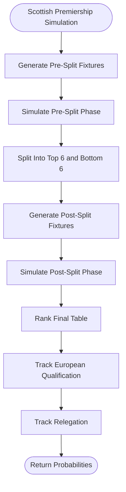

**Diagram sources**
- [Scotland.py:130-165](file://european_leagues/Scotland.py#L130-L165)
- [Scotland.py:168-179](file://european_leagues/Scotland.py#L168-L179)
- [Scotland.py:184-263](file://european_leagues/Scotland.py#L184-L263)
- [Scotland.py:296-356](file://european_leagues/Scotland.py#L296-L356)

**Section sources**
- [Scotland.py:22-33](file://european_leagues/Scotland.py#L22-L33)
- [Scotland.py:49-54](file://european_leagues/Scotland.py#L49-L54)
- [Scotland.py:59-114](file://european_leagues/Scotland.py#L59-L114)
- [Scotland.py:119-125](file://european_leagues/Scotland.py#L119-L125)
- [Scotland.py:130-165](file://european_leagues/Scotland.py#L130-L165)
- [Scotland.py:168-179](file://european_leagues/Scotland.py#L168-L179)
- [Scotland.py:184-263](file://european_leagues/Scotland.py#L184-L263)
- [Scotland.py:296-356](file://european_leagues/Scotland.py#L296-L356)

### UEFA Competition Scripts
The standalone UEFA scripts provide simplified simulations for:
- Champions League: Two-legged ties and final with penalty shootout
- Europa League: Two-legged ties with away goals rule and single-leg final
- Conference League: Mathematical puzzle solver rather than football simulation

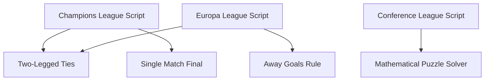

**Diagram sources**
- [champions_league.py:45-74](file://uefa/champions_league.py#L45-L74)
- [champions_league.py:77-90](file://uefa/champions_league.py#L77-L90)
- [europa_league.py:42-78](file://uefa/europa_league.py#L42-L78)
- [europa_league.py:81-94](file://uefa/europa_league.py#L81-L94)
- [conference_league.py:74-133](file://uefa/conference_league.py#L74-L133)

**Section sources**
- [champions_league.py:5-19](file://uefa/champions_league.py#L5-L19)
- [champions_league.py:22-43](file://uefa/champions_league.py#L22-L43)
- [champions_league.py:45-74](file://uefa/champions_league.py#L45-L74)
- [champions_league.py:77-90](file://uefa/champions_league.py#L77-L90)
- [champions_league.py:92-117](file://uefa/champions_league.py#L92-L117)
- [europa_league.py:5-12](file://uefa/europa_league.py#L5-L12)
- [europa_league.py:14-40](file://uefa/europa_league.py#L14-L40)
- [europa_league.py:42-78](file://uefa/europa_league.py#L42-L78)
- [europa_league.py:81-94](file://uefa/europa_league.py#L81-L94)
- [europa_league.py:96-133](file://uefa/europa_league.py#L96-L133)
- [conference_league.py:4-12](file://uefa/conference_league.py#L4-L12)
- [conference_league.py:74-133](file://uefa/conference_league.py#L74-L133)

## Dependency Analysis
The simulators have clear dependency patterns:
- All league simulators depend on random number generation and statistical libraries
- The Premier League simulator depends on European competition modules internally
- Standalone UEFA scripts are independent but use similar Elo and Poisson concepts
- European league simulators are mostly self-contained with minimal external dependencies

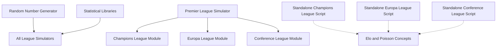

**Diagram sources**
- [germany.py:12-17](file://european_leagues/germany.py#L12-L17)
- [italy.py:1-6](file://european_leagues/italy.py#L1-L6)
- [spain.py:1-6](file://european_leagues/spain.py#L1-L6)
- [france.py:7-12](file://european_leagues/france.py#L7-L12)
- [Scotland.py:13-18](file://european_leagues/Scotland.py#L13-L18)
- [26-27-season.py:2-8](file://premier-league/26-27-season.py#L2-L8)

**Section sources**
- [germany.py:12-17](file://european_leagues/germany.py#L12-L17)
- [italy.py:1-6](file://european_leagues/italy.py#L1-L6)
- [spain.py:1-6](file://european_leagues/spain.py#L1-L6)
- [france.py:7-12](file://european_leagues/france.py#L7-L12)
- [Scotland.py:13-18](file://european_leagues/Scotland.py#L13-L18)
- [26-27-season.py:2-8](file://premier-league/26-27-season.py#L2-L8)

## Performance Considerations
Common performance characteristics across simulators:
- Monte Carlo simulations typically run 2,500 iterations
- Progress callbacks allow UI integration and real-time feedback
- Snapshot callbacks enable intermediate result collection
- Vectorized operations in some modules improve performance
- Random seed control ensures reproducibility

Optimization opportunities:
- Batch fixture processing where possible
- Use efficient data structures for large team sets
- Implement early stopping conditions
- Cache computed values like expected goals
- Parallelize independent simulations

[No sources needed since this section provides general guidance]

## Troubleshooting Guide
Common issues and solutions:
- **Seed inconsistencies**: Ensure consistent random seed usage across simulations
- **Fixture generation errors**: Verify that all teams play the correct number of matches
- **Elo convergence problems**: Check regression parameters and initial Elo values
- **Memory issues with large simulations**: Monitor memory usage and consider reducing simulation count
- **Progress callback failures**: Ensure callback functions handle edge cases properly

Debugging strategies:
- Print intermediate tables and rankings
- Validate fixture counts before simulation
- Test with small simulation counts first
- Use deterministic seeds for reproducible debugging

**Section sources**
- [germany.py:247-252](file://european_leagues/germany.py#L247-L252)
- [italy.py:264-268](file://european_leagues/italy.py#L264-L268)
- [spain.py:411-414](file://european_leagues/spain.py#L411-L414)
- [france.py:242-247](file://european_leagues/france.py#L242-L247)
- [Scotland.py:296-300](file://european_leagues/Scotland.py#L296-L300)

## Conclusion
The league simulators in this repository implement a consistent Monte Carlo architecture with league-specific adaptations. The Premier League simulator provides the most comprehensive integration with European competitions, while individual league simulators focus on their respective competition structures and qualification pathways. The system supports extensibility through well-defined interfaces and configuration parameters, making it suitable for adding new leagues and competitions.

Key strengths include:
- Consistent architecture across all simulators
- Flexible configuration parameters
- Progress and snapshot support for UI integration
- Comprehensive European qualification logic
- Realistic team strength modeling with Elo ratings

Areas for potential improvement:
- Standardizing fixture generation algorithms
- Enhancing error handling and validation
- Adding more detailed performance metrics
- Implementing better documentation for extension points

[No sources needed since this section summarizes without analyzing specific files]

## Appendices

### Configuration Reference
Common configuration parameters across simulators:

| Parameter | Description | Typical Value | Purpose |
|-----------|-------------|---------------|---------|
| HOME_ADVANTAGE_ELO | Home field advantage in Elo terms | 24-40 | Adjusts expected goals for home teams |
| BASE_HOME_XG | Base expected goals for home teams | 1.15-1.66 | Starting point for home team scoring |
| BASE_AWAY_XG | Base expected goals for away teams | 0.9-1.15 | Starting point for away team scoring |
| XG_ELO_SENSITIVITY | Elo impact on expected goals | 0.002 | Controls how Elo affects scoring |
| MAX_GOALS | Maximum goals per team per match | 10 | Prevents unrealistic high-scoring games |
| NUM_SIMS | Number of Monte Carlo simulations | 2500 | Balances accuracy vs performance |
| ELO_SCALE | Elo rating scale factor | 400.0 | Standard Elo calculation parameter |
| LEAGUE_AVERAGE_ELO | Average team strength baseline | 1500.0 | Reference point for team ratings |
| ELO_MAX_PULL | Strength of Elo regression | 1.0 | Controls how much ratings regress to mean |

**Section sources**
- [germany.py:24-36](file://european_leagues/germany.py#L24-L36)
- [france.py:19-30](file://european_leagues/france.py#L19-L30)
- [Scotland.py:22-33](file://european_leagues/Scotland.py#L22-L33)
- [26-27-season.py:12-23](file://premier-league/26-27-season.py#L12-L23)

### Extension Points for New Leagues
To add a new league simulator:
1. Define team list and initial Elo ratings
2. Implement fixture generation for the league structure
3. Add historical results input
4. Configure league-specific parameters
5. Implement Monte Carlo simulation loop
6. Add probability tracking for key outcomes
7. Integrate with dashboard if needed

Recommended interface pattern:
```python
def run_simulation(n_sims=DEFAULT_SIMS, seed=None, on_progress=None, 
                   is_running=None, snapshot_callback=None, snapshot_every=None):
    # Implementation following established patterns
    pass
```

**Section sources**
- [germany.py:247-327](file://european_leagues/germany.py#L247-L327)
- [italy.py:264-335](file://european_leagues/italy.py#L264-L335)
- [spain.py:411-479](file://european_leagues/spain.py#L411-L479)
- [france.py:242-314](file://european_leagues/france.py#L242-L314)
- [Scotland.py:296-356](file://european_leagues/Scotland.py#L296-L356)