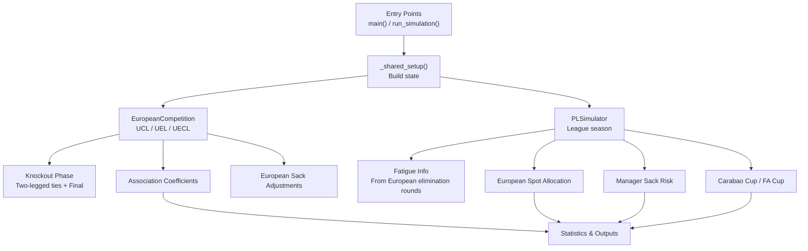
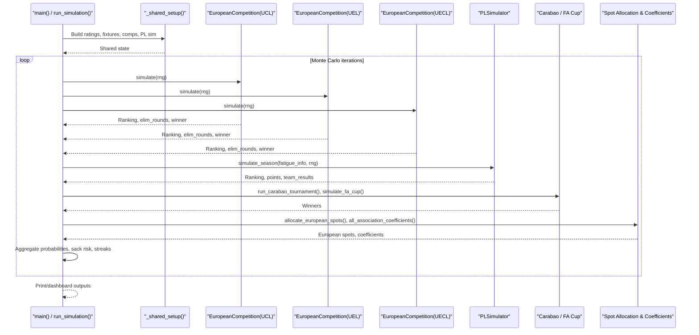
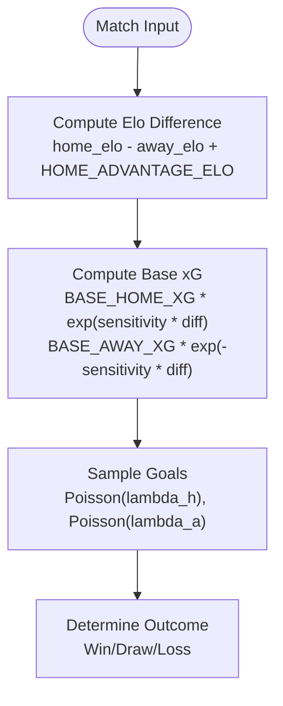
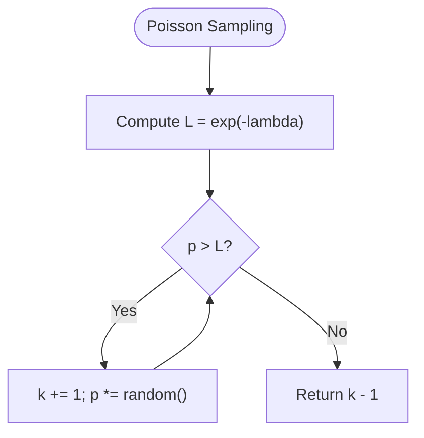
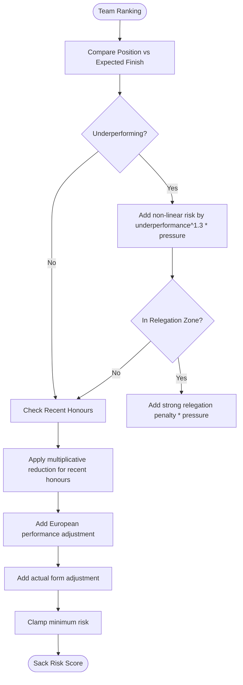
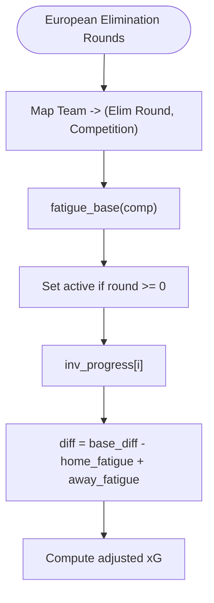
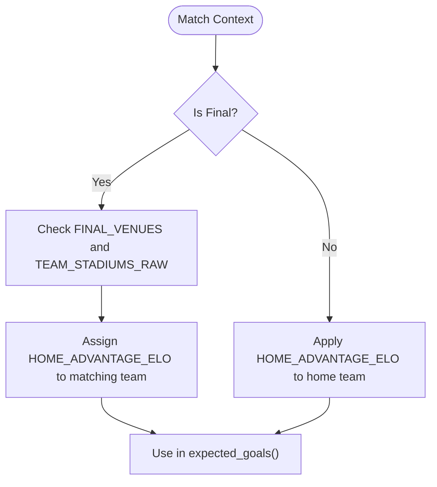
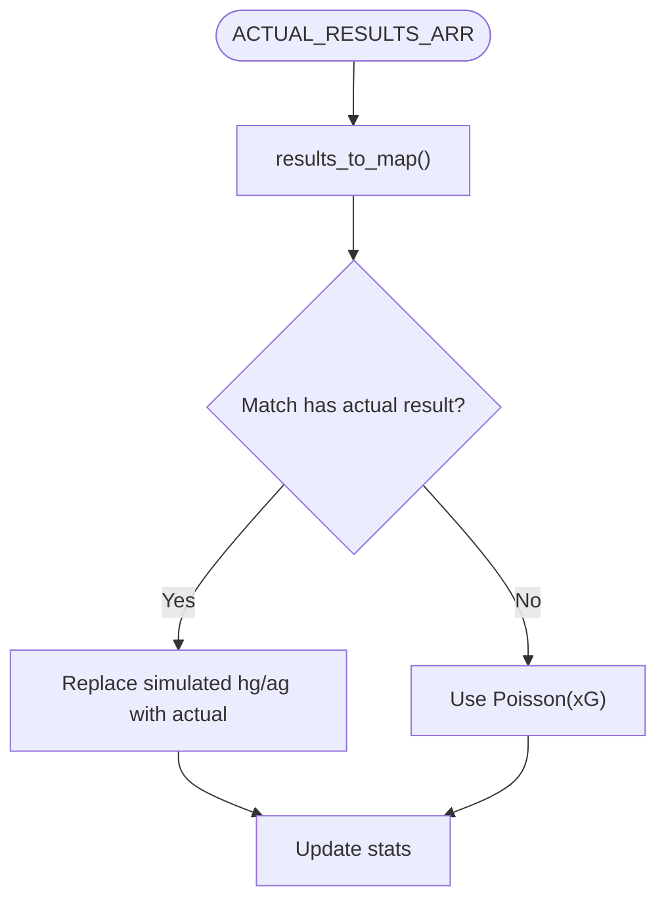
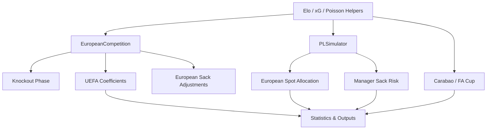

# Premier League Simulator

<cite>
**Referenced Files in This Document**   
- [26-27-season.py](file://premier-league/26-27-season.py)
- [README.md](file://premier-league/README.md)
</cite>

## Table of Contents
1. [Introduction](#introduction)
2. [Project Structure](#project-structure)
3. [Core Components](#core-components)
4. [Architecture Overview](#architecture-overview)
5. [Detailed Component Analysis](#detailed-component-analysis)
6. [Dependency Analysis](#dependency-analysis)
7. [Performance Considerations](#performance-considerations)
8. [Troubleshooting Guide](#troubleshooting-guide)
9. [Conclusion](#conclusion)
10. [Appendices](#appendices)

## Introduction
This document explains the Premier League simulation module as implemented in the repository’s unified simulation script. The system simulates:
- The Premier League season using an Elo-based expected goals model and Poisson goal sampling.
- Three European competitions: Champions League, Europa League, and Conference League.
- Domestic cups: Carabao Cup and FA Cup.
- Manager sack risk, fatigue from European fixtures, home advantage, and qualification pathways for European spots.

The module is designed as a Monte Carlo simulator that repeatedly runs league and cup tournaments, aggregates probabilities for titles, European qualification, relegation, manager firings, and competition outcomes, and exposes both a command-line entry point and a dashboard-friendly function.

**Section sources**
- [README.md:1-102](file://premier-league/README.md#L1-L102)

## Project Structure
The relevant implementation lives in one large Python file under the `premier-league` directory. It contains:
- Global configuration constants for Elo scaling, home advantage, expected goals parameters, fatigue levels, knockout K-factors, final venues, and team stadiums.
- Data tables for preset Elo ratings, actual results, fixtures, manager expectations, recent honours, and association mappings.
- Core simulation classes and functions for European competitions, knockout phases, PL simulation, domestic cups, coefficient calculations, and statistics output.
- Two main entry points:
  - `main()` for terminal execution.
  - `run_simulation()` for programmatic or dashboard usage with progress callbacks and snapshots.

**Diagram sources**
- [26-27-season.py:2092-2163](file://premier-league/26-27-season.py#L2092-L2163)
- [26-27-season.py:884-1066](file://premier-league/26-27-season.py#L884-L1066)
- [26-27-season.py:1133-1245](file://premier-league/26-27-season.py#L1133-L1245)
- [26-27-season.py:1313-1440](file://premier-league/26-27-season.py#L1313-L1440)
- [26-27-season.py:1446-1488](file://premier-league/26-27-season.py#L1446-L1488)
- [26-27-season.py:1612-1663](file://premier-league/26-27-season.py#L1612-L1663)
- [26-27-season.py:1881-1984](file://premier-league/26-27-season.py#L1881-L1984)
- [26-27-season.py:2262-2471](file://premier-league/26-27-season.py#L2262-L2471)
- [26-27-season.py:2696-2929](file://premier-league/26-27-season.py#L2696-L2929)

**Section sources**
- [26-27-season.py:1-43](file://premier-league/26-27-season.py#L1-L43)
- [26-27-season.py:2092-2163](file://premier-league/26-27-season.py#L2092-L2163)
- [26-27-season.py:2262-2471](file://premier-league/26-27-season.py#L2262-L2471)
- [26-27-season.py:2696-2929](file://premier-league/26-27-season.py#L2696-L2929)

## Core Components
The simulator is built around several core components:

- **Rng wrapper and Poisson sampling**: A deterministic random number generator with a fast Poisson sampler used throughout match simulations.
- **Elo helpers**: Expected result calculation and Elo updates for wins/draws/losses.
- **Expected Goals (xG)**: Home and away xG derived from Elo differences using exponential sensitivity to strength gaps.
- **EuropeanCompetition**: Simulates league phase and knockout phase for UCL, UEL, and UECL, including actual result injection and Elo progression.
- **PLSimulator**: Simulates the full Premier League season with fatigue-aware xG adjustments and Poisson scoring.
- **Domestic Cup Simulators**: Carabao Cup and FA Cup with Elo-based match models, extra time, and penalty-like resolution.
- **Manager Sack Risk Engine**: Computes per-team risk based on position vs expectation, pressure, relegation zone penalties, recent honours, European performance, and actual form adjustments.
- **European Spot Allocation**: Assigns Champions League, Europa League, and Conference League spots based on league ranking, cup winners, and UEFA coefficients.
- **UEFA Coefficient Aggregation**: Computes association coefficients from league positions, wins/draws, and knockout progression.

**Section sources**
- [26-27-season.py:98-149](file://premier-league/26-27-season.py#L98-L149)
- [26-27-season.py:127-141](file://premier-league/26-27-season.py#L127-L141)
- [26-27-season.py:884-1066](file://premier-league/26-27-season.py#L884-L1066)
- [26-27-season.py:1133-1245](file://premier-league/26-27-season.py#L1133-L1245)
- [26-27-season.py:1313-1440](file://premier-league/26-27-season.py#L1313-L1440)
- [26-27-season.py:1446-1488](file://premier-league/26-27-season.py#L1446-L1488)
- [26-27-season.py:1612-1663](file://premier-league/26-27-season.py#L1612-L1663)
- [26-27-season.py:1881-1984](file://premier-league/26-27-season.py#L1881-L1984)
- [26-27-season.py:788-838](file://premier-league/26-27-season.py#L788-L838)
- [26-27-season.py:326-356](file://premier-league/26-27-season.py#L326-L356)
- [26-27-season.py:1251-1307](file://premier-league/26-27-season.py#L1251-L1307)

## Architecture Overview
The unified architecture integrates four major simulation layers:

1. **Data Preparation Layer**: Builds current Elo ratings from presets and actual results, standardizes fixture names, and constructs full round-robin fixtures for the Premier League.
2. **European Competition Layer**: Runs UCL, UEL, and UECL simulations, producing rankings, knockout progression, and team results.
3. **Premier League Layer**: Uses European elimination rounds to compute fatigue factors, then simulates all remaining fixtures with Poisson-distributed goals.
4. **Cup and Statistics Layer**: Simulates Carabao Cup and FA Cup, allocates European spots, computes UEFA coefficients, and aggregates probabilities for outputs.

**Diagram sources**
- [26-27-season.py:2092-2163](file://premier-league/26-27-season.py#L2092-L2163)
- [26-27-season.py:2166-2256](file://premier-league/26-27-season.py#L2166-L2256)
- [26-27-season.py:2262-2471](file://premier-league/26-27-season.py#L2262-L2471)
- [26-27-season.py:2696-2929](file://premier-league/26-27-season.py#L2696-L2929)

**Section sources**
- [26-27-season.py:2092-2163](file://premier-league/26-27-season.py#L2092-L2163)
- [26-27-season.py:2166-2256](file://premier-league/26-27-season.py#L2166-L2256)
- [26-27-season.py:2262-2471](file://premier-league/26-27-season.py#L2262-L2471)
- [26-27-season.py:2696-2929](file://premier-league/26-27-season.py#L2696-L2929)

## Detailed Component Analysis

### Elo Rating System and Expected Goals
- **Elo update logic**: Uses logistic expected probability based on Elo difference and applies K-factor updates for wins, losses, and draws.
- **Expected goals**: Computes home and away lambda values using base xG and exponential sensitivity to Elo difference.
- **Home advantage**: Adds a fixed Elo advantage to the home team when computing xG.

**Diagram sources**
- [26-27-season.py:127-141](file://premier-league/26-27-season.py#L127-L141)
- [26-27-season.py:132-135](file://premier-league/26-27-season.py#L132-L135)
- [26-27-season.py:138-141](file://premier-league/26-27-season.py#L138-L141)

**Section sources**
- [26-27-season.py:127-141](file://premier-league/26-27-season.py#L127-L141)
- [26-27-season.py:132-135](file://premier-league/26-27-season.py#L132-L135)

### Poisson Distribution for Goal Scoring
- **Rng.poisson_L**: Implements inverse CDF sampling using cumulative product of uniform random numbers against `exp(-lambda)`.
- **Goal capping**: Goals are capped at `MAX_GOALS` to prevent extreme outliers.
- **Usage**: Applied in both European competition matches and Premier League fixtures.

**Diagram sources**
- [26-27-season.py:107-118](file://premier-league/26-27-season.py#L107-L118)
- [26-27-season.py:138-141](file://premier-league/26-27-season.py#L138-L141)

**Section sources**
- [26-27-season.py:98-118](file://premier-league/26-27-season.py#L98-L118)
- [26-27-season.py:138-141](file://premier-league/26-27-season.py#L138-L141)

### Manager Sack Risk Calculation Algorithm
The sack risk engine combines multiple signals:
- **Position vs expectation**: Penalizes managers for finishing below their expected position.
- **Relegation zone penalty**: Strongly increases risk for teams in or near the relegation zone.
- **Recent honours protection**: Reduces risk for recent league champions or European winners.
- **European performance adjustment**: Adds/subtracts risk based on how far a team underperformed relative to its seeded position in Europe.
- **Actual form adjustment**: Incorporates real-world results so far this season, blending all games with emphasis on last five.

**Diagram sources**
- [26-27-season.py:788-838](file://premier-league/26-27-season.py#L788-L838)
- [26-27-season.py:326-356](file://premier-league/26-27-season.py#L326-L356)
- [26-27-season.py:723-757](file://premier-league/26-27-season.py#L723-L757)

**Section sources**
- [26-27-season.py:788-838](file://premier-league/26-27-season.py#L788-L838)
- [26-27-season.py:326-356](file://premier-league/26-27-season.py#L326-L356)
- [26-27-season.py:723-757](file://premier-league/26-27-season.py#L723-L757)

### Fatigue Factors for European Competitions
- **Base fatigue**: Different competitions have different fatigue baselines (UCL highest, UECL lowest).
- **Active flag**: Teams eliminated early still receive fatigue but may not be active in later rounds.
- **Progressive effect**: Fatigue scales with inverse progress through the season, reducing impact earlier and increasing it later.
- **Integration**: Fatigue adjusts the Elo difference before computing xG for each fixture.

**Diagram sources**
- [26-27-season.py:83-84](file://premier-league/26-27-season.py#L83-L84)
- [26-27-season.py:1360-1397](file://premier-league/26-27-season.py#L1360-L1397)

**Section sources**
- [26-27-season.py:83-84](file://premier-league/26-27-season.py#L83-L84)
- [26-27-season.py:1360-1397](file://premier-league/26-27-season.py#L1360-L1397)

### Home Advantage Adjustments
- **Fixed Elo boost**: Home teams receive a constant Elo advantage (`HOME_ADVANTAGE_ELO`) in xG computation.
- **Final venue awareness**: For finals in neutral venues, home advantage can be assigned to the team whose stadium matches the final venue.
- **Cup finals**: Both Carabao Cup and FA Cup finals use neutral venue logic with optional venue-aware home advantage.

**Diagram sources**
- [26-27-season.py:72-80](file://premier-league/26-27-season.py#L72-L80)
- [26-27-season.py:1213-1229](file://premier-league/26-27-season.py#L1213-L1229)
- [26-27-season.py:1562-1592](file://premier-league/26-27-season.py#L1562-L1592)
- [26-27-season.py:1812-1841](file://premier-league/26-27-season.py#L1812-L1841)

**Section sources**
- [26-27-season.py:72-80](file://premier-league/26-27-season.py#L72-L80)
- [26-27-season.py:1213-1229](file://premier-league/26-27-season.py#L1213-L1229)
- [26-27-season.py:1562-1592](file://premier-league/26-27-season.py#L1562-L1592)
- [26-27-season.py:1812-1841](file://premier-league/26-27-season.py#L1812-L1841)

### Configuration Parameters
Key configurable parameters include:
- **Elo scale and league average**: `ELO_SCALE`, `LEAGUE_AVERAGE_ELO`.
- **Home advantage**: `HOME_ADVANTAGE_ELO`.
- **Expected goals**: `BASE_HOME_XG`, `BASE_AWAY_XG`, `XG_ELO_SENSITIVITY`.
- **Extra time factor**: `EXTRA_TIME_XG_FACTOR`.
- **Maximum goals**: `MAX_GOALS`.
- **Number of simulations**: `NUM_PL_SIMS`.
- **Elo regression pull**: `PL_ELO_MAX_PULL`.
- **Fatigue baselines**: `_FATIGUE_BASE` per competition.
- **Knockout K-factors**: `_EURO_K` per competition and stage.
- **Manager data**: `MANAGER_DATA` with expected finish and pressure.
- **Recent honours**: `RECENT_HONOURS` for sack-risk protection.
- **European risk weights**: `EURO_RISK_WEIGHT`.

**Section sources**
- [26-27-season.py:12-43](file://premier-league/26-27-season.py#L12-L43)
- [26-27-season.py:28-35](file://premier-league/26-27-season.py#L28-L35)
- [26-27-season.py:286-323](file://premier-league/26-27-season.py#L286-L323)

### Fixture Scheduling and Statistical Modeling Constants
- **Full round-robin construction**: `build_full_round_robin` generates all home-away pairs from actual results.
- **Fixture flattening**: `flatten_fixtures` converts nested round lists into flat match lists.
- **Statistical modeling constants**: Used in Elo updates, xG formulas, knockout progression, and coefficient calculations.

**Section sources**
- [26-27-season.py:648-663](file://premier-league/26-27-season.py#L648-L663)
- [26-27-season.py:12-43](file://premier-league/26-27-season.py#L12-L43)

### Integration with Actual Results Data
- **Actual results arrays**: Hardcoded tuples of `(home, away) -> (home_goals, away_goals)` for PL, UCL, UEL, and UECL.
- **Result mapping**: `results_to_map` converts arrays to dictionaries for lookup during simulation.
- **Injection logic**: During simulation, if a match has an actual result, simulated scores are replaced with observed scores.
- **Form analysis**: `build_actual_team_form` builds chronological W/D/L sequences per team from actual results.

**Diagram sources**
- [26-27-season.py:359-395](file://premier-league/26-27-season.py#L359-L395)
- [26-27-season.py:452-490](file://premier-league/26-27-season.py#L452-L490)
- [26-27-season.py:557-576](file://premier-league/26-27-season.py#L557-L576)
- [26-27-season.py:632-642](file://premier-league/26-27-season.py#L632-L642)
- [26-27-season.py:658-659](file://premier-league/26-27-season.py#L658-L659)
- [26-27-season.py:700-712](file://premier-league/26-27-season.py#L700-L712)

**Section sources**
- [26-27-season.py:359-395](file://premier-league/26-27-season.py#L359-L395)
- [26-27-season.py:452-490](file://premier-league/26-27-season.py#L452-L490)
- [26-27-season.py:557-576](file://premier-league/26-27-season.py#L557-L576)
- [26-27-season.py:632-642](file://premier-league/26-27-season.py#L632-L642)
- [26-27-season.py:658-659](file://premier-league/26-27-season.py#L658-L659)
- [26-27-season.py:700-712](file://premier-league/26-27-season.py#L700-L712)

### Team Form Analysis and Performance Metrics
- **Form building**: Chronological W/D/L sequences per team from actual results.
- **Last-N form**: Extracts recent form for sack-risk adjustments.
- **Form-to-rating conversion**: Converts W/D/L to points-per-game equivalent.
- **Actual form adjustment**: Blends all-season form with last-five form to produce a bounded sack-risk adjustment.

**Section sources**
- [26-27-season.py:700-712](file://premier-league/26-27-season.py#L700-L712)
- [26-27-season.py:715-720](file://premier-league/26-27-season.py#L715-L720)
- [26-27-season.py:723-757](file://premier-league/26-27-season.py#L723-L757)

### Examples of Running Simulations and Interpreting Results
- **Command-line execution**: `main()` prints progress, elapsed time, EPS probabilities, European spot distributions, final projections, European win chances, domestic cup winners, and streak statistics.
- **Programmatic execution**: `run_simulation()` returns a dictionary with average points, position probabilities, title/European/relegation probabilities, sack probabilities, and European reach metrics.
- **Interpretation guidance**:
  - Title probability indicates the percentage of simulations where a team finishes first.
  - European qualification probabilities show the likelihood of qualifying for UCL, UEL, or UECL.
  - Relegation probability shows the frequency of finishing in the bottom three.
  - Sack probability represents the conditional distribution of who is next to be sacked; sack_any_prob represents marginal probability of being sacked at least once.

**Section sources**
- [26-27-season.py:2262-2471](file://premier-league/26-27-season.py#L2262-L2471)
- [26-27-season.py:2696-2929](file://premier-league/26-27-season.py#L2696-L2929)

## Dependency Analysis
The module exhibits clear layering with minimal circular dependencies:
- **Constants and helpers** are imported by all simulation components.
- **EuropeanCompetition** depends on Elo helpers, expected goals, and knockout logic.
- **PLSimulator** depends on expected goals and Poisson sampling.
- **Cup simulators** depend on Elo helpers and expected goals.
- **Statistics and output** depend on all simulation results.

**Diagram sources**
- [26-27-season.py:127-141](file://premier-league/26-27-season.py#L127-L141)
- [26-27-season.py:884-1066](file://premier-league/26-27-season.py#L884-L1066)
- [26-27-season.py:1133-1245](file://premier-league/26-27-season.py#L1133-L1245)
- [26-27-season.py:1313-1440](file://premier-league/26-27-season.py#L1313-L1440)
- [26-27-season.py:1446-1488](file://premier-league/26-27-season.py#L1446-L1488)
- [26-27-season.py:1612-1663](file://premier-league/26-27-season.py#L1612-L1663)
- [26-27-season.py:1881-1984](file://premier-league/26-27-season.py#L1881-L1984)
- [26-27-season.py:1251-1307](file://premier-league/26-27-season.py#L1251-L1307)

**Section sources**
- [26-27-season.py:127-141](file://premier-league/26-27-season.py#L127-L141)
- [26-27-season.py:884-1066](file://premier-league/26-27-season.py#L884-L1066)
- [26-27-season.py:1133-1245](file://premier-league/26-27-season.py#L1133-L1245)
- [26-27-season.py:1313-1440](file://premier-league/26-27-season.py#L1313-L1440)
- [26-27-season.py:1446-1488](file://premier-league/26-27-season.py#L1446-L1488)
- [26-27-season.py:1612-1663](file://premier-league/26-27-season.py#L1612-L1663)
- [26-27-season.py:1881-1984](file://premier-league/26-27-season.py#L1881-L1984)
- [26-27-season.py:1251-1307](file://premier-league/26-27-season.py#L1251-L1307)

## Performance Considerations
- **Monte Carlo iterations**: The default number of simulations is tuned for balance between accuracy and runtime.
- **Fast Poisson sampling**: Uses precomputed `exp(-lambda)` for efficient inverse CDF sampling.
- **Early stopping**: European simulations can stop when no English teams remain in contention.
- **Caching**: Carabao Elo lookup uses `lru_cache` to avoid recomputation.
- **Progress rendering**: Provides ETA and completion percentage for long-running simulations.

[No sources needed since this section provides general guidance]

## Troubleshooting Guide
Common issues and resolutions:
- **Seed randomness**: If results vary unexpectedly, ensure a fixed seed is passed to `run_simulation()` or `main()` via shared setup.
- **Missing team names**: Ensure team names match preset mappings; name standardization functions exist for UEL and UECL fixtures.
- **Actual results mismatch**: Verify that actual result tuples match fixture order and team naming conventions.
- **Performance tuning**: Reduce `NUM_PL_SIMS` for faster runs or increase for higher precision.
- **Memory usage**: Large datasets like full fixture lists and result maps are stored in memory; consider limiting tracked teams if debugging.

**Section sources**
- [26-27-season.py:2092-2163](file://premier-league/26-27-season.py#L2092-L2163)
- [26-27-season.py:2696-2929](file://premier-league/26-27-season.py#L2696-L2929)

## Conclusion
The Premier League simulator provides a comprehensive, unified framework for modeling league and cup outcomes across multiple competitions. Its design separates concerns into clear layers: data preparation, European competition simulation, league simulation with fatigue integration, cup simulation, and statistical aggregation. The Elo-based expected goals model combined with Poisson sampling offers a flexible foundation for goal prediction, while manager sack risk, home advantage, and qualification pathway logic add realism. Users can customize parameters, inject actual results, and interpret probabilistic outputs for strategic insights.

[No sources needed since this section summarizes without analyzing specific files]

## Appendices

### Appendix A: Key Functions and Responsibilities
- `preset_pl_elos()`: Returns preset Elo ratings for Premier League teams.
- `preset_ucl_elos()`, `preset_uel_elos()`, `preset_uecl_elos()`: Return preset Elo ratings for European competitions.
- `association_map()`, `assoc_entrants()`: Map teams to associations and define entrant counts.
- `regress_elos()`: Regresses Elo ratings toward mean based on games played.
- `build_current_pl_ratings()`: Builds current Elo ratings from actual results.
- `compute_sack_risk()`: Computes manager sack risk scores.
- `allocate_european_spots()`: Assigns European qualification spots.
- `run_carabao_tournament()`, `simulate_fa_cup()`: Simulate domestic cups.
- `all_association_coefficients()`: Computes UEFA association coefficients.
- `main()`, `run_simulation()`: Entry points for execution.

**Section sources**
- [26-27-season.py:155-219](file://premier-league/26-27-season.py#L155-L219)
- [26-27-season.py:222-278](file://premier-league/26-27-season.py#L222-L278)
- [26-27-season.py:669-694](file://premier-league/26-27-season.py#L669-L694)
- [26-27-season.py:788-838](file://premier-league/26-27-season.py#L788-L838)
- [26-27-season.py:1446-1488](file://premier-league/26-27-season.py#L1446-L1488)
- [26-27-season.py:1612-1663](file://premier-league/26-27-season.py#L1612-L1663)
- [26-27-season.py:1881-1984](file://premier-league/26-27-season.py#L1881-L1984)
- [26-27-season.py:1251-1307](file://premier-league/26-27-season.py#L1251-L1307)
- [26-27-season.py:2262-2471](file://premier-league/26-27-season.py#L2262-L2471)
- [26-27-season.py:2696-2929](file://premier-league/26-27-season.py#L2696-L2929)