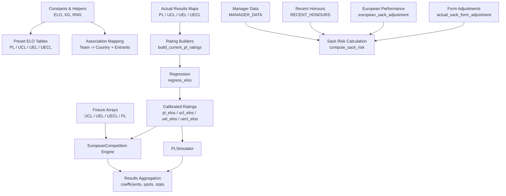
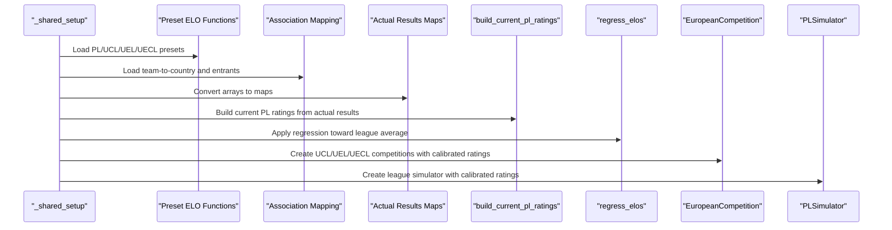
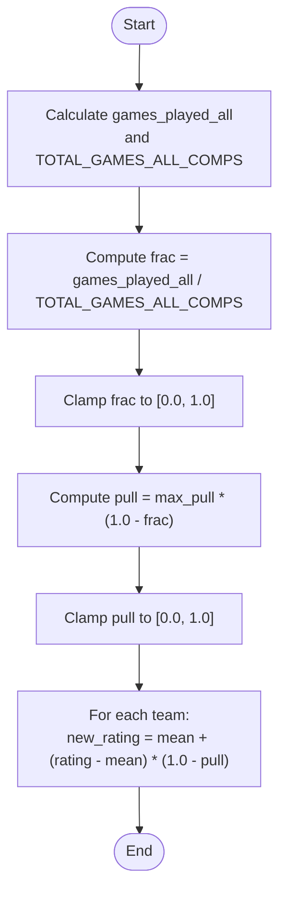
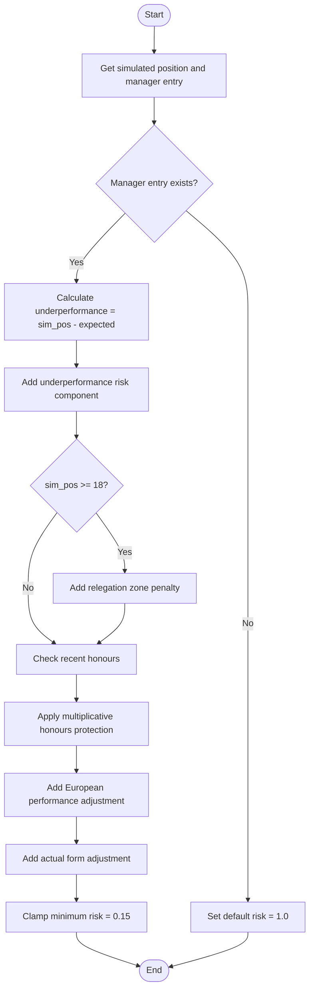
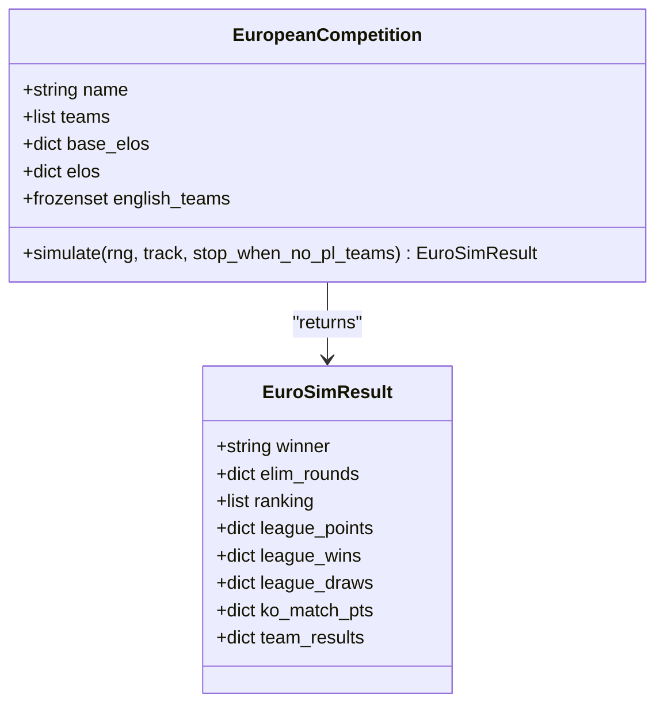
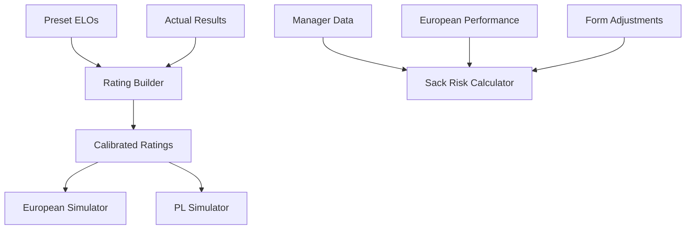

# Data Integration and Calibration

<cite>
**Referenced Files in This Document**   
- [26-27-season.py](file://premier-league/26-27-season.py)
</cite>

## Table of Contents
1. [Introduction](#introduction)
2. [Project Structure](#project-structure)
3. [Core Components](#core-components)
4. [Architecture Overview](#architecture-overview)
5. [Detailed Component Analysis](#detailed-component-analysis)
6. [Dependency Analysis](#dependency-analysis)
7. [Performance Considerations](#performance-considerations)
8. [Troubleshooting Guide](#troubleshooting-guide)
9. [Conclusion](#conclusion)
10. [Appendices](#appendices)

## Introduction
This document explains how the simulation engine is calibrated with real-world information across the Premier League, UEFA Champions League (UCL), UEFA Europa League (UEL), and UEFA Europa Conference League (UECL). It covers:
- Preset ELO ratings for each competition
- Association mapping for international teams
- Fixture schedule integration
- Actual results processing that adjusts initial team strengths
- Regression algorithms that pull ratings toward league averages over time
- Form-based adjustments incorporating recent performance
- Manager data integration including sack risk calculations, recent honours credit, and European competition performance adjustments
- Examples of data input formats, calibration processes, and validation methods

The primary implementation is contained in a single unified simulation module that integrates all these components.

## Project Structure
At the heart of the system is a unified Python module that defines:
- Constants and helper utilities for ELO, expected goals, and Poisson sampling
- Preset ELO tables for PL, UCL, UEL, and UECL
- Association mappings and entrant counts per association
- Fixture arrays and actual result arrays for all competitions
- Simulation engines for the league and European competitions
- Sack-risk calculation and manager-related adjustments
- Aggregation logic for coefficients, spot allocation, and statistics



**Diagram sources**
- [26-27-season.py:12-35](file://premier-league/26-27-season.py#L12-L35)
- [26-27-season.py:155-219](file://premier-league/26-27-season.py#L155-L219)
- [26-27-season.py:222-278](file://premier-league/26-27-season.py#L222-L278)
- [26-27-season.py:359-642](file://premier-league/26-27-season.py#L359-L642)
- [26-27-season.py:669-694](file://premier-league/26-27-season.py#L669-L694)
- [26-27-season.py:697-838](file://premier-league/26-27-season.py#L697-L838)
- [26-27-season.py:884-1066](file://premier-league/26-27-season.py#L884-L1066)
- [26-27-season.py:1313-1440](file://premier-league/26-27-season.py#L1313-L1440)
- [26-27-season.py:2092-2163](file://premier-league/26-27-season.py#L2092-L2163)

**Section sources**
- [26-27-season.py:1-43](file://premier-league/26-27-season.py#L1-L43)
- [26-27-season.py:155-219](file://premier-league/26-27-season.py#L155-L219)
- [26-27-season.py:222-278](file://premier-league/26-27-season.py#L222-L278)
- [26-27-season.py:359-642](file://premier-league/26-27-season.py#L359-L642)
- [26-27-season.py:669-694](file://premier-league/26-27-season.py#L669-L694)
- [26-27-season.py:697-838](file://premier-league/26-27-season.py#L697-L838)
- [26-27-season.py:884-1066](file://premier-league/26-27-season.py#L884-L1066)
- [26-27-season.py:1313-1440](file://premier-league/26-27-season.py#L1313-L1440)
- [26-27-season.py:2092-2163](file://premier-league/26-27-season.py#L2092-L2163)

## Core Components
- Preset ELO tables define baseline strengths for each competition.
- Association mapping links teams to their national associations and sets entrant counts.
- Fixture arrays define match schedules; actual result arrays provide observed outcomes.
- Rating builders adjust initial strengths based on observed results.
- Regression pulls ratings toward league averages as more games are played.
- European competition engine simulates group stages and knockout phases.
- PL simulator runs league matches with fatigue effects from European fixtures.
- Manager data and recent honours influence sack risk calculations.
- Form-based adjustments incorporate recent team performance into risk models.

**Section sources**
- [26-27-season.py:155-219](file://premier-league/26-27-season.py#L155-L219)
- [26-27-season.py:222-278](file://premier-league/26-27-season.py#L222-L278)
- [26-27-season.py:359-642](file://premier-league/26-27-season.py#L359-L642)
- [26-27-season.py:669-694](file://premier-league/26-27-season.py#L669-L694)
- [26-27-season.py:697-838](file://premier-league/26-27-season.py#L697-L838)
- [26-27-season.py:884-1066](file://premier-league/26-27-season.py#L884-L1066)
- [26-27-season.py:1313-1440](file://premier-league/26-27-season.py#L1313-L1440)

## Architecture Overview
The calibration pipeline integrates preset strengths, real-world fixtures, and observed results to produce calibrated ratings used by both the league and European simulators. The flow includes:
- Loading preset ELOs and association metadata
- Building current PL ratings from actual results
- Applying regression to stabilize ratings
- Standardizing fixture names for UEL and UECL
- Constructing European competition objects with calibrated ratings
- Running simulations and aggregating results



**Diagram sources**
- [26-27-season.py:2092-2163](file://premier-league/26-27-season.py#L2092-L2163)
- [26-27-season.py:669-694](file://premier-league/26-27-season.py#L669-L694)
- [26-27-season.py:884-1066](file://premier-league/26-27-season.py#L884-L1066)
- [26-27-season.py:1313-1440](file://premier-league/26-27-season.py#L1313-L1440)

## Detailed Component Analysis

### Preset ELO Ratings by Competition
The system defines explicit baseline ELO ratings for each competition:
- PL preset includes 20 English teams with varying strengths
- UCL preset includes top European clubs with higher overall ratings
- UEL preset includes mid-tier European clubs
- UECL preset includes lower-tier European clubs

These presets serve as priors before any real-world adjustment.

**Section sources**
- [26-27-season.py:155-219](file://premier-league/26-27-season.py#L155-L219)

### Association Mapping for International Teams
The association map provides:
- Team-to-country mapping for all participating teams
- Entrant counts per association to normalize coefficient calculations

This enables accurate coefficient aggregation and fair representation across associations.

**Section sources**
- [26-27-season.py:222-278](file://premier-league/26-27-season.py#L222-L278)

### Fixture Schedule Integration
Fixture arrays define:
- UCL group stage fixtures across multiple matchdays
- UEL group stage fixtures with name standardization
- UECL group stage fixtures with name standardization
- PL full round-robin generated from actual results

Name standardization ensures consistency between raw fixture data and canonical team names used throughout the simulation.

**Section sources**
- [26-27-season.py:397-450](file://premier-league/26-27-season.py#L397-L450)
- [26-27-season.py:492-550](file://premier-league/26-27-season.py#L492-L550)
- [26-27-season.py:578-629](file://premier-league/26-27-season.py#L578-L629)
- [26-27-season.py:648-655](file://premier-league/26-27-season.py#L648-L655)

### Actual Results Processing
Actual results are processed to:
- Update team strengths based on observed outcomes
- Blend prior preset strengths with observed performance using Bayesian-like weighting
- Generate form sequences for sack risk calculations

The process uses ELO updates for wins/losses and expected goal differences for draws.

**Section sources**
- [26-27-season.py:359-395](file://premier-league/26-27-season.py#L359-L395)
- [26-27-season.py:677-694](file://premier-league/26-27-season.py#L677-L694)
- [26-27-season.py:700-712](file://premier-league/26-27-season.py#L700-L712)

### Regression Algorithms Pulling Toward League Averages
The regression function:
- Calculates the fraction of total games played across all competitions
- Applies a pull factor that decreases as more games are observed
- Moves individual team ratings toward the league average or preset mean

This prevents overfitting to small sample sizes and stabilizes ratings over time.



**Diagram sources**
- [26-27-season.py:669-674](file://premier-league/26-27-season.py#L669-L674)

**Section sources**
- [26-27-season.py:669-674](file://premier-league/26-27-season.py#L669-L674)

### Form-Based Adjustments
Form-based adjustments:
- Build ordered result sequences (W/D/L) from actual results
- Calculate points-per-game for all games and last 5 games
- Blend these metrics with configurable weights
- Convert to sack risk adjustments clamped to a reasonable range

This incorporates recent performance trends into manager stability predictions.

**Section sources**
- [26-27-season.py:700-757](file://premier-league/26-27-season.py#L700-L757)

### Manager Data Integration and Sack Risk Calculations
Manager data includes:
- Manager names and nationalities
- Expected finishing positions
- Pressure multipliers reflecting board/media expectations

Sack risk calculation considers:
- Underperformance relative to expectations
- Relegation zone penalties
- Overperformance bonuses
- Recent honours protection (multiplicative factors)
- European performance adjustments
- Actual form adjustments



**Diagram sources**
- [26-27-season.py:788-838](file://premier-league/26-27-season.py#L788-L838)

**Section sources**
- [26-27-season.py:286-323](file://premier-league/26-27-season.py#L286-L323)
- [26-27-season.py:788-838](file://premier-league/26-27-season.py#L788-L838)

### European Competition Performance Adjustments
European performance affects sack risk through:
- Comparison of actual ranking vs. expected ranking based on ELOs
- Penalties for early elimination or poor performance relative to expectations
- Weighted adjustments by competition (UCL > UEL > UECL)

This ensures managers face consequences for disappointing European campaigns.

**Section sources**
- [26-27-season.py:326-356](file://premier-league/26-27-season.py#L326-L356)

### European Competition Engine
The European competition engine:
- Initializes team sets and base ELOs from presets or PL ratings
- Processes fixtures and actual results
- Simulates group stages with ELO-based scoring
- Runs knockout phases with two-legged ties and extra time rules
- Tracks team results and elimination rounds



**Diagram sources**
- [26-27-season.py:868-1066](file://premier-league/26-27-season.py#L868-L1066)

**Section sources**
- [26-27-season.py:868-1066](file://premier-league/26-27-season.py#L868-L1066)

### Premier League Simulator
The PL simulator:
- Builds fixture indices and expected goal parameters
- Incorporates fatigue effects from European competitions
- Uses actual results where available
- Simulates the full season with Poisson-distributed goals
- Produces rankings and team results

**Section sources**
- [26-27-season.py:1313-1440](file://premier-league/26-27-season.py#L1313-L1440)

## Dependency Analysis
The system has clear dependency relationships:
- Preset ELOs feed into rating builders
- Actual results drive rating adjustments
- Calibrated ratings power both European and PL simulators
- Manager data influences sack risk calculations
- European performance feeds back into manager risk assessments



**Diagram sources**
- [26-27-season.py:669-694](file://premier-league/26-27-season.py#L669-L694)
- [26-27-season.py:788-838](file://premier-league/26-27-season.py#L788-L838)
- [26-27-season.py:884-1066](file://premier-league/26-27-season.py#L884-L1066)
- [26-27-season.py:1313-1440](file://premier-league/26-27-season.py#L1313-L1440)

**Section sources**
- [26-27-season.py:669-694](file://premier-league/26-27-season.py#L669-L694)
- [26-27-season.py:788-838](file://premier-league/26-27-season.py#L788-L838)
- [26-27-season.py:884-1066](file://premier-league/26-27-season.py#L884-L1066)
- [26-27-season.py:1313-1440](file://premier-league/26-27-season.py#L1313-L1440)

## Performance Considerations
- The system uses efficient data structures (lists, dicts, frozensets) for fast lookups
- Pre-computation of expected goals and probabilities reduces repeated calculations
- Caching mechanisms prevent redundant computations for carabao and FA cup ELOs
- Progress rendering provides feedback during long simulation runs
- The Hungarian algorithm optimizes position probability assignments

[No sources needed since this section provides general guidance]

## Troubleshooting Guide
Common issues and solutions:
- **Name mismatches**: Ensure fixture names match canonical names in preset tables
- **Missing actual results**: Verify result arrays contain all necessary matches
- **Division by zero**: Check that total games counters are properly initialized
- **Invalid team references**: Validate team names against known team sets
- **Regression instability**: Monitor pull factors and ensure they remain within bounds

**Section sources**
- [26-27-season.py:648-655](file://premier-league/26-27-season.py#L648-L655)
- [26-27-season.py:669-674](file://premier-league/26-27-season.py#L669-L674)

## Conclusion
The data integration system successfully calibrates the simulation engine by combining preset strengths with real-world observations. Through careful handling of ELO ratings, regression algorithms, form-based adjustments, and manager-specific factors, the system produces realistic and stable predictions across multiple competitions. The modular design allows for easy extension and maintenance while maintaining computational efficiency.

[No sources needed since this section summarizes without analyzing specific files]

## Appendices

### Data Input Format Examples

#### Actual Results Format
Actual results use tuples of team pairs mapped to score tuples:
```
(("TeamA", "TeamB"), (home_goals, away_goals))
```

#### Fixture Format
Fixtures are defined as lists of matchday arrays containing team pair tuples:
```
[
    [("TeamA", "TeamB"), ("TeamC", "TeamD")],
    [("TeamE", "TeamF"), ("TeamG", "TeamH")]
]
```

#### Manager Data Format
Manager data uses tuples with manager name, nationality, expected finish, and pressure:
```
("TeamName": ("ManagerName", "Nationality", ExpectedFinish, PressureMultiplier))
```

**Section sources**
- [26-27-season.py:359-395](file://premier-league/26-27-season.py#L359-L395)
- [26-27-season.py:397-450](file://premier-league/26-27-season.py#L397-L450)
- [26-27-season.py:286-307](file://premier-league/26-27-season.py#L286-L307)

### Calibration Process Summary
1. Load preset ELOs for all competitions
2. Map associations and entrants
3. Convert actual results to lookup maps
4. Build current PL ratings from actual results
5. Apply regression toward league averages
6. Standardize fixture names for European competitions
7. Initialize European competition objects
8. Run simulations and aggregate results

**Section sources**
- [26-27-season.py:2092-2163](file://premier-league/26-27-season.py#L2092-L2163)

### Validation Methods
- **Consistency checks**: Verify team names exist in preset tables
- **Bounds checking**: Ensure regression pull factors stay within [0, 1]
- **Result validation**: Confirm actual results match fixture definitions
- **Probability normalization**: Verify sack risk distributions sum appropriately
- **Coefficient calculations**: Validate association coefficients against entrant counts

**Section sources**
- [26-27-season.py:669-674](file://premier-league/26-27-season.py#L669-L674)
- [26-27-season.py:788-838](file://premier-league/26-27-season.py#L788-L838)
- [26-27-season.py:1280-1307](file://premier-league/26-27-season.py#L1280-L1307)