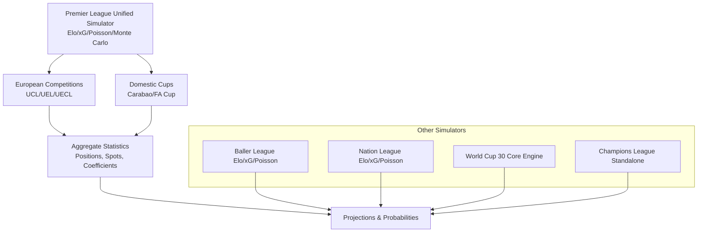
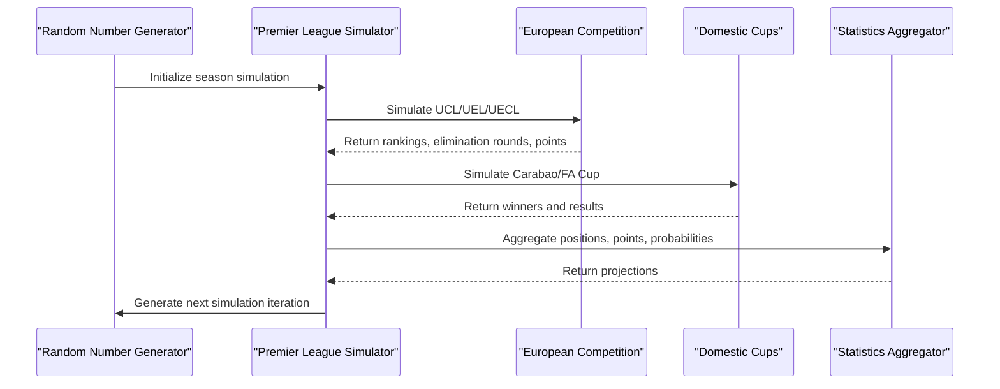
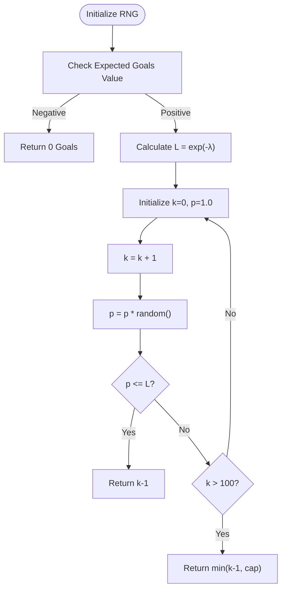
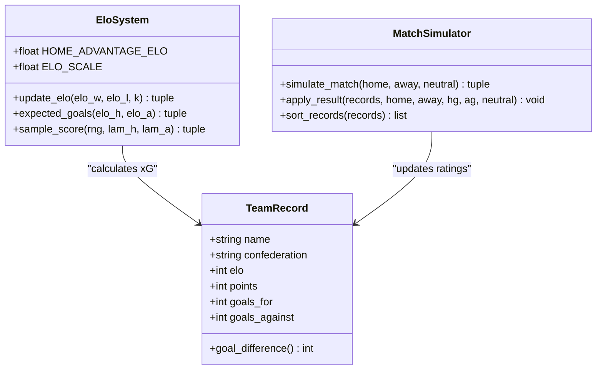
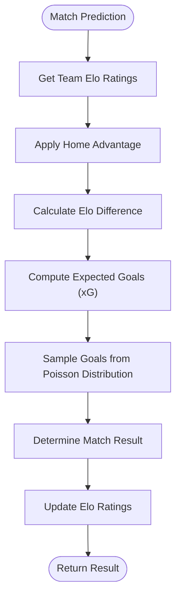
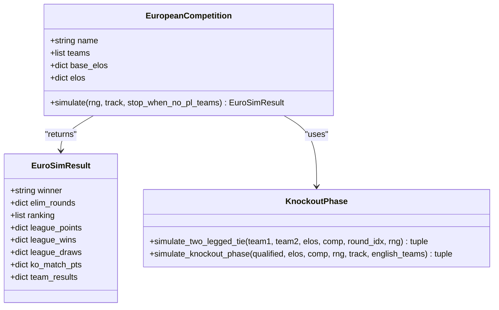
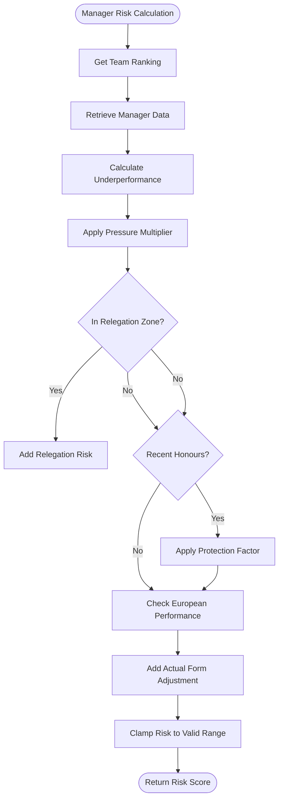
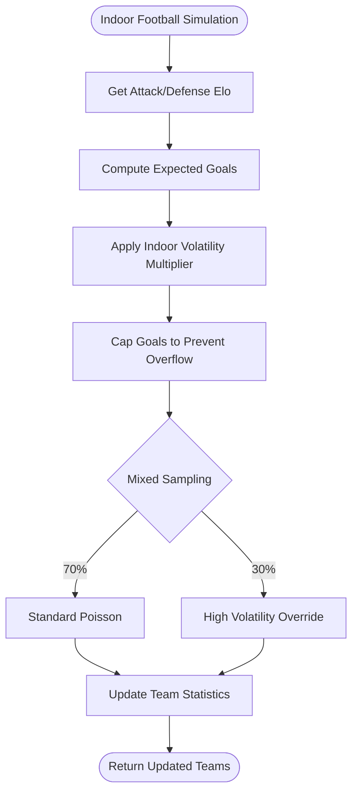
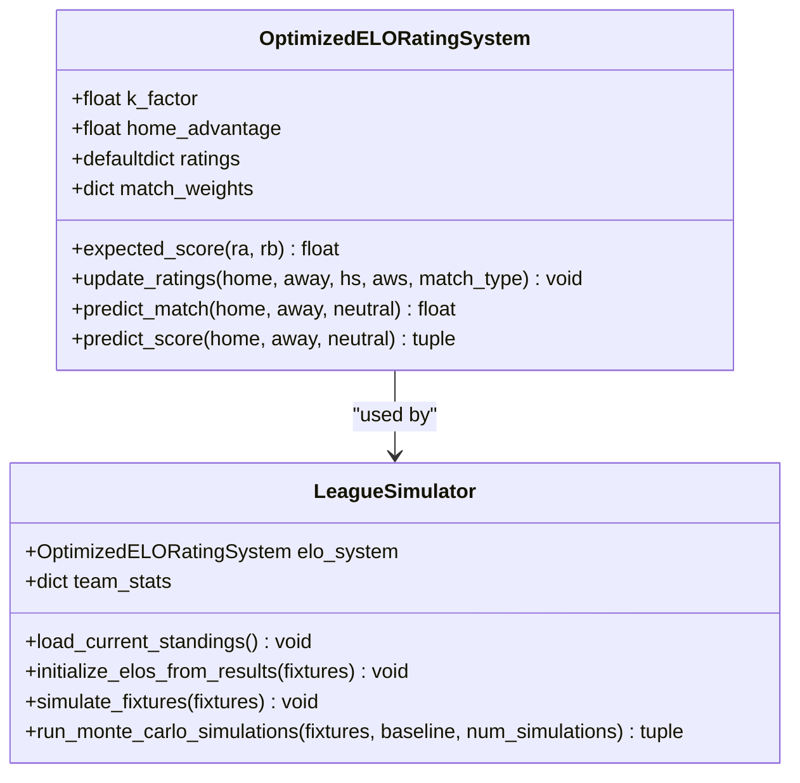
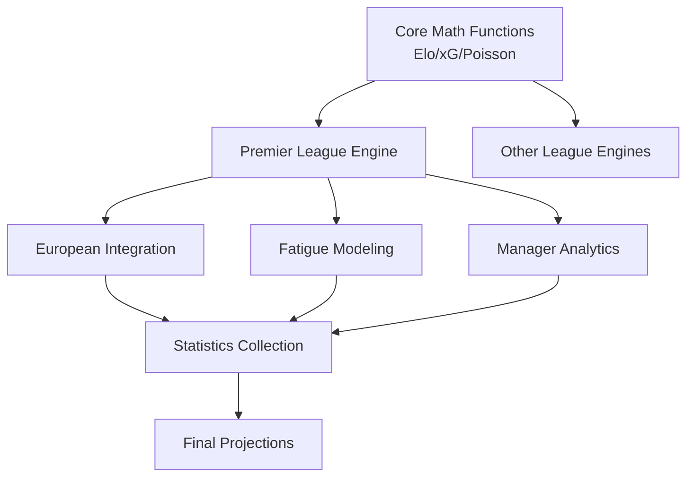

# Monte Carlo Simulation Engine

<cite>
**Referenced Files in This Document**
- [26-27-season.py](file://premier-league/26-27-season.py)
- [ballerleague.py](file://ballerleague/ballerleague.py)
- [nationleague.py](file://darlington/nationleague.py)
- [champions_league.py](file://uefa/champions_league.py)
- [main.py](file://worldcup30/main.py)
</cite>

## Table of Contents
1. [Introduction](#introduction)
2. [Project Structure](#project-structure)
3. [Core Components](#core-components)
4. [Architecture Overview](#architecture-overview)
5. [Detailed Component Analysis](#detailed-component-analysis)
6. [Dependency Analysis](#dependency-analysis)
7. [Performance Considerations](#performance-considerations)
8. [Troubleshooting Guide](#troubleshooting-guide)
9. [Conclusion](#conclusion)

## Introduction
This document explains the Monte Carlo simulation engine that powers league and competition predictions across multiple football models in the repository. It covers:
- Mathematical foundations: Elo rating systems, Poisson goal distributions, and expected goals (xG).
- Simulation workflow: team strength assessment, match outcome prediction, and aggregate statistics generation.
- Advanced modeling: home advantage, fatigue, manager performance analytics including sack risk.
- Competition formats: domestic leagues, European competitions, and cup tournaments.
- Integration of European competition impacts on domestic league performance.
- Performance optimization techniques, random seed management, and accuracy validation approaches.

The core engine is implemented primarily in a unified Premier League + European + Cup simulation script, with additional specialized implementations for other leagues and competitions.

## Project Structure
The Monte Carlo engine spans several modules:
- A comprehensive Premier League simulation integrating UEFA competitions and domestic cups.
- Specialized league simulators using Elo-based xG and Poisson sampling.
- Standalone European competition simulators.
- International tournament engines with confederation-aware scaling.

**Diagram sources**
- [26-27-season.py:1-120](file://premier-league/26-27-season.py#L1-L120)
- [26-27-season.py:865-1066](file://premier-league/26-27-season.py#L865-L1066)
- [champions_league.py:1-117](file://uefa/champions_league.py#L1-L117)
- [main.py:308-406](file://worldcup30/main.py#L308-L406)

**Section sources**
- [26-27-season.py:1-120](file://premier-league/26-27-season.py#L1-L120)
- [champions_league.py:1-117](file://uefa/champions_league.py#L1-L117)
- [main.py:308-406](file://worldcup30/main.py#L308-L406)

## Core Components
The Monte Carlo engine comprises these core components:
- Random number generator wrapper with Poisson sampling.
- Elo rating system with update rules and expected score calculation.
- Expected goals (xG) model based on Elo differences and home advantage.
- Match scoring via Poisson distribution with safety caps.
- League and knockout phase simulations with fixture handling.
- Fatigue modeling for teams participating in European competitions.
- Manager performance analytics and sack risk calculations.
- European competition integration affecting domestic spots and coefficients.

Key mathematical elements:
- Elo expected score: E = 1 / (1 + 10^((R_opp - R_team)/400))
- Elo update: ΔR = K * (S_actual - E_expected)
- xG model: λ_home = base_home * exp(sensitivity * (R_home - R_away)), λ_away = base_away * exp(-sensitivity * (R_home - R_away))
- Poisson sampling: k ~ Poisson(λ), capped to avoid overflow

**Section sources**
- [26-27-season.py:95-141](file://premier-league/26-27-season.py#L95-L141)
- [26-27-season.py:127-135](file://premier-league/26-27-season.py#L127-L135)

## Architecture Overview
The unified simulation architecture integrates multiple competition layers:

**Diagram sources**
- [26-27-season.py:2328-2470](file://premier-league/26-27-season.py#L2328-L2470)
- [26-27-season.py:865-1066](file://premier-league/26-27-season.py#L865-L1066)

## Detailed Component Analysis

### Random Number Generation and Poisson Sampling
The engine uses a custom RNG wrapper that provides:
- Uniform random number generation
- Poisson sampling using inverse transform method
- Safety limits to prevent numerical overflow

**Diagram sources**
- [26-27-season.py:98-122](file://premier-league/26-27-season.py#L98-L122)
- [main.py:327-341](file://worldcup30/main.py#L327-L341)

**Section sources**
- [26-27-season.py:98-122](file://premier-league/26-27-season.py#L98-L122)
- [main.py:327-341](file://worldcup30/main.py#L327-L341)

### Elo Rating System and Expected Goals
The Elo system calculates expected scores and updates ratings based on match outcomes:

**Diagram sources**
- [26-27-season.py:127-141](file://premier-league/26-27-season.py#L127-L141)
- [main.py:308-406](file://worldcup30/main.py#L308-L406)

**Section sources**
- [26-27-season.py:127-141](file://premier-league/26-27-season.py#L127-L141)
- [main.py:308-406](file://worldcup30/main.py#L308-L406)

### Match Outcome Prediction Workflow
The match prediction process follows this sequence:

**Diagram sources**
- [26-27-season.py:132-141](file://premier-league/26-27-season.py#L132-L141)
- [main.py:343-360](file://worldcup30/main.py#L343-L360)

**Section sources**
- [26-27-season.py:132-141](file://premier-league/26-27-season.py#L132-L141)
- [main.py:343-360](file://worldcup30/main.py#L343-L360)

### European Competition Integration
European competitions are integrated through a sophisticated system that tracks team performance and its impact on domestic leagues:

**Diagram sources**
- [26-27-season.py:868-1066](file://premier-league/26-27-season.py#L868-L1066)
- [26-27-season.py:1072-1200](file://premier-league/26-27-season.py#L1072-L1200)

**Section sources**
- [26-27-season.py:868-1066](file://premier-league/26-27-season.py#L868-L1066)
- [26-27-season.py:1072-1200](file://premier-league/26-27-season.py#L1072-L1200)

### Manager Performance Analytics and Sack Risk
The system includes advanced manager performance analytics with sack risk calculations:

**Diagram sources**
- [26-27-season.py:788-838](file://premier-league/26-27-season.py#L788-L838)

**Section sources**
- [26-27-season.py:788-838](file://premier-league/26-27-season.py#L788-L838)

### Alternative Implementation Patterns
Different simulators implement similar concepts with varying complexity:

#### Baller League Implementation
A simpler implementation focusing on indoor football characteristics:

**Diagram sources**
- [ballerleague.py:37-47](file://ballerleague/ballerleague.py#L37-L47)
- [ballerleague.py:232-276](file://ballerleague/ballerleague.py#L232-L276)

**Section sources**
- [ballerleague.py:37-47](file://ballerleague/ballerleague.py#L37-L47)
- [ballerleague.py:232-276](file://ballerleague/ballerleague.py#L232-L276)

#### Nation League Implementation
A simplified approach with form adjustments:

**Diagram sources**
- [nationleague.py:259-306](file://darlington/nationleague.py#L259-L306)
- [nationleague.py:307-393](file://darlington/nationleague.py#L307-L393)

**Section sources**
- [nationleague.py:259-306](file://darlington/nationleague.py#L259-L306)
- [nationleague.py:307-393](file://darlington/nationleague.py#L307-L393)

## Dependency Analysis
The simulation engine has clear dependency relationships:

**Diagram sources**
- [26-27-season.py:1-120](file://premier-league/26-27-season.py#L1-L120)
- [26-27-season.py:865-1066](file://premier-league/26-27-season.py#L865-L1066)

**Section sources**
- [26-27-season.py:1-120](file://premier-league/26-27-season.py#L1-L120)
- [26-27-season.py:865-1066](file://premier-league/26-27-season.py#L865-L1066)

## Performance Considerations
The engine implements several performance optimizations:

### Random Seed Management
- Custom RNG wrapper for consistent reproducibility
- Seeded random number generation for all simulations
- Separate random streams for different simulation components

### Computational Efficiency
- Vectorized operations where possible
- Early termination when no English teams remain in European competitions
- Capped goal values to prevent numerical overflow
- Pre-computed exponential values for Elo calculations

### Memory Optimization
- Use of `__slots__` for memory-efficient objects
- Dictionary-based data structures for fast lookups
- Minimal object creation during simulation loops

### Simulation Accuracy Validation
- Multiple simulation runs (2,500+ for Premier League)
- Statistical convergence monitoring
- Cross-validation between different competition formats
- Historical result calibration using actual match data

**Section sources**
- [26-27-season.py:98-122](file://premier-league/26-27-season.py#L98-L122)
- [26-27-season.py:2328-2470](file://premier-league/26-27-season.py#L2328-L2470)

## Troubleshooting Guide

### Common Issues and Solutions

#### Numerical Overflow in Poisson Sampling
- **Issue**: Extremely high expected goals causing overflow
- **Solution**: Implement goal caps (MAX_GOALS = 10)
- **Prevention**: Validate input parameters before simulation

#### Convergence Problems
- **Issue**: Simulation results not stabilizing
- **Solution**: Increase number of simulations or adjust random seeds
- **Monitoring**: Track convergence metrics across simulation batches

#### European Competition Integration Errors
- **Issue**: Incorrect fatigue application or spot allocation
- **Solution**: Verify fixture mappings and team qualification criteria
- **Validation**: Cross-check against official competition rules

#### Manager Sack Risk Calculation Errors
- **Issue**: Unrealistic risk scores or division by zero
- **Solution**: Add input validation and edge case handling
- **Calibration**: Adjust pressure multipliers based on historical data

**Section sources**
- [26-27-season.py:138-141](file://premier-league/26-27-season.py#L138-L141)
- [26-27-season.py:788-838](file://premier-league/26-27-season.py#L788-L838)

## Conclusion
The Monte Carlo simulation engine provides a comprehensive framework for football prediction across multiple competition formats. Its mathematical foundation combines Elo rating systems with Poisson-distributed goal modeling, while advanced features like fatigue tracking, manager analytics, and European competition integration create realistic simulation scenarios. The modular architecture allows for easy extension to new competition formats while maintaining computational efficiency through careful optimization techniques.

The engine's strength lies in its ability to handle complex interactions between domestic and international competitions, providing accurate probability distributions for various outcomes including league positions, European qualification, and managerial stability. Through rigorous validation and continuous calibration against actual results, the system maintains reliability across different seasons and competition structures.