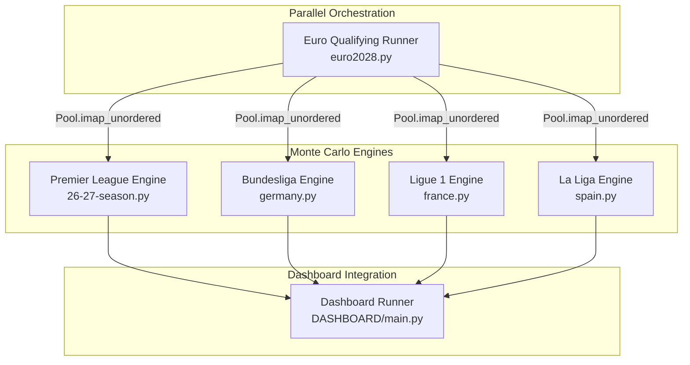
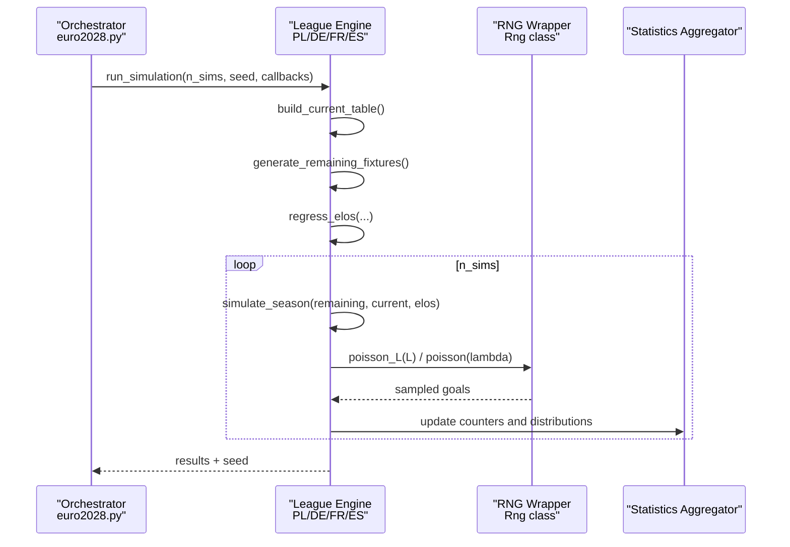
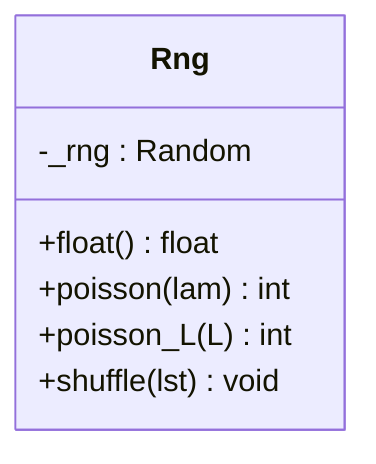
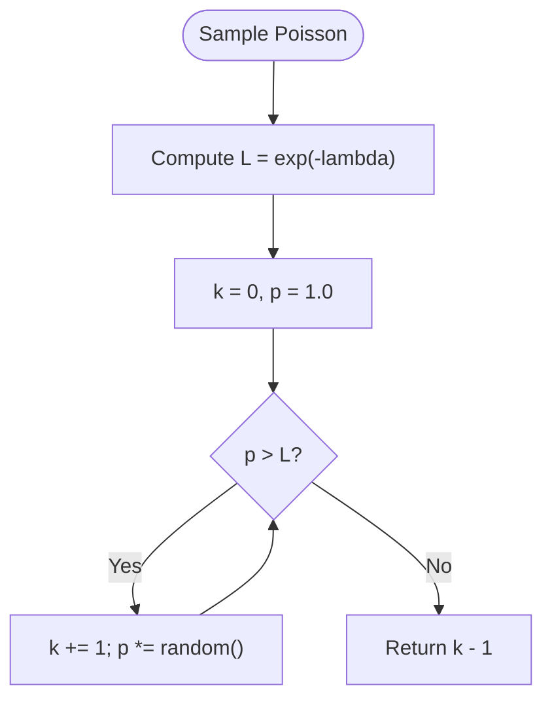
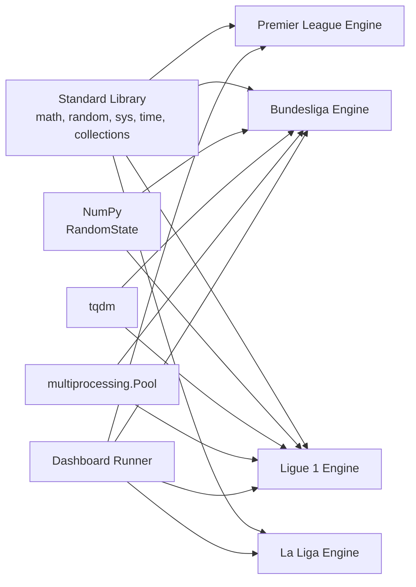

# Performance Optimization and Scalability

<cite>
**Referenced Files in This Document**
- [26-27-season.py](file://premier-league/26-27-season.py)
- [germany.py](file://european_leagues/germany.py)
- [france.py](file://european_leagues/france.py)
- [spain.py](file://european_leagues/spain.py)
- [euro2028.py](file://euro/euro2028.py)
- [main.py](file://DASHBOARD/main.py)
</cite>

## Table of Contents
1. [Introduction](#introduction)
2. [Project Structure](#project-structure)
3. [Core Components](#core-components)
4. [Architecture Overview](#architecture-overview)
5. [Detailed Component Analysis](#detailed-component-analysis)
6. [Dependency Analysis](#dependency-analysis)
7. [Performance Considerations](#performance-considerations)
8. [Troubleshooting Guide](#troubleshooting-guide)
9. [Conclusion](#conclusion)

## Introduction
This document explains the performance optimization techniques used across the Monte Carlo engines in this repository, focusing on:
- Optimized Python port architecture for large-scale simulations
- Memory management using `__slots__` in the RNG wrapper
- Efficient data structures for millions of simulation runs
- Parallel processing capabilities for scaling across CPU cores
- Random seed management for reproducibility
- Caching and snapshot mechanisms for repeated calculations and UI feedback
- Poisson sampling optimization using the L parameter instead of lambda
- The MAX_GOALS constraint to limit computational overhead

The analysis draws from the Premier League unified engine and European league simulators that share a consistent Monte Carlo pattern.

## Project Structure
The Monte Carlo engines are implemented as per-league modules with a common structure:
- Constants for ELO, expected goals, and goal caps
- RNG wrappers and optimized Poisson samplers
- Fixture generation and table state updates
- Single-season simulation loop
- Monte Carlo orchestration with progress callbacks and snapshots
- Optional parallel execution at higher levels

**Diagram sources**
- [26-27-season.py:95-141](file://premier-league/26-27-season.py#L95-L141)
- [germany.py:160-166](file://european_leagues/germany.py#L160-L166)
- [france.py:155-161](file://european_leagues/france.py#L155-L161)
- [spain.py:157-167](file://european_leagues/spain.py#L157-L167)
- [euro2028.py:969-1006](file://euro/euro2028.py#L969-L1006)
- [main.py:297-330](file://DASHBOARD/main.py#L297-L330)

**Section sources**
- [26-27-season.py:1-23](file://premier-league/26-27-season.py#L1-L23)
- [germany.py:1-36](file://european_leagues/germany.py#L1-L36)
- [france.py:1-30](file://european_leagues/france.py#L1-L30)
- [spain.py:152-167](file://european_leagues/spain.py#L152-L167)
- [euro2028.py:969-1006](file://euro/euro2028.py#L969-L1006)
- [main.py:297-330](file://DASHBOARD/main.py#L297-L330)

## Core Components
Key components shared across engines:
- Rng wrapper with `__slots__` for memory efficiency
- Optimized Poisson sampler using L = exp(-lambda)
- Goal cap via MAX_GOALS
- Expected goals model based on ELO differences
- Fixture generation and table update logic
- Monte Carlo loop with progress and snapshot callbacks
- Parallel execution via multiprocessing Pool

**Section sources**
- [26-27-season.py:95-141](file://premier-league/26-27-season.py#L95-L141)
- [germany.py:160-166](file://european_leagues/germany.py#L160-L166)
- [france.py:155-161](file://european_leagues/france.py#L155-L161)
- [spain.py:157-167](file://european_leagues/spain.py#L157-L167)
- [euro2028.py:969-1006](file://euro/euro2028.py#L969-L1006)
- [main.py:297-330](file://DASHBOARD/main.py#L297-L330)

## Architecture Overview
The Monte Carlo engines follow a consistent pipeline:
1. Initialize RNGs (Python random and NumPy RandomState) with deterministic seeds
2. Build current tables from played matches
3. Generate remaining fixtures
4. Regress ELO ratings toward league mean based on games played
5. Run single-season simulations over all remaining fixtures
6. Aggregate statistics (title probabilities, top-4, relegation, points distributions)
7. Provide progress callbacks and periodic snapshots for UI or external consumers
8. Optionally run in parallel across multiple processes using multiprocessing.Pool

**Diagram sources**
- [26-27-season.py:138-141](file://premier-league/26-27-season.py#L138-L141)
- [germany.py:228-242](file://european_leagues/germany.py#L228-L242)
- [france.py:223-237](file://european_leagues/france.py#L223-L237)
- [spain.py:222-241](file://european_leagues/spain.py#L222-L241)
- [euro2028.py:969-1006](file://euro/euro2028.py#L969-L1006)

## Detailed Component Analysis

### Rng Class and Memory Management with __slots__
The Rng class wraps Python’s random.Random and exposes methods for float generation, shuffling, and Poisson sampling. It uses `__slots__` to reduce per-instance memory overhead by restricting dynamic attribute creation.

- `__slots__ = ('_rng',)` ensures only `_rng` is stored, avoiding dict overhead per instance
- `poisson_L(L)` implements Knuth’s algorithm using precomputed L = exp(-lambda), which avoids repeated exponentiation inside the loop
- `poisson(lam)` delegates to `poisson_L(math.exp(-lam))`, centralizing the optimized path

Complexity:
- Time: O(k) where k is the sampled count; average k ≈ lambda
- Space: O(1) due to `__slots__` and minimal local variables

Memory benefits:
- Eliminates per-instance dictionary overhead
- Reduces GC pressure when creating thousands of RNG instances

**Diagram sources**
- [26-27-season.py:98-122](file://premier-league/26-27-season.py#L98-L122)

**Section sources**
- [26-27-season.py:98-122](file://premier-league/26-27-season.py#L98-L122)

### Poisson Sampling Optimization Using L Parameter
Instead of calling library Poisson functions repeatedly, the engines compute L = exp(-lambda) once and sample using a product-of-uniforms loop. This reduces function call overhead and leverages local variable access patterns.

Benefits:
- Avoids repeated math.exp calls inside the loop
- Minimizes attribute lookups by binding `random = self._rng.random` locally
- Enables vectorization-friendly patterns if adapted to NumPy later

**Diagram sources**
- [26-27-season.py:110-118](file://premier-league/26-27-season.py#L110-L118)
- [spain.py:157-167](file://european_leagues/spain.py#L157-L167)

**Section sources**
- [26-27-season.py:110-118](file://premier-league/26-27-season.py#L110-L118)
- [spain.py:157-167](file://european_leagues/spain.py#L157-L167)

### MAX_GOALS Constraint
All engines cap sampled goals at MAX_GOALS to prevent extreme outliers and reduce tail computation costs.

- Premier League: MAX_GOALS = 10
- Bundesliga: MAX_GOALS = 10
- Ligue 1: MAX_GOALS = 10
- La Liga: Uses min(..., MAX_GOALS) in score sampling

Impact:
- Bounds worst-case loops in Poisson sampling
- Stabilizes variance and improves convergence speed for probability estimates

**Section sources**
- [26-27-season.py:15-16](file://premier-league/26-27-season.py#L15-L16)
- [germany.py:28-29](file://european_leagues/germany.py#L28-L29)
- [france.py:23-24](file://european_leagues/france.py#L23-L24)
- [germany.py:164-165](file://european_leagues/germany.py#L164-L165)
- [france.py:159-160](file://european_leagues/france.py#L159-L160)

### Expected Goals Model and ELO Regression
Expected goals are modeled as exponential functions of ELO differences, with home advantage and sensitivity parameters. ELO ratings are regressed toward the league mean based on games played, reducing noise early in the season.

- Home/Away XG base rates differ
- Sensitivity scales impact of ELO difference on expected goals
- Regression pull decreases linearly as teams play more games

**Section sources**
- [26-27-season.py:132-135](file://premier-league/26-27-season.py#L132-L135)
- [germany.py:39-55](file://european_leagues/germany.py#L39-L55)
- [france.py:33-38](file://european_leagues/france.py#L33-L38)

### Data Structures for Large-Scale Simulations
Engines use efficient data structures:
- defaultdict and Counter for aggregating counts and distributions
- Preallocated dictionaries for team stats to avoid repeated allocations
- Lists of tuples for fixtures to minimize object overhead

Optimizations:
- Copying current table once per simulation to isolate state
- Reusing fixture lists across simulations where possible
- Using integer keys and simple dicts for fast lookups

**Section sources**
- [germany.py:228-242](file://european_leagues/germany.py#L228-L242)
- [france.py:223-237](file://european_leagues/france.py#L223-L237)
- [26-27-season.py:677-694](file://premier-league/26-27-season.py#L677-L694)

### Parallel Processing Capabilities
Higher-level orchestration uses multiprocessing.Pool to distribute independent simulation batches across CPU cores:
- pool.imap_unordered yields results as they complete
- Progress bar and ETA computed incrementally
- Aggregation of partial results into global counters

Scalability:
- Linear speedup up to number of physical cores
- Minimal inter-process communication overhead since each worker runs full simulations independently

**Section sources**
- [euro2028.py:969-1006](file://euro/euro2028.py#L969-L1006)

### Random Seed Management for Reproducibility
Each engine initializes both Python’s random.Random and NumPy’s RandomState with the same seed:
- Ensures deterministic behavior across runs
- Allows exact reproduction of simulation outcomes
- Supports seeding strategies (fixed, system-random, or user-provided)

Reproducibility guarantees:
- Consistent fixture ordering and random draws
- Stable probability estimates across identical configurations

**Section sources**
- [germany.py:57-58](file://european_leagues/germany.py#L57-L58)
- [germany.py:247-252](file://european_leagues/germany.py#L247-L252)
- [france.py:40-41](file://european_leagues/france.py#L40-L41)
- [france.py:242-247](file://european_leagues/france.py#L242-L247)

### Caching Mechanisms and Snapshots
Engines provide:
- Periodic snapshots of running statistics (average points, probabilities)
- Callback interfaces for UI integration (progress and snapshot events)
- Dashboard runner aggregates snapshots across leagues

Benefits:
- Real-time feedback during long-running simulations
- Reduced memory footprint by streaming snapshots rather than storing all intermediate states

**Section sources**
- [germany.py:276-312](file://european_leagues/germany.py#L276-L312)
- [france.py:265-300](file://european_leagues/france.py#L265-L300)
- [main.py:297-330](file://DASHBOARD/main.py#L297-L330)

## Dependency Analysis
The engines depend on:
- Standard library: math, random, sys, time, collections
- NumPy: RandomState for vectorized operations in some engines
- tqdm: Progress bars (disabled in GUI contexts)
- multiprocessing: For parallel execution at higher levels

Coupling:
- Low coupling between engines; each is self-contained
- High cohesion within each engine around simulation logic
- Shared patterns enable easy extension to new leagues

External integrations:
- Dashboard runner consumes engine outputs via callback interfaces
- Euro orchestrator distributes work across processes

**Diagram sources**
- [26-27-season.py:1-7](file://premier-league/26-27-season.py#L1-L7)
- [germany.py:12-17](file://european_leagues/germany.py#L12-L17)
- [france.py:7-12](file://european_leagues/france.py#L7-L12)
- [euro2028.py:969-1006](file://euro/euro2028.py#L969-L1006)
- [main.py:297-330](file://DASHBOARD/main.py#L297-L330)

**Section sources**
- [26-27-season.py:1-7](file://premier-league/26-27-season.py#L1-L7)
- [germany.py:12-17](file://european_leagues/germany.py#L12-L17)
- [france.py:7-12](file://european_leagues/france.py#L7-L12)
- [euro2028.py:969-1006](file://euro/euro2028.py#L969-L1006)
- [main.py:297-330](file://DASHBOARD/main.py#L297-L330)

## Performance Considerations
- Memory Efficiency: `__slots__` in Rng reduces per-instance overhead, critical when instantiating many RNG objects
- CPU Efficiency: L-based Poisson sampling minimizes function call overhead and leverages local variable access
- Computational Boundaries: MAX_GOALS caps extreme outcomes, stabilizing variance and improving convergence
- Parallelism: Multiprocessing Pool enables near-linear scaling across cores for independent simulation batches
- Reproducibility: Deterministic seeding ensures consistent results across runs and facilitates debugging
- Streaming Outputs: Snapshot callbacks reduce memory pressure and enable real-time UI updates

Benchmarking guidance:
- Measure wall-clock time per simulation batch using time.time()
- Track memory usage via tracemalloc or psutil for large runs
- Compare single-core vs multi-core throughput to estimate scalability factor
- Validate probability stability by increasing n_sims and observing convergence

[No sources needed since this section provides general guidance]

## Troubleshooting Guide
Common issues and resolutions:
- Non-reproducible results: Ensure seeds are set consistently for both random.Random and np.random.RandomState
- Excessive memory usage: Verify Rng uses `__slots__`; avoid storing unnecessary attributes
- Slow simulations: Check if MAX_GOALS is too high; consider capping at 10–12 for stability
- UI freezes: Disable tqdm in GUI contexts (_DISABLE_TQDM); use snapshot callbacks sparingly
- Parallel overhead: Ensure worker tasks are sufficiently heavy; small simulations may not benefit from multiprocessing

**Section sources**
- [germany.py:57-58](file://european_leagues/germany.py#L57-L58)
- [germany.py:247-252](file://european_leagues/germany.py#L247-L252)
- [france.py:40-41](file://european_leagues/france.py#L40-L41)
- [france.py:242-247](file://european_leagues/france.py#L242-L247)
- [main.py:297-330](file://DASHBOARD/main.py#L297-L330)

## Conclusion
The Monte Carlo engines in this repository implement a robust, scalable architecture optimized for large-scale sports simulations. Key optimizations include memory-efficient RNG wrappers with `__slots__`, L-based Poisson sampling, MAX_GOALS constraints, deterministic seeding, and parallel execution via multiprocessing. These techniques collectively enable efficient execution of millions of simulations while maintaining reproducibility and providing real-time feedback through snapshot callbacks.

[No sources needed since this section summarizes without analyzing specific files]