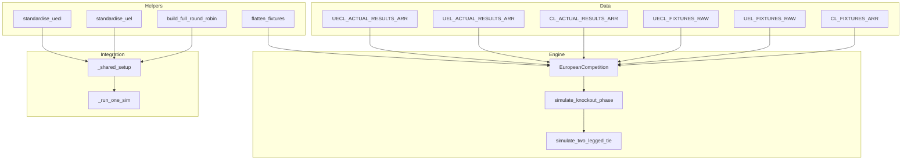
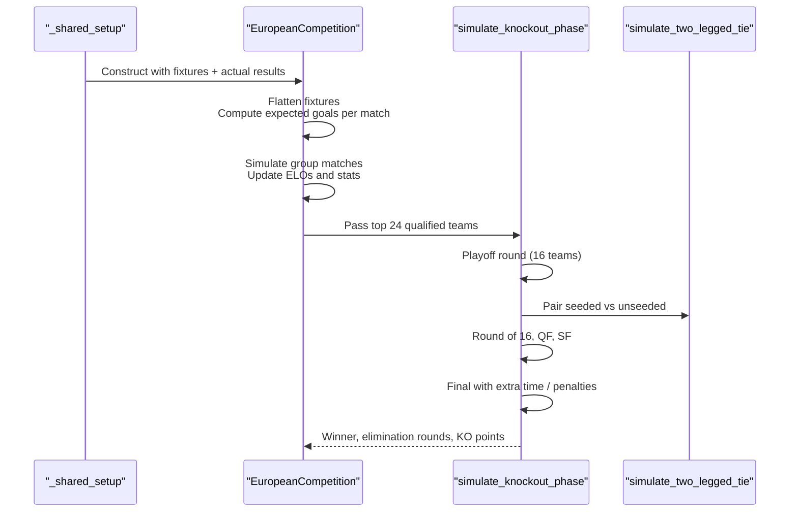
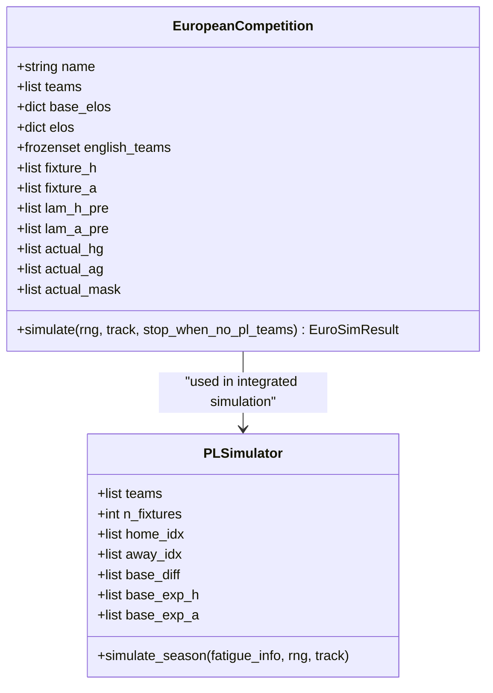
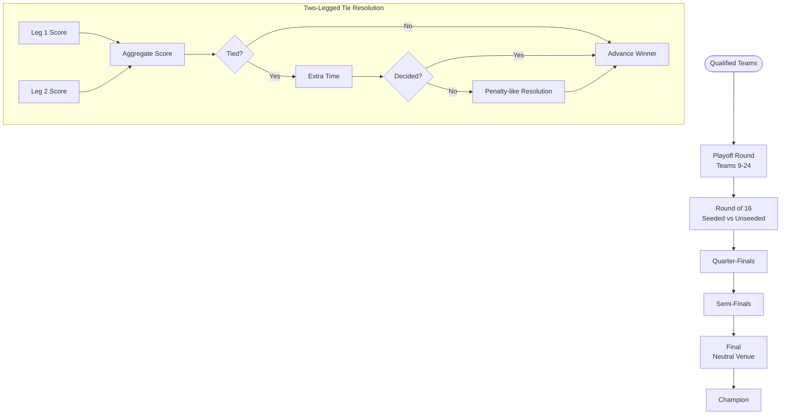
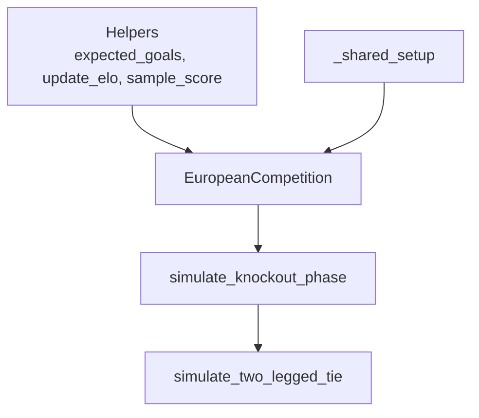

# Fixture Generation and Scheduling

<cite>
**Referenced Files in This Document**
- [26-27-season.py](file://premier-league/26-27-season.py)
</cite>

## Table of Contents
1. [Introduction](#introduction)
2. [Project Structure](#project-structure)
3. [Core Components](#core-components)
4. [Architecture Overview](#architecture-overview)
5. [Detailed Component Analysis](#detailed-component-analysis)
6. [Dependency Analysis](#dependency-analysis)
7. [Performance Considerations](#performance-considerations)
8. [Troubleshooting Guide](#troubleshooting-guide)
9. [Conclusion](#conclusion)

## Introduction
This document explains the fixture generation and scheduling system used for league and European competitions. It covers:
- How full round-robin fixtures are built using build_full_round_robin
- How Champions League, Europa League, and Conference League fixtures are structured and scheduled
- How match scheduling logic, home/away determination, and actual results integration work
- How knockout stages are organized for European competitions
- Examples of fixture manipulation and custom schedule generation patterns

The implementation is centered around a single comprehensive simulation file that defines data structures, helper functions, and competition engines.

## Project Structure
The fixture system lives primarily in one large Python module that contains:
- Data arrays for European competition fixtures and actual results
- Helpers to build round-robin schedules and flatten nested fixtures
- A European competition engine that simulates group stages and knockout phases
- Knockout phase logic with seeded/unseeded pairings and final rules
- Integration points where PL fixtures and European fixtures are combined

**Diagram sources**
- [26-27-season.py:397-450](file://premier-league/26-27-season.py#L397-L450)
- [26-27-season.py:492-541](file://premier-league/26-27-season.py#L492-L541)
- [26-27-season.py:578-615](file://premier-league/26-27-season.py#L578-L615)
- [26-27-season.py:648-663](file://premier-league/26-27-season.py#L648-L663)
- [26-27-season.py:884-1066](file://premier-league/26-27-season.py#L884-L1066)
- [26-27-season.py:1072-1245](file://premier-league/26-27-season.py#L1072-L1245)
- [26-27-season.py:2100-2163](file://premier-league/26-27-season.py#L2100-L2163)

**Section sources**
- [26-27-season.py:397-450](file://premier-league/26-27-season.py#L397-L450)
- [26-27-season.py:492-541](file://premier-league/26-27-season.py#L492-L541)
- [26-27-season.py:578-615](file://premier-league/26-27-season.py#L578-L615)
- [26-27-season.py:648-663](file://premier-league/26-27-season.py#L648-L663)
- [26-27-season.py:884-1066](file://premier-league/26-27-season.py#L884-L1066)
- [26-27-season.py:1072-1245](file://premier-league/26-27-season.py#L1072-L1245)
- [26-27-season.py:2100-2163](file://premier-league/26-27-season.py#L2100-L2163)

## Core Components
- Round-robin builder: build_full_round_robin generates all ordered home/away pairs from a set of teams observed in actual results.
- European competition engine: EuropeanCompetition consumes pre-defined fixtures, integrates actual results, simulates group stage matches, and advances to knockout.
- Knockout phase: simulate_knockout_phase organizes playoff rounds, Round of 16 seeding, quarter-finals, semi-finals, and final with extra time and penalty-like resolution.
- Two-legged tie resolver: simulate_two_legged_tie computes aggregate scores, applies extra-time logic, and resolves ties probabilistically based on Elo.

Key responsibilities:
- Fixture normalization and flattening
- Actual result injection into simulated fixtures
- Home/away advantage modeling via expected goals
- ELO-based score sampling and rating updates
- Knockout bracket construction and progression

**Section sources**
- [26-27-season.py:648-663](file://premier-league/26-27-season.py#L648-L663)
- [26-27-season.py:884-1066](file://premier-league/26-27-season.py#L884-L1066)
- [26-27-season.py:1072-1245](file://premier-league/26-27-season.py#L1072-L1245)

## Architecture Overview
The system composes three layers:
- Data layer: Fixed fixture arrays for Champions League, Europa League, and Conference League; corresponding actual results arrays; name standardization maps.
- Engine layer: EuropeanCompetition builds internal fixture arrays, injects actual results, simulates group stage matches, and produces rankings and qualified teams.
- Knockout layer: simulate_knockout_phase orchestrates multi-stage knockout with seeded/unseeded pairings and final rules.

**Diagram sources**
- [26-27-season.py:2100-2163](file://premier-league/26-27-season.py#L2100-L2163)
- [26-27-season.py:884-1066](file://premier-league/26-27-season.py#L884-L1066)
- [26-27-season.py:1072-1245](file://premier-league/26-27-season.py#L1072-L1245)

## Detailed Component Analysis

### Round-Robin Fixtures: build_full_round_robin
Purpose:
- Build a complete set of ordered home/away fixtures from observed teams in actual results.
- Used to generate the full Premier League season schedule when simulating alongside European competitions.

Behavior:
- Extracts unique team names from actual results
- Generates every possible ordered pair (home, away) excluding self-matches
- Returns a flat list of tuples suitable for simulation loops

Complexity:
- Time: O(T^2) where T is the number of teams
- Space: O(T^2) for the fixture list

Usage context:
- Called during setup to produce the PL fixtures list
- Combined with European fixtures for integrated simulations

**Section sources**
- [26-27-season.py:648-655](file://premier-league/26-27-season.py#L648-L655)
- [26-27-season.py:2111-2112](file://premier-league/26-27-season.py#L2111-L2112)

### Champions League Fixtures: CL_FIXTURES_ARR
Structure:
- Array of rounds, each containing a list of home/away pairs
- Represents the group stage matchdays for the Champions League

Actual results:
- CL_ACTUAL_RESULTS_ARR provides real-world scores for early matchdays
- These are injected into the simulation so that already-played matches use fixed outcomes

Home/Away determination:
- First element of each tuple is home team, second is away team
- Expected goals are computed using ELO differences plus home advantage

Integration:
- Passed to EuropeanCompetition along with pl_elos and cl_actual
- Flattened internally for efficient iteration

**Section sources**
- [26-27-season.py:397-450](file://premier-league/26-27-season.py#L397-L450)
- [26-27-season.py:452-490](file://premier-league/26-27-season.py#L452-L490)
- [26-27-season.py:2136-2138](file://premier-league/26-27-season.py#L2136-L2138)

### Europa League Fixtures: UEL_FIXTURES_RAW
Structure:
- Array of rounds with home/away pairs
- Uses abbreviated or alternate team names

Name standardization:
- UEL_NAME_MAP maps short names to standardized names
- standardise_uel normalizes team names before constructing the competition

Actual results:
- UEL_ACTUAL_RESULTS_ARR includes real scores for early rounds
- Injected into EuropeanCompetition to fix known outcomes

Normalization flow:
- Raw fixtures are transformed via standardise_uel before being passed to EuropeanCompetition

**Section sources**
- [26-27-season.py:492-541](file://premier-league/26-27-season.py#L492-L541)
- [26-27-season.py:543-554](file://premier-league/26-27-season.py#L543-L554)
- [26-27-season.py:557-576](file://premier-league/26-27-season.py#L557-L576)
- [26-27-season.py:2131-2138](file://premier-league/26-27-season.py#L2131-L2138)

### Conference League Fixtures: UECL_FIXTURES_RAW
Structure:
- Array of rounds with home/away pairs
- Uses alternate or shortened team names

Name standardization:
- UECL_NAME_MAP maps alternate names to standardized names
- standardise_uecl normalizes team names prior to competition construction

Actual results:
- UECL_ACTUAL_RESULTS_ARR includes real scores for early rounds
- Injected into EuropeanCompetition to fix known outcomes

Normalization flow:
- Raw fixtures are transformed via standardise_uecl before being passed to EuropeanCompetition

**Section sources**
- [26-27-season.py:578-615](file://premier-league/26-27-season.py#L578-L615)
- [26-27-season.py:617-629](file://premier-league/26-27-season.py#L617-L629)
- [26-27-season.py:632-642](file://premier-league/26-27-season.py#L632-L642)
- [26-27-season.py:2131-2138](file://premier-league/26-27-season.py#L2131-L2138)

### European Competition Engine: EuropeanCompetition
Responsibilities:
- Initialize teams, ELOs, and fixture arrays
- Flatten nested round fixtures into linear sequences
- Compute expected goals per match using ELO and home advantage
- Inject actual results where available
- Simulate group stage matches, update ELOs, accumulate stats
- Produce ranking and qualified teams for knockout phase

Key behaviors:
- Home/away determination uses tuple order (home, away)
- Actual results override simulated scores when present
- Stats include points, wins, draws, goals for/against, away goals, away wins
- Ranking uses multiple tiebreakers including opponent performance metrics

Knockout handoff:
- Top 24 teams advance to simulate_knockout_phase
- Team results are tracked for both group and knockout stages

**Diagram sources**
- [26-27-season.py:884-1066](file://premier-league/26-27-season.py#L884-L1066)
- [26-27-season.py:1313-1354](file://premier-league/26-27-season.py#L1313-L1354)

**Section sources**
- [26-27-season.py:884-1066](file://premier-league/26-27-season.py#L884-L1066)

### Knockout Phase Logic
Stages:
- Playoff round among teams ranked 9–24
- Round of 16 pairing seeded top 8 with playoff winners
- Quarter-finals, semi-finals, and final

Pairing rules:
- Seeded vs unseeded matchups in playoff round
- Balanced bracket construction for subsequent rounds

Match resolution:
- Two-legged ties compute aggregate scores
- Extra time modeled by scaling expected goals
- Penalties resolved probabilistically using Elo difference

Final rules:
- Single match at neutral venue with home advantage adjustments
- Extra time and penalty-like resolution if tied

**Diagram sources**
- [26-27-season.py:1072-1245](file://premier-league/26-27-season.py#L1072-L1245)

**Section sources**
- [26-27-season.py:1072-1245](file://premier-league/26-27-season.py#L1072-L1245)

### Match Scheduling Logic and Home/Away Determination
- Fixtures are defined as nested lists of rounds, each containing tuples of (home, away).
- EuropeanCompetition flattens these into linear arrays for efficient iteration.
- Home advantage is applied by adjusting expected goals based on ELO difference and a home bonus.
- Actual results override simulated scores when present, ensuring real-world outcomes are respected.

Home/Away determination:
- Tuple order dictates home/away assignment
- Expected goals computation accounts for home advantage

Actual results integration:
- Actual results arrays are converted to dictionaries keyed by (home, away)
- During simulation, if a match exists in actual results, those scores are used instead of simulated ones

**Section sources**
- [26-27-season.py:884-938](file://premier-league/26-27-season.py#L884-L938)
- [26-27-season.py:969-1013](file://premier-league/26-27-season.py#L969-L1013)

### Knockout Stages Structure for European Competitions
- The knockout phase begins after group stage qualification (top 24 teams).
- Playoff round determines entry into Round of 16.
- Bracket construction ensures balanced seeding and avoids early clashes between top teams.
- Each knockout tie is two-legged except the final.
- Extra time and penalty-like resolution handle ties.

Progression tracking:
- Elimination rounds recorded per team
- Knockout points accumulated for coefficient calculations

**Section sources**
- [26-27-season.py:1133-1245](file://premier-league/26-27-season.py#L1133-L1245)

### Fixture Manipulation and Custom Schedule Generation
Patterns demonstrated in the codebase:
- Flattening nested round fixtures into a single list for processing
- Standardizing team names before constructing competitions
- Building full round-robin schedules from observed teams
- Integrating actual results into simulated fixtures

Examples:
- Flattening: flatten_fixtures converts nested rounds to a flat list
- Standardization: standardise_uel and standardise_uecl normalize team names
- Round-robin: build_full_round_robin generates all ordered pairs for league play

Custom schedule generation tips:
- Use flatten_fixtures to process any nested fixture structure
- Apply name standardization maps to ensure consistent team identifiers
- Inject actual results via dictionary mapping to lock in known outcomes
- Extend EuropeanCompetition with custom fixture arrays for new competitions

**Section sources**
- [26-27-season.py:648-663](file://premier-league/26-27-season.py#L648-L663)
- [26-27-season.py:543-554](file://premier-league/26-27-season.py#L543-L554)
- [26-27-season.py:617-629](file://premier-league/26-27-season.py#L617-L629)
- [26-27-season.py:2131-2138](file://premier-league/26-27-season.py#L2131-L2138)

## Dependency Analysis
Internal dependencies:
- EuropeanCompetition depends on helper functions for expected goals, ELO updates, and score sampling
- Knockout phase depends on two-legged tie resolution and final match logic
- Setup functions depend on name standardization and fixture normalization

External dependencies:
- Random number generation for Poisson sampling and probabilistic decisions
- Math utilities for exponential and logarithmic operations

Coupling:
- High cohesion within EuropeanCompetition for fixture and ELO management
- Moderate coupling between setup and competition engines through shared data structures

Potential circular dependencies:
- None observed; dependencies flow from setup to engine to knockout logic

**Diagram sources**
- [26-27-season.py:884-1066](file://premier-league/26-27-season.py#L884-L1066)
- [26-27-season.py:1072-1245](file://premier-league/26-27-season.py#L1072-L1245)
- [26-27-season.py:2100-2163](file://premier-league/26-27-season.py#L2100-L2163)

**Section sources**
- [26-27-season.py:884-1066](file://premier-league/26-27-season.py#L884-L1066)
- [26-27-season.py:1072-1245](file://premier-league/26-27-season.py#L1072-L1245)
- [26-27-season.py:2100-2163](file://premier-league/26-27-season.py#L2100-L2163)

## Performance Considerations
- Round-robin generation is O(T^2), which is acceptable for typical league sizes (~20 teams)
- Flattening fixtures reduces overhead during simulation loops
- Actual result injection avoids unnecessary computation for already-played matches
- Knockout phase scales logarithmically with number of teams due to bracket structure
- ELO updates occur per match; consider batching if extending to larger datasets

Optimization opportunities:
- Precompute expected goals for static fixtures
- Cache ELO regression results across simulations
- Parallelize independent competition simulations

[No sources needed since this section provides general guidance]

## Troubleshooting Guide
Common issues and resolutions:
- Mismatched team names: Ensure name standardization maps are applied consistently
- Missing actual results: Verify actual results arrays contain all required matches
- Incorrect home/away assignment: Confirm tuple order matches intended scheduling
- Knockout bracket errors: Validate seeding rules and pairing logic

Debugging steps:
- Inspect flattened fixture arrays to verify structure
- Check actual result masks to confirm injection points
- Review ELO updates and expected goals for anomalies
- Trace knockout progression through elimination round records

**Section sources**
- [26-27-season.py:884-938](file://premier-league/26-27-season.py#L884-L938)
- [26-27-season.py:1133-1245](file://premier-league/26-27-season.py#L1133-L1245)

## Conclusion
The fixture generation and scheduling system provides a robust framework for simulating league and European competitions. It combines predefined fixture arrays with dynamic simulation logic, actual result integration, and sophisticated knockout phase handling. The modular design allows for easy extension to new competitions and customization of scheduling rules.

[No sources needed since this section summarizes without analyzing specific files]