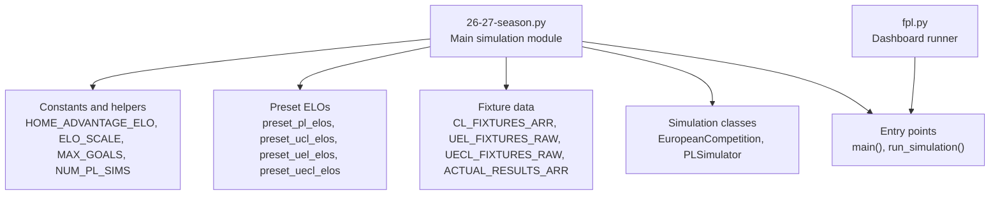
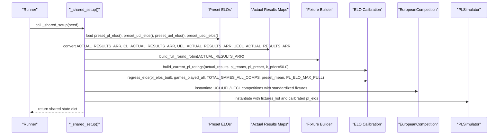
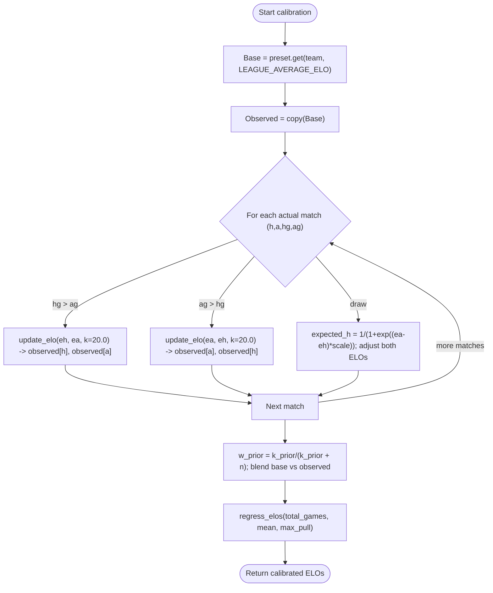
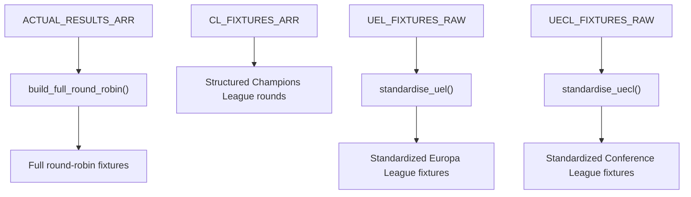
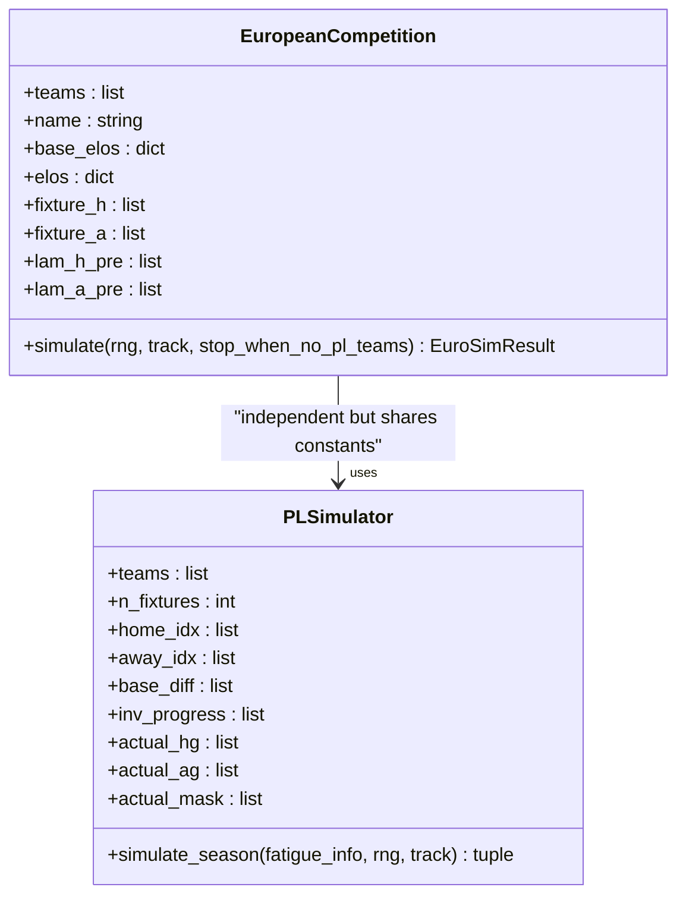
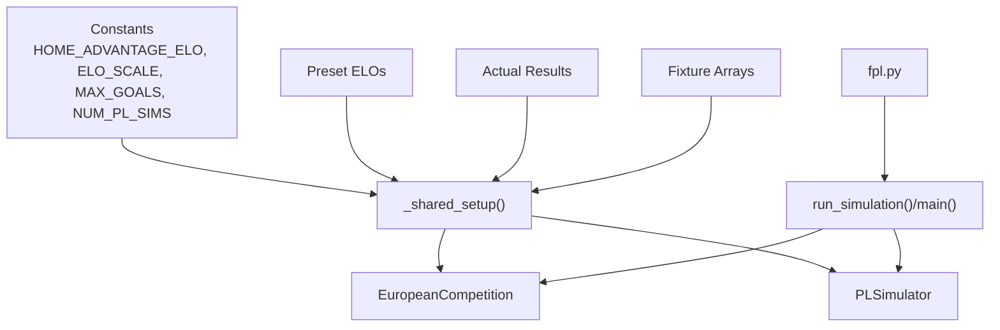

# Initial Setup and Configuration

<cite>
**Referenced Files in This Document**
- [26-27-season.py](file://premier-league/26-27-season.py)
- [fpl.py](file://premier-league/fpl.py)
</cite>

## Table of Contents
1. [Introduction](#introduction)
2. [Project Structure](#project-structure)
3. [Core Components](#core-components)
4. [Architecture Overview](#architecture-overview)
5. [Detailed Component Analysis](#detailed-component-analysis)
6. [Dependency Analysis](#dependency-analysis)
7. [Performance Considerations](#performance-considerations)
8. [Troubleshooting Guide](#troubleshooting-guide)
9. [Conclusion](#conclusion)
10. [Appendices](#appendices)

## Introduction
This document explains the simulation initialization process for a unified Premier League, Champions League, Europa League, and Conference League model. It focuses on:
- How team ELO ratings are loaded from preset dictionaries and calibrated using actual results
- How fixtures are generated and scheduled across competitions
- The role of configuration constants such as HOME_ADVANTAGE_ELO, ELO_SCALE, MAX_GOALS, and NUM_PL_SIMS
- Practical examples for modifying team ratings, adjusting simulation parameters, and configuring competition-specific settings

The implementation is centered around a single comprehensive simulation module that builds shared state once, then runs many Monte Carlo simulations to produce probabilistic outcomes for league standings, European qualification, cup winners, manager sack risk, and UEFA association coefficients.

## Project Structure
The relevant code lives under the Premier League project directory. The main simulation logic is implemented in one large Python file that contains:
- Constants and helper functions
- Preset ELO dictionaries for each competition
- Fixture arrays and result tables
- Simulation classes for the Premier League and European competitions
- Entry points for running simulations and dashboard integration

**Diagram sources**
- [26-27-season.py:1-25](file://premier-league/26-27-season.py#L1-L25)
- [26-27-season.py:155-219](file://premier-league/26-27-season.py#L155-L219)
- [26-27-season.py:359-642](file://premier-league/26-27-season.py#L359-L642)
- [26-27-season.py:884-1066](file://premier-league/26-27-season.py#L884-L1066)
- [26-27-season.py:1313-1440](file://premier-league/26-27-season.py#L1313-L1440)
- [26-27-season.py:2262-2933](file://premier-league/26-27-season.py#L2262-L2933)
- [fpl.py:767-804](file://premier-league/fpl.py#L767-L804)

**Section sources**
- [26-27-season.py:1-25](file://premier-league/26-27-season.py#L1-L25)
- [fpl.py:767-804](file://premier-league/fpl.py#L767-L804)

## Core Components
- Constants define core simulation behavior:
  - HOME_ADVANTAGE_ELO: base home advantage added to expected goals via ELO difference
  - ELO_SCALE: scales ELO differences into win probabilities
  - LEAGUE_AVERAGE_ELO: default rating for unknown teams
  - MAX_GOALS: caps sampled goals per match
  - NUM_PL_SIMS: number of Monte Carlo simulations for the Premier League
  - BASE_HOME_XG / BASE_AWAY_XG: baseline expected goals for home and away
  - XG_ELO_SENSITIVITY: how much ELO difference shifts expected goals
  - EXTRA_TIME_XG_FACTOR: reduces expected goals during extra time scenarios
- Preset ELO dictionaries provide initial team strengths for each competition:
  - preset_pl_elos
  - preset_ucl_elos
  - preset_uel_elos
  - preset_uecl_elos
- Fixture arrays define structured schedules:
  - CL_FIXTURES_ARR (Champions League)
  - UEL_FIXTURES_RAW (Europa League)
  - UECL_FIXTURES_RAW (Conference League)
  - ACTUAL_RESULTS_ARR (Premier League actual results used to build full round-robin fixtures)
- Simulation classes:
  - EuropeanCompetition: simulates league phase and knockout phase for UCL/UEL/UECL
  - PLSimulator: simulates the Premier League season with fatigue effects from European participation
- Entry points:
  - main(): runs the full simulation loop and prints detailed outputs
  - run_simulation(): returns aggregated statistics suitable for dashboards and external runners

**Section sources**
- [26-27-season.py:12-35](file://premier-league/26-27-season.py#L12-L35)
- [26-27-season.py:155-219](file://premier-league/26-27-season.py#L155-L219)
- [26-27-season.py:359-642](file://premier-league/26-27-season.py#L359-L642)
- [26-27-season.py:884-1066](file://premier-league/26-27-season.py#L884-L1066)
- [26-27-season.py:1313-1440](file://premier-league/26-27-season.py#L1313-L1440)
- [26-27-season.py:2262-2933](file://premier-league/26-27-season.py#L2262-L2933)

## Architecture Overview
The initialization pipeline constructs shared state once, then repeatedly simulates matches across all competitions. The key steps are:
1. Initialize RNG seed
2. Load preset ELO dictionaries
3. Convert actual results arrays into maps
4. Build full round-robin fixtures for the Premier League
5. Calibrate current PL ELOs using actual results
6. Apply ELO regression toward preset means based on games played
7. Standardize Europa and Conference League fixture names
8. Instantiate EuropeanCompetition objects for UCL, UEL, UECL
9. Instantiate PLSimulator for the Premier League
10. Run many simulations aggregating stats for rankings, European qualification, cups, and manager risk

**Diagram sources**
- [26-27-season.py:2092-2163](file://premier-league/26-27-season.py#L2092-L2163)
- [26-27-season.py:648-663](file://premier-league/26-27-season.py#L648-L663)
- [26-27-season.py:669-694](file://premier-league/26-27-season.py#L669-L694)
- [26-27-season.py:884-938](file://premier-league/26-27-season.py#L884-L938)
- [26-27-season.py:1313-1354](file://premier-league/26-27-season.py#L1313-L1354)

## Detailed Component Analysis

### ELO Rating Initialization and Calibration
- Preset ELO dictionaries:
  - preset_pl_elos: defines starting ELOs for Premier League teams
  - preset_ucl_elos: defines starting ELOs for Champions League participants
  - preset_uel_elos: defines starting ELOs for Europa League participants
  - preset_uecl_elos: defines starting ELOs for Conference League participants
- Calibration flow:
  - Start with base ratings from presets; if a team is missing, use LEAGUE_AVERAGE_ELO
  - Iterate through actual results to update ELOs incrementally using update_elo or draw adjustments
  - Blend prior preset ratings with observed updates using a Bayesian-like weight (k_prior/(k_prior + n))
  - Apply regression toward preset mean based on total games played across all competitions
- Impact:
  - Ensures ratings reflect both historical expectations (presets) and recent performance (actual results)
  - Prevents overfitting by pulling extreme ratings back toward the mean as more games are simulated

**Diagram sources**
- [26-27-season.py:669-694](file://premier-league/26-27-season.py#L669-L694)

**Section sources**
- [26-27-season.py:155-219](file://premier-league/26-27-season.py#L155-L219)
- [26-27-season.py:669-694](file://premier-league/26-27-season.py#L669-L694)
- [26-27-season.py:2099-2129](file://premier-league/26-27-season.py#L2099-L2129)

### Fixture Generation and Scheduling
- Premier League:
  - Full round-robin fixtures are built from actual results using build_full_round_robin
  - Each team plays every other team twice (home and away), resulting in PL_TOTAL_FIXTURES matches
- Champions League:
  - CL_FIXTURES_ARR provides a structured array of rounds with specific matchups
- Europa League:
  - UEL_FIXTURES_RAW uses abbreviated names; standardise_uel maps them to canonical names
- Conference League:
  - UECL_FIXTURES_RAW uses abbreviated names; standardise_uecl maps them to canonical names
- Scheduling algorithm:
  - Round-robin construction ensures balanced home/away distribution
  - European competitions simulate league phases followed by knockout phases with seeded/unseeded pairings and two-legged ties

**Diagram sources**
- [26-27-season.py:648-663](file://premier-league/26-27-season.py#L648-L663)
- [26-27-season.py:397-450](file://premier-league/26-27-season.py#L397-L450)
- [26-27-season.py:492-554](file://premier-league/26-27-season.py#L492-L554)
- [26-27-season.py:578-629](file://premier-league/26-27-season.py#L578-L629)

**Section sources**
- [26-27-season.py:648-663](file://premier-league/26-27-season.py#L648-L663)
- [26-27-season.py:397-450](file://premier-league/26-27-season.py#L397-L450)
- [26-27-season.py:492-554](file://premier-league/26-27-season.py#L492-L554)
- [26-27-season.py:578-629](file://premier-league/26-27-season.py#L578-L629)

### Simulation Classes and Data Flows
- EuropeanCompetition:
  - Initializes team sets, base ELOs, and precomputed expected goals
  - Simulates league phase with Poisson-distributed goals capped at MAX_GOALS
  - Uses actual results when available; otherwise samples scores
  - Computes ranking and proceeds to knockout phase with two-legged ties and extra time rules
- PLSimulator:
  - Builds index mappings and precomputes base expected goals based on ELO differences plus HOME_ADVANTAGE_ELO
  - Applies fatigue adjustments for teams participating in European competitions
  - Simulates the full Premier League season and produces ranked standings and team results

**Diagram sources**
- [26-27-season.py:884-1066](file://premier-league/26-27-season.py#L884-L1066)
- [26-27-season.py:1313-1440](file://premier-league/26-27-season.py#L1313-L1440)

**Section sources**
- [26-27-season.py:884-1066](file://premier-league/26-27-season.py#L884-L1066)
- [26-27-season.py:1313-1440](file://premier-league/26-27-season.py#L1313-L1440)

### Configuration Constants and Their Impact
- HOME_ADVANTAGE_ELO:
  - Adds a fixed advantage to home teams in expected goals calculations
  - Influences match outcomes and overall scoring distributions
- ELO_SCALE:
  - Controls sensitivity of win probability to ELO differences
  - Larger values make ELO differences less impactful; smaller values increase impact
- MAX_GOALS:
  - Caps the maximum number of goals sampled per match
  - Prevents unrealistic high-scoring outliers
- NUM_PL_SIMS:
  - Determines the number of Monte Carlo simulations run for the Premier League
  - Higher values improve statistical stability at the cost of runtime
- BASE_HOME_XG / BASE_AWAY_XG:
  - Set baseline expected goals for home and away teams before ELO adjustments
- XG_ELO_SENSITIVITY:
  - Modulates how ELO differences shift expected goals
- EXTRA_TIME_XG_FACTOR:
  - Reduces expected goals during extra time scenarios in knockout matches

Practical guidance:
- Increase HOME_ADVANTAGE_ELO to favor home teams more strongly
- Adjust ELO_SCALE to tune how quickly ELO differences translate into win probabilities
- Raise MAX_GOALS cautiously to allow higher-scoring matches if needed
- Increase NUM_PL_SIMS for more stable probabilities; decrease for faster runs

**Section sources**
- [26-27-season.py:12-24](file://premier-league/26-27-season.py#L12-L24)
- [26-27-season.py:138-141](file://premier-league/26-27-season.py#L138-L141)
- [26-27-season.py:2328-2333](file://premier-league/26-27-season.py#L2328-L2333)

### Examples: Modifying Team Ratings and Simulation Parameters
- Modify team ratings:
  - Edit preset_pl_elos to change initial Premier League team strengths
  - Edit preset_ucl_elos, preset_uel_elos, preset_uecl_elos to adjust European team strengths
- Adjust simulation parameters:
  - Change HOME_ADVANTAGE_ELO to alter home advantage strength
  - Change ELO_SCALE to modify ELO-to-probability conversion
  - Change MAX_GOALS to cap goal sampling differently
  - Change NUM_PL_SIMS to control simulation count
- Configure competition-specific settings:
  - Add or remove teams in preset dictionaries
  - Update fixture arrays (CL_FIXTURES_ARR, UEL_FIXTURES_RAW, UECL_FIXTURES_RAW) to reflect new schedules
  - Update name mapping functions (standardise_uel, standardise_uecl) if team naming conventions change

Note: Always ensure consistency between team names in presets, fixtures, and actual results to avoid lookup failures.

**Section sources**
- [26-27-season.py:155-219](file://premier-league/26-27-season.py#L155-L219)
- [26-27-season.py:397-450](file://premier-league/26-27-season.py#L397-L450)
- [26-27-season.py:492-554](file://premier-league/26-27-season.py#L492-L554)
- [26-27-season.py:578-629](file://premier-league/26-27-season.py#L578-L629)

## Dependency Analysis
- Shared constants and helpers are imported and used throughout the module
- Preset ELO dictionaries feed into calibration and regression functions
- Fixture arrays drive EuropeanCompetition and PLSimulator initialization
- Actual results influence both calibration and fixture generation
- Dashboard integration reads NUM_PL_SIMS and calls run_simulation

**Diagram sources**
- [26-27-season.py:12-24](file://premier-league/26-27-season.py#L12-L24)
- [26-27-season.py:2092-2163](file://premier-league/26-27-season.py#L2092-L2163)
- [26-27-season.py:2262-2933](file://premier-league/26-27-season.py#L2262-L2933)
- [fpl.py:767-804](file://premier-league/fpl.py#L767-L804)

**Section sources**
- [26-27-season.py:2092-2163](file://premier-league/26-27-season.py#L2092-L2163)
- [26-27-season.py:2262-2933](file://premier-league/26-27-season.py#L2262-L2933)
- [fpl.py:767-804](file://premier-league/fpl.py#L767-L804)

## Performance Considerations
- NUM_PL_SIMS directly impacts runtime; larger values yield more stable probabilities but take longer
- Precomputing expected goals and ELO-related values reduces repeated calculations during simulations
- Using a custom RNG wrapper improves reproducibility and avoids global state issues
- Fatigue adjustments are applied only when teams are active in European competitions, minimizing unnecessary computation

[No sources needed since this section provides general guidance]

## Troubleshooting Guide
Common issues and resolutions:
- Mismatched team names between presets and fixtures:
  - Ensure team names in preset dictionaries match those in fixture arrays
  - Use standardisation functions (standardise_uel, standardise_uecl) consistently
- Unexpected low/high scoring matches:
  - Check MAX_GOALS and BASE_HOME_XG/BASE_AWAY_XG settings
  - Verify ELO_SCALE and XG_ELO_SENSITIVITY are set appropriately
- Slow simulation runs:
  - Reduce NUM_PL_SIMS for faster iterations
  - Ensure no unnecessary logging or heavy operations inside simulation loops
- Incorrect calibration:
  - Confirm actual results arrays are complete and correctly formatted
  - Validate k_prior and PL_ELO_MAX_PULL values used in calibration and regression

**Section sources**
- [26-27-season.py:155-219](file://premier-league/26-27-season.py#L155-L219)
- [26-27-season.py:492-554](file://premier-league/26-27-season.py#L492-L554)
- [26-27-season.py:578-629](file://premier-league/26-27-season.py#L578-L629)
- [26-27-season.py:669-694](file://premier-league/26-27-season.py#L669-L694)

## Conclusion
The simulation initialization process integrates preset ELO ratings, actual results, and structured fixture arrays to create a robust framework for predicting outcomes across multiple competitions. By calibrating ELOs and applying regression, the system balances historical expectations with recent performance. The modular design allows easy modification of team ratings, simulation parameters, and competition-specific configurations, enabling flexible experimentation and analysis.

[No sources needed since this section summarizes without analyzing specific files]

## Appendices
- Key entry points:
  - main(): orchestrates the full simulation and prints comprehensive outputs
  - run_simulation(): returns aggregated statistics for dashboard integration
- Important data structures:
  - Preset ELO dictionaries for each competition
  - Fixture arrays for Champions League, Europa League, and Conference League
  - Actual results arrays for calibration and fixture generation

**Section sources**
- [26-27-season.py:2262-2933](file://premier-league/26-27-season.py#L2262-L2933)
- [fpl.py:767-804](file://premier-league/fpl.py#L767-L804)