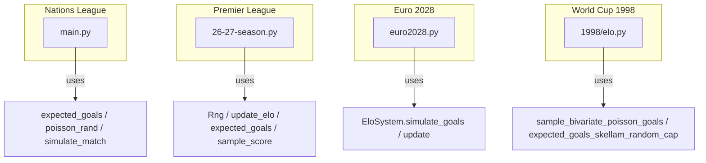
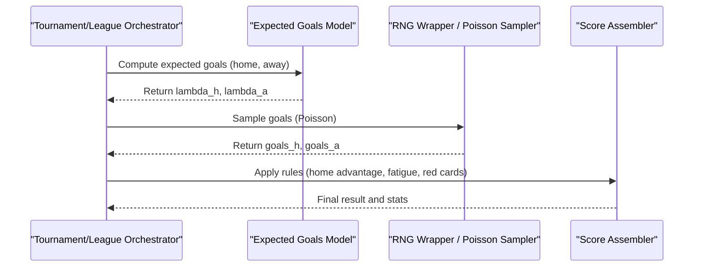
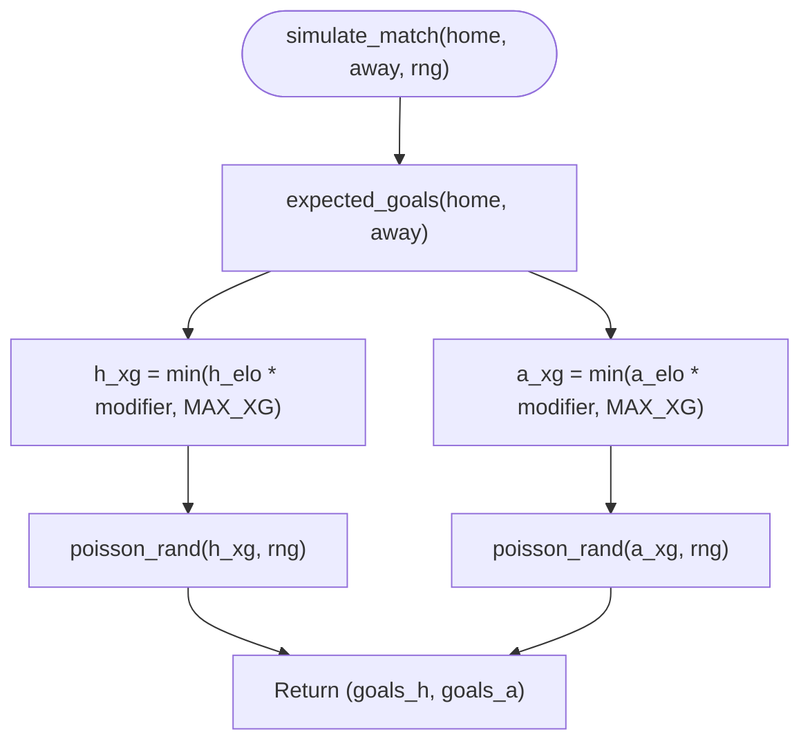
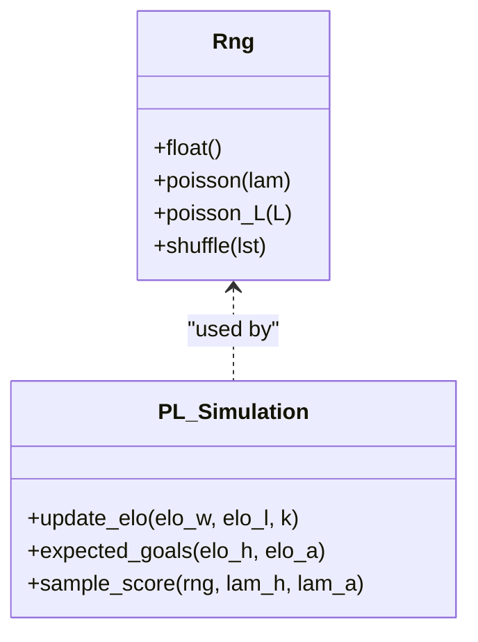
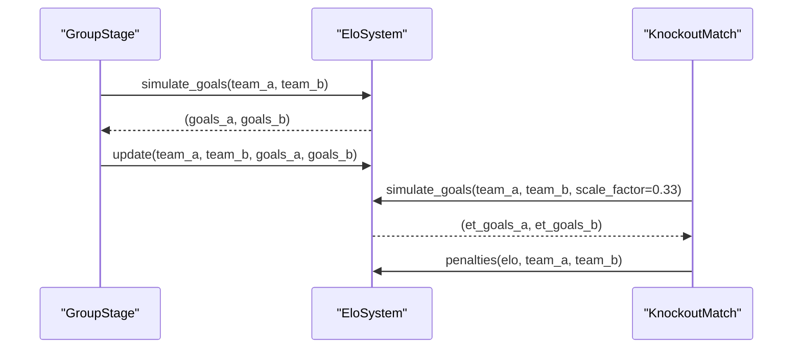
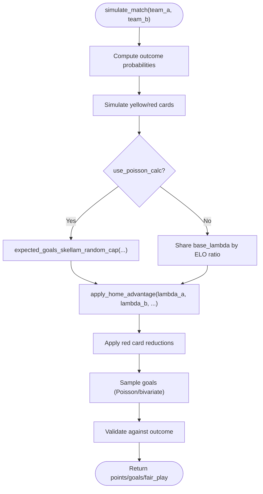
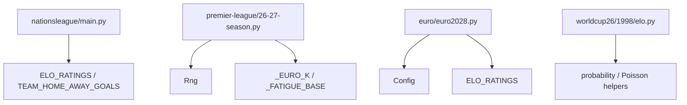

# Match Simulation Engine

<cite>
**Referenced Files in This Document**
- [nationsleague/main.py](file://nationsleague/main.py)
- [premier-league/26-27-season.py](file://premier-league/26-27-season.py)
- [euro/euro2028.py](file://euro/euro2028.py)
- [worldcup26/1998/elo.py](file://worldcup26/1998/elo.py)
</cite>

## Table of Contents
1. [Introduction](#introduction)
2. [Project Structure](#project-structure)
3. [Core Components](#core-components)
4. [Architecture Overview](#architecture-overview)
5. [Detailed Component Analysis](#detailed-component-analysis)
6. [Dependency Analysis](#dependency-analysis)
7. [Performance Considerations](#performance-considerations)
8. [Troubleshooting Guide](#troubleshooting-guide)
9. [Conclusion](#conclusion)

## Introduction
This document explains the core match simulation engine across multiple competition implementations in the repository. It focuses on:
- Elo rating system and update logic
- Expected goal calculations via expected_goals
- Poisson-based goal sampling via sample_score or equivalent functions
- Random number generation wrapper Rng
- Home advantage application
- Fatigue modeling and its effect on team performance
- Differences between league and knockout simulations

The goal is to provide a clear, mathematically grounded guide for readers with varying technical backgrounds.

## Project Structure
The match simulation engine is implemented in several modules that share common ideas but differ in details per competition:
- Nations League module: Poisson-based scoring with ELO-driven expected goals, home advantage, and historical attack modifiers
- Premier League module: Unified PL + European competitions with an Rng wrapper, Poisson sampling, fatigue, and competition-specific K factors
- Euro 2028 module: Group stage and knockout tournament simulation with EloSystem class and correlated Poisson goals
- World Cup 1998 Elo module: Advanced Skellam/Poisson models, bivariate Poisson sampling, and red card effects

**Diagram sources**
- [nationsleague/main.py:231-241](file://nationsleague/main.py#L231-L241)
- [premier-league/26-27-season.py:98-141](file://premier-league/26-27-season.py#L98-L141)
- [euro/euro2028.py:69-123](file://euro/euro2028.py#L69-L123)
- [worldcup26/1998/elo.py:510-533](file://worldcup26/1998/elo.py#L510-L533)

**Section sources**
- [nationsleague/main.py:1-241](file://nationsleague/main.py#L1-L241)
- [premier-league/26-27-season.py:1-141](file://premier-league/26-27-season.py#L1-L141)
- [euro/euro2028.py:1-123](file://euro/euro2028.py#L1-L123)
- [worldcup26/1998/elo.py:500-699](file://worldcup26/1998/elo.py#L500-L699)

## Core Components
This section documents the key building blocks used across the simulation engines.

### Elo Rating System and Update Logic
- Nations League: Uses effective_elo and ELO_RATINGS; updates are not directly shown here but are applied in other modules
- Premier League: Implements update_elo using logistic expected score and K factor
- Euro 2028: EloSystem.update applies K factor, goal difference multiplier, and clamps ratings within min/max bounds
- World Cup 1998: Uses Elo-based probabilities and Skellam/Poisson models for goal expectations

Key formulas:
- Expected score (logistic): E = 1 / (1 + exp((R_opponent - R_self)/scale))
- Elo update: R_new = R_old + K * (result - expected)

**Section sources**
- [premier-league/26-27-season.py:127-129](file://premier-league/26-27-season.py#L127-L129)
- [euro/euro2028.py:78-98](file://euro/euro2028.py#L78-L98)
- [worldcup26/1998/elo.py:535-618](file://worldcup26/1998/elo.py#L535-L618)

### Expected Goals Calculations
- Nations League: expected_goals uses ELO diff with HOME_ADV, BASE_XG, XG_ELO_SCALE, and historical attack modifiers capped at MAX_XG
- Premier League: expected_goals uses BASE_HOME_XG/BASE_AWAY_XG and exponential sensitivity to ELO diff
- Euro 2028: EloSystem.simulate_goals computes lambdas from base_goals and rating differences
- World Cup 1998: expected_goals_skellam_random_cap uses baseline goals and random cap to compute lambda_A and lambda_B

Formulas:
- Nations League: h_xg = BASE_XG * exp(diff/XG_ELO_SCALE), a_xg = BASE_XG * exp(-diff/XG_ELO_SCALE), then apply attack modifiers
- Premier League: h_xg = BASE_HOME_XG * exp(sensitivity * diff), a_xg = BASE_AWAY_XG * exp(-sensitivity * diff)
- Euro 2028: lam_a = base_goals * 10^(diff/1000), lam_b = base_goals * 10^(-diff/1000)
- World Cup 1998: lambda_A = baseline/2 * 10^(-D/400), lambda_B = baseline/2 * 10^(D/400)

**Section sources**
- [nationsleague/main.py:231-237](file://nationsleague/main.py#L231-L237)
- [premier-league/26-27-season.py:132-135](file://premier-league/26-27-season.py#L132-L135)
- [euro/euro2028.py:100-123](file://euro/euro2028.py#L100-L123)
- [worldcup26/1998/elo.py:520-533](file://worldcup26/1998/elo.py#L520-L533)

### Poisson-Based Goal Sampling
- Nations League: poisson_rand implements inverse CDF method using math.exp(-lam)
- Premier League: Rng.poisson and Rng.poisson_L implement the same algorithm with a wrapper around random.Random
- Euro 2028: Uses numpy.random.poisson with shared shock for correlation
- World Cup 1998: sample_bivariate_poisson_goals generates correlated goals via shared Poisson component

Algorithm overview:
- Generate uniform randoms until product <= exp(-lambda); count iterations minus one gives Poisson sample

**Section sources**
- [nationsleague/main.py:224-229](file://nationsleague/main.py#L224-L229)
- [premier-league/26-27-season.py:98-119](file://premier-league/26-27-season.py#L98-L119)
- [euro/euro2028.py:116-123](file://euro/euro2028.py#L116-L123)
- [worldcup26/1998/elo.py:510-518](file://worldcup26/1998/elo.py#L510-L518)

### Rng Wrapper Class
- Premier League: Rng encapsulates random.Random and provides float(), poisson(), poisson_L(), shuffle()
- Purpose: Centralizes RNG usage and allows consistent seeding across simulations

**Section sources**
- [premier-league/26-27-season.py:98-122](file://premier-league/26-27-season.py#L98-L122)

### Home Advantage Factors
- Nations League: Adds HOME_ADV to home team’s ELO before computing xG
- Euro 2028: EloSystem.get_rating adds home_advantage_elo when is_home=True
- Premier League: final_home_advantage adjusts ELO based on venue matching team stadium
- World Cup 1998: apply_home_advantage modifies lambdas after computing base rates

**Section sources**
- [nationsleague/main.py:231-237](file://nationsleague/main.py#L231-L237)
- [euro/euro2028.py:74-76](file://euro/euro2028.py#L74-L76)
- [premier-league/26-27-season.py:72-80](file://premier-league/26-27-season.py#L72-L80)
- [worldcup26/1998/elo.py:575-601](file://worldcup26/1998/elo.py#L575-L601)

### Fatigue Calculations and Competition Effects
- Premier League: _FATIGUE_BASE defines base fatigue by competition (UCL, UEL, UECL); euro_k returns K factors by competition and stage; knockout_k selects early/late KO K
- Euro 2028: KnockoutMatch.single_leg simulates extra time with scale_factor=0.33 and penalties modeled via logistic function over ELO diff
- World Cup 1998: Red cards reduce goal rates; extra time reduces lambda by factor (e.g., 0.30)

**Section sources**
- [premier-league/26-27-season.py:28-35](file://premier-league/26-27-season.py#L28-L35)
- [premier-league/26-27-season.py:87-92](file://premier-league/26-27-season.py#L87-L92)
- [euro/euro2028.py:241-279](file://euro/euro2028.py#L241-L279)
- [worldcup26/1998/elo.py:620-683](file://worldcup26/1998/elo.py#L620-L683)

## Architecture Overview
The simulation engines follow a layered architecture:
- Configuration and data tables define teams, ELOs, fixtures, and constants
- Core functions compute expected goals and sample scores
- Tournament/league orchestrators run matches, update standings, and handle tie-breakers
- Knockout stages add extra time and penalty models

**Diagram sources**
- [nationsleague/main.py:231-241](file://nationsleague/main.py#L231-L241)
- [premier-league/26-27-season.py:98-141](file://premier-league/26-27-season.py#L98-L141)
- [euro/euro2028.py:100-123](file://euro/euro2028.py#L100-L123)
- [worldcup26/1998/elo.py:575-618](file://worldcup26/1998/elo.py#L575-L618)

## Detailed Component Analysis

### Nations League Module
- effective_elo returns team ELO
- expected_goals computes home/away xG using ELO diff, HOME_ADV, BASE_XG, XG_ELO_SCALE, and historical attack modifiers capped at MAX_XG
- poisson_rand samples goals from Poisson distribution
- simulate_match composes expected_goals and poisson_rand
- simulate_two_legged_tie handles two-legged ties with aggregate goals and Elo-based tiebreakers
- neutral_match simulates neutral venue matches with averaged attack modifiers

**Diagram sources**
- [nationsleague/main.py:231-241](file://nationsleague/main.py#L231-L241)

**Section sources**
- [nationsleague/main.py:201-241](file://nationsleague/main.py#L201-L241)

### Premier League Module
- Rng wraps random.Random and exposes poisson methods
- update_elo computes expected score and updates both teams’ ELOs
- expected_goals computes home/away xG using BASE_HOME_XG/BASE_AWAY_XG and sensitivity
- sample_score draws goals via Rng.poisson and caps at MAX_GOALS
- fatigue_base and euro_k define competition-specific fatigue and K factors
- knockout_k selects appropriate K for early/late knockout rounds

**Diagram sources**
- [premier-league/26-27-season.py:98-141](file://premier-league/26-27-season.py#L98-L141)

**Section sources**
- [premier-league/26-27-season.py:98-141](file://premier-league/26-27-season.py#L98-L141)
- [premier-league/26-27-season.py:28-35](file://premier-league/26-27-season.py#L28-L35)
- [premier-league/26-27-season.py:87-92](file://premier-league/26-27-season.py#L87-L92)

### Euro 2028 Module
- EloSystem manages ratings and provides get_rating and update
- simulate_goals computes lambdas from base_goals and rating differences, applies goal correlation via shared Poisson shock
- KnockoutMatch handles single-leg and home-away legs with extra time and penalties
- TournamentSimulation orchestrates group draw, group stage, and knockout progression

**Diagram sources**
- [euro/euro2028.py:69-123](file://euro/euro2028.py#L69-L123)
- [euro/euro2028.py:241-279](file://euro/euro2028.py#L241-L279)

**Section sources**
- [euro/euro2028.py:69-123](file://euro/euro2028.py#L69-L123)
- [euro/euro2028.py:241-279](file://euro/euro2028.py#L241-L279)

### World Cup 1998 Elo Module
- sample_bivariate_poisson_goals creates correlated goals using shared Poisson component
- expected_goals_skellam_random_cap computes lambda_A and lambda_B with random cap
- simulate_match and simulate_knockout_match incorporate red cards, home advantage, and extra time scaling

**Diagram sources**
- [worldcup26/1998/elo.py:510-533](file://worldcup26/1998/elo.py#L510-L533)
- [worldcup26/1998/elo.py:535-618](file://worldcup26/1998/elo.py#L535-L618)

**Section sources**
- [worldcup26/1998/elo.py:510-618](file://worldcup26/1998/elo.py#L510-L618)

## Dependency Analysis
The simulation components depend on each other as follows:
- Nations League depends on ELO_RATINGS and TEAM_HOME_AWAY_GOALS for attack modifiers
- Premier League depends on Rng for Poisson sampling and _EURO_K/_FATIGUE_BASE for competition parameters
- Euro 2028 depends on Config and ELO_RATINGS for initial ratings and home boosts
- World Cup 1998 depends on helper functions for probability calculation and Poisson sampling

**Diagram sources**
- [nationsleague/main.py:99-171](file://nationsleague/main.py#L99-L171)
- [premier-league/26-27-season.py:28-35](file://premier-league/26-27-season.py#L28-L35)
- [euro/euro2028.py:15-42](file://euro/euro2028.py#L15-L42)
- [worldcup26/1998/elo.py:500-699](file://worldcup26/1998/elo.py#L500-L699)

**Section sources**
- [nationsleague/main.py:99-171](file://nationsleague/main.py#L99-L171)
- [premier-league/26-27-season.py:28-35](file://premier-league/26-27-season.py#L28-L35)
- [euro/euro2028.py:15-42](file://euro/euro2028.py#L15-L42)
- [worldcup26/1998/elo.py:500-699](file://worldcup26/1998/elo.py#L500-L699)

## Performance Considerations
- Poisson sampling via inverse CDF is O(k) where k is the sampled value; for typical football lambdas (~1-3), this is efficient
- Using numpy.random.poisson (Euro 2028) can be faster than manual loops for large-scale simulations
- Capping goals (MAX_GOALS or max_goals) prevents extreme outliers and stabilizes variance
- Precomputing attack modifiers (HOME_ATTACK_MOD/AWAY_ATTACK_MOD) avoids repeated calculations
- Seeding RNG ensures reproducibility across runs

[No sources needed since this section provides general guidance]

## Troubleshooting Guide
Common issues and resolutions:
- Negative or zero lambda: Ensure expected_goals returns positive values; clamp lambdas to minimum thresholds (e.g., 0.2)
- Non-converging Poisson sampling: Verify L = exp(-lambda) computation and loop termination condition
- Excessive goal counts: Apply caps (MAX_GOALS or max_goals) to prevent unrealistic outcomes
- Home advantage misapplication: Confirm whether neutral venues should bypass home boost
- Fatigue/K factor mismatches: Check competition-specific K factors and ensure correct stage mapping (early vs late knockout)

**Section sources**
- [euro/euro2028.py:110-114](file://euro/euro2028.py#L110-L114)
- [premier-league/26-27-season.py:138-141](file://premier-league/26-27-season.py#L138-L141)
- [worldcup26/1998/elo.py:575-601](file://worldcup26/1998/elo.py#L575-L601)

## Conclusion
The match simulation engine combines Elo-based expected goals with Poisson sampling to produce realistic match outcomes. Different modules tailor parameters for specific competitions, incorporating home advantage, fatigue, and knockout rules. The Rng wrapper centralizes randomness, while modular design allows extension to new competition formats. Understanding these components enables accurate tuning and interpretation of simulation results.

[No sources needed since this section summarizes without analyzing specific files]