# Simulation Workflow and Process Flow

<cite>
**Referenced Files in This Document**
- [26-27-season.py](file://premier-league/26-27-season.py)
- [champions_league.py](file://uefa/champions_league.py)
- [europa_league.py](file://uefa/europa_league.py)
- [conference_league.py](file://uefa/conference_league.py)
- [test_integration.py](file://premier-league/test_integration.py)
</cite>

## Table of Contents
1. [Introduction](#introduction)
2. [Project Structure](#project-structure)
3. [Core Components](#core-components)
4. [Architecture Overview](#architecture-overview)
5. [Detailed Component Analysis](#detailed-component-analysis)
6. [Dependency Analysis](#dependency-analysis)
7. [Performance Considerations](#performance-considerations)
8. [Troubleshooting Guide](#troubleshooting-guide)
9. [Conclusion](#conclusion)
10. [Appendices](#appendices)

## Introduction
This document explains the complete simulation workflow from initial setup through final results aggregation for a unified model that simulates:
- Premier League (PL)
- UEFA Champions League (UCL)
- UEFA Europa League (UEL)
- UEFA Conference League (UECL)
- Carabao Cup
- FA Cup

The system integrates actual results to calibrate initial team ratings, progressively updates team strengths via Elo-based scoring, applies fatigue factors when teams play European fixtures, computes manager sack risk based on performance metrics, and provides snapshotting for animation and progress tracking. It also documents fixture generation, match-by-match simulation execution, and real-time statistics tracking across all competitions.

## Project Structure
At a high level, the repository contains multiple sport simulations. The relevant code for this workflow is primarily located under:
- premier-league: Unified PL + European + domestic cup simulation engine
- uefa: Standalone scripts for UCL, UEL, and UECL Monte Carlo runs (used as conceptual references; the unified engine is implemented in the PL module)

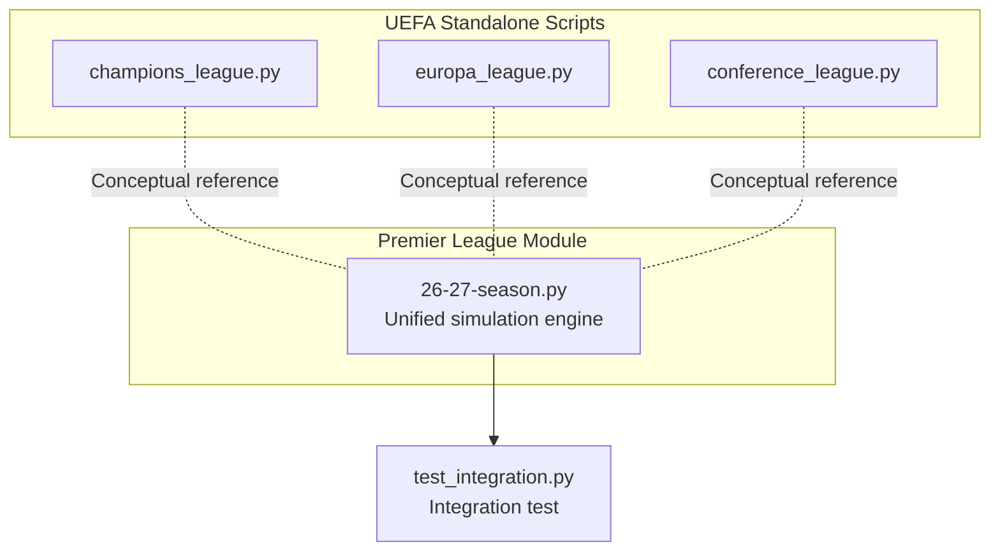

**Diagram sources**
- [26-27-season.py:1-120](file://premier-league/26-27-season.py#L1-L120)
- [champions_league.py:1-40](file://uefa/champions_league.py#L1-L40)
- [europa_league.py:1-40](file://uefa/europa_league.py#L1-L40)
- [conference_league.py:1-40](file://uefa/conference_league.py#L1-L40)
- [test_integration.py:1-21](file://premier-league/test_integration.py#L1-L21)

**Section sources**
- [26-27-season.py:1-120](file://premier-league/26-27-season.py#L1-L120)
- [test_integration.py:1-21](file://premier-league/test_integration.py#L1-L21)

## Core Components
The unified simulation engine implements:
- RNG wrapper and Poisson goal sampling
- Elo rating update and expected goals calculation
- Fixture generation and actual result integration
- European competition simulation with league phase and knockout phase
- PL season simulation with fatigue adjustments
- Domestic cup simulations (Carabao Cup and FA Cup)
- Manager sack risk computation
- Snapshot system for progress and animation
- Aggregation and reporting of probabilities and distributions

Key responsibilities:
- Initial setup and calibration using actual results
- Sequential processing of multiple competitions
- Cascading effects between competitions (e.g., European qualification impacts PL spots; fatigue affects PL performance)
- Real-time statistics tracking per team and per competition
- Final aggregation of probabilities, distributions, and most likely outcomes

**Section sources**
- [26-27-season.py:96-141](file://premier-league/26-27-season.py#L96-L141)
- [26-27-season.py:648-694](file://premier-league/26-27-season.py#L648-L694)
- [26-27-season.py:868-1066](file://premier-league/26-27-season.py#L868-L1066)
- [26-27-season.py:1313-1440](file://premier-league/26-27-season.py#L1313-L1440)
- [26-27-season.py:1612-1663](file://premier-league/26-27-season.py#L1612-L1663)
- [26-27-season.py:1881-1984](file://premier-league/26-27-season.py#L1881-L1984)
- [26-27-season.py:2092-2163](file://premier-league/26-27-season.py#L2092-L2163)
- [26-27-season.py:2696-2929](file://premier-league/26-27-season.py#L2696-L2929)

## Architecture Overview
The architecture centers around a shared setup that builds immutable state (ratings, competitions, PL simulator, form adjustments), followed by iterative simulation loops that run each competition and aggregate results.

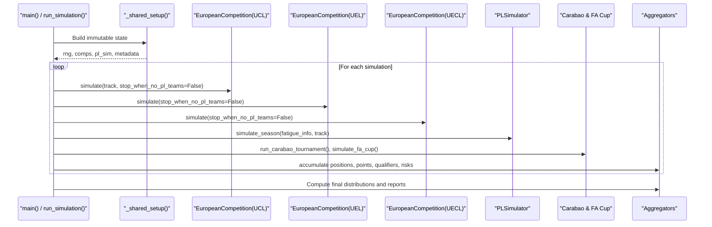

**Diagram sources**
- [26-27-season.py:2262-2471](file://premier-league/26-27-season.py#L2262-L2471)
- [26-27-season.py:2696-2929](file://premier-league/26-27-season.py#L2696-L2929)
- [26-27-season.py:2092-2163](file://premier-league/26-27-season.py#L2092-L2163)

## Detailed Component Analysis

### Fixture Generation and Actual Results Integration
Fixture generation constructs a full round-robin schedule from actual results data. Actual results are mapped into lookup structures so that already-played matches use real scores instead of simulated ones.

- Full round-robin construction from actual results
- Mapping actual results to dictionaries for quick lookup
- Flattening multi-round fixtures for European competitions
- Standardizing team names for UEL and UECL fixtures

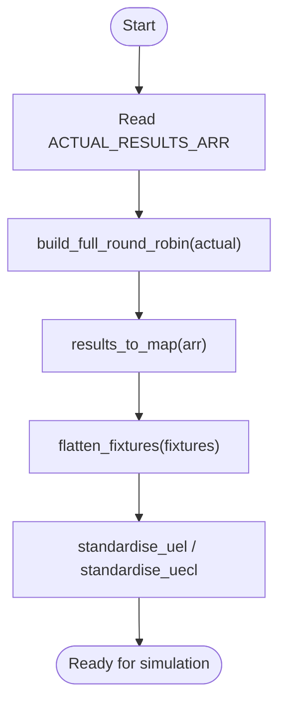

**Diagram sources**
- [26-27-season.py:648-663](file://premier-league/26-27-season.py#L648-L663)
- [26-27-season.py:553-554](file://premier-league/26-27-season.py#L553-L554)
- [26-27-season.py:628-629](file://premier-league/26-27-season.py#L628-L629)

**Section sources**
- [26-27-season.py:648-663](file://premier-league/26-27-season.py#L648-L663)
- [26-27-season.py:553-554](file://premier-league/26-27-season.py#L553-L554)
- [26-27-season.py:628-629](file://premier-league/26-27-season.py#L628-L629)

### Rating Calibration and Progressive Updates
Initial team ratings are calibrated using preset ELOs blended with observed results. Ratings regress toward priors based on games played across all competitions. During simulation, ELO updates occur after each match, reflecting win/draw/loss outcomes.

- Preset ELOs for PL, UCL, UEL, UECL
- Building current PL ratings from actual results
- Regressing ELOs toward means based on total games played
- Updating ELOs after each match in both PL and European competitions

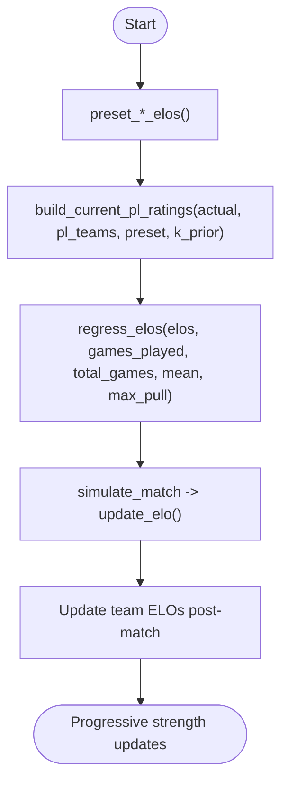

**Diagram sources**
- [26-27-season.py:155-219](file://premier-league/26-27-season.py#L155-L219)
- [26-27-season.py:669-694](file://premier-league/26-27-season.py#L669-L694)
- [26-27-season.py:127-135](file://premier-league/26-27-season.py#L127-L135)
- [26-27-season.py:999-1008](file://premier-league/26-27-season.py#L999-L1008)

**Section sources**
- [26-27-season.py:155-219](file://premier-league/26-27-season.py#L155-L219)
- [26-27-season.py:669-694](file://premier-league/26-27-season.py#L669-L694)
- [26-27-season.py:127-135](file://premier-league/26-27-season.py#L127-L135)
- [26-27-season.py:999-1008](file://premier-league/26-27-season.py#L999-L1008)

### European Competition Processing (UCL, UEL, UECL)
Each European competition is modeled as an object that:
- Initializes teams, base ELOs, and fixtures
- Processes league phase matches, updating stats and ELOs
- Runs knockout phase with two-legged ties, extra time, and penalties
- Tracks elimination rounds and team results for tracked teams

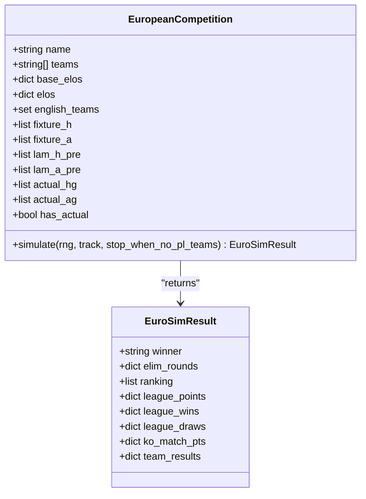

**Diagram sources**
- [26-27-season.py:868-1066](file://premier-league/26-27-season.py#L868-L1066)

**Section sources**
- [26-27-season.py:868-1066](file://premier-league/26-27-season.py#L868-L1066)

### Knockout Phase Logic
Knockout phases include:
- Playoff round for lower-ranked teams
- Round of 16 seeding and pairings
- Quarter-finals, semi-finals, and final
- Two-legged ties with aggregate scoring, extra time, and penalty shootouts
- ELO updates per tie outcome

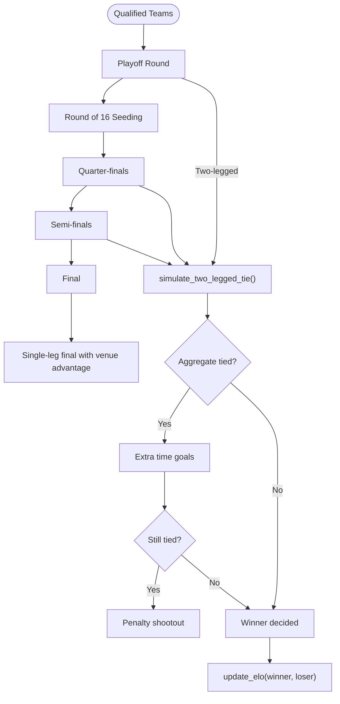

**Diagram sources**
- [26-27-season.py:1072-1245](file://premier-league/26-27-season.py#L1072-L1245)

**Section sources**
- [26-27-season.py:1072-1245](file://premier-league/26-27-season.py#L1072-L1245)

### PL Season Simulation with Fatigue Factors
The PL simulator:
- Builds fixtures and precomputes expected goals based on ELO differences
- Applies fatigue factors when teams participate in European competitions
- Simulates each match using Poisson distribution
- Tracks points, goals, and team results for tracked teams

Fatigue factor calculations:
- Base fatigue values differ by competition (UCL > UEL > UECL)
- Fatigue decays over the season via inverse progress weighting
- Active European participation reduces home/away expected goals

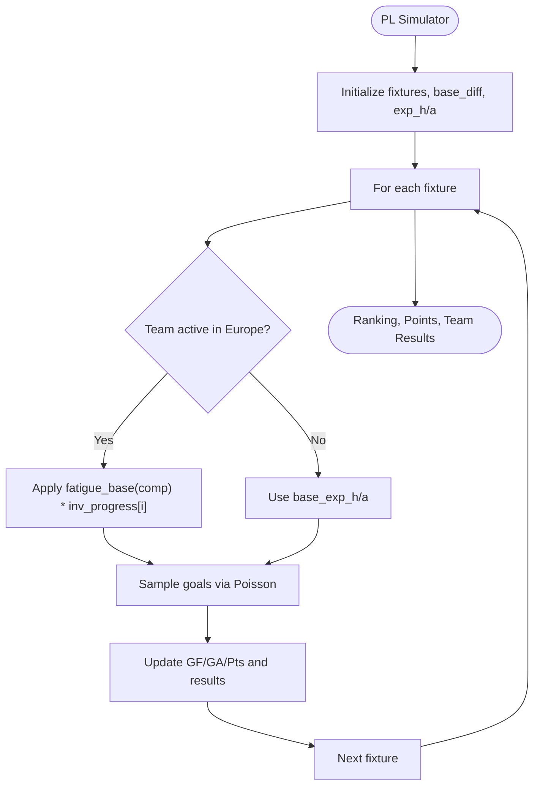

**Diagram sources**
- [26-27-season.py:1313-1440](file://premier-league/26-27-season.py#L1313-L1440)

**Section sources**
- [26-27-season.py:1313-1440](file://premier-league/26-27-season.py#L1313-L1440)

### Domestic Cup Simulations (Carabao Cup and FA Cup)
- Carabao Cup uses ELO-based match simulation with potential extra time and penalties
- FA Cup includes bracket progression from Round 1 through the final, with neutral venue finals
- Both support tracking team results for specific teams

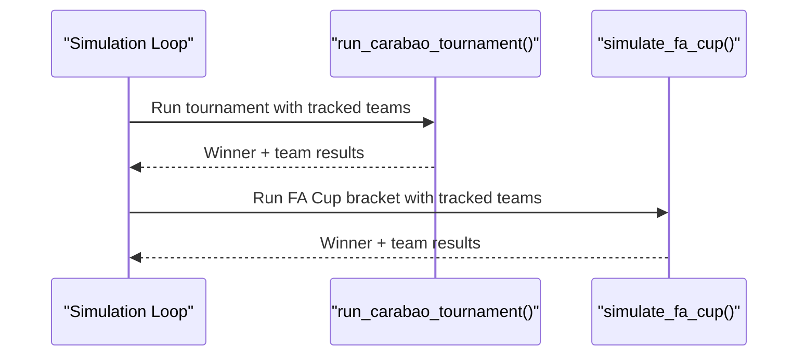

**Diagram sources**
- [26-27-season.py:1612-1663](file://premier-league/26-27-season.py#L1612-L1663)
- [26-27-season.py:1881-1984](file://premier-league/26-27-season.py#L1881-L1984)

**Section sources**
- [26-27-season.py:1612-1663](file://premier-league/26-27-season.py#L1612-L1663)
- [26-27-season.py:1881-1984](file://premier-league/26-27-season.py#L1881-L1984)

### Manager Sack Risk Calculation
Manager sack risk is computed per team based on:
- Performance relative to expectations (underperformance vs overperformance)
- Relegation zone penalties
- Recent honors protection (PL titles or European wins)
- European performance adjustments
- Actual form adjustments blending all games and last-5 emphasis

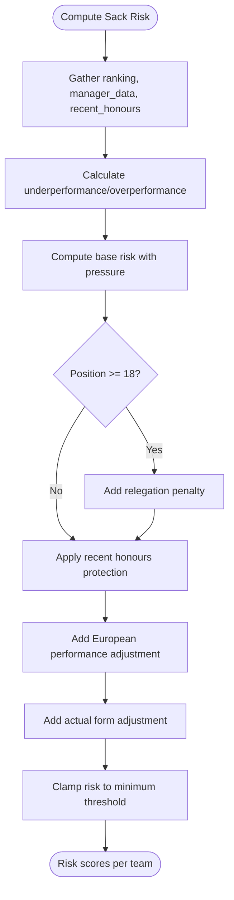

**Diagram sources**
- [26-27-season.py:788-838](file://premier-league/26-27-season.py#L788-L838)

**Section sources**
- [26-27-season.py:788-838](file://premier-league/26-27-season.py#L788-L838)

### Snapshot System for Animation and Progress Tracking
The snapshot system enables:
- Periodic callbacks during simulation runs
- Aggregation of average positions, points, probabilities, and sack metrics
- Progress indicators with ETA estimation

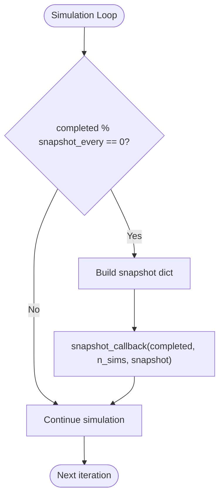

**Diagram sources**
- [26-27-season.py:2068-2080](file://premier-league/26-27-season.py#L2068-L2080)
- [26-27-season.py:2696-2929](file://premier-league/26-27-season.py#L2696-L2929)

**Section sources**
- [26-27-season.py:2068-2080](file://premier-league/26-27-season.py#L2068-L2080)
- [26-27-season.py:2696-2929](file://premier-league/26-27-season.py#L2696-L2929)

### Results Aggregation and Reporting
After running many simulations, the system aggregates:
- Title probabilities, European qualification probabilities, relegation probabilities
- Most likely final table via Hungarian algorithm assignment
- European competition standings and reach probabilities
- Association coefficients and EPS (extra performance spot) analysis
- Domestic cup win probabilities

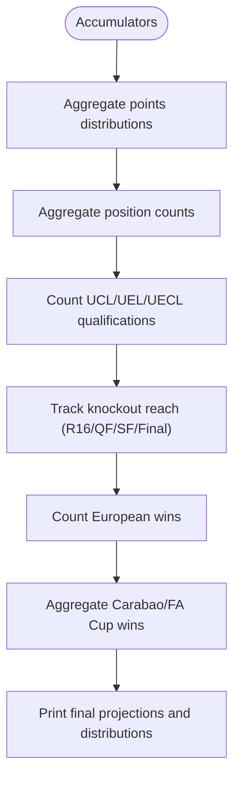

**Diagram sources**
- [26-27-season.py:2262-2471](file://premier-league/26-27-season.py#L2262-L2471)
- [26-27-season.py:2472-2691](file://premier-league/26-27-season.py#L2472-L2691)

**Section sources**
- [26-27-season.py:2262-2471](file://premier-league/26-27-season.py#L2262-L2471)
- [26-27-season.py:2472-2691](file://premier-league/26-27-season.py#L2472-L2691)

## Dependency Analysis
The unified engine depends on:
- Constants for ELO scale, home advantage, XG sensitivity, and fatigue bases
- Helper functions for RNG, Poisson sampling, and ELO updates
- Data tables for presets, associations, and manager information
- Functions for regression, form adjustments, and sack risk computation
- European competition classes and knockout logic
- PL simulator and domestic cup simulators
- Aggregation utilities and progress rendering

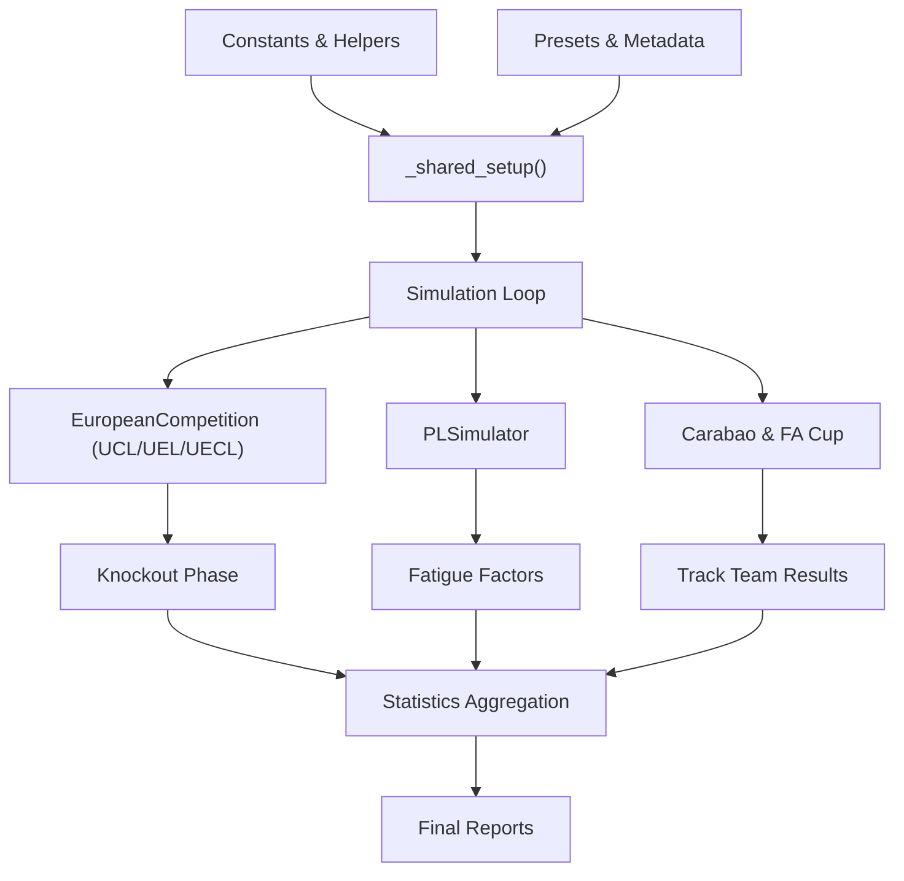

**Diagram sources**
- [26-27-season.py:1-120](file://premier-league/26-27-season.py#L1-L120)
- [26-27-season.py:2092-2163](file://premier-league/26-27-season.py#L2092-L2163)
- [26-27-season.py:2262-2471](file://premier-league/26-27-season.py#L2262-L2471)

**Section sources**
- [26-27-season.py:1-120](file://premier-league/26-27-season.py#L1-L120)
- [26-27-season.py:2092-2163](file://premier-league/26-27-season.py#L2092-L2163)
- [26-27-season.py:2262-2471](file://premier-league/26-27-season.py#L2262-L2471)

## Performance Considerations
- RNG wrapper optimizes Poisson sampling by precomputing exponential terms
- Precomputed expected goals reduce repeated calculations
- LRU caching for Carabao ELO lookups avoids recomputation
- Early stopping in knockout phases when no English teams remain reduces unnecessary work
- Snapshot intervals balance progress feedback with computational overhead

[No sources needed since this section provides general guidance]

## Troubleshooting Guide
Common issues and resolutions:
- Name mismatches in fixtures: Ensure standardization functions are applied for UEL and UECL
- Missing ELOs: Fallback to league average or preset mappings
- Seed reproducibility: Use deterministic seeds for consistent runs
- Progress callback errors: Validate snapshot callback signature and interval settings

**Section sources**
- [26-27-season.py:553-554](file://premier-league/26-27-season.py#L553-L554)
- [26-27-season.py:628-629](file://premier-league/26-27-season.py#L628-L629)
- [26-27-season.py:2068-2080](file://premier-league/26-27-season.py#L2068-L2080)

## Conclusion
The unified simulation engine provides a comprehensive framework for modeling the Premier League alongside major European competitions and domestic cups. It integrates actual results for calibration, applies progressive ELO updates, accounts for fatigue from European fixtures, computes manager sack risk, and supports real-time snapshots for visualization. The modular design allows for clear separation of concerns while enabling complex interactions between competitions.

[No sources needed since this section summarizes without analyzing specific files]

## Appendices

### Standalone UEFA Scripts Overview
The standalone scripts for UCL, UEL, and UECL provide conceptual references for Monte Carlo simulations but are not part of the unified engine’s core workflow. They demonstrate basic Elo-based match simulation, two-legged ties, and final outcomes.

**Section sources**
- [champions_league.py:1-117](file://uefa/champions_league.py#L1-L117)
- [europa_league.py:1-133](file://uefa/europa_league.py#L1-L133)
- [conference_league.py:1-140](file://uefa/conference_league.py#L1-L140)