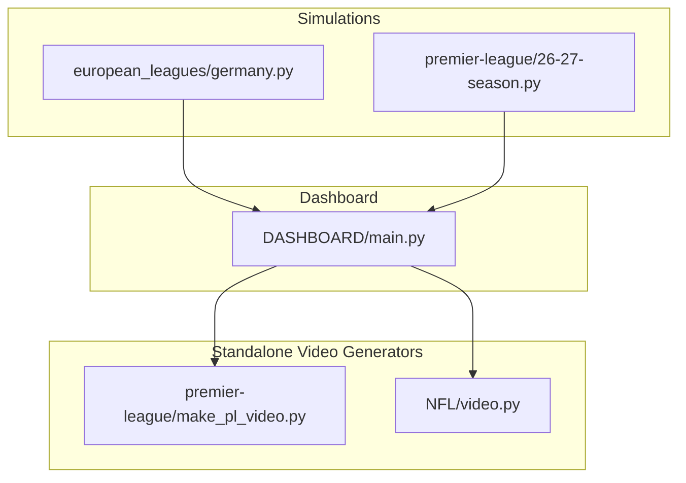
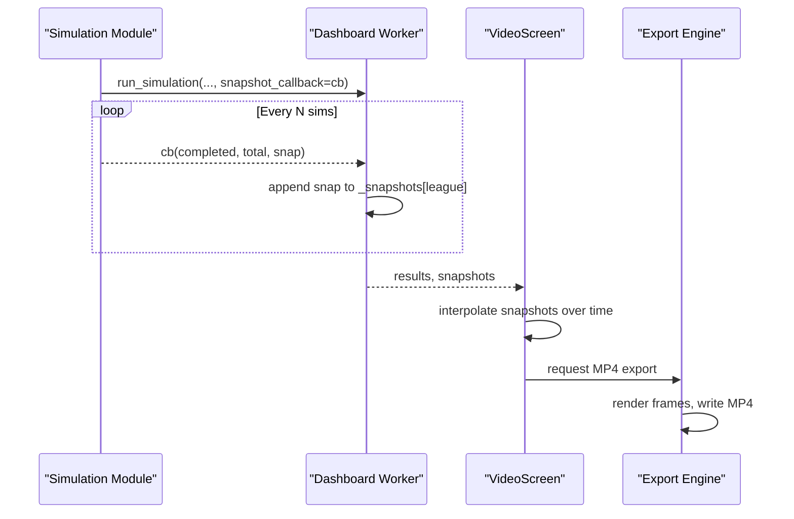
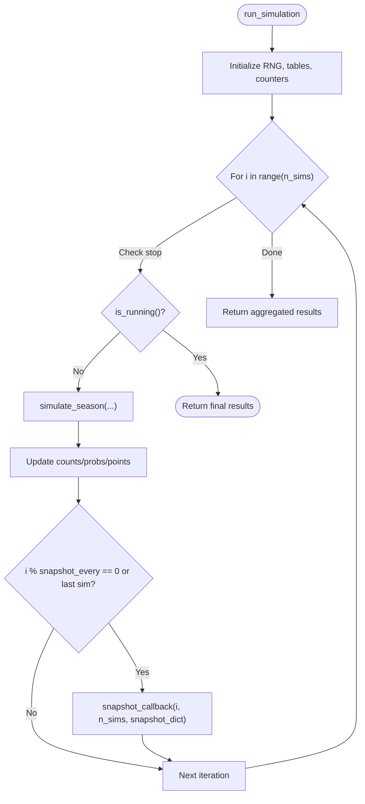
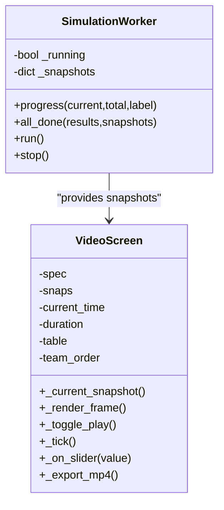
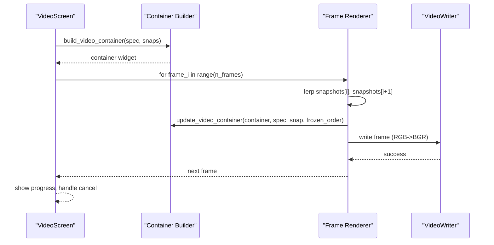
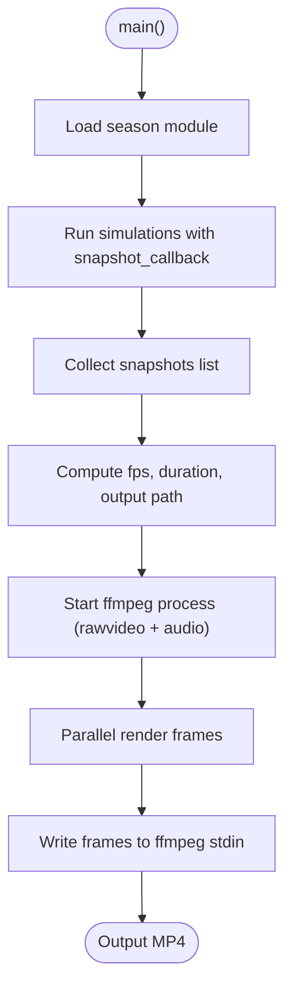
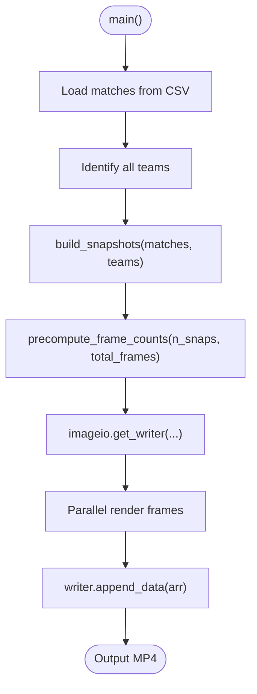
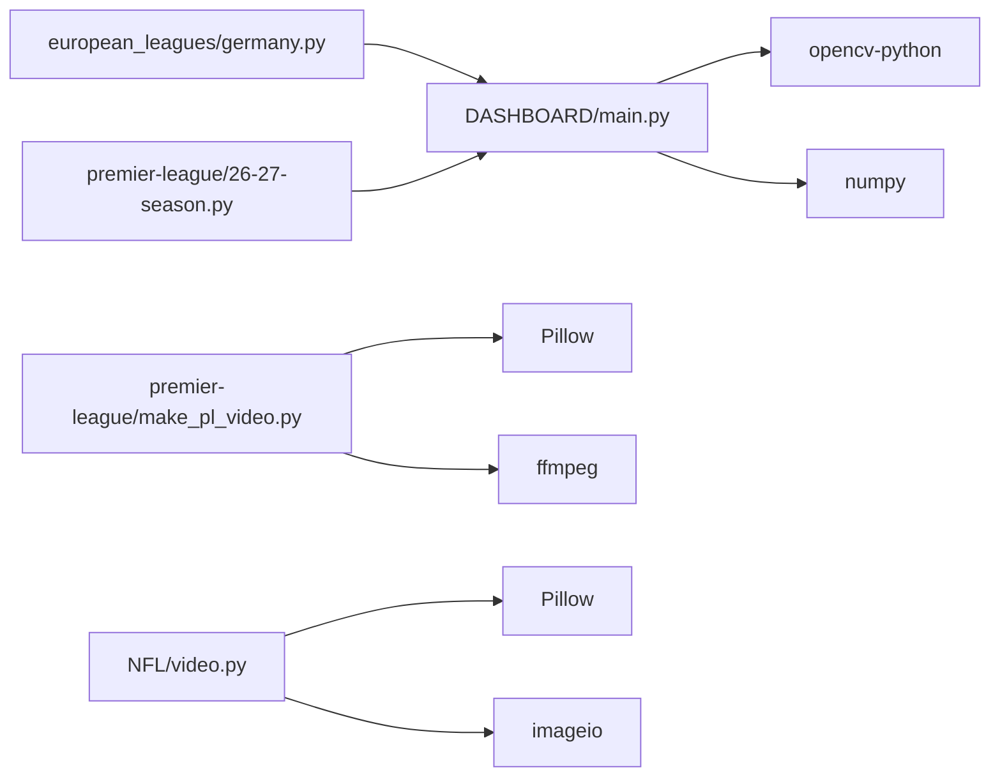

# Snapshot System and Animation

<cite>
**Referenced Files in This Document**   
- [DASHBOARD/main.py](file://DASHBOARD/main.py)
- [premier-league/make_pl_video.py](file://premier-league/make_pl_video.py)
- [NFL/video.py](file://NFL/video.py)
- [european_leagues/germany.py](file://european_leagues/germany.py)
</cite>

## Table of Contents
1. [Introduction](#introduction)
2. [Project Structure](#project-structure)
3. [Core Components](#core-components)
4. [Architecture Overview](#architecture-overview)
5. [Detailed Component Analysis](#detailed-component-analysis)
6. [Dependency Analysis](#dependency-analysis)
7. [Performance Considerations](#performance-considerations)
8. [Troubleshooting Guide](#troubleshooting-guide)
9. [Conclusion](#conclusion)
10. [Appendices](#appendices)

## Introduction
This document explains the snapshot system that captures simulation state at regular intervals to power animated progress visualizations. It covers how snapshots are taken during Monte Carlo runs, what data they store (team rankings, points, probabilities), and how this data is used to render animated table videos. It also documents the dashboard’s video generation pipeline, including playback controls, frame interpolation, and MP4 export, as well as standalone video generators for specific leagues.

## Project Structure
The snapshot-and-animation capability spans three main areas:
- Simulation modules emit periodic snapshots via callbacks.
- The dashboard collects snapshots, renders them into a Qt-based table, and exports an MP4.
- Standalone scripts generate high-quality league-specific videos from captured snapshots.

**Diagram sources**
- [european_leagues/germany.py:247-327](file://european_leagues/germany.py#L247-L327)
- [DASHBOARD/main.py:284-330](file://DASHBOARD/main.py#L284-L330)
- [premier-league/make_pl_video.py:214-228](file://premier-league/make_pl_video.py#L214-L228)
- [NFL/video.py:372-383](file://NFL/video.py#L372-L383)

**Section sources**
- [DASHBOARD/main.py:1-13](file://DASHBOARD/main.py#L1-L13)
- [premier-league/make_pl_video.py:1-12](file://premier-league/make_pl_video.py#L1-L12)
- [NFL/video.py:1-20](file://NFL/video.py#L1-L20)

## Core Components
- Snapshot callback contract: simulations call a callback with completed count, total count, and a snapshot dictionary containing per-team metrics.
- Dashboard snapshot collection: a background worker gathers snapshots per league while running all simulations sequentially.
- Playback engine: the dashboard’s VideoScreen interpolates between snapshots and updates a table view over time.
- Export engine: the dashboard renders frames to an offscreen widget and writes an MP4 using OpenCV.
- Standalone video generators: league-specific scripts render frames and encode videos using PIL/Pillow and ffmpeg or imageio.

Key responsibilities:
- Simulations: compute metrics and emit snapshots at configurable intervals.
- Dashboard: orchestrate simulations, collect snapshots, provide interactive playback, and export MP4s.
- Standalone tools: produce polished videos with parallel rendering and audio integration.

**Section sources**
- [european_leagues/germany.py:247-327](file://european_leagues/germany.py#L247-L327)
- [DASHBOARD/main.py:284-330](file://DASHBOARD/main.py#L284-L330)
- [DASHBOARD/main.py:1205-1250](file://DASHBOARD/main.py#L1205-L1250)
- [DASHBOARD/main.py:1373-1456](file://DASHBOARD/main.py#L1373-L1456)
- [premier-league/make_pl_video.py:73-141](file://premier-league/make_pl_video.py#L73-L141)
- [NFL/video.py:372-383](file://NFL/video.py#L372-L383)

## Architecture Overview
The system follows a producer-consumer pattern:
- Producers: simulation modules emit snapshots through callbacks.
- Consumer: the dashboard aggregates snapshots and drives playback/export.
- Renderers: either the dashboard (Qt + OpenCV) or standalone scripts (PIL + ffmpeg/imageio) convert snapshots to frames.

**Diagram sources**
- [DASHBOARD/main.py:284-330](file://DASHBOARD/main.py#L284-L330)
- [DASHBOARD/main.py:1205-1250](file://DASHBOARD/main.py#L1205-L1250)
- [DASHBOARD/main.py:1373-1456](file://DASHBOARD/main.py#L1373-L1456)

## Detailed Component Analysis

### Snapshot Data Model
Snapshots are dictionaries keyed by metric names. Common keys include:
- avg_points: average points per team across simulations so far.
- title_prob, top4_prob, fifth_prob, sixth_prob, releg_prob, relpo_prob: probability percentages for outcomes.
- For Premier League-specific snapshots: avg_positions, ucl_qual_prob, uel_qual_prob, uecl_qual_prob, total_euro_prob, relegation_prob.
- done, total: simulation counters added by the dashboard worker.

Example structure (conceptual):
- { "avg_points": { "TeamA": 45.2, ... }, "title_prob": { "TeamA": 12.3, ... }, "done": 100, "total": 2500 }

Complexity:
- Snapshot size grows linearly with number of teams; each metric maps team -> float.
- Interpolation cost is O(T) per frame where T is number of teams.

**Section sources**
- [european_leagues/germany.py:304-312](file://european_leagues/germany.py#L304-L312)
- [premier-league/make_pl_video.py:95-137](file://premier-league/make_pl_video.py#L95-L137)
- [DASHBOARD/main.py:311-319](file://DASHBOARD/main.py#L311-L319)

### Simulation Snapshot Emission
Each simulation module implements a run_simulation function accepting:
- n_sims: number of Monte Carlo runs.
- on_progress: progress callback.
- is_running: stop signal.
- snapshot_callback: invoked periodically with (completed, total, snapshot_dict).
- snapshot_every: interval between snapshots; defaults to ~n_sims // 250 if not provided.

At each snapshot point, the module computes aggregated metrics and calls the callback.

**Diagram sources**
- [european_leagues/germany.py:247-327](file://european_leagues/germany.py#L247-L327)

**Section sources**
- [european_leagues/germany.py:247-327](file://european_leagues/germany.py#L247-L327)

### Dashboard Snapshot Collection and Playback
The dashboard’s SimulationWorker:
- Iterates through configured leagues.
- Initializes per-league snapshot lists.
- Wraps each league’s runner with progress and snapshot callbacks.
- Stores snapshots under a key per league.

VideoScreen:
- Holds spec, snapshots, current time, duration, and frozen team order.
- Interpolates between adjacent snapshots based on elapsed time.
- Updates a QTableWidget row-by-row using fixed team ordering to avoid mid-playback swaps.
- Provides play/pause, slider scrubbing, and MP4 export.

**Diagram sources**
- [DASHBOARD/main.py:284-330](file://DASHBOARD/main.py#L284-L330)
- [DASHBOARD/main.py:1205-1250](file://DASHBOARD/main.py#L1205-L1250)

**Section sources**
- [DASHBOARD/main.py:284-330](file://DASHBOARD/main.py#L284-L330)
- [DASHBOARD/main.py:1205-1250](file://DASHBOARD/main.py#L1205-L1250)

### Dashboard MP4 Export Pipeline
Export steps:
- Validate prerequisites (OpenCV, numpy).
- Compute fps, duration, and total frames.
- Build an offscreen container widget with a table pre-populated using final snapshot data.
- Freeze team order to maintain consistent rows.
- Iterate frames:
  - Interpolate snapshots.
  - Update container table cells.
  - Render container to QPixmap, convert to RGB array.
  - Convert to BGR and write to cv2.VideoWriter.
- Show progress dialog and handle cancellation.

**Diagram sources**
- [DASHBOARD/main.py:1268-1352](file://DASHBOARD/main.py#L1268-L1352)
- [DASHBOARD/main.py:1355-1371](file://DASHBOARD/main.py#L1355-L1371)
- [DASHBOARD/main.py:1373-1456](file://DASHBOARD/main.py#L1373-L1456)

**Section sources**
- [DASHBOARD/main.py:1268-1352](file://DASHBOARD/main.py#L1268-L1352)
- [DASHBOARD/main.py:1355-1371](file://DASHBOARD/main.py#L1355-L1371)
- [DASHBOARD/main.py:1373-1456](file://DASHBOARD/main.py#L1373-L1456)

### Standalone Video Generators

#### Premier League Video Generator
- Loads season module dynamically.
- Runs simulations with snapshot_every=1 to capture every simulation.
- Computes fps from desired duration and number of snapshots.
- Uses PIL to render frames and ffmpeg via stdin to encode MP4 with looping audio.
- Parallelizes frame rendering across processes.

**Diagram sources**
- [premier-league/make_pl_video.py:146-152](file://premier-league/make_pl_video.py#L146-L152)
- [premier-league/make_pl_video.py:214-228](file://premier-league/make_pl_video.py#L214-L228)
- [premier-league/make_pl_video.py:248-265](file://premier-league/make_pl_video.py#L248-L265)
- [premier-league/make_pl_video.py:280-295](file://premier-league/make_pl_video.py#L280-L295)

**Section sources**
- [premier-league/make_pl_video.py:1-12](file://premier-league/make_pl_video.py#L1-L12)
- [premier-league/make_pl_video.py:73-141](file://premier-league/make_pl_video.py#L73-L141)
- [premier-league/make_pl_video.py:214-228](file://premier-league/make_pl_video.py#L214-L228)
- [premier-league/make_pl_video.py:248-265](file://premier-league/make_pl_video.py#L248-L265)
- [premier-league/make_pl_video.py:280-295](file://premier-league/make_pl_video.py#L280-L295)

#### NFL Video Generator
- Reads CSV match data and builds lifetime stats per game.
- Builds one snapshot per game with ranked teams and derived metrics.
- Precomputes frame counts to stretch snapshots across total frames.
- Renders frames using PIL and encodes via imageio (with ffmpeg fallback options).

**Diagram sources**
- [NFL/video.py:287-303](file://NFL/video.py#L287-L303)
- [NFL/video.py:372-383](file://NFL/video.py#L372-L383)
- [NFL/video.py:502-511](file://NFL/video.py#L502-L511)
- [NFL/video.py:577-589](file://NFL/video.py#L577-L589)
- [NFL/video.py:599-623](file://NFL/video.py#L599-L623)

**Section sources**
- [NFL/video.py:287-303](file://NFL/video.py#L287-L303)
- [NFL/video.py:372-383](file://NFL/video.py#L372-L383)
- [NFL/video.py:502-511](file://NFL/video.py#L502-L511)
- [NFL/video.py:577-589](file://NFL/video.py#L577-L589)
- [NFL/video.py:599-623](file://NFL/video.py#L599-L623)

## Dependency Analysis
- Simulations depend on internal ranking and probability logic; they expose run_simulation with optional snapshot callbacks.
- Dashboard depends on simulation modules via dynamic import and orchestrates snapshot collection.
- Dashboard export depends on OpenCV and numpy for MP4 writing.
- Standalone generators depend on PIL/Pillow and either ffmpeg or imageio.

**Diagram sources**
- [DASHBOARD/main.py:49-62](file://DASHBOARD/main.py#L49-L62)
- [DASHBOARD/main.py:1373-1380](file://DASHBOARD/main.py#L1373-L1380)
- [premier-league/make_pl_video.py:25-26](file://premier-league/make_pl_video.py#L25-L26)
- [NFL/video.py:31-34](file://NFL/video.py#L31-L34)

**Section sources**
- [DASHBOARD/main.py:49-62](file://DASHBOARD/main.py#L49-L62)
- [DASHBOARD/main.py:1373-1380](file://DASHBOARD/main.py#L1373-L1380)
- [premier-league/make_pl_video.py:25-26](file://premier-league/make_pl_video.py#L25-L26)
- [NFL/video.py:31-34](file://NFL/video.py#L31-L34)

## Performance Considerations
- Snapshot frequency: default snapshot_every ≈ n_sims // 250 balances detail vs. memory usage.
- Interpolation cost: linear in number of teams per frame; keep team set stable to avoid re-sorting.
- Rendering:
  - Dashboard uses Qt painting and OpenCV; ensure sufficient CPU/GPU resources for real-time playback.
  - Standalone generators use multiprocessing for frame rendering; tune worker count to available cores.
- Encoding:
  - ffmpeg rawvideo pipe avoids intermediate files; ensure ffmpeg is installed and accessible.
  - imageio may fall back to software encoding; consider hardware acceleration if available.

[No sources needed since this section provides general guidance]

## Troubleshooting Guide
Common issues and resolutions:
- Missing dependencies:
  - Dashboard MP4 export requires opencv-python and numpy. Install via pip.
  - ffmpeg must be installed and discoverable for standalone generators.
- Not enough snapshots:
  - Ensure snapshot_every is set appropriately; too large intervals yield insufficient frames.
  - Verify simulation completes without early termination.
- OpenCV writer failure:
  - Check output path permissions and codec support; try different paths or codecs.
- Audio sync in standalone generator:
  - Adjust audio offset parameter to align music loop start with video start.

**Section sources**
- [DASHBOARD/main.py:1373-1380](file://DASHBOARD/main.py#L1373-L1380)
- [DASHBOARD/main.py:1402-1407](file://DASHBOARD/main.py#L1402-L1407)
- [premier-league/make_pl_video.py:248-265](file://premier-league/make_pl_video.py#L248-L265)

## Conclusion
The snapshot system provides a robust foundation for animating simulation progress across multiple sports domains. Simulations emit structured snapshots that the dashboard collects, interpolates, and renders into interactive playback and MP4 exports. Standalone generators offer high-performance, customizable video production pipelines. By tuning snapshot frequency, frame rates, and rendering workers, users can balance fidelity, performance, and output quality.

[No sources needed since this section summarizes without analyzing specific files]

## Appendices

### Example: Retrieving Snapshots and Playing Back
- Retrieve snapshots per league from the dashboard after simulation completion.
- Use the VideoScreen to play back interpolated frames; adjust duration and fps via UI controls.
- Export MP4 using the built-in export button; choose destination path and wait for progress dialog.

**Section sources**
- [DASHBOARD/main.py:1205-1250](file://DASHBOARD/main.py#L1205-L1250)
- [DASHBOARD/main.py:1373-1456](file://DASHBOARD/main.py#L1373-L1456)

### Example: Customizing Visual Output
- Dashboard:
  - Modify LEAGUES column definitions to include/exclude metrics.
  - Adjust colors and fonts in style blocks for headers and table items.
- Standalone:
  - Change font sizes, column positions, and color schemes in render_frame functions.
  - Tune ffmpeg parameters (preset, CRF, audio bitrate) for quality/performance trade-offs.

**Section sources**
- [DASHBOARD/main.py:68-199](file://DASHBOARD/main.py#L68-L199)
- [premier-league/make_pl_video.py:73-141](file://premier-league/make_pl_video.py#L73-L141)
- [premier-league/make_pl_video.py:248-265](file://premier-league/make_pl_video.py#L248-L265)