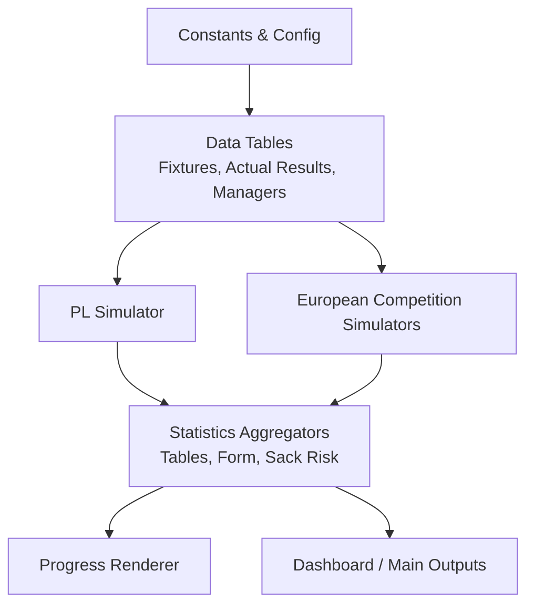
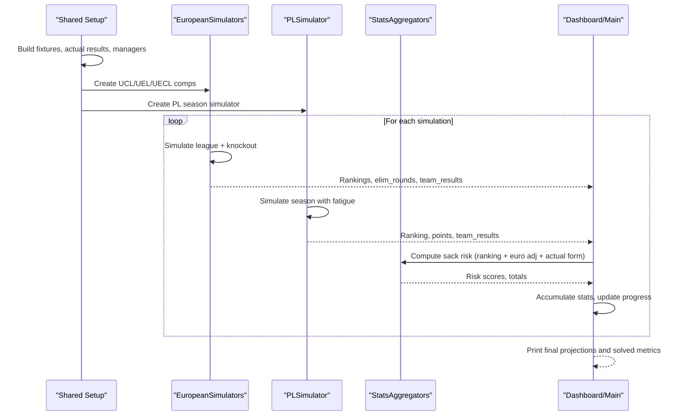
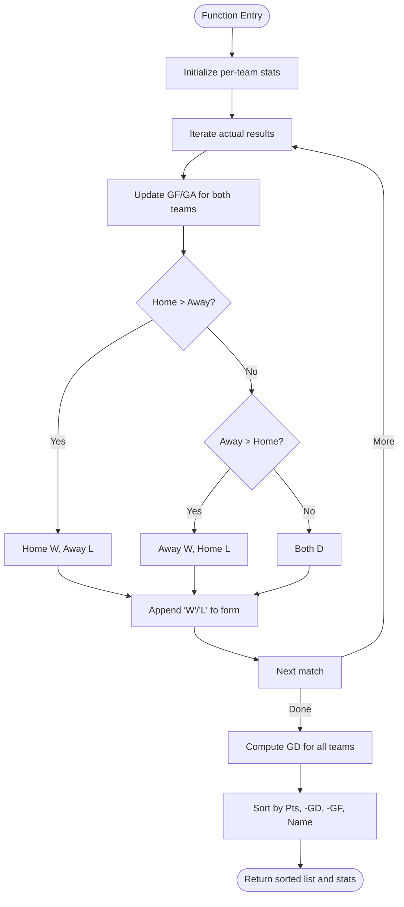
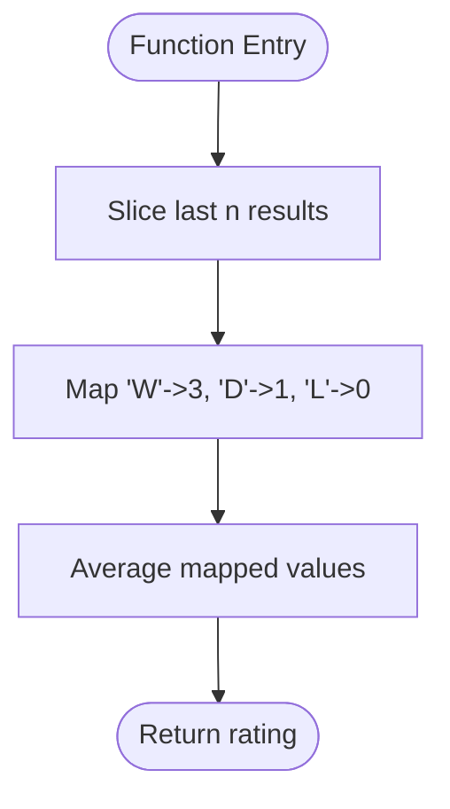
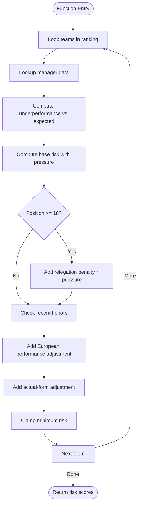
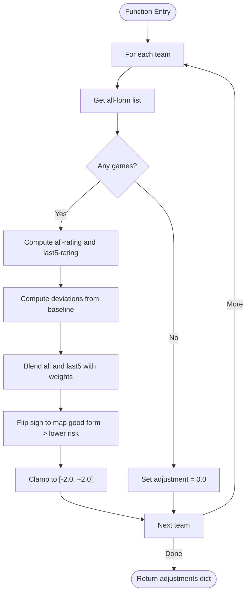
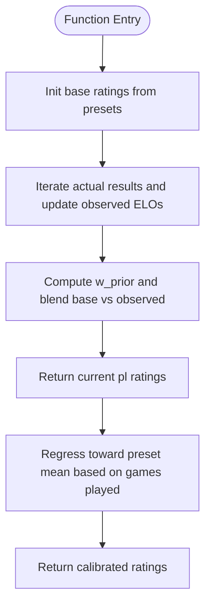
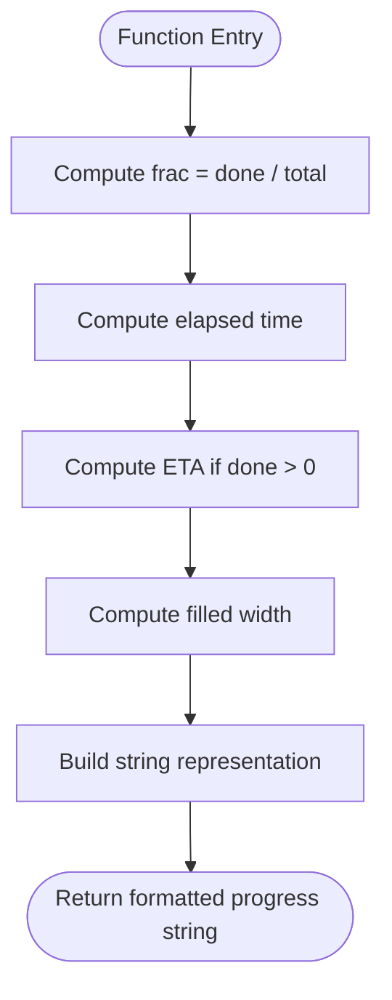
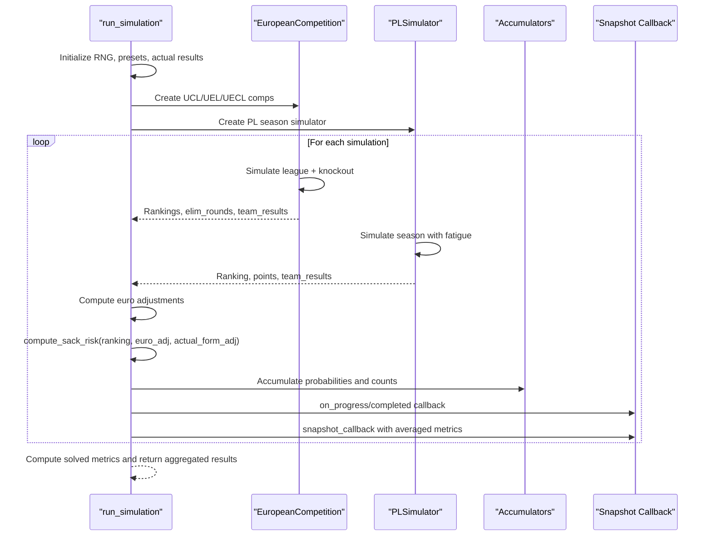
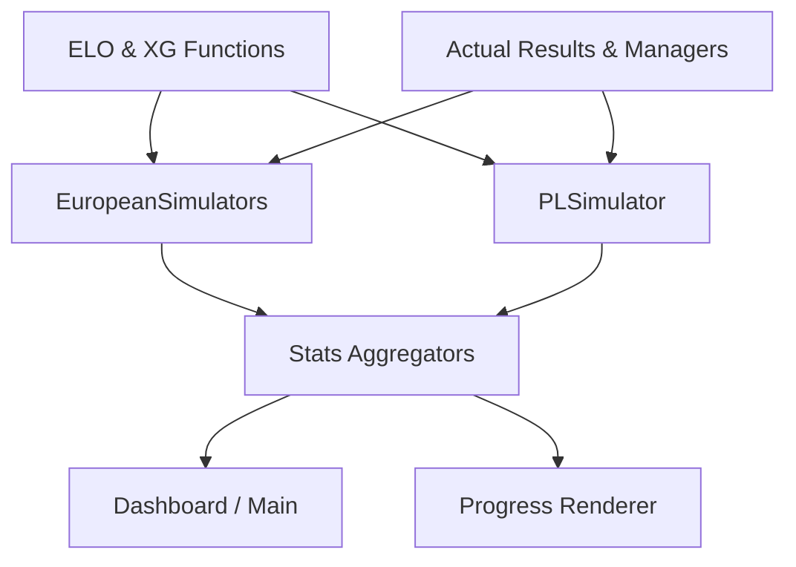

# Statistics Tracking and Aggregation

<cite>
**Referenced Files in This Document**
- [26-27-season.py](file://premier-league/26-27-season.py)
</cite>

## Table of Contents
1. [Introduction](#introduction)
2. [Project Structure](#project-structure)
3. [Core Components](#core-components)
4. [Architecture Overview](#architecture-overview)
5. [Detailed Component Analysis](#detailed-component-analysis)
6. [Dependency Analysis](#dependency-analysis)
7. [Performance Considerations](#performance-considerations)
8. [Troubleshooting Guide](#troubleshooting-guide)
9. [Conclusion](#conclusion)
10. [Appendices](#appendices)

## Introduction
This document explains the comprehensive statistics tracking system that monitors team performance throughout simulations. It focuses on:
- How league tables are built and updated using actual results
- How manager sack risk is calculated with progressive adjustments from form and European performance
- How form analysis works through last-n-game windows and point-based ratings
- How actual results data calibrates model expectations and progressively updates team strengths
- Examples of statistical outputs, performance metrics collection, and real-time progress tracking

The implementation is centered around a unified simulation engine for the Premier League and major European competitions, with strong integration between match modeling, ELO-based strength calibration, and managerial risk analytics.

## Project Structure
The relevant code resides in a single large simulation module that contains:
- Constants and configuration for ELO, expected goals, and competition parameters
- Data structures for fixtures, actual results, and manager information
- Simulation classes for European competitions and the Premier League season
- Statistical aggregation functions for table building, form analysis, and sack-risk computation
- Progress rendering and dashboard entry points for real-time feedback

**Diagram sources**
- [26-27-season.py:12-43](file://premier-league/26-27-season.py#L12-L43)
- [26-27-season.py:359-490](file://premier-league/26-27-season.py#L359-L490)
- [26-27-season.py:884-1066](file://premier-league/26-27-season.py#L884-L1066)
- [26-27-season.py:1313-1440](file://premier-league/26-27-season.py#L1313-L1440)
- [26-27-season.py:700-838](file://premier-league/26-27-season.py#L700-L838)
- [26-27-season.py:2067-2086](file://premier-league/26-27-season.py#L2067-L2086)
- [26-27-season.py:2262-2933](file://premier-league/26-27-season.py#L2262-L2933)

**Section sources**
- [26-27-season.py:12-43](file://premier-league/26-27-season.py#L12-L43)
- [26-27-season.py:359-490](file://premier-league/26-27-season.py#L359-L490)
- [26-27-season.py:884-1066](file://premier-league/26-27-season.py#L884-L1066)
- [26-27-season.py:1313-1440](file://premier-league/26-27-season.py#L1313-L1440)
- [26-27-season.py:700-838](file://premier-league/26-27-season.py#L700-L838)
- [26-27-season.py:2067-2086](file://premier-league/26-27-season.py#L2067-L2086)
- [26-27-season.py:2262-2933](file://premier-league/26-27-season.py#L2262-L2933)

## Core Components
- League table builder: aggregates actual results into W/D/L/GF/GA/Pts/form and computes goal difference and sorting keys
- Form analysis utilities: extract last-n results and convert sequences to point-based ratings
- Manager sack risk calculator: combines simulated ranking underperformance, recent honors, European performance, and actual-form adjustments
- Strength calibration: builds current ELOs from actual results and progressively regresses toward presets based on games played
- Progress renderer: displays completion percentage and ETA during long-running simulations
- Dashboard entry point: runs many simulations, accumulates probabilities, and returns rich statistical snapshots

**Section sources**
- [26-27-season.py:700-838](file://premier-league/26-27-season.py#L700-L838)
- [26-27-season.py:669-694](file://premier-league/26-27-season.py#L669-L694)
- [26-27-season.py:2067-2086](file://premier-league/26-27-season.py#L2067-L2086)
- [26-27-season.py:2696-2929](file://premier-league/26-27-season.py#L2696-L2929)

## Architecture Overview
The system integrates multiple simulation layers:
- European competitions (UCL, UEL, UECL) simulate league phases and knockout progression, producing rankings, elimination rounds, and per-team results
- The Premier League simulator uses fatigue-aware expected goals and Poisson sampling, optionally overriding matches with actual results
- Statistical aggregators compute league tables, form metrics, and sack-risk scores
- Real-time progress tracking provides visual feedback and periodic snapshots for dashboards

**Diagram sources**
- [26-27-season.py:2092-2163](file://premier-league/26-27-season.py#L2092-L2163)
- [26-27-season.py:884-1066](file://premier-league/26-27-season.py#L884-L1066)
- [26-27-season.py:1313-1440](file://premier-league/26-27-season.py#L1313-L1440)
- [26-27-season.py:2262-2933](file://premier-league/26-27-season.py#L2262-L2933)

## Detailed Component Analysis

### League Table Builder: build_actual_pl_table
Purpose:
- Aggregate actual results into a current league table including P/W/D/L/GF/GA/Pts/form
- Compute goal difference and sort by points, then GD, GF, and team name

Key behaviors:
- Initializes per-team stats and iterates over actual results
- Updates wins/draws/losses, goals for/against, and appends result markers to form lists
- Computes GD and sorts teams according to standard tiebreakers

**Diagram sources**
- [26-27-season.py:760-785](file://premier-league/26-27-season.py#L760-L785)

**Section sources**
- [26-27-season.py:760-785](file://premier-league/26-27-season.py#L760-L785)

### Form Analysis: last_n_form and form_to_rating
Purpose:
- Extract the most recent n results from a team’s ordered form list
- Convert a sequence of results ('W', 'D', 'L') into a normalized rating (points per game)

Key behaviors:
- last_n_form returns the tail slice of length n
- form_to_rating maps 'W' to 3 points, 'D' to 1 point, 'L' to 0 points, then averages

**Diagram sources**
- [26-27-season.py:715-720](file://premier-league/26-27-season.py#L715-L720)

**Section sources**
- [26-27-season.py:715-720](file://premier-league/26-27-season.py#L715-L720)

### Manager Sack Risk: compute_sack_risk
Purpose:
- Compute raw “next PL manager to be sacked” risk scores for a simulated season
- Adjust down by recent honors and add European performance adjustments
- Incorporate actual-form adjustments derived from real-world results so far this season

Inputs:
- ranking: simulated final table order
- manager_data: manager names, nationalities, expected finishes, pressure factors
- recent_honours: protection multipliers for recent champions or European winners
- euro_adjustments: additive adjustments from European performance
- actual_form_adjustments: blending of all actual games and last-5 form

Processing logic:
- Base risk starts at 1.0
- Underperformance increases risk non-linearly; severe positions (relegation zone) increase further
- Overperformance reduces risk via multiplicative factors
- Recent honors reduce risk multiplicatively
- European performance adds/subtracts risk
- Actual-form adjustments add/subtract risk
- Final score is clamped to a minimum threshold

**Diagram sources**
- [26-27-season.py:788-838](file://premier-league/26-27-season.py#L788-L838)

**Section sources**
- [26-27-season.py:788-838](file://premier-league/26-27-season.py#L788-L838)

### Actual-Form Adjustment: actual_sack_form_adjustment
Purpose:
- Derive sack-risk adjustments from actual results so far this season
- Blend overall record and last-5 form with configurable weights
- Scale and clamp adjustments to a reasonable range

Key behaviors:
- Computes all-form rating and last-5 rating
- Converts ratings to deviations from a neutral baseline
- Applies weighting and flips sign so good form lowers risk
- Clamps to [-2.0, +2.0]

**Diagram sources**
- [26-27-season.py:723-757](file://premier-league/26-27-season.py#L723-L757)

**Section sources**
- [26-27-season.py:723-757](file://premier-league/26-27-season.py#L723-L757)

### Strength Calibration: build_current_pl_ratings and regress_elos
Purpose:
- Build current ELO ratings by updating preset ELOs with actual results
- Regress ratings toward presets based on the fraction of total games played across all competitions

Key behaviors:
- Iterates actual results and applies ELO updates per match outcome
- Computes weighted average between preset base and observed updates
- Applies regression pull toward mean based on games_played / TOTAL_GAMES_ALL_COMPS

**Diagram sources**
- [26-27-season.py:669-694](file://premier-league/26-27-season.py#L669-L694)

**Section sources**
- [26-27-season.py:669-694](file://premier-league/26-27-season.py#L669-L694)

### Progress Rendering: render_progress
Purpose:
- Provide a text-based progress bar showing completion percentage and estimated time remaining

Key behaviors:
- Calculates fraction done and elapsed time
- Computes ETA assuming constant speed
- Renders a fixed-width bar with filled segments and an arrow indicator

**Diagram sources**
- [26-27-season.py:2070-2080](file://premier-league/26-27-season.py#L2070-L2080)

**Section sources**
- [26-27-season.py:2070-2080](file://premier-league/26-27-season.py#L2070-L2080)

### Dashboard Entry Point: run_simulation
Purpose:
- Run N simulations, accumulate statistics, and return structured outputs for dashboards
- Integrate actual-form adjustments and European performance into sack-risk calculations
- Provide periodic snapshots with averaged positions, qualification probabilities, relegation probabilities, and sack metrics

Key outputs:
- Average points and positions per team
- Title probability and European qualification probabilities
- Relegation probability
- Sack probability distributions and expected firings per season
- European reach probabilities (R16, QF, SF, Final) and win probabilities
- Unified “solved” metrics for European competitions

**Diagram sources**
- [26-27-season.py:2696-2929](file://premier-league/26-27-season.py#L2696-L2929)

**Section sources**
- [26-27-season.py:2696-2929](file://premier-league/26-27-season.py#L2696-L2929)

## Dependency Analysis
The statistics tracking system depends on:
- Match modeling components: ELO updates, expected goals, Poisson sampling
- Competition simulators: European leagues and knockouts, PL season simulation
- Data inputs: actual results arrays, manager data, recent honors
- Aggregation functions: table building, form analysis, sack-risk calculation
- Progress and dashboard interfaces: progress rendering, callbacks, snapshots

**Diagram sources**
- [26-27-season.py:127-141](file://premier-league/26-27-season.py#L127-L141)
- [26-27-season.py:884-1066](file://premier-league/26-27-season.py#L884-L1066)
- [26-27-season.py:1313-1440](file://premier-league/26-27-season.py#L1313-L1440)
- [26-27-season.py:700-838](file://premier-league/26-27-season.py#L700-L838)
- [26-27-season.py:2067-2086](file://premier-league/26-27-season.py#L2067-L2086)
- [26-27-season.py:2262-2933](file://premier-league/26-27-season.py#L2262-L2933)

**Section sources**
- [26-27-season.py:127-141](file://premier-league/26-27-season.py#L127-L141)
- [26-27-season.py:884-1066](file://premier-league/26-27-season.py#L884-L1066)
- [26-27-season.py:1313-1440](file://premier-league/26-27-season.py#L1313-L1440)
- [26-27-season.py:700-838](file://premier-league/26-27-season.py#L700-L838)
- [26-27-season.py:2067-2086](file://premier-league/26-27-season.py#L2067-L2086)
- [26-27-season.py:2262-2933](file://premier-league/26-27-season.py#L2262-L2933)

## Performance Considerations
- Use of precomputed exponentials and inverse exponentials for Poisson sampling reduces repeated math operations
- Actual results override simulated scores when available, avoiding unnecessary randomness for known outcomes
- Fatigue effects are applied only to active teams, minimizing computation overhead
- Progress updates are throttled to avoid excessive I/O during long simulations
- Snapshot callbacks can be configured to trigger periodically, balancing detail with performance

[No sources needed since this section provides general guidance]

## Troubleshooting Guide
Common issues and resolutions:
- Missing actual results for some fixtures: ensure ACTUAL_RESULTS_ARR and related arrays are complete and consistent with fixture sets
- Unexpected sack risk spikes: verify manager_data entries include expected finish and pressure; check recent_honours mappings
- Form-related anomalies: confirm form lists are constructed in chronological order and last_n_form window size is appropriate
- Progress not updating: ensure render_progress is called within the simulation loop and stderr flushing is enabled

**Section sources**
- [26-27-season.py:359-490](file://premier-league/26-27-season.py#L359-L490)
- [26-27-season.py:286-317](file://premier-league/26-27-season.py#L286-L317)
- [26-27-season.py:700-720](file://premier-league/26-27-season.py#L700-L720)
- [26-27-season.py:2067-2086](file://premier-league/26-27-season.py#L2067-L2086)

## Conclusion
The statistics tracking system provides a robust framework for monitoring team performance across simulations. It integrates actual results for calibration, computes meaningful form metrics, and calculates nuanced manager sack risks incorporating multiple factors. The modular design supports real-time progress tracking and rich dashboard outputs, enabling detailed insights into league dynamics and European competition outcomes.

[No sources needed since this section summarizes without analyzing specific files]

## Appendices

### Example Statistical Outputs
- Average points per team and position probabilities
- Title probability and European qualification probabilities
- Relegation probabilities
- Sack probability distributions and expected firings per season
- European reach probabilities (R16, QF, SF, Final) and win probabilities
- Unified “solved” metrics for European competitions

**Section sources**
- [26-27-season.py:2897-2929](file://premier-league/26-27-season.py#L2897-L2929)