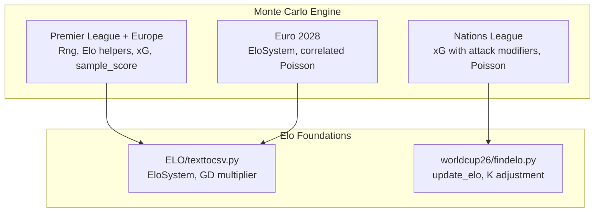
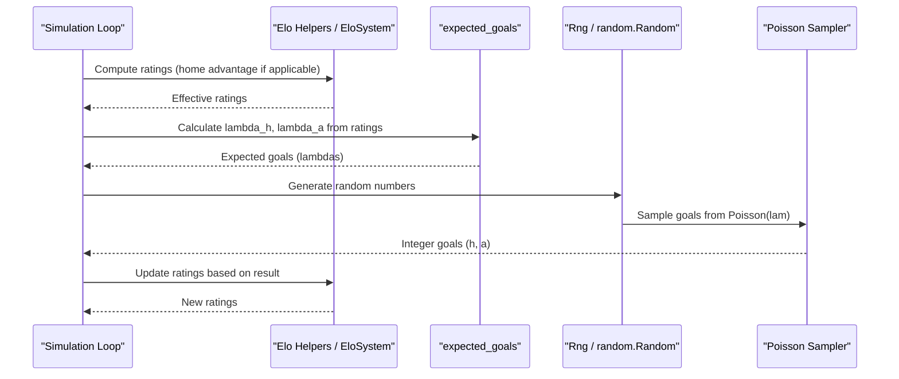
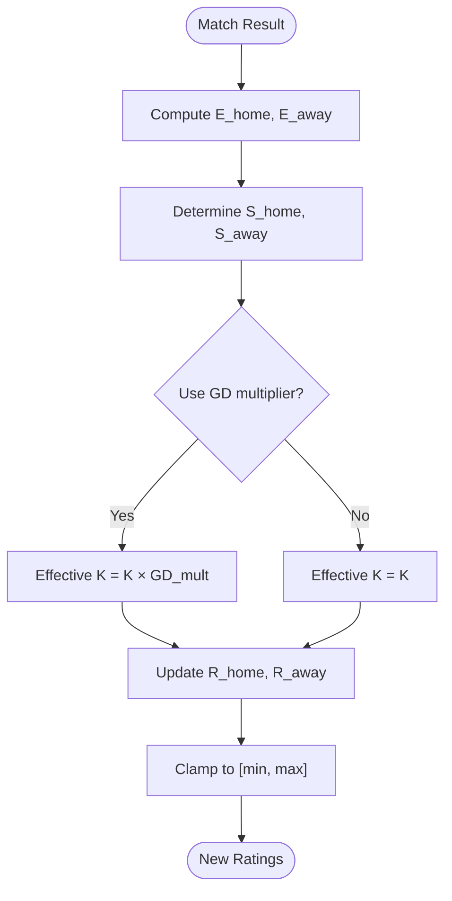
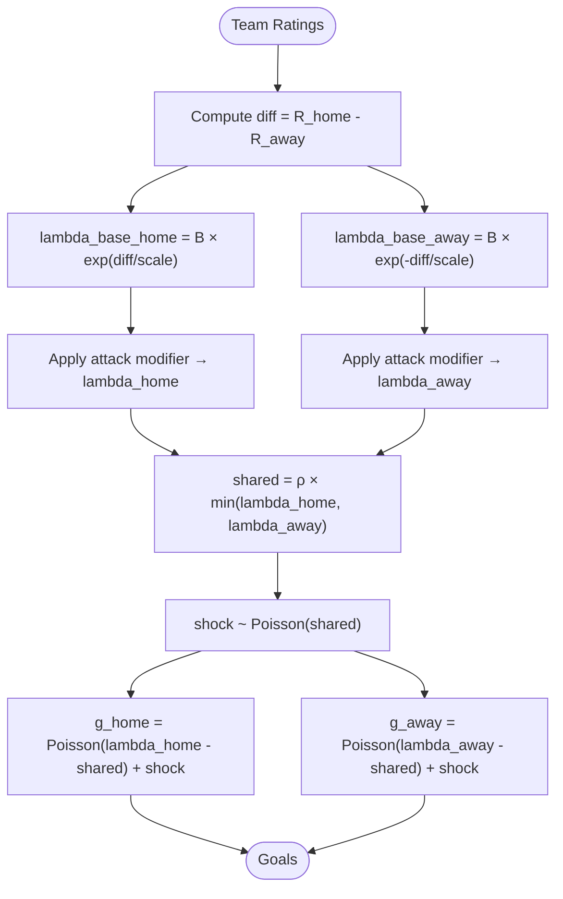
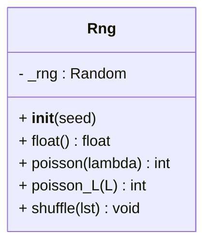
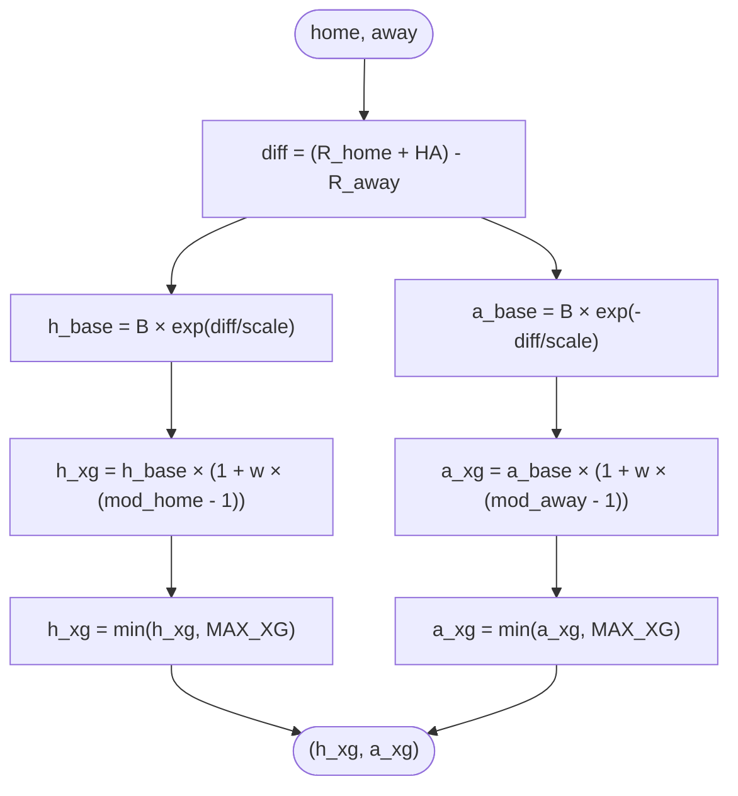
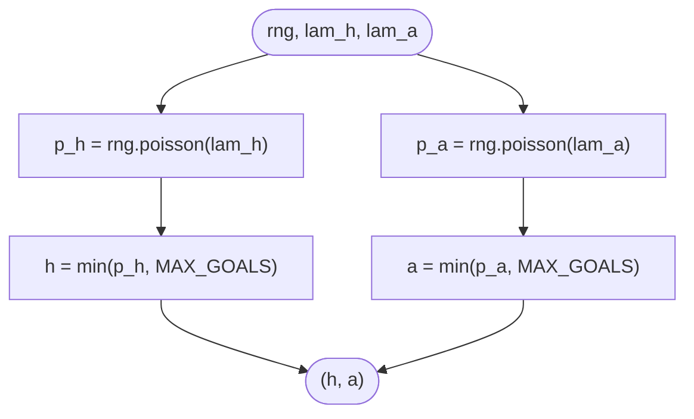
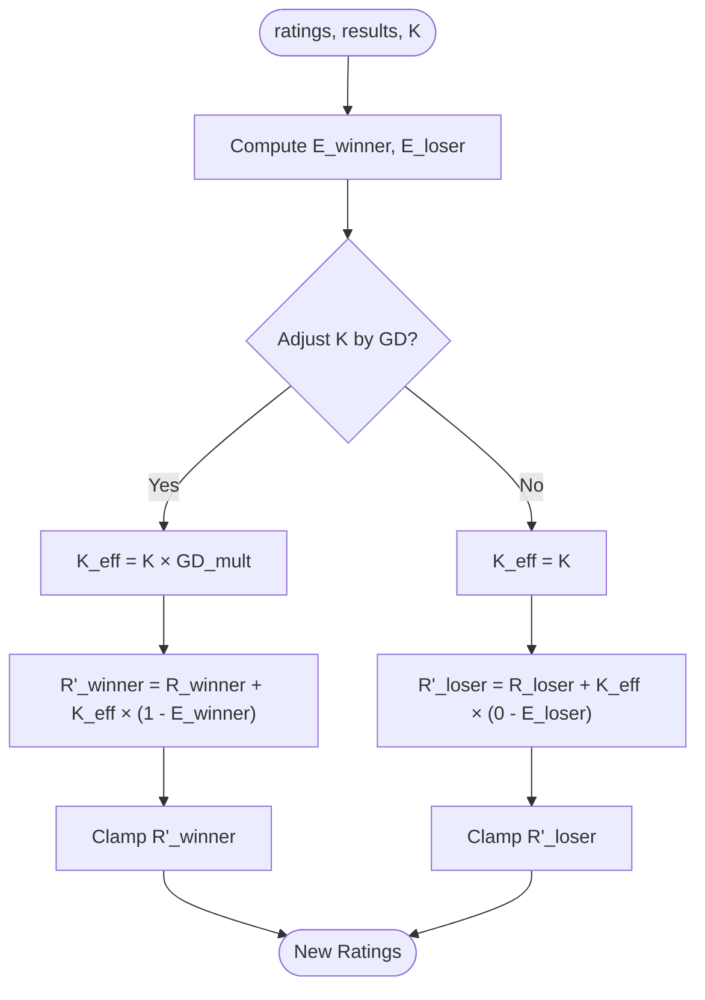
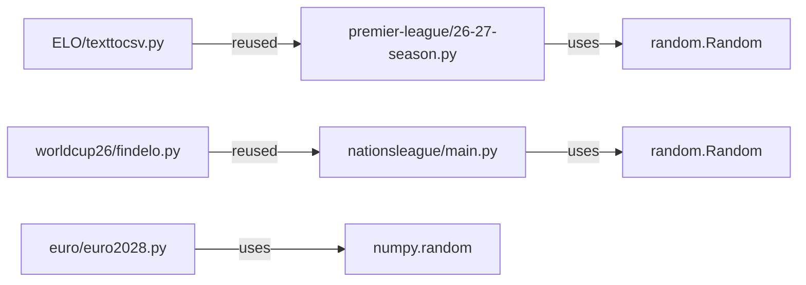

# Statistical Models and Algorithms

<cite>
**Referenced Files in This Document**
- [26-27-season.py](file://premier-league/26-27-season.py)
- [main.py](file://nationsleague/main.py)
- [euro2028.py](file://euro/euro2028.py)
- [texttocsv.py](file://ELO/texttocsv.py)
- [findelo.py](file://worldcup26/findelo.py)
</cite>

## Table of Contents
1. [Introduction](#introduction)
2. [Project Structure](#project-structure)
3. [Core Components](#core-components)
4. [Architecture Overview](#architecture-overview)
5. [Detailed Component Analysis](#detailed-component-analysis)
6. [Dependency Analysis](#dependency-analysis)
7. [Performance Considerations](#performance-considerations)
8. [Troubleshooting Guide](#troubleshooting-guide)
9. [Conclusion](#conclusion)

## Introduction
This document explains the statistical modeling foundation powering the Monte Carlo engine across multiple sports simulations in the repository. It focuses on:
- The Elo rating system, including expected outcomes, dynamic updates, and home advantage adjustments.
- Poisson distribution usage for goal scoring simulation, with parameter calculation from team strengths and expected goals (xG).
- A reproducible random number generation wrapper class Rng with seed management.
- Core algorithms: expected_goals, sample_score, and update_elo.
- Mathematical formulas, code-level references, and performance considerations.

The implementation spans several modules that share common patterns:
- Premier League + European + Carabao Cup unified simulation (optimized Python port).
- UEFA Nations League 2026–2029 simulation.
- Euro 2028 tournament simulation.
- Standalone Elo systems used for calibration and validation.

## Project Structure
The statistical models are primarily implemented in:
- premier-league/26-27-season.py: Rng wrapper, Elo helpers, xG model, and score sampling.
- nationsleague/main.py: xG model with historical attack modifiers, Poisson sampling, and match simulation.
- euro/euro2028.py: EloSystem class with goal correlation and knockout logic.
- ELO/texttocsv.py: EloSystem class with two-pass calibration and goal-difference multiplier.
- worldcup26/findelo.py: World Football Elo update function with K-factor adjustment by goal difference.

**Diagram sources**
- [26-27-season.py:98-141](file://premier-league/26-27-season.py#L98-L141)
- [main.py:201-241](file://nationsleague/main.py#L201-L241)
- [euro2028.py:69-123](file://euro/euro2028.py#L69-L123)
- [texttocsv.py:252-318](file://ELO/texttocsv.py#L252-L318)
- [findelo.py:66-89](file://worldcup26/findelo.py#L66-L89)

**Section sources**
- [26-27-season.py:1-25](file://premier-league/26-27-season.py#L1-L25)
- [main.py:14-26](file://nationsleague/main.py#L14-L26)
- [euro2028.py:15-42](file://euro/euro2028.py#L15-L42)

## Core Components
- Rng wrapper: Provides deterministic random number generation for reproducibility, including a custom Poisson sampler.
- Elo helpers: Expected outcome calculation and rating updates with home advantage and optional goal-difference scaling.
- xG model: Computes expected goals based on Elo differentials and team-specific modifiers.
- Score sampling: Draws integer goals from Poisson distributions using computed lambdas.

Key responsibilities:
- Reproducible simulations via seeded RNG.
- Accurate expected outcomes using logistic Elo functions.
- Realistic goal distributions via Poisson sampling.
- Dynamic strength adjustments after matches.

**Section sources**
- [26-27-season.py:98-141](file://premier-league/26-27-season.py#L98-L141)
- [main.py:201-241](file://nationsleague/main.py#L201-L241)
- [euro2028.py:69-123](file://euro/euro2028.py#L69-L123)

## Architecture Overview
The Monte Carlo engine composes three layers:
1. Strength Model (Elo): Encodes team strengths and adjusts for home advantage.
2. Goal Model (xG + Poisson): Converts strengths into expected goals and samples scores.
3. Simulation Loop: Runs many iterations to produce probabilistic outcomes.

**Diagram sources**
- [26-27-season.py:127-141](file://premier-league/26-27-season.py#L127-L141)
- [main.py:231-241](file://nationsleague/main.py#L231-L241)
- [euro2028.py:78-123](file://euro/euro2028.py#L78-L123)

## Detailed Component Analysis

### Elo Rating System
Mathematical foundations:
- Expected outcome for home team:
  - E_home = 1 / (1 + 10^((R_away - (R_home + HA)) / 400))
  - Where R_home, R_away are Elo ratings and HA is home advantage.
- Actual outcome S:
  - S_home = 1 if win, 0.5 if draw, 0 if loss.
- Rating update:
  - R'_home = R_home + K × (S_home - E_home)
  - R'_away = R_away + K × (S_away - E_away)
- Home advantage adjustments:
  - Additive boost to home team’s effective rating before computing expected outcome.
- Goal-difference multiplier (optional):
  - Scale K by margin of victory to increase sensitivity to dominant performances.

Implementation highlights:
- Logistic formulation using base-10 exponentiation or natural log scale variants.
- Clamping of updated ratings within min/max bounds.
- Two-pass calibration approach to derive initial seeds and spread.

**Diagram sources**
- [texttocsv.py:274-318](file://ELO/texttocsv.py#L274-L318)
- [euro2028.py:78-98](file://euro/euro2028.py#L78-L98)
- [findelo.py:66-89](file://worldcup26/findelo.py#L66-L89)

**Section sources**
- [texttocsv.py:252-318](file://ELO/texttocsv.py#L252-L318)
- [euro2028.py:69-123](file://euro/euro2028.py#L69-L123)
- [findelo.py:66-89](file://worldcup26/findelo.py#L66-L89)

### Poisson Distribution for Goal Scoring
Goal scoring is modeled as independent Poisson processes per team:
- Lambda parameters derived from team strengths and xG models.
- Shared correlation component to induce realistic goal ties and momentum effects.

Parameter calculation:
- Base expected goals depend on Elo differential:
  - lambda_home ∝ exp(+diff/scale)
  - lambda_away ∝ exp(-diff/scale)
- Historical attack modifiers adjust lambdas for team-specific tendencies.
- Correlated Poisson:
  - shared = ρ × min(lambda_home, lambda_away)
  - g_home = Poisson(lambda_home - shared) + shared_shock
  - g_away = Poisson(lambda_away - shared) + shared_shock

**Diagram sources**
- [main.py:211-241](file://nationsleague/main.py#L211-L241)
- [euro2028.py:100-123](file://euro/euro2028.py#L100-L123)

**Section sources**
- [main.py:201-241](file://nationsleague/main.py#L201-L241)
- [euro2028.py:100-123](file://euro/euro2028.py#L100-L123)

### Random Number Generation Wrapper (Rng)
Purpose:
- Provide deterministic simulations by wrapping Python’s random.Random with a fixed seed.
- Expose methods for floats, shuffles, and Poisson sampling.

Key features:
- Custom Poisson sampler using inverse transform method with precomputed L = exp(-λ).
- Avoids external library overhead for Poisson draws in tight loops.

**Diagram sources**
- [26-27-season.py:98-122](file://premier-league/26-27-season.py#L98-L122)

**Section sources**
- [26-27-season.py:98-122](file://premier-league/26-27-season.py#L98-L122)

### Expected Goals Function (expected_goals)
Responsibilities:
- Convert Elo differentials into expected goals for home and away teams.
- Incorporate historical attack modifiers and caps to avoid extreme values.

Formulas:
- diff = (R_home + HA) - R_away
- h_xg = B × exp(diff / scale) × (1 + w × (mod_home - 1))
- a_xg = B × exp(-diff / scale) × (1 + w × (mod_away - 1))
- Cap at MAX_XG to stabilize simulations.

**Diagram sources**
- [main.py:211-237](file://nationsleague/main.py#L211-L237)
- [26-27-season.py:132-135](file://premier-league/26-27-season.py#L132-L135)

**Section sources**
- [main.py:211-237](file://nationsleague/main.py#L211-L237)
- [26-27-season.py:132-135](file://premier-league/26-27-season.py#L132-L135)

### Sample Score Function (sample_score)
Responsibilities:
- Draw integer goals for home and away teams from Poisson distributions.
- Enforce maximum goals cap to prevent outliers.

Algorithm:
- h = min(Poisson(lambda_home), MAX_GOALS)
- a = min(Poisson(lambda_away), MAX_GOALS)

**Diagram sources**
- [26-27-season.py:138-141](file://premier-league/26-27-season.py#L138-L141)

**Section sources**
- [26-27-season.py:138-141](file://premier-league/26-27-season.py#L138-L141)

### Update Elo Function (update_elo)
Responsibilities:
- Adjust team ratings after a match using actual outcomes and expected probabilities.
- Optionally scale K by goal difference to reflect dominance.

Formula:
- R'_winner = R_winner + K_eff × (1 - E_winner)
- R'_loser = R_loser + K_eff × (0 - E_loser)
- K_eff may be adjusted by goal difference multiplier.

**Diagram sources**
- [26-27-season.py:127-129](file://premier-league/26-27-season.py#L127-L129)
- [texttocsv.py:289-318](file://ELO/texttocsv.py#L289-L318)
- [findelo.py:66-89](file://worldcup26/findelo.py#L66-L89)

**Section sources**
- [26-27-season.py:127-129](file://premier-league/26-27-season.py#L127-L129)
- [texttocsv.py:289-318](file://ELO/texttocsv.py#L289-L318)
- [findelo.py:66-89](file://worldcup26/findelo.py#L66-L89)

## Dependency Analysis
Inter-module relationships:
- Premier League module defines Rng and core helpers used by broader simulation pipelines.
- Nations League module implements its own xG and Poisson sampling, leveraging historical attack modifiers.
- Euro 2028 module encapsulates EloSystem with correlated Poisson goals and knockout logic.
- Standalone Elo modules provide reusable classes and utilities for calibration and validation.

**Diagram sources**
- [26-27-season.py:98-122](file://premier-league/26-27-season.py#L98-L122)
- [main.py:224-241](file://nationsleague/main.py#L224-L241)
- [euro2028.py:119-123](file://euro/euro2028.py#L119-L123)

**Section sources**
- [26-27-season.py:98-141](file://premier-league/26-27-season.py#L98-L141)
- [main.py:201-241](file://nationsleague/main.py#L201-L241)
- [euro2028.py:69-123](file://euro/euro2028.py#L69-L123)

## Performance Considerations
- Deterministic RNG: Using Rng with a fixed seed ensures reproducibility across runs; avoids global state interference.
- Custom Poisson sampler: Inverse transform method reduces dependency overhead and improves control over randomness in tight loops.
- Capping goals: Prevents extreme outliers that can skew statistics and slow convergence.
- Efficient Elo updates: Vectorized operations where possible; clamping ratings to bounded ranges prevents numerical drift.
- Correlated Poisson: Introduces realistic tie rates without excessive computational cost.

Recommendations:
- Precompute constants like ln(10)/scale to reduce repeated math calls.
- Batch simulations to amortize overhead.
- Use efficient data structures (e.g., dictionaries for ratings) to minimize lookup costs.

[No sources needed since this section provides general guidance]

## Troubleshooting Guide
Common issues and resolutions:
- Non-reproducible results: Ensure Rng is initialized with a fixed seed and passed consistently through simulation functions.
- Unrealistic goal distributions: Check lambda calculations and caps; verify historical attack modifiers are correctly applied.
- Rating drift: Confirm Elo updates use correct expected outcomes and apply goal-difference multipliers appropriately.
- Correlation artifacts: Validate shared component magnitude relative to lambdas to maintain realistic tie frequencies.

Validation steps:
- Compare simulated W/D/L rates against historical baselines.
- Inspect mean goals per match and variance to ensure alignment with observed data.
- Monitor Elo trajectories for stability and convergence.

**Section sources**
- [26-27-season.py:98-141](file://premier-league/26-27-season.py#L98-L141)
- [main.py:211-241](file://nationsleague/main.py#L211-L241)
- [euro2028.py:100-123](file://euro/euro2028.py#L100-L123)

## Conclusion
The Monte Carlo engine integrates robust statistical models:
- Elo-based strength estimation with home advantage and dynamic updates.
- Poisson-driven goal scoring with correlated components for realism.
- Deterministic RNG for reproducible simulations.
These components work together to produce reliable probabilistic forecasts across leagues and tournaments. By tuning parameters such as K-factors, home advantage, and correlation coefficients, the engine balances accuracy and computational efficiency.

[No sources needed since this section summarizes without analyzing specific files]