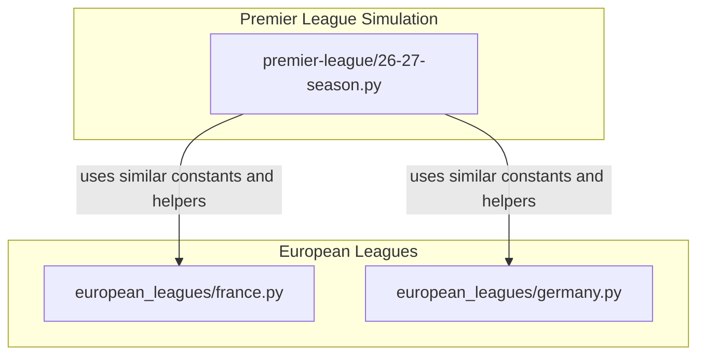
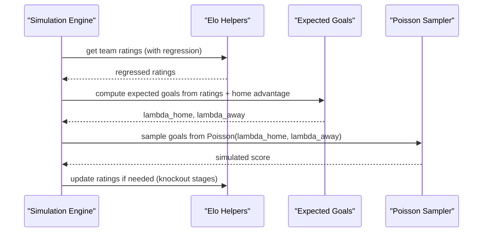
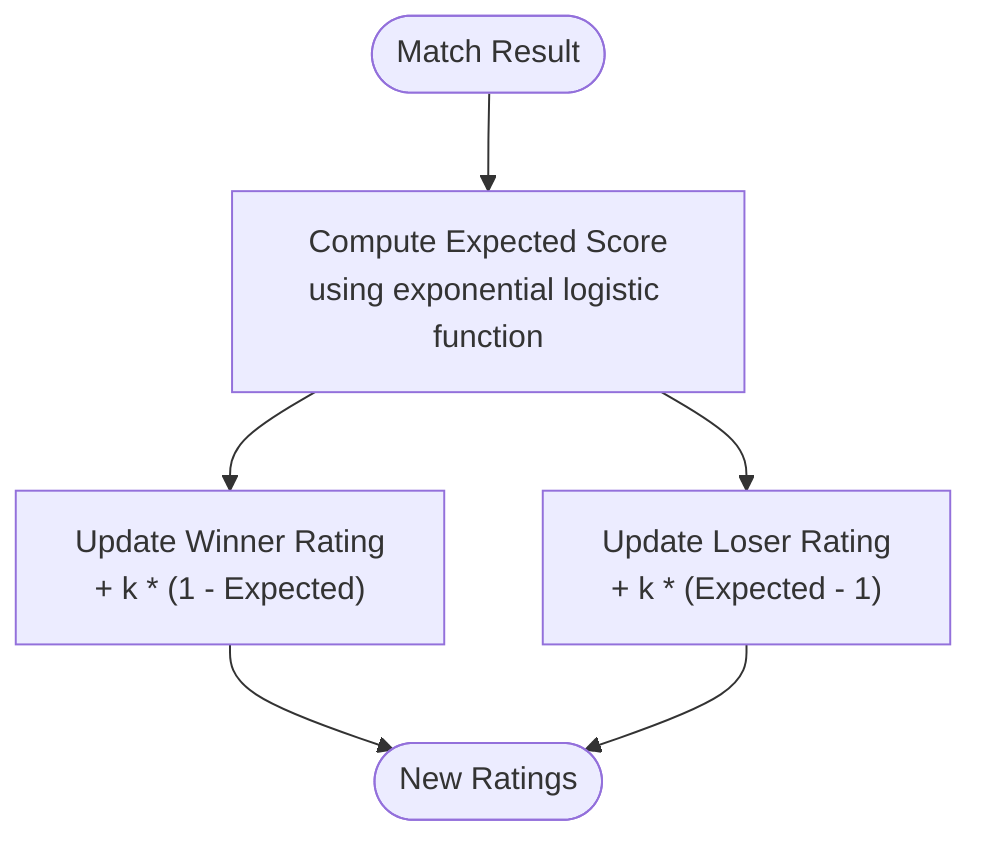
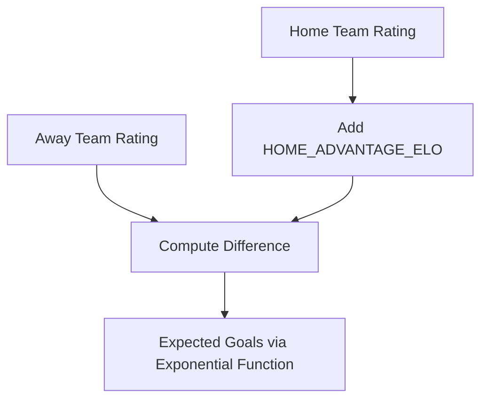
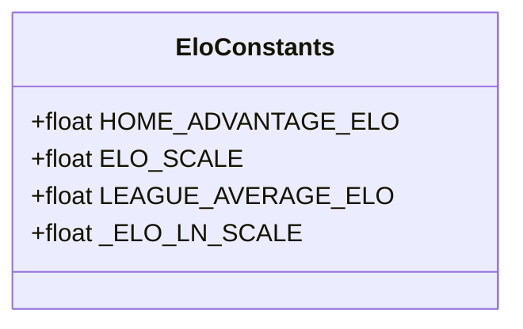
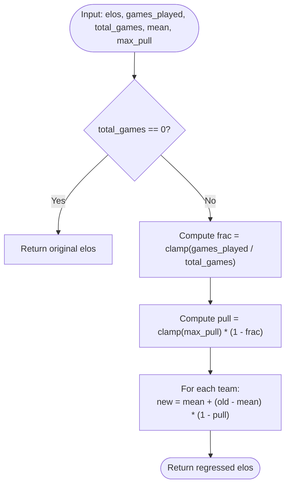
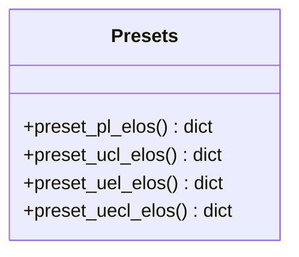
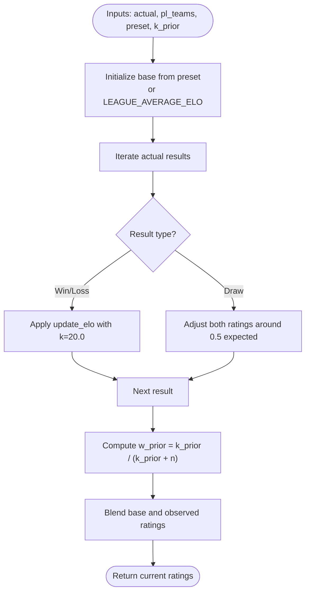
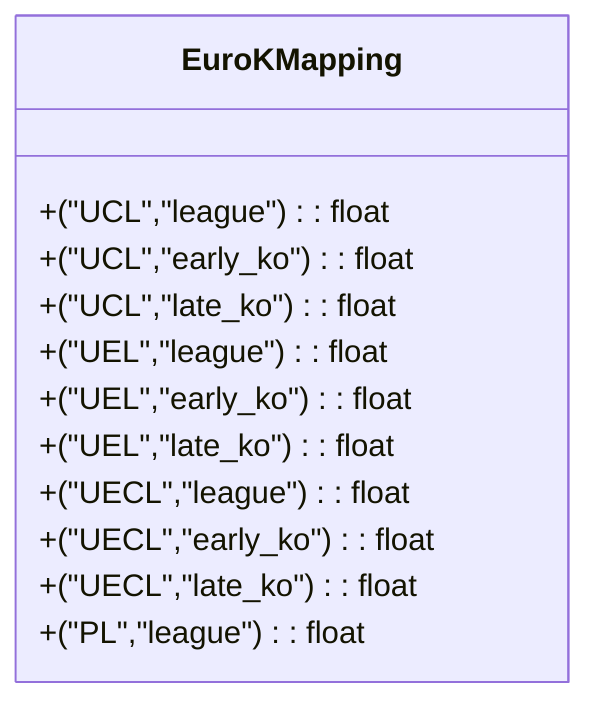
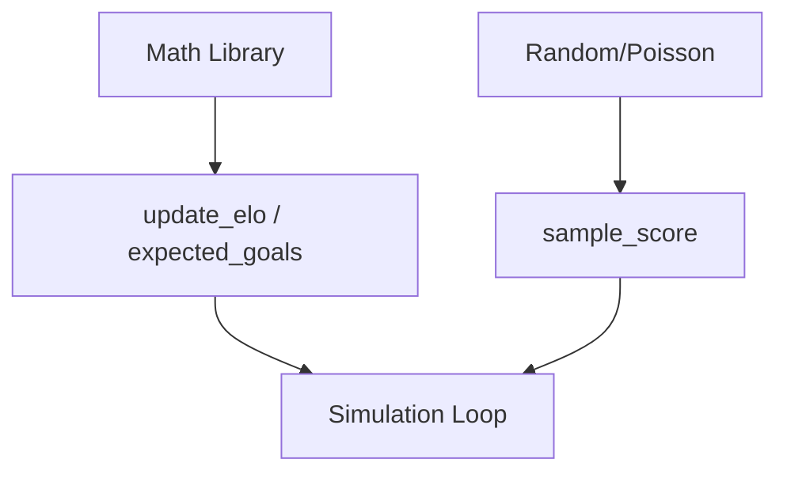

# Elo Rating System Implementation

<cite>
**Referenced Files in This Document**
- [26-27-season.py](file://premier-league/26-27-season.py)
- [france.py](file://european_leagues/france.py)
- [germany.py](file://european_leagues/germany.py)
</cite>

## Table of Contents
1. [Introduction](#introduction)
2. [Project Structure](#project-structure)
3. [Core Components](#core-components)
4. [Architecture Overview](#architecture-overview)
5. [Detailed Component Analysis](#detailed-component-analysis)
6. [Dependency Analysis](#dependency-analysis)
7. [Performance Considerations](#performance-considerations)
8. [Troubleshooting Guide](#troubleshooting-guide)
9. [Conclusion](#conclusion)

## Introduction
This document explains the Elo rating system used across league and European competition simulations. It covers:
- The core Elo calculation algorithm, including expected score computation using exponential functions and rating updates after matches.
- Home advantage adjustments via a constant that shifts team strength for home fixtures.
- The ELO_SCALE parameter and its effect on rating sensitivity.
- The regress_elos function that pulls ratings toward the league average based on games played.
- Practical examples of rating updates.
- How initial preset ratings are established for different competitions (PL, UCL, UEL, UECL).
- The build_current_pl_ratings function that blends prior knowledge with observed results.
- K-factor variations across competition stages and their impact on rating volatility.

## Project Structure
The Elo implementation is primarily contained within the Premier League simulation file, with consistent patterns replicated across European league modules. Key responsibilities:
- Core constants and helper math for Elo and expected goals.
- Preset ratings per competition.
- Regression toward league mean.
- Building current ratings by combining priors and observed results.
- Simulation engines that use Elo-derived expected goals to sample scores.

**Diagram sources**
- [26-27-season.py:12-35](file://premier-league/26-27-season.py#L12-L35)
- [france.py:19-30](file://european_leagues/france.py#L19-L30)
- [germany.py:24-36](file://european_leagues/germany.py#L24-L36)

**Section sources**
- [26-27-season.py:12-35](file://premier-league/26-27-season.py#L12-L35)
- [france.py:19-30](file://european_leagues/france.py#L19-L30)
- [germany.py:24-36](file://european_leagues/germany.py#L24-L36)

## Core Components
- Constants:
  - HOME_ADVANTAGE_ELO: Adds a fixed boost to the home team’s effective strength before computing expected goals or probabilities.
  - ELO_SCALE: Controls the steepness of the logistic curve mapping rating differences to win probabilities.
  - LEAGUE_AVERAGE_ELO: Baseline rating used when no prior exists.
  - _ELO_LN_SCALE: Precomputed scaling factor derived from natural log of 10 divided by ELO_SCALE; used in exponential-based expected score calculations.
- Functions:
  - update_elo: Computes new ratings given winner and loser ratings and a k-factor.
  - expected_goals: Converts Elo difference into expected goal rates for home and away teams using exponential functions.
  - regress_elos: Pulls each team’s rating toward the league average based on how many games have been played relative to total season games.
  - build_current_pl_ratings: Blends preset prior ratings with observed results to produce current ratings.
- Competition presets:
  - preset_pl_elos, preset_ucl_elos, preset_uel_elos, preset_uecl_elos define initial team strengths per competition.
- K-factors:
  - _EURO_K maps competition and stage to k-values controlling rating volatility during league and knockout phases.

**Section sources**
- [26-27-season.py:12-35](file://premier-league/26-27-season.py#L12-L35)
- [26-27-season.py:127-135](file://premier-league/26-27-season.py#L127-L135)
- [26-27-season.py:155-219](file://premier-league/26-27-season.py#L155-L219)
- [26-27-season.py:669-694](file://premier-league/26-27-season.py#L669-L694)

## Architecture Overview
The Elo system integrates with match simulation through expected goals. Ratings determine expected scoring rates, which are then sampled via Poisson distributions to generate realistic scores. Home advantage is applied as an additive shift to the home team’s effective rating. Regression ensures early-season ratings remain stable until sufficient evidence accumulates.

**Diagram sources**
- [26-27-season.py:127-135](file://premier-league/26-27-season.py#L127-L135)
- [26-27-season.py:669-694](file://premier-league/26-27-season.py#L669-L694)
- [26-27-season.py:1350-1400](file://premier-league/26-27-season.py#L1350-L1400)

## Detailed Component Analysis

### Core Elo Calculation Algorithm
- Expected score uses the logistic function expressed with exponentials:
  - For a match between winner and loser with ratings elo_w and elo_l, expected score for the winner is computed as 1 / (1 + exp((elo_l - elo_w) * _ELO_LN_SCALE)).
  - The loser’s expected score is 1 minus the winner’s expected score.
- Rating updates:
  - New winner rating = old winner rating + k * (1 - expected_winner).
  - New loser rating = old loser rating + k * (expected_winner - 1).
- Exponential foundation:
  - _ELO_LN_SCALE = ln(10) / ELO_SCALE, ensuring the logistic curve aligns with base-10 Elo conventions while implemented via natural exponentials.

**Diagram sources**
- [26-27-season.py:127-129](file://premier-league/26-27-season.py#L127-L129)
- [26-27-season.py:24](file://premier-league/26-27-season.py#L24)

**Section sources**
- [26-27-season.py:24](file://premier-league/26-27-season.py#L24)
- [26-27-season.py:127-129](file://premier-league/26-27-season.py#L127-L129)

### Home Advantage Adjustments
- HOME_ADVANTAGE_ELO adds a fixed boost to the home team’s effective rating before computing expected goals or probabilities.
- In simulation loops, the effective rating difference includes this constant:
  - diff = elo_home - elo_away + HOME_ADVANTAGE_ELO
- This increases the home team’s expected goals and win probability relative to the away team.

**Diagram sources**
- [26-27-season.py:12](file://premier-league/26-27-season.py#L12)
- [26-27-season.py:132-135](file://premier-league/26-27-season.py#L132-L135)
- [france.py:155-158](file://european_leagues/france.py#L155-L158)
- [germany.py:160-163](file://european_leagues/germany.py#L160-L163)

**Section sources**
- [26-27-season.py:12](file://premier-league/26-27-season.py#L12)
- [26-27-season.py:132-135](file://premier-league/26-27-season.py#L132-L135)
- [france.py:19](file://european_leagues/france.py#L19)
- [germany.py:24](file://european_leagues/germany.py#L24)

### ELO_SCALE Parameter Impact
- ELO_SCALE determines the sensitivity of the logistic curve:
  - Larger ELO_SCALE flattens the curve, making rating differences less impactful on expected outcomes.
  - Smaller ELO_SCALE steepens the curve, making small rating differences more decisive.
- _ELO_LN_SCALE = ln(10) / ELO_SCALE scales the exponent accordingly.
- Typical value: 400.0, aligning with classical Elo conventions.

**Diagram sources**
- [26-27-season.py:12-24](file://premier-league/26-27-season.py#L12-L24)
- [france.py:26-30](file://european_leagues/france.py#L26-L30)
- [germany.py:31-36](file://european_leagues/germany.py#L31-L36)

**Section sources**
- [26-27-season.py:12-24](file://premier-league/26-27-season.py#L12-L24)
- [france.py:26-30](file://european_leagues/france.py#L26-L30)
- [germany.py:31-36](file://european_leagues/germany.py#L31-L36)

### Rating Regression Toward League Average
- regress_elos pulls each team’s rating toward the league mean based on games_played / total_games:
  - frac = min(max(games_played / total_games, 0), 1)
  - pull = min(max(max_pull, 0), 1) * (1 - frac)
  - new_rating = mean + (old_rating - mean) * (1 - pull)
- At season start (frac near 0), pull is near max_pull, causing strong regression.
- As games accumulate (frac approaches 1), pull decreases, allowing observed performance to dominate.

**Diagram sources**
- [26-27-season.py:669-674](file://premier-league/26-27-season.py#L669-L674)
- [france.py:33-38](file://european_leagues/france.py#L33-L38)
- [germany.py:39-55](file://european_leagues/germany.py#L39-L55)

**Section sources**
- [26-27-season.py:669-674](file://premier-league/26-27-season.py#L669-L674)
- [france.py:33-38](file://european_leagues/france.py#L33-L38)
- [germany.py:39-55](file://european_leagues/germany.py#L39-L55)

### Practical Examples of Rating Updates
- Example scenario:
  - Suppose two teams have ratings 1600 and 1500, and the match ends with the higher-rated team winning.
  - Using update_elo with k=20:
    - Expected score for the winner is computed via the logistic function.
    - Winner’s rating increases by k * (1 - expected).
    - Loser’s rating decreases by k * (expected - 1).
- Draws:
  - In build_current_pl_ratings, draws adjust both teams’ ratings symmetrically around 0.5 expected score.

Note: These examples describe behavior without exposing code content. See source paths for exact implementations.

**Section sources**
- [26-27-season.py:127-129](file://premier-league/26-27-season.py#L127-L129)
- [26-27-season.py:677-694](file://premier-league/26-27-season.py#L677-L694)

### Initial Preset Ratings for Competitions
- PL, UCL, UEL, UECL each have dedicated preset functions returning team-to-rating mappings:
  - preset_pl_elos: English Premier League teams and their starting Elo values.
  - preset_ucl_elos: Champions League participants.
  - preset_uel_elos: Europa League participants.
  - preset_uecl_elos: Conference League participants.
- These presets serve as prior knowledge before any observed results are incorporated.

**Diagram sources**
- [26-27-season.py:155-219](file://premier-league/26-27-season.py#L155-L219)

**Section sources**
- [26-27-season.py:155-219](file://premier-league/26-27-season.py#L155-L219)

### build_current_pl_ratings: Combining Priors and Observed Results
- Purpose:
  - Blend preset prior ratings with observed match results to produce current ratings.
- Process:
  - Initialize base ratings from presets (defaulting to LEAGUE_AVERAGE_ELO for unknown teams).
  - Iterate over actual results:
    - For wins/losses, apply update_elo with a fixed k (e.g., 20.0).
    - For draws, adjust both teams’ ratings around expected draw probability.
  - Weight the prior base ratings against observed ratings using w_prior = k_prior / (k_prior + n), where n is the number of observed matches.
- Outcome:
  - Current ratings reflect both historical priors and recent form, with the balance controlled by k_prior and the volume of observed data.

**Diagram sources**
- [26-27-season.py:677-694](file://premier-league/26-27-season.py#L677-L694)

**Section sources**
- [26-27-season.py:677-694](file://premier-league/26-27-season.py#L677-L694)

### K-Factor Variations Across Competition Stages
- K-factors control rating volatility:
  - Higher k means larger rating changes per match.
  - Lower k means more conservative updates.
- Mapping:
  - _EURO_K defines k-values for:
    - League stages: PL, UCL, UEL, UECL.
    - Knockout stages: early_ko and late_ko for UCL, UEL, UECL.
- Usage:
  - During knockout phases, the appropriate k-value is selected based on competition and round index.
  - Late knockout rounds typically use higher k-values to increase volatility in decisive matches.

**Diagram sources**
- [26-27-season.py:30-35](file://premier-league/26-27-season.py#L30-L35)

**Section sources**
- [26-27-season.py:30-35](file://premier-league/26-27-season.py#L30-L35)

## Dependency Analysis
- Core dependencies:
  - Math operations for exponential and logistic functions.
  - Random sampling via Poisson distribution for goal generation.
- Integration points:
  - Simulation engines consume expected goals derived from Elo ratings.
  - Knockout logic applies stage-specific k-factors when updating ratings post-match.

**Diagram sources**
- [26-27-season.py:127-141](file://premier-league/26-27-season.py#L127-L141)
- [26-27-season.py:1350-1400](file://premier-league/26-27-season.py#L1350-L1400)

**Section sources**
- [26-27-season.py:127-141](file://premier-league/26-27-season.py#L127-L141)
- [26-27-season.py:1350-1400](file://premier-league/26-27-season.py#L1350-L1400)

## Performance Considerations
- Precomputing _ELO_LN_SCALE avoids repeated division in expected score calculations.
- Vectorized preparation of base expected goals and Poisson survival probabilities reduces per-match overhead.
- Clamping inputs (e.g., frac and pull) prevents numerical instability and ensures bounded regression behavior.
- Using fixed k-values in build_current_pl_ratings simplifies early-season blending without complex dynamic tuning.

[No sources needed since this section provides general guidance]

## Troubleshooting Guide
- Unexpectedly large rating swings:
  - Check k-factor selection for the competition stage; late knockout stages may use higher k-values.
- Ratings not converging:
  - Verify regress_elos parameters: ensure games_played and total_games are correctly set so pull decreases appropriately.
- Home advantage effects seem too strong or weak:
  - Review HOME_ADVANTAGE_ELO; it directly shifts expected goals and probabilities.
- Sensitivity issues:
  - Adjust ELO_SCALE; smaller values increase sensitivity to rating differences, larger values decrease it.

**Section sources**
- [26-27-season.py:30-35](file://premier-league/26-27-season.py#L30-L35)
- [26-27-season.py:669-674](file://premier-league/26-27-season.py#L669-L674)
- [26-27-season.py:12](file://premier-league/26-27-season.py#L12)
- [26-27-season.py:12-24](file://premier-league/26-27-season.py#L12-L24)

## Conclusion
The Elo system in these simulations combines a mathematically sound logistic model with practical adjustments for home advantage, rating regression, and competition-specific volatility. By blending prior knowledge with observed results and calibrating sensitivity through ELO_SCALE, the system produces robust predictions across leagues and European competitions. The modular design allows consistent application of these principles across multiple simulations while accommodating stage-specific dynamics through k-factor mappings.

[No sources needed since this section summarizes without analyzing specific files]