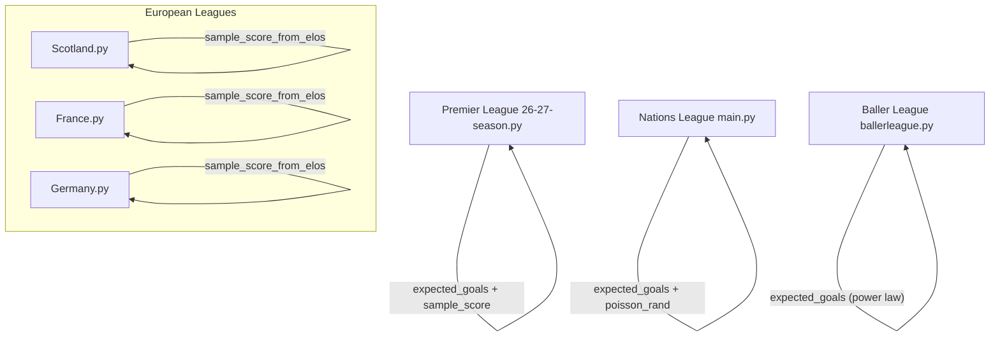
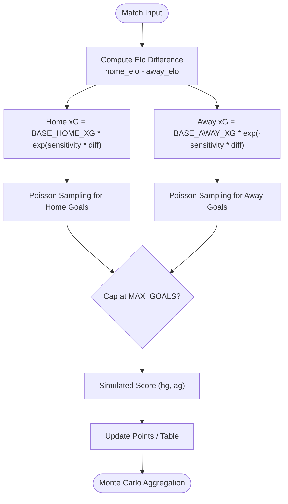
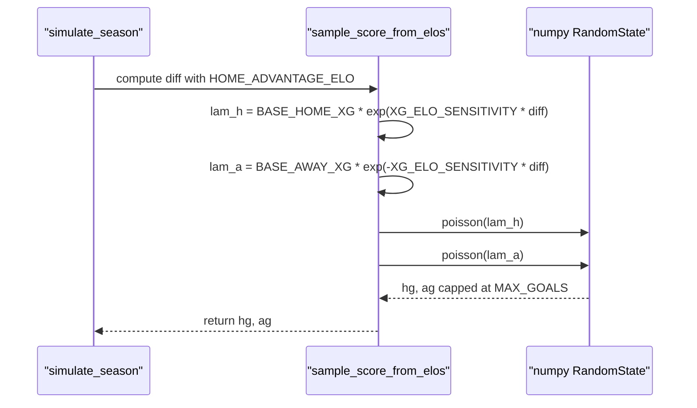
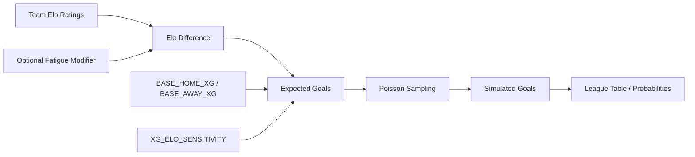

# Expected Goals (xG) Modeling

<cite>
**Referenced Files in This Document**
- [Scotland.py](file://european_leagues/Scotland.py)
- [france.py](file://european_leagues/france.py)
- [germany.py](file://european_leagues/germany.py)
- [26-27-season.py](file://premier-league/26-27-season.py)
- [main.py](file://nationsleague/main.py)
- [ballerleague.py](file://ballerleague/ballerleague.py)
</cite>

## Table of Contents
1. [Introduction](#introduction)
2. [Project Structure](#project-structure)
3. [Core Components](#core-components)
4. [Architecture Overview](#architecture-overview)
5. [Detailed Component Analysis](#detailed-component-analysis)
6. [Dependency Analysis](#dependency-analysis)
7. [Performance Considerations](#performance-considerations)
8. [Troubleshooting Guide](#troubleshooting-guide)
9. [Conclusion](#conclusion)

## Introduction
This document explains the expected goals (xG) methodology used across multiple league simulations in the repository. The core idea is to model each team’s goal expectation as a Poisson rate that depends on:
- A baseline for home and away teams
- An exponential adjustment based on Elo rating differences
- Optional modifiers such as fatigue, historical attack strength, or caps

The xG values are then converted into actual simulated goals using Poisson sampling. These simulations feed Monte Carlo engines that project season outcomes, European qualification probabilities, and other metrics.

## Project Structure
The xG modeling appears in several independent modules:
- European leagues (Scotland, France, Germany): consistent constants and helper functions for score simulation
- Premier League unified engine: optimized Poisson sampling with optional fatigue adjustments
- Nations League: a variant with historical attack modifiers
- Baller League: an alternative power-law formulation for expected goals

**Diagram sources**
- [Scotland.py:119-125](file://european_leagues/Scotland.py#L119-L125)
- [france.py:155-161](file://european_leagues/france.py#L155-L161)
- [germany.py:160-166](file://european_leagues/germany.py#L160-L166)
- [26-27-season.py:132-141](file://premier-league/26-27-season.py#L132-L141)
- [main.py:231-241](file://nationsleague/main.py#L231-L241)
- [ballerleague.py:40-41](file://ballerleague/ballerleague.py#L40-L41)

**Section sources**
- [Scotland.py:22-33](file://european_leagues/Scotland.py#L22-L33)
- [france.py:19-30](file://european_leagues/france.py#L19-L30)
- [germany.py:24-36](file://european_leagues/germany.py#L24-L36)
- [26-27-season.py:12-24](file://premier-league/26-27-season.py#L12-L24)
- [main.py:220-241](file://nationsleague/main.py#L220-L241)
- [ballerleague.py:37-47](file://ballerleague/ballerleague.py#L37-L47)

## Core Components
This section documents the key parameters and functions that define the xG methodology.

### Baseline Goal Expectations
- BASE_HOME_XG: baseline expected goals for the home team when there is no Elo advantage
- BASE_AWAY_XG: baseline expected goals for the away team when there is no Elo advantage

These constants differ slightly by league:
- Scotland and Premier League use higher baselines reflecting more goals per game
- France and Germany use lower baselines

**Section sources**
- [Scotland.py:23-25](file://european_leagues/Scotland.py#L23-L25)
- [france.py:20-22](file://european_leagues/france.py#L20-L22)
- [germany.py:25-27](file://european_leagues/germany.py#L25-L27)
- [26-27-season.py:19-21](file://premier-league/26-27-season.py#L19-L21)

### ELO Sensitivity Parameter
XG_ELO_SENSITIVITY controls how strongly Elo differences translate into changes in goal expectations. It appears in the exponent of the adjustment factor:
- Positive difference increases home xG and decreases away xG
- Negative difference does the opposite

A small positive value like 0.002 means moderate sensitivity; larger values would make xG more volatile with respect to Elo gaps.

**Section sources**
- [Scotland.py:25](file://european_leagues/Scotland.py#L25)
- [france.py:22](file://european_leagues/france.py#L22)
- [germany.py:27](file://european_leagues/germany.py#L27)
- [26-27-season.py:21](file://premier-league/26-27-season.py#L21)

### Expected Goals Function
The standard expected_goals function computes home and away xG from Elo ratings:
- Compute d = home_elo - away_elo
- Home xG = BASE_HOME_XG * exp(XG_ELO_SENSITIVITY * d)
- Away xG = BASE_AWAY_XG * exp(-XG_ELO_SENSITIVITY * d)

In some modules, this is wrapped inside a sample_score function that converts xG into integer goals via Poisson sampling.

**Section sources**
- [26-27-season.py:132-141](file://premier-league/26-27-season.py#L132-L141)
- [Scotland.py:119-125](file://european_leagues/Scotland.py#L119-L125)
- [france.py:155-161](file://european_leagues/france.py#L155-L161)
- [germany.py:160-166](file://european_leagues/germany.py#L160-L166)

### Shot Quality Assessment and Goal Probability
In these models, “shot quality” is abstracted into team strength through Elo ratings. Rather than modeling individual shots, the system models match-level goal counts directly:
- Stronger teams generate higher xG because their Elo increases the home or away rate
- Weaker teams generate lower xG because their Elo reduces the opposing team’s rate
- The Poisson distribution then turns xG into discrete goal counts

This approach treats xG as the mean of a Poisson process rather than a direct probability per shot.

**Section sources**
- [26-27-season.py:132-141](file://premier-league/26-27-season.py#L132-L141)
- [main.py:231-241](file://nationsleague/main.py#L231-L241)

### Integration with Poisson Distribution
Goal simulation uses Poisson sampling:
- lam_h and lam_a are the Poisson rates derived from xG
- Actual goals are sampled from Poisson(lam_h) and Poisson(lam_a)
- Some implementations cap maximum goals at MAX_GOALS

There are two common ways to sample Poisson:
- Directly using numpy.random.poisson
- Using a custom inverse-CDF method based on L = exp(-lam)

**Section sources**
- [Scotland.py:119-125](file://european_leagues/Scotland.py#L119-L125)
- [france.py:155-161](file://european_leagues/france.py#L155-L161)
- [germany.py:160-166](file://european_leagues/germany.py#L160-L166)
- [26-27-season.py:98-141](file://premier-league/26-27-season.py#L98-L141)
- [main.py:224-241](file://nationsleague/main.py#L224-L241)

### Alternative Power-Law xG Model
The Baller League module uses a different formulation:
- expected_goals(attack_elo, opp_defence_elo) = BASE_GOALS * 10^((attack_elo - opp_defence_elo)/400)
- This is a multiplicative power-law relationship rather than an exponential Elo-difference relationship

**Section sources**
- [ballerleague.py:40-41](file://ballerleague/ballerleague.py#L40-L41)

## Architecture Overview
The xG pipeline connects team strength, baseline expectations, and randomness into simulated scores.

**Diagram sources**
- [26-27-season.py:132-141](file://premier-league/26-27-season.py#L132-L141)
- [Scotland.py:119-125](file://european_leagues/Scotland.py#L119-L125)
- [france.py:155-161](file://european_leagues/france.py#L155-L161)
- [germany.py:160-166](file://european_leagues/germany.py#L160-L166)

## Detailed Component Analysis

### Scottish Premiership xG Implementation
The Scottish model defines:
- HOME_ADVANTAGE_ELO = 40.0
- BASE_HOME_XG = 1.6644
- BASE_AWAY_XG = 1.1200
- XG_ELO_SENSITIVITY = 0.002
- MAX_GOALS = 10

The helper sample_score_from_elos computes:
- diff = elo_home - elo_away + HOME_ADVANTAGE_ELO
- lam_h = BASE_HOME_XG * exp(XG_ELO_SENSITIVITY * diff)
- lam_a = BASE_AWAY_XG * exp(-XG_ELO_SENSITIVITY * diff)
- hg = min(poisson(lam_h), MAX_GOALS)
- ag = min(poisson(lam_a), MAX_GOALS)

This is used both in vectorized pre-split simulation and in post-split fixtures.

**Diagram sources**
- [Scotland.py:119-125](file://european_leagues/Scotland.py#L119-L125)
- [Scotland.py:194-201](file://european_leagues/Scotland.py#L194-L201)

**Section sources**
- [Scotland.py:22-33](file://european_leagues/Scotland.py#L22-L33)
- [Scotland.py:119-125](file://european_leagues/Scotland.py#L119-L125)
- [Scotland.py:184-263](file://european_leagues/Scotland.py#L184-L263)

### French Ligue 1 xG Implementation
The French model uses:
- HOME_ADVANTAGE_ELO = 24.0
- BASE_HOME_XG = 1.60
- BASE_AWAY_XG = 1.15
- XG_ELO_SENSITIVITY = 0.002
- MAX_GOALS = 10

The same pattern applies:
- diff = elo_home - elo_away + HOME_ADVANTAGE_ELO
- lam_h and lam_a computed with exponential adjustment
- Poisson sampling with MAX_GOALS cap

**Section sources**
- [france.py:19-30](file://european_leagues/france.py#L19-L30)
- [france.py:155-161](file://european_leagues/france.py#L155-L161)
- [france.py:223-237](file://european_leagues/france.py#L223-L237)

### German Bundesliga xG Implementation
The German model mirrors the French structure:
- HOME_ADVANTAGE_ELO = 24.0
- BASE_HOME_XG = 1.60
- BASE_AWAY_XG = 1.15
- XG_ELO_SENSITIVITY = 0.002
- MAX_GOALS = 10

It also includes a more explicit regress_elos implementation that adjusts Elo toward the league mean based on games played.

**Section sources**
- [germany.py:24-36](file://european_leagues/germany.py#L24-L36)
- [germany.py:39-55](file://european_leagues/germany.py#L39-L55)
- [germany.py:160-166](file://european_leagues/germany.py#L160-L166)
- [germany.py:228-242](file://european_leagues/germany.py#L228-L242)

### Premier League Unified Engine xG Implementation
The Premier League engine defines:
- HOME_ADVANTAGE_ELO = 40.0
- BASE_HOME_XG = 1.6644
- BASE_AWAY_XG = 1.1200
- XG_ELO_SENSITIVITY = 0.002
- MAX_GOALS = 10

It provides:
- expected_goals(elo_h, elo_a) returning (BASE_HOME_XG * exp(XG_ELO_SENSITIVITY * d), BASE_AWAY_XG * exp(-XG_ELO_SENSITIVITY * d))
- sample_score(rng, lam_h, lam_a) converting xG to integer goals via Poisson sampling
- Rng class with a custom poisson_L implementation for performance

In the main simulation loop, it optionally adjusts the Elo difference by fatigue before computing xG:
- diff = base_diff - home_fatigue + away_fatigue
- lam_h and lam_a computed from adjusted diff
- L_h = exp(-lam_h), L_a = exp(-lam_a)
- Goals sampled via rng.poisson_L(L)

**Section sources**
- [26-27-season.py:12-24](file://premier-league/26-27-season.py#L12-L24)
- [26-27-season.py:98-141](file://premier-league/26-27-season.py#L98-L141)
- [26-27-season.py:1376-1440](file://premier-league/26-27-season.py#L1376-L1440)

### Nations League xG Implementation
The Nations League uses a variant:
- effective_elo(team) combines base Elo with modifiers
- diff = (effective_elo(home) + HOME_ADV) - effective_elo(away)
- h_elo = BASE_XG * exp(diff / XG_ELO_SCALE)
- a_elo = BASE_XG * exp(-diff / XG_ELO_SCALE)
- Historical attack modifiers scale xG:
  - h = h_elo * (1 + HIST_WEIGHT * (HOME_ATTACK_MOD[home] - 1))
  - a = a_elo * (1 + HIST_WEIGHT * (AWAY_ATTACK_MOD[away] - 1))
- Capped at MAX_XG
- Goals sampled via poisson_rand

**Section sources**
- [main.py:220-241](file://nationsleague/main.py#L220-L241)

### Baller League xG Implementation
The Baller League uses a different formula:
- expected_goals(attack_elo, opp_defence_elo) = BASE_GOALS * 10^((attack_elo - opp_defence_elo)/400)
- This is not the same exponential Elo-difference form used elsewhere
- It is used to update attack and defense ratings based on goals minus expected goals

**Section sources**
- [ballerleague.py:37-47](file://ballerleague/ballerleague.py#L37-L47)
- [ballerleague.py:90-117](file://ballerleague/ballerleague.py#L90-L117)

## Dependency Analysis
The xG components depend on:
- Math library for exp and log operations
- Random number generators for Poisson sampling
- Team Elo ratings as input
- Constants for baselines and sensitivity

**Diagram sources**
- [26-27-season.py:132-141](file://premier-league/26-27-season.py#L132-L141)
- [Scotland.py:119-125](file://european_leagues/Scotland.py#L119-L125)
- [main.py:231-241](file://nationsleague/main.py#L231-L241)

**Section sources**
- [26-27-season.py:132-141](file://premier-league/26-27-season.py#L132-L141)
- [Scotland.py:119-125](file://european_leagues/Scotland.py#L119-L125)
- [main.py:231-241](file://nationsleague/main.py#L231-L241)

## Performance Considerations
- Vectorized Poisson sampling in European leagues improves speed for large fixture sets
- Custom Rng.poisson_L in the Premier League engine avoids repeated exp calls and can be faster in tight loops
- MAX_GOALS capping prevents extreme outliers from skewing results
- Fatigue adjustments in the Premier League add computation but improve realism

[No sources needed since this section provides general guidance]

## Troubleshooting Guide
Common issues and checks:
- If xG values seem too high or too low, verify BASE_HOME_XG and BASE_AWAY_XG
- If Elo differences have too much or too little impact, adjust XG_ELO_SENSITIVITY
- If simulated goals exceed realistic ranges, check MAX_GOALS and Poisson sampling logic
- If home advantage seems missing, confirm HOME_ADVANTAGE_ELO is added to diff before computing xG
- If fatigue effects are unexpected, verify inv_progress and fatigue_arr usage

**Section sources**
- [26-27-season.py:1392-1405](file://premier-league/26-27-season.py#L1392-L1405)
- [Scotland.py:119-125](file://european_leagues/Scotland.py#L119-L125)
- [france.py:155-161](file://european_leagues/france.py#L155-L161)
- [germany.py:160-166](file://european_leagues/germany.py#L160-L166)

## Conclusion
The xG modeling in this repository consistently uses Elo-based exponential adjustments to convert team strength into goal expectations. Baseline constants capture typical scoring levels for home and away teams, while XG_ELO_SENSITIVITY controls responsiveness to Elo gaps. Poisson sampling translates xG into realistic goal distributions, and Monte Carlo engines aggregate these simulations into probabilistic season projections. Variants exist for different leagues, including fatigue adjustments and historical attack modifiers, but the core mathematical structure remains aligned across implementations.

[No sources needed since this section summarizes without analyzing specific files]