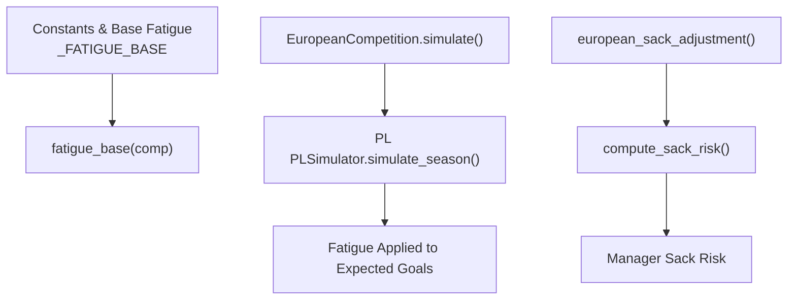
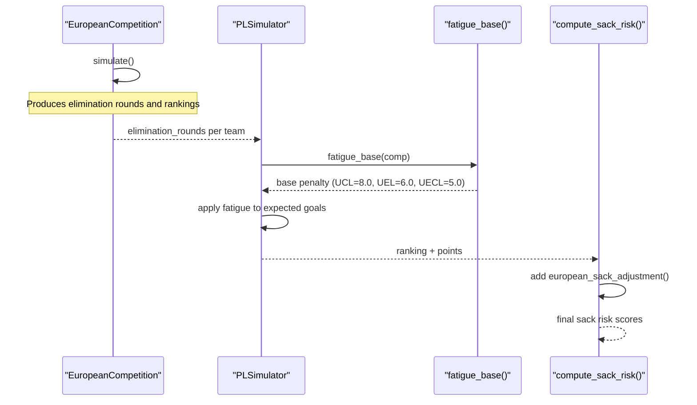
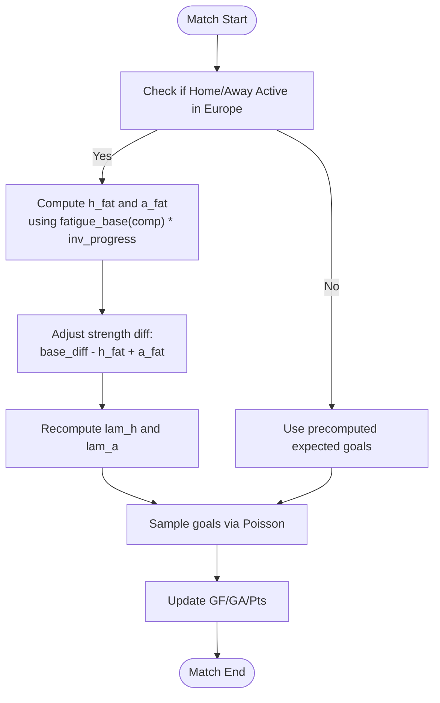
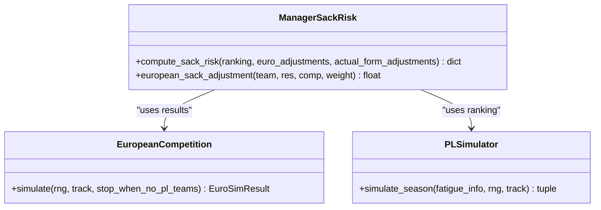

# Fatigue Factor System

<cite>
**Referenced Files in This Document**
- [26-27-season.py](file://premier-league/26-27-season.py)
</cite>

## Table of Contents
1. [Introduction](#introduction)
2. [Project Structure](#project-structure)
3. [Core Components](#core-components)
4. [Architecture Overview](#architecture-overview)
5. [Detailed Component Analysis](#detailed-component-analysis)
6. [Dependency Analysis](#dependency-analysis)
7. [Performance Considerations](#performance-considerations)
8. [Troubleshooting Guide](#troubleshooting-guide)
9. [Conclusion](#conclusion)
10. [Appendices](#appendices)

## Introduction
This document explains the fatigue factor system that models fixture congestion and European competition impact on domestic performance. It focuses on:
- The base fatigue penalties for each European competition
- How those penalties are applied during Premier League simulations
- How European participation interacts with domestic league outcomes
- How fatigue factors integrate with manager sack risk calculations
- Practical examples, tuning guidance, and troubleshooting tips

The implementation is contained within a single simulation module that runs unified Premier League, European, Carabao Cup, and FA Cup simulations.

## Project Structure
The fatigue logic lives in the main simulation file alongside ELO utilities, European competition simulators, and the Premier League simulator. Key areas include:
- Constants and base fatigue configuration
- Fatigue lookup function
- European competition simulation
- Premier League season simulation with fatigue adjustments
- Manager sack risk calculation and integration

**Diagram sources**
- [26-27-season.py:28-35](file://premier-league/26-27-season.py#L28-L35)
- [26-27-season.py:83-88](file://premier-league/26-27-season.py#L83-L88)
- [26-27-season.py:884-1066](file://premier-league/26-27-season.py#L884-L1066)
- [26-27-season.py:1313-1440](file://premier-league/26-27-season.py#L1313-L1440)
- [26-27-season.py:788-838](file://premier-league/26-27-season.py#L788-L838)
- [26-27-season.py:326-356](file://premier-league/26-27-season.py#L326-L356)

**Section sources**
- [26-27-season.py:1-120](file://premier-league/26-27-season.py#L1-L120)

## Core Components
- _FATIGUE_BASE dictionary defines base fatigue penalties per competition:
  - UCL: 8.0
  - UEL: 6.0
  - UECL: 5.0
- fatigue_base(comp) returns the base penalty for a given competition or 0.0 if unknown.
- PLSimulator.simulate_season applies fatigue to expected goals based on whether teams are active in European competitions and how far they have progressed.
- compute_sack_risk integrates European performance adjustments into manager sack risk.

Key responsibilities:
- Define base fatigue penalties
- Provide lookup utility
- Apply fatigue to domestic match expectations
- Integrate European performance into managerial pressure

**Section sources**
- [26-27-season.py:28-35](file://premier-league/26-27-season.py#L28-L35)
- [26-27-season.py:83-88](file://premier-league/26-27-season.py#L83-L88)
- [26-27-season.py:1313-1440](file://premier-league/26-27-season.py#L1313-L1440)
- [26-27-season.py:788-838](file://premier-league/26-27-season.py#L788-L838)

## Architecture Overview
The fatigue system connects European competition results to domestic performance modeling and managerial decisions.

**Diagram sources**
- [26-27-season.py:884-1066](file://premier-league/26-27-season.py#L884-L1066)
- [26-27-season.py:1313-1440](file://premier-league/26-27-season.py#L1313-L1440)
- [26-27-season.py:83-88](file://premier-league/26-27-season.py#L83-L88)
- [26-27-season.py:788-838](file://premier-league/26-27-season.py#L788-L838)
- [26-27-season.py:326-356](file://premier-league/26-27-season.py#L326-L356)

## Detailed Component Analysis

### Base Fatigue Configuration
- _FATIGUE_BASE maps competition codes to base fatigue penalties:
  - UCL: 8.0
  - UEL: 6.0
  - UECL: 5.0
- These values represent the magnitude of domestic performance reduction due to European fixture congestion.

Impact:
- Higher base penalties mean stronger negative effects on expected goals in domestic matches when teams participate in European competitions.

**Section sources**
- [26-27-season.py:28-35](file://premier-league/26-27-season.py#L28-L35)

### Fatigue Lookup Function
- fatigue_base(comp) returns the base penalty for a competition code.
- If the competition code is not recognized, it returns 0.0.

Usage:
- Called by the Premier League simulator to determine the fatigue penalty for each team based on their European participation.

**Section sources**
- [26-27-season.py:83-88](file://premier-league/26-27-season.py#L83-L88)

### European Competition Simulation
- EuropeanCompetition.simulate() runs the league phase and knockout phase for each European competition.
- It produces:
  - Team rankings
  - Elimination rounds per team
  - League points, wins, draws
  - Knockout match points

Integration with fatigue:
- The simulation outputs elimination_rounds per team, which are used to build fatigue_info passed to the Premier League simulator.

**Section sources**
- [26-27-season.py:884-1066](file://premier-league/26-27-season.py#L884-L1066)

### Premier League Simulator and Fatigue Application
- PLSimulator.simulate_season() applies fatigue to expected goals for domestic matches.
- For each fixture:
  - If either home or away team is active in Europe, fatigue reduces the home team’s expected goals and increases the away team’s relative advantage.
  - The fatigue effect scales with inv_progress, meaning fatigue has more impact earlier in the season and less later.

Algorithm overview:
- Build fatigue_arr from fatigue_info using fatigue_base(comp).
- Mark active teams participating in Europe.
- For each match:
  - Compute fatigue-adjusted difference between home and away strengths.
  - Recalculate expected goals with reduced home advantage for fatigued teams.
  - Sample goals using Poisson distribution.

**Diagram sources**
- [26-27-season.py:1355-1440](file://premier-league/26-27-season.py#L1355-L1440)
- [26-27-season.py:83-88](file://premier-league/26-27-season.py#L83-L88)

**Section sources**
- [26-27-season.py:1313-1440](file://premier-league/26-27-season.py#L1313-L1440)

### Manager Sack Risk Integration
- compute_sack_risk calculates raw sack risk based on league position, manager expectations, pressure, recent honors, and European performance adjustments.
- european_sack_adjustment adds or subtracts risk based on a team’s European standing relative to expectations.

Interaction with fatigue:
- While fatigue directly affects domestic performance, European performance adjustments indirectly influence sack risk by modifying managerial pressure.
- Teams performing poorly in Europe may face higher sack risk even if domestic results are stable.

**Diagram sources**
- [26-27-season.py:788-838](file://premier-league/26-27-season.py#L788-L838)
- [26-27-season.py:326-356](file://premier-league/26-27-season.py#L326-L356)
- [26-27-season.py:884-1066](file://premier-league/26-27-season.py#L884-L1066)
- [26-27-season.py:1313-1440](file://premier-league/26-27-season.py#L1313-L1440)

**Section sources**
- [26-27-season.py:788-838](file://premier-league/26-27-season.py#L788-L838)
- [26-27-season.py:326-356](file://premier-league/26-27-season.py#L326-L356)

## Dependency Analysis
- _FATIGUE_BASE depends only on competition codes.
- fatigue_base depends on _FATIGUE_BASE.
- PLSimulator.simulate_season depends on:
  - fatigue_base
  - European competition results (elimination_rounds)
  - ELO-based expected goals functions
- compute_sack_risk depends on:
  - Manager data
  - European performance adjustments
  - Actual form adjustments

Coupling:
- Fatigue is decoupled from European simulation but tightly integrated with domestic simulation.
- Sack risk is loosely coupled to fatigue through European performance adjustments.

Potential circular dependencies:
- None detected; fatigue flows one-way from European results to domestic simulation and then to sack risk.

External dependencies:
- Math functions for ELO and Poisson sampling
- Random number generator wrapper

**Section sources**
- [26-27-season.py:28-35](file://premier-league/26-27-season.py#L28-L35)
- [26-27-season.py:83-88](file://premier-league/26-27-season.py#L83-L88)
- [26-27-season.py:1313-1440](file://premier-league/26-27-season.py#L1313-L1440)
- [26-27-season.py:788-838](file://premier-league/26-27-season.py#L788-L838)

## Performance Considerations
- Fatigue application is O(n_fixtures) per simulation run.
- The use of precomputed expected goals (base_exp_h/base_exp_a) avoids recomputation for non-fatigued matches.
- Poisson sampling is efficient but capped at MAX_GOALS to prevent excessive computation.
- Fatigue scaling with inv_progress reduces computational overhead by limiting fatigue impact to early-season fixtures.

Optimization opportunities:
- Cache fatigue_info per team across simulations if European results are stable.
- Vectorize fatigue adjustments for batch processing.

[No sources needed since this section provides general guidance]

## Troubleshooting Guide
Common issues and resolutions:
- Unknown competition code in fatigue_base:
  - Ensure competition codes are UCL, UEL, or UECL.
  - Unknown codes return 0.0, effectively disabling fatigue for that team.
- Unexpected fatigue impact:
  - Verify that teams are marked as active in Europe (round_ >= 0).
  - Check inv_progress scaling; fatigue has less impact later in the season.
- Sack risk anomalies:
  - Confirm European performance adjustments are correctly computed.
  - Validate manager expectations and pressure values.

Debugging steps:
- Print fatigue_info before passing to PLSimulator.
- Inspect fatigue_arr and active flags for each team.
- Log expected goals before and after fatigue adjustment.

**Section sources**
- [26-27-season.py:83-88](file://premier-league/26-27-season.py#L83-L88)
- [26-27-season.py:1355-1440](file://premier-league/26-27-season.py#L1355-L1440)
- [26-27-season.py:788-838](file://premier-league/26-27-season.py#L788-L838)

## Conclusion
The fatigue factor system effectively models the impact of European competition participation on domestic performance. By applying base penalties from _FATIGUE_BASE and scaling them with progression depth and season timing, the system captures realistic fixture congestion effects. Integration with manager sack risk ensures that European performance influences managerial stability assessments. Tuning parameters like base penalties and inv_progress scaling allows adaptation to different scenarios and leagues.

[No sources needed since this section summarizes without analyzing specific files]

## Appendices

### Practical Examples

#### Example 1: Fatigue Accumulation Over Congested Periods
- Scenario: A top team participates in UCL and reaches the knockout stages.
- Effect:
  - Base fatigue penalty: 8.0 (UCL)
  - Early-season matches: High fatigue impact due to inv_progress near 1.0
  - Late-season matches: Reduced fatigue impact as inv_progress decreases
- Outcome: Domestic performance dips during congested periods, especially in early fixtures.

#### Example 2: Top Teams vs. Mid-Table Teams
- Top teams:
  - More likely to participate in UCL/UEL
  - Higher base fatigue penalties
  - Greater domestic performance impact during European runs
- Mid-table teams:
  - Often in UECL or lower rounds
  - Lower base fatigue penalties
  - Less severe domestic impact

#### Example 3: Manager Sack Risk Impact
- Poor European performance increases sack risk via european_sack_adjustment.
- Teams eliminated early in Europe face higher managerial pressure.
- Recent honors (e.g., winning UEL/UECL last season) reduce sack risk.

### Guidance on Tuning Fatigue Parameters
- Increase base penalties (_FATIGUE_BASE) to model heavier fixture congestion.
- Adjust inv_progress scaling to change how fatigue impacts vary over the season.
- Modify EURO_RISK_WEIGHT to emphasize or de-emphasize European performance in sack risk.

**Section sources**
- [26-27-season.py:28-35](file://premier-league/26-27-season.py#L28-L35)
- [26-27-season.py:1355-1440](file://premier-league/26-27-season.py#L1355-L1440)
- [26-27-season.py:319-323](file://premier-league/26-27-season.py#L319-L323)