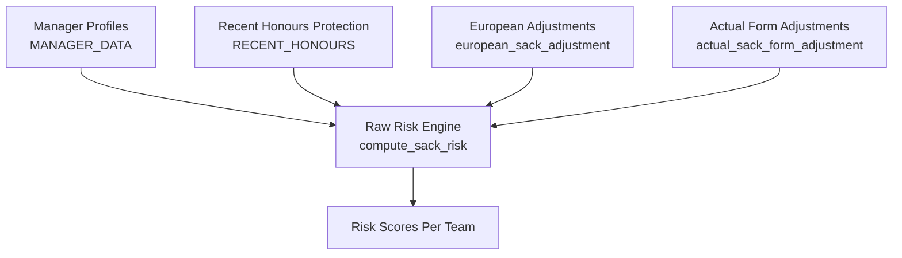
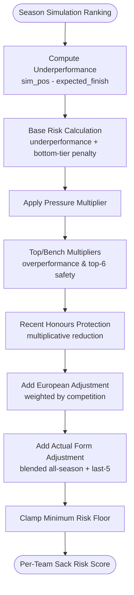
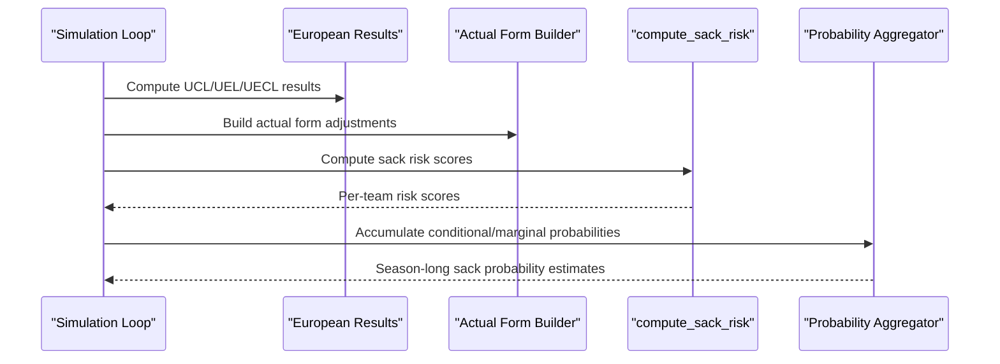
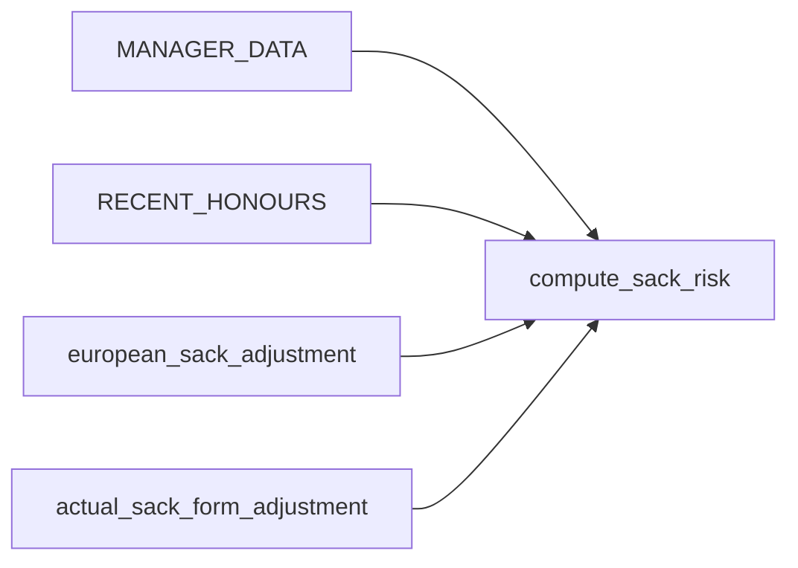

# Manager Performance Analytics

<cite>
**Referenced Files in This Document**
- [26-27-season.py](file://premier-league/26-27-season.py)
</cite>

## Table of Contents
1. [Introduction](#introduction)
2. [Project Structure](#project-structure)
3. [Core Components](#core-components)
4. [Architecture Overview](#architecture-overview)
5. [Detailed Component Analysis](#detailed-component-analysis)
6. [Dependency Analysis](#dependency-analysis)
7. [Performance Considerations](#performance-considerations)
8. [Troubleshooting Guide](#troubleshooting-guide)
9. [Conclusion](#conclusion)
10. [Appendices](#appendices)

## Introduction
This document explains the manager performance analytics and sack risk calculation system used to estimate which Premier League managers are most at risk of being sacked during a simulated season. It covers:
- The MANAGER_DATA structure that stores manager identity, nationality, expected finish targets, and pressure levels.
- The RECENT_HONOURS protection mechanism that reduces sack risk for teams with recent major achievements.
- The compute_sack_risk function that calculates raw sack risk scores based on league position, points per game (via form), and historical survival rates.
- The european_sack_adjustment function that modifies sack risk based on European competition performance.
- The actual_sack_form_adjustment system that incorporates real-world form data by blending all season games with last-5-games performance.
- Practical examples and guidance for interpreting and using these analytics for decision-making.

## Project Structure
The analytics live within a unified simulation script that combines Premier League, European competitions, and domestic cup simulations. The relevant components for manager analytics are concentrated in one file:
- Data structures for manager profiles and recent honours
- Functions to adjust sack risk based on European results and actual form
- Core risk scoring logic that integrates league position, expectations, pressure, honours, Europe, and actual form

**Diagram sources**
- [26-27-season.py:286-307](file://premier-league/26-27-season.py#L286-L307)
- [26-27-season.py:313-317](file://premier-league/26-27-season.py#L313-L317)
- [26-27-season.py:326-356](file://premier-league/26-27-season.py#L326-L356)
- [26-27-season.py:723-757](file://premier-league/26-27-season.py#L723-L757)
- [26-27-season.py:788-838](file://premier-league/26-27-season.py#L788-L838)

**Section sources**
- [26-27-season.py:286-307](file://premier-league/26-27-season.py#L286-L307)
- [26-27-season.py:313-317](file://premier-league/26-27-season.py#L313-L317)
- [26-27-season.py:326-356](file://premier-league/26-27-season.py#L326-L356)
- [26-27-season.py:723-757](file://premier-league/26-27-season.py#L723-L757)
- [26-27-season.py:788-838](file://premier-league/26-27-season.py#L788-L838)

## Core Components
- MANAGER_DATA: Stores per-team manager name, nationality, expected finish target, and pressure multiplier.
- RECENT_HONOURS: Provides multiplicative protection against sack decisions for teams with recent league or European titles.
- european_sack_adjustment: Adds or subtracts sack risk based on how a team performs in European competitions relative to expectations.
- actual_sack_form_adjustment: Blends all-season form with last-5-games form to produce a risk adjustment grounded in real results.
- compute_sack_risk: Computes raw sack risk scores integrating league position, underperformance vs. expectations, pressure, top/bottom-tier multipliers, recent honours, European adjustments, and actual form adjustments.

**Section sources**
- [26-27-season.py:286-307](file://premier-league/26-27-season.py#L286-L307)
- [26-27-season.py:313-317](file://premier-league/26-27-season.py#L313-L317)
- [26-27-season.py:326-356](file://premier-league/26-27-season.py#L326-L356)
- [26-27-season.py:723-757](file://premier-league/26-27-season.py#L723-L757)
- [26-27-season.py:788-838](file://premier-league/26-27-season.py#L788-L838)

## Architecture Overview
The sack risk pipeline integrates multiple signals:
- League ranking drives baseline risk via underperformance relative to expected finish and bottom-tier penalties.
- Pressure amplifies sensitivity to underperformance and relegation-zone outcomes.
- Recent honours provide multiplicative protection.
- European performance adds an additive adjustment weighted by competition importance.
- Actual form adjusts risk based on real-world results, emphasizing recent form while considering the whole season.

**Diagram sources**
- [26-27-season.py:788-838](file://premier-league/26-27-season.py#L788-L838)
- [26-27-season.py:326-356](file://premier-league/26-27-season.py#L326-L356)
- [26-27-season.py:723-757](file://premier-league/26-27-season.py#L723-L757)

## Detailed Component Analysis

### MANAGER_DATA Structure
MANAGER_DATA maps each Premier League team to a tuple containing:
- Manager name
- Nationality
- Expected finish target (the board’s acceptable finish)
- Pressure multiplier (media/board pressure above baseline; 1.0 is neutral)

This structure informs how sensitive a manager is to underperformance and how much extra risk they face when falling short of expectations or slipping into the relegation zone.

Key characteristics:
- Higher expected finish targets (lower numbers) increase sensitivity to underperformance.
- Pressure > 1.0 amplifies risk increases from underperformance and relegation-zone penalties.
- Pressure < 1.0 dampens risk increases.

Practical implications:
- Managers at high-profile clubs often have higher pressure values, making them more vulnerable to poor runs.
- Clubs with modest expectations may tolerate worse results without proportional risk increases.

**Section sources**
- [26-27-season.py:286-307](file://premier-league/26-27-season.py#L286-L307)

### RECENT_HONOURS Protection System
RECENT_HONOURS provides multiplicative protection against sack decisions:
- pl_champion_recent: Number of Premier League titles in the last two seasons.
- european_winner_last: Whether the team won UEL or UECL last season.

Protection rules:
- Back-to-back PL champions receive a strong reduction factor.
- Single PL champion in the last two seasons receives moderate reduction.
- Last season’s UEL/UECL winner receives additional reduction.

These protections reduce the computed risk score multiplicatively, reflecting the reality that recent success can shield a manager from immediate dismissal despite poor current form.

**Section sources**
- [26-27-season.py:313-317](file://premier-league/26-27-season.py#L313-L317)
- [26-27-season.py:821-829](file://premier-league/26-27-season.py#L821-L829)

### compute_sack_risk Function
compute_sack_risk calculates raw sack risk scores for each team in the simulated ranking. Inputs include:
- ranking: Simulated final league order.
- manager_data: MANAGER_DATA mapping.
- recent_honours: RECENT_HONOURS mapping.
- euro_adjustments: Additive adjustments from European performance.
- actual_form_adjustments: Additive adjustments from real-world form.

Algorithm highlights:
- Underperformance penalty: If sim_pos is worse than expected_finish, risk increases nonlinearly with underperformance magnitude and pressure.
- Relegation-zone penalty: Teams finishing 18th or lower incur a base penalty that scales with position and is multiplied by pressure.
- Overperformance bonus: Finishing above expectations applies a multiplicative reduction.
- Top-tier safety: Finishing in top positions applies further reductions.
- Recent honours: Multiplicative protection applied if applicable.
- European adjustment: Additive adjustment added to risk.
- Actual form adjustment: Additive adjustment added to risk.
- Minimum floor: Final risk is clamped to a minimum threshold to avoid zero-risk scenarios.

Complexity:
- Linear in number of teams O(n).
- Constant-time lookups for manager data, honours, and adjustments.

Error handling:
- Missing manager entry defaults to a neutral risk value.
- Missing honours or adjustments default to no effect.

**Section sources**
- [26-27-season.py:788-838](file://premier-league/26-27-season.py#L788-L838)

### european_sack_adjustment Function
european_sack_adjustment computes an additive adjustment to sack risk based on a team’s European competition performance:
- Input parameters:
  - team: Team identifier.
  - res: Competition result object containing ranking and elimination rounds.
  - comp: Competition object providing base Elo ratings.
  - weight: Competition-specific weight (UCL, UEL, UECL).

Logic:
- If the team did not participate or has no elimination round recorded, returns zero adjustment.
- Determines actual ranking position and expected ranking based on base Elo ordering.
- Applies penalties if the team underperforms relative to expectations by certain thresholds.
- Applies additional penalties for very low rankings or early eliminations using a mapping of elimination round to adjustment.
- Returns the weighted sum of adjustments.

Weights:
- UCL: Highest impact.
- UEL: Moderate impact.
- UECL: Lower impact.

This ensures that disappointing European campaigns increase sack risk proportionally to the competition’s prestige and the team’s expected strength.

**Section sources**
- [26-27-season.py:326-356](file://premier-league/26-27-season.py#L326-L356)
- [26-27-season.py:26](file://premier-league/26-27-season.py#L26)

### actual_sack_form_adjustment System
actual_sack_form_adjustment produces a per-team additive adjustment based on real-world results so far this season:
- Inputs:
  - actual_form: Dictionary mapping team to ordered list of results ('W', 'D', 'L').
  - pl_teams: List of Premier League teams.
  - recent_weight: Weight given to last-5-games form (default 0.7).

Processing:
- For each team, compute overall form rating (points per game) across all games played.
- Compute last-5-games form rating.
- Convert ratings to point-per-game deviations from a neutral baseline (1.0 PPG).
- Scale deviations to approximate [-2.0, +2.0] range.
- Blend all-season and last-5-games adjustments using recent_weight.
- Flip sign so negative means good form (lowers risk) and positive means poor form (raises risk).
- Clamp to [-2.0, +2.0].

Interpretation:
- Negative adjustment lowers sack risk (good recent and/or overall form).
- Positive adjustment raises sack risk (poor recent and/or overall form).
- Emphasizes recent form while still accounting for the broader season context.

**Section sources**
- [26-27-season.py:723-757](file://premier-league/26-27-season.py#L723-L757)

### Integration Points and Usage
The system integrates into the broader simulation workflow:
- Build actual form adjustments from real-world results.
- Compute European adjustments for each team across UCL, UEL, and UECL.
- Pass rankings, European adjustments, and actual form adjustments into compute_sack_risk.
- Aggregate conditional “next to be sacked” probabilities and marginal “sacked at all” probabilities across many simulations.

**Diagram sources**
- [26-27-season.py:2361-2389](file://premier-league/26-27-season.py#L2361-L2389)
- [26-27-season.py:2802-2829](file://premier-league/26-27-season.py#L2802-L2829)

**Section sources**
- [26-27-season.py:2361-2389](file://premier-league/26-27-season.py#L2361-L2389)
- [26-27-season.py:2802-2829](file://premier-league/26-27-season.py#L2802-L2829)

## Dependency Analysis
The core dependencies among analytics components:
- compute_sack_risk depends on:
  - MANAGER_DATA for manager profiles and pressure.
  - RECENT_HONOURS for protection factors.
  - european_sack_adjustment outputs for additive European adjustments.
  - actual_sack_form_adjustment outputs for additive real-form adjustments.
- european_sack_adjustment depends on:
  - Competition results (ranking, elimination rounds).
  - Competition base Elo ordering.
  - Weights for competition prestige.
- actual_sack_form_adjustment depends on:
  - Ordered result lists per team.
  - Recent-weight parameter to balance all-season vs. last-5-games.

**Diagram sources**
- [26-27-season.py:286-307](file://premier-league/26-27-season.py#L286-L307)
- [26-27-season.py:313-317](file://premier-league/26-27-season.py#L313-L317)
- [26-27-season.py:326-356](file://premier-league/26-27-season.py#L326-L356)
- [26-27-season.py:723-757](file://premier-league/26-27-season.py#L723-L757)
- [26-27-season.py:788-838](file://premier-league/26-27-season.py#L788-L838)

**Section sources**
- [26-27-season.py:286-307](file://premier-league/26-27-season.py#L286-L307)
- [26-27-season.py:313-317](file://premier-league/26-27-season.py#L313-L317)
- [26-27-season.py:326-356](file://premier-league/26-27-season.py#L326-L356)
- [26-27-season.py:723-757](file://premier-league/26-27-season.py#L723-L757)
- [26-27-season.py:788-838](file://premier-league/26-27-season.py#L788-L838)

## Performance Considerations
- Efficiency: All core functions operate in linear time relative to the number of teams, making them suitable for repeated calls within large simulation loops.
- Numerical stability: Risk scores are clamped to avoid extreme values, ensuring stable aggregation across many simulations.
- Parameter tuning: Weights for European competitions and recent form can be adjusted to reflect different strategic priorities or external pressures.

[No sources needed since this section provides general guidance]

## Troubleshooting Guide
Common issues and resolutions:
- Missing manager data: If a team lacks an entry in MANAGER_DATA, compute_sack_risk assigns a neutral risk value. Ensure all teams are present in the mapping.
- Empty form data: If a team has no actual results yet, actual_sack_form_adjustment returns zero adjustment. Populate form data as matches are played.
- European participation checks: european_sack_adjustment returns zero if a team is not in the competition results. Verify team participation and result objects.
- Unexpected risk spikes: Check pressure multipliers and underperformance magnitudes. High-pressure managers near the relegation zone will see amplified risk increases.

**Section sources**
- [26-27-season.py:788-838](file://premier-league/26-27-season.py#L788-L838)
- [26-27-season.py:723-757](file://premier-league/26-27-season.py#L723-L757)
- [26-27-season.py:326-356](file://premier-league/26-27-season.py#L326-L356)

## Conclusion
The manager performance analytics system provides a robust framework for estimating sack risk by combining league performance, managerial expectations, pressure, recent honours, European results, and real-world form. By understanding each component’s role and interactions, analysts and decision-makers can interpret risk scores meaningfully and use them to inform strategic choices regarding managerial stability and performance management.

[No sources needed since this section summarizes without analyzing specific files]

## Appendices

### Practical Examples of Sack Risk Calculations
Below are conceptual scenarios illustrating how different inputs affect risk scores. These examples demonstrate interpretation rather than exact numerical outputs.

- Scenario A: Strong overperformance with recent honours
  - Team finishes well above expected_finish.
  - Has recent PL title(s) or European win.
  - Result: Significant multiplicative reduction from honours and overperformance bonuses; risk score remains low.

- Scenario B: Poor form with high pressure
  - Team finishes below expected_finish and enters relegation zone.
  - Manager has high pressure multiplier.
  - Result: Large underperformance penalty and bottom-tier penalty amplified by pressure; risk score rises sharply.

- Scenario C: Mixed European performance
  - Team underperforms in UCL relative to expected strength.
  - Result: Additive European adjustment increases risk; magnitude depends on competition weight and elimination stage.

- Scenario D: Improving actual form
  - Team’s last-5-games form improves significantly, even if overall season form is mediocre.
  - Result: Negative actual form adjustment lowers risk, reflecting recent momentum.

Guidance for decision-making:
- Use risk scores comparatively across teams to identify the most vulnerable managers.
- Track trends over time: rising risk indicates deteriorating conditions; falling risk suggests stabilization or improvement.
- Combine risk scores with contextual factors (injuries, fixture difficulty, board statements) for holistic decisions.

[No sources needed since this section provides conceptual examples and guidance]