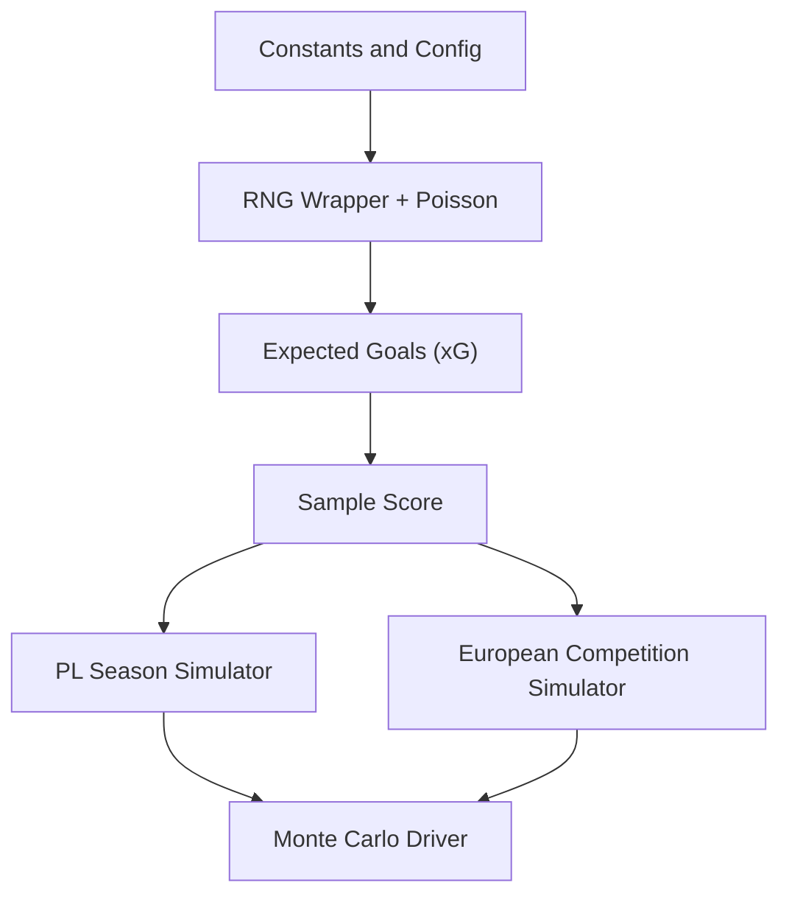
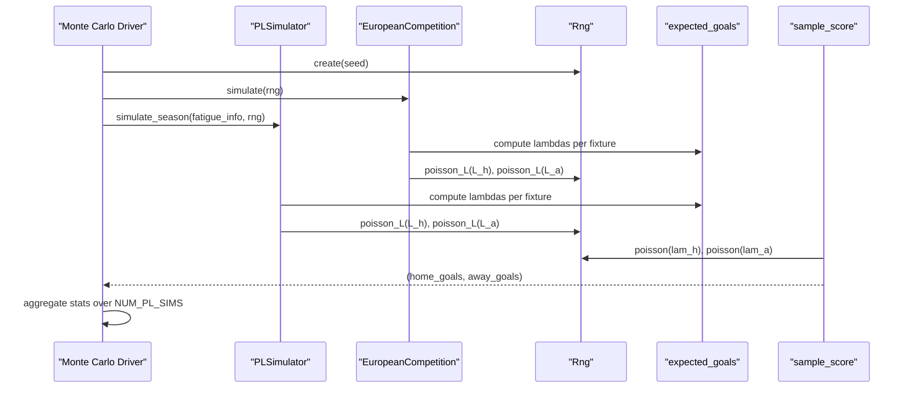
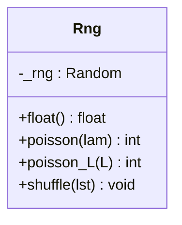
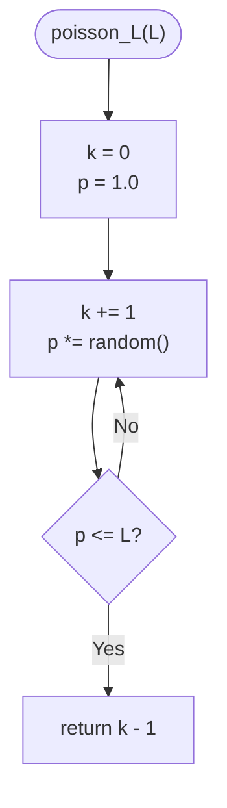
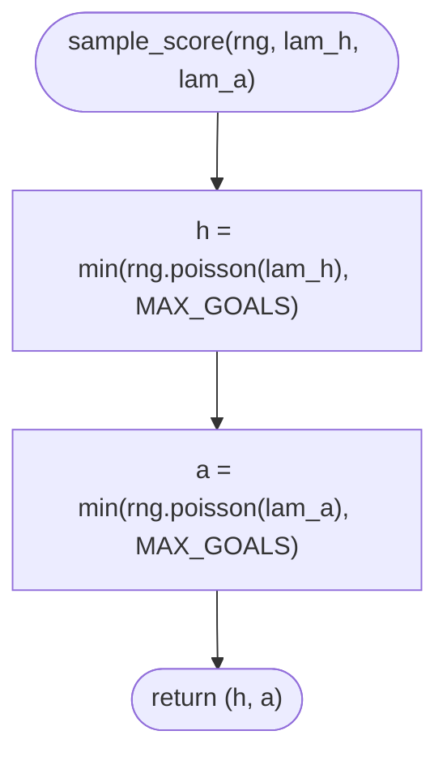
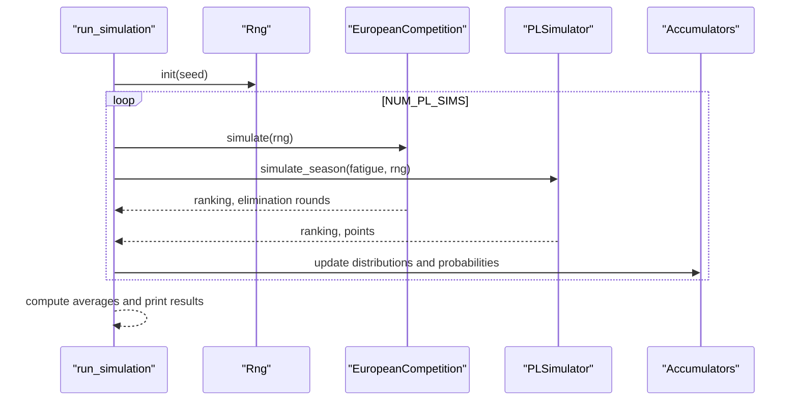
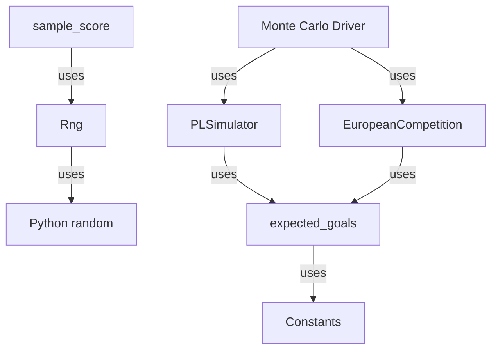

# Poisson Distribution Goal Simulation

<cite>
**Referenced Files in This Document**
- [26-27-season.py](file://premier-league/26-27-season.py)
</cite>

## Table of Contents
1. [Introduction](#introduction)
2. [Project Structure](#project-structure)
3. [Core Components](#core-components)
4. [Architecture Overview](#architecture-overview)
5. [Detailed Component Analysis](#detailed-component-analysis)
6. [Dependency Analysis](#dependency-analysis)
7. [Performance Considerations](#performance-considerations)
8. [Troubleshooting Guide](#troubleshooting-guide)
9. [Conclusion](#conclusion)

## Introduction
This document explains the Poisson distribution implementation used for goal scoring simulation in a football analytics project. It focuses on:
- The Rng class that wraps Python’s random module and provides a custom Poisson sampler
- The mathematical foundation of Poisson sampling for modeling rare events like goals
- The sample_score function that generates realistic match scores from expected goals (xG)
- The MAX_GOALS constraint to prevent unrealistic high-scoring matches
- Integration with the Monte Carlo simulation framework
- Performance considerations and efficiency characteristics of the custom Poisson implementation

The primary implementation is located in the Premier League simulation file, which also contains the ELO-based xG model, season simulation, European competition simulation, and the main Monte Carlo loop.

## Project Structure
The relevant code lives in a single large simulation script that combines:
- Constants and configuration for ELO, xG, and tournament rules
- A lightweight RNG wrapper with a custom Poisson sampler
- Functions to compute expected goals from ELO differences
- Sample score generation using Poisson sampling
- Season and knockout simulation logic
- A Monte Carlo driver that runs many simulations and aggregates statistics

**Diagram sources**
- [26-27-season.py:10-24](file://premier-league/26-27-season.py#L10-L24)
- [26-27-season.py:98-121](file://premier-league/26-27-season.py#L98-L121)
- [26-27-season.py:132-141](file://premier-league/26-27-season.py#L132-L141)
- [26-27-season.py:1313-1440](file://premier-league/26-27-season.py#L1313-L1440)
- [26-27-season.py:884-1066](file://premier-league/26-27-season.py#L884-L1066)
- [26-27-season.py:2696-2889](file://premier-league/26-27-season.py#L2696-L2889)

**Section sources**
- [26-27-season.py:10-24](file://premier-league/26-27-season.py#L10-L24)
- [26-27-season.py:98-121](file://premier-league/26-27-season.py#L98-L121)
- [26-27-season.py:132-141](file://premier-league/26-27-season.py#L132-L141)
- [26-27-season.py:1313-1440](file://premier-league/26-27-season.py#L1313-L1440)
- [26-27-season.py:884-1066](file://premier-league/26-27-season.py#L884-L1066)
- [26-27-season.py:2696-2889](file://premier-league/26-27-season.py#L2696-L2889)

## Core Components
- Rng: A deterministic random number generator wrapper around Python’s random.Random, exposing float(), poisson(), poisson_L(), and shuffle().
- Expected goals (xG): Computes home and away expected goals based on ELO difference and baseline constants.
- sample_score: Samples goals for both teams from Poisson distributions parameterized by lambda values derived from xG.
- PLSimulator and EuropeanCompetition: Use Poisson sampling to simulate league fixtures and European competitions.
- Monte Carlo driver: Runs many independent simulations, aggregating outcomes such as rankings, qualification probabilities, and manager sack risk.

Key responsibilities:
- Rng encapsulates randomness and implements an efficient inverse-transform Poisson sampler.
- sample_score ensures realistic match scores while enforcing a maximum goal cap.
- Simulators integrate Poisson sampling into full-season and tournament contexts.
- The Monte Carlo driver coordinates multiple components and accumulates statistical results.

**Section sources**
- [26-27-season.py:98-121](file://premier-league/26-27-season.py#L98-L121)
- [26-27-season.py:132-141](file://premier-league/26-27-season.py#L132-L141)
- [26-27-season.py:1313-1440](file://premier-league/26-27-season.py#L1313-L1440)
- [26-27-season.py:884-1066](file://premier-league/26-27-season.py#L884-L1066)
- [26-27-season.py:2696-2889](file://premier-league/26-27-season.py#L2696-L2889)

## Architecture Overview
The simulation architecture layers the following:
- Randomness abstraction via Rng
- Statistical modeling via Poisson sampling driven by xG
- Match outcome generation via sample_score
- Tournament and league simulation via dedicated simulators
- Aggregation across Monte Carlo iterations

**Diagram sources**
- [26-27-season.py:132-141](file://premier-league/26-27-season.py#L132-L141)
- [26-27-season.py:98-121](file://premier-league/26-27-season.py#L98-L121)
- [26-27-season.py:1313-1440](file://premier-league/26-27-season.py#L1313-L1440)
- [26-27-season.py:884-1066](file://premier-league/26-27-season.py#L884-L1066)
- [26-27-season.py:2696-2889](file://premier-league/26-27-season.py#L2696-L2889)

## Detailed Component Analysis

### Mathematical Foundation of Poisson Distribution for Goal Scoring
Poisson distribution models the probability of observing k events in a fixed interval when events occur independently at a known average rate λ. In football, goals are relatively rare and approximately independent within a match, making Poisson a natural choice for modeling team goal counts.

Key properties:
- Mean and variance equal λ
- Probability mass function: P(X = k) = e^(-λ) * λ^k / k!
- For small λ, most mass concentrates near 0 and 1; for larger λ, the distribution spreads out

In this codebase:
- λ is derived from expected goals (xG) computed via ELO differences and baseline home/away rates
- Sampling uses an inverse-transform method through cumulative products of uniform random numbers

Practical implications:
- Lower λ yields more low-scoring matches (common in defensive or evenly matched games)
- Higher λ yields more goals and higher variance (typical in mismatched matchups)

**Section sources**
- [26-27-season.py:132-141](file://premier-league/26-27-season.py#L132-L141)
- [26-27-season.py:98-121](file://premier-league/26-27-season.py#L98-L121)

### Rng Class Wrapper Around Python’s random Module
Rng encapsulates a seeded instance of random.Random and exposes:
- float(): returns a uniform random number in [0, 1)
- poisson(lam): samples from Poisson(λ) by converting λ to L = e^(-λ) and calling poisson_L(L)
- poisson_L(L): inverse-transform Poisson sampler using cumulative product of uniforms
- shuffle(lst): shuffles a list in place

Implementation highlights:
- Uses __slots__ to reduce memory overhead
- Avoids external dependencies beyond standard library
- Provides deterministic reproducibility via seed

**Diagram sources**
- [26-27-season.py:98-121](file://premier-league/26-27-season.py#L98-L121)

**Section sources**
- [26-27-season.py:98-121](file://premier-league/26-27-season.py#L98-L121)

### Custom Poisson Sampler Implementation
The Poisson sampler uses the inverse-transform method:
- Convert λ to L = e^(-λ)
- Generate U ~ Uniform(0,1) repeatedly and multiply them until the product p ≤ L
- Return k - 1 where k is the iteration count

Algorithm flow:

Complexity:
- Expected number of iterations equals λ + 1
- Time complexity O(λ) per sample
- Space complexity O(1)

Optimization notes:
- Local variable caching of random() reduces attribute lookup cost
- Direct use of math.exp(-lam) avoids repeated exponentiation in callers

**Diagram sources**
- [26-27-season.py:110-118](file://premier-league/26-27-season.py#L110-L118)

**Section sources**
- [26-27-season.py:110-118](file://premier-league/26-27-season.py#L110-L118)

### Expected Goals (xG) Model
Expected goals are computed from ELO differences:
- Home λ = BASE_HOME_XG * exp(sensitivity * (home_ELO - away_ELO))
- Away λ = BASE_AWAY_XG * exp(-sensitivity * (home_ELO - away_ELO))

Parameters:
- BASE_HOME_XG and BASE_AWAY_XG set baseline scoring expectations
- XG_ELO_SENSITIVITY controls how strongly ELO differences affect λ

Usage:
- Used by both league and European simulators to derive λ per fixture
- Precomputed L = e^(-λ) values are cached to avoid redundant exponentiation

**Section sources**
- [26-27-season.py:132-135](file://premier-league/26-27-season.py#L132-L135)
- [26-27-season.py:936-937](file://premier-league/26-27-season.py#L936-L937)
- [26-27-season.py:1350-1353](file://premier-league/26-27-season.py#L1350-L1353)

### sample_score Function
sample_score generates a realistic match score by sampling goals for both teams:
- h = min(poisson(lam_h), MAX_GOALS)
- a = min(poisson(lam_a), MAX_GOALS)
- Returns (h, a)

Behavior:
- Ensures each team’s goal count does not exceed MAX_GOALS
- Integrates directly with Rng.poisson for sampling

Integration points:
- Used in two-legged ties and finals to generate leg scores and extra-time scenarios
- Applied in Monte Carlo loops to accumulate statistics

**Diagram sources**
- [26-27-season.py:138-141](file://premier-league/26-27-season.py#L138-L141)

**Section sources**
- [26-27-season.py:138-141](file://premier-league/26-27-season.py#L138-L141)

### MAX_GOALS Constraint
MAX_GOALS caps the maximum number of goals any team can score in a simulated match. This prevents unrealistic high-scoring outliers that could distort statistics and narrative plausibility.

Effects:
- Truncates the right tail of the Poisson distribution
- Reduces variance slightly compared to unconstrained Poisson
- Keeps simulated scores within plausible ranges for professional football

Configuration:
- Defined as a constant at the top of the simulation file
- Applied consistently across all sampling paths

**Section sources**
- [26-27-season.py:15](file://premier-league/26-27-season.py#L15)
- [26-27-season.py:138-141](file://premier-league/26-27-season.py#L138-L141)
- [26-27-season.py:969-971](file://premier-league/26-27-season.py#L969-L971)
- [26-27-season.py:1404-1405](file://premier-league/26-27-season.py#L1404-L1405)

### Practical Examples of Poisson Sampling
Conceptual examples (no code snippets):
- Low λ (e.g., 0.8): Most samples will be 0 or 1 goals; occasional 2 goals; very rare 3+
- Medium λ (e.g., 1.5): Common outcomes include 0, 1, 2 goals; 3 goals less common
- High λ (e.g., 3.0): More spread across 1–4 goals; 5+ possible but still uncommon due to MAX_GOALS

How different λ values produce different distributions:
- As λ increases, the mode shifts right and variance increases
- With MAX_GOALS, extreme tails are truncated, reducing the impact of very high λ

Demonstration approach:
- Run many samples for a given λ and plot histograms
- Compare empirical mean and variance to theoretical λ
- Observe effect of truncation at MAX_GOALS

[No sources needed since this section provides conceptual guidance]

### Integration with the Monte Carlo Simulation Framework
The Monte Carlo driver:
- Creates a single Rng instance per run with a deterministic seed
- Reuses the same RNG across European competitions, league simulation, and cup tournaments
- Iterates NUM_PL_SIMS times, accumulating:
  - Team rankings and points distributions
  - European qualification probabilities
  - Manager sack risk metrics
  - Association coefficients and spot allocations

Key integration points:
- EuropeanCompetition.simulate uses Poisson sampling per fixture
- PLSimulator.simulate_season uses Poisson sampling per fixture
- Knockout phases use sample_score for leg and extra-time decisions

**Diagram sources**
- [26-27-season.py:2696-2889](file://premier-league/26-27-season.py#L2696-L2889)
- [26-27-season.py:2328-2471](file://premier-league/26-27-season.py#L2328-L2471)

**Section sources**
- [26-27-season.py:2696-2889](file://premier-league/26-27-season.py#L2696-L2889)
- [26-27-season.py:2328-2471](file://premier-league/26-27-season.py#L2328-L2471)

## Dependency Analysis
Component relationships:
- Rng depends only on Python’s random module
- expected_goals depends on ELO constants and sensitivity parameters
- sample_score depends on Rng and MAX_GOALS
- PLSimulator and EuropeanCompetition depend on expected_goals and Rng
- Monte Carlo driver depends on all above components and aggregation utilities

Potential coupling concerns:
- Heavy reliance on global constants for tuning (ELO scale, xG baselines)
- Shared RNG state across components requires careful seeding strategy

External dependencies:
- Standard library only (math, random, time, sys, functools, collections)

**Diagram sources**
- [26-27-season.py:98-121](file://premier-league/26-27-season.py#L98-L121)
- [26-27-season.py:132-141](file://premier-league/26-27-season.py#L132-L141)
- [26-27-season.py:1313-1440](file://premier-league/26-27-season.py#L1313-L1440)
- [26-27-season.py:884-1066](file://premier-league/26-27-season.py#L884-L1066)
- [26-27-season.py:2696-2889](file://premier-league/26-27-season.py#L2696-L2889)

**Section sources**
- [26-27-season.py:98-121](file://premier-league/26-27-season.py#L98-L121)
- [26-27-season.py:132-141](file://premier-league/26-27-season.py#L132-L141)
- [26-27-season.py:1313-1440](file://premier-league/26-27-season.py#L1313-L1440)
- [26-27-season.py:884-1066](file://premier-league/26-27-season.py#L884-L1066)
- [26-27-season.py:2696-2889](file://premier-league/26-27-season.py#L2696-L2889)

## Performance Considerations
Custom Poisson implementation vs. standard library alternatives:
- Advantages:
  - No external dependencies; pure Python
  - Deterministic via seeded RNG
  - Lightweight and easy to audit
- Trade-offs:
  - Slower than NumPy’s vectorized Poisson sampling for large batches
  - O(λ) expected runtime per sample; may become a bottleneck at scale

Optimization strategies observed:
- Precomputing L = e^(-λ) avoids repeated exponentiation in hot loops
- Local variable caching of random() reduces attribute lookup overhead
- Using __slots__ in Rng reduces per-instance memory footprint

Scaling recommendations:
- For massive Monte Carlo runs, consider batch sampling with NumPy for speed
- Keep MAX_GOALS reasonable to limit tail effects
- Tune NUM_PL_SIMS based on available compute time and desired precision

[No sources needed since this section provides general guidance]

## Troubleshooting Guide
Common issues and resolutions:
- Non-reproducible results:
  - Ensure a fixed seed is passed to Rng
  - Verify that the same RNG instance is reused across components
- Unrealistically high scores:
  - Check MAX_GOALS setting
  - Validate λ values from expected_goals to ensure they reflect realistic xG
- Slow performance:
  - Reduce NUM_PL_SIMS for quick tests
  - Consider precomputing L values and minimizing repeated math operations
- Incorrect ELO-driven xG:
  - Review BASE_HOME_XG, BASE_AWAY_XG, and XG_ELO_SENSITIVITY constants
  - Confirm ELO inputs are properly regressed and normalized

**Section sources**
- [26-27-season.py:15](file://premier-league/26-27-season.py#L15)
- [26-27-season.py:132-141](file://premier-league/26-27-season.py#L132-L141)
- [26-27-season.py:98-121](file://premier-league/26-27-season.py#L98-L121)
- [26-27-season.py:2696-2889](file://premier-league/26-27-season.py#L2696-L2889)

## Conclusion
The Poisson distribution implementation provides a robust and transparent foundation for simulating football goal scoring. By wrapping Python’s random module with a custom Poisson sampler, the code achieves determinism and simplicity while maintaining realistic match outcomes through ELO-derived xG. The MAX_GOALS constraint ensures plausibility, and the Monte Carlo framework integrates these components to produce statistically meaningful predictions across leagues and tournaments. While the custom sampler is slower than vectorized alternatives, its clarity and portability make it well-suited for analytical workflows where reproducibility and transparency are paramount.

[No sources needed since this section summarizes without analyzing specific files]