# Statistical Modeling Framework

<cite>
**Referenced Files in This Document**
- [texttocsv.py](file://ELO/texttocsv.py)
- [findelo.py](file://worldcup26/findelo.py)
- [fullsim.py](file://worldcup26/fullsim.py)
- [elo_ratings.txt](file://worldcup26/elo_ratings.txt)
- [26-27-season.py](file://premier-league/26-27-season.py)
- [main.py](file://clubworldcup/main.py)
</cite>

## Table of Contents
1. [Introduction](#introduction)
2. [Project Structure](#project-structure)
3. [Core Components](#core-components)
4. [Architecture Overview](#architecture-overview)
5. [Detailed Component Analysis](#detailed-component-analysis)
6. [Dependency Analysis](#dependency-analysis)
7. [Performance Considerations](#performance-considerations)
8. [Troubleshooting Guide](#troubleshooting-guide)
9. [Conclusion](#conclusion)

## Introduction
This document explains the statistical modeling framework used across the repository to generate predictions for football outcomes, team strength calibration, and manager risk analytics. The system combines:
- Elo-based team strength models with dynamic updates and home advantage adjustments
- Expected goals (xG) estimation using Poisson distributions and ELO-driven intensity parameters
- Fatigue factors that capture fixture congestion and European competition impact on domestic performance
- Manager sack-risk scoring based on points per game, recent form, historical expectations, and European performance penalties
- Simulation engines for league seasons, European competitions, and knockout matches

The goal is to provide a clear, code-mapped understanding of how these components interact to produce reliable predictions.

## Project Structure
The modeling logic spans several modules:
- ELO rating engine and calibration pipeline
- World Cup simulation with Dixon–Coles goal model
- Premier League season simulator integrating xG, fatigue, and manager analytics
- Simple xG estimator utility

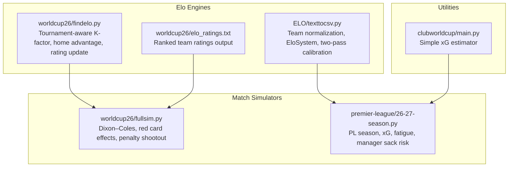

**Diagram sources**
- [texttocsv.py:252-318](file://ELO/texttocsv.py#L252-L318)
- [findelo.py:6-89](file://worldcup26/findelo.py#L6-L89)
- [fullsim.py:23-82](file://worldcup26/fullsim.py#L23-L82)
- [26-27-season.py:1313-1440](file://premier-league/26-27-season.py#L1313-L1440)
- [main.py:7-18](file://clubworldcup/main.py#L7-L18)

**Section sources**
- [texttocsv.py:1-442](file://ELO/texttocsv.py#L1-L442)
- [findelo.py:1-225](file://worldcup26/findelo.py#L1-L225)
- [fullsim.py:1-129](file://worldcup26/fullsim.py#L1-L129)
- [26-27-season.py:1-400](file://premier-league/26-27-season.py#L1-L400)
- [main.py:1-30](file://clubworldcup/main.py#L1-L30)

## Core Components
- Elo rating systems:
  - Club-level EloSystem with dynamic updates, home advantage, and goal-difference scaling
  - Tournament-aware Elo with K-factors by competition type and neutral venue handling
- Goal modeling:
  - Dixon–Coles distribution for match scores
  - Poisson-based expected goals with ELO sensitivity and fatigue adjustments
- Fatigue factor system:
  - Competition-specific base fatigue values and time-decay through the season
  - European competition elimination rounds influence domestic fixture difficulty
- Manager analytics:
  - Sack risk derived from underperformance vs. expectations, relegation zone penalties, recent honors protection, and European performance adjustments
- Validation and tuning:
  - Calibration via two-pass Elo seeding
  - Parameter sets for K-factors, ELO scales, and xG sensitivities

**Section sources**
- [texttocsv.py:252-356](file://ELO/texttocsv.py#L252-L356)
- [findelo.py:14-89](file://worldcup26/findelo.py#L14-L89)
- [fullsim.py:23-82](file://worldcup26/fullsim.py#L23-L82)
- [26-27-season.py:1313-1440](file://premier-league/26-27-season.py#L1313-L1440)

## Architecture Overview
The prediction pipeline integrates multiple layers:
- Data ingestion and normalization
- Team strength calibration (Elo)
- Match outcome simulation (Poisson/Dixon–Coles)
- Season simulation with fatigue and European competition integration
- Manager risk scoring and outputs

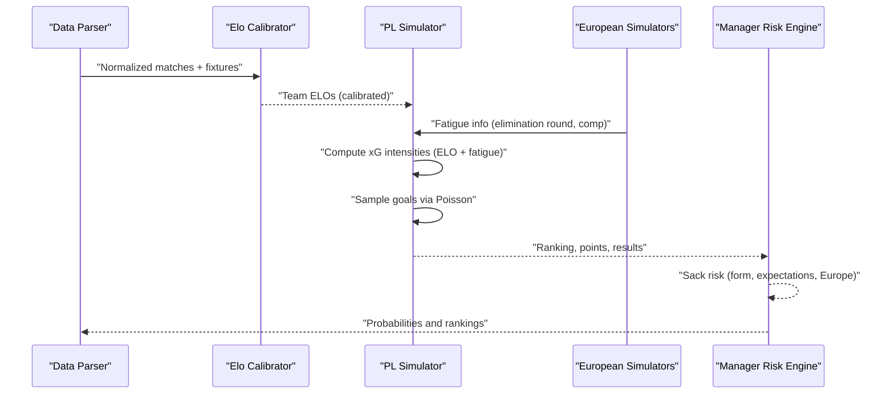

**Diagram sources**
- [texttocsv.py:183-246](file://ELO/texttocsv.py#L183-L246)
- [texttocsv.py:324-356](file://ELO/texttocsv.py#L324-L356)
- [26-27-season.py:1313-1440](file://premier-league/26-27-season.py#L1313-L1440)
- [26-27-season.py:2181-2205](file://premier-league/26-27-season.py#L2181-L2205)

## Detailed Component Analysis

### Elo Rating System Implementation
The Elo implementation includes:
- Dynamic rating updates with configurable K-factor
- Home advantage adjustment
- Goal-difference multiplier to scale learning rate
- Two-pass calibration to derive league power and seed initial ratings

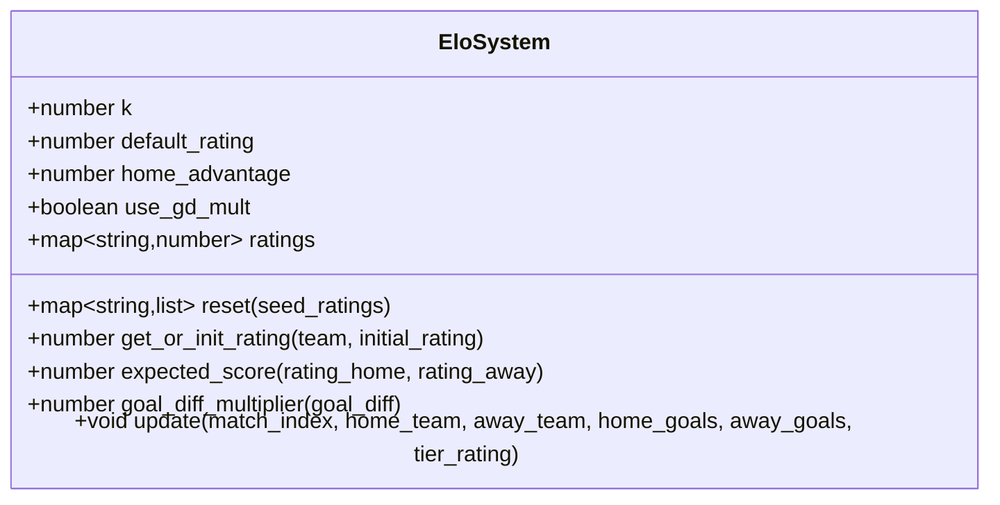

Key behaviors:
- Expected score uses logistic function with home advantage added to home rating
- Goal difference multiplier increases effective K for larger margins
- History tracking supports visualization and diagnostics

**Diagram sources**
- [texttocsv.py:252-318](file://ELO/texttocsv.py#L252-L318)

**Section sources**
- [texttocsv.py:252-318](file://ELO/texttocsv.py#L252-L318)

### Dynamic Rating Updates and Calibration
Two-pass calibration:
- Pass 1: Conservative Elo (lower K, no GD mult) to measure empirical league strengths
- Compute league powers relative to a baseline league (e.g., Premier League)
- Pass 2: Final Elo with calibrated seeds and expanded spread

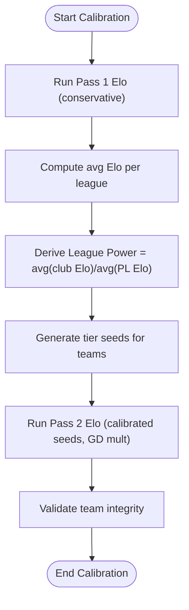

**Diagram sources**
- [texttocsv.py:324-356](file://ELO/texttocsv.py#L324-L356)
- [texttocsv.py:362-377](file://ELO/texttocsv.py#L362-L377)

**Section sources**
- [texttocsv.py:324-356](file://ELO/texttocsv.py#L324-L356)
- [texttocsv.py:362-377](file://ELO/texttocsv.py#L362-L377)

### Home Advantage Adjustments
- Club-level Elo adds a fixed home advantage to the home team’s rating before computing expected score
- Tournament-level Elo applies a flat home advantage when not neutral venues
- Final matches adjust home advantage based on stadium matching the final venue

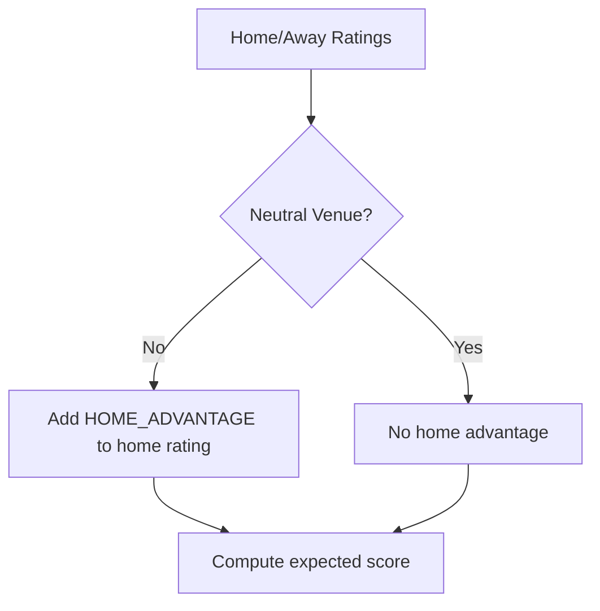

**Diagram sources**
- [texttocsv.py:274-276](file://ELO/texttocsv.py#L274-L276)
- [findelo.py:154-183](file://worldcup26/findelo.py#L154-L183)
- [26-27-season.py:72-80](file://premier-league/26-27-season.py#L72-L80)

**Section sources**
- [texttocsv.py:274-276](file://ELO/texttocsv.py#L274-L276)
- [findelo.py:154-183](file://worldcup26/findelo.py#L154-L183)
- [26-27-season.py:72-80](file://premier-league/26-27-season.py#L72-L80)

### Team Strength Calibration
- League power computed as average club Elo divided by baseline league average
- Seeds generated per team based on league power
- Used to initialize final Elo pass for improved spread and stability

**Section sources**
- [texttocsv.py:324-356](file://ELO/texttocsv.py#L324-L356)

### Expected Goals (xG) Calculation Methodology
- Base home and away xG intensities defined
- Intensity depends on ELO difference with exponential sensitivity
- Poisson sampling generates goal counts capped at MAX_GOALS
- Simple xG estimator also available for aggregated shot data

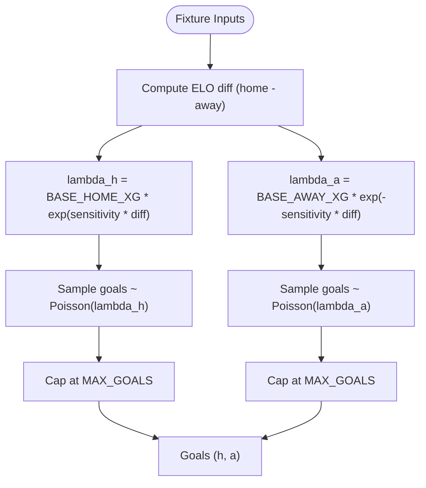

**Diagram sources**
- [26-27-season.py:132-141](file://premier-league/26-27-season.py#L132-L141)
- [26-27-season.py:1350-1353](file://premier-league/26-27-season.py#L1350-L1353)
- [main.py:7-18](file://clubworldcup/main.py#L7-L18)

**Section sources**
- [26-27-season.py:132-141](file://premier-league/26-27-season.py#L132-L141)
- [26-27-season.py:1350-1353](file://premier-league/26-27-season.py#L1350-L1353)
- [main.py:7-18](file://clubworldcup/main.py#L7-L18)

### Shot Quality Assessment and Goal Probability Modeling
- Dixon–Coles distribution models joint goal probabilities with correlation parameter rho
- Red card events modify team intensities proportionally to remaining match time
- Penalty shootout modeled with probability skewed by ELO difference

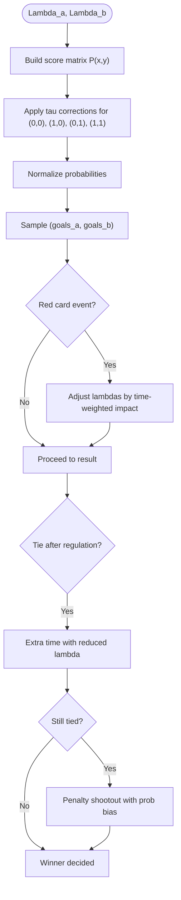

**Diagram sources**
- [fullsim.py:23-47](file://worldcup26/fullsim.py#L23-L47)
- [fullsim.py:49-82](file://worldcup26/fullsim.py#L49-L82)

**Section sources**
- [fullsim.py:23-82](file://worldcup26/fullsim.py#L23-L82)

### Fatigue Factor System
- Competition-specific base fatigue values (UCL > UEL > UECL)
- Fatigue decays over the season via inverse progress weighting
- European competition elimination rounds determine active fatigue status
- Domestic xG intensities adjusted downward for fatigued teams

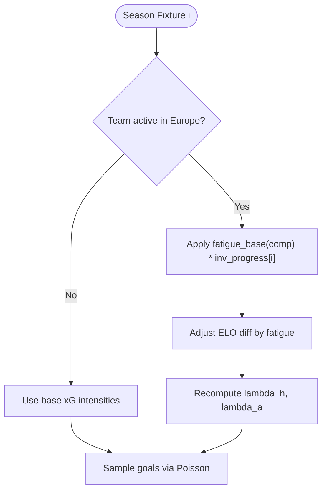

**Diagram sources**
- [26-27-season.py:28-35](file://premier-league/26-27-season.py#L28-L35)
- [26-27-season.py:1355-1405](file://premier-league/26-27-season.py#L1355-L1405)

**Section sources**
- [26-27-season.py:28-35](file://premier-league/26-27-season.py#L28-L35)
- [26-27-season.py:1355-1405](file://premier-league/26-27-season.py#L1355-L1405)

### Manager Performance Analytics and Sack Risk
- Manager data includes expected finish and pressure multipliers
- Recent honors provide multiplicative protection against sack risk
- European performance adjustments add/subtract risk based on actual vs. expected positions and elimination rounds
- Actual form adjustments blend all-season and last-5-games points-per-game relative to a neutral baseline

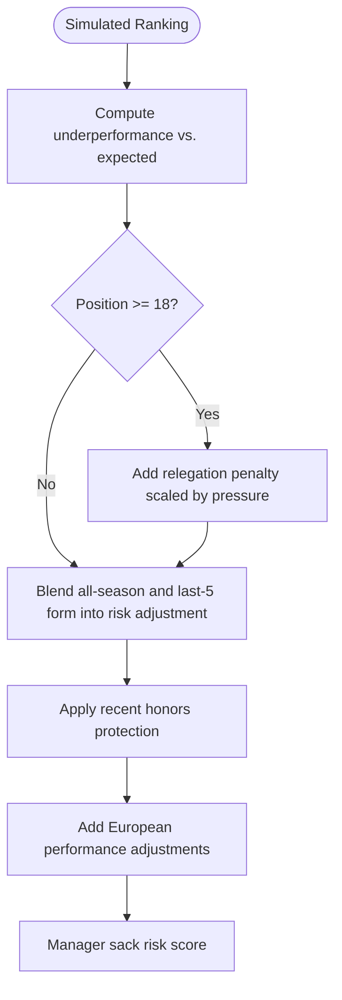

**Diagram sources**
- [26-27-season.py:286-323](file://premier-league/26-27-season.py#L286-L323)
- [26-27-season.py:326-356](file://premier-league/26-27-season.py#L326-L356)
- [26-27-season.py:723-757](file://premier-league/26-27-season.py#L723-L757)
- [26-27-season.py:788-817](file://premier-league/26-27-season.py#L788-L817)

**Section sources**
- [26-27-season.py:286-323](file://premier-league/26-27-season.py#L286-L323)
- [26-27-season.py:326-356](file://premier-league/26-27-season.py#L326-L356)
- [26-27-season.py:723-757](file://premier-league/26-27-season.py#L723-L757)
- [26-27-season.py:788-817](file://premier-league/26-27-season.py#L788-L817)

### Model Validation Techniques, Accuracy Metrics, and Parameter Tuning
- Two-pass Elo calibration improves stability and spread of team strengths
- K-factor selection varies by tournament type and stage (league vs. early/late knockout)
- ELO scale and sensitivity parameters control responsiveness to differences
- Calibration utilities demonstrate binning and weighted averaging for probability refinement

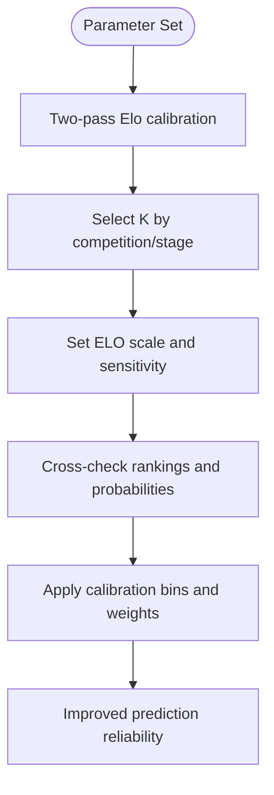

**Diagram sources**
- [texttocsv.py:395-414](file://ELO/texttocsv.py#L395-L414)
- [findelo.py:14-46](file://worldcup26/findelo.py#L14-L46)
- [26-27-season.py:12-24](file://premier-league/26-27-season.py#L12-L24)

**Section sources**
- [texttocsv.py:395-414](file://ELO/texttocsv.py#L395-L414)
- [findelo.py:14-46](file://worldcup26/findelo.py#L14-L46)
- [26-27-season.py:12-24](file://premier-league/26-27-season.py#L12-L24)

## Dependency Analysis
- ELO calibrator feeds team strengths into the Premier League simulator
- European simulators provide fatigue information influencing domestic xG
- Manager risk engine consumes simulated rankings and European results
- Simple xG estimator can be used for aggregated analysis but is separate from the main simulation

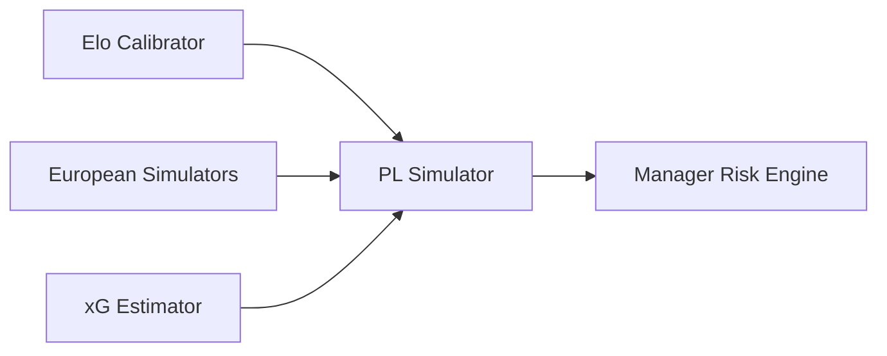

**Diagram sources**
- [texttocsv.py:324-356](file://ELO/texttocsv.py#L324-L356)
- [26-27-season.py:1313-1440](file://premier-league/26-27-season.py#L1313-L1440)
- [26-27-season.py:2181-2205](file://premier-league/26-27-season.py#L2181-L2205)
- [main.py:7-18](file://clubworldcup/main.py#L7-L18)

**Section sources**
- [texttocsv.py:324-356](file://ELO/texttocsv.py#L324-L356)
- [26-27-season.py:1313-1440](file://premier-league/26-27-season.py#L1313-L1440)
- [26-27-season.py:2181-2205](file://premier-league/26-27-season.py#L2181-L2205)
- [main.py:7-18](file://clubworldcup/main.py#L7-L18)

## Performance Considerations
- Use conservative K and disable goal-difference multiplier during calibration to stabilize early estimates
- Limit maximum goals sampled to avoid extreme tails in Poisson distributions
- Apply fatigue decay smoothly across the season to prevent abrupt drops in performance
- Keep ELO sensitivity moderate to balance responsiveness and noise

[No sources needed since this section provides general guidance]

## Troubleshooting Guide
- Team name normalization issues:
  - Ensure aliases are up-to-date; check for suspicious duplicates via integrity validation
- Unexpected low/high ratings:
  - Verify home advantage settings and neutral venue flags
- Poor calibration:
  - Review two-pass calibration steps and ensure baseline league identification is correct
- Manager risk anomalies:
  - Check recent honors mapping and European performance adjustments
- Simulation instability:
  - Confirm Poisson sampling caps and Dixon–Coles tau corrections are applied correctly

**Section sources**
- [texttocsv.py:362-377](file://ELO/texttocsv.py#L362-L377)
- [findelo.py:154-183](file://worldcup26/findelo.py#L154-L183)
- [fullsim.py:23-47](file://worldcup26/fullsim.py#L23-L47)

## Conclusion
The framework integrates robust Elo calibration, Poisson-based goal modeling, fatigue-aware xG, and comprehensive manager analytics to deliver reliable predictions. By tuning K-factors, ELO sensitivity, and fatigue parameters, and by validating through two-pass calibration and integrity checks, the system maintains accuracy and adaptability across leagues and competitions.

[No sources needed since this section summarizes without analyzing specific files]