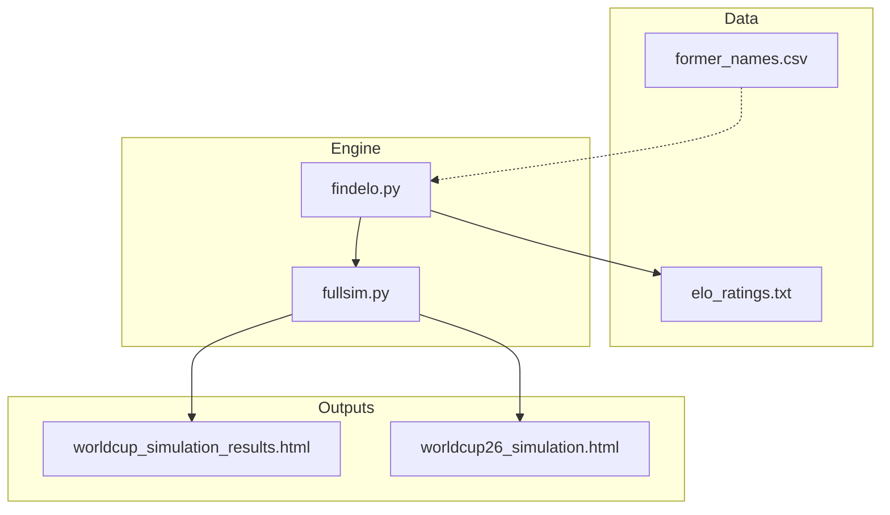
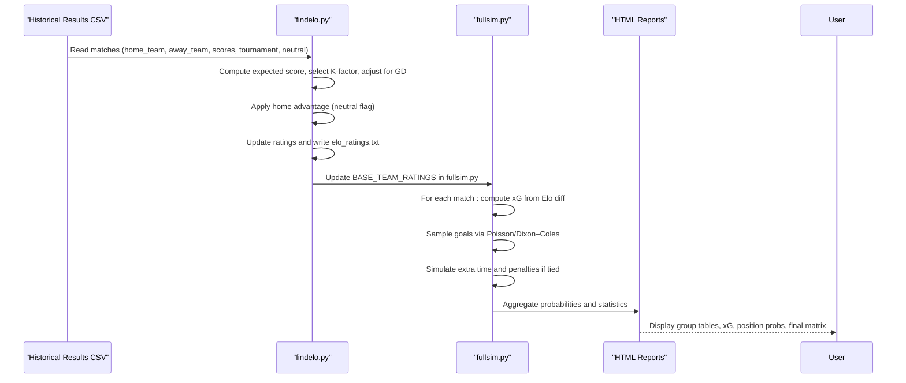
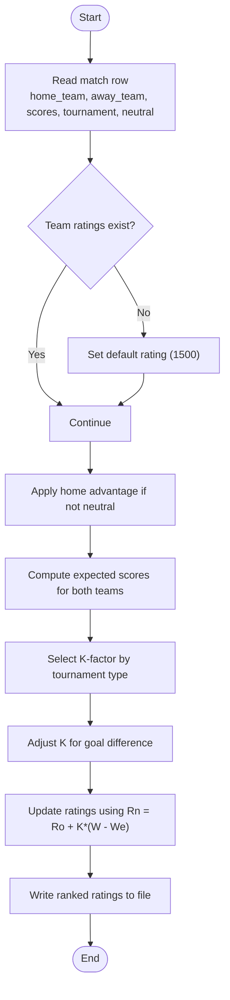
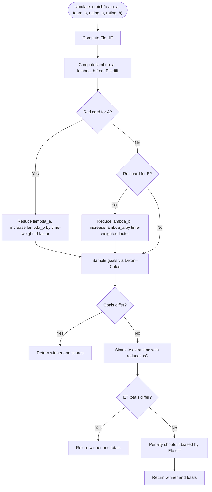
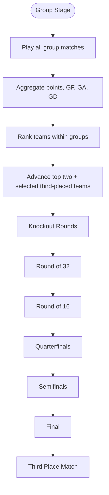
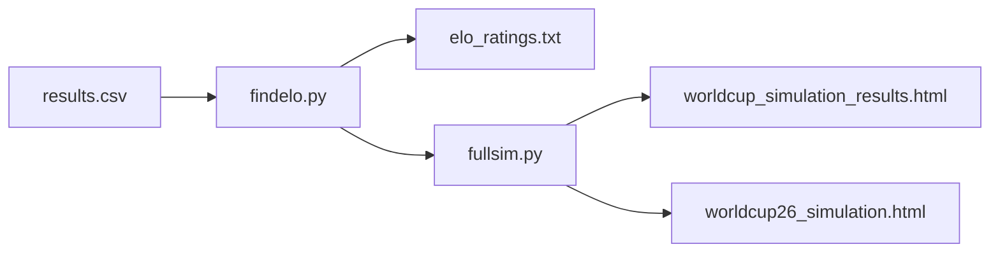

# Men's World Cup 2026 Simulation

<cite>
**Referenced Files in This Document**
- [fullsim.py](file://worldcup26/fullsim.py)
- [findelo.py](file://worldcup26/findelo.py)
- [elo_ratings.txt](file://worldcup26/elo_ratings.txt)
- [former_names.csv](file://worldcup26/former_names.csv)
- [worldcup_simulation_results.html](file://worldcup26/worldcup_simulation_results.html)
- [worldcup26_simulation.html](file://worldcup26/worldcup26_simulation.html)
</cite>

## Table of Contents
1. [Introduction](#introduction)
2. [Project Structure](#project-structure)
3. [Core Components](#core-components)
4. [Architecture Overview](#architecture-overview)
5. [Detailed Component Analysis](#detailed-component-analysis)
6. [Dependency Analysis](#dependency-analysis)
7. [Performance Considerations](#performance-considerations)
8. [Troubleshooting Guide](#troubleshooting-guide)
9. [Conclusion](#conclusion)
10. [Appendices](#appendices)

## Introduction
This document explains the Men’s World Cup 2026 simulation system implemented in the repository. It covers:
- Qualification and tournament structure as modeled by the code
- Group stage dynamics and knockout bracket progression algorithms
- The Elo rating system with home advantage, expected goals (xG), and Poisson-based match outcome modeling
- Multi-stage qualification concepts, play-off formats, and final tournament draw procedures
- Statistical models for predicting outcomes, head-to-head considerations, and historical performance weighting
- Configuration options, bracket visualizations, and result interpretation methods
- Examples of simulation runs, probability distributions, and visualization outputs

The system uses Monte Carlo simulations to estimate probabilities across group stages and knockout rounds, driven by team Elo ratings and a Dixon–Coles/Poisson goal model. HTML reports provide detailed per-group statistics, xG predictions, position probabilities, and final-position matrices.

## Project Structure
The relevant implementation is concentrated under the worldcup26 directory:
- fullsim.py: Core match simulator, Elo-driven xG generation, and final-round simulation loop
- findelo.py: Elo rating computation from historical results, K-factor selection, home advantage handling, and automatic update of team ratings in fullsim.py
- elo_ratings.txt: Ranked list of teams by computed Elo rating
- former_names.csv: Mapping of current team names to historical names used in historical data
- worldcup_simulation_results.html: Detailed HTML report with group tables, closeness ratings, expected points, and probabilities
- worldcup26_simulation.html: Another HTML report including per-match xG predictions and final-position matrix

**Diagram sources**
- [findelo.py:146-216](file://worldcup26/findelo.py#L146-L216)
- [fullsim.py:1-129](file://worldcup26/fullsim.py#L1-L129)
- [elo_ratings.txt:1-294](file://worldcup26/elo_ratings.txt#L1-L294)
- [former_names.csv:1-36](file://worldcup26/former_names.csv#L1-L36)
- [worldcup_simulation_results.html:1-800](file://worldcup26/worldcup_simulation_results.html#L1-L800)
- [worldcup26_simulation.html:1-296](file://worldcup26/worldcup26_simulation.html#L1-L296)

**Section sources**
- [fullsim.py:1-129](file://worldcup26/fullsim.py#L1-L129)
- [findelo.py:1-225](file://worldcup26/findelo.py#L1-L225)
- [elo_ratings.txt:1-294](file://worldcup26/elo_ratings.txt#L1-L294)
- [former_names.csv:1-36](file://worldcup26/former_names.csv#L1-L36)
- [worldcup_simulation_results.html:1-800](file://worldcup26/worldcup_simulation_results.html#L1-L800)
- [worldcup26_simulation.html:1-296](file://worldcup26/worldcup26_simulation.html#L1-L296)

## Core Components
- Elo Rating Engine (findelo.py): Computes expected scores, selects K-factors based on tournament type, adjusts K for goal difference, applies home advantage, updates ratings, and writes ranked output. It also updates BASE_TEAM_RATINGS in fullsim.py.
- Match Simulator (fullsim.py): Uses Elo differences to compute expected goals (xG) via exponential scaling, samples goals using a Dixon–Coles adjustment over independent Poisson distributions, simulates extra time and penalties, and aggregates Monte Carlo results.
- Visualization Outputs (HTML files): Provide group-level statistics, closeness ratings, expected points/goals, per-match xG predictions, position probabilities, and final-position matrices.

Key responsibilities:
- Historical Elo calibration and maintenance
- Tournament simulation engine (group + knockout)
- Statistical modeling (Poisson/Dixon–Coles)
- Reporting and visualization

**Section sources**
- [findelo.py:6-89](file://worldcup26/findelo.py#L6-L89)
- [findelo.py:146-216](file://worldcup26/findelo.py#L146-L216)
- [fullsim.py:23-82](file://worldcup26/fullsim.py#L23-L82)
- [fullsim.py:94-129](file://worldcup26/fullsim.py#L94-L129)

## Architecture Overview
The system follows a modular pipeline:
1. Data ingestion and preprocessing:
   - Read historical match results (CSV)
   - Map historical team names to current names
2. Elo calibration:
   - Compute expected scores and update ratings with K-factors and home advantage
   - Persist rankings and update team ratings in the simulator
3. Simulation:
   - Generate xG from Elo differences
   - Sample goals using Poisson/Dixon–Coles
   - Handle red cards, extra time, and penalties
   - Run Monte Carlo iterations to estimate probabilities
4. Reporting:
   - Produce HTML reports with group tables, xG predictions, position probabilities, and final-position matrices

**Diagram sources**
- [findelo.py:146-216](file://worldcup26/findelo.py#L146-L216)
- [fullsim.py:23-82](file://worldcup26/fullsim.py#L23-L82)
- [fullsim.py:94-129](file://worldcup26/fullsim.py#L94-L129)
- [worldcup_simulation_results.html:1-800](file://worldcup26/worldcup_simulation_results.html#L1-L800)
- [worldcup26_simulation.html:1-296](file://worldcup26/worldcup26_simulation.html#L1-L296)

## Detailed Component Analysis

### Elo Rating System and Home Advantage
- Expected score calculation uses the standard logistic function with a denominator of 400.
- K-factor selection depends on tournament classification:
  - World Cup finals: higher K
  - Continental championship finals and major intercontinental tournaments: medium-high K
  - Qualifiers and major tournaments: medium K
  - Other tournaments: lower K
  - Friendlies: lowest K
- Goal-difference adjustment increases K for larger margins, reflecting stronger signals.
- Home advantage adds a fixed point bonus to the home team when not neutral.
- Ratings are updated iteratively and written to a ranked text file; the script can auto-update BASE_TEAM_RATINGS in fullsim.py.

**Diagram sources**
- [findelo.py:6-89](file://worldcup26/findelo.py#L6-L89)
- [findelo.py:146-216](file://worldcup26/findelo.py#L146-L216)

**Section sources**
- [findelo.py:6-89](file://worldcup26/findelo.py#L6-L89)
- [findelo.py:146-216](file://worldcup26/findelo.py#L146-L216)
- [elo_ratings.txt:1-294](file://worldcup26/elo_ratings.txt#L1-L294)

### Match Outcome Model: Poisson and Dixon–Coles
- xG Generation:
  - Base expected goals scale with an exponential function of the Elo difference between teams.
  - A base lambda parameter sets the overall scoring level.
- Goal Sampling:
  - Independent Poisson probabilities are computed for each team’s goals up to a cap.
  - Dixon–Coles correlation adjustments modify joint probabilities for low-score outcomes (0-0, 1-0, 0-1, 1-1).
  - Probabilities are normalized and sampled to produce match scores.
- Red Cards:
  - Randomly applied during the match with a time-weighted impact that reduces the affected team’s xG and boosts the opponent’s xG proportionally to remaining minutes.
- Extra Time and Penalties:
  - If tied after regulation, reduced xG values simulate extra time.
  - If still tied, a penalty shootout is simulated with a bias toward the higher-rated team.

**Diagram sources**
- [fullsim.py:23-82](file://worldcup26/fullsim.py#L23-L82)

**Section sources**
- [fullsim.py:23-82](file://worldcup26/fullsim.py#L23-L82)

### Group Stage Dynamics and Knockout Bracket Progression
- Group Stage:
  - HTML reports present predicted finishing positions, expected points, expected goals for/against, and group closeness ratings.
  - Each group includes four teams; top two advance, plus best third-place teams depending on format.
- Knockout Bracket:
  - The simulator supports round-by-round progression (Round of 32, Round of 16, Quarterfinals, Semifinals, Final).
  - Probability matrices show the likelihood of reaching each stage and winning specific placements.
  - The final simulation loop demonstrates Monte Carlo estimation of champion probabilities given semi-final matchups.

**Diagram sources**
- [worldcup_simulation_results.html:1-800](file://worldcup26/worldcup_simulation_results.html#L1-L800)
- [worldcup26_simulation.html:1-296](file://worldcup26/worldcup26_simulation.html#L1-L296)
- [fullsim.py:94-129](file://worldcup26/fullsim.py#L94-L129)

**Section sources**
- [worldcup_simulation_results.html:1-800](file://worldcup26/worldcup_simulation_results.html#L1-L800)
- [worldcup26_simulation.html:1-296](file://worldcup26/worldcup26_simulation.html#L1-L296)
- [fullsim.py:94-129](file://worldcup26/fullsim.py#L94-L129)

### Statistical Models: Head-to-Head and Historical Performance Weighting
- Head-to-Head:
  - Not explicitly modeled in the provided code; match outcomes are primarily driven by Elo ratings and xG sampling.
- Historical Performance Weighting:
  - Elo ratings incorporate historical match results through iterative updates with K-factors tuned by tournament importance and goal difference.
  - Team name mapping ensures historical records align with current team identities.

**Section sources**
- [findelo.py:6-89](file://worldcup26/findelo.py#L6-L89)
- [former_names.csv:1-36](file://worldcup26/former_names.csv#L1-L36)

### Configuration Options and Visualization Outputs
- Configuration:
  - Number of simulations, base scoring rate, red card probability, and Elo parameters are defined in the simulator.
  - K-factor rules and home advantage constants are configurable in the Elo engine.
- Visualizations:
  - HTML reports include:
    - Group tables with predicted finishing positions and expected stats
    - Per-match xG predictions
    - Position probability distributions
    - Final-position matrices showing chances to reach each knockout stage and win placements

**Section sources**
- [fullsim.py:1-129](file://worldcup26/fullsim.py#L1-L129)
- [findelo.py:146-216](file://worldcup26/findelo.py#L146-L216)
- [worldcup_simulation_results.html:1-800](file://worldcup26/worldcup_simulation_results.html#L1-L800)
- [worldcup26_simulation.html:1-296](file://worldcup26/worldcup26_simulation.html#L1-L296)

## Dependency Analysis
- findelo.py depends on:
  - Historical results CSV (path configured in main)
  - Output file paths for ratings and updating fullsim.py
- fullsim.py depends on:
  - Team ratings (BASE_TEAM_RATINGS) updated by findelo.py
  - Standard libraries and numpy for numerical operations
- HTML outputs depend on:
  - Aggregated simulation results and statistics produced by the engine

**Diagram sources**
- [findelo.py:146-216](file://worldcup26/findelo.py#L146-L216)
- [fullsim.py:1-129](file://worldcup26/fullsim.py#L1-L129)

**Section sources**
- [findelo.py:146-216](file://worldcup26/findelo.py#L146-L216)
- [fullsim.py:1-129](file://worldcup26/fullsim.py#L1-L129)

## Performance Considerations
- Monte Carlo Iterations:
  - Increasing NUM_SIMULATIONS improves statistical stability but increases runtime linearly.
- Numerical Efficiency:
  - Using numpy arrays for probability matrices accelerates goal sampling.
- I/O Overhead:
  - Frequent file writes (e.g., updating BASE_TEAM_RATINGS) should be minimized or batched.
- Randomness:
  - Seed control enables reproducibility; ensure consistent seeding across runs for comparable results.

[No sources needed since this section provides general guidance]

## Troubleshooting Guide
- Missing Input Files:
  - Ensure the historical results CSV path exists and contains required columns (home_team, away_team, home_score, away_score, tournament, neutral).
- File Permission Errors:
  - Verify write permissions for output files and for updating fullsim.py.
- Name Mismatches:
  - Use former_names.csv mappings to reconcile historical team names with current identifiers.
- Simulation Stability:
  - Check random seed settings and verify that probability normalization occurs before sampling.

**Section sources**
- [findelo.py:146-216](file://worldcup26/findelo.py#L146-L216)
- [former_names.csv:1-36](file://worldcup26/former_names.csv#L1-L36)

## Conclusion
The Men’s World Cup 2026 simulation system combines Elo-based team strength modeling with a Poisson/Dixon–Coles goal framework to generate realistic match outcomes. Through Monte Carlo simulations, it estimates group standings, knockout progression probabilities, and final placement distributions. The Elo engine calibrates team strengths from historical data, incorporating home advantage and tournament-specific sensitivity. HTML reports provide comprehensive insights into expected goals, position probabilities, and final-position matrices, enabling robust analysis and visualization of tournament scenarios.

[No sources needed since this section summarizes without analyzing specific files]

## Appendices

### Example Simulation Runs and Outputs
- Final Round Simulation:
  - Demonstrates running multiple simulations to estimate champion probabilities given semi-final matchups.
- HTML Reports:
  - Include group closeness ratings, expected points/goals, per-match xG predictions, and final-position matrices.

**Section sources**
- [fullsim.py:94-129](file://worldcup26/fullsim.py#L94-L129)
- [worldcup_simulation_results.html:1-800](file://worldcup26/worldcup_simulation_results.html#L1-L800)
- [worldcup26_simulation.html:1-296](file://worldcup26/worldcup26_simulation.html#L1-L296)