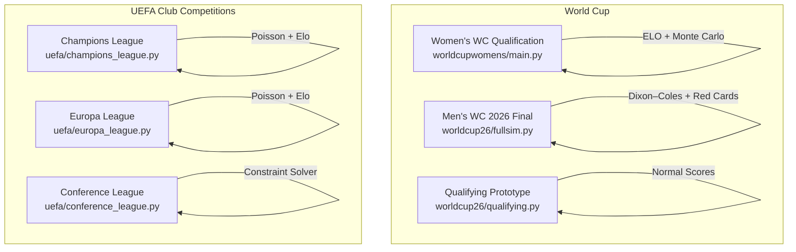
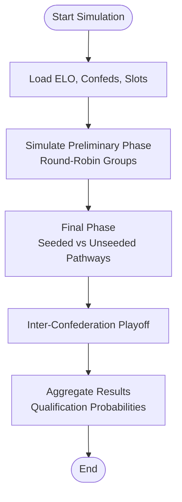
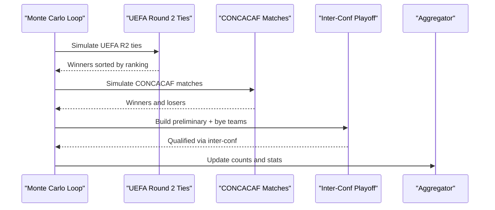
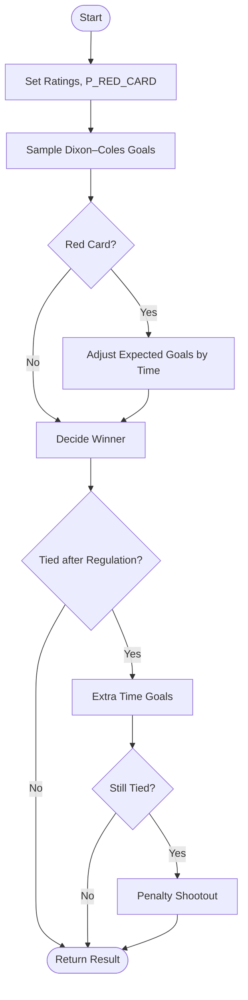
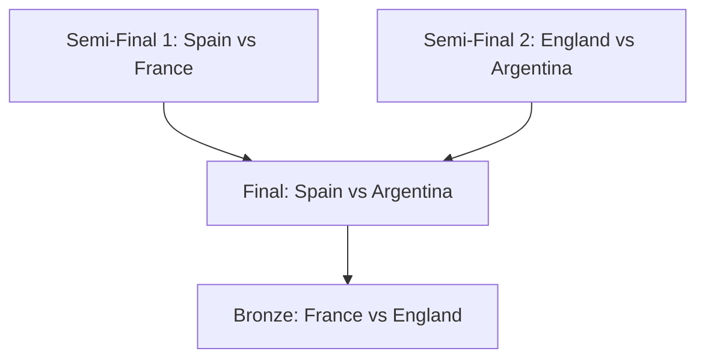
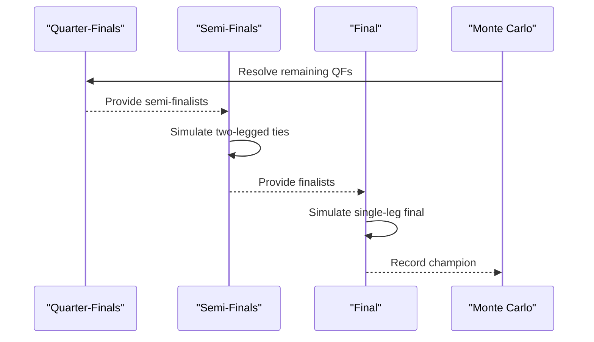
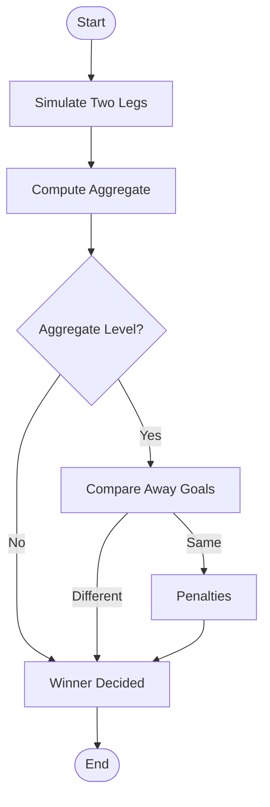
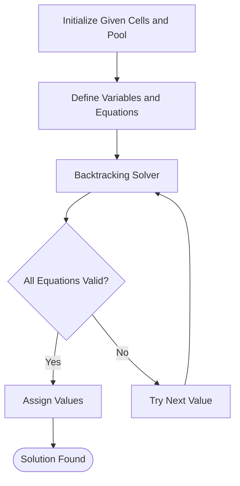
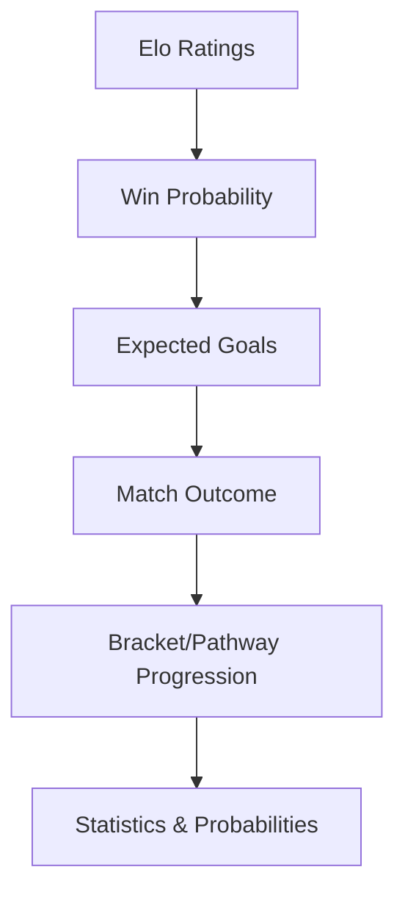
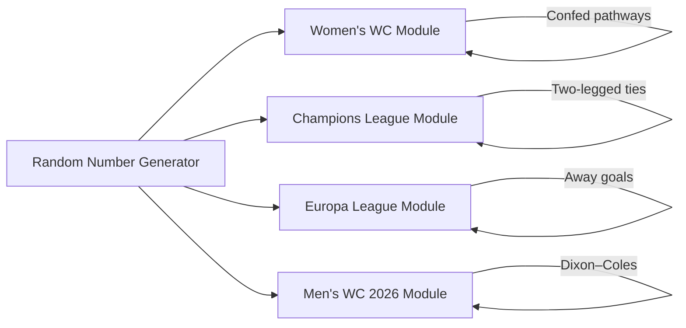

# Tournament Simulations

<cite>
**Referenced Files in This Document**
- [worldcupwomens/main.py](file://worldcupwomens/main.py)
- [worldcup26/fullsim.py](file://worldcup26/fullsim.py)
- [uefa/champions_league.py](file://uefa/champions_league.py)
- [uefa/europa_league.py](file://uefa/europa_league.py)
- [uefa/conference_league.py](file://uefa/conference_league.py)
- [worldcup26/qualifying.py](file://worldcup26/qualifying.py)
- [worldcupwomens/womens_2027_world_cup_simulation_one_file.md](file://worldcupwomens/womens_2027_world_cup_simulation_one_file.md)
</cite>

## Table of Contents
1. [Introduction](#introduction)
2. [Project Structure](#project-structure)
3. [Core Components](#core-components)
4. [Architecture Overview](#architecture-overview)
5. [Detailed Component Analysis](#detailed-component-analysis)
6. [Dependency Analysis](#dependency-analysis)
7. [Performance Considerations](#performance-considerations)
8. [Troubleshooting Guide](#troubleshooting-guide)
9. [Conclusion](#conclusion)

## Introduction
This document explains the tournament-specific simulation modules for:
- Women’s World Cup qualification (confederation pathways, seeding, and probability calculations)
- Men’s World Cup 2026 (qualification rounds, group stage dynamics, knockout bracket progression)
- UEFA competitions (Champions League, Europa League, Conference League draws, formats, and progression rules)
It also covers statistical models used for outcomes (Elo-based probabilities, Poisson/Dixon–Coles goal models), head-to-head comparisons, historical performance weighting, configuration options, bracket visualizations, and result interpretation guidelines.

## Project Structure
The relevant modules are organized by competition:
- worldcupwomens: Women’s World Cup qualification Monte Carlo engine with confederation pathways and inter-confederation playoffs
- worldcup26: Men’s World Cup 2026 final-stage simulation using Dixon–Coles goals and red-card impacts; a separate qualifying prototype uses normal distributions for player scores
- uefa: Champions League, Europa League, and Conference League simulations with Elo + Poisson models and two-legged ties

**Diagram sources**
- [worldcupwomens/main.py:1-665](file://worldcupwomens/main.py#L1-L665)
- [worldcup26/fullsim.py:1-129](file://worldcup26/fullsim.py#L1-L129)
- [worldcup26/qualifying.py:1-95](file://worldcup26/qualifying.py#L1-L95)
- [uefa/champions_league.py:1-117](file://uefa/champions_league.py#L1-L117)
- [uefa/europa_league.py:1-133](file://uefa/europa_league.py#L1-L133)
- [uefa/conference_league.py:1-140](file://uefa/conference_league.py#L1-L140)

**Section sources**
- [worldcupwomens/main.py:1-665](file://worldcupwomens/main.py#L1-L665)
- [worldcup26/fullsim.py:1-129](file://worldcup26/fullsim.py#L1-L129)
- [worldcup26/qualifying.py:1-95](file://worldcup26/qualifying.py#L1-L95)
- [uefa/champions_league.py:1-117](file://uefa/champions_league.py#L1-L117)
- [uefa/europa_league.py:1-133](file://uefa/europa_league.py#L1-L133)
- [uefa/conference_league.py:1-140](file://uefa/conference_league.py#L1-L140)

## Core Components
- Women’s World Cup qualification simulator:
  - ELO-based match/tie simulators
  - Confederation slot allocation and preliminary/final phases
  - Inter-confederation playoff pathway
  - Monte Carlo aggregation to produce qualification probabilities
- Men’s World Cup 2026 final simulator:
  - Dixon–Coles goal model with time-weighted red card effects
  - Extra time and penalty shootout modeling
  - Bracket state for semi-finals and final
- UEFA club competitions:
  - Two-legged tie simulators with home advantage
  - Penalty resolution based on Elo differences
  - Single-match finals with Poisson goals
- Conference League puzzle solver:
  - Constraint satisfaction over a grid with arithmetic equations

**Section sources**
- [worldcupwomens/main.py:215-405](file://worldcupwomens/main.py#L215-L405)
- [worldcup26/fullsim.py:23-82](file://worldcup26/fullsim.py#L23-L82)
- [uefa/champions_league.py:22-90](file://uefa/champions_league.py#L22-L90)
- [uefa/europa_league.py:14-94](file://uefa/europa_league.py#L14-L94)
- [uefa/conference_league.py:60-133](file://uefa/conference_league.py#L60-L133)

## Architecture Overview
The system is composed of independent simulation modules that share common statistical patterns:
- Probability engines: Elo-based win probabilities and draw adjustments
- Goal engines: Poisson or Dixon–Coles distributions for scoring
- Knockout logic: Two-legged ties, away goals rules where applicable, extra time, penalties
- Aggregation: Monte Carlo runs to estimate probabilities across many scenarios

[No sources needed since this diagram shows conceptual workflow, not actual code structure]

## Detailed Component Analysis

### Women’s World Cup Qualification Simulation
Key responsibilities:
- Define team ELOs and confederation mappings
- Allocate slots per confederation and inter-confederation slots
- Run preliminary round-robin groups and final-phase seeded/unseeded matchups
- Simulate inter-confederation playoffs and aggregate qualification probabilities

**Diagram sources**
- [worldcupwomens/main.py:319-405](file://worldcupwomens/main.py#L319-L405)
- [worldcupwomens/main.py:412-537](file://worldcupwomens/main.py#L412-L537)

Implementation highlights:
- Match and tie simulators use Elo differences with home advantage and draw probabilities
- Preliminary phase tracks points, goal difference, goals scored, wins/draws/losses
- Final phase selects three seeded teams from different confederations and pairs them against unseeded teams while minimizing same-confederation matchups
- Inter-confederation playoff combines preliminary winners with bye teams and repeats final-phase logic

**Diagram sources**
- [worldcupwomens/main.py:448-511](file://worldcupwomens/main.py#L448-L511)

Configuration and outputs:
- Slot allocation per confederation includes direct slots and inter-confederation slots
- National league rankings influence sorting within UEFA round 2 winners
- Outputs include qualification probabilities, preliminary phase averages, and inter-confederation participation rates

**Section sources**
- [worldcupwomens/main.py:10-113](file://worldcupwomens/main.py#L10-L113)
- [worldcupwomens/main.py:144-207](file://worldcupwomens/main.py#L144-L207)
- [worldcupwomens/main.py:215-300](file://worldcupwomens/main.py#L215-L300)
- [worldcupwomens/main.py:319-405](file://worldcupwomens/main.py#L319-L405)
- [worldcupwomens/main.py:412-537](file://worldcupwomens/main.py#L412-L537)
- [worldcupwomens/main.py:544-665](file://worldcupwomens/main.py#L544-L665)

### Men’s World Cup 2026 Simulation
Key responsibilities:
- Simulate matches using Dixon–Coles goal distribution
- Incorporate red card events with time-weighted impact on expected goals
- Handle extra time and penalty shootouts
- Run Monte Carlo for final-stage bracket

**Diagram sources**
- [worldcup26/fullsim.py:23-82](file://worldcup26/fullsim.py#L23-L82)

Bracket visualization and progression:
- The script defines fixed semi-final pairings and simulates the final outcome repeatedly
- It prints winner probabilities and exact final scenario likelihoods

**Diagram sources**
- [worldcup26/fullsim.py:87-92](file://worldcup26/fullsim.py#L87-L92)

Qualifying prototype note:
- The file worldcup26/qualifying.py implements a different domain (player score simulation using normal distributions) and is not directly tied to national team qualification pathways.

**Section sources**
- [worldcup26/fullsim.py:1-129](file://worldcup26/fullsim.py#L1-L129)
- [worldcup26/qualifying.py:1-95](file://worldcup26/qualifying.py#L1-L95)

### UEFA Champions League Simulation
Key responsibilities:
- Elo-based expected goals and Poisson sampling
- Two-legged ties without away goals rule
- Penalties resolved by Elo-weighted probability
- Monte Carlo to estimate champion probabilities

**Diagram sources**
- [uefa/champions_league.py:46-90](file://uefa/champions_league.py#L46-L90)
- [uefa/champions_league.py:98-112](file://uefa/champions_league.py#L98-L112)

Draw procedures and formats:
- Two-legged ties simulate both legs with home advantage embedded in expected goals
- No away goals rule; ties go to penalties if aggregate is level

**Section sources**
- [uefa/champions_league.py:1-117](file://uefa/champions_league.py#L1-L117)

### UEFA Europa League Simulation
Key responsibilities:
- Elo-based expected goals and Poisson sampling
- Two-legged ties with away goals rule
- Penalties resolved by Elo-weighted probability
- Monte Carlo to estimate champion probabilities

**Diagram sources**
- [uefa/europa_league.py:43-78](file://uefa/europa_league.py#L43-L78)

Progression rules:
- Quarter-finals results are fixed in comments; semi-finals are simulated
- Away goals apply before penalties

**Section sources**
- [uefa/europa_league.py:1-133](file://uefa/europa_league.py#L1-L133)

### UEFA Conference League Simulation
Key responsibilities:
- Constraint satisfaction solver for a numeric grid with given cells and arithmetic equations
- Backtracking search to assign values from a pool to variables while satisfying all equations

**Diagram sources**
- [uefa/conference_league.py:23-58](file://uefa/conference_league.py#L23-L58)
- [uefa/conference_league.py:74-133](file://uefa/conference_league.py#L74-L133)

Note: This module solves a puzzle rather than simulating tournament draws or brackets.

**Section sources**
- [uefa/conference_league.py:1-140](file://uefa/conference_league.py#L1-L140)

### Conceptual Overview
A unified view of how these modules approach tournament simulation:
- Statistical foundation: Elo ratings translate to win probabilities and expected goals
- Goal generation: Poisson or Dixon–Coles distributions model realistic scoring patterns
- Tie-breaking: Away goals (where applicable), extra time, and penalties
- Aggregation: Monte Carlo runs provide robust probability estimates

[No sources needed since this diagram shows conceptual workflow, not actual code structure]

## Dependency Analysis
Common dependencies and relationships:
- All modules rely on random number generation for Monte Carlo simulations
- UEFA modules share similar structures for two-legged ties and penalties
- Women’s World Cup module integrates multiple stages (preliminary, final, inter-confederation)
- Men’s World Cup 2026 module introduces advanced goal modeling (Dixon–Coles) and event-driven adjustments (red cards)

**Diagram sources**
- [worldcupwomens/main.py:215-300](file://worldcupwomens/main.py#L215-L300)
- [uefa/champions_league.py:46-90](file://uefa/champions_league.py#L46-L90)
- [uefa/europa_league.py:43-78](file://uefa/europa_league.py#L43-L78)
- [worldcup26/fullsim.py:23-82](file://worldcup26/fullsim.py#L23-L82)

**Section sources**
- [worldcupwomens/main.py:215-405](file://worldcupwomens/main.py#L215-L405)
- [uefa/champions_league.py:46-90](file://uefa/champions_league.py#L46-L90)
- [uefa/europa_league.py:43-78](file://uefa/europa_league.py#L43-L78)
- [worldcup26/fullsim.py:23-82](file://worldcup26/fullsim.py#L23-L82)

## Performance Considerations
- Monte Carlo iterations:
  - Women’s World Cup defaults to 2,500 simulations; can be increased for stability
  - UEFA modules default to 50,000 simulations; consider scaling based on available compute
  - Men’s World Cup 2026 final simulation uses 5,000 iterations
- Computational cost:
  - Dixon–Coles matrix construction is O(max_goals^2); keep max_goals modest
  - Two-legged ties involve multiple Poisson samples; vectorization may improve speed
- Randomness control:
  - Use seeds for reproducibility when comparing scenarios
- Output frequency:
  - Progress callbacks can throttle updates during long runs

[No sources needed since this section provides general guidance]

## Troubleshooting Guide
Common issues and resolutions:
- Missing ELO entries:
  - Some team names map to canonical forms; ensure consistent naming to avoid fallback defaults
- Draw handling:
  - Verify draw probability parameters align with competition rules (neutral venue vs home advantage)
- Away goals rule:
  - Confirm whether away goals apply (UEFA Europa League does; Champions League does not in this implementation)
- Red card timing:
  - Ensure minute selection and impact factors reflect desired realism
- Seed control:
  - Set random seeds for reproducible results across runs

**Section sources**
- [worldcupwomens/main.py:130-138](file://worldcupwomens/main.py#L130-L138)
- [uefa/champions_league.py:46-74](file://uefa/champions_league.py#L46-L74)
- [uefa/europa_league.py:43-78](file://uefa/europa_league.py#L43-L78)
- [worldcup26/fullsim.py:56-64](file://worldcup26/fullsim.py#L56-L64)

## Conclusion
These tournament simulation modules provide a cohesive framework for modeling football competitions:
- Women’s World Cup qualification integrates confederation pathways, seeding, and inter-confederation playoffs with Monte Carlo probability estimation
- Men’s World Cup 2026 leverages advanced goal modeling and event-driven adjustments to simulate high-stakes matches
- UEFA club competitions implement realistic two-legged ties, away goals rules where applicable, and penalty shootouts
- The Conference League module demonstrates constraint-solving techniques applicable to structured puzzles

By combining Elo-based probabilities, Poisson/Dixon–Coles goal models, and robust bracket/pathway logic, the system delivers actionable insights into tournament outcomes, qualification probabilities, and competitive dynamics.

[No sources needed since this section summarizes without analyzing specific files]