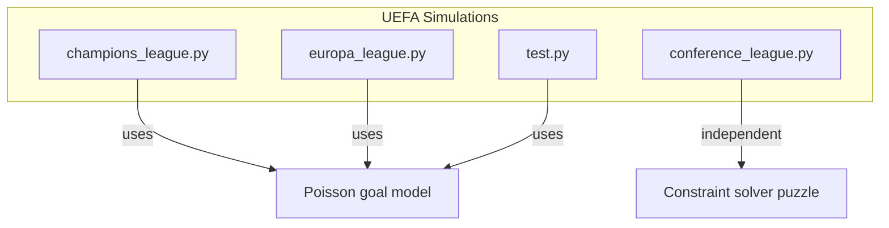
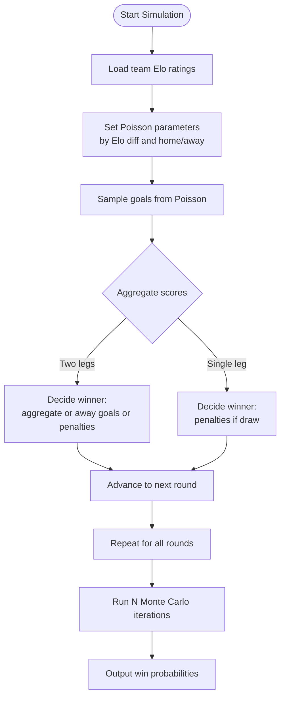
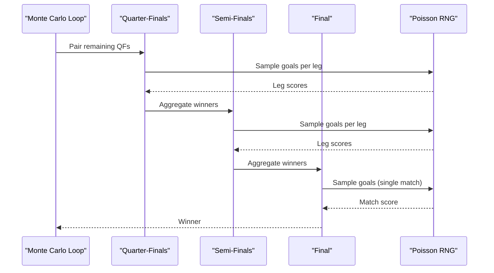
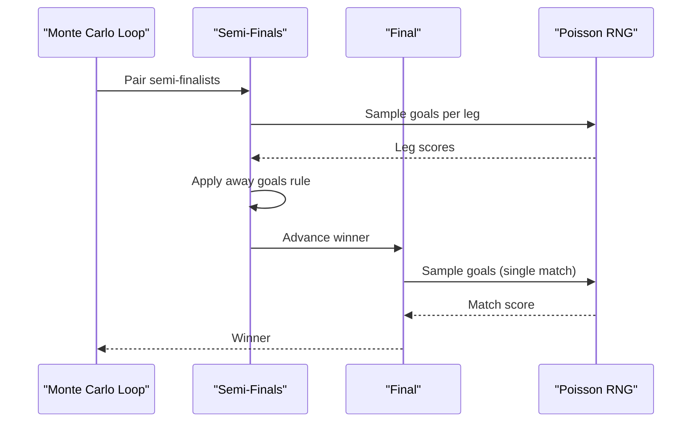
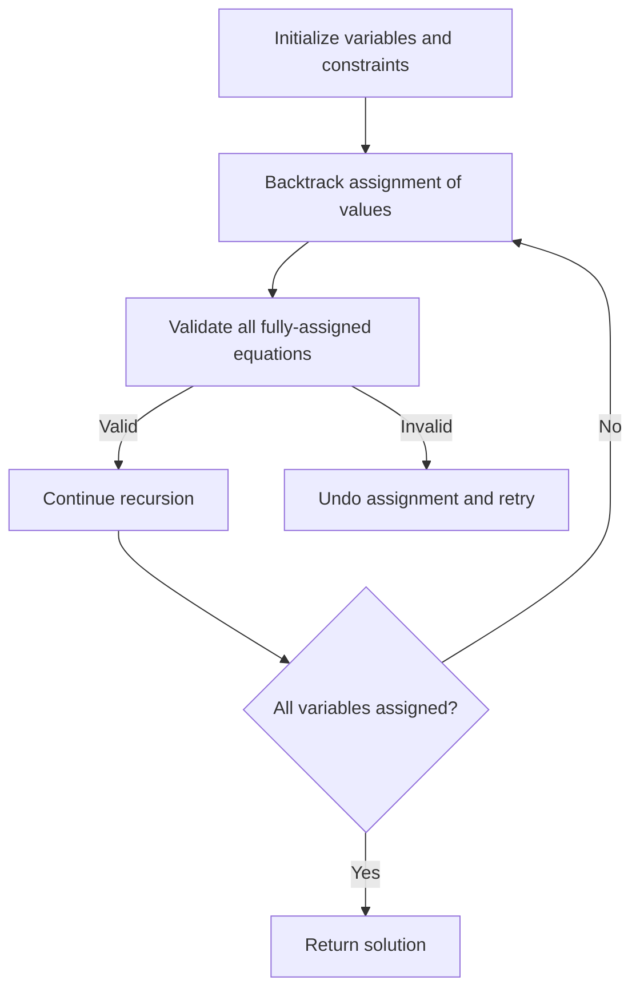
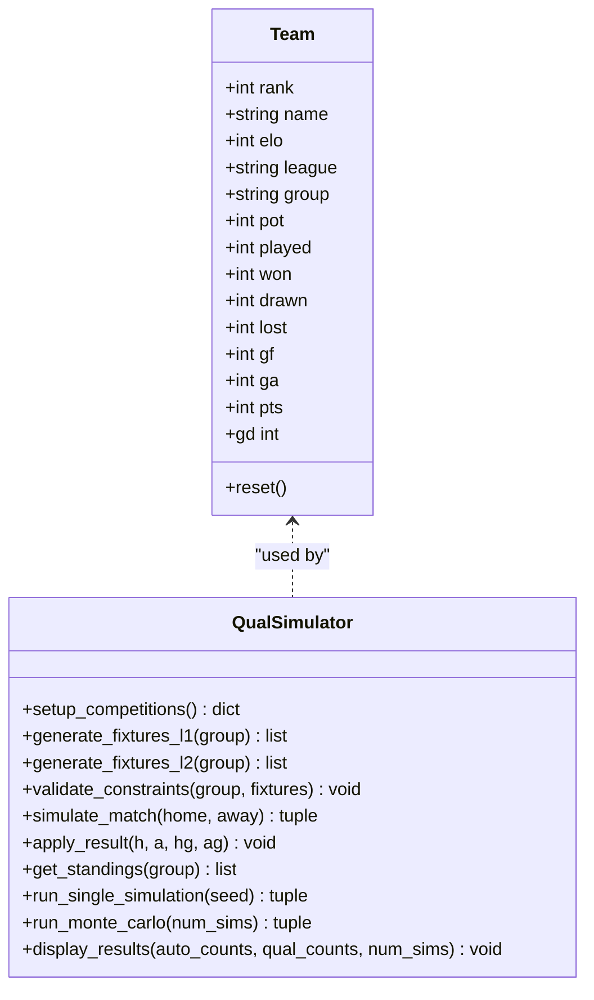
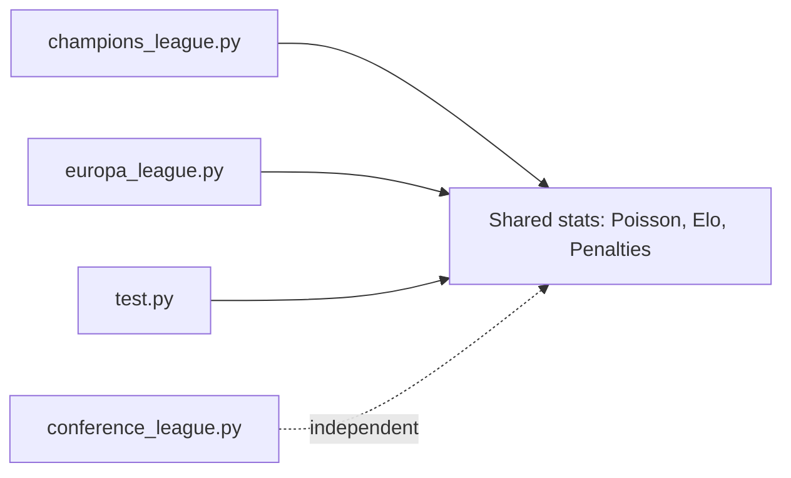

# UEFA Competitions Simulation

<cite>
**Referenced Files in This Document**
- [champions_league.py](file://uefa/champions_league.py)
- [europa_league.py](file://uefa/europa_league.py)
- [conference_league.py](file://uefa/conference_league.py)
- [test.py](file://uefa/test.py)
</cite>

## Table of Contents
1. [Introduction](#introduction)
2. [Project Structure](#project-structure)
3. [Core Components](#core-components)
4. [Architecture Overview](#architecture-overview)
5. [Detailed Component Analysis](#detailed-component-analysis)
6. [Dependency Analysis](#dependency-analysis)
7. [Performance Considerations](#performance-considerations)
8. [Troubleshooting Guide](#troubleshooting-guide)
9. [Conclusion](#conclusion)
10. [Appendices](#appendices)

## Introduction
This document explains the simulation system for UEFA club competitions implemented in this repository, focusing on:
- Champions League knockout modeling
- Europa League knockout modeling
- Conference League-related logic (a constraint solver used as a puzzle component)
- A broader league qualification simulator that demonstrates seeding, group fixtures, and playoff progression

The simulations use Elo-based team strength, Poisson-distributed goals, and Monte Carlo methods to estimate win probabilities and advancement chances. The code also illustrates how home advantage is modeled and how penalties are resolved when matches end in draws.

## Project Structure
The UEFA-related code resides under the uefa directory with four primary files:
- champions_league.py: Champions League knockout simulation from quarter-finals onward
- europa_league.py: Europa League knockout simulation from semi-finals onward
- conference_league.py: A constraint-solver puzzle unrelated to match simulation
- test.py: A comprehensive league qualification simulator demonstrating seeding, groups, fixtures, and playoffs

**Diagram sources**
- [champions_league.py:1-117](file://uefa/champions_league.py#L1-L117)
- [europa_league.py:1-133](file://uefa/europa_league.py#L1-L133)
- [conference_league.py:1-140](file://uefa/conference_league.py#L1-L140)
- [test.py:1-287](file://uefa/test.py#L1-L287)

**Section sources**
- [champions_league.py:1-117](file://uefa/champions_league.py#L1-L117)
- [europa_league.py:1-133](file://uefa/europa_league.py#L1-L133)
- [conference_league.py:1-140](file://uefa/conference_league.py#L1-L140)
- [test.py:1-287](file://uefa/test.py#L1-L287)

## Core Components
- Team strength representation via Elo ratings
- Goal generation using Poisson distributions parameterized by Elo differences
- Two-legged tie resolution with aggregate scoring and penalty shootouts
- Single-match final resolution with neutral venue assumptions
- Monte Carlo engine to aggregate outcomes across many runs
- Seeding and grouping utilities for league qualification scenarios

Key responsibilities:
- champions_league.py models Champions League QF/SF/F with two-legged ties and no away goals rule
- europa_league.py models Europa League SF/F with two-legged ties including away goals rule
- test.py models a multi-league qualification pathway with seeding, groups, mini-leagues, and playoffs
- conference_league.py implements a constraint satisfaction problem unrelated to match simulation

**Section sources**
- [champions_league.py:21-90](file://uefa/champions_league.py#L21-L90)
- [europa_league.py:14-94](file://uefa/europa_league.py#L14-L94)
- [test.py:135-177](file://uefa/test.py#L135-L177)

## Architecture Overview
At a high level, each competition module defines:
- An Elo dictionary for participating teams
- A Poisson random generator
- Expected goals calculation based on Elo difference and home/away roles
- Tie simulation functions for two-legged and single-leg formats
- A Monte Carlo loop aggregating results into probability distributions

**Diagram sources**
- [champions_league.py:21-90](file://uefa/champions_league.py#L21-L90)
- [europa_league.py:14-94](file://uefa/europa_league.py#L14-L94)
- [test.py:135-177](file://uefa/test.py#L135-L177)

## Detailed Component Analysis

### Champions League Knockout Model
- Uses Elo ratings for participating teams
- Implements a Poisson-based expected goals model
- Models two-legged ties without the away goals rule; draws go to penalties
- Final is a single match at a neutral venue; draws go to penalties
- Runs Monte Carlo simulations to compute win probabilities

**Diagram sources**
- [champions_league.py:45-90](file://uefa/champions_league.py#L45-L90)
- [champions_league.py:92-117](file://uefa/champions_league.py#L92-L117)

**Section sources**
- [champions_league.py:5-19](file://uefa/champions_league.py#L5-L19)
- [champions_league.py:21-43](file://uefa/champions_league.py#L21-L43)
- [champions_league.py:45-90](file://uefa/champions_league.py#L45-L90)
- [champions_league.py:92-117](file://uefa/champions_league.py#L92-L117)

### Europa League Knockout Model
- Uses Elo ratings for participating teams
- Implements a Poisson-based expected goals model
- Models two-legged ties with the away goals rule; draws proceed to penalties
- Final is a single match at a neutral venue; draws go to penalties
- Predefined semi-final matchups reflect recent results

**Diagram sources**
- [europa_league.py:27-78](file://uefa/europa_league.py#L27-L78)
- [europa_league.py:80-94](file://uefa/europa_league.py#L80-L94)
- [europa_league.py:96-133](file://uefa/europa_league.py#L96-L133)

**Section sources**
- [europa_league.py:5-12](file://uefa/europa_league.py#L5-L12)
- [europa_league.py:14-40](file://uefa/europa_league.py#L14-L40)
- [europa_league.py:42-78](file://uefa/europa_league.py#L42-L78)
- [europa_league.py:80-94](file://uefa/europa_league.py#L80-L94)
- [europa_league.py:96-133](file://uefa/europa_league.py#L96-L133)

### Conference League Constraint Solver
- Implements a constraint satisfaction problem over a grid with given cells and arithmetic equations
- Not related to match simulation or tournament structure
- Demonstrates backtracking search with equation validation

**Diagram sources**
- [conference_league.py:23-58](file://uefa/conference_league.py#L23-L58)
- [conference_league.py:60-72](file://uefa/conference_league.py#L60-L72)
- [conference_league.py:74-133](file://uefa/conference_league.py#L74-L133)

**Section sources**
- [conference_league.py:1-140](file://uefa/conference_league.py#L1-L140)

### League Qualification Simulator (test.py)
- Defines a set of national teams with Elo ratings
- Builds two leagues with different group sizes and pot structures
- Generates fixtures ensuring balanced home/away and cross-pot matchups
- Validates fixture constraints
- Simulates matches using Poisson goals
- Computes standings with head-to-head tiebreakers
- Determines automatic qualifiers and playoff participants
- Runs mini-leagues and playoffs to determine additional qualifiers

**Diagram sources**
- [test.py:27-46](file://uefa/test.py#L27-L46)
- [test.py:48-77](file://uefa/test.py#L48-L77)
- [test.py:79-115](file://uefa/test.py#L79-L115)
- [test.py:117-177](file://uefa/test.py#L117-L177)
- [test.py:179-287](file://uefa/test.py#L179-L287)

**Section sources**
- [test.py:9-25](file://uefa/test.py#L9-L25)
- [test.py:27-46](file://uefa/test.py#L27-L46)
- [test.py:48-77](file://uefa/test.py#L48-L77)
- [test.py:79-115](file://uefa/test.py#L79-L115)
- [test.py:117-177](file://uefa/test.py#L117-L177)
- [test.py:179-287](file://uefa/test.py#L179-L287)

## Dependency Analysis
- All three competition modules share common statistical primitives:
  - Poisson random number generation
  - Elo-based expected goals calculation
  - Penalty shootout resolution
- Differences:
  - Champions League uses two-legged ties without away goals
  - Europa League uses two-legged ties with away goals
  - test.py includes seeding, grouping, and playoff mechanics not present in the knockout-only modules
- conference_league.py is independent and does not depend on the other modules

**Diagram sources**
- [champions_league.py:21-43](file://uefa/champions_league.py#L21-L43)
- [europa_league.py:14-40](file://uefa/europa_league.py#L14-L40)
- [test.py:135-177](file://uefa/test.py#L135-L177)

**Section sources**
- [champions_league.py:21-43](file://uefa/champions_league.py#L21-L43)
- [europa_league.py:14-40](file://uefa/europa_league.py#L14-L40)
- [test.py:135-177](file://uefa/test.py#L135-L177)

## Performance Considerations
- Monte Carlo loops run tens of thousands of iterations; performance depends on:
  - Efficiency of Poisson sampling
  - Number of rounds simulated
  - Size of team pools and group structures
- Recommendations:
  - Vectorize Poisson sampling where possible
  - Cache repeated computations (e.g., Elo differences)
  - Use progress indicators for long-running simulations
  - Parallelize independent simulations if needed

[No sources needed since this section provides general guidance]

## Troubleshooting Guide
Common issues and resolutions:
- Incorrect away goals handling: Ensure the correct rule is applied per competition (Champions League vs Europa League)
- Fixture constraint violations: Validate home/away balance and cross-pot matchups before simulating
- Penalty shootout bias: Verify Elo-based probability calculations for fairness
- Seed reproducibility: Set random seeds for reproducible runs

**Section sources**
- [champions_league.py:45-90](file://uefa/champions_league.py#L45-L90)
- [europa_league.py:42-78](file://uefa/europa_league.py#L42-L78)
- [test.py:117-177](file://uefa/test.py#L117-L177)

## Conclusion
The repository provides focused simulations for UEFA club competitions:
- Champions League knockout modeling without away goals
- Europa League knockout modeling with away goals
- A comprehensive league qualification simulator demonstrating seeding, groups, and playoffs
- An independent constraint solver puzzle

These components collectively illustrate statistical modeling approaches for match predictions, including Elo-based strengths, Poisson goals, and Monte Carlo probability estimation. They also demonstrate how competition-specific rules affect progression through knockout phases.

[No sources needed since this section summarizes without analyzing specific files]

## Appendices

### Statistical Modeling Approaches
- Team strength: Elo ratings
- Goal distribution: Poisson with parameters derived from Elo differences and home/away roles
- Tie resolution:
  - Two-legged ties: aggregate scores; away goals rule applies only in Europa League
  - Penalties: Elo-weighted probability favoring stronger team
- Advancement probabilities: Estimated via Monte Carlo simulations

**Section sources**
- [champions_league.py:21-43](file://uefa/champions_league.py#L21-L43)
- [europa_league.py:14-40](file://uefa/europa_league.py#L14-L40)
- [test.py:135-177](file://uefa/test.py#L135-L177)

### Competition-Specific Configurations and Rules
- Champions League:
  - Two-legged ties without away goals
  - Final is single match at neutral venue
- Europa League:
  - Two-legged ties with away goals
  - Final is single match at neutral venue
- Conference League:
  - No match simulation in this repository; includes a constraint solver puzzle

**Section sources**
- [champions_league.py:45-90](file://uefa/champions_league.py#L45-L90)
- [europa_league.py:42-78](file://uefa/europa_league.py#L42-L78)
- [conference_league.py:1-140](file://uefa/conference_league.py#L1-L140)

### Integration Between Domestic League Performance and European Qualification
- The qualification simulator demonstrates:
  - Seeding by rank/Elo
  - Group formation with pot constraints
  - Automatic qualifiers and playoff pathways
  - Mini-leagues and playoffs to determine additional qualifiers

**Section sources**
- [test.py:48-77](file://uefa/test.py#L48-L77)
- [test.py:79-115](file://uefa/test.py#L79-L115)
- [test.py:179-244](file://uefa/test.py#L179-L244)