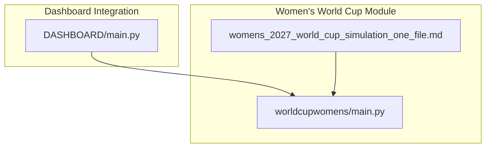
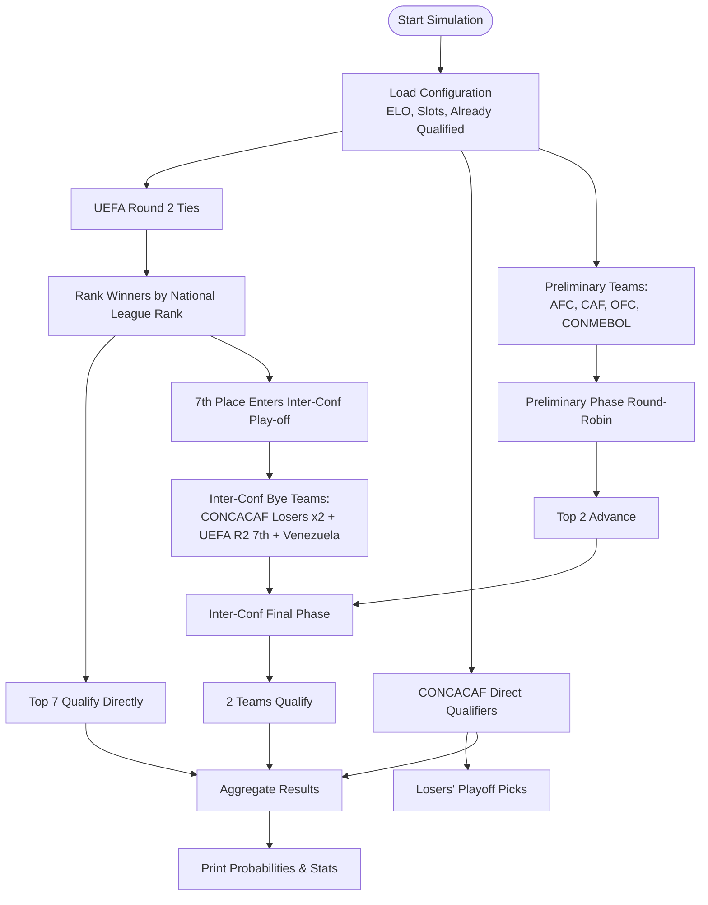
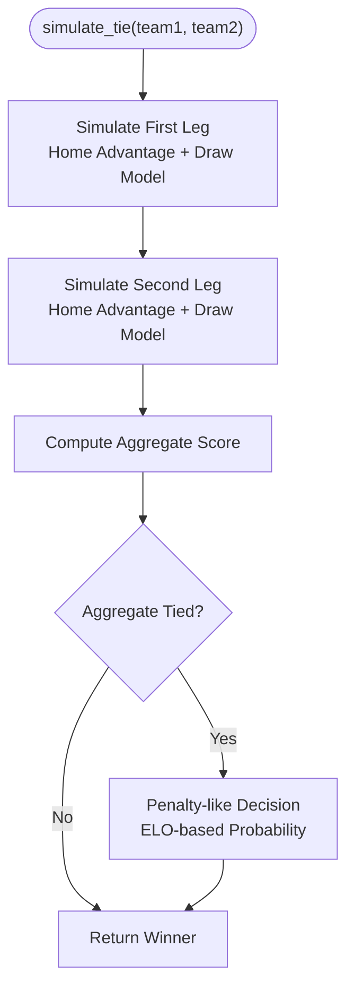
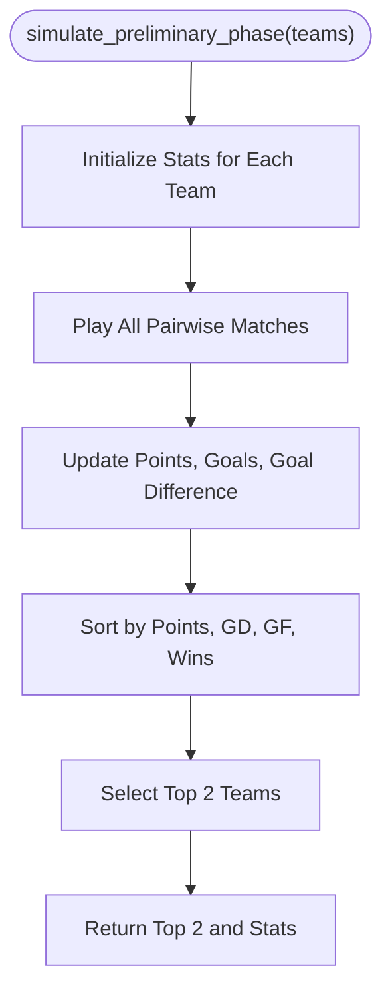
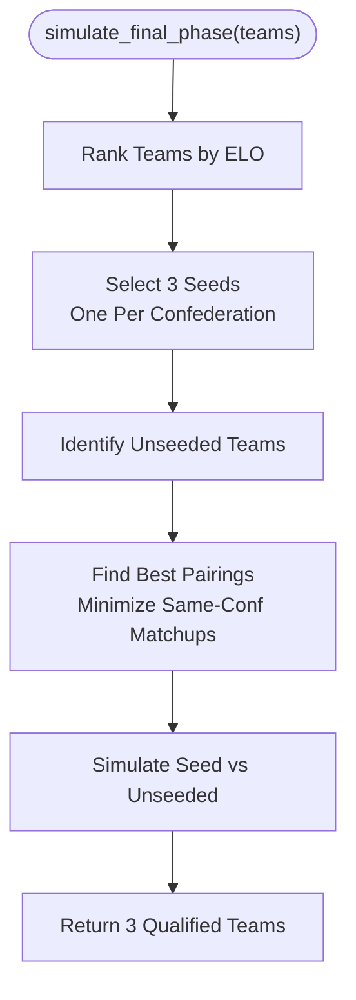
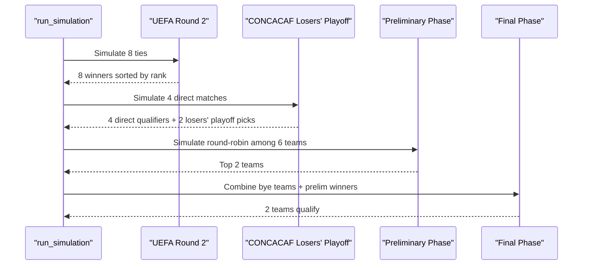
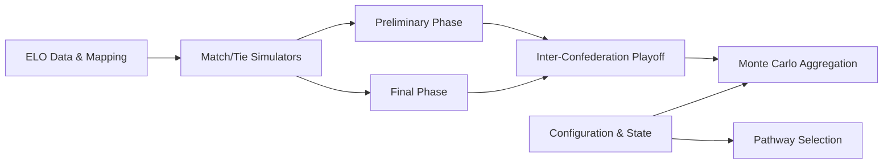

# Women's World Cup Simulation

<cite>
**Referenced Files in This Document**
- [main.py](file://worldcupwomens/main.py)
- [womens_2027_world_cup_simulation_one_file.md](file://worldcupwomens/womens_2027_world_cup_simulation_one_file.md)
- [DASHBOARD main.py](file://DASHBOARD/main.py)
</cite>

## Table of Contents
1. [Introduction](#introduction)
2. [Project Structure](#project-structure)
3. [Core Components](#core-components)
4. [Architecture Overview](#architecture-overview)
5. [Detailed Component Analysis](#detailed-component-analysis)
6. [Dependency Analysis](#dependency-analysis)
7. [Performance Considerations](#performance-considerations)
8. [Troubleshooting Guide](#troubleshooting-guide)
9. [Conclusion](#conclusion)
10. [Appendices](#appendices)

## Introduction
This document explains the Women’s World Cup qualification simulation system implemented for the 2027 tournament cycle. It covers:
- Confederation-based qualification pathways for AFC, CAF, CONCACAF, CONMEBOL, OFC, and UEFA.
- The seeding system using team rankings and ELO ratings.
- Probability calculations for tournament participation via Monte Carlo simulation.
- Two-legged tie simulation algorithms, preliminary phase round-robin format, and final pathway selection.
- Inter-confederation playoff structure, head-to-head comparison logic, and historical performance weighting.
- Configuration parameters for slot allocation, already qualified teams, and simulation controls such as N_SIMS and RANDOM_SEED.
- Examples of qualification probability outputs and interpretation guidelines.

The primary implementation is a single-file Python module that models the remaining qualification process, including group stages, knockout rounds, and inter-confederation playoffs. A dashboard integration entry point demonstrates how to run the simulation with progress callbacks.

## Project Structure
The relevant project area contains:
- A core simulation script implementing all qualification logic.
- A markdown design note describing an alternative one-file simulator layout.
- A dashboard configuration file that wires the simulation into a larger analytics dashboard.

**Diagram sources**
- [main.py:1-665](file://worldcupwomens/main.py#L1-L665)
- [womens_2027_world_cup_simulation_one_file.md:1-329](file://worldcupwomens/womens_2027_world_cup_simulation_one_file.md#L1-L329)
- [DASHBOARD main.py:180-199](file://DASHBOARD/main.py#L180-L199)

**Section sources**
- [main.py:1-665](file://worldcupwomens/main.py#L1-L665)
- [womens_2027_world_cup_simulation_one_file.md:1-329](file://worldcupwomens/womens_2027_world_cup_simulation_one_file.md#L1-L329)
- [DASHBOARD main.py:180-199](file://DASHBOARD/main.py#L180-L199)

## Core Components
The simulation is organized around these key components:
- ELO data and name mapping for consistent team identification.
- Configuration for already qualified teams, slot allocations per confederation, and simulation parameters.
- Match and tie simulators using ELO-based probabilities and draw modeling.
- Preliminary phase round-robin engine producing top-two qualifiers.
- Final phase pathway selector ensuring cross-confederation matchups.
- Inter-confederation playoff orchestrator combining preliminary results with bye teams.
- Monte Carlo engine aggregating qualification probabilities across many simulations.
- CLI reporting and dashboard runner integration.

Key responsibilities:
- ELO lookup and normalization ensure match outcomes reflect relative team strength.
- Slot allocation defines direct slots and inter-confederation playoff slots per confederation.
- Tie simulators model two-legged ties with home advantage and penalty-like resolution on aggregate draws.
- Preliminary phase uses a full round-robin among six teams, ranking by points, goal difference, goals scored, and wins.
- Final phase selects three seeded teams (one per confederation) and pairs them against unseeded teams while minimizing same-confederation matchups.
- Inter-confederation playoff combines preliminary winners with four bye teams (two from CONCACAF losers’ playoff, one from UEFA Round 2, and Venezuela).

**Section sources**
- [main.py:10-139](file://worldcupwomens/main.py#L10-L139)
- [main.py:144-209](file://worldcupwomens/main.py#L144-L209)
- [main.py:215-317](file://worldcupwomens/main.py#L215-L317)
- [main.py:319-405](file://worldcupwomens/main.py#L319-L405)
- [main.py:412-537](file://worldcupwomens/main.py#L412-L537)

## Architecture Overview
The system implements a modular pipeline where each stage feeds into the next:
- Input configuration defines teams, confederations, slots, and simulation parameters.
- Match simulators generate probabilistic outcomes based on ELO.
- Group and knockout stages produce intermediate qualifiers.
- Inter-confederation playoff determines additional World Cup participants.
- Aggregation computes qualification probabilities and summary statistics.

**Diagram sources**
- [main.py:448-505](file://worldcupwomens/main.py#L448-L505)
- [main.py:319-405](file://worldcupwomens/main.py#L319-L405)

**Section sources**
- [main.py:412-537](file://worldcupwomens/main.py#L412-L537)

## Detailed Component Analysis

### ELO Ratings and Team Identity
- ELO values are hardcoded for many national teams, providing a baseline for match outcome probabilities.
- A name mapping normalizes common CSV or input names to canonical team names used in the ELO dictionary.
- If a team is missing from ELO, a default value is used with a warning.

Complexity considerations:
- ELO lookup is O(1) average time due to dictionary access.
- Name mapping adds minimal overhead and ensures consistency across simulations.

**Section sources**
- [main.py:10-139](file://worldcupwomens/main.py#L10-L139)

### Configuration and State
- ALREADY_QUALIFIED lists teams that automatically qualify (hosts and pre-qualified nations).
- SLOT_ALLOCATION defines:
  - Direct slots per confederation.
  - Inter-confederation playoff slots.
  - Predefined teams participating in each confederation’s path.
  - Special modes for CONCACAF and UEFA pathways.
- TEAM_CONF maps each team to its confederation.
- NATIONALS_LEAGUE_RANK provides historical performance weighting for UEFA Round 2 winners.
- N_SIMS and RANDOM_SEED control Monte Carlo runs and reproducibility.

Configuration highlights:
- AFC: 6 direct slots, 2 inter-conf slots; includes Australia, China, Japan, North Korea, Philippines, South Korea; inter-conf teams include Uzbekistan and Chinese Taipei.
- CAF: 4 direct slots, 2 inter-conf slots; includes Algeria, Cameroon, Malawi, Morocco; inter-conf teams include Ghana and South Africa.
- CONCACAF: 4 direct slots, 2 inter-conf slots; mode indicates final-phase bye behavior.
- CONMEBOL: 3 direct slots, 2 inter-conf slots; includes Argentina, Colombia, Brazil; inter-conf teams include Venezuela and Ecuador.
- OFC: 1 direct slot, 1 inter-conf slot; includes New Zealand; inter-conf team is Papua New Guinea.
- UEFA: 11 direct slots, 1 inter-conf slot; includes Denmark, France, Germany, Spain; mode indicates final-phase seeding.

**Section sources**
- [main.py:144-209](file://worldcupwomens/main.py#L144-L209)

### Two-Legged Tie Simulation Algorithms
Two functions simulate two-legged ties:
- Full two-legged tie: both legs are simulated with home advantage and draw modeling.
- Partial two-legged tie: first-leg result is fixed; only the second leg is simulated.

Algorithm details:
- Home advantage is modeled by adding a fixed bonus to the home team’s ELO before computing win probability.
- Draw probability is explicitly modeled; if the aggregate score is tied, a penalty-like decision uses ELO differences.
- Outcomes are discrete approximations (e.g., 2-0, 1-1, 0-2) rather than continuous Poisson distributions.

**Diagram sources**
- [main.py:215-250](file://worldcupwomens/main.py#L215-L250)
- [main.py:252-281](file://worldcupwomens/main.py#L252-L281)

**Section sources**
- [main.py:215-281](file://worldcupwomens/main.py#L215-L281)

### Preliminary Phase Round-Robin Format
The preliminary phase involves six teams playing a full round-robin:
- Each pair plays once at a neutral venue.
- Points are awarded for wins and draws; goal difference, goals scored, and wins are used for tie-breaking.
- Top two teams advance to the final phase.

Implementation notes:
- Statistics are tracked per team (points, goals for/against, goal difference, wins, draws, losses).
- Ranking uses a multi-key sort prioritizing points, then goal difference, goals scored, and wins.

**Diagram sources**
- [main.py:319-351](file://worldcupwomens/main.py#L319-L351)

**Section sources**
- [main.py:319-351](file://worldcupwomens/main.py#L319-L351)

### Final Phase Pathway Selection
The final phase selects three seeded teams (one per confederation) and pairs them against unseeded teams:
- Seeding prioritizes the highest ELO teams while ensuring different confederations.
- Unseeded teams are those not selected as seeds.
- Pathways are chosen to minimize same-confederation matchups; permutations are evaluated to reduce conflicts.

**Diagram sources**
- [main.py:354-396](file://worldcupwomens/main.py#L354-L396)

**Section sources**
- [main.py:354-396](file://worldcupwomens/main.py#L354-L396)

### Inter-Confederation Playoff Structure
The inter-confederation playoff combines:
- Preliminary phase winners from AFC, CAF, and OFC.
- Bye teams: two from CONCACAF losers’ playoff, one from UEFA Round 2 (the 7th-ranked winner), and Venezuela.
- The preliminary phase produces two teams; the final phase selects two more teams to qualify directly.

Head-to-head comparison logic:
- Preliminary phase ranking uses points, goal difference, goals scored, and wins.
- Final phase pairing avoids same-confederation matchups when possible.

Historical performance weighting:
- UEFA Round 2 winners are ranked by NATIONALS_LEAGUE_RANK to determine direct qualifiers versus the inter-conf playoff candidate.

**Diagram sources**
- [main.py:448-505](file://worldcupwomens/main.py#L448-L505)
- [main.py:399-405](file://worldcupwomens/main.py#L399-L405)

**Section sources**
- [main.py:448-505](file://worldcupwomens/main.py#L448-L505)
- [main.py:399-405](file://worldcupwomens/main.py#L399-L405)

### Probability Calculations and Monte Carlo Engine
The Monte Carlo engine runs multiple simulations to estimate qualification probabilities:
- Tracks counts of teams qualifying directly and via inter-confederation playoffs.
- Aggregates preliminary phase statistics and final phase matchups.
- Computes overall qualification probability by combining already qualified teams with simulated outcomes.

Output metrics:
- wc_qualifiers: raw counts of teams qualifying per simulation.
- qualification_prob: normalized probabilities per team.
- uefa_inter_conf: frequency of the UEFA team entering the inter-conf final phase.
- inter_conf_participants and inter_conf_wc_qualifiers: participation and qualification rates through playoffs.
- preliminary_winners and preliminary_runners_up: advancement frequencies from the preliminary phase.

**Section sources**
- [main.py:412-537](file://worldcupwomens/main.py#L412-L537)

### Dashboard Integration
The dashboard configuration references the simulation runner:
- n_sims is taken from the module’s N_SIMS constant.
- The runner function accepts progress callbacks and a stop signal.
- The integration marks the Women’s World Cup section with metadata for visualization.

**Section sources**
- [DASHBOARD main.py:180-199](file://DASHBOARD/main.py#L180-L199)

## Dependency Analysis
The simulation has clear internal dependencies:
- ELO and name mapping underpin match simulators.
- Configuration drives pathway selection and slot allocation.
- Preliminary and final phases depend on match simulators and ranking logic.
- Inter-confederation playoff depends on preliminary results and bye team selection.
- Monte Carlo aggregation depends on all prior stages.

**Diagram sources**
- [main.py:10-139](file://worldcupwomens/main.py#L10-L139)
- [main.py:144-209](file://worldcupwomens/main.py#L144-L209)
- [main.py:215-317](file://worldcupwomens/main.py#L215-L317)
- [main.py:319-405](file://worldcupwomens/main.py#L319-L405)
- [main.py:412-537](file://worldcupwomens/main.py#L412-L537)

**Section sources**
- [main.py:10-537](file://worldcupwomens/main.py#L10-L537)

## Performance Considerations
- Monte Carlo simulations scale linearly with N_SIMS; increasing N_SIMS improves statistical stability but increases runtime.
- ELO lookups are O(1); name mapping adds negligible overhead.
- Preliminary phase complexity grows quadratically with the number of teams in the group (O(n^2) pairwise matches).
- Final phase pathway search evaluates permutations of unseeded teams; this can be expensive for large sets but is constrained to small numbers in practice.
- Progress callbacks update periodically to avoid excessive I/O overhead during long runs.

[No sources needed since this section provides general guidance]

## Troubleshooting Guide
Common issues and resolutions:
- Missing ELO for a team: The system prints a warning and defaults to a baseline rating. Ensure team names match the canonical list or add mappings.
- Reproducibility: Set RANDOM_SEED via command-line argument to fix random state across runs.
- Early termination: Use the is_running callback to stop simulations early if needed.
- Dashboard integration: Ensure n_sims aligns with the module’s N_SIMS constant and that progress callbacks are properly wired.

**Section sources**
- [main.py:130-139](file://worldcupwomens/main.py#L130-L139)
- [main.py:164-170](file://worldcupwomens/main.py#L164-L170)
- [main.py:412-446](file://worldcupwomens/main.py#L412-L446)
- [DASHBOARD main.py:180-199](file://DASHBOARD/main.py#L180-L199)

## Conclusion
The Women’s World Cup qualification simulation provides a comprehensive model of the 2027 qualification process. It integrates ELO-based match outcomes, confederation-specific pathways, preliminary and final phases, and inter-confederation playoffs within a Monte Carlo framework. The system offers detailed probability outputs and configurable parameters, enabling analysts to explore scenarios and interpret qualification likelihoods across teams and confederations.

[No sources needed since this section summarizes without analyzing specific files]

## Appendices

### Configuration Parameters Reference
- ALREADY_QUALIFIED: Teams that automatically qualify.
- SLOT_ALLOCATION: Confederation slot definitions including direct slots, inter-conf slots, and team lists.
- TEAM_CONF: Team-to-confederation mapping.
- NATIONALS_LEAGUE_RANK: Historical ranking used for UEFA Round 2 seeding.
- N_SIMS: Number of Monte Carlo simulations.
- RANDOM_SEED: Optional seed for reproducibility.

**Section sources**
- [main.py:144-209](file://worldcupwomens/main.py#L144-L209)

### Example Outputs and Interpretation Guidelines
- Qualification probability: Percentage chance a team qualifies, combining direct qualification and inter-conf playoff success.
- Preliminary phase stats: Average points, goals, and advancement rates over simulations.
- Inter-confederation playoff probabilities: Chance of reaching and winning the playoff route.
- Confidence metric: Average probability of the top 32 most likely qualifiers.

Guidelines:
- Treat probabilities as estimates; higher N_SIMS yields more stable results.
- Compare probabilities across teams within the same confederation to assess relative strength.
- Use preliminary phase stats to identify teams likely to advance through group play.

**Section sources**
- [main.py:544-665](file://worldcupwomens/main.py#L544-L665)