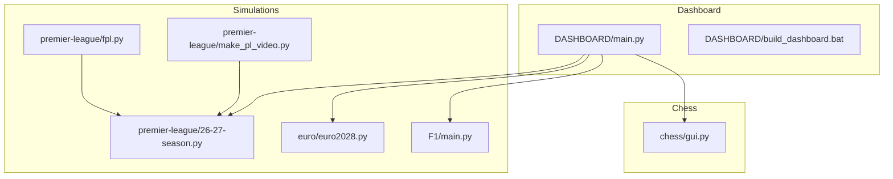
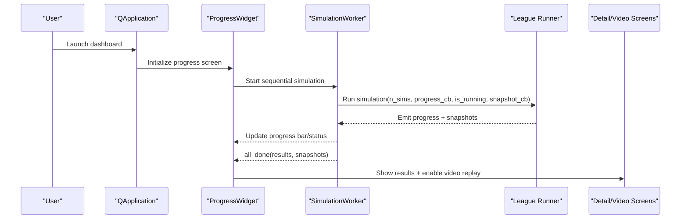
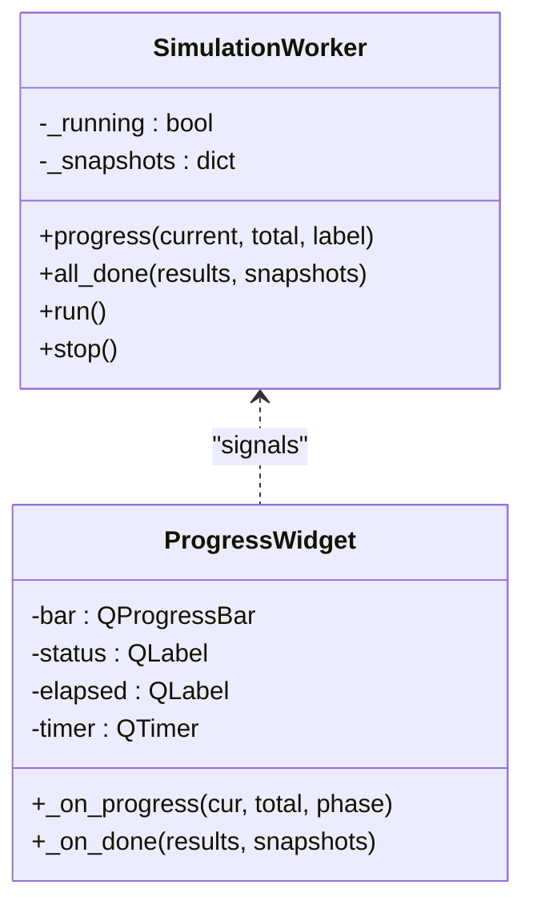
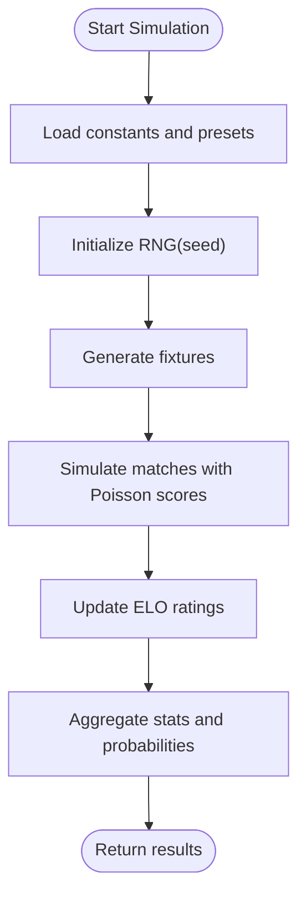
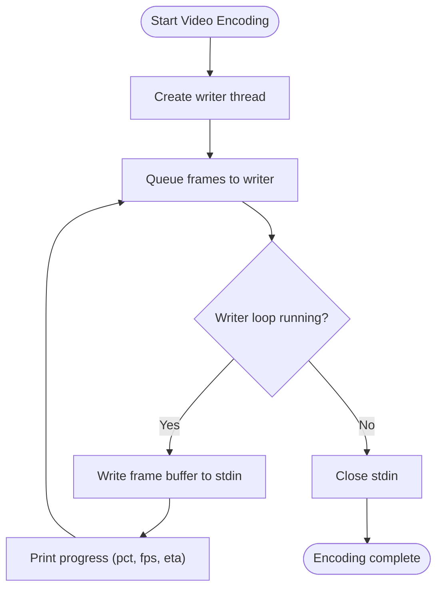
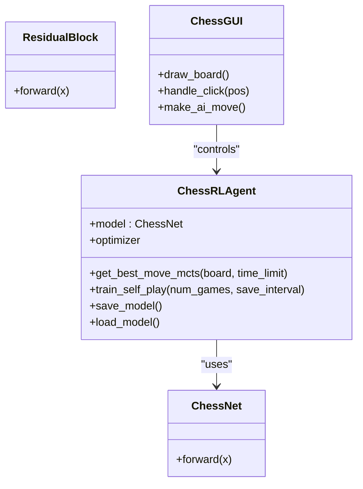
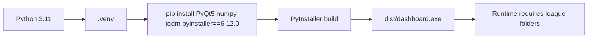

# Troubleshooting and FAQ

<cite>
**Referenced Files in This Document**
- [DASHBOARD/main.py](file://DASHBOARD/main.py)
- [DASHBOARD/build_dashboard.bat](file://DASHBOARD/build_dashboard.bat)
- [premier-league/26-27-season.py](file://premier-league/26-27-season.py)
- [premier-league/fpl.py](file://premier-league/fpl.py)
- [premier-league/make_pl_video.py](file://premier-league/make_pl_video.py)
- [chess/gui.py](file://chess/gui.py)
- [euro/euro2028.py](file://euro/euro2028.py)
- [F1/main.py](file://F1/main.py)
</cite>

## Table of Contents
1. [Introduction](#introduction)
2. [Project Structure](#project-structure)
3. [Core Components](#core-components)
4. [Architecture Overview](#architecture-overview)
5. [Detailed Component Analysis](#detailed-component-analysis)
6. [Dependency Analysis](#dependency-analysis)
7. [Performance Considerations](#performance-considerations)
8. [Troubleshooting Guide](#troubleshooting-guide)
9. [Conclusion](#conclusion)
10. [Appendices](#appendices)

## Introduction
This document provides comprehensive troubleshooting guidance for the sports analysis project, focusing on installation issues (Python dependency conflicts, PyQt5 setup, system compatibility), runtime errors (memory limitations during large simulations, file permission problems, data corruption), performance optimization (simulation parameter tuning, memory management, resource allocation), GUI-related issues (display problems, rendering errors, interface responsiveness), frequently asked questions (simulation accuracy, result interpretation, feature limitations), and diagnostic tools/logging/debugging techniques.

## Project Structure
The repository contains multiple independent simulation modules and a unified dashboard that orchestrates them:
- DASHBOARD: A PyQt5-based GUI that loads and runs multiple league/world-cup simulators sequentially while capturing snapshots for replay.
- premier-league: Simulation logic and chart/video generation utilities.
- chess: Reinforcement learning agent with PyTorch and a pygame-based GUI.
- euro, F1, and other modules: Additional simulation engines used by the dashboard or standalone scripts.

**Diagram sources**
- [DASHBOARD/main.py:1-63](file://DASHBOARD/main.py#L1-L63)
- [DASHBOARD/build_dashboard.bat:1-119](file://DASHBOARD/build_dashboard.bat#L1-L119)
- [premier-league/26-27-season.py:1-200](file://premier-league/26-27-season.py#L1-L200)
- [premier-league/fpl.py:760-804](file://premier-league/fpl.py#L760-L804)
- [premier-league/make_pl_video.py:154-187](file://premier-league/make_pl_video.py#L154-L187)
- [euro/euro2028.py:970-1002](file://euro/euro2028.py#L970-L1002)
- [F1/main.py:968-1005](file://F1/main.py#L968-L1005)
- [chess/gui.py:1-34](file://chess/gui.py#L1-L34)

**Section sources**
- [DASHBOARD/main.py:1-63](file://DASHBOARD/main.py#L1-L63)
- [DASHBOARD/build_dashboard.bat:1-119](file://DASHBOARD/build_dashboard.bat#L1-L119)

## Core Components
- Dashboard orchestration: Loads simulation modules dynamically, runs them sequentially, updates progress, and captures snapshots for video playback.
- Simulation engines: Monte Carlo simulations using ELO-based models, Poisson scoring, and tournament structures.
- Video/chart pipeline: Generates PNGs and videos via OpenCV/FFmpeg; includes progress reporting and error handling.
- Chess RL agent: Neural network model with MCTS, training loop, and pygame GUI.

Key responsibilities:
- DASHBOARD/main.py: UI, worker thread, snapshot collection, map visualization, PNG export, video rendering.
- premier-league/26-27-season.py: Simulation constants, RNG wrapper, ELO/scoring helpers, team presets.
- premier-league/fpl.py: Entry point to load simulation module, run simulations, build charts.
- premier-league/make_pl_video.py: FFmpeg writer thread and progress printing.
- chess/gui.py: PyTorch model, MCTS, training, and pygame GUI.

**Section sources**
- [DASHBOARD/main.py:284-333](file://DASHBOARD/main.py#L284-L333)
- [premier-league/26-27-season.py:98-141](file://premier-league/26-27-season.py#L98-L141)
- [premier-league/fpl.py:767-804](file://premier-league/fpl.py#L767-L804)
- [premier-league/make_pl_video.py:154-187](file://premier-league/make_pl_video.py#L154-L187)
- [chess/gui.py:35-81](file://chess/gui.py#L35-L81)

## Architecture Overview
The dashboard composes multiple simulation modules and presents results through interactive widgets. It uses a background worker thread to avoid blocking the UI and collects periodic snapshots for replay.

**Diagram sources**
- [DASHBOARD/main.py:284-333](file://DASHBOARD/main.py#L284-L333)
- [DASHBOARD/main.py:339-410](file://DASHBOARD/main.py#L339-L410)

## Detailed Component Analysis

### Dashboard Orchestration and Worker Thread
- Responsibilities:
  - Dynamically load simulation modules for each league/world cup.
  - Run simulations sequentially on a background thread.
  - Capture snapshots per league for video replay.
  - Emit progress signals to update the UI.
- Error handling:
  - Raises RuntimeError when PNG write fails or when insufficient snapshots exist for video rendering.
  - Validates OpenCV output file creation.

**Diagram sources**
- [DASHBOARD/main.py:284-333](file://DASHBOARD/main.py#L284-L333)
- [DASHBOARD/main.py:339-410](file://DASHBOARD/main.py#L339-L410)

**Section sources**
- [DASHBOARD/main.py:284-333](file://DASHBOARD/main.py#L284-L333)
- [DASHBOARD/main.py:660-686](file://DASHBOARD/main.py#L660-L686)
- [DASHBOARD/main.py:1378-1406](file://DASHBOARD/main.py#L1378-L1406)

### Simulation Engine (Premier League)
- Key elements:
  - Constants for ELO scaling, home advantage, expected goals, and maximum goals.
  - RNG wrapper providing deterministic random operations.
  - ELO update and expected goals functions.
  - Team presets and competition-specific parameters.
- Common pitfalls:
  - Misconfiguration of NUM_PL_SIMS can cause long runtimes or memory pressure.
  - Incorrect fixture data or team names may lead to lookup failures.

**Diagram sources**
- [premier-league/26-27-season.py:1-200](file://premier-league/26-27-season.py#L1-L200)

**Section sources**
- [premier-league/26-27-season.py:1-200](file://premier-league/26-27-season.py#L1-L200)

### Video Generation Pipeline
- Responsibilities:
  - Write frames to FFmpeg via stdin using a dedicated writer thread.
  - Provide real-time progress feedback (percentage, FPS, ETA).
- Error handling:
  - Catches exceptions in the writer thread and records them.
  - Ensures stdin is closed properly even on errors.

**Diagram sources**
- [premier-league/make_pl_video.py:154-187](file://premier-league/make_pl_video.py#L154-L187)

**Section sources**
- [premier-league/make_pl_video.py:154-187](file://premier-league/make_pl_video.py#L154-L187)

### Chess RL Agent and GUI
- Responsibilities:
  - Define neural network architecture (policy/value heads).
  - Implement MCTS move selection with time limits.
  - Train via self-play and save/load models and training data.
  - Provide pygame-based GUI for human interaction and auto-play.
- Error handling:
  - Gracefully handles missing model files or corrupted checkpoints.
  - Logs warnings/errors for I/O operations.

**Diagram sources**
- [chess/gui.py:35-81](file://chess/gui.py#L35-L81)
- [chess/gui.py:101-169](file://chess/gui.py#L101-L169)
- [chess/gui.py:328-408](file://chess/gui.py#L328-L408)
- [chess/gui.py:690-800](file://chess/gui.py#L690-L800)

**Section sources**
- [chess/gui.py:35-81](file://chess/gui.py#L35-L81)
- [chess/gui.py:101-169](file://chess/gui.py#L101-L169)
- [chess/gui.py:328-408](file://chess/gui.py#L328-L408)
- [chess/gui.py:690-800](file://chess/gui.py#L690-L800)

## Dependency Analysis
- Build environment:
  - The build script enforces Python 3.11, creates an isolated .venv, installs minimal dependencies (PyQt5, numpy, tqdm, pyinstaller), and excludes unnecessary modules to reduce bundle size.
  - Uses --collect-all for numpy and tqdm to avoid C-extension issues at runtime.
- Runtime dependencies:
  - DASHBOARD/main.py imports PyQt5 components for UI and threading.
  - premier-league/fpl.py loads simulation modules dynamically and invokes run_simulation.
  - premier-league/make_pl_video.py relies on FFmpeg and OpenCV for video encoding.

**Diagram sources**
- [DASHBOARD/build_dashboard.bat:10-49](file://DASHBOARD/build_dashboard.bat#L10-L49)
- [DASHBOARD/build_dashboard.bat:59-84](file://DASHBOARD/build_dashboard.bat#L59-L84)
- [DASHBOARD/build_dashboard.bat:110-118](file://DASHBOARD/build_dashboard.bat#L110-L118)

**Section sources**
- [DASHBOARD/build_dashboard.bat:10-49](file://DASHBOARD/build_dashboard.bat#L10-L49)
- [DASHBOARD/build_dashboard.bat:59-84](file://DASHBOARD/build_dashboard.bat#L59-L84)
- [DASHBOARD/build_dashboard.bat:110-118](file://DASHBOARD/build_dashboard.bat#L110-L118)

## Performance Considerations
- Simulation parameter tuning:
  - Adjust NUM_PL_SIMS to balance accuracy vs. runtime/memory usage.
  - Reduce n_sims for leagues where high precision is not required.
- Memory management:
  - Avoid excessive snapshot accumulation; limit snapshot frequency if needed.
  - Use batched processing and clear intermediate arrays after use.
- Resource allocation:
  - For video encoding, ensure sufficient disk space and CPU resources.
  - Tune FFmpeg parameters (frame rate, resolution) to reduce encoding time.
- Parallelization:
  - Some modules use parallel workers (e.g., pool.imap_unordered); ensure adequate CPU cores and avoid oversubscription.

[No sources needed since this section provides general guidance]

## Troubleshooting Guide

### Installation Problems

#### Python Dependency Conflicts
- Symptoms:
  - Import errors for PyQt5, numpy, tqdm during build or runtime.
  - PyInstaller failing due to incompatible packages.
- Solutions:
  - Use the provided build script to create a clean virtual environment and install only required dependencies.
  - Ensure Python 3.11 is available; the script falls back to default python if not found.
  - Re-run the build script to force reinstalling dependencies.

**Section sources**
- [DASHBOARD/build_dashboard.bat:10-49](file://DASHBOARD/build_dashboard.bat#L10-L49)

#### PyQt5 Setup Issues
- Symptoms:
  - Application crashes on startup due to missing or conflicting Qt libraries.
  - Rendering artifacts or missing fonts.
- Solutions:
  - Verify PyQt5 is installed in the active environment.
  - Exclude conflicting Qt frameworks (PySide2/6, PyQt6) during build.
  - On Windows, ensure system fonts are available; fallback logic exists for older Qt versions.

**Section sources**
- [DASHBOARD/build_dashboard.bat:65-84](file://DASHBOARD/build_dashboard.bat#L65-L84)
- [DASHBOARD/main.py:246-250](file://DASHBOARD/main.py#L246-L250)

#### System Compatibility Problems
- Symptoms:
  - Executable fails to launch or cannot find league folders.
  - Missing dynamic libraries for numpy or OpenCV.
- Solutions:
  - Copy required league folders next to dashboard.exe or run from source tree.
  - Use --collect-all for numpy/tqdm during PyInstaller build.
  - Validate dist/dashboard.exe exists post-build.

**Section sources**
- [DASHBOARD/build_dashboard.bat:95-118](file://DASHBOARD/build_dashboard.bat#L95-L118)

### Runtime Errors

#### Memory Limitations During Large Simulations
- Symptoms:
  - Out-of-memory errors or slow performance during many simulations.
  - UI becomes unresponsive due to heavy computation.
- Solutions:
  - Reduce n_sims per league or globally.
  - Limit snapshot frequency to reduce memory footprint.
  - Monitor process memory and adjust batch sizes accordingly.

**Section sources**
- [DASHBOARD/main.py:284-333](file://DASHBOARD/main.py#L284-L333)
- [premier-league/26-27-season.py:16](file://premier-league/26-27-season.py#L16)

#### File Permission Issues
- Symptoms:
  - Cannot write PNG files or reports.
  - Errors when saving training data or models.
- Solutions:
  - Ensure write permissions to output directories.
  - Clear stale PNGs before starting new runs.
  - Check directory paths and ownership.

**Section sources**
- [DASHBOARD/main.py:660-686](file://DASHBOARD/main.py#L660-L686)
- [premier-league/fpl.py:777-779](file://premier-league/fpl.py#L777-L779)
- [chess/gui.py:146-153](file://chess/gui.py#L146-L153)

#### Data Corruption Scenarios
- Symptoms:
  - Invalid JSON or pickle files for models/training data.
  - Corrupted CSV/fixture inputs causing parsing errors.
- Solutions:
  - Validate input files before running simulations.
  - Backup and restore known-good datasets.
  - Use checksums to detect corruption.

**Section sources**
- [chess/gui.py:155-169](file://chess/gui.py#L155-L169)
- [premier-league/26-27-season.py:333-341](file://premier-league/26-27-season.py#L333-L341)

### Performance Optimization

#### Simulation Parameter Tuning
- Recommendations:
  - Lower NUM_PL_SIMS for faster iterations during development.
  - Increase K values cautiously to reflect uncertainty in knockout stages.
  - Calibrate expected goals based on historical data.

**Section sources**
- [premier-league/26-27-season.py:12-22](file://premier-league/26-27-season.py#L12-L22)

#### Memory Management
- Recommendations:
  - Periodically flush snapshots to disk if they grow too large.
  - Use generators for large datasets instead of loading everything into memory.
  - Clear caches (e.g., position_cache) when not needed.

**Section sources**
- [chess/gui.py:130-132](file://chess/gui.py#L130-L132)

#### Resource Allocation
- Recommendations:
  - Allocate more CPU cores for parallel workers (pool.imap_unordered).
  - Tune FFmpeg threads and preset for encoding speed vs. quality.
  - Monitor GPU memory when using PyTorch models.

**Section sources**
- [euro/euro2028.py:970-1002](file://euro/euro2028.py#L970-L1002)
- [premier-league/make_pl_video.py:154-187](file://premier-league/make_pl_video.py#L154-L187)

### GUI-Related Issues

#### Display Problems
- Symptoms:
  - Widgets not visible, incorrect sizing, or missing fonts.
- Solutions:
  - Resize tables and headers appropriately.
  - Ensure QApplication.processEvents is called during offscreen rendering.
  - Validate font availability and fallback metrics.

**Section sources**
- [DASHBOARD/main.py:660-686](file://DASHBOARD/main.py#L660-L686)
- [DASHBOARD/main.py:246-250](file://DASHBOARD/main.py#L246-L250)

#### Rendering Errors
- Symptoms:
  - PNG export fails or images are blank.
  - Video frames not written correctly.
- Solutions:
  - Check write permissions and path validity.
  - Validate OpenCV codec and FFmpeg availability.
  - Inspect frame buffers and encoder settings.

**Section sources**
- [DASHBOARD/main.py:660-686](file://DASHBOARD/main.py#L660-L686)
- [DASHBOARD/main.py:1378-1406](file://DASHBOARD/main.py#L1378-L1406)
- [premier-league/make_pl_video.py:154-187](file://premier-league/make_pl_video.py#L154-L187)

#### Interface Responsiveness
- Symptoms:
  - UI freezes during long simulations.
- Solutions:
  - Use background threads (QThread) for computations.
  - Emit progress signals to keep UI updated.
  - Avoid heavy operations in event handlers.

**Section sources**
- [DASHBOARD/main.py:284-333](file://DASHBOARD/main.py#L284-L333)
- [DASHBOARD/main.py:339-410](file://DASHBOARD/main.py#L339-L410)

### Frequently Asked Questions

#### Simulation Accuracy
- Q: How accurate are the predictions?
  - A: Accuracy depends on ELO calibration, fixture data quality, and number of simulations. More sims reduce variance but increase runtime.

#### Result Interpretation
- Q: What do probability columns mean?
  - A: They represent the likelihood of outcomes (title win, top-4 qualification, relegation) derived from Monte Carlo simulations.

#### Feature Limitations
- Q: Why is Women's World Cup excluded from video replay?
  - A: The source module does not provide snapshot callbacks; video replay requires snapshot support.

[No sources needed since this section summarizes without analyzing specific files]

### Diagnostic Tools, Logging, and Debugging

#### Logging Mechanisms
- Chess RL Agent:
  - Uses Python logging to record model load/save, training progress, and errors.
- Health/Kaggle modules:
  - Log file-not-found and analysis failures for diagnostics.

**Section sources**
- [chess/gui.py:31-33](file://chess/gui.py#L31-L33)
- [chess/gui.py:146-153](file://chess/gui.py#L146-L153)
- [HEALTH/LUNGCANCER.py:65-69](file://HEALTH/LUNGCANCER.py#L65-L69)
- [kaggle/main.py:64-68](file://kaggle/main.py#L64-L68)

#### Debugging Techniques
- Enable verbose logging for simulation runs.
- Validate input data integrity before execution.
- Isolate issues by running single-league simulations.
- Use profiling tools to identify bottlenecks in rendering or encoding.

[No sources needed since this section provides general guidance]

## Conclusion
This guide consolidates common installation, runtime, performance, and GUI troubleshooting strategies across the sports analysis project. By following the recommended steps—using the provided build script, tuning simulation parameters, managing memory and resources, and leveraging logging—you can resolve most issues efficiently. For complex problems, isolate components, validate inputs, and consult the referenced code sections for deeper insights.

[No sources needed since this section summarizes without analyzing specific files]

## Appendices

### Appendix A: Quick Checklist
- Install Python 3.11 and use the build script to set up .venv.
- Ensure league folders are present next to dashboard.exe.
- Reduce n_sims if experiencing memory issues.
- Verify write permissions for output directories.
- Check FFmpeg/OpenCV availability for video generation.

[No sources needed since this section provides general guidance]