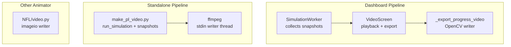
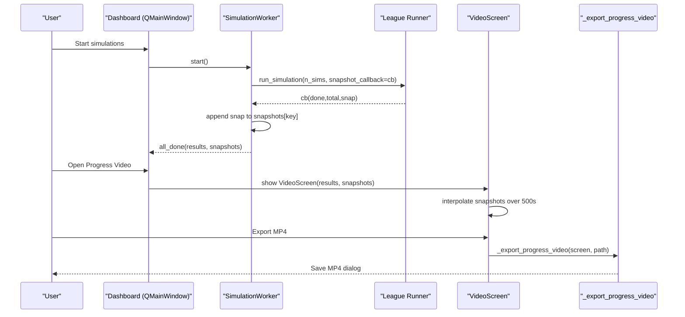
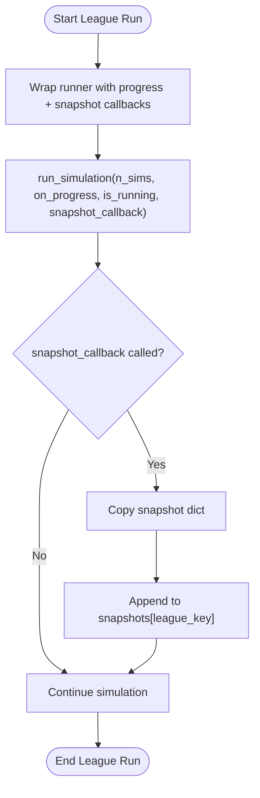
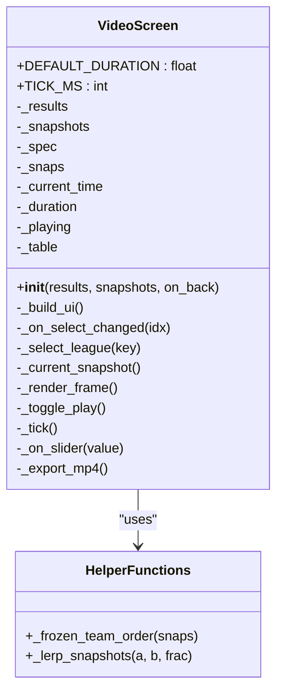
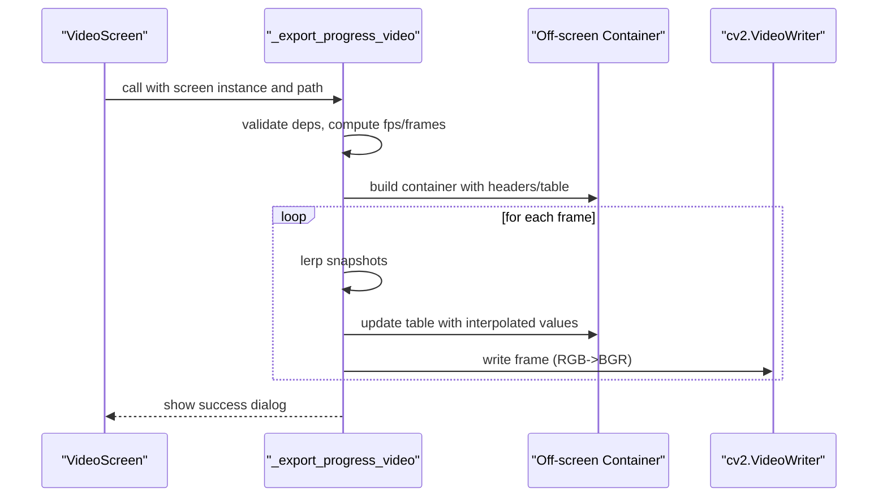
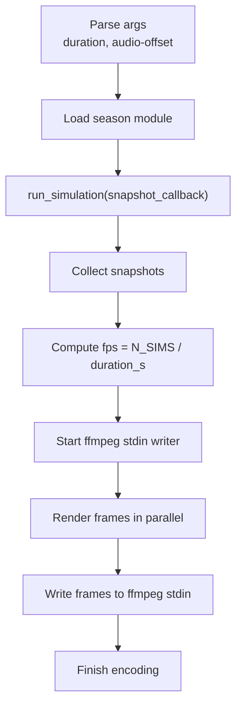

# Animated Video Generation

<cite>
**Referenced Files in This Document**
- [DASHBOARD/main.py](file://DASHBOARD/main.py)
- [premier-league/make_pl_video.py](file://premier-league/make_pl_video.py)
- [NFL/video.py](file://NFL/video.py)
</cite>

## Table of Contents
1. [Introduction](#introduction)
2. [Project Structure](#project-structure)
3. [Core Components](#core-components)
4. [Architecture Overview](#architecture-overview)
5. [Detailed Component Analysis](#detailed-component-analysis)
6. [Dependency Analysis](#dependency-analysis)
7. [Performance Considerations](#performance-considerations)
8. [Troubleshooting Guide](#troubleshooting-guide)
9. [Conclusion](#conclusion)
10. [Appendices](#appendices)

## Introduction
This document explains the animated video generation system used to visualize how league standings evolve during Monte Carlo simulations. It covers:
- How snapshot capture records intermediate states over time
- The VideoScreen component that renders 500-second animated sequences for league table progression
- The snapshot callback mechanism invoked during simulation runs
- Animation playback controls, frame timing, and smooth transitions between stages
- Guidance on customizing animation speed, adding commentary overlays, and exporting MP4 videos

Two complementary pipelines are present:
- An interactive dashboard pipeline (PyQt-based) that captures snapshots during simulations and provides a 500-second playback UI with MP4 export
- A standalone Premier League pipeline that generates an MP4 directly from simulation snapshots using parallel rendering and ffmpeg

## Project Structure
The animated video features span three primary files:
- DASHBOARD/main.py: Simulation dashboard, snapshot collection, VideoScreen playback, and MP4 export via OpenCV
- premier-league/make_pl_video.py: Standalone script that runs simulations, captures snapshots, and writes an MP4 with ffmpeg
- NFL/video.py: Separate all-time franchise table animator (uses imageio; included for context but not part of the Monte Carlo snapshot workflow)

**Diagram sources**
- [DASHBOARD/main.py:284-330](file://DASHBOARD/main.py#L284-L330)
- [DASHBOARD/main.py:1037-1265](file://DASHBOARD/main.py#L1037-L1265)
- [DASHBOARD/main.py:1373-1456](file://DASHBOARD/main.py#L1373-L1456)
- [premier-league/make_pl_video.py:214-295](file://premier-league/make_pl_video.py#L214-L295)
- [NFL/video.py:527-629](file://NFL/video.py#L527-L629)

**Section sources**
- [DASHBOARD/main.py:1-13](file://DASHBOARD/main.py#L1-L13)
- [premier-league/make_pl_video.py:1-12](file://premier-league/make_pl_video.py#L1-L12)
- [NFL/video.py:1-20](file://NFL/video.py#L1-L20)

## Core Components
- Snapshot Callback System: During each league’s run_simulation, a snapshot_callback is invoked periodically to record intermediate state dictionaries containing team probabilities and averages. These are stored per league key and later replayed by VideoScreen.
- VideoScreen: A PyQt QWidget that renders a fixed-duration (500 seconds) animated sequence of the league table, interpolating between snapshots for smooth transitions. It supports play/pause, scrubbing, and MP4 export.
- Standalone MP4 Generator: A command-line tool that loads a season module, runs simulations with snapshot callbacks, and uses parallel rendering plus ffmpeg to produce an MP4 with looping audio.

Key responsibilities:
- Data capture: SimulationWorker wraps each league runner and collects snapshots into a dict keyed by league
- Playback: VideoScreen maps current time to interpolated snapshots and updates a QTableWidget
- Export: _export_progress_video renders frames off-screen and writes them to MP4 via OpenCV

**Section sources**
- [DASHBOARD/main.py:284-330](file://DASHBOARD/main.py#L284-L330)
- [DASHBOARD/main.py:1037-1265](file://DASHBOARD/main.py#L1037-L1265)
- [premier-league/make_pl_video.py:214-295](file://premier-league/make_pl_video.py#L214-L295)

## Architecture Overview
The system has two main flows:

1) Dashboard flow (interactive):
- SimulationWorker runs leagues sequentially, invoking snapshot_callback to collect snapshots
- Results and snapshots are emitted to the main window
- Home screen offers “Progress Video” which opens VideoScreen
- VideoScreen plays back 500 seconds of table evolution using interpolation
- Export button triggers _export_progress_video to render frames and write MP4

2) Standalone Premier League flow (non-interactive):
- make_pl_video.py loads the season module and runs simulations with snapshot_callback
- Frames are rendered in parallel worker processes and piped to ffmpeg via stdin
- Audio is looped and offset randomly within a configured range

**Diagram sources**
- [DASHBOARD/main.py:284-330](file://DASHBOARD/main.py#L284-L330)
- [DASHBOARD/main.py:1037-1265](file://DASHBOARD/main.py#L1037-L1265)
- [DASHBOARD/main.py:1373-1456](file://DASHBOARD/main.py#L1373-L1456)

## Detailed Component Analysis

### Snapshot Capture Mechanism
- Each league spec defines a runner that accepts n_sims, on_progress, is_running, and snapshot_callback
- SimulationWorker wraps these runners and stores snapshots per league key
- Snapshots include numeric fields such as avg_points, title_prob, ucl_qual_prob, etc., plus done/total counters
- The callback creates a shallow copy of the snapshot and appends it to the list for that league

Complexity considerations:
- Snapshot size grows linearly with number of captured steps
- Interpolation operates over numeric dicts and top-level counters

Error handling:
- If no snapshots are captured, the dashboard disables video export and shows warnings

**Section sources**
- [DASHBOARD/main.py:68-199](file://DASHBOARD/main.py#L68-L199)
- [DASHBOARD/main.py:284-330](file://DASHBOARD/main.py#L284-L330)

**Diagram sources**
- [DASHBOARD/main.py:284-330](file://DASHBOARD/main.py#L284-L330)

### VideoScreen Component
VideoScreen renders a 500-second animated sequence showing league standings changes throughout simulations. Key behaviors:
- DEFAULT_DURATION = 500.0 seconds
- TICK_MS = 50 ms (20 fps UI updates)
- Uses a timer to advance current_time and update a slider and table
- Interpolates between adjacent snapshots for smooth transitions
- Freezes team row order based on final snapshot to avoid mid-playback row swaps
- Provides Play/Pause, Scrubbing, and Export MP4 controls

Playback math:
- Maps current_time / duration to a position across snapshots
- Computes integer index i and fractional part frac
- Calls _lerp_snapshots(a, b, frac) to blend numeric values

Rendering:
- Updates QTableWidget cells with formatted values from the interpolated snapshot
- Displays simulation counters (done/total) in the status label

Export:
- Opens a save dialog and calls _export_progress_video
- Requires opencv-python and numpy

**Diagram sources**
- [DASHBOARD/main.py:1009-1034](file://DASHBOARD/main.py#L1009-L1034)
- [DASHBOARD/main.py:1037-1265](file://DASHBOARD/main.py#L1037-L1265)

**Section sources**
- [DASHBOARD/main.py:1009-1034](file://DASHBOARD/main.py#L1009-L1034)
- [DASHBOARD/main.py:1037-1265](file://DASHBOARD/main.py#L1037-L1265)

### Snapshot Interpolation and Team Ordering
- _frozen_team_order selects a canonical row order based on the final snapshot’s avg_points to prevent rows from swapping during playback
- _lerp_snapshots blends numeric fields between two snapshots using a fraction, preserving structure for nested dicts

Complexity:
- Linear in the number of teams and keys per snapshot
- Avoids expensive operations by only blending numeric data

**Section sources**
- [DASHBOARD/main.py:1009-1034](file://DASHBOARD/main.py#L1009-L1034)

### MP4 Export (Dashboard)
_export_progress_video:
- Validates dependencies (opencv-python, numpy)
- Sets fps = 5 and computes total frames from duration
- Builds an off-screen container widget with a table sized to at least 1280x720
- Renders each frame by updating the container with interpolated snapshots
- Converts Qt widgets to images and writes frames to MP4 via cv2.VideoWriter
- Shows a modal progress dialog and handles cancellation

**Diagram sources**
- [DASHBOARD/main.py:1373-1456](file://DASHBOARD/main.py#L1373-L1456)

**Section sources**
- [DASHBOARD/main.py:1373-1456](file://DASHBOARD/main.py#L1373-L1456)

### Standalone Premier League MP4 Generator
make_pl_video.py:
- Loads the season module dynamically and runs simulations with snapshot_callback
- Captures snapshots after every simulation step
- Calculates fps from total_frames/duration_s
- Starts ffmpeg process reading raw RGB frames from stdin
- Parallelizes frame rendering across ProcessPoolExecutor workers
- Streams encoded frames to ffmpeg via a dedicated writer thread
- Adds looping background music with randomized start offset

**Diagram sources**
- [premier-league/make_pl_video.py:192-295](file://premier-league/make_pl_video.py#L192-L295)

**Section sources**
- [premier-league/make_pl_video.py:1-12](file://premier-league/make_pl_video.py#L1-L12)
- [premier-league/make_pl_video.py:192-295](file://premier-league/make_pl_video.py#L192-L295)

## Dependency Analysis
- DASHBOARD/main.py depends on:
  - League modules (e.g., premier-league/26-27-season.py) via dynamic import
  - PyQt5 for UI and rendering
  - OpenCV and NumPy for MP4 export
- premier-league/make_pl_video.py depends on:
  - Season module (26-27-season.py)
  - PIL for frame rendering
  - ffmpeg for encoding
  - multiprocessing for parallel rendering
- NFL/video.py depends on:
  - imageio for writing MP4
  - PIL for frame rendering

Coupling:
- VideoScreen is decoupled from simulation logic; it consumes pre-captured snapshots
- Standalone generator tightly couples simulation execution and rendering pipeline

Potential circular dependencies:
- None observed; dynamic imports isolate simulation modules

External integration points:
- ffmpeg binary availability required for standalone pipeline
- OpenCV codec support required for dashboard export

**Section sources**
- [DASHBOARD/main.py:15-31](file://DASHBOARD/main.py#L15-L31)
- [DASHBOARD/main.py:49-62](file://DASHBOARD/main.py#L49-L62)
- [DASHBOARD/main.py:1373-1380](file://DASHBOARD/main.py#L1373-L1380)
- [premier-league/make_pl_video.py:13-26](file://premier-league/make_pl_video.py#L13-L26)
- [NFL/video.py:22-34](file://NFL/video.py#L22-L34)

## Performance Considerations
- Dashboard playback:
  - 20 fps UI updates via QTimer at 50 ms intervals
  - Interpolation cost proportional to number of teams and keys
  - Rendering updates QTableWidget cells; consider reducing column count or font size for very large tables
- Dashboard export:
  - Fixed 5 fps output; total frames = 5 * duration
  - Off-screen rendering and conversion to BGR frames; ensure sufficient memory for large resolutions
- Standalone pipeline:
  - Parallel rendering across CPU cores; tune N_WORKERS based on available cores
  - ffmpeg encoding quality presets affect CPU usage and output size
  - Audio looping adds minimal overhead

Optimization opportunities:
- Batch table updates in dashboard export to reduce repaints
- Use lower resolution for preview exports
- Adjust ffmpeg preset/crf trade-offs for faster encoding vs. smaller file sizes

[No sources needed since this section provides general guidance]

## Troubleshooting Guide
Common issues and resolutions:
- No snapshots captured:
  - Ensure snapshot_callback is passed to run_simulation and that snapshot_every is set appropriately
  - Validate that the league runner invokes the callback with valid snapshot dicts
- Export fails due to missing dependencies:
  - Install opencv-python and numpy for dashboard MP4 export
  - Ensure ffmpeg is installed and accessible for standalone pipeline
- OpenCV cannot open output file:
  - Check permissions and path validity; try a different directory or filename
- Frame rendering slow:
  - Reduce table columns or font size
  - Lower export fps or resolution
  - Increase N_WORKERS in standalone pipeline if CPU-bound

**Section sources**
- [DASHBOARD/main.py:1373-1380](file://DASHBOARD/main.py#L1373-L1380)
- [DASHBOARD/main.py:1402-1407](file://DASHBOARD/main.py#L1402-L1407)
- [premier-league/make_pl_video.py:248-265](file://premier-league/make_pl_video.py#L248-L265)

## Conclusion
The animated video generation system provides robust tools for visualizing league table evolution during Monte Carlo simulations. The dashboard offers an interactive 500-second playback experience with smooth interpolation and MP4 export, while the standalone pipeline enables high-performance batch encoding with ffmpeg. By understanding the snapshot callback mechanism, VideoScreen’s playback logic, and the export workflows, users can customize animation speed, add overlays, and produce presentation-ready videos.

[No sources needed since this section summarizes without analyzing specific files]

## Appendices

### Customization Guidance
- Customize animation speed:
  - Dashboard: Modify DEFAULT_DURATION and TICK_MS in VideoScreen to adjust playback length and UI refresh rate
  - Standalone: Change duration_s and N_SIMS to alter fps and total frames
- Add commentary overlays:
  - For dashboard export: Render additional text onto the off-screen container before capturing frames
  - For standalone pipeline: Overlay text using PIL ImageDraw before passing frames to ffmpeg
- Export video files:
  - Dashboard: Use the Export MP4 button; ensure opencv-python and numpy are installed
  - Standalone: Run make_pl_video.py with desired --duration and optional --audio-offset

**Section sources**
- [DASHBOARD/main.py:1037-1040](file://DASHBOARD/main.py#L1037-L1040)
- [DASHBOARD/main.py:1251-1265](file://DASHBOARD/main.py#L1251-L1265)
- [premier-league/make_pl_video.py:192-212](file://premier-league/make_pl_video.py#L192-L212)